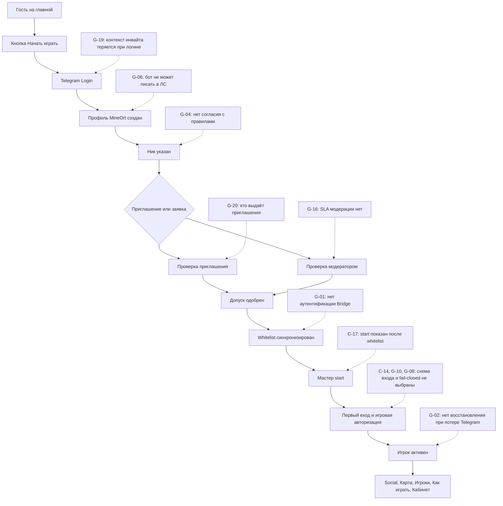

# MineOrt IV — анализ аудита v2.0

**Статус:** черновик для утверждения · **Базовая дата пакета:** 13.11.2026 (пятница) · **Запуск:** 10.12.2026 (четверг), до запуска 27 календарных дней.

**Источник анализа:** [аудит концепции и разработки v2.0](<../MineOrt_IV_Аудит_концепции_и_разработки_v2 (1).md>) (1241 строка, файл не изменялся). Ссылки вида `(аудит §6.3, стр. 217–226)` указывают на номера строк этого файла.

**Теги пакета:** [ЗАКРЕПЛЕНО] / [ПРЕДЛАГАЕТСЯ] / [ПРОВЕРИТЬ] / [ОПРЕДЕЛИТЬ] / [РИСК] — как в аудите (стр. 11–17); [ПРЕДЛОЖЕНИЕ КОМАНДЫ] — число, правило, механизм или дата, которых нет в аудите; [РЕШЕНИЕ ВЛАДЕЛЬЦА 13.11.2026] — решение владельца, принятое после аудита. Все разрешения противоречий и пробелов ниже — [ПРЕДЛОЖЕНИЕ КОМАНДЫ], если не указано иное.

Связанные файлы: [глоссарий](02-glossary.md) · [открытые решения](03-open-decisions.md) · [модель статусов](../01-product/02-user-status-model.md) · [роли и права](../01-product/03-roles-permissions.md) · [план релиза](../04-plan/01-release-plan.md) · [TZ-00](../06-tz/TZ-00-product-scope.md).

## Содержание

1. [Резюме](#1-резюме)
2. [Что зафиксировано](#2-что-зафиксировано)
3. [Противоречия C-01…C-18](#3-противоречия-c-01c-18)
4. [Пробелы G-01…G-20](#4-пробелы-g-01g-20)
5. [Покрытие приёмочных сценариев AC-01…AC-24 и новые AC-25…AC-34](#5-покрытие-ac-01ac-24-и-новые-ac-25ac-34)
6. [Реалистичность сроков на 13.11.2026](#6-реалистичность-сроков-на-13112026)
7. [Прогон пути из Приложения A](#7-прогон-пути-из-приложения-a)
8. [Замечания для сведения](#8-замечания-для-сведения)

---

## 1. Резюме

1. **Главный блокер запуска — безопасность входа в offline-режиме** (аудит §26 п. 7, стр. 1112; риск «Критический» стр. 958). Ник + whitelist не гарантируют, что подключился владелец аккаунта (стр. 230). До аутентификации в игре нельзя ни двигаться, ни пользоваться вещами и командами (стр. 232). Схема игрового входа в аудите **не выбрана** (стр. 234, 1069, 1217) — это OD-23, прототип нужен в первую неделю.
2. **Концепция определена достаточно для ТЗ** (стр. 1106), но аудит прямо называет себя «не финальным ТЗ и не утверждённой архитектурой» (стр. 6). Всё, что помечено [ПРЕДЛАГАЕТСЯ], [ПРОВЕРИТЬ], [ОПРЕДЕЛИТЬ], не является требованием, пока его не принял владелец (стр. 19).
3. **Состав продукта зафиксирован (8 составляющих, §18, стр. 875–886)**, а деление на релизы P0/P1/P2 (§19, стр. 888–921) — лишь план выпуска, не отмена требований (стр. 886).
4. **Решения владельца от 13.11.2026** [РЕШЕНИЕ ВЛАДЕЛЬЦА 13.11.2026]: OD-33 — один основной поток разработки (владелец) + AI-агенты, отдельных разработчиков и тестировщиков нет; OD-34 — к 10.12.2026 выпускается **весь P0 + P1**. Аудит считает такую цель высокорисковой (стр. 923, 1030) — риск сохраняется и фиксируется в плане.
5. **Аудит содержит 18 внутренних противоречий** (раздел 3), из них 1 блокирующее по безопасности (C-14: «защищённый вход для offline- и Premium-игроков»), 5 с высокой серьёзностью (C-02, C-04, C-08, C-15, C-16). Самое влияющее на модель данных — C-02: линейная цепочка статусов (стр. 217–224) против рекомендации независимых измерений (стр. 226).
6. **Аудит содержит 20 пробелов** (раздел 4): отсутствует аутентификация Bridge (G-01), нет восстановления доступа при потере Telegram (G-02), нет числовых лимитов и SLO (G-03), согласие с правилами не встроено в поток (G-04), не описаны многие маршруты (G-05), не решён вопрос утечки геометрии баз через публичные тайлы (G-11).
7. **24 приёмочных сценария (стр. 927–952) покрывают «счастливые пути»**, негативных проверок почти нет (G-15). Пакет добавляет AC-25…AC-34 (раздел 5) [ПРЕДЛОЖЕНИЕ КОМАНДЫ].
8. **Оценка объёма — 116–205 задач и 250–550 часов на P0+P1** (стр. 1017–1024) без привязки к размеру команды (C-16, G-14). При одном потоке на 27 дней доступно 162 ч (6 ч/день) или 270 ч (10 ч/день) — дефицит до 388 ч в худшем сочетании; закрывается только множителем AI-агентов (раздел 6).
9. **Социальная часть (Social) и гильдии велики**, но их можно сжать по глубине (комментарии, перенос событий, лимит мест) без потери «разделов». Неприкосновенны: offline-безопасность, честные статусы, бэкапы, аудит админ-действий, серверная проверка прав гильдий (стр. 556, 822–829).
10. **Права гильдии и права сайта — разные плоскости** (стр. 520–532, 814–820). Эскалация гильдейского ранга в глобальные права — критический риск (стр. 959). Нужны негативные тесты (см. [роли и права](../01-product/03-roles-permissions.md)).
11. **Статусы «вошёл на сайт», «заявка одобрена», «whitelist синхронизирован», «личность подтверждена» — разные состояния** (стр. 173). Пакет вводит независимые измерения и производный `onboarding_stage` (см. [модель статусов](../01-product/02-user-status-model.md)).
12. **Карта — отдельный источник утечек**: метки и тайлы могут раскрыть скрытые базы (стр. 451, 963), а «карта не должна обходить ограничения доступа сайта» (стр. 455) противоречит свободной выдаче тайлов (C-15, G-11).
13. **Выбор движка карты (BlueMap/Dynmap) не сделан** (стр. 1059, 1216): нужен спайк W1–W2 и стресс-тест на BisectHosting (стр. 962, 1070).
14. **Тексты правил сервера, IP/домен, список модов, версия Minecraft/Paper — не определены** (стр. 150, 262, 1043, 1068, 1071, 1072). Пакет не придумывает их содержания.
15. **Документ говорит «33 дня»** (стр. 1030) от 7.11.2026; на 13.11.2026 осталось 27 дней (C-01). «33 дня» используется только как историческая цифра.

---

## 2. Что зафиксировано

### 2.1. Целевой состав продукта (§18, стр. 875–886) — [ЗАКРЕПЛЕНО как целевой состав]

| № | Составляющая | Строка | Релиз (§19) | Где детализируется |
|---|---|---|---|---|
| 1 | Главная с CTA «Начать играть» и секцией правил | 877 | P0 | [IA](../01-product/01-information-architecture.md), [TZ-05 в реестре TZ-00](../06-tz/TZ-00-product-scope.md) |
| 2 | Telegram-вход, привязка ника, приглашения/заявки, управляемый whitelist, безопасное игровое подключение | 878 | P0 | [статусы](../01-product/02-user-status-model.md), [Bridge](../03-architecture/02-bridge-protocol.md) |
| 3 | «Как играть»: мастер установки + энциклопедия | 879 | P0 (мастер), P1 (расширение) | [IA](../01-product/01-information-architecture.md) |
| 4 | Social: публикации/новости, опросы, календарь, заказы/помощь, галерея | 880 | P1 | [сценарии Social](../02-scenarios/02-scenarios-social.md) |
| 5 | Карта-атлас, метки, изображения, `/marker new` | 881 | P1 (первичная интеграция), P2 (полная оболочка) | [сценарии мира и гильдий](../02-scenarios/03-scenarios-world-guilds.md) |
| 6 | Игроки и гильдии: цветные теги, создание админом, управление рангами главами | 882 | P1 | [роли и права](../01-product/03-roles-permissions.md) |
| 7 | Личный кабинет: базовая статистика и история активности | 883 | P0 (статус допуска), P1 (история и статистика) — см. C-12 | [IA](../01-product/01-information-architecture.md) |
| 8 | Админ-панель: заявки, доступы, гильдии, модерация | 884 | P0 (допуск), P1 (остальное) | [роли и права](../01-product/03-roles-permissions.md) |

### 2.2. Прочие закреплённые требования

| Требование | Строки | Тег в аудите |
|---|---|---|
| Шесть основных разделов + отдельная админ-панель (URL — рекомендации) | 92 | [ЗАКРЕПЛЕНО] |
| Главный CTA «Начать играть» важнее новостей/галереи/статистики | 140–142 | [ЗАКРЕПЛЕНО] |
| Раздел «Правила сервера» на главной, наполнение позже | 189 | [ЗАКРЕПЛЕНО] |
| Telegram-first: без email/пароля, устойчивый `user_id`, `@username` — изменяемое поле | 197–205 | [ЗАКРЕПЛЕНО] |
| Поддержка лицензионных и нелицензионных Java-клиентов (offline-mode) | 228–230 | закреплено в обсуждении |
| «Как играть» — самообслуживание, снижающее нагрузку на администратора | 240–242 | [ЗАКРЕПЛЕНО] |
| MineOrt Client — готовая клиентская сборка | 266 | [ЗАКРЕПЛЕНО как функция] |
| Social — основной раздел из семи функций | 298–308 | [ЗАКРЕПЛЕНО] |
| Лента: публикации игроков по ощущению как X/Reddit в пределах сообщества | 320 | [ЗАКРЕПЛЕНО] |
| Календарь: игрок организует ивент или просит помощь | 345 | [ЗАКРЕПЛЕНО] |
| Табло заказов; табло помощи | 355, 371 | [ЗАКРЕПЛЕНО] |
| Свой атлас на open source картографическом проекте, 7 обязательных сценариев | 395–407 | [ЗАКРЕПЛЕНО] |
| Страница «Игроки», группировка по гильдиям, цветной тег, глава, иерархия рангов | 465–467 | [ЗАКРЕПЛЕНО] |
| Цветной тег гильдии | 570 | [ЗАКРЕПЛЕНО] |
| Кабинет: базовая статистика и история действий на сайте | 589 | [ЗАКРЕПЛЕНО] |
| Первоначальные гильдии создаёт владелец сервера, назначает глав | 617 | [ЗАКРЕПЛЕНО] |
| Дизайн: зелёная гамма, голубой/фиолетовый как отсылка к ORT Hertli | 64–65 | [ЗАКРЕПЛЕНО] |

### 2.3. Журнал решений Приложения C (стр. 1198–1218)

| Решение (аудит) | Статус в аудите | Строка | Что делает пакет |
|---|---|---|---|
| Шесть основных разделов | Закреплено | 1202 | Маршруты и доступ — [IA](../01-product/01-information-architecture.md) |
| CTA → Telegram при отсутствии входа | Закреплено | 1203 | SC-ONB-01, SC-ONB-02 |
| Правила на главной | Закреплено | 1204 | OD-06, OD-38, C-18 |
| Social со всеми шестью категориями | Закреплено | 1205 | C-06; OD-04, OD-27 |
| Галерея и медиа | Закреплено | 1206 | OD-19, OD-40; NFR-LIM |
| Атлас на open source движке | Закреплено как цель | 1207 | OD-16, OD-17 |
| `/marker new` | Закреплено как функция | 1208 | OD-20; [Bridge](../03-architecture/02-bridge-protocol.md) |
| Каталог игроков и гильдий | Закреплено | 1209 | OD-01, OD-29 |
| Гильдии создаёт владелец | Закреплено | 1210 | OD-11, C-04 |
| Глава управляет составом и рангами | Закреплено | 1211 | OD-09, [матрица прав](../01-product/03-roles-permissions.md) |
| Цветной тег гильдии | Закреплено | 1212 | OD-15, C-05 |
| Ранги owner/vice/officers/member | Ориентир от владельца | 1213 | OD-09, C-03 |
| Базовая статистика + история сайта | Закреплено | 1214 | OD-29, C-12 |
| Next.js, Supabase, Vercel | Предложено | 1215 | OD-35 |
| BlueMap или Dynmap | Проверить | 1216 | OD-16 |
| AuthMe vs Telegram-код | Решить | 1217 | OD-23 |
| Полный состав к 10 декабря | Решить | 1218 | **OD-34 — принято владельцем 13.11.2026** |

---

## 3. Противоречия C-01…C-18

Серьёзность: **Блокер** (мешает начать P0 или ломает безопасность) · **Высокий** (меняет модель данных или права) · **Средний** (меняет UI/план) · **Низкий** (терминология/редакция).

| ID | Суть противоречия | Строки аудита | Серьёзность | Предлагаемое разрешение | Куда внесено |
|---|---|---|---|---|---|
| C-01 | Версия и даты: документ v2.0 «7 ноября 2026» (стр. 3–4), в основании упомянут предыдущий аудит v1.0 от 7.11 (стр. 1226); «около 33 календарных дней» (стр. 1030) — актуально на 7.11, на 13.11 осталось 27. | 3–5, 1030, 1226 | Средний | Базовая дата пакета — 13.11.2026, запуск 10.12.2026, **27 дней**. «33 дня» остаётся как историческая цифра только в 00-analysis. | README, [план релиза](../04-plan/01-release-plan.md), [TZ-00](../06-tz/TZ-00-product-scope.md) |
| C-02 | Статусы онбординга записаны как **одна линейная цепочка** `new → … → active/suspended/revoked` (стр. 217–224), но тут же рекомендуется хранить их как несколько независимых сущностей (стр. 226) и подчёркивается, что «вошёл», «одобрен», «whitelist», «личность подтверждена» — разные состояния (стр. 173). | 173, 217–226 | Высокий | Принять независимые измерения (application, invitation, access_membership, whitelist applied_state, game_identity, account_status); линейная цепочка — только производный `onboarding_stage` (функция измерений). | [модель статусов](../01-product/02-user-status-model.md), [модель данных](../03-architecture/03-data-model.md) |
| C-03 | «Шесть рангов» (стр. 507–518: owner, vice_leader, officer_1..3, member) против формулировки «owner/vice/officers/member» (стр. 1213) и «officer_*» (стр. 818, 529): неясно, фиксированы ли именно шесть уровней. | 507–518, 818, 1213 | Низкий | Шесть уровней = стартовый шаблон `guild_ranks` (owner, vice_leader, officer_1, officer_2, officer_3, member); `officers` в сокращённых записях = officer_1..3. Настраиваемость — OD-09. | [роли и права](../01-product/03-roles-permissions.md), OD-09 |
| C-04 | Кто создаёт гильдии: «владелец сервера» (стр. 617, 1210; 467), «только владелец/глобальные администраторы» (стр. 524, 526) и открытый вопрос «только глобальный админ или и другие уполномоченные» (стр. 1051). Одновременно «владелец» не является отдельной ролью в модели `site_role` (стр. 525–527). | 467, 524–527, 617, 1051, 1210 | Высокий | Создаёт и назначает главу только `site_role = admin` (право `guild.create`). «Владелец» = admin с разрешением `roles.manage`. Остальное — OD-11. | [роли и права](../01-product/03-roles-permissions.md), OD-11 |
| C-05 | Цветные теги: P1 включает «цветные теги» гильдий (стр. 908), в P2 — синхронизация с игровым чатом/TAB (стр. 916), а вопрос «нужен ли тег в игре уже в P1» открыт (стр. 1055). | 570–574, 908, 916, 1055 | Средний | В P1 тег и цвет — только на сайте; игровая синхронизация — P2 (E17). Решение — OD-15. | [модель данных](../03-architecture/03-data-model.md), OD-15, E17 |
| C-06 | Social: семь функций (лента, новости, опросы, календарь, заказы, помощь, галерея — стр. 300–308), фильтры из шести значений «Всё/Новости/Публикации/Ивенты/Запросы/Галерея» (стр. 314), в Приложении B шесть подпунктов (стр. 1167–1173) и «шесть категорий» в журнале (стр. 1205). | 300–308, 314, 1167–1173, 1205 | Низкий | Шесть подразделов UI = семь функций (лента и новости объединены в «Лента и новости»; заказы и помощь — две вкладки одной модели `requests`). | [IA](../01-product/01-information-architecture.md) |
| C-07 | Заказы и помощь — одна модель `requests` с `type = order \| help` (стр. 373, 786), но статусы разные: «Открыт → Взяли в работу → Выполнен/Отменён» (стр. 363) и «Ищу помощь / Есть добровольцы / Выполнено / Закрыто» (стр. 373). | 363, 373, 786 | Средний | Одна таблица, статусы ограничиваются CHECK по `type`: order — `open → in_progress → done \| cancelled`; help — `seeking → volunteers_found → done → closed`. | [модель данных](../03-architecture/03-data-model.md), [сценарии Social](../02-scenarios/02-scenarios-social.md) |
| C-08 | Матрица гильдии: «Покинуть гильдию — Глава ✓**» (стр. 550), но сноска запрещает оставлять гильдию без главы (стр. 554). Сценарий AC-23 также говорит о запрете состояния «без главы» (стр. 951). | 550, 554, 951 | Высокий | Глава **не может** уйти, пока не передал главенство (через admin, OD-12) — `guild.leave` для owner запрещено; один owner на гильдию, last-owner guard. | [роли и права](../01-product/03-roles-permissions.md), OD-12, OD-14 |
| C-09 | Правка метки с сайта обязательна (стр. 407), а `/marker list`, `/marker delete`, `/marker edit` «не следует обещать в первом релизе» (стр. 446). | 407, 446 | Низкий | P1: создание метки в игре (`/marker new`) + редактирование на сайте; игровые команды list/edit/delete — P2. | [сценарии мира и гильдий](../02-scenarios/03-scenarios-world-guilds.md), OD-20 |
| C-10 | Дублирование сущностей: `applications` и `guild_join_requests` (стр. 752, 768); `invitations` и `guild_invitations` (стр. 753, 767); `post_media`/`media` и `marker_media` (стр. 778, 793, при этом единое хранилище стр. 381); `site_activity`, `audit_log`, `guild_audit_events` (стр. 758, 769, 798). | 381, 752–753, 758, 767–769, 778, 793, 798 | Средний | `applications` и `guild_join_requests` раздельно; `invitations` (токен, хэш) отдельно от адресных `guild_invitations`; единые `media` + полиморфные `media_attachments`; единый `audit_log` со scope (global/guild); `site_activity` — пользовательская проекция, не аудит. | [модель данных](../03-architecture/03-data-model.md) |
| C-11 | Названия разделов: «Как играть» / «Гайдбук» (стр. 98, 152, 603); «Карта» / «Атлас» (стр. 99, 397); «Social» / «Общение» (стр. 97); в заголовке «Игроки и гильдии» (стр. 9), в навигации «Игроки» (стр. 100, 1038). | 9, 97–100, 152, 397, 603, 1038 | Низкий | В UI: «Как играть» (внутри — «Гайдбук»), меню «Карта», продукт «Атлас», «Общение» (код `social`), «Игроки» с вкладкой «Гильдии». Синонимы запрещены в UI — см. [глоссарий](02-glossary.md). | [глоссарий](02-glossary.md), OD-01, OD-07 |
| C-12 | Граница кабинета: P0 — «Базовый кабинет: статус допуска, ник, ссылка на гайд, адрес» (стр. 898; E07, стр. 985), P1 — «Кабинет с историей действий сайта и базовой игровой статистикой» (стр. 909; E15, стр. 993), а AC-20 требует всё сразу (стр. 948). | 898, 909, 948, 985, 993 | Средний | AC-20 делится: P0 — статус допуска, P1 — история и статистика. | [IA](../01-product/01-information-architecture.md), [acceptance-тесты](../05-qa/01-acceptance-tests.md) |
| C-13 | Награда в заказах: «необязательная награда или условия обмена» (стр. 361), но «без серверной валюты и автоматических сделок» (стр. 367). | 361, 367 | Низкий | Награда — свободный текст, без валюты и автоматических сделок. | [сценарии Social](../02-scenarios/02-scenarios-social.md) |
| C-14 | P0 требует «Защищённый вход для offline- и Premium-игроков» (стр. 896). Для прямого Paper без прокси это offline-mode (стр. 230) — проверка Mojang-сессии для Premium возможна только отдельным плагином, что в аудите не проверено. Premium-игрок и offline-игрок с тем же ником имеют разный UUID. | 228–234, 896 | **Блокер** | Premium получает автологин **только** при подтверждённой плагином проверке сессии Mojang [ПРОВЕРИТЬ AuthMe/LibreLogin]; иначе обрабатывается как offline-игрок. Решение вместе с OD-23. | [Bridge](../03-architecture/02-bridge-protocol.md), OD-23, OD-22 |
| C-15 | «Карта, даже на отдельном поддомене, не должна обходить ограничения доступа сайта» (стр. 455) и «не раскрывать скрытые базы» (стр. 451), но публичные тайлы движка раскрывают геометрию построек независимо от меток. | 451, 455, 963 | Высокий | Тайлы и слои закрываются за сессией сайта (или публикуются только разрешённые области); приватные метки не передаются в движок; проверка — AC-31. | [NFR и безопасность](../03-architecture/04-nfr-security.md), OD-24, G-11 |
| C-16 | Оценка 250–550 ч «при одном основном потоке» (стр. 1024) не привязана к числу часов в день и к 27 дням; количество задач (116–205) не переведено в часы. | 1017–1024 | Высокий | Явный расчёт ёмкости — раздел 6; множитель AI-агентов принимается как допущение [ПРЕДЛОЖЕНИЕ КОМАНДЫ]. | [план релиза](../04-plan/01-release-plan.md), OD-33 |
| C-17 | Приложение A ставит `/start` **после** синхронизации whitelist (стр. 1139–1145), §5.3 направляет на `/start` сразу после онбординга (стр. 158–171), а §5.3 уточняет, что мастер может быть доступен при ожидании заявки (стр. 173). | 158–173, 1139–1145 | Средний | Мастер `/start` открыт всем авторизованным; адрес сервера и «Можно подключаться» показываются только при `applied_state = applied`. Решение — OD-03. | [IA](../01-product/01-information-architecture.md), OD-03 |
| C-18 | P0 содержит «пустую секцию правил» (стр. 892), но §5.5 предлагает согласие с правилами перед выдачей доступа (стр. 191), а AC-07 проверяет опубликованную версию правил (стр. 935). Без текста правил согласие бессодержательно. | 191, 892, 935 | Средний | Механизм версионирования и согласия делается в P0 (`rules_versions`, `rules_acceptances`); текст — обязательный вход от владельца до 01.12 (OD-06). Без принятия правил нельзя подать заявку (AC-33). | [модель статусов](../01-product/02-user-status-model.md), OD-06 |

---

## 4. Пробелы G-01…G-20

| ID | Пробел | Строки аудита | Серьёзность | Предлагаемое разрешение | Куда внесено |
|---|---|---|---|---|---|
| G-01 | Нет описания аутентификации Bridge: аудит требует «проверил подлинность» (стр. 719), но не механизм, ключи, ротацию, защиту от повторов. | 719, 14.1 | **Блокер** | Двухслойная подпись: HMAC-запрос Bridge→backend и Ed25519-подпись каждой команды; ротация, окна времени, nonce [ПРЕДЛОЖЕНИЕ КОМАНДЫ]. | [протокол Bridge](../03-architecture/02-bridge-protocol.md) |
| G-02 | Нет процедуры восстановления при потере Telegram: риск назван (стр. 970), вопрос открыт (стр. 1080), но порядка нет. | 970, 1080 | Высокий | Через admin: проверка игровых данных, подтверждение главой/модератором, step-up, задержка 72 ч, аудит (OD-31). | OD-31, SC-AUTH-05, SC-ADM-06 |
| G-03 | Нет чисел: лимиты частоты (стр. 839), квоты (стр. 849), SLO (стр. 851) — «пока не утверждены». | 839, 849, 851 | Высокий | Набор NFR-LIM/SLO/REL/A11Y с числами и пометкой [ПРЕДЛОЖЕНИЕ КОМАНДЫ]. | [NFR и безопасность](../03-architecture/04-nfr-security.md) |
| G-04 | Согласие с правилами предложено (стр. 191), но не встроено ни в цепочку статусов (стр. 217–224), ни в путь CTA (стр. 158–171), ни в Приложение A. | 158–171, 191, 217–224 | Высокий | `rules_acceptances` как предусловие `needs_access`; AC-33. | [модель статусов](../01-product/02-user-status-model.md), SC-ONB-03 |
| G-05 | Не описаны маршруты: `/invite/:code`, `/rules`, `/privacy`, `/admin/players`, `/admin/invitations`, `/admin/rules`, `/admin/bridge`, `/admin/audit`, `/admin/guides`, `/admin/map`. Предложенный список (стр. 104–131) уже, чем админ-разделы (стр. 619–630). | 104–131, 619–630 | Средний | Полная карта маршрутов в IA. | [IA](../01-product/01-information-architecture.md) |
| G-06 | Право бота писать в ЛС не вытекает из Telegram Login (стр. 207); уведомления «о решении по заявке» (стр. 711) нельзя доставить без начатого диалога. | 204, 207, 711 | Высокий | Шаг «подключить бота» — обязательный шаг онбординга (OD-41). | OD-41, SC-AUTH-07 |
| G-07 | Права на использование эмблемы ORT Hertli не подтверждены (стр. 68). | 65–68 | Средний | До подтверждения эмблема не используется (OD-39). | OD-39 |
| G-08 | Смена ника у offline-игрока меняет UUID; процедура не описана (стр. 967). | 967 | Средний | Смена только через admin, миграция UUID, аудит (OD-37). | OD-37, SC-ACC-10 |
| G-09 | Удаление и сроки хранения не определены: «политика удаления определяется отдельно» (стр. 388), «сколько хранить историю» (стр. 609); AC-24 говорит об «политике удаления» (стр. 952). | 388, 609, 952 | Средний | Soft-delete, медиа удаляются через 30 дней, аудит хранится (OD-40); сроки в NFR. | OD-40, [NFR](../03-architecture/04-nfr-security.md) |
| G-10 | Что делает вход в игру при недоступности backend/auth-сервиса — не определено (стр. 234 ставит вопрос об «отключении auth-сервиса»). | 232–234, 674 | **Блокер** | Fail-closed для новых сессий (OD-46); AC-30. | OD-46, SC-GAME-04 |
| G-11 | Утечка геометрии баз через публичные тайлы (стр. 450–455) не имеет контроля, помимо видимости меток. | 450–455, 963 | Высокий | Закрытие тайлов за сессией, стресс-тест, решение хостинга карты (OD-24); AC-31. | OD-24, C-15 |
| G-12 | Часовой пояс: «понятные часовые пояса» (стр. 859) без правила хранения и отображения. | 347, 351, 859 | Низкий | Хранить UTC, показывать в поясе браузера с меткой; пояс сообщества — от владельца (OD-42). | OD-42 |
| G-13 | Персональные данные и возраст участников: нет политики конфиденциальности и вопроса о несовершеннолетних (сообщество школьных друзей, стр. 27, 60). | 27, 487, 804 | Высокий | `/privacy`, согласие при первом входе; вопрос о несовершеннолетних — владельцу (OD-45). | OD-45, [NFR](../03-architecture/04-nfr-security.md) |
| G-14 | Размер команды не указан (стр. 1024: «один основной поток»). **Закрыт решением владельца 13.11.2026:** один поток + AI-агенты (OD-33). | 1024 | Высокий (закрыт) | OD-33 принят; расчёт — раздел 6. | OD-33, [план релиза](../04-plan/01-release-plan.md) |
| G-15 | AC не привязаны к релизам (P0/P1), нет негативных AC (подмена ника есть — AC-05, но нет недействительного приглашения, неподписанной команды, дубля события). | 925–952 | Средний | AC-25…AC-34 и распределение AC по релизам (раздел 5). | [acceptance-тесты](../05-qa/01-acceptance-tests.md) |
| G-16 | Нет SLA модерации и обжалования решений (стр. 1077, 1081). | 1077, 1081 | Средний | Жалобы ≤24 ч, заявки ≤48 ч; финальное слово владельца (OD-28, OD-32). | OD-28, OD-32 |
| G-17 | Мониторинг и инциденты «без конкретики» — только перечень (стр. 867). | 867 | Средний | Метрики очереди Bridge, алерты, инцидент-план. | [NFR](../03-architecture/04-nfr-security.md), SC-OPS-01…04 |
| G-18 | Step-up для админов «желателен» без выбора метода (стр. 636). | 635–636 | Высокий | TOTP или passkey на 15 минут; AC-34. | [NFR](../03-architecture/04-nfr-security.md), SC-ADM-02 |
| G-19 | Сохранение контекста инвайт-ссылки при логине через Telegram: ссылка/код вводятся до входа (стр. 211), но как они переживают редирект OIDC — не описано. | 211 | Средний | Токен приглашения сохраняется в серверной сессии/подписанном cookie до логина. | SC-ONB-04 |
| G-20 | Кто выдаёт приглашения и в каком количестве — «[ОПРЕДЕЛИТЬ]» (стр. 211). | 211 | Средний | Только admin; квота игроков — позже (OD-36). | OD-36, SC-ADM-08 |

---

## 5. Покрытие AC-01…AC-24 и новые AC-25…AC-34

Релизы AC: [ПРЕДЛОЖЕНИЕ КОМАНДЫ], согласно решению владельца OD-34 (весь P0+P1 к 10.12). Новые AC — [ПРЕДЛОЖЕНИЕ КОМАНДЫ].

### 5.1. Таблица покрытия исходных AC

| AC | Что проверяется (аудит, стр. 929–952) | Релиз | Чего не хватает | Усиливающие новые AC |
|---|---|---|---|---|
| AC-01 | Гость → CTA → Telegram-вход (929) | P0 | Отмена виджета, невалидная подпись (SC-AUTH-04) | AC-25 |
| AC-02 | Авторизованный пользователь не входит заново (930) | P0 | Какой шаг для каждой стадии онбординга | AC-25 |
| AC-03 | Приглашённый завершает регистрацию (931) | P0 | Недействительное приглашение | AC-26, AC-33 |
| AC-04 | Заявка без приглашения (932) | P0 | Повтор после отклонения, согласие с правилами | AC-33 |
| AC-05 | Вход под чужим ником (933) | P0 | Нет условий: перебор, подмена в limbo | AC-29, AC-30 |
| AC-06 | Игрок следует инструкции подключения (934) | P0 | Устаревший клиент, контрольная сумма | — |
| AC-07 | Администратор добавляет правила (935) | P0 | Версионирование, повторное принятие | AC-33 |
| AC-08 | Пост со скриншотом (936) | P1 (P1a) | Недопустимые файлы, права видимости | — |
| AC-09 | Опрос и голос (937) | P1 (P1b) | Гонка, двойной клик | — |
| AC-10 | Событие в календаре (938) | P1 (P1b) | Часовой пояс, лимит мест | — |
| AC-11 | Заказ/просьба о помощи (939) | P1 (P1c) | Статусы по `type`, отмена | — |
| AC-12 | Скриншот в галерею (940) | P1 (P1a) | Скрытие/удаление | — |
| AC-13 | Метка через `/marker new` (941) | P1 (P1c) | Дубль события | AC-32 |
| AC-14 | Фото к метке (942) | P1 (P1c) | Утечка приватных меток | AC-31 |
| AC-15 | Админ создаёт гильдию (943) | P1 (P1b) | Уникальность тега | — |
| AC-16 | Глава приглашает участника (944) | P1 (P1b) | Кандидат уже в гильдии | — |
| AC-17 | Глава назначает допустимый ранг (945) | P1 (P1b) | Что считается «допустимым» | AC-18 |
| AC-18 | Участник назначает себя главой — отказ (946) | P1 (P1b) | Обход UI через прямой API | — |
| AC-19 | Каталог участников, фильтр по гильдии (947) | P1 (P1a) | Скрытие кандидатов | — |
| AC-20 | Кабинет: статистика и история (948) | P0 (статус допуска) + P1 (история, статистика) — C-12 | Приватность истории | — |
| AC-21 | Minecraft выключен при одобрении (949) | P0 | Применение после восстановления | AC-28 |
| AC-22 | Решение администратора в аудите (950) | P0 | Посторонний не воспроизведёт | AC-34 |
| AC-23 | Глава не оставляет гильдию без главы (951) | P1 (P1b) | Бан главы, уход главы | — |
| AC-24 | Удаление поста/метки (952) | P1 (P1a/P1c) | Сроки, политика (OD-40) | — |

### 5.2. Новые критерии AC-25…AC-34

| AC | Критерий | Релиз | Основание в аудите |
|---|---|---|---|
| AC-25 | Смена Telegram `@username` не ломает профиль и вход (идентичность — Telegram ID) | P0 | Стр. 202, 705 |
| AC-26 | Недействительное (истёкшее/отозванное/исчерпанное) приглашение отклоняется с понятной причиной | P0 | Стр. 211, 753 |
| AC-27 | Bridge отклоняет неподписанную, просроченную или чужую команду | P0 | Стр. 719, 677 |
| AC-28 | Reconciliation выявляет drift whitelist и не подтверждает «Доступ готов» ложно | P0 | Стр. 725, 733 |
| AC-29 | До игровой авторизации нет движения, предметов, команд, чата | P0 | Стр. 232, 835 |
| AC-30 | Недоступность backend → fail-closed для новых сессий | P0 | Стр. 232–234 |
| AC-31 | Скрытая метка недоступна через прямой URL, API, движок и тайлы | P1 | Стр. 451, 455, 963 |
| AC-32 | Повторное `marker.create_requested` не создаёт дубль метки | P1 | Стр. 708 |
| AC-33 | Без принятия актуальной версии правил нельзя подать заявку или погасить приглашение | P0 | Стр. 191 |
| AC-34 | Критичная админ-операция требует step-up | P0 | Стр. 635–636 |

**Распределение по релизам:** P0 — AC-01…07, AC-20 (статус допуска), AC-21, AC-22, AC-25…30, AC-33, AC-34. P1 — AC-08…19, AC-20 (история и статистика), AC-23, AC-24, AC-31, AC-32.

---

## 6. Реалистичность сроков на 13.11.2026

### 6.1. Исходные данные

- Аудит: P0 — 45–65 задач, весь P0+P1 — **116–205 задач** (стр. 1017–1022); ориентир **250–550 часов** «при одном основном потоке с активным участием владельца» (стр. 1024); полный P0+P1 к 10.12 — «высокорисковая цель» (стр. 1030).
- Дата: 13.11.2026 → 10.12.2026 = **27 календарных дней** (включая 14.11…10.12). Исторические «33 дня» — от 7.11 (C-01).
- [РЕШЕНИЕ ВЛАДЕЛЬЦА 13.11.2026]: OD-33 — один основной поток (владелец) + AI-агенты; отдельных разработчиков и тестировщиков нет. OD-34 — к 10.12 выпускается весь P0 + P1.

### 6.2. Расчёт ёмкости [ПРЕДЛОЖЕНИЕ КОМАНДЫ]

Количество рабочих часов в день в аудите не указано; ниже — два сценария (человек как узкое место: ревью, решения, ручной QA, тест безопасности).

| Показатель | Сценарий A: 6 ч/день | Сценарий B: 10 ч/день |
|---|---|---|
| Доступные часы за 27 дней | 27 × 6 = **162 ч** | 27 × 10 = **270 ч** |
| Нужно по аудиту (нижняя граница 250 ч) | дефицит 88 ч | запас 20 ч |
| Нужно по аудиту (верхняя граница 550 ч) | дефицит 388 ч | дефицит 280 ч |
| Требуемый множитель «AI-агенты + человек» к 250 ч | 250 / 162 ≈ 1,5× | 250 / 270 ≈ 0,9× |
| Требуемый множитель к 550 ч | 550 / 162 ≈ 3,4× | 550 / 270 ≈ 2,0× |
| Середина диапазона (400 ч) | 2,5× | 1,5× |

Примечания: (1) оценка аудита 250–550 ч — часы совокупной инженерной работы потока (стр. 1024), в аудите не разделено время человека и время агентов; (2) аудит прямо предупреждает, что производительность модели нужно измерять на пилотном спринте (стр. 1026), поэтому множитель — допущение, а не измерение.

### 6.3. Задачи против времени

| Показатель | Значение |
|---|---|
| Задач в день при 116–205 задачах за 27 дней | 4,3–7,6 задач/день |
| Средняя трудоёмкость задачи, подразумеваемая аудитом (250/116 … 550/205) | 2,2–2,7 ч/задачу |
| Доля P0 (45–65 задач × 2,2–2,7 ч) | ≈ 97–174 ч |
| Доля P1 (71–140 задач × 2,2–2,7 ч) | ≈ 153–376 ч |

Вывод по оценке аудита: P0 по аудиту — 97–174 ч, что примерно помещается в 162–270 ч (в сценарии A — на границе), а **дефицит создаёт P1**. Но это оценка «задачами» аудита (2,2–2,7 ч), а не разбор по историям.

**Поправка по бэклогу снизу вверх (v0.2, пересчитана в v0.3 и v0.4).** Разбор на истории размером S/M/L = 2/6/12 ч без ускорения AI ([бэклог, п. 5](../04-plan/02-backlog.md#5-сверка-объёма-с-231-аудита-и-с-ёмкостью-27-дней)) даёт для **P0 — 550 ч** (89 историй; 392 ч / 62 истории до раунда ревью безопасности, +62 ч в v0.2 на подпись решений входа, сверку числа, карантин ника, режим восстановления, удаление аккаунта и паттерн записи через API, +50 ч в v0.3 на `/abandon`, один выбор в боте, `data_migrate` и `data_restore`, предусловие архива при выдаче ника, tombstone бана, внешний журнал, расширенный режим восстановления и чтение через представления, +46 ч в v0.4 на стенд PAPER-T, домен и TLS, ТЗ P0-остатка, тестовый вход для E2E, Java CI Bridge и наполнение — правила v1, гайды, адрес и клиент). Это 3,4× ёмкости при 6 ч/день (162 ч) и 2,0× при 10 ч/день (270 ч): **P0 один без ускорения агентами не помещается даже в 10-часовом сценарии**; тезис «P0 примерно помещается» относится только к оценке аудита и не подтверждён разбором. Весь P0 + P1 — **154 истории, 914 ч** (5,6× / 3,4× ёмкости, на 364 ч выше верхней границы аудита 550 ч), нагрузка владельца как узкого места — 415 ч (2,6× / 1,5×), из них на P0 — 300 ч (1,9× / 1,1×), а в пике W3 на P0 приходится 122 ч (из них 92 ч «В», которые нельзя передать агентам) против 42 / 70 ч. Единицы разные (S/M/L без AI-ускорения против оценки аудита под Codex, стр. 1024), поэтому сравнение ориентировочное; множитель проверяет SP-07 на M1.

Следствие: план строится так: P0 — критический путь владельца и обязательно с ускорением агентами; P1 — параллельно силами AI-агентов по ТЗ с ревью владельца; волны P1a/P1b/P1c — внутренние вехи внутри 27 дней (не пост-релиз).

### 6.4. Следствия для плана

1. Цель P0+P1 к 10.12 принимается как **риск высокого уровня** (риск «много функций до 10.12», стр. 966, и R-15 bus factor — см. [реестр рисков](../04-plan/03-risk-register.md)).
2. Приоритет внутри P1: P1a (лента/новости, галерея, каталог игроков, кабинет-история) → P1b (гильдии, опросы, календарь) → P1c (заказы/помощь, атлас на BlueMap/Dynmap, `/marker new`).
3. Обязательна **лестница сокращений** ([план релиза](../04-plan/01-release-plan.md#5-лестница-сокращений)): сначала глубина P1, затем перенос волн P1c → P1b на после 10.12, затем P0-упрощения, затем (ступень 7) сдвиг даты или закрытый запуск только P0 — решение владельца. Неприкосновенно: offline-безопасность, честные статусы, бэкапы, аудит админ-действий, серверная проверка прав гильдий (и приватность меток). Даже после ступеней 1–6 остаётся 526 ч (1,9× ёмкости при 10 ч/день), поэтому ступень 7 нужна; формула новой даты — `13.11 + остаток_ч ÷ (множитель × ч/день)`, закрытый запуск только с P0 разрыв по часам не устраняет ([план релиза, п. 5](../04-plan/01-release-plan.md#5-лестница-сокращений)).
4. Go/no-go по каждой волне отдельно (веха M4, 08.12): волна, не прошедшая критерии, выпускается под фича-флагом или переносится. Это соответствует аудиту: «не выдавать неработающие заглушки за готовую функциональность» (стр. 1032).
5. Пилотный спринт W1 (13.11–19.11) измеряет реальную скорость агентов; M1 (19.11) — точка пересмотра множителя. Пороги привязаны к множителю SP-07, измеренному по фактической скорости владельца на «В»-историях W1 (R4-09), при 10 ч/день: **ниже 3,4×** (весь бэклог 914 ч не помещается) — включаются ступени 3–4; **ниже 2,4×** (не помещается остаток 654 ч после ступеней 1–4) — готовятся ступени 5–6; **ниже 1,9×** (не помещается остаток 526 ч после всех ступеней 1–6) — ступень 7: сдвиг даты по формуле или закрытый запуск только P0, решение владельца (R3-16). При 6 ч/день пороги 5,6×, 4,0× и 3,2×.

---

## 7. Прогон пути из Приложения A

Путь Приложения A (стр. 1119–1158) пройден шаг за шагом; ниже показано, где он «рвётся» — не определён статус, роль, правило или есть противоречие.

| Шаг пути (стр.) | Что рвётся | Ссылка |
|---|---|---|
| Главная → «Начать играть» (1125) | Не указан безопасный возврат на нужный шаг после OIDC-редиректа | G-19, SC-ONB-01, SC-ONB-02 |
| Telegram Login → профиль (1125–1128) | Нет шага «подключить бота» (ЛС); нет обработки отмены виджета, невалидной подписи | G-06, OD-41, SC-AUTH-04 |
| Ник указан (1130) | Нет согласия с правилами; правила на главной пустые; формат ника и занятость не определены; премиум-ник на offline-сервере | G-04, C-18, SC-ACC-01 |
| Приглашение (1134–1136) | Неясно, кто выдаёт и сколько; нет недействительного приглашения; нет привязки согласия | G-20, OD-36, AC-26 |
| Заявка → проверка модератором (1134–1137) | Нет SLA; нет повторной подачи после отклонения; нет пути отмены (`withdrawn`) | G-16, OD-28, SC-ACC-06 |
| «Допуск одобрен» (1139) | Одобрение при выключенном Minecraft; нет состояния «в очереди» | AC-21, SC-ACC-07 |
| Whitelist синхронизирован (1141) | Аутентификация Bridge, reconciliation, ошибка/таймаут; «Доступ готов» только при `applied` | G-01, AC-27, AC-28 |
| Мастер `/start` (1143) | Приложение A ставит мастер после whitelist, §5.3 — сразу после онбординга | C-17, OD-03 |
| Первый вход + безопасная авторизация (1146–1147) | Схема не выбрана; fail-closed при недоступном backend; смена ника/UUID; Premium | OD-23, OD-46, G-10, G-08, C-14 |
| Игрок активен (1149) | Нет перехода в `restricted` и обратно; нет восстановления при потере Telegram | G-02, C-02 |
| Ветка Social / Карта / Игроки / Кабинет (1151–1157) | Видимость для гостей и ожидающих не определена; обход приватности через карту | OD-02, G-11, C-15 |

---

## 8. Замечания для сведения

- Аудит не изменялся; все расхождения зафиксированы здесь и в [открытых решениях](03-open-decisions.md).
- В стр. 1113 (§26 п. 8) названа задача «граница релиза 10 декабря»; в журнале Приложения C это строка 1218. Решение владельца 13.11.2026 (OD-34) закрывает вопрос; пакет не утверждает, что план реализуем — только что он построен под эту цель.
- Номера строк сверены с файлом аудита (1241 строка) 13.11.2026; при правке аудита ссылки нужно перепроверить.
- Подразделы 14.1, 14.2 и другие «десятичные» разделы аудита цитируются по строкам, а не по номерам, поскольку нумерация в файле смешанная (Часть I/II/III).
