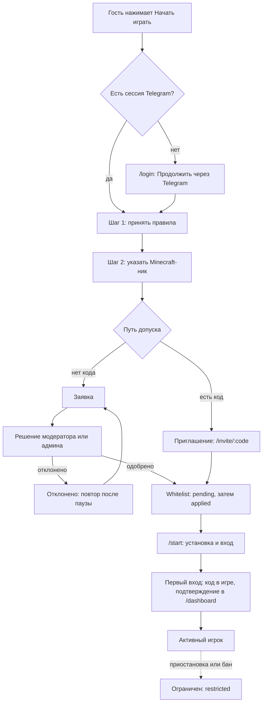

# MineOrt IV — Информационная архитектура сайта

| Поле | Значение |
|---|---|
| Документ | `01-product/01-information-architecture.md` |
| Статус | Черновик для утверждения |
| Базовая дата | 13.11.2026 (пятница); запуск 10.12.2026 (четверг), 27 календарных дней |
| Источник | Аудит §4 (стр. 90–134), §5.3–5.4 (стр. 154–185), §17.3 (стр. 853–859), Прил. A–B (стр. 1119–1196) |
| Связанные файлы | [02-user-status-model.md](02-user-status-model.md), [03-roles-permissions.md](03-roles-permissions.md), [../00-analysis/02-glossary.md](../00-analysis/02-glossary.md), [../00-analysis/03-open-decisions.md](../00-analysis/03-open-decisions.md) |

Теги: [ЗАКРЕПЛЕНО] / [ПРЕДЛАГАЕТСЯ] / [ПРОВЕРИТЬ] / [ОПРЕДЕЛИТЬ] — из аудита; [ПРЕДЛОЖЕНИЕ КОМАНДЫ] — отсутствует в аудите и вводится командой документации; [РЕШЕНИЕ ВЛАДЕЛЬЦА 13.11.2026] — решения владельца.

**Решение владельца [РЕШЕНИЕ ВЛАДЕЛЬЦА 13.11.2026]:** к 10.12.2026 выпускается весь P0 и весь P1. Волны P1a, P1b, P1c — внутренние вехи внутри 27 дней, а не пост-релизные этапы: P1a — лента и новости, галерея, каталог игроков, история в кабинете; P1b — гильдии, опросы, календарь; P1c — заказы и помощь, атлас, `/marker new`. Любая волна при невыполнении критериев go/no-go скрывается фича-флагом (см. [../04-plan/01-release-plan.md](../04-plan/01-release-plan.md)).

---

## 1. Разделы сайта

[ЗАКРЕПЛЕНО] Шесть основных пунктов навигации и отдельная админ-панель; конкретные URL — рекомендации для ТЗ (аудит §4, стр. 92–102).

| # | Название в меню (UI) | Продукт / код | Маршрут | Назначение | Релиз |
|---|---|---|---|---|---|
| 1 | Главная | home | `/` | Знакомство с проектом, главный CTA «Начать играть», блок «Правила сервера», статус сервера | P0 |
| 2 | Общение | social | `/social` | Лента, новости, опросы, календарь, заказы, помощь, галерея | P1a / P1b / P1c |
| 3 | Как играть | guide | `/guide` | Энциклопедия («Гайдбук»); мастер подключения `/start` | P0 |
| 4 | Карта | «Атлас», map | `/map` | Собственный атлас мира: слои, метки, фото | P1c |
| 5 | Игроки | players | `/players` | Каталог игроков, вкладка «Гильдии», страницы гильдий | P1a (каталог), P1b (гильдии) |
| 6 | Личный кабинет | dashboard | `/dashboard` | Статус допуска, профиль, история, настройки | P0 (статус), P1a (история) |
| — | Админ-панель | admin | `/admin` | Заявки, игроки, гильдии, контент, Bridge, аудит | P0 (допуск), P1 (контент, гильдии, карта) |

Термины UI закреплены единообразно (см. [../00-analysis/02-glossary.md](../00-analysis/02-glossary.md)): «Как играть» (энциклопедия внутри — «Гайдбук»); меню «Карта», продукт «Атлас»; в UI «Общение», в коде `social`; «Игроки» с вкладкой «Гильдии» (OD-01); «Гильдия» как единственный термин (OD-07). Запрещённые в UI синонимы: Social, «Игроки и гильдии» как название пункта меню, «клан/семья» как название сущности (аудит стр. 9, 100, 469, 1038, 1047).

---

## 2. Полная карта маршрутов

Условные обозначения уровня доступа (измерение 1, см. [02-user-status-model.md](02-user-status-model.md)): `guest` < `tg_user` < `applicant` < `member`; `restricted` — отдельный уровень (вход возможен, действия записи заблокированы). Роли сайта (измерение 2): `player`, `moderator`, `admin`. «Staff» = `moderator` или `admin` с выданным разрешением на этот раздел. «Публично» = доступно без входа.

Колонка «Источник»: «аудит» — маршрут есть в аудите §4 (стр. 106–132); «G-05» — маршрут добавлен командой для закрытия пробела G-05 (в аудите отсутствует) — [ПРЕДЛОЖЕНИЕ КОМАНДЫ].

### 2.1. Публичная часть и онбординг

| Маршрут | Раздел | Уровень доступа × site_role | Релиз | SC | Источник |
|---|---|---|---|---|---|
| `/` | Главная | Публично | P0 | SC-ONB-01, SC-ONB-02 | аудит |
| `/start` | Как играть (мастер) | Мастер открыт всем (OD-03); адрес сервера и кнопка «Можно подключаться» — только при `applied_state=applied` | P0 | SC-GUIDE-01, SC-GUIDE-02, SC-GUIDE-03 | аудит |
| `/login` | Вход | guest (для остальных — редирект на нужный шаг) | P0 | SC-AUTH-01, SC-AUTH-02, SC-AUTH-04 | аудит |
| `/onboarding/minecraft` | Онбординг | tg_user, applicant; шаги: правила → ник → приглашение или заявка | P0 | SC-ONB-03, SC-ACC-01, SC-ACC-05 | аудит |
| `/invite/:code` | Онбординг | Публично (предпросмотр); погашение — после входа и принятия правил (AC-33) | P0 | SC-ONB-04, SC-ACC-02, SC-ACC-03 | G-05 |
| `/rules` | Главная (версии правил) | Публично; принятие — tg_user+ | P0 | SC-ONB-03, SC-ADM-03 | G-05 (OD-38: плюс якорь на `/`) |
| `/privacy` | Подвал | Публично | P0 | SC-ONB-03 | G-05 (OD-45) |
| `/guide` | Как играть | Публично (основные гайды) | P0 | SC-GUIDE-04 | аудит |
| `/guide/:slug` | Как играть | Публично; отдельные действия и ссылки — по статусу доступа | P0 | SC-GUIDE-04 | аудит |

### 2.2. Общение (Social)

Видимость для гостей и заявителей — OD-02: гость видит официальные новости и public-галерею; applicant — чтение; member — публикация.

| Маршрут | Раздел | Уровень доступа × site_role | Релиз | SC | Источник |
|---|---|---|---|---|---|
| `/social` | Общение (лента) | Чтение: guest (новости) / applicant+ (всё); публикация: member | P1a | SC-SOC-01, SC-SOC-02, SC-SOC-06, SC-SOC-07, SC-SOC-08 | аудит |
| `/social/post/:id` | Общение | Как у ленты; видимость поста `public` / `guild` / `private` | P1a | SC-SOC-01, SC-SOC-03, SC-SOC-04, SC-SOC-05 | аудит |
| `/social/gallery` | Галерея | Чтение public: guest; загрузка: member | P1a | SC-GAL-01, SC-GAL-02 | аудит |
| `/social/polls` | Голосования | Чтение: applicant+; голос: member; создание: moderator+ и главы в своей гильдии (OD-27) | P1b | SC-POLL-01, SC-POLL-02, SC-POLL-03 | аудит |
| `/social/events` | Календарь | Чтение: applicant+; создание и запись: member | P1b | SC-EVT-01, SC-EVT-02 | аудит |
| `/social/requests` | Заказы и помощь | Чтение: applicant+; создание и отклик: member | P1c | SC-REQ-01, SC-REQ-02, SC-REQ-03 | аудит |

### 2.3. Карта, игроки, гильдии

| Маршрут | Раздел | Уровень доступа × site_role | Релиз | SC | Источник |
|---|---|---|---|---|---|
| `/map` | Карта (Атлас) | Публичные метки: guest (политика приватности, OD-18); `guild` и `private` — только по праву | P1c | SC-MAP-01, SC-MAP-02, SC-MAP-04 | аудит |
| `/map/marker/:id` | Карта | Видимость метки `public` / `guild` / `private`; чужая закрытая метка — 404 | P1c | SC-MAP-03, SC-MAP-04, SC-MAP-05, SC-MAP-06, SC-MRK-01..03 | аудит |
| `/players` | Игроки | Публичные поля — по настройкам приватности (OD-29); кандидаты и отклонённые не показываются | P1a | SC-PLR-01 | аудит |
| `/players/:id` | Игроки | Публичные поля профиля; Telegram ID, IP, журналы никогда не публичны | P1a | SC-PLR-02 | аудит |
| `/players?tab=guilds` | Игроки, вкладка «Гильдии» | Как у `/players` | P1b | SC-PLR-01, SC-GLD-01 | [ПРЕДЛОЖЕНИЕ КОМАНДЫ] (реализация OD-01) |
| `/guilds/:slug` | Игроки (страница гильдии) | Публичные блоки; панель управления — только по праву | P1b | SC-GLD-01..SC-GLD-09 | аудит |
| `/guilds/:slug/manage` | Игроки (управление) | member гильдии с рангом и правом (см. [03-roles-permissions.md](03-roles-permissions.md), §4); для остальных — 403 | P1b | SC-GLD-02..SC-GLD-08, SC-GLD-10 | аудит |

Вкладка «Гильдии» реализуется как параметр `?tab=guilds` на `/players` [ПРЕДЛОЖЕНИЕ КОМАНДЫ]: пункт меню один (OD-01), отдельного маршрута `/guilds` в меню нет; `/guilds/:slug` остаётся каноническим адресом страницы гильдии.

### 2.4. Личный кабинет

| Маршрут | Раздел | Уровень доступа × site_role | Релиз | SC | Источник |
|---|---|---|---|---|---|
| `/dashboard` | Личный кабинет | tg_user+, включая `restricted` (только статус и контакт с администрацией) | P0 | SC-DSH-01, SC-GAME-01 | аудит |
| `/dashboard/activity` | Кабинет, история | member (история только владельцу) | P1a | SC-DSH-02 | аудит |
| `/dashboard/settings` | Кабинет, настройки | tg_user+; привязки — P0; уведомления и публичность — P1a | P0 / P1a | SC-DSH-03, SC-AUTH-07 | аудит |

Граница кабинета (C-12): P0 — статус допуска, привязки, адрес сервера после `applied`, подтверждение первого входа; P1a — история действий на сайте и настройки публичности/уведомлений (аудит стр. 898, 909).

### 2.5. Админ-панель

Доступ: только `moderator` / `admin` с выданными разрешениями (аудит стр. 102, 526); критичные действия требуют step-up (AC-34). Подробно — [03-roles-permissions.md](03-roles-permissions.md), §5.

| Маршрут | Назначение | Уровень × site_role | Релиз | SC | Источник |
|---|---|---|---|---|---|
| `/admin` | Сводка: очередь заявок, ошибки Bridge, жалобы | staff | P0 | SC-ADM-01 | аудит |
| `/admin/applications` | Заявки: решение, повтор | moderator (разрешение), admin | P0 | SC-ADM-01 | аудит |
| `/admin/players` | Игроки: поиск, приостановка, бан, перепривязка, история привязок | admin; moderator — частично | P0 | SC-ADM-05, SC-ADM-06 | G-05 |
| `/admin/invitations` | Приглашения: создание, отзыв | admin (OD-36) | P0 | SC-ADM-08 | G-05 |
| `/admin/rules` | Версии правил | admin | P0 | SC-ADM-03 | G-05 |
| `/admin/bridge` | Очередь server_actions, ошибки, retry/cancel | admin | P0 | SC-ADM-04, SC-OPS-04 | G-05 |
| `/admin/audit` | Журнал аудита | admin; moderator — только свой раздел | P0 | SC-ADM-01..SC-ADM-06 | G-05 |
| `/admin/guides` | Статьи Гайдбука, версии, файлы сборки | admin, moderator с разрешением | P0 | SC-GUIDE-04 | G-05 |
| `/admin/moderation` | Жалобы, скрытие, закрепление новостей | moderator, admin | P1a | SC-SOC-02, SC-SOC-03, SC-ADM-07 | аудит |
| `/admin/guilds` | Создание гильдий, назначение глав, коррекция состава, архив | admin | P1b | SC-GLD-01, SC-GLD-07, SC-GLD-09 | аудит |
| `/admin/map` | Метки, категории, модерация, настройки приватности | moderator (разрешение), admin | P1c | SC-ADM-07, SC-MAP-04 | G-05 |

Разделы `/admin/players`, `/admin/invitations`, `/admin/rules`, `/admin/bridge`, `/admin/audit`, `/admin/guides`, `/admin/map` отсутствуют в перечне маршрутов аудита (стр. 128–131), но следуют из списка разделов админки (аудит §12.2, стр. 619–630) — закрытие G-05 [ПРЕДЛОЖЕНИЕ КОМАНДЫ].

---

## 3. Глобальное меню

### 3.1. Структура (аудит Прил. B, стр. 1160–1196)

```text
MINEORT IV
├── Главная
│   ├── Начать играть  → /start (с auth/onboarding gate)
│   └── Правила сервера (секция на / и страница /rules, OD-38)
├── Общение
│   ├── Лента и новости            P1a
│   ├── Галерея                    P1a
│   ├── Голосования                P1b
│   ├── Календарь                  P1b
│   ├── Заказы                     P1c
│   └── Помощь                     P1c
├── Как играть
│   ├── Установка и вход
│   ├── Моды/сборка
│   ├── Плагины
│   ├── Карта и гильдии
│   └── Решение ошибок
├── Карта (Атлас)                  P1c
│   ├── Мир, слои, категории
│   ├── Метки и изображения
│   └── Мои метки
├── Игроки
│   ├── Каталог игроков            P1a
│   └── Гильдии                    P1b (вкладка)
└── Личный кабинет
    ├── Статус доступа и привязки
    ├── Базовая статистика
    ├── Моя активность             P1a
    ├── Моя гильдия                P1b
    └── Настройки и уведомления
Отдельно: Админ-панель (для уполномоченных)
```

В Прил. B подпункт «Игроки» содержит «Гильдии / семьи / кланы» — в UI используется единственное слово «Гильдии» (OD-07). «Заказы» и «Помощь» остаются двумя вкладками одного раздела `/social/requests` (C-07).

### 3.2. Desktop и mobile

Требования аудита: телефон — полноценная платформа (стр. 85); mobile-first для онбординга и гайдов, полноценный desktop для карты и ленты (стр. 855–856). Ниже — компоновка [ПРЕДЛОЖЕНИЕ КОМАНДЫ].

| Элемент | Desktop (от 1024 px) | Mobile (320–767 px) |
|---|---|---|
| Шапка | Логотип, шесть пунктов в строку, кнопка входа или аватар | Логотип, аватар или «Войти», кнопка меню |
| Главный CTA | Hero на `/`, плюс акцентная кнопка в шапке для `guest` и `tg_user` | Hero на `/`; на `/guide` и `/start` — закреплённая нижняя кнопка |
| Навигация | Горизонтальное меню с выпадающими подпунктами | Полноэкранное меню (шторка) с аккордеоном подпунктов |
| Общение | Фильтры «Всё / Новости / Публикации / Ивенты / Запросы / Галерея» чипами сверху (аудит стр. 314) | Те же фильтры горизонтальной прокруткой |
| Карта | Широкая карта, боковая панель слоёв | Карта на весь экран, слои в нижней шторке |
| Кабинет | Две колонки: статус и активность | Одна колонка, статус допуска первым блоком |
| Админка | Боковое меню разделов | Только просмотр и простые действия; сложные формы — desktop [ПРЕДЛОЖЕНИЕ КОМАНДЫ] |
| Минимальная ширина | 320 px (NFR-A11Y) | 320 px |

Пункты меню, недоступные текущему уровню (например «Карта» до P1c при отключённом фича-флаге), не показываются, а не отображаются неактивными [ПРЕДЛОЖЕНИЕ КОМАНДЫ]; для `guest` защищённые разделы ведут на `/login` с сохранением адреса возврата.

---

## 4. Главный CTA «Начать играть» по onboarding_stage

[ЗАКРЕПЛЕНО] Большая главная кнопка «Начать играть» — центральный CTA, важнее новостей и галереи (аудит стр. 142). Состояния — аудит §5.4 (стр. 175–185); привязка к производному `onboarding_stage` — [ПРЕДЛОЖЕНИЕ КОМАНДЫ]. Правила вычисления стадии — [02-user-status-model.md](02-user-status-model.md), §8.

Принцип (аудит стр. 173): «вошёл», «заявка одобрена», «whitelist синхронизирован», «игровая личность подтверждена» — разные состояния; CTA и адрес сервера соответствуют действительному статусу. Мастер `/start` открыт всем (OD-03, C-17), но адрес сервера и «Можно подключаться» появляются только при `applied_state=applied`.

| onboarding_stage | Текст CTA | Цель перехода | Вторичное действие | Что скрыто | Источник текста |
|---|---|---|---|---|---|
| `guest` | «Начать играть» | `/login` → «Продолжить через Telegram» | «О проекте» | — | аудит стр. 179 |
| `needs_rules` | «Принять правила» | `/onboarding/minecraft`, шаг правил | «Читать правила» → `/rules` | Подача заявки и погашение приглашения (AC-33) | [ПРЕДЛОЖЕНИЕ КОМАНДЫ] |
| `needs_nick` | «Указать ник и получить доступ» | `/onboarding/minecraft`, шаг ника | — | — | аудит стр. 180 |
| `needs_access` | «Продолжить регистрацию» | `/onboarding/minecraft`, шаг «приглашение или заявка» | «Изучить инструкции» → `/guide` | — | аудит стр. 181 |
| `application_pending` | «Заявка на рассмотрении» | `/dashboard` | «Изучить инструкции» → `/guide` | Адрес сервера, «Можно подключаться» | аудит стр. 182 |
| `application_rejected` | «Заявка отклонена» (с причиной и датой, когда можно подать новую) | `/dashboard` | «Связаться с администрацией» | Адрес сервера | [ПРЕДЛОЖЕНИЕ КОМАНДЫ]; повтор через 7 дней — NFR-LIM [ПРЕДЛОЖЕНИЕ КОМАНДЫ] |
| `access_preparing` | «Доступ подготавливается» | `/start` (шаги установки) | Статус на `/dashboard` | Адрес сервера, «Можно подключаться» | аудит стр. 183 |
| `ready_to_install` | «Установить сборку и подключиться» | `/start`, шаг установки | Адрес сервера (виден) | — | аудит стр. 184 |
| `first_login_pending` | «Подтвердить первый вход» | `/start`, шаг входа; подтверждение кода — `/dashboard` | «Не получается войти» → `/guide` | — | [ПРЕДЛОЖЕНИЕ КОМАНДЫ] |
| `active` | «Как подключиться» + ссылка в кабинет | `/guide/<установка>` и `/dashboard` | — | — | аудит стр. 185; OD-44 |
| `restricted` | «Доступ ограничен» | `/dashboard` (причина и обращение) | — | Все игровые шаги | [ПРЕДЛОЖЕНИЕ КОМАНДЫ] |

Правило для `restricted`: перекрывает все остальные стадии (см. [02-user-status-model.md](02-user-status-model.md)). Для `active` вариант по умолчанию OD-44: «Как подключиться» и ссылка в кабинет.

### 4.1. Схема онбординга



Схема соответствует Прил. A (аудит стр. 1119–1158) с двумя изменениями, снимающими C-17 и G-04: мастер `/start` не ждёт `whitelist`, а гейтит только адрес и кнопку «Можно подключаться»; шаг принятия правил включён в поток до подачи заявки.

---

## 5. Пустые и ошибочные состояния

[ЗАКРЕПЛЕНО] Явные пустые состояния: нет постов, нет гильдии, нет ивентов, сервер недоступен, нет статистики; понятные состояния ошибок и загрузки; часовые пояса и даты событий понятны (аудит §17.3, стр. 853–859). Тексты ниже — рекомендации [ПРЕДЛОЖЕНИЕ КОМАНДЫ]; содержание правил сервера не придумывается.

Для каждого экрана с данными обязательны четыре состояния: loading (скелетон, без прыжков вёрстки), empty, error (с кнопкой «Повторить»), success.

| Ситуация | Где | Состояние | Рекомендуемый текст | Действие | Релиз |
|---|---|---|---|---|---|
| Нет публикаций | `/social` | empty | «Здесь пока тихо. Станьте первым, кто поделится скриншотом» (для member); для гостя — «Новостей пока нет» | «Опубликовать» (member) | P1a |
| Нет событий | `/social/events` | empty | «Ближайших событий нет» | «Создать событие» (member) | P1b |
| Нет опросов | `/social/polls` | empty | «Активных голосований нет» | «Создать» (если есть право) | P1b |
| Нет заказов и просьб о помощи | `/social/requests` | empty | «Заказов пока нет» / «Просьб о помощи пока нет» | «Создать заказ» | P1c |
| Пустая галерея | `/social/gallery` | empty | «Скриншотов пока нет» | «Загрузить» (member) | P1a |
| Нет гильдии | `/dashboard`, `/players/:id` | empty | «Вы не состоите в гильдии» | «Найти гильдию» → `/players?tab=guilds` | P1b |
| Нет статистики | `/dashboard` | empty | «Статистика появится после первого входа на сервер» | «Как подключиться» | P0 |
| Нет меток | `/map`, «Мои метки» | empty | «Меток пока нет» | `/marker new` в игре или «Добавить на карте» | P1c |
| Сервер Minecraft выключен | `/`, `/dashboard`, `/start` | error (информационное) | «Сервер сейчас выключен. Сайт работает, заявки принимаются» | Статус и время обновления | P0 (AC-21, SC-OPS-02) |
| Whitelist не применён | `/dashboard`, `/start` | pending (не success) | «Доступ подготавливается. Вы получите уведомление, когда можно будет подключаться» | — | P0 |
| Whitelist завершился ошибкой | `/dashboard` | error | «Применение доступа задерживается. Администрация уведомлена» (без технических деталей) | «Связаться с администрацией» | P0 |
| Игровой backend недоступен | `/dashboard` | error | «Игровая проверка временно недоступна. Вход на сервер закрыт до восстановления» (fail-closed, OD-46) | Повторить позже | P0 |
| Нет прав (403) | любой раздел | error | «У вас нет доступа к этому разделу» + причина уровня (например «нужно быть участником») | Ссылка на нужный шаг онбординга | P0 |
| Объект скрыт или не существует (404) | метки, гильдийские посты, приватные медиа | error | Единый текст «Страница не найдена» без раскрытия причины (AC-31) | «На главную» | P0 / P1c |
| Сессия истекла | любой защищённый раздел | error | «Сессия завершилась. Войдите снова» | `/login` с возвратом на страницу | P0 |
| Аккаунт ограничен | `/dashboard` | restricted | «Доступ ограничен. Обратитесь в администрацию» (с причиной, если она публикуема) | Контакт администрации | P0 |
| Загрузка файла отклонена | формы загрузки | error | «Допустимы JPEG, PNG, WebP до 10 МБ» (NFR-LIM) | Выбрать другой файл | P1a |
| Событие в другом часовом поясе | `/social/events` | info | Время в поясе браузера с явной меткой пояса; UTC в хранении (OD-42) | Переключатель пояса | P1b |
| Приглашение недействительно | `/invite/:code` | error | Причина: «истекло», «уже использовано», «отозвано» (AC-26) | «Подать заявку» | P0 |

---

## 6. Нерешённое и допущения

| Вопрос | Ссылка | Допущение до решения |
|---|---|---|
| Публичность Social, карты и каталога для гостей | аудит стр. 134; OD-02, OD-18, OD-29 | Гость: официальные новости, public-галерея, публичные метки, ограниченный каталог |
| Кнопка «Правила» в меню | OD-38 | Нет отдельного пункта: якорь на `/` и страница `/rules` |
| «Игроки» / «Гильдии» — один или два пункта меню | OD-01 | Один пункт «Игроки», вкладка «Гильдии» |
| CTA активного игрока | OD-44 | «Как подключиться» + ссылка в кабинет |
| Адрес сервера и домен | OD-26 | Владелец до 01.12; до этого в UI — заглушка «адрес будет опубликован» |

## 7. Замечания для сведения

1. Аудит трактует «Social», «Общение» и «Social / Общение» как одно (C-11); в UI используется «Общение», в коде и маршрутах `social`.
2. Прил. A ставит `/start` после синхронизации whitelist (стр. 1139–1145), а §5.3 — сразу после онбординга (стр. 158–171) (C-17); принят вариант §5.3 с гейтом шагов (OD-03).
3. Маршрут `/onboarding/minecraft` в аудите описан как «ник + приглашение/заявка» (стр. 110); шаг принятия правил добавлен командой (G-04, C-18).
4. Маршруты из G-05 добавлены как [ПРЕДЛОЖЕНИЕ КОМАНДЫ]; финальный перечень утверждается в TZ-00 ([../06-tz/TZ-00-product-scope.md](../06-tz/TZ-00-product-scope.md)).
5. Привязка маршрутов к волнам P1a/P1b/P1c соответствует решению владельца 13.11.2026; маршруты волны, выключенной фича-флагом на go/no-go (M4, 08.12), возвращают 404 и скрываются из меню.
