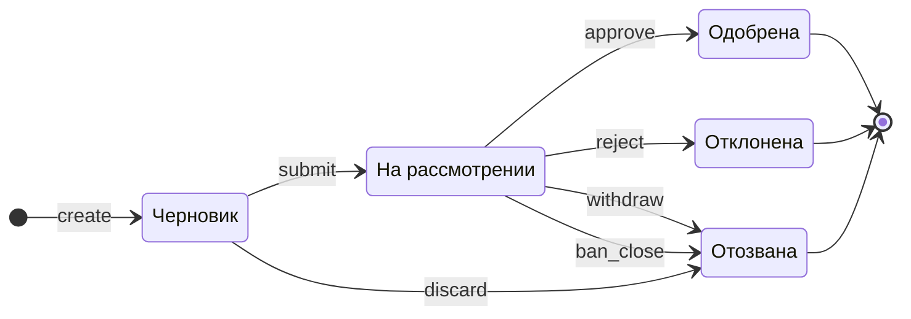
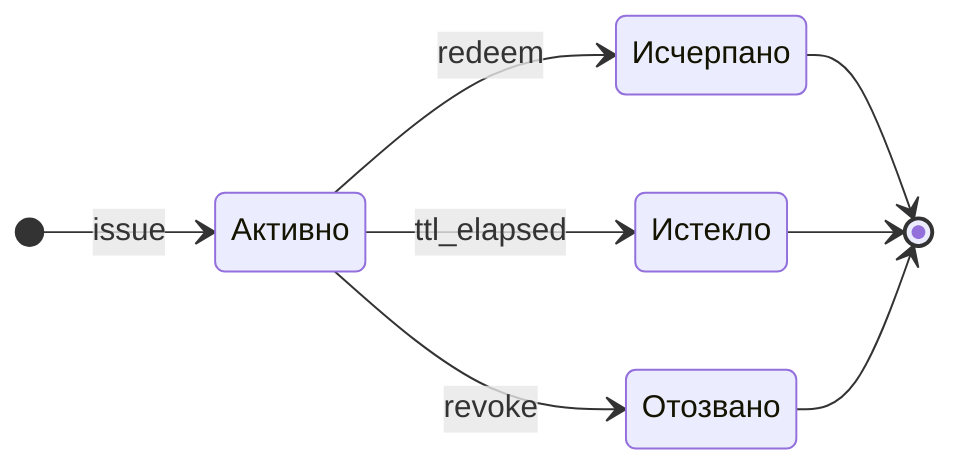
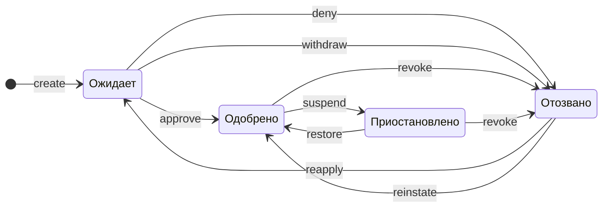
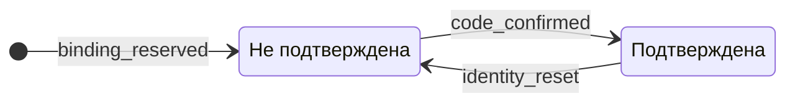
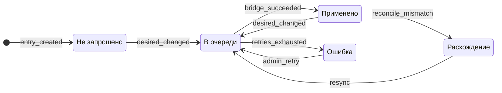
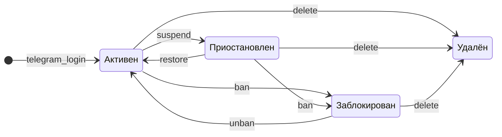

# MineOrt IV — Модель статусов пользователя

| Поле | Значение |
|---|---|
| Документ | `01-product/02-user-status-model.md` |
| Статус | Черновик для утверждения |
| Базовая дата | 13.11.2026 (пятница); запуск 10.12.2026 (четверг), 27 календарных дней |
| Источник | Аудит §6.2–6.4 (стр. 209–234), §5.3–5.4 (стр. 154–185), §5.5 (стр. 187–191), §16.1 (стр. 814–820), Прил. A (стр. 1119–1158) |
| Закрывает | C-02 (линейная цепочка vs независимые измерения), C-17 (когда открыт `/start`), C-18 / G-04 (правила в потоке) |
| Связанные файлы | [01-information-architecture.md](01-information-architecture.md), [03-roles-permissions.md](03-roles-permissions.md), [../03-architecture/03-data-model.md](../03-architecture/03-data-model.md), [../03-architecture/02-bridge-protocol.md](../03-architecture/02-bridge-protocol.md) |

Теги: [ЗАКРЕПЛЕНО] / [ПРЕДЛАГАЕТСЯ] / [ПРОВЕРИТЬ] / [ОПРЕДЕЛИТЬ] — из аудита; [ПРЕДЛОЖЕНИЕ КОМАНДЫ] — отсутствует в аудите; [РЕШЕНИЕ ВЛАДЕЛЬЦА 13.11.2026] — решения владельца. Имена событий аудита (`audit_log`) в этом документе — [ПРЕДЛОЖЕНИЕ КОМАНДЫ].

---

## 1. Проблема и решение

Аудит приводит линейную цепочку статусов (стр. 217–224):

```text
new → identity_linked → minecraft_name_selected
      → invite_validated / application_pending
      → approved / rejected
      → whitelist_pending → whitelisted
      → first_game_login_pending → game_identity_confirmed
      → active / suspended / revoked
```

и тут же [ПРЕДЛАГАЕТСЯ] хранить стадии «как несколько независимых сущностей/статусов (сайт, заявка, whitelist, игра), а не как единственный статус» (стр. 226). Аудит не разрешает противоречие между цепочкой и рекомендацией (C-02). Линейная цепочка плохо описывает реальные ситуации: заявка одобрена, а whitelist упал; игрок приостановлен, пока заявка остаётся «одобрена»; whitelist потерял запись (drift) у активного игрока.

**Решение (принято в пакете документации) [ПРЕДЛОЖЕНИЕ КОМАНДЫ, развивает аудит стр. 226]:** состояние пользователя — это набор независимых измерений, у каждого свой конечный автомат, инициатор и аудит. Единый «статус игрока» не хранится. Для UI вычисляется производный `onboarding_stage` (§8) и уровень доступа к платформе (§9). Строки аудита (стр. 218–223) трактуются как последовательность типичного пути, а не как значения одного поля (§10).

Владелец принял границу P0 + P1 к 10.12.2026 [РЕШЕНИЕ ВЛАДЕЛЬЦА 13.11.2026]: все измерения ниже — P0 (кроме гильдейских, которые вынесены в [03-roles-permissions.md](03-roles-permissions.md)).

## 2. Измерения состояния

| # | Измерение | Таблица / поле | Значения (канонические) | Что описывает | Кто меняет |
|---|---|---|---|---|---|
| 1 | Аккаунт | `users.account_status` | `active` \| `suspended` \| `banned` \| `deleted` | Можно ли пользоваться сайтом | Система, admin, сам пользователь (удаление) |
| 2 | Привязка ника | `minecraft_identities.binding_status`; `account_type` | `reserved` \| `confirmed` \| `released`; `premium` \| `offline` \| `unknown` | Принадлежит ли ник пользователю | Система, admin |
| 3 | Заявка | `applications.status` | `draft` \| `pending` \| `approved` \| `rejected` \| `withdrawn` | Путь «заявка» | Пользователь, moderator/admin |
| 4 | Приглашение | `invitations.status` | `active` \| `exhausted` \| `expired` \| `revoked` | Путь «приглашение» | Система, admin |
| 5 | Членство (допуск) | `access_memberships.status` | `pending` \| `approved` \| `suspended` \| `revoked` | Решение о допуске | Система, moderator/admin |
| 6 | Whitelist | `whitelist_entries`: `desired` (`on` \| `off`) + `applied_state` | `not_requested` \| `pending` \| `applied` \| `failed` \| `drift` | Что хотим и что реально применено на сервере | Backend, Bridge, reconciliation |
| 7 | Игровая личность | `game_identity` | `unconfirmed` \| `confirmed` | Подтверждён ли владелец ника в игре | Система после подтверждения кода |
| 8 | Согласие с правилами | `rules_acceptances` (+ `rules_versions`) | запись принятия версии | Предусловие допуска | Пользователь |
| 9 | Роль сайта | `site_role` | `player` \| `moderator` \| `admin` | Права (см. [03-roles-permissions.md](03-roles-permissions.md)) | admin с `roles.manage` |
| 10 | Команда Bridge | `server_actions.status` | `queued` \| `leased` \| `succeeded` \| `failed_retryable` \| `failed` \| `expired` \| `cancelled` | Исполнение команд на сервере | Bridge, backend |

Измерения 9 и 10 описаны в других файлах; здесь приводятся автоматы измерений 1, 3–7 и правило для 8. Гильдейский ранг (`guild_rank`) — третья плоскость полномочий, не статус допуска (аудит стр. 820).

Таблица для шага из заявки (измерение 3) и из приглашения (измерение 4) приводит к одному членству (измерение 5): независимо от пути допуск описывается `access_memberships`.

---

## 3. Автоматы состояний

В диаграммах идентификаторы состояний и подписи переходов — латиница (имена событий), русские названия — в кавычках у состояний.

### 3.1. Заявка (`applications.status`)



| Переход | Инициатор | Условие | Событие audit_log |
|---|---|---|---|
| `create` | tg_user | Есть выбранный ник (`binding_status=reserved`) | — (событие пользовательской активности) |
| `submit` | Пользователь | Принята актуальная мажорная версия правил (AC-33); нет другой `pending`-заявки; с отклонения прошло ≥ 7 дней (NFR-LIM [ПРЕДЛОЖЕНИЕ КОМАНДЫ]) | `application.submitted` |
| `approve` | moderator (с разрешением) или admin | Заявка в `pending`; решение один раз; запись причины необязательна | `application.approved` (+ создание whitelist desired=on, см. §3.5) |
| `reject` | moderator или admin | Заявка в `pending`; причина обязательна и показывается пользователю | `application.rejected` |
| `withdraw` / `discard` | Пользователь | Заявка в `draft` или `pending`. Для `pending` одновременно членство `pending` → `revoked` с `revoke_reason=application_withdrawn` (§3.3, OD-49) [ПРЕДЛОЖЕНИЕ КОМАНДЫ] | `application.withdrawn` |
| `ban_close` | Система | Бан пользователя (§3.6) при заявке в `pending`: заявка закрывается как `withdrawn`, членство `pending` → `revoked` (`revoke_reason=user_banned`); после разбана пользователь подаёт новую заявку (`reapply`); `reinstate` (§3.3) относится к ранее одобренным (OD-48) [ПРЕДЛОЖЕНИЕ КОМАНДЫ] | `application.withdrawn` (инициатор — система) |

Терминальные состояния. Повторная заявка — новая запись `applications`, а не возврат старой; ограничение «одна `pending`-заявка» и срок повтора (7 дней после отклонения) — SC-ACC-05, SC-ACC-06; Блокирует: OD-06 (текст правил) — для `submit`.

### 3.2. Приглашение (`invitations.status`)



| Переход | Инициатор | Условие | Событие audit_log |
|---|---|---|---|
| `issue` | admin (OD-36) | Токен 128 бит, хранится SHA-256-хэш, TTL 7 дней, одноразовое (NFR-LIM [ПРЕДЛОЖЕНИЕ КОМАНДЫ]) | `invitation.issued` |
| `redeem` | Пользователь | Статус `active`; срок не истёк; принята актуальная мажорная версия правил (AC-33); пользователь вошёл через Telegram и выбрал ник; запись в `invitation_redemptions` | `invitation.redeemed` |
| `ttl_elapsed` | Система (по запросу или планировщиком) | `expires_at` в прошлом | `invitation.expired` |
| `revoke` | admin | Статус `active` | `invitation.revoked` |

Просмотр `/invite/:code` не погашает приглашение (контекст сохраняется до входа — SC-ONB-04, G-19). Недействительное приглашение отклоняется с причиной «истекло / исчерпано / отозвано» (AC-26, SC-ACC-03). Одноразовость — значение по умолчанию; квоты на число использований — [ПРЕДЛОЖЕНИЕ КОМАНДЫ], уточняется в OD-36.

### 3.3. Членство (`access_memberships.status`)



| Переход | Инициатор | Условие | Событие audit_log |
|---|---|---|---|
| `create` | Система | Подана заявка (`applications.submit`) или погашено приглашение | `membership.created` |
| `approve` | Система (приглашение) или moderator/admin (заявка) | По приглашению — автоматически при `redeem` [ПРЕДЛОЖЕНИЕ КОМАНДЫ: приглашения выдаёт только admin, OD-36, поэтому «предварительное одобрение» аудита стр. 211 равно одобрению]; по заявке — при `application.approved` | `membership.approved` |
| `deny` | Система | Заявка отклонена (`application.rejected`) | `membership.denied` |
| `suspend` | moderator (разрешение) или admin | Причина обязательна; сразу выставляет `whitelist.desired=off` (§3.5) | `membership.suspended` |
| `restore` | admin | Только из `suspended`; восстанавливает `desired=on` | `membership.restored` |
| `revoke` | admin | Из `approved` / `suspended`; освобождает ник (`binding_status=released`, `quarantine_until` = момент освобождения + срок карантина, см. §3.4; только при игровой истории, R3-08); Bridge: `whitelist.remove`, `player.kick`; данные игрока не сбрасываются, `player.data_archive` отложен до повторной выдачи ника (§3.4) [ПРЕДЛОЖЕНИЕ КОМАНДЫ] | `membership.revoked` |
| `reapply` | Система | Новая заявка или новое приглашение после `revoked`; для заявки — с учётом паузы повтора | `membership.reapplied` |
| `withdraw` | Система по действию пользователя | Пользователь отозвал `pending`-заявку; `revoke_reason=application_withdrawn` (OD-49) [ПРЕДЛОЖЕНИЕ КОМАНДЫ] | `membership.revoked` |
| `reinstate` | admin | Возврат доступа после разбана (§3.6, `unban`): из `revoked` (причина `user_banned`) в `approved` без новой заявки; step-up обязателен (AC-34); `whitelist.desired=on` и новая постановка в очередь Bridge. Вариант по умолчанию [ОПРЕДЕЛИТЬ → OD-48]; альтернатива — новая заявка или приглашение (`reapply`) | `membership.reinstated` |

Единственная активная строка членства на пользователя (partial unique) [ПРЕДЛОЖЕНИЕ КОМАНДЫ]. Статус «отклонена» на уровне пользователя видит `applications.status=rejected`; членство при этом `revoked` (см. правило `application_rejected` в §8).

### 3.4. Игровая личность (`game_identity`)



| Переход | Инициатор | Условие | Событие audit_log / security_events |
|---|---|---|---|
| `code_confirmed` | Пользователь (в `/dashboard` под Telegram-сессией владельца ника) | Первый вход: 6-значный код TTL 5 мин введён; `whitelist.applied_state=applied`; код выдан именно этому нику (AC-05, AC-29) | `game_identity.confirmed`; `minecraft_identities.binding_status=confirmed` |
| `identity_reset` | admin | Смена ника или UUID (OD-37), перепривязка Telegram; `binding_status` → `released` (только старый ник при смене ника: уходит в карантин, §3.4) или `reserved` (новый ник; при перепривязке Telegram ник остаётся за тем же пользователем и НЕ освобождается, R3-09) | `game_identity.reset` (+ step-up, AC-34) |

Единое правило блокировки (R3-10 [ПРЕДЛОЖЕНИЕ КОМАНДЫ]): неудача пары «ник + источник подключения» — неверный код/пароль, неверное число, «Это не я», неотвеченный challenge (`expired`); 5 неудач за 10 минут → блок пары на 15 минут (блок только по нику или по IP не применяется), запись в `security_events` (NFR-LIM). Владелец снимает блок только через бот со сверкой числа; оповещения владельцу **об отказах** (`concurrent_join_denied`, заблокированные попытки) — не больше 3 в час на ник, далее дайджест; сообщение challenge живого входа отправляется всегда (R4-01а). Источник, ни разу не подтверждавший вход под этим ником, получает не более 3 challenge за 10 минут (включая `abandoned`), затем `denied` без сообщения в бот (R4-01б); источники, где владелец уже подтверждал вход, освобождены от лимита оповещений и бюджета пароля (R4-01в). Подтверждение в боте — один выбор на challenge: верное число → `confirmed`, неверное число или «Это не я» → `denied` (кнопки гаснут, limbo-соединение кикается, повторного выбора нет, R3-01). Явное исключение: глобальный бюджет неудач игрового пароля на ник отключает только парольный путь, бот остаётся доступен (R3-11). Статусы `login_challenges`: `pending | confirmed | denied | expired | abandoned` (при `player.quit` или кике limbo-соединения Bridge вызывает `abandon`, R3-02). До подтверждения игрок находится в limbo: нет движения, предметов, команд и чата (AC-29). Протокол — [../03-architecture/02-bridge-protocol.md](../03-architecture/02-bridge-protocol.md), §6 (схема гибрида — OD-23).

`minecraft_identities.binding_status`: `reserved` (ник выбран пользователем, ещё не подтверждён) → `confirmed` (одновременно с `game_identity=confirmed`) → `released` (отозван допуск, смена ника, бан с освобождением, удаление аккаунта; перепривязка Telegram ник не освобождает). `account_type`: `premium` \| `offline` \| `unknown` определяется плагином входа, а не заявлением пользователя; `unknown` — значение до первого входа. Правило premium-автологина [ПРЕДЛОЖЕНИЕ КОМАНДЫ]: допускается только если `account_type=premium` зафиксирован при подтверждённом первом входе И проверенный UUID сессии Mojang равен сохранённому `mc_uuid`; иначе игрок идёт обычным путём `offline` (SC-GAME-02, TC-GAME-02d). Разрешение C-14: автологин premium только при проверке сессии Mojang плагином, иначе игрок обслуживается как `offline` (аудит стр. 896; [ПРОВЕРИТЬ]).

#### Карантин освобождённого ника [ПРЕДЛОЖЕНИЕ КОМАНДЫ]

Освобождённый ник нельзя сразу отдать другому человеку: при игре в offline-режиме UUID производится от ника, поэтому новый владелец ника унаследовал бы инвентарь, эндер-сундук, приваты и права прежнего. Поэтому:

- `binding_status=released` сопровождается `quarantine_until = max(now() + 90 дней, banned_until)` (90 дней по умолчанию [ПРЕДЛОЖЕНИЕ КОМАНДЫ]; R4-02). Пока `now() < quarantine_until`, ник не выбирается никем, кроме admin со step-up (AC-34). При бессрочном бане `quarantine_until = 'infinity'`: ник не выдаётся, только админом со step-up.
- Карантин и архивация применяются только если ник когда-либо имел `whitelist.applied_state=applied` или `game_identity=confirmed` (R3-08). Резерв без игровой истории освобождается сразу: наследовать нечего.
- Архивация отложена (R3-04). При бане, отзыве, удалении данные игрока (playerdata, эндер-сундук, LuckPerms, приваты под offline-UUID) НЕ сбрасываются; ник получает `released` + `quarantine_until`. Действие Bridge `player.data_archive` ставится только при фактической повторной выдаче ника другому пользователю: досрочно админом со step-up либо фоновой задачей после окончания карантина. Результат пишется в `player_data_archives` и `audit_log`.
- Выдача ника (триггер БД и RPC; все пути: обычный выбор ника, админская выдача, фоновая задача окончания карантина) требует `player_data_archives.status=archived` для последней `released`-записи этого ника. Если архива нет или он `failed` — отказ и алерт. Запрос на архив создаёт RPC в отдельной зафиксированной транзакции; триггер выдачи только отклоняет (`nick.archive_required`), R4-04.
- Смена ника админом (SC-ACC-10) использует действие `player.data_migrate` (old_uuid → new_uuid: инвентарь, эндер-сундук, приваты, LuckPerms, статистика); старый ник уходит в карантин без данных, в `player_data_archives` фиксируется запись `archived` с пометкой `migrated` (R3-05). Порядок (R4-07): `whitelist.remove` старого ника, `player.data_migrate`, и только после его `succeeded` — `whitelist.add` нового ника.
- Освобождение происходит при: `revoke` членства, бане, удалении аккаунта (SC-DSH-04), смене ника админом (SC-ACC-10). Перепривязка Telegram (SC-ADM-06) ник НЕ освобождает: ник остаётся за прежним `user_id` (R3-09).
- `reinstate` после разбана (OD-48) возвращает прежнему владельцу тот же ник с нетронутыми данными, пока он в карантине и данные не архивированы; если архивация уже выполнена (досрочная выдача), данные возвращаются действием `player.data_restore` (из архива) в белом списке Bridge. Гонка reinstate и архивации (R4-03): отменяется только `player.data_archive` в статусе `queued`; для `leased` reinstate ждёт финального статуса, а поздний `succeeded` по отменённому архиву автоматически ставит `player.data_restore`; после повторной выдачи ника другому и окончания карантина возвращение доступа идёт через новую заявку.
- Освободить карантин досрочно может только admin со step-up (`audit_log`), и только если архив выполнен.

### 3.5. Whitelist (`desired` + `applied_state`)

`desired` (`on` \| `off`) — то, чего хочет backend; `applied_state` — степень применения желаемого на сервере. Честный статус (AC-21, AC-28): пользователю показывается «Доступ готов» только при `desired=on` и `applied_state=applied`.



| Переход | Инициатор | Условие | Событие |
|---|---|---|---|
| `desired_changed` (→ `pending`) | Backend | Одобрено членство (`desired=on`) или приостановка/отзыв (`desired=off`); создаётся `server_actions` (`whitelist.add` / `whitelist.remove`) со статусом `queued` | `whitelist.requested`; server_action `queued` |
| `bridge_succeeded` | Bridge | Результат `succeeded` по подписанной команде; для `on` — подтверждено игровым узлом | `whitelist.applied` |
| `retries_exhausted` | Backend | `server_actions.status=failed` (до 8 попыток, `expires_at` 24 ч) | `whitelist.failed`; запись в очереди `/admin/bridge` |
| `reconcile_mismatch` | Backend по снимку Bridge | Запись на сервере отличается от `desired`: лишняя или отсутствующая | `whitelist.drift_detected` (security_event при лишней записи) |
| `resync` | Система | Недостающая approved-запись добавляется автоматически; лишняя — только отметка для admin без автоудаления [ПРЕДЛОЖЕНИЕ КОМАНДЫ] | `whitelist.requested` |
| `admin_retry` | admin | Из `failed`; ручная повторная постановка | `whitelist.retried` |

Сервер Minecraft выключен: заявка может быть одобрена, `desired=on`, `applied_state=pending`; после запуска сервера Bridge применяет команду (AC-21, SC-ACC-07). Параметры протокола (backoff, ±60 с, Ed25519) — [../03-architecture/02-bridge-protocol.md](../03-architecture/02-bridge-protocol.md) [ПРЕДЛОЖЕНИЕ КОМАНДЫ]; здесь они не дублируются. Статусы `server_actions` отличаются от `applied_state`: первое — ход исполнения команды, второе — итоговое состояние записи.

### 3.6. Аккаунт (`users.account_status`)



| Переход | Инициатор | Условие | Событие |
|---|---|---|---|
| `telegram_login` | Система | Первый успешный вход через Telegram (OIDC); создан `user_id` | `user.created` |
| `suspend` / `restore` | moderator (разрешение) или admin | Причина обязательна; при `suspend` — `membership.suspend`, `whitelist.desired=off`, `player.kick` | `user.suspended`, `user.restored` |
| `ban` / `unban` | admin | Step-up обязателен (AC-34); при `ban` — отзыв всех веб-сессий, `membership.revoke`, Bridge: `whitelist.remove`, `player.kick` (данные игрока не сбрасываются: ник `released` + `quarantine_until`, архивация отложена до повторной выдачи, R3-04); `pending`-заявка закрывается (`ban_close`, §3.1). При `unban` сам доступ автоматически не возвращается: `account_status` → `active`, членство остаётся `revoked` до `reinstate` (§3.3) или новой заявки — [ОПРЕДЕЛИТЬ → OD-48] | `user.banned`, `user.unbanned` |
| `delete` | Пользователь или admin | Soft-delete (SC-DSH-04); в той же операции: `membership.revoked`, `whitelist.remove` + `player.kick`, ник → `released` с `quarantine_until` (при игровой истории; данные игрока не сбрасываются, архивация отложена, §3.4); удаление главы гильдии блокируется до передачи главенства (last-owner); самоудаление требует свежего Telegram-входа (re-auth не старше 5 минут, не ввода ника, R3-15) и запрещено при `account_status ∈ {banned, suspended}` (только admin со step-up, R3-06); при админ-удалении забаненного создаётся `deletion_tombstones` (хэш Telegram ID, `banned`, `ban_until`; хранится не меньше срока бана, бессрочно для перманентного), проверяемый при Telegram-входе ДО создания `users`; повторный вход тем же Telegram (без бана) создаёт новый аккаунт без старых данных; медиа удаляются через 30 дней, аудит хранится (OD-40); необратимость и срок восстановления — [ОПРЕДЕЛИТЬ] | `user.deleted` |

Заблокированный пользователь входить может, но видит только экран ограничения (SC-AUTH-06). `deleted` — терминальное состояние для пользовательского интерфейса; повторная регистрация того же Telegram-идентификатора — [ОПРЕДЕЛИТЬ] (OD-40, G-09).

---

## 4. Правило согласия с правилами сервера (`rules_acceptances`)

[ПРЕДЛАГАЕТСЯ] версионируемые правила, дата последнего обновления и подтверждение согласия перед выдачей доступа (аудит стр. 191). Аудит не вводит согласие в поток (G-04): §5.3 ведёт сразу к заявке, а «пустая секция правил» P0 (стр. 892) противоречит AC-07 (стр. 935) (C-18).

Решение [ПРЕДЛОЖЕНИЕ КОМАНДЫ]:

1. Согласие — запись в `rules_acceptances` (`user_id`, `rules_version_id`, `accepted_at`).
2. Согласие требуется для **текущей мажорной версии** правил. Минорная правка (описка, формулировка) повторного принятия не требует. Текст правил даёт владелец до 01.12 (OD-06); команда не придумывает содержание.
3. Согласие — предусловие стадии `needs_access`: без него `onboarding_stage=needs_rules`, подача заявки (`applications.submit`) и погашение приглашения (`invitations.redeem`) отклоняются сервером, а не только скрываются в UI (AC-33).
4. Публикация новой мажорной версии (SC-ADM-03, AC-07) делает согласия предыдущей версии недействительными: у участников с уже одобренным допуском это не отзывает доступ, но блокирует новые заявки и приглашения, показывает баннер «Правила обновлены, подтвердите» и фиксируется в `/dashboard` [ПРЕДЛОЖЕНИЕ КОМАНДЫ]. Нужно ли в этом случае ограничивать вход в игру — [ОПРЕДЕЛИТЬ] (OD-06).
5. Принятие и просмотр правил для гостя: `/rules` публично; принять правила может только tg_user+ (нужна привязка к `user_id`).

## 5. Связь независимых измерений

| Событие | Затрагиваемые измерения |
|---|---|
| Выбор ника | `binding_status=reserved`, `account_type=unknown` |
| Подача заявки | `applications.status=pending` (+ `membership.pending`) |
| Погашение приглашения | `invitations.status=exhausted`, `invitation_redemptions` + membership `approved` |
| Одобрение | `applications.status=approved`, `membership.approved`, `whitelist.desired=on`, `applied_state=pending` + `server_actions.queued` |
| Успех Bridge | `server_actions.succeeded`, `applied_state=applied` |
| Подтверждение кода в игре | `game_identity=confirmed`, `binding_status=confirmed` |
| Приостановка | `membership.suspended` (+ `account_status=suspended` при блокировке сайта), `desired=off` |
| Бан | `account_status=banned`, `membership.revoked`, `binding_status=released` (+ `quarantine_until` при игровой истории; данные не сбрасываются, `player.data_archive` отложен), `desired=off` |
| Отклонение | `applications.status=rejected`, `membership.revoked` (причина «заявка отклонена») |

## 6. Инварианты

| ID | Инвариант | Проверка |
|---|---|---|
| I-01 | Сообщение «Доступ готов» и адрес сервера показываются только при `whitelist.desired=on` и `applied_state=applied` (AC-21, AC-28) | TC в [../05-qa/01-acceptance-tests.md](../05-qa/01-acceptance-tests.md): SC-ACC-07, SC-ACC-09 |
| I-02 | Эквивалентность (= K-12 в [03-data-model](../03-architecture/03-data-model.md)): `whitelist.desired=on` ⇔ `membership.approved` ∧ `account_status=active` ∧ ник не `released`. Следствие: `suspended` или `revoked` ⇒ `desired=off` и поставленный `whitelist.remove` (R3-13) | SC-ACC-11 |
| I-03 | `account_status` ∈ {`suspended`, `banned`} ⇒ `onboarding_stage=restricted` | SC-AUTH-06 |
| I-04 | `game_identity=confirmed` возможна только при `applied_state=applied` и `binding_status=reserved` → `confirmed` | SC-GAME-01 |
| I-05 | Один ник (`minecraft_identities`) — один Telegram-пользователь одновременно (partial unique по `binding_status` ∈ {`reserved`, `confirmed`}) | SC-ACC-12 |
| I-06 | Одна `pending`-заявка на пользователя; одна активная строка членства | SC-ACC-05 |
| I-07 | Подача заявки и погашение приглашения невозможны без принятия актуальной мажорной версии правил (AC-33) | SC-ONB-03 |
| I-08 | Таймаут Bridge, `failed` и `drift` не превращаются в «подтверждено»; reconciliation не автоудаляет лишние записи | SC-ACC-08, SC-ACC-09 |
| I-09 | Бан/приостановка отзывают активные веб-сессии и игровой допуск в пределах одного цикла реконсиляции (NFR-SEC) [ПРОВЕРИТЬ] | SC-AUTH-06, SC-ACC-11 |
| I-10 | До `game_identity=confirmed` игрок в limbo: нет движения, предметов, команд, чата (AC-29); при недоступности backend — fail-closed (AC-30, OD-46) | SC-GAME-04, SC-GAME-06 |
| I-11 | Админ-операции ban, unban, смена главы, перепривязка Telegram, смена ника/UUID — только со step-up (AC-34) | SC-ADM-02 |
| I-12 | Карантин (R3-13: перенумерован из дубля I-10): `binding_status=released` при игровой истории ⇒ задан `quarantine_until = max(now() + 90 дней, banned_until)` (`'infinity'` при бессрочном бане, R4-02); ник не может получить другой пользователь, пока `now() < quarantine_until` (кроме admin со step-up) и пока для последней `released`-записи нет `player_data_archives.status=archived`; данные игрока не сбрасываются до повторной выдачи ника; ник без игровой истории освобождается сразу (R3-04, R3-08) [ПРЕДЛОЖЕНИЕ КОМАНДЫ] | SC-ACC-11, SC-ACC-12, SC-DSH-04 (TC-ACC-11d, TC-ACC-12d) |

---

## 7. Уровень доступа к платформе (измерение 1 из §16.1 аудита)

[ЗАКРЕПЛЕНО] Три независимых измерения: доступ к платформе, глобальная роль, роль в гильдии (аудит стр. 814–820). Уровень доступа вычисляется из измерений 1–7 [ПРЕДЛОЖЕНИЕ КОМАНДЫ]:

| Уровень | Условие |
|---|---|
| `guest` | Нет сессии |
| `tg_user` | Есть сессия, `account_status=active`; нет `pending`-заявки и нет членства `approved` |
| `applicant` | `applications.status=pending` или `membership.status=pending` |
| `member` | `membership.status=approved` и `account_status=active` |
| `restricted` | `account_status` ∈ {`suspended`, `banned`} или `membership.status` ∈ {`suspended`, `revoked`} (кроме случая отклонённой заявки, см. §8) |

`member` не означает игровой доступ: он определяется `whitelist` и `game_identity`. Права по уровню — [03-roles-permissions.md](03-roles-permissions.md), §2.

## 8. Производный onboarding_stage

`onboarding_stage` — вычисляемое значение (не колонка), используется для CTA (см. [01-information-architecture.md](01-information-architecture.md), §4) и мастера `/start`. Значения: `guest`, `needs_rules`, `needs_nick`, `needs_access`, `application_pending`, `application_rejected`, `access_preparing`, `ready_to_install`, `first_login_pending`, `active`, `restricted`.

Вычисляется строго сверху вниз; первое совпавшее условие определяет стадию. `restricted` проверяется раньше всех и перекрывает остальные.

| Приоритет | Условие (измерения) | Стадия | Примечание |
|---|---|---|---|
| 1 | Нет сессии | `guest` | |
| 2 | `account_status` ∈ {`suspended`, `banned`} или `membership.status=suspended`; либо `membership.status=revoked` и последняя заявка не `rejected` | `restricted` | Перекрывает всё ниже. `deleted` — сессия невозможна |
| 3 | Последняя `applications.status=rejected`, членство `revoked`, срок повтора ещё идёт | `application_rejected` | После истечения паузы переходит в `needs_access`; по сути — исключение из п. 2 для отказа |
| 4 | Не принята актуальная мажорная версия правил **и** нет `membership.status=approved` | `needs_rules` | Для одобренных игроков новая версия правил не меняет стадию, а даёт баннер (§4, п. 4) |
| 5 | Нет `minecraft_identities` с `binding_status` ∈ {`reserved`, `confirmed`} | `needs_nick` | |
| 6 | `applications.status=pending` или `membership.status=pending` | `application_pending` | |
| 7 | Нет членства `approved` (нет заявки, `draft`, `withdrawn`, нет погашенного приглашения) | `needs_access` | |
| 8 | `membership.approved` и (`desired=off`, либо `applied_state` ≠ `applied`) | `access_preparing` | Включает `not_requested`, `pending`, `failed`, `drift`; при `failed` / `drift` UI показывает «задержка», а не «готово» |
| 9 | `membership.approved`, `desired=on`, `applied_state=applied`, `game_identity=unconfirmed`, нет начатого игрового подтверждения | `ready_to_install` | «Можно подключаться»; адрес сервера виден |
| 10 | То же, `game_identity=unconfirmed`, игрок уже заходил и получил код (есть `game_auth_challenge`) | `first_login_pending` | [ПРЕДЛОЖЕНИЕ КОМАНДЫ]: различие по наличию вызова |
| 11 | `membership.approved`, `desired=on`, `applied_state=applied`, `game_identity=confirmed` | `active` | |

Для `drift` у уже `active` игрока (потеря записи в whitelist) стадия понижается до `access_preparing` до устранения расхождения (честный статус, I-01) [ПРЕДЛОЖЕНИЕ КОМАНДЫ].

### 8.1. Примеры комбинаций

| Ситуация | Измерения | Стадия |
|---|---|---|
| Только что вошёл через Telegram | сессия есть, правила не приняты | `needs_rules` |
| Ник выбран, заявка не подана | `reserved`, нет заявки | `needs_access` |
| Заявка отправлена | `applications.pending` | `application_pending` |
| Одобрено, MC выключен | `membership.approved`, `desired=on`, `applied_state=pending` | `access_preparing` |
| Whitelist применён | `applied_state=applied`, `game_identity=unconfirmed` | `ready_to_install` |
| Код введён, личность подтверждена | `game_identity=confirmed` | `active` |
| Одобрено, потом бан | `account_status=banned`, `desired=off` | `restricted` |
| Одобрено, whitelist упал | `applied_state=failed` | `access_preparing` |
| Отклонено две недели назад | `applications.rejected`, пауза истекла | `needs_access` |

---

## 9. Соответствие линейной цепочки аудита (стр. 218–223) комбинации измерений

В цепочке аудита 14 значений в шести строках (в плане пакета указано 13; расхождение зафиксировано в «Замечаниях для сведения»). Каждое значение — комбинация измерений, а не отдельный статус.

| # | Значение аудита | Комбинация измерений в модели | Стадия |
|---|---|---|---|
| 1 | `new` | Нет `users` / нет сессии | `guest` |
| 2 | `identity_linked` | `users.account_status=active`; Telegram привязан; ник не выбран | `needs_rules` / `needs_nick` |
| 3 | `minecraft_name_selected` | `minecraft_identities.binding_status=reserved`; нет заявки / приглашения | `needs_access` |
| 4 | `invite_validated` | `invitations.status=exhausted` (погашено); `membership.approved` | `access_preparing` |
| 5 | `application_pending` | `applications.status=pending`; `membership.pending` | `application_pending` |
| 6 | `approved` | `applications.status=approved`; `membership.approved` | `access_preparing` |
| 7 | `rejected` | `applications.status=rejected`; `membership.revoked` | `application_rejected` |
| 8 | `whitelist_pending` | `whitelist.desired=on`, `applied_state=pending`; `server_actions` `queued`/`leased` | `access_preparing` |
| 9 | `whitelisted` | `desired=on`, `applied_state=applied` | `ready_to_install` |
| 10 | `first_game_login_pending` | `applied_state=applied`; `game_identity=unconfirmed`; вызов выдан | `first_login_pending` |
| 11 | `game_identity_confirmed` | `game_identity=confirmed`; `binding_status=confirmed` | `active` |
| 12 | `active` | `membership.approved`, `applied`, `game_identity=confirmed` | `active` |
| 13 | `suspended` | `membership.suspended` (и/или `account_status=suspended`); `desired=off` | `restricted` |
| 14 | `revoked` | `membership.revoked`; `binding_status=released` (+ `quarantine_until`); `desired=off` | `restricted` |

Значения `approved` + `whitelist_pending` + `whitelisted` в линейной цепочке — разные точки одного пути; в модели они одновременно описываются заявкой (`approved`) и whitelist (`pending` → `applied`), и поэтому «одобрено, но whitelist упал» выражается комбинацией `applications.approved` + `applied_state=failed` (в цепочке аудита такого значения нет).

## 10. Сводка событий аудита и безопасности

Все изменения измерений §3 пишутся в единый `audit_log` со `scope` (global) [ПРЕДЛОЖЕНИЕ КОМАНДЫ]; технические сбои входа и подозрительные события — в `security_events`; попытки игровой авторизации и перебор кода — в `security_events` с записью IP (хранение 30 дней, NFR-LIM [ПРЕДЛОЖЕНИЕ КОМАНДЫ]). Перечень событий: `application.*`, `invitation.*`, `membership.*`, `whitelist.*`, `game_identity.*`, `user.*`, `rules.published`, `rules.accepted` [ПРЕДЛОЖЕНИЕ КОМАНДЫ].

## 11. Замечания для сведения

1. План пакета указывает «13 шагов» цепочки аудита; фактически в строках 218–223 перечислено 14 значений (с учётом `approved` / `rejected` и `active` / `suspended` / `revoked` как отдельных). В §9 приведены все 14.
2. Аудит (стр. 211) говорит о «предварительном одобрении» участия по приглашению; в модели оно сводится к немедленному `membership.approved`, так как приглашения выдаёт только admin (OD-36). Если OD-36 будет изменён (квоты игроков), потребуется промежуточный `membership.pending` и модерация.
3. `onboarding_stage=application_rejected` — исключение из правила «`membership.revoked` ⇒ `restricted`»: отказ по заявке не является санкцией. Альтернатива (отдельное значение `membership.denied`) отвергнута, чтобы не расширять канонический список статусов.
4. Различие `ready_to_install` и `first_login_pending` основано на наличии выданного вызова входа (`game_auth_challenge`) — в аудите отдельного признака нет; сущность вызова описана в [../03-architecture/02-bridge-protocol.md](../03-architecture/02-bridge-protocol.md).
5. Будущие файлы пакета (сценарии, тесты) ссылаются на SC и TC по этой модели: SC-ACC-07 → I-01, SC-ACC-11 → I-02, SC-ACC-12 → I-05 и I-12.
6. **Раунд 3 (MAJOR-4, MAJOR-5, MAJOR-6, MINOR-1, MINOR-2, MINOR-3, MINOR-9, MINOR-11).** Отложенная архивация и карантин только при игровой истории (§3.4); `player.data_migrate` при смене ника; запрет самоудаления при `banned`/`suspended` и `deletion_tombstones` (§3.6); перепривязка Telegram не освобождает ник; статусы `login_challenges` расширены до `pending | confirmed | denied | expired | abandoned`; инвариант карантина перенумерован в I-12 (в раунде 2 он дублировал номер I-10 с инвариантом limbo), I-02 переписан как эквивалентность. Все механизмы — [ПРЕДЛОЖЕНИЕ КОМАНДЫ].
7. **Раунд 4 (R4-01…R4-08).** (R4-01) Оповещения об отказах и challenge разделены: challenge владельцу отправляется всегда, чужой источник ограничен бюджетом challenge, подтверждённые источники освобождены (правило блокировки выше). (R4-02) Карантин не короче срока бана; при бессрочном бане ник не выдаётся без admin со step-up (I-12). (R4-03) Гонка reinstate и архива. (R4-04) Запрос на архив — RPC в отдельной зафиксированной транзакции. (R4-07) Порядок смены ника: `player.data_migrate` до `whitelist.add` нового ника. (R4-08) Таймаут limbo: 5 мин для `first_join`, 120 с для повторных входов.
