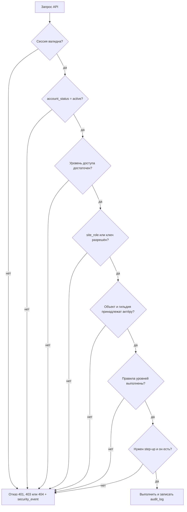

# MineOrt IV — Роли и права доступа

| Поле | Значение |
|---|---|
| Документ | `01-product/03-roles-permissions.md` |
| Статус | Черновик для утверждения |
| Базовая дата | 13.11.2026 (пятница); запуск 10.12.2026 (четверг), 27 календарных дней |
| Источник | Аудит §10.5–10.10 (стр. 501–583), §12.3 (стр. 632–637), §15.5 (стр. 801–808), §16.1–16.2 (стр. 814–829); §8, §9, §11 (стр. 296–609) |
| Связанные файлы | [02-user-status-model.md](02-user-status-model.md), [01-information-architecture.md](01-information-architecture.md), [../03-architecture/04-nfr-security.md](../03-architecture/04-nfr-security.md), [../05-qa/01-acceptance-tests.md](../05-qa/01-acceptance-tests.md) |

Теги: [ЗАКРЕПЛЕНО] / [ПРЕДЛАГАЕТСЯ] / [ПРОВЕРИТЬ] / [ОПРЕДЕЛИТЬ] — из аудита; [ПРЕДЛОЖЕНИЕ КОМАНДЫ] — отсутствует в аудите; [РЕШЕНИЕ ВЛАДЕЛЬЦА 13.11.2026] — решения владельца.

**Важно.** Аудит прямо говорит, что гильдейская матрица **не утверждена** (стр. 536, 553). Матрицы ниже — предложение для утверждения, помеченное по OD; все ✓* раскрыты как конкретные условия и должны быть подтверждены владельцем.

**Релизы.** Владелец принял границу P0 + P1 к 10.12.2026 [РЕШЕНИЕ ВЛАДЕЛЬЦА 13.11.2026]; волны P1a / P1b / P1c — внутренние вехи (P1a: лента, галерея, каталог игроков, история в кабинете; P1b: гильдии, опросы, календарь; P1c: заказы и помощь, атлас, `/marker new`). Серверные проверки прав гильдий (AC-18, AC-23) и видимость меток (AC-31) входят в критерии go/no-go волн и в список «никогда не режем».

---

## 1. Три независимых измерения

[Аудит, обязательное ограничение] Полномочия складываются из трёх независимых измерений; `guild_rank` нельзя использовать как основание для глобального `admin` (аудит стр. 814–820).

| Измерение | Значения (канонические) | Откуда вычисляется | Что даёт |
|---|---|---|---|
| 1. Уровень доступа к платформе | `guest` \| `tg_user` \| `applicant` \| `member` \| `restricted` | Производное от статусов (см. [02-user-status-model.md](02-user-status-model.md), §7) | Допуск к разделам и общим функциям |
| 2. Роль сайта `site_role` | `player` \| `moderator` \| `admin` | Колонка пользователя; «владелец» — `admin` с разрешением `roles.manage` | Модерация и администрирование |
| 3. Ранг в гильдии `guild_rank` | `owner` \| `vice_leader` \| `officer_1` \| `officer_2` \| `officer_3` \| `member` (уровни 1→6) | Строка `guild_members` активной гильдии | Руководство **только своей гильдией** (аудит стр. 520–530) |

Правила сочетания [ПРЕДЛОЖЕНИЕ КОМАНДЫ]:

1. Любое действие проверяется по всем трём измерениям и по принадлежности объекта (§6). Отказ хотя бы по одному — отказ.
2. `site_role` действует поверх уровня доступа: `moderator` и `admin` на сайте имеют уровень `member`; уровень `restricted` лишает и прав роли (кроме входа и просмотра статуса).
3. `guild_rank` не повышает `site_role` и не влияет на уровень доступа; гильдия не может создавать привилегии на уровне Minecraft-сервера (аудит стр. 829).
4. Владелец проекта: `site_role=admin` + разрешение `roles.manage`; передача `roles.manage` — только со step-up (AC-34).

## 2. Матрица «действие × уровень доступа × site_role» по разделам

Обозначения. Колонки уровня: `guest`, `tg_user`, `applicant`, `member`, `restricted`. Колонки роли `moderator` и `admin` — дополнительные права к уровню `member`. **✓** — разрешено; **—** — запрещено; **✓\*** — разрешено при условии из колонки «Условие / OD». Релиз — P0 или волна P1a / P1b / P1c. По умолчанию для P0 и P1 действует матрица ниже. Серверная проверка обязательна для каждой строки (§6); скрытие кнопок — не защита.

### 2.1. Главная, правила, гайды

| Действие | guest | tg_user | applicant | member | restricted | moderator | admin | Условие / OD | Релиз |
|---|---|---|---|---|---|---|---|---|---|
| Просмотр `/`, `/rules`, `/privacy`, `/guide` | ✓ | ✓ | ✓ | ✓ | ✓ | ✓ | ✓ | Публично | P0 |
| Принять правила | — | ✓ | ✓ | ✓ | — | ✓ | ✓ | Только текущая мажорная версия (AC-33) | P0 |
| Открыть мастер `/start` | ✓ | ✓ | ✓ | ✓ | — | ✓ | ✓ | OD-03: открыт всем, кроме `restricted` | P0 |
| Видеть адрес сервера и «Можно подключаться» | — | — | — | ✓\* | — | ✓\* | ✓\* | Только при `desired=on` и `applied_state=applied` (AC-21) | P0 |
| Редактировать статьи Гайдбука | — | — | — | — | — | ✓\* | ✓ | Разрешение `guides.edit` | P0 |

### 2.2. Social: лента, новости

| Действие | guest | tg_user | applicant | member | restricted | moderator | admin | Условие / OD | Релиз |
|---|---|---|---|---|---|---|---|---|---|
| Читать официальные новости и public-галерею | ✓ | ✓ | ✓ | ✓ | ✓ | ✓ | ✓ | OD-02 | P1a |
| Читать общую ленту (посты игроков) | — | — | ✓ | ✓ | ✓\* | ✓ | ✓ | OD-02; `restricted` — только `public` | P1a |
| Создать пост | — | — | — | ✓\* | — | ✓ | ✓ | OD-27; лимит 10 в час (NFR-LIM) [ПРЕДЛОЖЕНИЕ КОМАНДЫ] | P1a |
| Редактировать / удалять свой пост | — | — | — | ✓ | — | ✓ | ✓ | Только автор | P1a |
| Комментировать, ставить реакции | — | — | — | ✓\* | — | ✓ | ✓ | OD-05: реакции к 10.12, комментарии — первыми в лестнице сокращений; лимит 30 в час | P1a |
| Опубликовать официальную новость, закрепить | — | — | — | — | — | ✓\* | ✓ | OD-27; разрешение `news.publish` | P1a |
| Пожаловаться на материал | — | — | — | ✓ | — | ✓ | ✓ | SC-SOC-03 | P1a |
| Скрыть, одобрить, удалить чужой материал | — | — | — | — | — | ✓\* | ✓ | Разрешение `content.moderate`; действие в аудите | P1a |
| Пост от имени гильдии | — | — | — | ✓\* | — | — | ✓ | OD-43: глава и офицеры гильдии (`guild.manage_posts`) | P1a / P1b |

### 2.3. Опросы, события, заказы и помощь

| Действие | guest | tg_user | applicant | member | restricted | moderator | admin | Условие / OD | Релиз |
|---|---|---|---|---|---|---|---|---|---|
| Просмотр опросов, календаря, заказов | — | — | ✓ | ✓ | ✓\* | ✓ | ✓ | OD-02; `restricted` — только публичное | P1b / P1c |
| Создать опрос | — | — | — | ✓\* | — | ✓ | ✓ | OD-27: moderator+ и глава/офицер в своей гильдии; лимит 5 в сутки | P1b |
| Голосовать | — | — | — | ✓ | — | ✓ | ✓ | Один голос на `member` (AC-09); серверная уникальность | P1b |
| Изменить / отозвать голос | — | — | — | ✓\* | — | ✓\* | ✓\* | Только пока опрос идёт и настройка разрешает; SC-POLL-03 | P1b |
| Закрыть, скрыть опрос | — | — | — | ✓\* | — | ✓ | ✓ | Автор — свой; moderator+ — любой | P1b |
| Создать событие | — | — | — | ✓\* | — | ✓ | ✓ | OD-27 (member с rate-limit); время хранится в UTC (OD-42) | P1b |
| Записаться / отменить запись | — | — | — | ✓ | — | ✓ | ✓ | Лимит мест — по полю события; SC-EVT-02 | P1b |
| Перенести, отменить событие | — | — | — | ✓\* | — | ✓ | ✓ | Автор — своё; moderator+ — любое | P1b |
| Создать заказ или просьбу о помощи | — | — | — | ✓ | — | ✓ | ✓ | `requests.type` = `order` \| `help`; награда — свободный текст (C-13) | P1c |
| Откликнуться на чужой запрос | — | — | — | ✓\* | — | ✓ | ✓ | Нельзя на собственный (SC-REQ-03) | P1c |
| Менять статус запроса | — | — | — | ✓\* | — | ✓ | ✓ | Автор — по статусной цепочке своего типа; иначе moderator+. `order`: `open` → `in_progress` → `done` \| `cancelled`; `help`: `seeking` → `volunteers_found` → `done` → `closed` | P1c |

### 2.4. Галерея

| Действие | guest | tg_user | applicant | member | restricted | moderator | admin | Условие / OD | Релиз |
|---|---|---|---|---|---|---|---|---|---|
| Просмотр публичных изображений | ✓ | ✓ | ✓ | ✓ | ✓ | ✓ | ✓ | `visibility=public` и `moderation_status=approved` | P1a |
| Просмотр `guild` / `private` изображений | — | — | — | ✓\* | — | ✓\* | ✓ | Только по праву к объекту (§6); прямой URL не обходит проверки | P1a |
| Загрузить изображение | — | — | — | ✓\* | — | ✓ | ✓ | JPEG/PNG/WebP ≤ 10 МБ; 20 в час, 50 МБ в сутки, квота 500 МБ (NFR-LIM) | P1a |
| Скрыть, удалить своё | — | — | — | ✓ | — | ✓ | ✓ | Мягкое удаление; файл удаляется через 30 дней (OD-40, AC-24) | P1a |
| Скрыть, удалить чужое | — | — | — | — | — | ✓\* | ✓ | Разрешение `content.moderate` | P1a |
| Прикрепить медиа к посту или метке | — | — | — | ✓\* | — | ✓ | ✓ | Только автор объекта; повторное использование без перезагрузки (SC-GAL-02) | P1a / P1c |

### 2.5. Карта (Атлас)

Видимость меток: `public` / `guild` / `private`; статус модерации `draft` / `pending` / `approved` / `hidden` (OD-18, аудит стр. 452).

| Действие | guest | tg_user | applicant | member | restricted | moderator | admin | Условие / OD | Релиз |
|---|---|---|---|---|---|---|---|---|---|
| Просмотр публичных меток | ✓\* | ✓\* | ✓\* | ✓ | ✓\* | ✓ | ✓ | OD-18; только `public` и `approved`; точные базы и приватные объекты не показываются (AC-31) | P1c |
| Просмотр `guild`-меток | — | — | — | ✓\* | — | ✓\* | ✓ | Только член той же гильдии | P1c |
| Просмотр `private`-меток | — | — | — | ✓\* | — | ✓\* | ✓\* | Только автор; moderator/admin — в админке с аудитом | P1c |
| Создать метку на сайте | — | — | — | ✓\* | — | ✓ | ✓ | 10 в час, 100 активных (NFR-LIM) | P1c |
| `/marker new` в игре | — | — | — | ✓\* | — | ✓\* | ✓\* | Только при `game_identity=confirmed`, `applied_state=applied` и пройденной игровой авторизации (AC-29); cooldown 30 с; создаёт черновик `private` (OD-20) | P1c |
| Прикрепить фото к метке | — | — | — | ✓\* | — | — | — | Только автор метки; ≤ 5 изображений на метку | P1c |
| Редактировать, удалить свою метку | — | — | — | ✓ | — | ✓ | ✓ | Игровые `/marker list|edit|delete` — не в релизе (P2, OD-20) | P1c |
| Публикация `public`-метки | — | — | — | ✓\* | — | ✓\* | ✓ | Премодерация (OD-19); решение moderator с `markers.moderate` | P1c |
| Модерировать чужие метки | — | — | — | — | — | ✓\* | ✓ | Разрешение `markers.moderate` | P1c |

### 2.6. Игроки и профили

| Действие | guest | tg_user | applicant | member | restricted | moderator | admin | Условие / OD | Релиз |
|---|---|---|---|---|---|---|---|---|---|
| Каталог игроков | ✓\* | ✓\* | ✓\* | ✓ | ✓\* | ✓ | ✓ | OD-29: публично — дата первого входа и гильдия; прочее — по настройкам приватности; кандидаты и отклонённые скрыты (AC-19) | P1a |
| Профиль игрока | ✓\* | ✓\* | ✓\* | ✓ | ✓\* | ✓ | ✓ | Только публичные поля; Telegram ID, IP, коды, журналы — никогда (стр. 487, 804) | P1a |
| Страница гильдии | ✓\* | ✓\* | ✓\* | ✓ | ✓\* | ✓ | ✓ | Публичные блоки; `guild`-контент — только членам | P1b |
| Изменить свой профиль и приватность | — | — | — | ✓ | — | ✓ | ✓ | OD-29 (opt-in); SC-DSH-03 | P1a |

### 2.7. Личный кабинет

| Действие | guest | tg_user | applicant | member | restricted | moderator | admin | Условие / OD | Релиз |
|---|---|---|---|---|---|---|---|---|---|
| Видеть статус допуска и привязки | — | ✓ | ✓ | ✓ | ✓ | ✓ | ✓ | Только своё (IDOR-защита) | P0 |
| Подтвердить код первого входа | — | — | — | ✓\* | — | ✓\* | ✓\* | Только под Telegram-сессией владельца ника; `applied_state=applied` (AC-05) | P0 |
| История действий на сайте | — | — | — | ✓ | — | ✓ | ✓ | Только владельцу, плюс события, разрешённые настройкой (SC-DSH-02) | P1a |
| Настройки уведомлений и публичности | — | ✓ | ✓ | ✓ | ✓\* | ✓ | ✓ | OD-30: обязательные — решение по заявке, «доступ готов», подтверждение входа | P0 / P1a |
| Удаление своего аккаунта (запрос и подтверждение) | — | ✓ | ✓ | ✓ | ✓\* | ✓ | ✓ | OD-40; SC-DSH-04: подтверждение свежим Telegram-входом (re-auth ≤ 5 минут, не вводом ника); whitelist.remove + player.kick, ник уходит в карантин (`quarantine_until`; только при игровой истории), данные игрока не сбрасываются до повторной выдачи ника, удаление главы гильдии блокируется до передачи главенства (last-owner). ✓\* для `restricted`: самоудаление запрещено при `account_status ∈ {banned, suspended}` (только admin со step-up; TC-DSH-04d), при админ-удалении забаненного создаётся `deletion_tombstones` (R3-06); запись в аудит [ПРЕДЛОЖЕНИЕ КОМАНДЫ] | P0 |
| Выгрузка своих данных | — | ✓ | ✓ | ✓ | ✓ | ✓ | ✓ | SC-DSH-05: только свои данные, без чужих и без секретов; лимит повторных запросов; запись в аудит [ПРЕДЛОЖЕНИЕ КОМАНДЫ] | P1a |

### 2.8. Админ-панель

Разрешения модераторам выдаёт `admin` (аудит стр. 526) в виде ключей. Ключи ниже — [ПРЕДЛОЖЕНИЕ КОМАНДЫ]; точный набор утверждается владельцем (OD-28).

| Ключ | Описание | moderator | admin |
|---|---|---|---|
| `applications.review` | Рассмотрение заявок | ✓\* | ✓ |
| `invitations.manage` | Создание и отзыв приглашений (OD-36) | — | ✓ |
| `players.suspend` | Приостановка допуска | ✓\* | ✓ |
| `players.ban` | Бан и разбан (step-up) | — | ✓ |
| `players.rebind` | Перепривязка Telegram (ник не освобождается, R3-09), смена ника/UUID с переносом данных `player.data_migrate` (step-up, OD-37) | — | ✓ |
| `rules.publish` | Публикация версий правил | — | ✓ |
| `bridge.manage` | Очередь, retry, cancel, ротация секрета (step-up) | — | ✓ |
| `audit.view` | Чтение журнала аудита (moderator — только свой раздел) | ✓\* | ✓ |
| `guides.edit` | Статьи Гайдбука и файлы сборки | ✓\* | ✓ |
| `news.publish` | Официальные новости | ✓\* | ✓ |
| `content.moderate` | Жалобы, скрытие материалов | ✓\* | ✓ |
| `markers.moderate` | Метки и категории | ✓\* | ✓ |
| `polls.create` | Создание опросов | ✓\* | ✓ |
| `guild.create` | Создание гильдии, назначение главы (step-up) | — | ✓ |
| `guild.admin` | Принудительная коррекция состава, архив | — | ✓ |
| `roles.manage` | Выдача и отзыв `site_role` и разрешений | — | ✓\* (владелец) |

Условие ✓\* для `moderator`: ключ выдан конкретному модератору (по умолчанию не выдан никто). Модератор не может расширить собственные права. Все действия админки пишутся в `audit_log`; секреты в интерфейсе не показываются (аудит стр. 630, 637).

### 2.9. Критичные операции со step-up

[ПРЕДЛАГАЕТСЯ] Бан/разбан, назначение главы, передача прав, смена Telegram-идентичности требуют повторного подтверждения (аудит стр. 635); для админов желательна независимая защита passkey/TOTP (стр. 636). Параметры — [ПРЕДЛОЖЕНИЕ КОМАНДЫ]: step-up TOTP или passkey действует 15 минут; админская сессия — 12 часов (NFR-SEC; G-18). Перечень, расширяющий аудит: ban/unban; `guild.create` и назначение, смена главы; перепривязка Telegram; смена ника/UUID; выдача `roles.manage`; ротация или отзыв секрета Bridge; отмена очереди Bridge, влияющая на допуск. Проверка — AC-34, SC-ADM-02.

---

## 3. Гильдейская матрица (аудит §10.7, стр. 534–556)

Матрица [ПРЕДЛАГАЕТСЯ], **не утверждена владельцем** (стр. 536). Обозначения: **✓** — по умолчанию разрешено; **—** — нет; **✓\*** — только в пределах установленных ограничений (раскрыты ниже); **✓\*\*** — глава не оставляет гильдию без главы. Ранг определяет шаблон (OD-09): набор прав ранга хранится в `guild_ranks`; имена рангов правит глава, права рангов — только `admin`.

Колонка «Админ» — глобальный `site_role=admin`, действующий через админку (не член гильдии, правила уровней его не ограничивают, но действие пишется в аудит).

| Ключ права | Действие | Админ | Глава | Заместитель | Помощники | Участник | Релиз |
|---|---|---|---|---|---|---|---|
| `guild.create` | Создать новую гильдию | ✓ | — | — | — | — | P1b |
| `guild.transfer_owner` | Назначить / сменить главу | ✓ | — | — | — | — | P1b |
| `guild.edit_identity` | Изменить название / тег / цвет | ✓ | ✓\* | — | — | — | P1b |
| `guild.edit_profile` | Настроить описание / эмблему | ✓ | ✓ | ✓\* | ✓\* | — | P1b |
| `guild.invite` | Пригласить игрока | ✓ | ✓ | ✓ | ✓\* | — | P1b |
| `guild.accept_request` | Принять заявку в гильдию | ✓ | ✓ | ✓ | ✓\* | — | P1b |
| `guild.assign_rank` | Назначить низший ранг | ✓ | ✓ | ✓\* | ✓\* | — | P1b |
| `guild.assign_rank` (→ `vice_leader`) | Повысить до заместителя | ✓ | ✓ | — | — | — | P1b |
| `guild.kick` | Исключить участника | ✓ | ✓ | ✓\* | ✓\* | — | P1b |
| `guild.manage_posts` | Управлять публикациями гильдии | ✓ | ✓ | ✓ | ✓\* | — | P1b |
| `guild.leave` | Покинуть гильдию | — | ✓\*\* | ✓ | ✓ | ✓ | P1b |
| `guild.archive` | Распустить / архивировать гильдию | ✓ | — | — | — | — | P1b |

Столбец «Помощники» объединяет `officer_1`, `officer_2`, `officer_3`; в шаблоне права убывают с номером (`officer_1` ≥ `officer_2` ≥ `officer_3`) [ПРЕДЛОЖЕНИЕ КОМАНДЫ].

### 3.1. Раскрытие ✓\* [ПРЕДЛОЖЕНИЕ КОМАНДЫ]

| Право | Условие ✓\* по умолчанию | OD |
|---|---|---|
| `guild.edit_identity` у главы | Глава может править название, тег и цвет в пределах уникальности (тег и slug уникальны без учёта регистра); смена тега логируется; формат тега и допустимые цвета — [ОПРЕДЕЛИТЬ] | OD-09, OD-15 |
| `guild.edit_profile` у заместителя и помощников | Текст описания и баннер; без права менять название и тег; право в шаблоне ранга включено, `admin` может отключить | OD-09 |
| `guild.invite`, `guild.accept_request` у помощников | Только кандидаты с `access_memberships.status=approved` (OD-13); у кандидата нет активной гильдии (AC-16) | OD-08, OD-13 |
| `guild.assign_rank` у заместителя и помощников | Правило уровней (§4): назначать можно только ранг строго ниже собственного, цель — строго ниже по рангу | OD-09 |
| `guild.kick` у заместителя и помощников | Цель — строго ниже по рангу; исключение главы невозможно (§4) | OD-14 |
| `guild.manage_posts` у помощников | Посты гильдии публикуют и редактируют только глава и офицеры (`officer_*` по шаблону ранга) | OD-43 |
| Все права | Действует только в **своей** гильдии и пока членство активно (`guild_members`); при исключении, бане, смене гильдии права исчезают немедленно | OD-08 |

Количественные лимиты: численность гильдии настраивается админом, по умолчанию 50 (OD-10). Создание и передача главенства — только через админку (OD-11, OD-12). Приглашение игрока в гильдию допускается при `access_membership=approved` — до `whitelist` (OD-13).

---

## 4. Правила уровней и ограничения иерархии

[Аудит, обязательное ограничение] Участник никогда не может назначить себе роль выше своей; менеджер не может назначать, повышать или исключать игрока с рангом, равным или выше собственного (аудит стр. 556). Контроль выполняется на сервере.

Уровни: `owner`=1, `vice_leader`=2, `officer_1`=3, `officer_2`=4, `officer_3`=5, `member`=6 (меньшее число — выше ранг; аудит стр. 509–516). Формулировка правил [ПРЕДЛОЖЕНИЕ КОМАНДЫ]:

| Правило | Условие | Отказ |
|---|---|---|
| R-LVL-1 | Любое управляющее действие над участником `T` от участника `A` допустимо только при `A.level < T.level` (актёр строго выше цели) | 403 `guild.rank_too_low` |
| R-LVL-2 | Назначаемый ранг должен иметь `new_rank.level > A.level` (строго ниже ранга актёра) | 403 `guild.rank_escalation` |
| R-LVL-3 | Самоназначение: `T = A` для `assign_rank` недопустимо ни при каких условиях | 403 `guild.self_assign` |
| R-LVL-4 | Ровно один `owner` на гильдию (partial unique); назначить второго `owner` — только `guild.transfer_owner` (атомарная передача) | 409 `guild.owner_conflict` |
| R-LVL-5 | Последнего `owner` нельзя удалить, исключить, понизить, архивировать вместе с членством или позволить ему выйти без передачи (AC-23) | 409 `guild.last_owner` |
| R-LVL-6 | Право проверяется по актуальным данным БД на каждом запросе; кэш прав на клиенте и в JWT для `guild_rank` не используется | — |
| R-LVL-7 | Объект принадлежит конкретной гильдии; актёр обязан быть активным членом именно этой гильдии | 403 / 404 (без раскрытия существования) |
| R-LVL-8 | Один активный участник (`guild_members`, partial unique) — одна гильдия (OD-08) | 409 `guild.already_member` |

Передача главы (`guild.transfer_owner`) — только админ (OD-12): новый глава обязан быть членом этой гильдии с `access_membership=approved` и `account_status=active`; предыдущий глава получает ранг `member` (по умолчанию) [ПРЕДЛОЖЕНИЕ КОМАНДЫ]; операция атомарна, требует step-up и пишет `guild.owner_transferred`. Самостоятельная передача главой — P2 (OD-12).

Уход главы запрещён до передачи (OD-14, C-08): в аудите «✓**» (стр. 550) трактуется как условное разрешение, запрет «оставить гильдию без главы» (стр. 554) имеет приоритет.

Бан игрока-главы (SC-GLD-11): гильдия остаётся активной, права главы пропадают сразу (измерение 1 = `restricted`), гильдия помечается «нужен глава» и попадает в очередь админа [ПРЕДЛОЖЕНИЕ КОМАНДЫ]. Уход игрока из гильдии скрывает гильдейские метки и `guild`-контент от него немедленно (SC-MAP-06).

## 5. Запреты эскалации

[Аудит, обязательное ограничение] Никакой ранг гильдии не должен давать доступ к `/op`, RCON, общим настройкам сервера, системным ролям сайта или данным чужой гильдии (аудит стр. 532, 829).

| Запрет | Как обеспечивается | Проверка |
|---|---|---|
| `guild_rank` ≠ `site_role` | Разные колонки и разные проверки в API; `guild.*` ключи не входят в набор `admin`-ключей | TC-GLD-10a |
| `guild_rank` ≠ Minecraft OP, RCON, LuckPerms | Bridge принимает только белый список действий (`whitelist.add`, `whitelist.remove`, `player.kick`, `auth.release`, `marker.ack`, `tag.sync` (P2)); произвольных консольных команд нет; Bridge не принимает неподписанные команды (AC-27) | TC-GLD-10b, TC-GLD-10c |
| Тег и цвет гильдии не создают прав в игре | Синхронизация тега в игру — P2 (OD-15, E17); в P1 тег виден только на сайте (C-05) | TC-GLD-10b |
| Глава ≠ глобальный администратор | `/admin/*` проверяет `site_role` и ключи, а не гильдейский ранг | TC-GLD-10a |
| Данные чужой гильдии недоступны | Фильтр по `guild_id` на сервере; RLS на таблицах гильдий | TC-GLD-04c |
| Бан и приостановка отзывают права немедленно | Проверка `account_status` и `membership.status` в каждом запросе; отзыв веб-сессий | TC-GLD-11a |

## 6. Серверная проверка прав (аудит §16.2, стр. 822–829)

[ПРЕДЛАГАЕТСЯ] Права проверяются на backend для каждого действия с учётом конкретного объекта; отдельно проверяется гильдия объекта и членство вызывающего; при смене рангов сравниваются уровни; права исчезают своевременно после блокировки или исключения; назначения, исключения, смены главы и правки тегов логируются (аудит стр. 824–828).

Конвейер проверки [ПРЕДЛОЖЕНИЕ КОМАНДЫ]:

Принципы:

1. Проверка всегда на сервере и до чтения/записи объекта; для чужого закрытого объекта возвращается 404, а не 403 (не раскрывать существование; AC-31).
2. Роли читаются из БД на каждый запрос или из короткоживущего серверного кэша с инвалидацией при бане, исключении и смене ранга; клиентские токены несут только `user_id` и идентификатор сессии [ПРЕДЛОЖЕНИЕ КОМАНДЫ].
3. Привилегированные операции выполняет backend под серверным ключом; секреты недоступны клиенту; Supabase/Postgres: RLS включён, тесты из ролей `anon`, `authenticated`, `owner`, `moderator`, `admin`; `authenticated` сама по себе не доказывает владение записью (аудит стр. 807–808).
4. Данные, закрытые для публичного API: Telegram ID, одноразовые токены, IP, административные журналы (аудит стр. 804). Публичное чтение — только через представления `public_members`, `public_profiles`, `public_guilds`: `anon` и `authenticated` не получают SELECT на базовые таблицы с закрытыми колонками (`users`, `minecraft_identities`, `guild_members` и др.); фильтр `privacy_settings` применяется внутри представления (R3-07 [ПРЕДЛОЖЕНИЕ КОМАНДЫ]; TC-OPS-06h); прямые URL приватных медиа проверяются серверным слоем (стр. 806).
5. Каждое отклонение по правам пишется в `security_events` без раскрытия причины пользователю сверх общего «нет доступа».
6. Откат ошибочных прав: изменения ролей и рангов обратимы через `audit_log`; SC-OPS-03, NFR-SEC.

## 7. Обязательные негативные проверки (будущие TC)

Список — спецификация для [../05-qa/01-acceptance-tests.md](../05-qa/01-acceptance-tests.md). Идентификаторы следуют схеме `TC-<DOM>-NN[a-z]`, где `NN` — номер связанного SC; детальные Given/When/Then — в файле 05-qa. Приоритет: Blocker — релиз блокируется; Critical — обязательна до go/no-go волны; Major — обязательна до релиза; Minor — желательна. «Обход UI» = прямой вызов API/URL без интерфейса.

### 7.1. Допуск, вход, игра (P0)

| TC | Проверка | Ожидание | Связи | Приоритет | Релиз |
|---|---|---|---|---|---|
| TC-AUTH-04a | Вход с неверной подписью или повтором (replay) Telegram | Сессия не создаётся, запись в `security_events` | SC-AUTH-04; NFR-SEC | Blocker | P0 |
| TC-AUTH-06a | Забаненный / приостановленный пользователь с живой сессией вызывает API записи | 403, сессия отозвана | SC-AUTH-06; I-03 | Critical | P0 |
| TC-ONB-03a | Подача заявки без принятия актуальной версии правил, обход UI | 403/422, заявка не создана | SC-ONB-03; AC-33 | Blocker | P0 |
| TC-ACC-02a | Погашение приглашения без принятия правил | Отказ, приглашение остаётся `active` | SC-ACC-02; AC-33 | Blocker | P0 |
| TC-ACC-03a | Просроченное, исчерпанное, отозванное приглашение | Отказ с причиной, статус не меняется | SC-ACC-03; AC-26 | Critical | P0 |
| TC-ACC-05a | Вторая `pending`-заявка и подача до окончания паузы после отклонения | 409, заявка не создана | SC-ACC-05, SC-ACC-06 | Major | P0 |
| TC-ACC-05b | Чтение чужой заявки пользователем `tg_user` (IDOR) | 404/403 | SC-ACC-05; AC-22 | Critical | P0 |
| TC-ACC-11a | Приостановленный пользователь вызывает действие, ведущее к `whitelist.add` | `desired` остаётся `off` | SC-ACC-11; I-02 | Critical | P0 |
| TC-ACC-11d | После бана/отзыва/удаления ник в карантине, данные игрока не сбрасываются до повторной выдачи ника (`player.data_archive` только при выдаче другому); новый владелец ника их не наследует; reinstate в карантине возвращает данные (раунд 3, [ПРЕДЛОЖЕНИЕ КОМАНДЫ]) | Данные не наследуются и не теряются раньше срока | SC-ACC-11; I-12 | Blocker | P0 |
| TC-ACC-12a | Второй Telegram выбирает уже занятый ник | Отказ без раскрытия владельца | SC-ACC-12; I-05 | Critical | P0 |
| TC-ACC-12d | Занять ник в карантине без admin со step-up; выдача при отсутствующем или `failed` архиве даже админом | Отказ + алерт | SC-ACC-12; I-12 | Critical | P0 |
| TC-GAME-03a | Вход в игру под чужим ником без подтверждения владельцем | Игрок в limbo, `game_identity` не меняется | SC-GAME-03; AC-05, AC-29 | Blocker | P0 |
| TC-GAME-03b | Подтверждение кода из чужой Telegram-сессии | 403, код не гасится | SC-GAME-03, SC-GAME-05; AC-05 | Blocker | P0 |
| TC-GAME-07b | Подключение под ником, который уже в сети и авторизован | Отказ (409 `ERR_NICK_ALREADY_ONLINE`), владелец не выбит | SC-GAME-07; AC-05, AC-29 | Blocker | P0 |
| TC-DSH-04d | Самоудаление при `banned`/`suspended` (UI и прямой API); повторный Telegram-вход после админ-удаления забаненного (R3-06, [ПРЕДЛОЖЕНИЕ КОМАНДЫ]) | 403; вход отклонён по `deletion_tombstones` до создания `users` | SC-DSH-04, SC-ADM-05; AC-22 | Blocker | P0 |
| TC-GAME-04a | Backend недоступен при входе новой сессии | Вход закрыт (fail-closed) | SC-GAME-04; AC-30, OD-46 | Blocker | P0 |
| TC-GAME-06a | Движение, предметы, команды и чат до авторизации | Заблокированы | SC-GAME-06; AC-29 | Blocker | P0 |
| TC-ADM-01a | Moderator без `applications.review` решает заявку | 403 | SC-ADM-01; AC-22 | Critical | P0 |
| TC-ADM-01b | Игрок без `site_role` открывает `/admin/*` и вызывает admin API | 403 | SC-ADM-01 | Blocker | P0 |
| TC-ADM-01c | Повторное решение по уже решённой заявке | 409, аудит без дубля | SC-ADM-01 | Major | P0 |
| TC-ADM-02a | Бан, разбан, смена главы, перепривязка без step-up | Отказ, требуется step-up | SC-ADM-02; AC-34 | Blocker | P0 |
| TC-ADM-02b | Step-up истёк (более 15 минут) или от другой сессии | Отказ | SC-ADM-02; AC-34 | Critical | P0 |
| TC-ADM-03a | Moderator публикует версию правил | 403 | SC-ADM-03 | Major | P0 |
| TC-ADM-04a | Не-admin смотрит очередь Bridge, retry, cancel | 403 | SC-ADM-04 | Critical | P0 |
| TC-ADM-05a | Moderator выполняет бан | 403 | SC-ADM-05 | Critical | P0 |
| TC-ADM-08a | Moderator или игрок создаёт приглашение | 403 (OD-36) | SC-ADM-08 | Critical | P0 |
| TC-OPS-04a | Неподписанная, просроченная или чужая команда Bridge | Bridge отклоняет | SC-OPS-04; AC-27 | Blocker | P0 |
| TC-OPS-04g | Неподписанный, подделанный или повторённый ответ решения входа | Limbo не снимается | SC-OPS-04; AC-27 | Blocker | P0 |
| TC-OPS-06g | Прямой PATCH/INSERT клиентской ролью в привилегированные колонки | Отказ на уровне БД, код `data.privileged_write_denied`, запись в `security_events` | SC-DSH-01; NFR-SEC-06 | Blocker | P0 |
| TC-OPS-06h | Прямой SELECT закрытых колонок базовых таблиц ролями `anon` и `authenticated`; публичные данные доступны через представления `public_members`, `public_profiles`, `public_guilds` (R3-07, [ПРЕДЛОЖЕНИЕ КОМАНДЫ]) | Отказ на базовых таблицах; через представления — только публичные поля с учётом `privacy_settings` | SC-DSH-01, SC-PLR-02; NFR-SEC-06 | Blocker | P0 |

### 7.2. Social, галерея, кабинет (P1a, P1b, P1c)

| TC | Проверка | Ожидание | Связи | Приоритет | Релиз |
|---|---|---|---|---|---|
| TC-SOC-01a | `guest`, `tg_user`, `applicant` создают пост через API | 403 | SC-SOC-01, SC-SOC-06; OD-02 | Critical | P1a |
| TC-SOC-02a | Member публикует официальную новость или закрепляет | 403 | SC-SOC-02; OD-27 | Critical | P1a |
| TC-SOC-04a | Удаление или правка чужого поста (IDOR) | 403 | SC-SOC-04; AC-24 | Critical | P1a |
| TC-SOC-06a | Гость читает ленту: видны только официальные новости и public-галерея | Остальное скрыто | SC-SOC-06; OD-02 | Major | P1a |
| TC-SOC-07a | Превышение лимита постов в час | 429 | SC-SOC-07; NFR-LIM | Major | P1a |
| TC-SOC-08a | Member без права публикует пост «от гильдии» | 403 | SC-SOC-08; OD-43 | Major | P1b |
| TC-GAL-01a | Скрытие, удаление чужого изображения | 403 | SC-GAL-01; AC-12 | Critical | P1a |
| TC-GAL-01b | Прямой URL `guild` / `private` изображения без права | 404, файл не отдаётся | SC-GAL-01; AC-24, AC-31 | Blocker | P1a |
| TC-PLR-01a | Кандидаты и отклонённые заявители отсутствуют в публичном каталоге (UI и API) | Нет в выдаче | SC-PLR-01; AC-19 | Critical | P1a |
| TC-PLR-02a | Публичный API профиля: Telegram ID, IP, коды | Не возвращаются | SC-PLR-02; §15.5 | Blocker | P1a |
| TC-PLR-02b | Чтение закрытых таблиц ключом `anon` и `authenticated` (RLS; публичное чтение только через представления `public_*`) | Отказ | SC-PLR-02; NFR-SEC | Blocker | P1a |
| TC-DSH-02a | Чтение истории или настроек другого пользователя | 403 | SC-DSH-02, SC-DSH-03; AC-20 | Critical | P1a |
| TC-POLL-01a | Member создаёт опрос без права; глава создаёт опрос чужой гильдии | 403 | SC-POLL-01; OD-27 | Major | P1b |
| TC-POLL-02a | Голос от гостя | 401/403 | SC-POLL-02; AC-09 | Critical | P1b |
| TC-POLL-02b | Повторный голос через API, двойной клик, гонка | Один голос, остальные 409 | SC-POLL-02; AC-09 | Blocker | P1b |
| TC-POLL-02e | Голос с `option_id` из чужого опроса | Отказ | SC-POLL-02; AC-09 | Critical | P1b |
| TC-POLL-03a | Голос после закрытия опроса | 409 | SC-POLL-03 | Major | P1b |
| TC-EVT-02a | Не-автор переносит или отменяет событие | 403 | SC-EVT-02; AC-10 | Major | P1b |
| TC-REQ-03a | Отклик на собственный запрос | 403 | SC-REQ-03; AC-11 | Major | P1c |
| TC-REQ-03b | Смена статуса запроса не автором или недопустимая цепочка (`done` из `cancelled`) | 403/409 | SC-REQ-03; AC-11 | Major | P1c |
| TC-REQ-03c | Статус `seeking` у `order` или `open` у `help` (несоответствие `type`) | 422 | SC-REQ-01, SC-REQ-02; C-07 | Major | P1c |

### 7.3. Карта и метки (P1c)

| TC | Проверка | Ожидание | Связи | Приоритет | Релиз |
|---|---|---|---|---|---|
| TC-MAP-03a | Не-автор прикрепляет изображение к метке | 403 | SC-MAP-03; AC-14 | Critical | P1c |
| TC-MAP-04a | Гость запрашивает `private` или `guild` метку по прямому URL и по API | 404 | SC-MAP-04; AC-31 | Blocker | P1c |
| TC-MAP-04b | Не-член гильдии запрашивает `guild`-метку | 404 | SC-MAP-04; AC-31 | Blocker | P1c |
| TC-MAP-04c | Движок карты (маркеры, тайлы, JSON) не содержит закрытых меток и геометрии баз | Утечки нет | SC-MAP-04; AC-31, R-21 | Blocker | P1c |
| TC-MAP-04d | После смены видимости на `private` кэш и CDN не отдают прежнюю версию | Нет в выдаче | SC-MAP-04; AC-31 | Critical | P1c |
| TC-MAP-05a | Не-автор или не-moderator удаляет метку | 403 | SC-MAP-05; AC-24 | Critical | P1c |
| TC-MAP-06a | После ухода из гильдии пользователь видит гильдейские метки | Не видит сразу | SC-MAP-06 | Critical | P1c |
| TC-MRK-02a | `/marker new` без игровой авторизации или без права | Отказ, метка не создана | SC-MRK-02; AC-29 | Blocker | P1c |
| TC-MRK-02b | `/marker new` чаще cooldown (30 с) и сверх лимита | Отказ | SC-MRK-02; NFR-LIM | Major | P1c |
| TC-MRK-02c | Неприличное название метки | Отказ или модерация | SC-MRK-02 | Minor | P1c |
| TC-MRK-03a | Повторное одинаковое marker-событие Bridge | Создаётся ровно одна метка | SC-MRK-03; AC-32 | Critical | P1c |
| TC-MRK-03b | Marker-событие с неверной подписью | Отклонено, метка не создана | SC-MRK-03; AC-27 | Blocker | P1c |
| TC-ADM-07a | Moderator без `markers.moderate` одобряет публичную метку | 403 | SC-ADM-07; OD-19 | Major | P1c |

### 7.4. Гильдии (P1b)

| TC | Проверка | Ожидание | Связи | Приоритет | Релиз |
|---|---|---|---|---|---|
| TC-GLD-01a | Не-admin (включая главу другой гильдии) создаёт гильдию через API | 403 | SC-GLD-01; OD-11 | Blocker | P1b |
| TC-GLD-01b | Дубль тега или slug (в том числе в другом регистре) | 409 | SC-GLD-01; AC-15 | Critical | P1b |
| TC-GLD-02a | Приглашение игрока, уже состоящего в другой гильдии | 409 | SC-GLD-02; AC-16, OD-08 | Critical | P1b |
| TC-GLD-02b | Приглашение игрока без `access_membership=approved` | 409 | SC-GLD-02; AC-16, OD-13 | Critical | P1b |
| TC-GLD-02c | Офицер гильдии A приглашает от имени гильдии B (IDOR) | 403 | SC-GLD-02; AC-17 | Blocker | P1b |
| TC-GLD-03a | Заявка в гильдию от пользователя, уже состоящего в гильдии | 409 | SC-GLD-03; OD-08 | Major | P1b |
| TC-GLD-04a | Участник (`member`) назначает ранг | 403 | SC-GLD-04; AC-17 | Blocker | P1b |
| TC-GLD-04b | Офицер назначает ранг участнику выше или равному себе | 403 | SC-GLD-04; AC-17 | Blocker | P1b |
| TC-GLD-04c | Глава гильдии A меняет ранг в гильдии B (чужая гильдия) | 403 | SC-GLD-04; AC-17 | Blocker | P1b |
| TC-GLD-04g | Назначение `rank_id` из чужой гильдии | 403 | SC-GLD-04; AC-17 | Critical | P1b |
| TC-GLD-05a | Самоповышение через UI | Кнопка недоступна | SC-GLD-05; AC-18 | Critical | P1b |
| TC-GLD-05b | Самоповышение прямым вызовом API | 403 `guild.self_assign` | SC-GLD-05; AC-18 | Blocker | P1b |
| TC-GLD-05c | Назначение ранга, равного или выше собственного (`new_rank.level <= actor.level`) | 403 `guild.rank_escalation` | SC-GLD-05; AC-18 | Blocker | P1b |
| TC-GLD-05d | Действие над целью с `target.level <= actor.level` | 403 `guild.rank_too_low` | SC-GLD-05; AC-18 | Blocker | P1b |
| TC-GLD-05e | Параллельные повышения не создают второго `owner` (гонка) | Ровно один `owner` | SC-GLD-05; AC-18, AC-23 | Critical | P1b |
| TC-GLD-06a | Удаление или понижение последнего главы через API | 409 `guild.last_owner` | SC-GLD-06; AC-23 | Blocker | P1b |
| TC-GLD-06b | Выход главы без передачи | 409 | SC-GLD-06; AC-23, OD-14 | Blocker | P1b |
| TC-GLD-06c | Параллельные «выход» и «передача» не оставляют гильдию без главы | Ровно один `owner` | SC-GLD-06; AC-23 | Critical | P1b |
| TC-GLD-06d | Админ удаляет членство главы без замены | 409 | SC-GLD-06; AC-23 | Critical | P1b |
| TC-GLD-07a | Глава передаёт главенство сам | 403 (OD-12, P2) | SC-GLD-07 | Major | P1b |
| TC-GLD-07b | Передача не-члену, не-`approved` или забаненному | 409 | SC-GLD-07 | Major | P1b |
| TC-GLD-08a | Исключённый участник вызывает API со старой сессией | 403 сразу | SC-GLD-08; §16.2 | Blocker | P1b |
| TC-GLD-09a | Не-admin архивирует или распускает гильдию | 403 | SC-GLD-09 | Critical | P1b |
| TC-GLD-09b | Действия над архивной гильдией (приглашение, посты) | 409 | SC-GLD-09 | Major | P1b |
| TC-GLD-10a | Глава гильдии вызывает `/api/admin/*` | 403 | SC-GLD-10; AC-18 | Blocker | P1b |
| TC-GLD-10b | Глава пытается получить OP или повысить `site_role` | Невозможно, события нет | SC-GLD-10; §10.6 | Blocker | P1b |
| TC-GLD-10c | Попытка поставить в очередь произвольную консольную команду (RCON) | 400/403; в `server_actions` нет | SC-GLD-10; AC-27 | Blocker | P1b |
| TC-GLD-11a | Игрок-глава забанен и пытается управлять гильдией | 403; гильдия отмечена «нужен глава» | SC-GLD-11 | Critical | P1b |

Покрытие обязательных требований плана: AC-18 — TC-GLD-05a..e; AC-23 — TC-GLD-06a..d, TC-GLD-05e; AC-31 — TC-MAP-04a..d, TC-GAL-01b; AC-05 — TC-GAME-03a, TC-GAME-03b; AC-29 — TC-GAME-06a, TC-GAME-03a, TC-MRK-02a. TC для AC-21 (негативный: whitelist без применения, MC выключен) — в [../05-qa/01-acceptance-tests.md](../05-qa/01-acceptance-tests.md), домен ACC.

## 8. Допущения и замечания для сведения

1. Матрица гильдейских прав не утверждена владельцем (аудит стр. 536): «точная матрица не утверждена». Все ✓\* раскрыты по умолчанию в §3.1; смена значений — через `guild_ranks` (OD-09).
2. C-03: аудит называет иерархию «шесть рангов» (стр. 507–518), но в Приложении C (стр. 1213) и в таблице ролей (стр. 818) перечисляет `owner / vice_leader / officer_* / member`. В модели — шесть уровней (`officer_*` = три ранга).
3. C-04: создание гильдий — по аудиту владелец (стр. 617, 1210), в таблице ролей — «владелец / глобальные администраторы» (стр. 524), в вопросах — открытый (стр. 1051). Принято: только `admin` (OD-11).
4. C-08: «Глава покидает ✓**» (стр. 550) против запрета оставлять гильдию без главы (стр. 554). Принято: запрет, до передачи выход невозможен (OD-14).
5. C-09: правка меток с сайта (стр. 407) допустима в P1; игровые `/marker list|edit|delete` не обещаются (стр. 446, OD-20).
6. Ключи разрешений админки (§2.8) отсутствуют в аудите; они вводят детализацию «выданных разрешений» (стр. 526) и уточняются в OD-28.
7. Разделение ролей между модераторами и admin на `players.suspend` (приостановка) и `players.ban` (бан) — [ПРЕДЛОЖЕНИЕ КОМАНДЫ]; в аудите (стр. 635) сказано лишь, что бан и разбан требуют повторного подтверждения.
8. Идентификаторы TC в §7 — резервирование; при расхождении нумерации с файлами 02-scenarios и 05-qa приоритет у номеров SC, а файл 05-qa выравнивается по ним.
9. **Раунд 3 (MAJOR-4, MAJOR-6, MAJOR-7, MINOR-2, MINOR-3, MINOR-9, QA-3).** Самоудаление запрещено при `banned`/`suspended`, re-auth ≤ 5 минут (§2.7, TC-DSH-04d); публичное чтение только через представления (§6, TC-OPS-06h); отложенная архивация и ссылки инварианта карантина обновлены (I-10 → I-12, TC-ACC-11d, TC-ACC-12d); `players.rebind` не освобождает ник; TC-OPS-06g ожидает `data.privileged_write_denied`. Все механизмы — [ПРЕДЛОЖЕНИЕ КОМАНДЫ].
