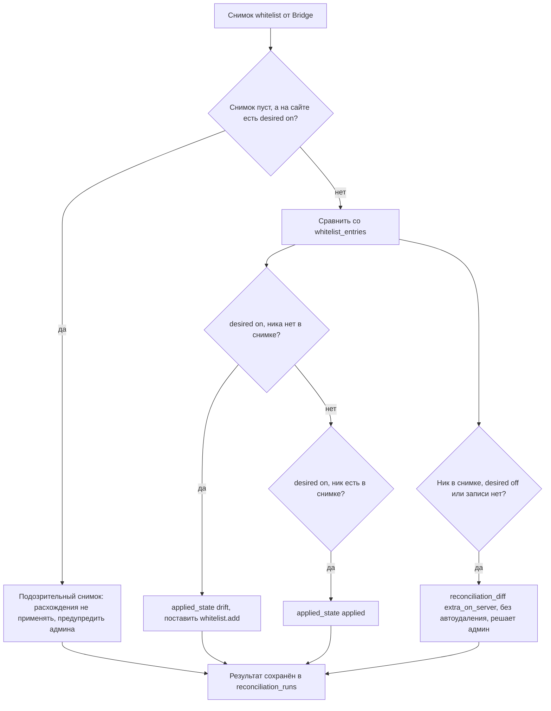
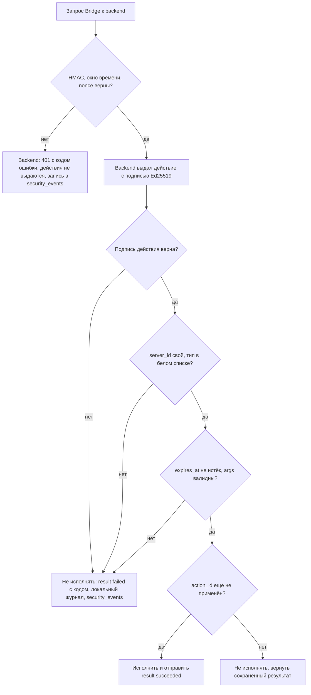

# MineOrt IV — Сценарии: онбординг, доступ, игровая авторизация, админка допуска (P0)

| Поле | Значение |
|---|---|
| Документ | `02-scenarios/01-scenarios-access-p0.md` |
| Статус | Черновик для утверждения |
| Базовая дата | 13.11.2026 (пятница); запуск 10.12.2026 (четверг), 27 календарных дней |
| Релиз | Весь файл — P0 (критический путь допуска и безопасности; не режется по лестнице сокращений, кроме глубины, указанной в [плане релиза](../04-plan/01-release-plan.md)) |
| Источник | [Аудит](<../MineOrt_IV_Аудит_концепции_и_разработки_v2 (1).md>) §5–§7 (стр. 138–295), §12 (стр. 613–640), §14 (стр. 701–740), §20 (стр. 925–952), Прил. A (стр. 1119–1158) |
| Опирается на | [01-information-architecture.md](../01-product/01-information-architecture.md), [02-user-status-model.md](../01-product/02-user-status-model.md), [03-roles-permissions.md](../01-product/03-roles-permissions.md), [02-bridge-protocol.md](../03-architecture/02-bridge-protocol.md), [03-data-model.md](../03-architecture/03-data-model.md), [04-nfr-security.md](../03-architecture/04-nfr-security.md), [03-open-decisions.md](../00-analysis/03-open-decisions.md) |
| Потребители | [05-qa/01-acceptance-tests.md](../05-qa/01-acceptance-tests.md) (создаёт TC по колонке «Связи»), [TZ-02](../06-tz/TZ-02-telegram-auth-profiles.md), [TZ-03](../06-tz/TZ-03-applications-whitelist.md), [TZ-04](../06-tz/TZ-04-minecraft-security-bridge.md) |

Теги: [ЗАКРЕПЛЕНО] / [ПРЕДЛАГАЕТСЯ] / [ПРОВЕРИТЬ] / [ОПРЕДЕЛИТЬ] / [РИСК] — из аудита; [ПРЕДЛОЖЕНИЕ КОМАНДЫ] — отсутствует в аудите (числа, правила, механизмы, имена событий, тексты интерфейса, отмеченные так); [РЕШЕНИЕ ВЛАДЕЛЬЦА 13.11.2026] — решения владельца (OD-33, OD-34). Тексты правил сервера не придумываются (OD-06).

## 1. О файле

Файл описывает 46 сценариев P0: онбординг (ONB), вход через Telegram (AUTH), ник, приглашения и заявки, whitelist (ACC), игровую авторизацию (GAME), мастер подключения и Гайдбук (GUIDE), кабинет (DSH, статус), админку допуска (ADM) и эксплуатацию (OPS). Это спецификация поведения: приложения пока нет, тест-кейсы 05-qa пишутся по этим сценариям.

**Сквозные правила для всех сценариев (не повторяются в каждом):**

1. Канонические статусы — как в [02-user-status-model.md](../01-product/02-user-status-model.md); производный `onboarding_stage` вычисляется на сервере при каждом запросе и нигде не хранится.
2. «Доступ готов» и адрес сервера показываются только при `whitelist.desired=on` и `applied_state=applied` (AC-21, AC-28). Таймаут, `failed`, `drift` никогда не превращаются в «подтверждено».
3. Любое право проверяется на backend по сессии и по БД (NFR-SEC-06); скрытие кнопки — не защита. Отказ по праву пишется в `security_events` (тип `permission_denied` [ПРЕДЛОЖЕНИЕ КОМАНДЫ]).
4. Чужой закрытый объект отдаёт 404, а не 403, если существование объекта нельзя раскрывать; иначе 403.
5. Лимиты — NFR-LIM-xx; превышение даёт 429 с `Retry-After` и понятным текстом.
6. Имена событий `audit_log` / `security_events` — [ПРЕДЛОЖЕНИЕ КОМАНДЫ] (за основу взяты имена из модели статусов); окончательный каталог — в ТЗ.
7. Тип 05-qa: уровни TC — E2E Playwright, API, Плагин-интеграция на тестовом Paper, Ручной. Приоритеты — Blocker / Critical / Major / Minor; приоритеты и Given/When/Then задаёт 05-qa (здесь — только перечень ID и смысл).
8. Эпики E00–E19 в колонке «Связи» — предварительная привязка [ПРЕДЛОЖЕНИЕ КОМАНДЫ] (уточняется в [backlog](../04-plan/02-backlog.md)): E01 главная и меню; E02 Telegram-вход и профили; E03 ник, приглашения, заявки, решения; E04 Bridge и игровая авторизация; E05 правила и CTA; E06 мастер `/start` и клиент; E07 кабинет и админка допуска; E19 эксплуатация.

**SC-ACC-04 в нумерации отсутствует намеренно** (так задано планом пакета): нумерация ACC сохранена с пропуском, ссылки на SC-ACC-04 недопустимы. Погашение приглашения целиком описано в SC-ACC-02.

## 2. Индекс сценариев

| SC | Название | Релиз | AC |
|---|---|---|---|
| [SC-ONB-01](#sc-onb-01--гость-нажимает-начать-играть) | Гость нажимает «Начать играть» | P0 | AC-01 |
| [SC-ONB-02](#sc-onb-02--авторизованный-пользователь-нажимает-начать-играть) | Авторизованный пользователь нажимает «Начать играть» (все стадии) | P0 | AC-02 |
| [SC-ONB-03](#sc-onb-03--принятие-правил) | Принятие правил | P0 | AC-07, AC-33 |
| [SC-ONB-04](#sc-onb-04--инвайт-ссылка-до-входа) | Инвайт-ссылка до входа, сохранение контекста | P0 | AC-03, AC-26 |
| [SC-AUTH-01](#sc-auth-01--первый-вход-через-telegram) | Первый вход через Telegram | P0 | AC-01 |
| [SC-AUTH-02](#sc-auth-02--повторный-вход-сессия-выход-отзыв) | Повторный вход, сессия, выход, отзыв | P0 | AC-02 |
| [SC-AUTH-03](#sc-auth-03--смена-telegram-username) | Смена Telegram `@username` | P0 | AC-25 |
| [SC-AUTH-04](#sc-auth-04--отмена-входа-невалидная-подпись-replay) | Отмена входа, невалидная подпись, replay | P0 | AC-01 (негатив) |
| [SC-AUTH-05](#sc-auth-05--потеря-доступа-к-telegram) | Потеря доступа к Telegram | P0 | AC-34 |
| [SC-AUTH-06](#sc-auth-06--заблокированный-пользователь-входит) | Заблокированный пользователь входит | P0 | AC-22 (смежный) |
| [SC-AUTH-07](#sc-auth-07--бот-не-может-писать-в-лс) | Бот не может писать в ЛС | P0 | AC-05 (смежный) |
| [SC-ACC-01](#sc-acc-01--выбор-ника) | Выбор ника (формат, занятость, premium-ник) | P0 | AC-03, AC-04 |
| [SC-ACC-02](#sc-acc-02--валидное-приглашение) | Валидное приглашение | P0 | AC-03, AC-33 |
| [SC-ACC-03](#sc-acc-03--приглашение-истекло-отозвано-или-исчерпано) | Приглашение истекло, отозвано или исчерпано | P0 | AC-26 |
| [SC-ACC-05](#sc-acc-05--подача-заявки) | Подача заявки | P0 | AC-04 |
| [SC-ACC-06](#sc-acc-06--отклонение-заявки-и-повтор-после-паузы) | Отклонение заявки, повтор с паузой | P0 | AC-04, AC-22 |
| [SC-ACC-07](#sc-acc-07--одобрение-при-выключенном-minecraft) | Одобрение при выключенном Minecraft | P0 | AC-21 |
| [SC-ACC-08](#sc-acc-08--ошибка-или-таймаут-whitelist-retry-ручная-обработка) | Ошибка или таймаут whitelist, retry, ручная обработка | P0 | AC-21, AC-28 |
| [SC-ACC-09](#sc-acc-09--reconciliation-после-рестарта) | Reconciliation после рестарта (drift в обе стороны) | P0 | AC-28 |
| [SC-ACC-10](#sc-acc-10--смена-ника-после-whitelist) | Смена ника после whitelist | P0 | AC-05, AC-34 |
| [SC-ACC-11](#sc-acc-11--приостановка-или-отзыв-доступа) | Приостановка или отзыв доступа | P0 | AC-22, AC-34 |
| [SC-ACC-12](#sc-acc-12--два-telegram-на-один-ник) | Два Telegram на один ник | P0 | AC-05 |
| [SC-GAME-01](#sc-game-01--первый-вход-в-игру-и-подтверждение-личности) | Первый вход, подтверждение личности | P0 | AC-29 |
| [SC-GAME-02](#sc-game-02--повторный-вход-premium-и-offline) | Повторный вход premium / offline | P0 | AC-05, AC-29 |
| [SC-GAME-03](#sc-game-03--вход-под-чужим-ником) | Вход под чужим ником | P0 | AC-05 |
| [SC-GAME-04](#sc-game-04--backend-недоступен-fail-closed) | Backend недоступен, fail-closed | P0 | AC-30 |
| [SC-GAME-05](#sc-game-05--перебор-и-истечение-кода) | Перебор и истечение кода | P0 | AC-05 |
| [SC-GAME-06](#sc-game-06--действия-до-авторизации-запрещены) | Действия до авторизации запрещены | P0 | AC-29 |
| [SC-GAME-07](#sc-game-07--параллельный-и-повторный-вход-под-тем-же-ником) | Параллельный и повторный вход под тем же ником | P0 | AC-05, AC-29 |
| [SC-GUIDE-01](#sc-guide-01--мастер-start) | Мастер `/start` | P0 | AC-06 |
| [SC-GUIDE-02](#sc-guide-02--start-до-одобрения) | `/start` до одобрения | P0 | AC-06, AC-21 |
| [SC-GUIDE-03](#sc-guide-03--устаревший-клиент-и-контрольная-сумма) | Устаревший клиент, контрольная сумма | P0 | AC-06 |
| [SC-GUIDE-04](#sc-guide-04--энциклопедия-поиск-ничего-не-найдено) | Энциклопедия, поиск, «ничего не найдено» | P0 | AC-06 |
| [SC-DSH-01](#sc-dsh-01--кабинет-статусы-допуска) | Кабинет: статусы допуска | P0 | AC-20 (статус) |
| [SC-DSH-04](#sc-dsh-04--удаление-аккаунта) | Удаление аккаунта | P0 | AC-22, AC-24 (смежный) |
| [SC-ADM-01](#sc-adm-01--решение-по-заявке-аудит-посторонний) | Решение по заявке, аудит, посторонний | P0 | AC-22 |
| [SC-ADM-02](#sc-adm-02--step-up-для-критичных-операций) | Step-up для критичных операций | P0 | AC-34 |
| [SC-ADM-03](#sc-adm-03--публикация-новой-версии-правил) | Публикация новой версии правил | P0 | AC-07, AC-33 |
| [SC-ADM-04](#sc-adm-04--очередь-bridge-просмотр-retry-cancel) | Очередь Bridge: просмотр, retry, cancel | P0 | AC-21, AC-28 |
| [SC-ADM-05](#sc-adm-05--бан-и-разбан) | Бан и разбан | P0 | AC-34 |
| [SC-ADM-06](#sc-adm-06--перепривязка-telegram) | Перепривязка Telegram | P0 | AC-25, AC-34 |
| [SC-ADM-08](#sc-adm-08--создание-и-отзыв-приглашений) | Создание и отзыв приглашений | P0 | AC-26 |
| [SC-OPS-01](#sc-ops-01--бэкап-и-тест-восстановления) | Бэкап и тест восстановления | P0 | — (NFR-REL-06) |
| [SC-OPS-02](#sc-ops-02--сайт-при-выключенном-minecraft) | Сайт при выключенном Minecraft | P0 | AC-21 |
| [SC-OPS-03](#sc-ops-03--откат-ошибочных-прав) | Откат ошибочных прав | P0 | AC-22 |
| [SC-OPS-04](#sc-ops-04--ротация-и-компрометация-секрета-bridge-неподписанные-и-просроченные-команды) | Ротация и компрометация секрета Bridge; неподписанные и просроченные команды | P0 | AC-27 |

Покрытие P0-критериев приёмки (план пакета, §«Релизы AC»): AC-01 — ONB-01, AUTH-01, AUTH-04; AC-02 — ONB-02, AUTH-02; AC-03 — ONB-04, ACC-01, ACC-02; AC-04 — ACC-01, ACC-05, ACC-06; AC-05 — GAME-02, GAME-03, GAME-05, ACC-10, ACC-12; AC-06 — GUIDE-01..04; AC-07 — ONB-03, ADM-03; AC-20 (статус) — DSH-01; AC-21 — ACC-07, ACC-08, GUIDE-02, OPS-02; AC-22 — ADM-01, ADM-05, OPS-03; AC-25 — AUTH-03, ADM-06; AC-26 — ONB-04, ACC-03, ADM-08; AC-27 — OPS-04; AC-28 — ACC-08, ACC-09; AC-29 — GAME-01, GAME-02, GAME-06; AC-30 — GAME-04; AC-33 — ONB-03, ACC-02, ADM-03; AC-34 — ADM-02, ADM-05, ADM-06, ACC-10.

---

## 3. Онбординг (ONB)

### SC-ONB-01 · Гость нажимает «Начать играть»

| Поле | Значение |
|---|---|
| Релиз | P0 |
| Актор и уровень доступа | Посетитель: `guest` (нет сессии) |
| Предусловия | `onboarding_stage=guest`; сайт доступен; Telegram OIDC настроен [ПРОВЕРИТЬ домен у BotFather, R-17] |
| Триггер | Клик по кнопке «Начать играть» на `/` (или в закреплённой кнопке шапки) |
| Связи | AC: AC-01. TC: TC-ONB-01a (CTA ведёт на `/login` с сохранением возврата), TC-ONB-01b (мобильный: 320 px, CTA виден без прокрутки). OD: OD-44. TZ: [TZ-02](../06-tz/TZ-02-telegram-auth-profiles.md), [TZ-00](../06-tz/TZ-00-product-scope.md). Epic: E01, E05. SC: SC-AUTH-01 |
| Источник в аудите | §5.1, §5.3–5.4 (стр. 140–185); Прил. A (стр. 1121–1131) |

**Основной поток**

1. Гость видит на `/` главный CTA «Начать играть» (аудит стр. 142: важнее новостей и галереи).
2. Клик отправляет на `/login?return=/onboarding/minecraft`; адрес возврата сохраняется на сервере (не в открытом виде в OIDC-запросе).
3. `/login` показывает кнопку «Продолжить через Telegram» (аудит стр. 179) и ссылки на `/rules` и `/privacy`.
4. Дальше выполняется [SC-AUTH-01](#sc-auth-01--первый-вход-через-telegram).
5. После успешного входа сервер вычисляет стадию и перенаправляет на нужный шаг: для нового пользователя `needs_rules` → `/onboarding/minecraft`, шаг правил ([SC-ONB-03](#sc-onb-03--принятие-правил)).

**Альтернативы и ошибки**

- A1. Гость пришёл по `/invite/:code` — контекст приглашения сохранён ([SC-ONB-04](#sc-onb-04--инвайт-ссылка-до-входа)), `return` указывает на онбординг с приглашением.
- A2. Гость вернулся на `/`, не завершив вход: никаких записей не создано, CTA прежний.
- E1. Telegram недоступен (NFR-REL-10): `/login` показывает «Вход через Telegram сейчас недоступен. Попробуйте позже»; сайт остальные страницы отдаёт как обычно.
- E2. Включён блок JS/виджет не загрузился: кнопка работает как обычная ссылка на серверный старт OIDC [ПРЕДЛОЖЕНИЕ КОМАНДЫ].
- E3. Адрес `return` ведёт на внешний домен: игнорируется, используется `/onboarding/minecraft` (защита от open redirect).

**Постусловия (изменения статусов)**

- До завершения входа изменений нет. После входа — `users.account_status=active`, стадия `needs_rules` (см. SC-AUTH-01).

**UI-состояния**

- loading: кнопка CTA блокируется на время редиректа, без прыжков вёрстки.
- empty: не применимо.
- error: «Вход через Telegram сейчас недоступен. Попробуйте позже» + кнопка «Повторить».
- success: переход на шаг «Принять правила».

**Аудит и события**

- audit_log: нет. security_events: нет. server_actions: нет. Событие активности (аналитика CTA) — [ПРЕДЛОЖЕНИЕ КОМАНДЫ], без персональных данных.

---

### SC-ONB-02 · Авторизованный пользователь нажимает «Начать играть»

| Поле | Значение |
|---|---|
| Релиз | P0 |
| Актор и уровень доступа | `tg_user`, `applicant`, `member`, `restricted` |
| Предусловия | Есть действующая сессия; `onboarding_stage` — любая из 11 канонических |
| Триггер | Клик по «Начать играть» (на `/`, в шапке) |
| Связи | AC: AC-02. TC: TC-ONB-02a (параметризованный: по одному кейсу на стадию, цель и текст CTA), TC-ONB-02b (повторный Telegram-вход не запрашивается; устаревший CTA после смены стадии). OD: OD-03, OD-44. TZ: [TZ-00](../06-tz/TZ-00-product-scope.md), [TZ-03](../06-tz/TZ-03-applications-whitelist.md). Epic: E05, E01. SC: SC-ONB-03, SC-ACC-01, SC-ACC-05, SC-GUIDE-01, SC-DSH-01 |
| Источник в аудите | §5.3–5.4 (стр. 154–185); [IA §4](../01-product/01-information-architecture.md) |

**Основной поток**

1. Сервер определяет `onboarding_stage` по правилам [02-user-status-model.md §8](../01-product/02-user-status-model.md) (сверху вниз, первое совпавшее условие).
2. CTA ведёт на цель по таблице; Telegram-вход заново не запрашивается (AC-02).
3. Пользователь попадает на нужный шаг установки или допуска.

| Стадия | Текст CTA | Цель | Что скрыто |
|---|---|---|---|
| `guest` | «Начать играть» | `/login` (см. SC-ONB-01) | — |
| `needs_rules` | «Принять правила» | `/onboarding/minecraft`, шаг правил | Подача заявки, погашение приглашения |
| `needs_nick` | «Указать ник и получить доступ» | `/onboarding/minecraft`, шаг ника | — |
| `needs_access` | «Продолжить регистрацию» | `/onboarding/minecraft`, шаг «приглашение или заявка» | — |
| `application_pending` | «Заявка на рассмотрении» | `/dashboard` | Адрес сервера, «Можно подключаться» |
| `application_rejected` | «Заявка отклонена» (причина, дата, когда можно подать новую) | `/dashboard` | Адрес сервера |
| `access_preparing` | «Доступ подготавливается» | `/start` (шаги установки) | Адрес сервера, «Можно подключаться» |
| `ready_to_install` | «Установить сборку и подключиться» | `/start`, шаг установки | — |
| `first_login_pending` | «Подтвердить первый вход» | `/start` (шаг входа), подтверждение кода — `/dashboard` | — |
| `active` | «Как подключиться» + ссылка в кабинет (OD-44) | `/guide/<установка>` и `/dashboard` | — |
| `restricted` | «Доступ ограничен» | `/dashboard` | Все игровые шаги |

**Альтернативы и ошибки**

- A1. Стадия изменилась между отрисовкой страницы и кликом (например, одобрили заявку): цель вычисляется заново на сервере при клике, UI не доверяется.
- A2. `drift` или `failed` у игрока, который был `active`: стадия `access_preparing`, CTA «Доступ подготавливается», без «Можно подключаться» (I-01).
- A3. Сессия истекла: «Сессия завершилась. Войдите снова», `/login` с возвратом.
- E1. `account_status=deleted`: сессия невозможна, поведение как `guest`.
- E2. Пользователь переходит по прямой ссылке на шаг, недоступный его стадии (например, подача заявки при `needs_rules`): сервер отклоняет (403/422) и перенаправляет на актуальный шаг (AC-33).

**Постусловия (изменения статусов)**

- Нет: сценарий только маршрутизирует.

**UI-состояния**

- loading: скелетон кнопки, пока вычисляется стадия.
- empty: не применимо.
- error: «Не удалось определить статус. Повторить» (кнопка).
- success: переход на цель стадии.

**Аудит и события**

- Нет записей `audit_log`. При E2 — `security_events` типа `permission_denied` не пишется (это ожидаемая навигация), пишется только при подозрении на обход (повторяющиеся запросы к закрытому шагу) [ПРЕДЛОЖЕНИЕ КОМАНДЫ].

---

### SC-ONB-03 · Принятие правил

| Поле | Значение |
|---|---|
| Релиз | P0 |
| Актор и уровень доступа | `tg_user` (и выше при новой мажорной версии) |
| Предусловия | `onboarding_stage=needs_rules`: нет `rules_acceptances` для текущей мажорной `rules_versions`; нет `membership=approved`; опубликована хотя бы одна версия правил (текст до 01.12, OD-06; до этого — тестовая версия на staging) |
| Триггер | Шаг «Правила» в `/onboarding/minecraft` или баннер «Правила обновлены, подтвердите» |
| Связи | AC: AC-07, AC-33. TC: TC-ONB-03a (обход UI: подача заявки без принятия, Blocker), TC-ONB-03b (принятие создаёт `rules_acceptances` ровно на актуальную мажорную версию; стадия → `needs_nick`), TC-ONB-03c (минорная правка не требует повтора; мажорная требует; баннер у одобренных). OD: OD-06, OD-38, OD-45. TZ: [TZ-03](../06-tz/TZ-03-applications-whitelist.md). Epic: E05. SC: SC-ADM-03, SC-ACC-02, SC-ACC-05 |
| Источник в аудите | §5.5 (стр. 187–191); §20 AC-07 (стр. 935); C-18, G-04 |

**Основной поток**

1. Шаг 1 `/onboarding/minecraft` показывает текст актуальной версии правил: номер версии, дату последнего обновления, полный текст (без придуманного содержимого).
2. Пользователь отмечает «Я прочитал(а) и принимаю правила (версия X.Y)» и нажимает «Принять».
3. Клиент отправляет `rules_version_id`; backend проверяет, что версия актуальна по мажорному номеру.
4. Создаётся `rules_acceptances(user_id, rules_version_id, accepted_at)`; в `audit_log` пишется `rules.accepted`.
5. Стадия пересчитывается: `needs_nick` ([SC-ACC-01](#sc-acc-01--выбор-ника)).

**Альтернативы и ошибки**

- A1. Пока пользователь читал, опубликована новая мажорная версия: 409 `rules.outdated`, UI показывает новую версию и просит принять её.
- A2. Правка минорная: повторное принятие не требуется (02-user-status-model §4, п. 2).
- A3. Пользователь с уже одобренным допуском после новой мажорной версии: стадия не меняется, баннер «Правила обновлены, подтвердите»; доступ не отзывается; новые заявки и приглашения блокируются до принятия. Блокировать ли вход в игру — [ОПРЕДЕЛИТЬ → OD-06].
- A4. Согласие с политикой конфиденциальности `/privacy` (OD-45) оформляется отдельной отметкой при первом входе (SC-AUTH-01), а не смешивается с принятием правил [ПРЕДЛОЖЕНИЕ КОМАНДЫ].
- E1. Обход UI: прямой вызов подачи заявки без принятия — 403/422, заявка не создаётся (TC-ONB-03a). Прямое погашение приглашения без принятия — отказ, приглашение остаётся `active` (TC-ACC-02a).
- E2. Правила не опубликованы вовсе (OD-06 не закрыт): шаг показывает «Правила будут опубликованы до открытия сервера», подача заявки и погашение приглашения недоступны [ОПРЕДЕЛИТЬ → OD-06: допустимость варианта «пустая секция»].
- E3. Гость открывает `/rules`: читает, принять нельзя — «Войдите, чтобы принять правила».

**Постусловия (изменения статусов)**

- Запись `rules_acceptances`; `onboarding_stage`: `needs_rules` → `needs_nick`. Остальные измерения не меняются.

**UI-состояния**

- loading: скелетон текста правил; кнопка «Принять» заблокирована до прокрутки/загрузки текста [ПРЕДЛОЖЕНИЕ КОМАНДЫ].
- empty: «Правила пока не опубликованы» (E2).
- error: «Не удалось сохранить согласие. Повторить»; при 409 — «Правила обновились. Прочитайте новую версию».
- success: «Правила приняты» → переход к шагу ника.

**Аудит и события**

- audit_log: `rules.accepted` (user_id, rules_version_id). security_events: при попытке обхода (E1) — `permission_denied`. server_actions: нет.

---

### SC-ONB-04 · Инвайт-ссылка до входа

| Поле | Значение |
|---|---|
| Релиз | P0 |
| Актор и уровень доступа | `guest` или `tg_user` |
| Предусловия | Существует `invitations.status=active`, `expires_at` в будущем; ссылка `/invite/<код>` выдана админом (OD-36, SC-ADM-08) |
| Триггер | Переход по `/invite/:code` до входа |
| Связи | AC: AC-03, AC-26. TC: TC-ONB-04a (просмотр не погашает приглашение; контекст сохраняется через Telegram-вход), TC-ONB-04b (контекст потерян — ручной ввод кода; ограничение частоты `/invite/:code`). OD: OD-36. G: G-19. TZ: [TZ-03](../06-tz/TZ-03-applications-whitelist.md), [TZ-02](../06-tz/TZ-02-telegram-auth-profiles.md). Epic: E03. SC: SC-AUTH-01, SC-ACC-02, SC-ACC-03 |
| Источник в аудите | §6.2 (стр. 209–213); G-19 |

**Основной поток**

1. Сервер находит приглашение по SHA-256 хэшу токена из URL; приглашение не погашается (просмотр не меняет `invitations.status`).
2. Страница показывает предпросмотр: «Вас пригласили в MineOrt IV», срок действия, кнопку «Продолжить через Telegram» (для `guest`) или «Продолжить» (для `tg_user`).
3. Контекст приглашения сохраняется в серверной pre-auth сессии (httpOnly cookie, привязка к хэшу токена; срок жизни контекста до 1 часа [ПРЕДЛОЖЕНИЕ КОМАНДЫ]); сам код не передаётся в OIDC-запросе (закрывает G-19).
4. После [SC-AUTH-01](#sc-auth-01--первый-вход-через-telegram) пользователь возвращается в онбординг с активным контекстом.
5. Далее по стадии: правила ([SC-ONB-03](#sc-onb-03--принятие-правил)) → ник ([SC-ACC-01](#sc-acc-01--выбор-ника)) → погашение ([SC-ACC-02](#sc-acc-02--валидное-приглашение)).

**Альтернативы и ошибки**

- A1. Приглашение недействительно (истекло, исчерпано, отозвано): страница показывает причину ([SC-ACC-03](#sc-acc-03--приглашение-истекло-отозвано-или-исчерпано)) и «Подать заявку».
- A2. Пользователь уже `member` (допуск `approved`): «У вас уже есть доступ»; приглашение не гасится, остаётся `active`.
- A3. Пользователь отменил Telegram-вход: контекст сохраняется до окончания его срока; возврат на `/invite/:code` восстанавливает шаг.
- A4. Cookie потеряна (другой браузер/устройство после входа): онбординг предлагает поле «Введите код приглашения» вручную.
- A5. Приглашение предъявительское (не привязано к Telegram): погашает тот, кто успел; привязка к конкретному Telegram не вводится [ПРЕДЛОЖЕНИЕ КОМАНДЫ, уточняется в OD-36].
- E1. Подбор кодов: ограничение частоты запросов к `/invite/:code` на IP [ПРЕДЛОЖЕНИЕ КОМАНДЫ, значение — в ТЗ]; токен 128 бит, перебор нереалистичен (NFR-LIM-03).
- E2. `account_status ∈ {suspended, banned}`: стадия `restricted`, предпросмотр показывает «Доступ ограничен».

**Постусловия (изменения статусов)**

- `invitations.status` не меняется. Создаётся только pre-auth контекст.

**UI-состояния**

- loading: скелетон карточки приглашения.
- empty: не применимо.
- error: «Приглашение не найдено» / причина недействительности (см. SC-ACC-03).
- success: карточка предпросмотра с кнопкой продолжения.

**Аудит и события**

- audit_log: нет (просмотр). security_events: превышение лимита запросов к `/invite/:code` — `invite_probe` [ПРЕДЛОЖЕНИЕ КОМАНДЫ].

---

## 4. Вход через Telegram (AUTH)

### SC-AUTH-01 · Первый вход через Telegram

| Поле | Значение |
|---|---|
| Релиз | P0 |
| Актор и уровень доступа | `guest` → `tg_user` |
| Предусловия | Telegram-идентификатор ещё не известен системе; OIDC-клиент зарегистрирован [ПРОВЕРИТЬ]; лимит NFR-LIM-01 не превышен |
| Триггер | Клик «Продолжить через Telegram» на `/login` |
| Связи | AC: AC-01. TC: TC-AUTH-01a (первый вход создаёт `users`, `telegram_identities`, сессию; профиль с устойчивым `user_id`), TC-AUTH-01b (пользователь без `@username`; лимит 10 в минуту на IP). OD: OD-45, OD-41. NFR: NFR-LIM-01, NFR-SEC-01, NFR-SEC-02, NFR-SEC-07. TZ: [TZ-02](../06-tz/TZ-02-telegram-auth-profiles.md). Epic: E02. SC: SC-ONB-01, SC-AUTH-04, SC-AUTH-07 |
| Источник в аудите | §6.1 (стр. 197–207); §14 (стр. 705); T-REPLAY-OIDC |

**Основной поток**

1. Backend создаёт `state`, `nonce` и PKCE-verifier; `state` одноразовый, TTL 10 минут (NFR-SEC-07).
2. Браузер перенаправляется на Telegram OIDC [ПРОВЕРИТЬ: https://core.telegram.org/bots/telegram-login].
3. Пользователь подтверждает вход в Telegram.
4. Callback: проверка `state` (привязан к браузерной pre-auth сессии), обмен кода, проверка подписи ID token, `aud`/`iss`/`exp`, `nonce`.
5. По `telegram_id` не найдено записи: создаются `users` (`account_status=active`, `site_role=player`), `telegram_identities` (`telegram_id` — устойчивый ключ, `username` — изменяемое отображаемое поле, аудит стр. 202), `audit_log: user.created`.
6. Создаётся `user_sessions`: cookie httpOnly, Secure, SameSite=Lax; обычная сессия 30 дней, скользящая (NFR-SEC-01, NFR-SEC-02).
7. При первом входе показывается краткое согласие с политикой `/privacy` (OD-45) [ПРЕДЛОЖЕНИЕ КОМАНДЫ].
8. Редирект на сохранённый `return` либо по стадии (`needs_rules`).

**Альтернативы и ошибки**

- A1. Вход при активном инвайт-контексте: онбординг продолжается с приглашением (SC-ONB-04).
- A2. У пользователя нет Telegram `@username`: профиль создаётся с отображаемым именем из данных Telegram; работа системы от `username` не зависит.
- A3. `telegram_id` уже известен: это повторный вход ([SC-AUTH-02](#sc-auth-02--повторный-вход-сессия-выход-отзыв)).
- E1. Не совпал `state`/`nonce`/подпись, просрочен `state`: вход отклонён ([SC-AUTH-04](#sc-auth-04--отмена-входа-невалидная-подпись-replay)).
- E2. Превышен лимит 10 попыток в минуту на IP: 429 «Слишком много попыток. Попробуйте через минуту».
- E3. Telegram недоступен: сообщение, как в SC-ONB-01 E1.
- E4. Telegram-идентификатор принадлежит удалённому пользователю (`account_status=deleted`): поведение — [ОПРЕДЕЛИТЬ → OD-40 / G-09].

**Постусловия (изменения статусов)**

- `users.account_status=active`; запись `telegram_identities`; запись `user_sessions`. Стадия: `needs_rules`.

**UI-состояния**

- loading: «Проверяем вход…» (после возврата из Telegram).
- empty: не применимо.
- error: «Не удалось войти через Telegram. Попробуйте ещё раз» (без технических деталей).
- success: переход на шаг правил.

**Аудит и события**

- audit_log: `user.created`. security_events: при E1 — `login_bad_signature` / `login_state_invalid`; при E2 — `rate_limited`.

---

### SC-AUTH-02 · Повторный вход, сессия, выход, отзыв

| Поле | Значение |
|---|---|
| Релиз | P0 |
| Актор и уровень доступа | `tg_user` и выше; админская сессия |
| Предусловия | `telegram_identities` существует; `account_status=active` (для остальных — SC-AUTH-06) |
| Триггер | Вход, истечение сессии, «Выйти», отзыв администратором или баном |
| Связи | AC: AC-02. TC: TC-AUTH-02a (повторный вход: тот же `user_id`, статусы неизменны), TC-AUTH-02b (выход отзывает сессию; сессия после отзыва даёт 401), TC-AUTH-02c (админская сессия 12 ч без скольжения; обычная скользящая 30 дней), TC-AUTH-08a, TC-AUTH-08b (CSRF: выход и любое изменение состояния только не-GET с проверкой Origin/токена). NFR: NFR-SEC-01..03, NFR-SEC-05, NFR-SEC-08. TZ: [TZ-02](../06-tz/TZ-02-telegram-auth-profiles.md). Epic: E02. SC: SC-AUTH-01, SC-AUTH-06, SC-ADM-05 |
| Источник в аудите | §17.1 (стр. 836–838); §6.1 |

**Основной поток**

1. Пользователь входит через Telegram (шаги 1–4 SC-AUTH-01); по `telegram_id` находится существующий `user_id`; новая запись не создаётся.
2. Создаётся новая `user_sessions`; обычная сессия продлевается при активности (rolling 30 дней), админская истекает через 12 часов без продления (NFR-SEC-03).
3. Пользователь попадает на шаг по стадии либо на `return`.
4. «Выйти»: POST (не GET) с CSRF-защитой; `user_sessions.revoked_at` проставляется, cookie очищается.
5. «Выйти на всех устройствах» (в `/dashboard/settings`): отзываются все сессии пользователя [ПРЕДЛОЖЕНИЕ КОМАНДЫ].

**Альтернативы и ошибки**

- A1. Сессия истекла: на защищённой странице «Сессия завершилась. Войдите снова», возврат на ту же страницу после входа.
- A2. Несколько устройств: каждая сессия независима; отзыв одной не затрагивает остальные.
- A3. Бан или приостановка аккаунта админом: все сессии отзываются сразу (NFR-SEC-05), следующий запрос — 401 ([SC-AUTH-06](#sc-auth-06--заблокированный-пользователь-входит)).
- E1. Повторное использование отозванной cookie: 401, запись в `security_events` (`session_reuse_after_revoke`) [ПРЕДЛОЖЕНИЕ КОМАНДЫ].
- E2. Выход через GET или кросс-доменный POST без токена: отклонён (CSRF, TC-AUTH-08a/b).

**Постусловия (изменения статусов)**

- Вход: новая запись сессии. Выход/отзыв: `revoked_at` заполнено. Статусы допуска не меняются.

**UI-состояния**

- loading: «Входим…».
- empty: список сессий пуст не бывает (текущая сессия всегда есть).
- error: «Сессия завершилась. Войдите снова».
- success: «Вы вышли» + CTA «Начать играть».

**Аудит и события**

- audit_log: `auth.login`, `auth.logout`, `session.revoked` (актор, причина) [ПРЕДЛОЖЕНИЕ КОМАНДЫ]. security_events: E1.

---

### SC-AUTH-03 · Смена Telegram `@username`

| Поле | Значение |
|---|---|
| Релиз | P0 |
| Актор и уровень доступа | Любой `tg_user`+ |
| Предусловия | `telegram_identities.telegram_id` привязан к `user_id`; в БД лежит старый `username` |
| Триггер | Пользователь сменил `@username` в Telegram; при следующем входе или обновлении данных профиль приходит с новым значением |
| Связи | AC: AC-25. TC: TC-AUTH-03a (смена `@username` не меняет `user_id`, заявку, членство, whitelist, гильдию, историю), TC-AUTH-03b (захват освободившегося `@old` другим человеком создаёт нового пользователя, доступа к профилю нет). TZ: [TZ-02](../06-tz/TZ-02-telegram-auth-profiles.md). Epic: E02. SC: SC-AUTH-02, SC-ADM-06 |
| Источник в аудите | §6.1 (стр. 202); §14 (стр. 705: «не доверять username»); AC-25 [ПРЕДЛОЖЕНИЕ КОМАНДЫ] |

**Основной поток**

1. Пользователь входит (SC-AUTH-02); backend ищет запись только по `telegram_id`.
2. Полученный `username` отличается от сохранённого: `telegram_identities.username` обновляется; старое значение пишется в `telegram_identity_history`.
3. Профиль, ник, заявка, членство, whitelist, игровая личность, роли не затрагиваются; на сайте отображается новое `@username`.
4. Уведомления бота продолжают приходить (привязка по `telegram_id`/чату, не по `@username`).

**Альтернативы и ошибки**

- A1. `@username` удалён пользователем: отображается имя без `@`, система работает.
- A2. Новое значение совпадает с `@username` другого пользователя: допустимо, уникальность `username` не требуется.
- A3. Третье лицо занимает освободившийся `@old` и входит: у него другой `telegram_id`, создаётся новый `user_id`; к старому профилю доступа нет (поиск по `@username` в админке не является основанием для привязки).
- E1. В админке поиск по `@username` возвращает несколько совпадений (старый и новый владельцы): действия выполняются только по `user_id`/`telegram_id`.

**Постусловия (изменения статусов)**

- Меняется только `telegram_identities.username` (+ история). Все измерения статуса сохраняются.

**UI-состояния**

- loading/empty/error: не применимо (изменение прозрачное).
- success: в шапке и кабинете актуальное `@username`; в `/dashboard/settings` строка «Telegram: @new (ранее @old)» [ПРЕДЛОЖЕНИЕ КОМАНДЫ].

**Аудит и события**

- audit_log: `telegram.username_changed` (user_id, old, new). security_events: нет (при E1 админа — запись просмотра не нужна).

---

### SC-AUTH-04 · Отмена входа, невалидная подпись, replay

| Поле | Значение |
|---|---|
| Релиз | P0 |
| Актор и уровень доступа | `guest`; злоумышленник без аккаунта |
| Предусловия | Начат OIDC-поток (есть `state` в pre-auth сессии) либо атакующий отправляет подделанный callback |
| Триггер | Пользователь нажал «Отмена» в Telegram; callback с неверной подписью; повтор того же callback; просроченный `state` |
| Связи | AC: AC-01 (негатив). TC: TC-AUTH-04a (неверная подпись ID token и повтор — сессия не создаётся, Blocker), TC-AUTH-04b (повторное использование `state`/`nonce`, подмена callback из другой браузерной сессии, просроченный `state`), TC-AUTH-04c (отмена виджета: возврат на `/login`, `users` не создан). NFR: NFR-SEC-07, T-REPLAY-OIDC. TZ: [TZ-02](../06-tz/TZ-02-telegram-auth-profiles.md). Epic: E02. SC: SC-AUTH-01 |
| Источник в аудите | §14 (стр. 705); §17.1 (стр. 836); [ПРОВЕРИТЬ] OIDC (стр. 207) |

**Основной поток** (отмена пользователем)

1. Пользователь в Telegram отказывается подтверждать вход.
2. Callback приходит без кода авторизации или с `error`.
3. `/login` показывает «Вход отменён. Можно попробовать снова»; запись `users` и сессия не создаются; `state` аннулируется.

**Альтернативы и ошибки**

- E1. Неверная подпись ID token / неверные `aud`/`iss`/`exp`: 401, сессия не создаётся, `security_events: login_bad_signature` с IP; пользователю показывается общее «Не удалось войти» (Blocker, TC-AUTH-04a).
- E2. Replay: повторная отправка того же кода/ID token либо повторное использование `state`/`nonce`: отклонено, `security_events: login_replay`.
- E3. Просроченный `state` (старше 10 минут): «Ссылка входа устарела. Начните заново».
- E4. Callback из чужой браузерной сессии (`state` не принадлежит этой pre-auth сессии): отклонён как CSRF.
- E5. Всплеск ошибок с одного IP: срабатывает лимит NFR-LIM-01, затем алерт ≥ 5 событий за 10 минут [ПРЕДЛОЖЕНИЕ КОМАНДЫ, по аналогии с NFR-OPS-15].

**Постусловия (изменения статусов)**

- Ни `users`, ни `user_sessions` не создаются и не меняются. Существующие сессии не затрагиваются.

**UI-состояния**

- loading: не применимо.
- empty: не применимо.
- error: «Вход отменён» / «Ссылка входа устарела» / общее «Не удалось войти» (без технических деталей).
- success: не применимо (сценарий негативный).

**Аудит и события**

- security_events: `login_bad_signature`, `login_replay`, `login_state_invalid` (IP, время, user_agent; IP хранится 30 дней, NFR-OPS-03). audit_log: нет.

---

### SC-AUTH-05 · Потеря доступа к Telegram

| Поле | Значение |
|---|---|
| Релиз | P0 (процесс); статус решения OD-31 — открыто, поведение ниже — вариант по умолчанию [ПРЕДЛОЖЕНИЕ КОМАНДЫ] |
| Актор и уровень доступа | Пользователь без доступа к своему Telegram (`guest` с точки зрения сайта); `admin` с `players.rebind` |
| Предусловия | У пользователя есть `users` с `telegram_identities`, привязанный Telegram недоступен (потерян, заблокирован, смена номера, удалён пользователем или автоудалён Telegram); игровой ник уже может быть `confirmed` |
| Триггер | Пользователь выбирает «Не могу войти в Telegram» на `/login`. Явные причины: потеря телефона/номера, блокировка, а также **удаление Telegram-аккаунта пользователем или его автоудаление Telegram за неактивность** (Telegram ID после этого недоступен, аккаунт сайта остаётся) |
| Связи | AC: AC-34. TC: TC-AUTH-05a (запрос восстановления не раскрывает данные аккаунта; без администратора доступ не восстанавливается), TC-AUTH-05b (задержка 72 ч, отмена старым владельцем), TC-ADM-06a. OD: OD-31. G: G-02. NFR: T-TG-LOSS. TZ: [TZ-02](../06-tz/TZ-02-telegram-auth-profiles.md). Epic: E02, E07. SC: SC-ADM-06, SC-ADM-02 |
| Источник в аудите | §21 (стр. 970); §24.5 (стр. 1080); G-02 |

**Основной поток** (по умолчанию OD-31: восстановление только через администратора)

1. На `/login` пользователь открывает «Не могу войти в Telegram» и заполняет форму обращения: игровой ник, способ связи, описание. Форма доступна без входа, с ограничением частоты [ПРЕДЛОЖЕНИЕ КОМАНДЫ].
2. Создаётся запрос восстановления (сущность `recovery_requests` — [ПРЕДЛОЖЕНИЕ КОМАНДЫ], описана в [03-data-model.md](../03-architecture/03-data-model.md)). Ответ пользователю всегда одинаков («Обращение принято»), независимо от того, существует ли такой ник.
3. Админ в `/admin/players` проверяет игровые данные (ник, дата первого входа, UUID, последние входы из `server_events`) и подтверждение главой гильдии/модератором, если есть.
4. Админ подтверждает запрос со step-up (AC-34).
5. Запускается задержка 72 часа (OD-31); на старый Telegram (если жив) уходит уведомление с возможностью «Это не я» [ПРЕДЛОЖЕНИЕ КОМАНДЫ].
6. По истечении задержки выполняется перепривязка ([SC-ADM-06](#sc-adm-06--перепривязка-telegram)).

**Альтернативы и ошибки**

- A1. Старый владелец отменяет запрос за 72 часа: запрос закрыт, `security_events: recovery_cancelled_by_owner`, админ уведомлён.
- A2. Данных недостаточно для подтверждения: админ отклоняет с причиной; пользователь может подать новый запрос.
- A3. Пользователь без игрового прошлого (ник не `confirmed`): доступ восстанавливается проще (создать новый аккаунт) — решает админ [ОПРЕДЕЛИТЬ].
- E1. Массовая подача запросов на один аккаунт: лимит, алерт админу.
- E2. Админ без step-up пытается подтвердить: отказ (TC-ADM-02a).

**Постусловия (изменения статусов)**

- До перепривязки статусы пользователя не меняются. После: см. SC-ADM-06.

**UI-состояния**

- loading: «Отправляем обращение…».
- empty: не применимо.
- error: «Не удалось отправить обращение. Повторить».
- success: «Обращение принято. Администрация свяжется с вами» (одинаково для любого ника).

**Аудит и события**

- audit_log: `recovery.requested`, `recovery.approved`, `recovery.cancelled`. security_events: A1, E1.

---

### SC-AUTH-06 · Заблокированный пользователь входит

| Поле | Значение |
|---|---|
| Релиз | P0 |
| Актор и уровень доступа | `restricted` (`account_status ∈ {suspended, banned}`) |
| Предусловия | `users.account_status=suspended` или `banned`; все прежние сессии отозваны (I-09) |
| Триггер | Вход через Telegram или запрос API со старой сессией |
| Связи | AC: AC-22 (смежный), I-03. TC: TC-AUTH-06a (живая сессия при бане: API записи → 403, сессия отозвана, Critical), TC-AUTH-06b (вход заблокированного: виден только экран ограничения; все остальные разделы закрыты). TZ: [TZ-02](../06-tz/TZ-02-telegram-auth-profiles.md). Epic: E02, E07. SC: SC-ADM-05, SC-ACC-11, SC-AUTH-02 |
| Источник в аудите | §16.1 (стр. 814–820); §12.3 (стр. 635); [02-user-status-model §3.6](../01-product/02-user-status-model.md) |

**Основной поток**

1. Пользователь проходит Telegram-вход (SC-AUTH-01/02): личность подтверждена.
2. Сервер видит `account_status ∈ {suspended, banned}`; создаётся ограниченная сессия [ПРЕДЛОЖЕНИЕ КОМАНДЫ]: разрешены только просмотр `/dashboard` (экран статуса) и выход.
3. `onboarding_stage=restricted` (приоритет 2, перекрывает всё).
4. `/dashboard` показывает «Доступ ограничен. Обратитесь в администрацию» и причину, если она публикуема; контакт администрации из подвала.
5. Любой другой раздел отвечает 403 «У вас нет доступа к этому разделу»; `/start` недоступен.

**Альтернативы и ошибки**

- A1. Бан наступил во время активной сессии: следующий запрос получает 401/403, сессия отозвана (TC-AUTH-06a).
- A2. Игрок в игре в момент бана: `player.kick` и `whitelist.remove` ставятся в очередь (SC-ACC-11, SC-ADM-05).
- A3. `account_status=deleted`: сессия невозможна, вход создаёт нового пользователя только по правилам OD-40 [ОПРЕДЕЛИТЬ].
- E1. Заблокированный пытается подать заявку/принять приглашение прямым API: 403.
- E2. Заблокированный пытается писать/публиковать: 403 (глобально).

**Постусловия (изменения статусов)**

- Нет изменений при входе. Разбан — [SC-ADM-05](#sc-adm-05--бан-и-разбан).

**UI-состояния**

- loading: скелетон статуса.
- empty: не применимо.
- error: общий 403 «У вас нет доступа к этому разделу».
- success (экран ограничения): «Доступ ограничен. Обратитесь в администрацию».

**Аудит и события**

- security_events: `permission_denied` при попытках записи; audit_log: нет (вход не является админ-действием).

---

### SC-AUTH-07 · Бот не может писать в ЛС

| Поле | Значение |
|---|---|
| Релиз | P0 |
| Актор и уровень доступа | `tg_user`+; `telegram_identities.dm_consent=false` |
| Предусловия | Простой Telegram Login не даёт права писать в ЛС (аудит стр. 207); OD-41 по умолчанию — обязательный шаг онбординга |
| Триггер | Шаг «Подключить бота» в онбординге или `/dashboard/settings`; либо сбой доставки (Telegram вернул «forbidden») |
| Связи | AC: AC-05 (смежный: подтверждение входа ботом). TC: TC-AUTH-07a (привязка бота по одноразовому токену, `dm_consent=true`), TC-AUTH-07b (бот заблокирован: `dm_consent=false`, обязательные уведомления продублированы в кабинете, подтверждение входа переключается на резерв). OD: OD-41, OD-30, OD-23. G: G-06. TZ: [TZ-02](../06-tz/TZ-02-telegram-auth-profiles.md), [TZ-04](../06-tz/TZ-04-minecraft-security-bridge.md). Epic: E02, E04. SC: SC-GAME-02, SC-ACC-07 |
| Источник в аудите | §6.1 (стр. 204–207); §14 (стр. 711); G-06 |

**Основной поток**

1. Шаг «Подключить бота» показывает кнопку «Открыть бота в Telegram» (deep link с одноразовым токеном привязки, привязан к `user_id`).
2. Пользователь нажимает Start в боте; бот присылает токен; backend связывает чат с `user_id` и ставит `dm_consent=true`.
3. Сайт обновляет шаг («Бот подключён»); обязательные уведомления (OD-30: решение по заявке, «Доступ готов», подтверждение входа) теперь доставляются в Telegram.

**Альтернативы и ошибки**

- A1. Пользователь пропускает шаг (если OD-41 будет решён как B или C): уведомления дублируются в кабинете, подтверждение входа — игровым паролем (SC-GAME-02).
- A2. Позже пользователь блокирует бота: Telegram возвращает ошибку доставки; `notification_deliveries.status=failed`, `dm_consent=false`; в кабинете баннер «Бот не может вам писать. Нажмите Start в боте».
- A3. Уведомление о решении по заявке не доставлено: решение всё равно видно в кабинете (честный статус не зависит от доставки).
- E1. Токен привязки просрочен, использован или чужой: «Ссылка устарела. Получите новую»; привязка чужому пользователю невозможна (токен привязан к `user_id`, одноразовый).
- E2. Жёсткость гейта (блокирует ли шаг подачу заявки или «Доступ готов») — [ОПРЕДЕЛИТЬ → OD-41]; по умолчанию шаг обязателен в чек-листе онбординга и не вводит новую стадию.

**Постусловия (изменения статусов)**

- `telegram_identities.dm_consent` true/false. Стадии допуска не меняются.

**UI-состояния**

- loading: «Ждём подтверждения от бота…» (опрос статуса).
- empty: не применимо.
- error: «Бот не может вам писать. Нажмите Start в боте» + кнопка «Открыть бота».
- success: «Бот подключён».

**Аудит и события**

- audit_log: `bot.linked`, `bot.unlinked`. notification_deliveries: статусы доставок (аудит стр. 737: подтверждение отправки — Telegram API).

## 5. Ник, допуск и whitelist (ACC)

### SC-ACC-01 · Выбор ника

| Поле | Значение |
|---|---|
| Релиз | P0 |
| Актор и уровень доступа | `tg_user` |
| Предусловия | `onboarding_stage=needs_nick`: правила текущей мажорной версии приняты; нет `minecraft_identities` с `binding_status ∈ {reserved, confirmed}` |
| Триггер | Шаг «Minecraft-ник» в `/onboarding/minecraft` |
| Связи | AC: AC-03, AC-04. TC: TC-ACC-01a (валидный ник создаёт `reserved`, `account_type=unknown`), TC-ACC-01b (формат: длина, символы, пробелы, регистр), TC-ACC-01c (занятый ник без раскрытия владельца, регистронезависимо), TC-ACC-01d (ник существующего лицензионного аккаунта: предупреждение, привилегий нет), TC-OPS-08a (SQL-инъекции и экранирование в поле ника). NFR: T-SQLI, T-XSS. OD: OD-37. TZ: [TZ-03](../06-tz/TZ-03-applications-whitelist.md). Epic: E03. SC: SC-ACC-12, SC-ACC-10 |
| Источник в аудите | §6.1 (стр. 203); §6.4 (стр. 230) |

**Основной поток**

1. Пользователь вводит ник; клиент подсказывает формат, но решает сервер.
2. Валидация: 3–16 символов, латиница, цифры, `_` [ПРОВЕРИТЬ правила ника Java Edition, как в 02-bridge-protocol §1]; пробелы по краям обрезаются; сравнение без учёта регистра.
3. Проверка занятости: нет записи с тем же `lower(nickname)` и `binding_status ∈ {reserved, confirmed}` (I-05, K-11).
4. Предупреждение о лицензионном аккаунте: если ник совпадает с существующим Mojang-профилем, показывается «Этот ник может принадлежать лицензионному аккаунту. Владение подтверждается при первом входе в игру» [ПРОВЕРИТЬ реализуемость проверки]. Резервирование ника не даёт игрового доступа и не доказывает владение.
5. Создаётся `minecraft_identities(user_id, nickname, binding_status=reserved, account_type=unknown, game_identity=unconfirmed)`.
6. Стадия пересчитывается: `needs_access` (выбор «приглашение или заявка»).

**Альтернативы и ошибки**

- A1. Пользователь меняет ник до подачи заявки/погашения приглашения: прежняя запись `reserved` → `released`, новая `reserved`; частота таких смен ограничивается [ОПРЕДЕЛИТЬ → ТЗ].
- A2. `account_type` определяется плагином входа, а не заявлением пользователя; значение `premium` записывается только после проверки Mojang-сессии (C-14).
- E1. Ник занят (в том числе другим регистром): «Этот ник уже занят» — владелец не раскрывается ([SC-ACC-12](#sc-acc-12--два-telegram-на-один-ник)).
- E2. Недопустимые символы/длина: «Ник: 3–16 символов, латиница, цифры и _».
- E3. Запрещённые или неприличные ники: список и политика — [ОПРЕДЕЛИТЬ] (не придумываются).
- E4. Попытка сменить ник при `applications.status=pending`: запрещено (сначала отзыв заявки) [ПРЕДЛОЖЕНИЕ КОМАНДЫ]; после whitelist смена только через администратора ([SC-ACC-10](#sc-acc-10--смена-ника-после-whitelist)).
- E5. Строка с SQL/HTML-разметкой: отклоняется валидатором ника; при выводе всегда экранируется.

**Постусловия (изменения статусов)**

- `minecraft_identities`: `binding_status=reserved`, `account_type=unknown`, `game_identity=unconfirmed`. Стадия: `needs_nick` → `needs_access`.

**UI-состояния**

- loading: проверка занятости «Проверяем ник…» (debounce).
- empty: пустое поле — подсказка формата.
- error: тексты E1–E4 рядом с полем.
- success: «Ник зарезервирован. Дальше — приглашение или заявка».

**Аудит и события**

- audit_log: `identity.nickname_reserved`, при смене — `identity.nickname_released`. security_events: нет.

---

### SC-ACC-02 · Валидное приглашение

| Поле | Значение |
|---|---|
| Релиз | P0 |
| Актор и уровень доступа | `tg_user` |
| Предусловия | `needs_access`: правила приняты, ник `reserved`; `invitations.status=active`, `expires_at` в будущем, `used_count < max_uses`; нет `pending`-заявки и нет `approved`-членства |
| Триггер | «Применить приглашение» (из контекста SC-ONB-04) либо ручной ввод кода |
| Связи | AC: AC-03, AC-33. TC: TC-ACC-02a (погашение без принятия правил: отказ, приглашение остаётся `active`, Blocker), TC-ACC-02b (двойной клик и гонка двух вкладок: ровно одно погашение, T-RACE), TC-ACC-02c (позитив: `exhausted`, `invitation_redemptions`, `membership=approved`, `desired=on`, `whitelist.add` в очереди). OD: OD-36, OD-13. NFR: NFR-LIM-03. TZ: [TZ-03](../06-tz/TZ-03-applications-whitelist.md). Epic: E03. SC: SC-ONB-04, SC-ACC-03, SC-ACC-07 |
| Источник в аудите | §6.2 (стр. 211); AC-03 (стр. 931); AC-33 [ПРЕДЛОЖЕНИЕ КОМАНДЫ] |

**Основной поток**

1. Пользователь подтверждает применение приглашения.
2. Backend в одной транзакции: ищет приглашение по хэшу токена `FOR UPDATE`; проверяет `status=active`, срок, `used_count < max_uses` (K-10); проверяет, что принята актуальная мажорная версия правил (AC-33) и что ник `reserved` за этим пользователем.
3. Создаётся `invitation_redemptions`; `used_count` увеличивается; при `max_uses=1` статус → `exhausted`.
4. Создаётся `access_memberships` со статусом `approved` (приглашения выдаёт только admin, OD-36, поэтому «предварительное одобрение» аудита равно одобрению; см. 02-user-status-model §3.3).
5. Создаётся `whitelist_entries`: `desired=on`, `applied_state=pending`; ставится `server_actions` `whitelist.add` (`queued`, `expires_at` +24 ч).
6. Стадия `access_preparing`; после применения — `ready_to_install` ([SC-ACC-07](#sc-acc-07--одобрение-при-выключенном-minecraft)).
7. В бот и кабинет уходит уведомление о допуске; «Доступ готов» — только после `applied`.

**Альтернативы и ошибки**

- A1. Две вкладки одновременно: одна транзакция выигрывает, вторая получает 409 «Приглашение уже использовано» (TC-ACC-02b); создаётся ровно одно членство.
- A2. Пользователь уже `member`: 409, приглашение остаётся `active`.
- A3. Minecraft выключен: допуск `approved`, `applied_state=pending`, «Доступ подготавливается» (AC-21).
- E1. Правила не приняты: 403/422, приглашение остаётся `active` (TC-ACC-02a).
- E2. Ник не выбран: возврат на шаг ника (422).
- E3. Приглашение недействительно: [SC-ACC-03](#sc-acc-03--приглашение-истекло-отозвано-или-исчерпано).
- E4. `account_status ∈ {suspended, banned}`: 403, стадия `restricted`.

**Постусловия (изменения статусов)**

- `invitations.status`: `active` → `exhausted`; `access_memberships.status=approved`; `whitelist.desired=on`, `applied_state=pending`; `server_actions.status=queued`. Стадия: `needs_access` → `access_preparing`.

**UI-состояния**

- loading: «Применяем приглашение…».
- empty: не применимо.
- error: тексты по E1–E4; 409 «Приглашение уже использовано».
- success: «Приглашение принято. Доступ подготавливается».

**Аудит и события**

- audit_log: `invitation.redeemed`, `membership.created`, `membership.approved`, `whitelist.requested`. server_actions: `whitelist.add` (`queued`). security_events: нет.

---

### SC-ACC-03 · Приглашение истекло, отозвано или исчерпано

| Поле | Значение |
|---|---|
| Релиз | P0 |
| Актор и уровень доступа | `guest` или `tg_user` |
| Предусловия | Приглашение существует и находится в одном из статусов `expired`, `exhausted`, `revoked` (либо `active`, но `expires_at` в прошлом); либо токен не существует |
| Триггер | Открытие `/invite/:code` или попытка погашения |
| Связи | AC: AC-26. TC: TC-ACC-03a (параметризованный: истекло, исчерпано, отозвано — отказ с причиной, статус не меняется, Critical), TC-ACC-03b (несуществующий/подделанный код: «не найдено», без разницы во времени ответа), TC-ACC-03c (отзыв после погашения не отзывает членство; просмотр недействительной ссылки не создаёт записей). OD: OD-36. TZ: [TZ-03](../06-tz/TZ-03-applications-whitelist.md). Epic: E03. SC: SC-ONB-04, SC-ACC-02, SC-ADM-08 |
| Источник в аудите | §6.2 (стр. 211: «срок, статус»); AC-26 [ПРЕДЛОЖЕНИЕ КОМАНДЫ] |

**Основной поток**

1. Сервер определяет причину по `status` и `expires_at`.
2. Страница показывает причину и следующее действие:

| Случай | HTTP | Текст пользователю | Действие |
|---|---|---|---|
| Срок истёк (`expires_at` в прошлом) | 410 | «Срок приглашения истёк» | «Подать заявку», «Связаться с администрацией» |
| Исчерпано (`exhausted`) | 410 | «Приглашение уже использовано» | «Подать заявку» |
| Отозвано (`revoked`) | 410 | «Приглашение отозвано администратором» | «Подать заявку» |
| Не найдено | 404 | «Приглашение не найдено. Проверьте ссылку» | Ввести код вручную, «Подать заявку» |

3. Статус приглашения не меняется (кроме ленивого перехода `active` → `expired` при истёкшем сроке).

**Альтернативы и ошибки**

- A1. Приглашение истекло между открытием страницы и нажатием «Применить»: отказ при погашении с тем же текстом.
- A2. Приглашение исчерпал другой пользователь: пользователь видит «уже использовано»; кто погасил — не раскрывается.
- A3. Приглашение отозвано после погашения: отзыв не меняет членство (кнопка отзыва для `exhausted` недоступна; управление доступом — [SC-ACC-11](#sc-acc-11--приостановка-или-отзыв-доступа)).
- E1. Многократные запросы несуществующих кодов с одного IP: ограничение частоты, `security_events: invite_probe`.

**Постусловия (изменения статусов)**

- Нет изменений допуска. Допускается только ленивая пометка `expired`.

**UI-состояния**

- loading: скелетон карточки.
- empty: не применимо.
- error: тексты из таблицы выше (понятная причина — AC-26).
- success: не применимо (негативный сценарий); альтернативный путь — «Подать заявку» ведёт в [SC-ACC-05](#sc-acc-05--подача-заявки).

**Аудит и события**

- audit_log: `invitation.expired` (при ленивой пометке). security_events: `invite_probe` (E1).

---

### SC-ACC-05 · Подача заявки

| Поле | Значение |
|---|---|
| Релиз | P0 |
| Актор и уровень доступа | `tg_user` → `applicant` |
| Предусловия | `needs_access`: правила текущей мажорной версии приняты, ник `reserved`; нет `pending`-заявки; нет `approved`-членства; пауза после отклонения прошла |
| Триггер | «Отправить заявку» в `/onboarding/minecraft` |
| Связи | AC: AC-04, AC-33. TC: TC-ACC-05a (вторая `pending`-заявка и подача до окончания паузы: 409, Major), TC-ACC-05b (IDOR: чтение/изменение чужой заявки, Critical), TC-ACC-05c (черновик, автосохранение, отзыв). NFR: NFR-LIM-02. OD: OD-28. TZ: [TZ-03](../06-tz/TZ-03-applications-whitelist.md). Epic: E03. SC: SC-ACC-06, SC-ADM-01, SC-ONB-03 |
| Источник в аудите | §6.2 (стр. 213); AC-04 (стр. 932) |

**Основной поток**

1. Форма короткой заявки (аудит стр. 213): состав полей — [ОПРЕДЕЛИТЬ → ТЗ]; предлагаются «Откуда вы о нас узнали» и «О себе» (необязательно), длина ограничена [ПРЕДЛОЖЕНИЕ КОМАНДЫ]. Черновик сохраняется (`applications.status=draft`).
2. «Отправить»: backend проверяет актуальное принятие правил (AC-33), отсутствие другой `pending`-заявки (K-9), окончание паузы после отклонения (7 дней, NFR-LIM-02), `account_status=active`.
3. `applications.status`: `draft` → `pending`; создаётся `access_memberships.status=pending`.
4. Пользователь получает статус «Заявка на рассмотрении» (стадия `application_pending`, уровень `applicant`) и CTA «Изучить инструкции».
5. Заявка появляется в очереди `/admin/applications`; срок реакции ≤ 48 ч (OD-28, значение по умолчанию [ПРЕДЛОЖЕНИЕ КОМАНДЫ]).

**Альтернативы и ошибки**

- A1. Отзыв заявки пользователем: `pending` → `withdrawn`; членство `pending` закрывается (переход для отзыва в модели статусов явно не описан — см. «Замечания для сведения», п. 5).
- A2. Автосохранение: закрытие вкладки не теряет `draft`; «Отменить черновик» переводит в `withdrawn`.
- A3. Новая заявка после `rejected` создаётся новой записью, а не возвратом старой.
- E1. Вторая `pending`-заявка (в том числе двойной клик/гонка): 409, существует одна (TC-ACC-05a).
- E2. Подача раньше окончания паузы: 409 «Новую заявку можно подать после <дата>».
- E3. Правила не приняты (обход UI): 403/422, заявка не создаётся (TC-ONB-03a).
- E4. Чужая заявка по ID: 404/403, данные не раскрываются (TC-ACC-05b).
- E5. Превышена длина полей: 422 с указанием поля.

**Постусловия (изменения статусов)**

- `applications.status=pending`; `access_memberships.status=pending`. Уровень: `tg_user` → `applicant`. Стадия: `needs_access` → `application_pending`.

**UI-состояния**

- loading: «Отправляем заявку…».
- empty: пустая форма с подсказками.
- error: тексты E1–E5 у формы.
- success: «Заявка отправлена. Мы сообщим о решении» + статус в кабинете.

**Аудит и события**

- audit_log: `application.submitted`, `membership.created`. security_events: при E4 — `permission_denied`.

---

### SC-ACC-06 · Отклонение заявки и повтор после паузы

| Поле | Значение |
|---|---|
| Релиз | P0 |
| Актор и уровень доступа | `moderator` с `applications.review` либо `admin` (решение); `applicant` (результат) |
| Предусловия | `applications.status=pending`; `access_memberships.status=pending` |
| Триггер | Решение «Отклонить» в `/admin/applications` (см. SC-ADM-01) |
| Связи | AC: AC-04, AC-22. TC: TC-ACC-06a (отклонение: причина обязательна, показывается пользователю, стадия `application_rejected`, не `restricted`), TC-ACC-06b (граница паузы: за секунду до 7 дней — 409, после — подача разрешена), TC-ACC-06c (состояние ника в период паузы; повторное отклонение), TC-ACC-05a. NFR: NFR-LIM-02. TZ: [TZ-03](../06-tz/TZ-03-applications-whitelist.md). Epic: E03, E07. SC: SC-ADM-01, SC-ACC-05 |
| Источник в аудите | §6.2 (стр. 213: «принимает решение»); §6.3 (стр. 221 `rejected`) |

**Основной поток**

1. Модератор/админ выбирает «Отклонить» и вводит причину для пользователя (обязательна) и, при желании, внутреннюю заметку (не показывается).
2. `applications.status`: `pending` → `rejected`; `access_memberships`: `pending` → `revoked` с `revoke_reason=application_rejected`; `whitelist` не создаётся.
3. Пользователь получает уведомление (бот при `dm_consent`, всегда — кабинет): причина, дата решения, дата, когда можно подать новую заявку (дата решения + 7 дней).
4. Стадия `application_rejected`: CTA «Заявка отклонена», действие «Связаться с администрацией»; адрес сервера скрыт.
5. Ник остаётся `reserved` за пользователем на период паузы [ПРЕДЛОЖЕНИЕ КОМАНДЫ]; после паузы стадия `needs_access`, пользователь подаёт новую заявку (SC-ACC-05).

**Альтернативы и ошибки**

- A1. Подача новой заявки раньше срока: 409 с датой (TC-ACC-06b).
- A2. Повторное отклонение: снова пауза 7 дней от даты нового решения.
- A3. Админ вручную разрешает повтор до окончания паузы: возможность и аудит — [ОПРЕДЕЛИТЬ → OD-28].
- E1. Отклонение без причины: 422.
- E2. Заметка модератора не должна попадать в текст пользователю и в публичные API.
- E3. Решение по заявке, которая уже не `pending`: 409, аудит без дубля (TC-ADM-01c).

**Постусловия (изменения статусов)**

- `applications.status=rejected`; `access_memberships.status=revoked` (`revoke_reason=application_rejected`); `whitelist` без записи. Стадия: `application_pending` → `application_rejected`; через 7 дней → `needs_access`.

**UI-состояния**

- loading: не применимо.
- empty: нет.
- error: «Подать новую заявку можно после 20.11.2026» (пример формата).
- success: статус «Заявка отклонена» с причиной и датой.

**Аудит и события**

- audit_log: `application.rejected` (actor, причина), `membership.denied`. security_events: нет.

---

### SC-ACC-07 · Одобрение при выключенном Minecraft

| Поле | Значение |
|---|---|
| Релиз | P0 |
| Актор и уровень доступа | `moderator` с `applications.review` либо `admin`; `applicant` (получатель) |
| Предусловия | `applications.status=pending`; `bridge_servers.status=offline` (heartbeat отсутствует более 90 с), Paper выключен |
| Триггер | «Одобрить» в `/admin/applications`; либо погашение приглашения (SC-ACC-02) |
| Связи | AC: AC-21. TC: TC-ACC-07a (позитив: одобрение → `applied`, p95 < 60 с при онлайн-сервере), TC-ACC-07b (MC выключен: `applied_state=pending`, сайт и API не показывают «Доступ готов» и адрес, Blocker), TC-ACC-07c (после запуска сервера применено, статус обновляется, уведомление «Доступ готов»), TC-ACC-08a (базовый прогон применения). NFR: NFR-PERF-04, NFR-PERF-07. TZ: [TZ-03](../06-tz/TZ-03-applications-whitelist.md), [TZ-04](../06-tz/TZ-04-minecraft-security-bridge.md). Epic: E03, E04. SC: SC-ACC-08, SC-ACC-09, SC-OPS-02. Диаграмма: [02-bridge-protocol §7.2](../03-architecture/02-bridge-protocol.md) |
| Источник в аудите | §14.1 (стр. 714–725); AC-21 (стр. 949); §17.1 (стр. 846–847) |

**Основной поток**

1. Модератор нажимает «Одобрить» (решение пишется один раз).
2. В одной транзакции: `applications.approved`; `access_memberships.approved`; `whitelist_entries.desired=on`, `applied_state=pending`; создаётся `server_actions` `whitelist.add` (`queued`, подпись Ed25519, `expires_at` +24 ч).
3. Сервер выключен: действие остаётся `queued`, `bridge_servers.status=offline`.
4. Пользователь получает «Заявка одобрена. Доступ подготавливается» — не «Доступ готов»; адрес сервера и «Можно подключаться» скрыты на сервере (не только в UI). Стадия `access_preparing`.
5. Сайт показывает «Сервер сейчас выключен. Сайт работает, заявки принимаются».
6. Сервер запускается: Bridge отправляет `POST /reconcile` (`reason=startup`) и `POST /actions/lease`; получает `whitelist.add`, проверяет подпись и срок, применяет, отвечает `succeeded`.
7. Backend: `server_actions.succeeded`, `applied_state=applied`; стадия `ready_to_install`; уведомление «Доступ готов».

**Альтернативы и ошибки**

- A1. Сервер выключен дольше 24 часов: действие `expired`, `applied_state=failed` ([SC-ACC-08](#sc-acc-08--ошибка-или-таймаут-whitelist-retry-ручная-обработка)).
- A2. Решение изменено до применения (заявку отозвали): `whitelist.add` → `cancelled`; если уже применено — ставится `whitelist.remove`.
- A3. Одобрение при включённом сервере: путь тот же, `applied` за p95 < 60 с (NFR-PERF-04).
- E1. Попытка получить «Доступ готов» вручную через API: невозможна, `applied_state` пишется только backend/Bridge (K-13).
- E2. Повторное «Одобрить» уже одобренной заявки: 409, второго `whitelist.add` нет (идемпотентность).

**Постусловия (изменения статусов)**

- После шага 2: `applications=approved`, `membership=approved`, `desired=on`, `applied_state=pending`, `server_actions=queued`. После шага 7: `server_actions=succeeded`, `applied_state=applied`. Стадия: `application_pending` → `access_preparing` → `ready_to_install`.

**UI-состояния**

- loading: «Подготавливаем доступ…» (индикатор, опрос статуса).
- empty: не применимо.
- error: «Сервер сейчас выключен» (информационное); при `failed` — «Применение доступа задерживается. Администрация уведомлена».
- success: «Доступ готов. Можно подключаться» — только при `applied_state=applied`.

**Аудит и события**

- audit_log: `application.approved`, `membership.approved`, `whitelist.requested`, `whitelist.applied`. server_actions: `queued` → `leased` → `succeeded`. security_events: нет.

---

### SC-ACC-08 · Ошибка или таймаут whitelist, retry, ручная обработка

| Поле | Значение |
|---|---|
| Релиз | P0 |
| Актор и уровень доступа | Система/Bridge; `admin` с `bridge.manage` |
| Предусловия | `access_memberships=approved`; `desired=on`; `applied_state=pending`; `server_actions` в `leased` или `failed_retryable` |
| Триггер | Ответ Bridge `failed` (Paper отказал, состояние не подтвердилось), истёк `lease_until`, либо исчерпаны попытки |
| Связи | AC: AC-21, AC-28. TC: TC-ACC-08a (базовое применение в SLO), TC-ACC-08b (backoff 5 с, 15 с, 45 с, 2 мин, 5 мин, до 8 попыток, идемпотентность по `action_id`), TC-ACC-08c (честный статус при `failed`; ручное исправление подтверждается только сверкой), TC-ADM-04a. NFR: NFR-OPS-14. TZ: [TZ-04](../06-tz/TZ-04-minecraft-security-bridge.md), [TZ-03](../06-tz/TZ-03-applications-whitelist.md). Epic: E04, E07. SC: SC-ACC-07, SC-ACC-09, SC-ADM-04 |
| Источник в аудите | §14.1 (стр. 725: повторные попытки, журнал, таймауты, мониторинг) |

**Основной поток**

1. Bridge возвращает `status=failed` (`retryable=true`, `ERR_WHITELIST_APPLY_FAILED`) либо `lease_until` истекает без ответа (`ERR_LEASE_EXPIRED`): `server_actions` → `failed_retryable`, запись попытки в `server_action_attempts`.
2. Повторные попытки по графику: сразу, затем через 5 с, 15 с, 45 с, 2 мин, 5 мин и далее каждые 5 мин; всего до 8 попыток (02-bridge-protocol §4).
3. Успех на любой попытке: `applied_state=applied`.
4. После 8-й неудачи: `server_actions=failed`, `applied_state=failed`; запись появляется в `/admin/bridge`; админам уходит алерт (NFR-OPS-14).
5. Пользователь видит «Применение доступа задерживается. Администрация уведомлена»; технические детали не показываются; «Доступ готов» не показывается; стадия `access_preparing`.
6. Админ открывает `/admin/bridge`, видит `error_code` и историю попыток, нажимает «Повторить»: создаётся новый `action_id` с `retry_of_action_id`; `applied_state`: `failed` → `pending`.
7. Успех: `applied_state=applied`.

**Альтернативы и ошибки**

- A1. Ручная обработка: админ добавляет ник в whitelist на сервере напрямую; кнопки «отметить применённым» нет. Следующая сверка (≤ 15 мин или «Запустить сверку») находит ник в снимке при `desired=on` и подтверждает `applied` (случай B в SC-ACC-09).
- A2. Действие истекло (`expires_at` 24 ч): `expired`, `applied_state=failed`; повтор — новым действием.
- A3. Повторная отправка результата после сетевой ошибки: тот же ответ, дублей нет (идемпотентность по `action_id` и `attempt`).
- A4. Отмена действия админом, влияющая на допуск: требует step-up ([SC-ADM-02](#sc-adm-02--step-up-для-критичных-операций)).
- E1. Не-admin вызывает retry/cancel: 403 (TC-ADM-04a).
- E2. Гонка двух админов: второй retry получает 409, действует один `action_id`.

**Постусловия (изменения статусов)**

- Успех: `server_actions=succeeded`, `applied_state=applied`. Исчерпание: `server_actions=failed`, `applied_state=failed`. Admin retry: новый `server_actions=queued`, `applied_state=pending`.

**UI-состояния**

- loading: «Подготавливаем доступ…».
- empty: у админа очередь без `failed`: «Ошибок нет».
- error: «Применение доступа задерживается. Администрация уведомлена».
- success: «Доступ готов» только при `applied`.

**Аудит и события**

- audit_log: `whitelist.failed`, `whitelist.retried` (actor). server_actions: `failed_retryable`, `failed`, `expired`, новая запись с `retry_of_action_id`. security_events: нет.

---

### SC-ACC-09 · Reconciliation после рестарта

| Поле | Значение |
|---|---|
| Релиз | P0 |
| Актор и уровень доступа | Система (Bridge → backend); `admin` (разбор расхождений) |
| Предусловия | Bridge online; в `whitelist_entries` есть записи с `desired` on/off |
| Триггер | Старт Bridge/Paper (`reason=startup`), каждые 15 минут (`periodic`), «Запустить сверку» в `/admin/bridge` (`manual`) |
| Связи | AC: AC-28. TC: TC-ACC-09a (missing: `desired=on`, ника нет в снимке → `drift` → `whitelist.add` → `applied`, Blocker), TC-ACC-09b (extra: ник в снимке без `desired=on` → `reconciliation_diffs`, автоудаления нет), TC-ACC-09c (пустой снимок при непустом списке на сайте: расхождения не применяются, алерт), TC-ACC-09d (drift у `active` игрока понижает стадию до `access_preparing`). NFR: NFR-REL-09. TZ: [TZ-04](../06-tz/TZ-04-minecraft-security-bridge.md). Epic: E04. SC: SC-ACC-07, SC-ACC-08, SC-ADM-04. Диаграмма: [02-bridge-protocol §7.6](../03-architecture/02-bridge-protocol.md) |
| Источник в аудите | §14.1 (стр. 725: сверка после перезапуска); AC-28 [ПРЕДЛОЖЕНИЕ КОМАНДЫ] |

**Основной поток**

1. Bridge читает whitelist Paper и отправляет `POST /reconcile` (`snapshot_id`, `taken_at`, `reason`, `entries[]`).
2. Backend проверяет, что снимок не пустой при непустом наборе `desired=on`; сравнивает со `whitelist_entries` (логика ниже) и сохраняет `reconciliation_runs` и `reconciliation_diffs`.
3. Дрейф **в сторону «не хватает»** (`desired=on`, ника нет в снимке): `applied` → `drift`, ставится `whitelist.add`; игроку «Идёт проверка доступа», без «Можно подключаться»; после успеха `applied`.
4. Дрейф **в сторону «лишний»** (ник в снимке, `desired=off` либо записи на сайте нет): запись `reconciliation_diffs` (`extra_on_server`), `security_events` при лишней записи; **автоудаления нет** (иначе сбой плагина удалил бы всех). Админ решает: удалить (`whitelist.remove`, step-up) или принять в список.
5. Ник есть в снимке и `desired=on`: `pending` → `applied` (подтверждение по снимку Paper).
6. Ник `desired=off` и нет в снимке: ничего делать не требуется.

**Альтернативы и ошибки**

- A1. Повторная отправка того же `snapshot_id`: идемпотентно (уникальность), второй запуск не создаёт дублей.
- A2. Сверка при старте после простоя сервера: сначала `reconcile`, затем `lease` (порядок защищает от применения устаревших команд).
- A3. `drift` у уже `active` игрока (потеря записи): стадия понижается до `access_preparing` до устранения (честный статус, I-01).
- E1. Снимок с неверной подписью HMAC: `ERR_SIG_INVALID`, расхождений не создаётся.
- E2. Версия Bridge ниже `min_bridge_version`: сверка отклоняется, админу — предупреждение.
- E3. `drift > 5` в одной сверке: оповещение (метрика 02-bridge-protocol §9).

**Постусловия (изменения статусов)**

- `applied_state`: `applied` → `drift` → `pending` → `applied` (missing) либо `pending` → `applied` (подтверждение). `reconciliation_diffs.resolution`: `open` → `resolved|ignored` (extra). Лишние записи не удаляются автоматически.

**UI-состояния**

- loading: у админа — «Сверка выполняется…».
- empty: «Расхождений нет».
- error: у игрока при drift — «Идёт проверка доступа»; у админа — список расхождений с кнопками «Удалить с сервера» / «Принять».
- success: «Сверка завершена: добавлено N, расхождений M».

**Аудит и события**

- audit_log: `whitelist.drift_detected`, `whitelist.requested`, `reconciliation.resolved` (actor). security_events: лишняя запись в whitelist; подозрительный пустой снимок. server_actions: `whitelist.add`/`whitelist.remove`.

---

### SC-ACC-10 · Смена ника после whitelist

| Поле | Значение |
|---|---|
| Релиз | P0 |
| Актор и уровень доступа | `member` (запрашивает); `admin` с `players.rebind` (выполняет) |
| Предусловия | `access_memberships=approved`; `applied_state=applied`; `minecraft_identities.binding_status=confirmed`; ник A; новый ник B свободен |
| Триггер | Обращение пользователя «Запросить смену ника» в кабинете (OD-37: смена только через admin) |
| Связи | AC: AC-05, AC-34. TC: TC-ACC-10a (пользователь не может сменить ник сам: UI и прямой API → 403), TC-ACC-10b (админ с step-up: `whitelist.remove` A, `player.data_migrate`, затем `whitelist.add` B (R4-07: add нового ника только после `succeeded` миграции), `game_identity` → `unconfirmed`, данные мигрированы действием `player.data_migrate`: инвентарь, эндер-сундук, приваты, LuckPerms и статистика игрока перенесены на новый UUID и доступны под ником B, R3-05), TC-ACC-10c (старый ник A освобождён и уходит в карантин без данных: `quarantine_until` задан, запись `player_data_archives` со статусом `archived` и пометкой `migrated`, вход под A закрыт; занять A раньше срока нельзя), TC-ADM-02a. OD: OD-37. G: G-08. TZ: [TZ-03](../06-tz/TZ-03-applications-whitelist.md), [TZ-04](../06-tz/TZ-04-minecraft-security-bridge.md). Epic: E03, E04. SC: SC-ACC-01, SC-GAME-01, SC-ADM-02 |
| Источник в аудите | §21 (стр. 967); G-08; OD-37 (стр. 967) |

**Основной поток**

1. Пользователь в `/dashboard` отправляет обращение: желаемый новый ник B и причина. Самостоятельной смены нет.
2. Админ в `/admin/players` проверяет B (формат, занятость, I-05) и подтверждает действие со step-up (AC-34).
3. Транзакция: для B создаётся/переименовывается запись `reserved`; `game_identity` для B → `unconfirmed` (`identity_reset`); запись A → `binding_status=released` с `quarantine_until = max(now() + 90 дней, banned_until)` (для смены ника `banned_until` не задан, то есть 90 дней [ПРЕДЛОЖЕНИЕ КОМАНДЫ]; R4-02) — фактически A освобождается только после `succeeded` миграции (шаг 5); `game_identity` → `unconfirmed` (`identity_reset`).
4. Миграция связанных данных: профиль, членство, гильдия, метки, заявки привязаны к `user_id` и сохраняются; данные, привязанные к игровому UUID (инвентарь, эндер-сундук, приваты, LuckPerms, статистика), переносятся действием Bridge `player.data_migrate` на UUID ника B, так как offline-UUID вычисляется из ника [ПРОВЕРИТЬ в документации Paper/Mojang]; все миграции фиксируются в `audit_log`.
5. **Порядок действий (R4-07):** сначала `whitelist.remove` (A) (и `player.kick`, если A в сети), затем `player.data_migrate` (old_uuid A → new_uuid B: инвентарь, эндер-сундук, приваты, LuckPerms, статистика; действие в белом списке Bridge [ПРЕДЛОЖЕНИЕ КОМАНДЫ], R3-05), и **только после его `succeeded`** — `whitelist.add` (B). До этого ник B в whitelist не попадает, чтобы B не вошёл и не создал данные под новым UUID раньше переноса. Для одного игрока исполняется одно `whitelist.*` за раз, побеждает последнее намерение (02-bridge-protocol §4, п. 7). Данные уходят с ником игрока, поэтому у старого ника A после миграции архивировать нечего: создаётся запись `player_data_archives` со статусом `archived` и пометкой `migrated` (без `player.data_archive`), и будущий владелец ника A ничего не унаследует. Если миграция не удалась (`failed`/`expired`), `whitelist.add` для B не ставится, запись A остаётся активной, админ видит ошибку в очереди Bridge и повторяет действие.
6. После `applied` для B игрок входит под B: [SC-GAME-01](#sc-game-01--первый-вход-в-игру-и-подтверждение-личности) (новый код, повторное подтверждение).

**Альтернативы и ошибки**

- A1. Minecraft выключен: действия `queued`, статус `pending`, «Доступ подготавливается» ([SC-ACC-07](#sc-acc-07--одобрение-при-выключенном-minecraft)).
- A2. Ник B занят: отказ без раскрытия владельца ([SC-ACC-12](#sc-acc-12--два-telegram-на-один-ник)).
- A3. Игрок пытается войти под старым ником A после смены: Paper (whitelist) или `POST /auth/join` (`ERR_NICK_NOT_BOUND`) отказывает.
- E1. Пользователь вызывает смену ника через API: 403 (TC-ACC-10a).
- E2. Без step-up: отказ, требуется step-up (TC-ADM-02a).
- E3. Два обращения на один ник B: уникальность (K-11) оставляет одно.

**Постусловия (изменения статусов)**

- `minecraft_identities` A: `released`, `quarantine_until` задан (только если у A была игровая история, R3-08; иначе освобождается сразу); `player_data_archives` A: `archived` (`migrated`); B: `reserved`; `game_identity=unconfirmed`; `whitelist.desired=on`, `applied_state=pending` → `applied`. Стадия: `active` → `access_preparing` → `ready_to_install` → (после подтверждения) `active`.

**UI-состояния**

- loading: «Меняем ник…» (у админа).
- empty: не применимо.
- error: «Ник занят», «Нужно подтверждение (step-up)».
- success: у пользователя — «Ник изменён. Войдите в игру и подтвердите вход заново».

**Аудит и события**

- audit_log: `identity.nickname_changed` (старый, новый, actor, причина), `game_identity.reset`, `stepup.passed`, `player.data_migrate` (результат). server_actions: `player.data_migrate`, `whitelist.remove`, `whitelist.add`, `player.kick`. security_events: нет.

---

### SC-ACC-11 · Приостановка или отзыв доступа

| Поле | Значение |
|---|---|
| Релиз | P0 |
| Актор и уровень доступа | `moderator` с `players.suspend` (приостановка); `admin` (отзыв, восстановление) |
| Предусловия | `access_memberships=approved`; `desired=on`; `applied_state=applied` |
| Триггер | «Приостановить»/«Отозвать доступ» в `/admin/players` (бан — [SC-ADM-05](#sc-adm-05--бан-и-разбан)) |
| Связи | AC: AC-22, AC-34. TC: TC-ACC-11a (приостановленный не может вызвать действие, ведущее к `whitelist.add`; `desired` остаётся `off`, Critical), TC-ACC-11b (приостановка ставит `whitelist.remove` + `player.kick`; повторный вход закрыт), TC-ACC-11c (MC выключен: `remove` в очереди, вход блокирует `POST /auth/join`), TC-ACC-11d (после отзыва/бана/удаления ник уходит в `released` + `quarantine_until`, а данные игрока НЕ сбрасываются сразу; `player.data_archive` ставится только при фактической повторной выдаче ника другому пользователю; новый владелец ника не получает инвентарь, эндер-сундук, приваты и права прежнего; reinstate в карантине возвращает ник с нетронутыми данными (`player.data_restore` не нужен), после архивации возврат — через `player.data_restore`, Blocker, R3-04). TZ: [TZ-03](../06-tz/TZ-03-applications-whitelist.md), [TZ-04](../06-tz/TZ-04-minecraft-security-bridge.md). Epic: E03, E04, E07. SC: SC-ADM-05, SC-AUTH-06 |
| Источник в аудите | §6.3 (стр. 223 `suspended / revoked`); §10.6 (приостановка допуска); §12.2 (стр. 622) |

**Основной поток**

1. Модератор/админ выбирает «Приостановить» (или «Отозвать доступ» — только admin) и вводит причину (обязательна).
2. Транзакция: `access_memberships`: `approved` → `suspended` (отзыв: → `revoked`, `binding_status=released`, ник уходит в карантин: `quarantine_until = max(now() + 90 дней, banned_until)` (R4-02); карантин и архивация — только если ник когда-либо имел `applied_state=applied` или `game_identity=confirmed`, иначе резерв без игровой истории освобождается сразу, R3-08); `whitelist.desired=off`, `applied_state=pending` (I-02, K-12).
3. Ставятся `server_actions`: `whitelist.remove` и `player.kick` (`reason_code`, срок жизни 10 мин). При отзыве данные игрока (playerdata, эндер-сундук, LuckPerms, приваты под offline-UUID) НЕ сбрасываются: архивация отложена (R3-04 [ПРЕДЛОЖЕНИЕ КОМАНДЫ]). Действие `player.data_archive` ставится только при фактической повторной выдаче ника другому пользователю (досрочно админом со step-up или фоновой задачей после окончания карантина); выдача ника (обычная, админская и фоновая) требует `player_data_archives.status=archived` для последней `released`-записи этого ника, иначе отказ и алерт ([SC-ACC-12](#sc-acc-12--два-telegram-на-один-ник)).
4. Bridge исполняет: игрок в сети отключается, ник удаляется из whitelist; после успеха `applied_state=applied` для состояния `off`.
5. На сайте стадия `restricted`: «Доступ ограничен. Обратитесь в администрацию» (причина — если публикуема). Если одновременно `account_status ∈ {suspended, banned}` — отзываются веб-сессии (I-09).
6. Восстановление (`restore`, только admin, из `suspended`): `desired=on`, `whitelist.add`, далее как [SC-ACC-07](#sc-acc-07--одобрение-при-выключенном-minecraft).

**Альтернативы и ошибки**

- A1. Игрок не в сети: `player.kick` завершается `not_online` (успех).
- A2. Minecraft выключен: `whitelist.remove` остаётся `queued`; пока ник присутствует в whitelist Paper, вторую линию защиты даёт игровая авторизация — `POST /auth/join` отвечает отказом при `membership ≠ approved` (`ERR_NICK_NOT_BOUND`), игрок остаётся в limbo и отключается [ПРЕДЛОЖЕНИЕ КОМАНДЫ].
- A3. Отзыв ещё не применённого `whitelist.add`: действие `cancelled`; если применено — ставится `remove`.
- E1. Модератор без `players.suspend` или попытка `revoke`: 403.
- E2. Повторная приостановка: идемпотентно, второй `remove` не создаётся.
- E3. Приостановленный вызывает API, ведущее к допуску: 403, `desired` остаётся `off` (TC-ACC-11a).

**Постусловия (изменения статусов)**

- `membership=suspended|revoked`; `desired=off`; `applied_state` → `applied` после `remove`; `binding_status=released` и `quarantine_until` (при отзыве, если была игровая история). Данные игрока не тронуты до повторной выдачи ника. Стадия → `restricted`. Ник в карантине до `quarantine_until`: [SC-ACC-12](#sc-acc-12--два-telegram-на-один-ник), TC-ACC-12d.

**UI-состояния**

- loading: у админа «Применяем…».
- empty: не применимо.
- error: у игрока — экран ограничения; у админа — «Не удалось поставить действие в очередь. Повторить».
- success: «Доступ приостановлен»/«Доступ отозван».

**Аудит и события**

- audit_log: `membership.suspended` / `membership.revoked` / `membership.restored`, `whitelist.requested` (off). server_actions: `whitelist.remove`, `player.kick` (`player.data_archive` здесь не ставится: отложен до повторной выдачи ника, [SC-ACC-12](#sc-acc-12--два-telegram-на-один-ник)). security_events: при попытке входа приостановленного — `join_denied`.

---

### SC-ACC-12 · Два Telegram на один ник

| Поле | Значение |
|---|---|
| Релиз | P0 |
| Актор и уровень доступа | `tg_user` B (претендент); пользователь A — действующий владелец ника |
| Предусловия | Ник N у пользователя A: `binding_status ∈ {reserved, confirmed}`; пользователь B на шаге ника |
| Триггер | B вводит ник N (в любом регистре) |
| Связи | AC: AC-05. TC: TC-ACC-12a (занят: отказ без раскрытия владельца, Critical), TC-ACC-12b (гонка двух претендентов на свободный ник: один успех, K-11), TC-ACC-12c (после `released` ник доступен только по истечении `quarantine_until` И при `player_data_archives.status=archived`; до этого срока тот же выбор отклоняется, а после срока проходит), TC-ACC-12d (попытка занять ник в карантине: отказ с нейтральным текстом; исключение — admin со step-up, и только если архив выполнен: при отсутствующем или `failed` архиве даже админ получает отказ и алерт; архивация ставится в момент досрочной выдачи, Critical). OD: OD-32. TZ: [TZ-03](../06-tz/TZ-03-applications-whitelist.md). Epic: E03. SC: SC-ACC-01, SC-GAME-03 |
| Источник в аудите | §6.4 (стр. 230); I-05 [02-user-status-model](../01-product/02-user-status-model.md) |

**Основной поток**

1. B вводит N; сервер проверяет partial unique `lower(nickname)` по `binding_status ∈ {reserved, confirmed}`.
2. Ник занят пользователем A: ответ «Этот ник уже занят». Не раскрывается, кто владелец, подтверждён ли ник, существует ли у A заявка.
3. Запись A не меняется; у B ничего не создаётся.
4. B выбирает другой ник либо обращается к администрации (спор — OD-32: решение владельца через `/admin`, с аудитом).

**Альтернативы и ошибки**

- A1. Ник N освобождён (`released`: отзыв допуска, смена ника, бан, удаление аккаунта; не перепривязка Telegram): пока `now() < quarantine_until` (`max(now() + 90 дней, banned_until)`, 90 дней по умолчанию [ПРЕДЛОЖЕНИЕ КОМАНДЫ]; при бессрочном бане `'infinity'`: ник не выдаётся, только admin со step-up; R4-02) B ник занять не может, текст отказа нейтральный и не раскрывает причину; повторно занять ник раньше срока может только admin со step-up (`audit_log`, TC-ACC-12d). Выдача ника (триггер БД и RPC; все пути: обычный выбор ника, админский и фоновая задача окончания карантина) требует `player_data_archives.status=archived` для последней `released`-записи этого ника (R3-04): `player.data_archive` ставится только при фактической повторной выдаче, а не при бане/отзыве/удалении. Если архива нет, запрос на архив создаёт RPC в отдельной зафиксированной транзакции, а сама выдача отклоняется (`nick.archive_required`, триггер БД только отклоняет и ничего не создаёт, R4-04); если архив `failed` — отказ + алерт, ник остаётся в `released`. После `quarantine_until` и выполненного архива ник свободен: B может занять N (TC-ACC-12c). Ник без игровой истории (никогда `applied` и не `confirmed`) в карантин не уходит и освобождается сразу (R3-08). Перепривязка Telegram ([SC-ADM-06](#sc-adm-06--перепривязка-telegram)) ник не освобождает. Если прежний владелец возвращён по `reinstate` (OD-48), ему возвращается тот же ник.
- A2. Резерв без заявки не вечен: срок освобождения неактивного резерва — [ОПРЕДЕЛИТЬ → ТЗ] (значение не придумывается).
- A3. B утверждает, что ник принадлежит ему: путь — обращение к администратору; сам сайт ник не отдаёт.
- E1. Гонка двух одновременных запросов на свободный N: БД оставляет одну запись, второй получает «занят» (TC-ACC-12b).
- E2. B пытается подтвердить в игре код за ник A со своей Telegram-сессией: 403, код не гасится ([SC-GAME-03](#sc-game-03--вход-под-чужим-ником)).

**Постусловия (изменения статусов)**

- Нет изменений у A и B. Единственный активный владелец ника сохраняется.

**UI-состояния**

- loading: «Проверяем ник…».
- empty: не применимо.
- error: «Этот ник уже занят».
- success: не применимо (негативный сценарий).

**Аудит и события**

- audit_log: нет. security_events: многократные попытки занять чужой ник (≥ N за период) — `nick_claim_conflict` [ПРЕДЛОЖЕНИЕ КОМАНДЫ]; попытка занять ник в карантине — `nick_quarantine_denied` [ПРЕДЛОЖЕНИЕ КОМАНДЫ]; досрочное освобождение карантина админом — `audit_log` `identity.quarantine_lifted` и `player.data_archive` (результат); отказ выдачи из-за отсутствующего/failed архива — `security_events` `nick_issue_blocked_no_archive` + алерт [ПРЕДЛОЖЕНИЕ КОМАНДЫ].

## 6. Игровая авторизация (GAME)

Общие условия блока: схема входа — гибрид (OD-23, прототип в W1, итог — техлид; детали и числа — [02-bridge-protocol §6](../03-architecture/02-bridge-protocol.md), [ПРЕДЛОЖЕНИЕ КОМАНДЫ]); проверка AuthMe/LibreLogin/Mojang — [ПРОВЕРИТЬ]. Обязательный принцип аудита (§6.4, стр. 232): до успешной аутентификации нельзя двигаться, пользоваться предметами, командами и правами.

### SC-GAME-01 · Первый вход в игру и подтверждение личности

| Поле | Значение |
|---|---|
| Релиз | P0 |
| Актор и уровень доступа | `member` (владелец ника) в игре и в `/dashboard` |
| Предусловия | `access_memberships=approved`; `desired=on`; `applied_state=applied`; `game_identity=unconfirmed`; `binding_status=reserved`; Bridge online; у пользователя есть Telegram-сессия |
| Триггер | Первое подключение к серверу под своим ником |
| Связи | AC: AC-29, AC-05. TC: TC-GAME-01a (код выдан, подтверждение в кабинете → `game_identity=confirmed`, limbo снят), TC-GAME-01b (стадии `ready_to_install` → `first_login_pending` → `active`; код гасится один раз), TC-GAME-01c (подтверждение в боте со сверкой числа: limbo показывает 2 цифры, бот предлагает выбрать из 3; ровно одно нажатие: верное число → `confirmed`; неверное число или «Это не я» → `denied`, кнопки гаснут, засчитывается неудача пары «ник + источник», limbo-соединение кикается, повторного выбора нет, Blocker, R3-01), TC-GAME-06a, TC-GAME-07a. NFR: NFR-LIM-16, NFR-LIM-23, NFR-SEC-11. OD: OD-23, OD-22. TZ: [TZ-04](../06-tz/TZ-04-minecraft-security-bridge.md). Epic: E04, E07. SC: SC-GAME-05, SC-GAME-06, SC-DSH-01. Диаграмма: [02-bridge-protocol §7.3](../03-architecture/02-bridge-protocol.md) |
| Источник в аудите | §6.4 (стр. 228–234); §7.3 п. 8 (стр. 258); AC-05 (стр. 933) |

**Основной поток**

1. Игрок подключается; Paper пропускает по whitelist; Bridge переводит его в limbo: заморозка, нет команд/чата/взаимодействий, инвентарь скрыт. Таймаут limbo для `first_join` — 5 минут (= TTL кода), для повторных входов — 120 с (= TTL challenge 120 с); по таймауту — kick (R3-02 [ПРЕДЛОЖЕНИЕ КОМАНДЫ]).
2. Bridge вызывает `POST /auth/join` (ник, UUID, тип аккаунта, признак проверенной Mojang-сессии).
3. Backend создаёт `login_challenges` (`kind=first_join`, статус `pending`): 6-значный код, TTL 5 минут, в БД хэш; `challenge` живёт столько же, сколько limbo-соединение (R3-02); код возвращается Bridge в ответе и показывается только игроку в этом соединении. Стадия `first_login_pending`.
4. Игроку в limbo показывается код и адрес кабинета.
5. Игрок открывает `/dashboard` под своей Telegram-сессией; блок «Подтвердить первый вход» предупреждает: «Вводите только код из вашей игры»; показываются время запроса и тип аккаунта.
6. Игрок вводит код. Backend проверяет код (хэш), TTL, что ник принадлежит пользователю текущей сессии (`minecraft_identities.user_id`), счётчик попыток.
7. `login_challenges` → `confirmed`; `game_identity=confirmed`, `binding_status=confirmed`; фиксируются UUID и `account_type`.
8. Bridge получает `confirmed` (опрос `GET /auth/challenges/{id}` раз в 2 с либо действие `auth.release`) и снимает limbo.
9. Игрок видит «Вход подтверждён»; стадия `active`.

**Альтернативы и ошибки**

- A1. Код истёк (5 минут): `challenge` → `expired`, limbo кикается по таймауту; следующий вход создаёт новый `challenge`. Игрок отключился или кикнут раньше: при `player.quit` либо кике limbo-соединения Bridge вызывает `POST /api/bridge/v1/auth/challenges/{id}/abandon` (подпись HMAC), `challenge` → `abandoned`. Пока соединение живо и `challenge` в `pending`, второе подключение под этим ником **отклоняется** (409 `ERR_LOGIN_IN_PROGRESS`) и не инвалидирует первый `challenge` (иначе злоумышленник мог бы сбрасывать вход владельца; [SC-GAME-07](#sc-game-07--параллельный-и-повторный-вход-под-тем-же-ником)); блокировка действует только пока соединение живо, после `abandon` ник сразу свободен для входа владельца [ПРЕДЛОЖЕНИЕ КОМАНДЫ].
- A2. Окна между limbo и TTL кода нет: таймаут limbo для `first_join` равен TTL кода (5 минут). Если игрок кикнут или вышел до ввода, `challenge` → `abandoned`, а ввод старого кода отклоняется (`ERR_CHALLENGE_EXPIRED`), `game_identity` не меняется; при следующем входе выдаётся новый код [ПРЕДЛОЖЕНИЕ КОМАНДЫ → решение техлида в OD-23].
- A3. Игрок закрыл клиент и вернулся позже: `challenge` просрочен, создаётся новый; стадия остаётся `first_login_pending`, пока нет подтверждения.
- A5. Подтверждение в Telegram-боте (сообщение боту при `dm_consent=true`): limbo показывает игроку число из 2 цифр, бот присылает три числа, и игрок выбирает показанное в игре (сверка числа). Выбор один: верное число → `confirmed`; неверное число или «Это не я» → `denied`, кнопки гаснут, засчитывается неудача пары «ник + источник» (E1), limbo-соединение кикается; повторного выбора нет (следующая попытка — новый вход и новый `challenge`). Подтверждение «Это я» без сверки числа не принимается и не разблокирует вход. В сообщении бота — грубый признак источника подключения (страна/регион, без точного IP) и время [ПРЕДЛОЖЕНИЕ КОМАНДЫ].
- A4. После подтверждения игроку предлагается резервный игровой пароль (см. SC-GAME-02): механика — [ОПРЕДЕЛИТЬ → OD-23].
- A6. Бюджет challenge (R4-01б): источник, ни разу не подтверждавший вход под этим ником, получает не более 3 challenge за 10 минут, включая `abandoned`; дальше `POST /auth/join` возвращает подписанный `denied` (`ERR_CHALLENGE_BUDGET`) без challenge, без сообщения в бот и без записи в дайджест владельца, пишется только `security_events: challenge_budget_exceeded`. Сообщение challenge владельцу в бот отправляется всегда: лимит 3 в час относится только к оповещениям об отказах ([SC-GAME-07](#sc-game-07--параллельный-и-повторный-вход-под-тем-же-ником), R4-01а). Источник, где владелец уже подтверждал вход, под бюджет не попадает (R4-01в).
- E1. Неудача пары — неверный код/пароль, неверное число, «Это не я», неотвеченный (`expired`) challenge (`abandoned` не считается неудачей, но входит в бюджет challenge, A6). 5 неудач за 10 минут: блокировка по паре «ник + источник подключения» на 15 минут; владелец снимает блокировку только через бот со сверкой числа (R3-10; [SC-GAME-05](#sc-game-05--перебор-и-истечение-кода), [SC-GAME-07](#sc-game-07--параллельный-и-повторный-вход-под-тем-же-ником)).
- E2. Код вводит пользователь, не владеющий ником: 403, код не гасится ([SC-GAME-03](#sc-game-03--вход-под-чужим-ником)).
- E3. Backend недоступен: [SC-GAME-04](#sc-game-04--backend-недоступен-fail-closed).
- E4. Игрок не успел за 5 минут (TTL кода): `challenge` → `expired`, kick, на сайте стадия `first_login_pending` сохраняется.

**Постусловия (изменения статусов)**

- `game_identity`: `unconfirmed` → `confirmed`; `binding_status`: `reserved` → `confirmed`; `login_challenges.status=confirmed` (при ошибках: `denied` | `expired` | `abandoned`). Стадия: `ready_to_install` → `first_login_pending` → `active`.

**UI-состояния**

- loading: «Ждём подтверждения…» (у игрока в limbo).
- empty: в кабинете нет активного запроса: «Запросов на подтверждение нет».
- error: «Код неверный. Осталось N попыток», «Код истёк. Зайдите в игру снова», «Вход с этого источника заблокирован на 15 минут».
- success: «Вход подтверждён» (в игре и в кабинете).

**Аудит и события**

- audit_log: `game_identity.confirmed`. server_events: `player.join`, `auth.failed`. security_events: перебор кода (`game_auth_bruteforce`), исчерпан бюджет challenge (`challenge_budget_exceeded`, R4-01б). server_actions: `auth.release` (если используется). `login_attempt_locks.last_confirmed_at` пары ставится при `confirmed` (R4-01в).

---

### SC-GAME-02 · Повторный вход premium и offline

| Поле | Значение |
|---|---|
| Релиз | P0 |
| Актор и уровень доступа | `member`, `game_identity=confirmed` |
| Предусловия | Подтверждённая личность; `minecraft_identities.account_type ∈ {premium, offline, unknown}`; `dm_consent` определяет путь |
| Триггер | Любое подключение после первого подтверждения |
| Связи | AC: AC-05, AC-29. TC: TC-GAME-02a (premium с проверенной Mojang-сессией: автологин `allowed`), TC-GAME-02b (premium-ник без проверки сессии обрабатывается как offline), TC-GAME-02c (offline: подтверждение в Telegram со сверкой числа; верное число → `confirmed` (не `allowed`: `allowed` выдаётся только premium-автологину, R3-20); неверное число и «Это не я» → `denied`, кнопки гаснут, kick, повторного выбора нет; резерв — игровой пароль), TC-GAME-02d (premium-автологин только если `account_type=premium` зафиксирован при подтверждённом первом входе И проверенный UUID сессии Mojang = сохранённому `mc_uuid`; иначе обычный путь, Critical). OD: OD-23, OD-41. NFR: NFR-SEC-11. TZ: [TZ-04](../06-tz/TZ-04-minecraft-security-bridge.md). Epic: E04. SC: SC-AUTH-07, SC-GAME-03, SC-GAME-06 |
| Источник в аудите | §6.4 (стр. 232–234); C-14 (стр. 896) |

**Основной поток** (offline либо premium без проверки сессии)

1. Игрок входит; limbo (то же поведение для premium и offline, C-14).
2. `POST /auth/join` возвращает режим `telegram_confirmation` (если бюджет challenge пары не исчерпан, R4-01б); бот **всегда** отправляет владельцу сообщение challenge (оно не входит в лимит оповещений об отказах, R4-01а): «Вход в MineOrt под ником X в 12:34 (источник: страна/регион). Это вы?»; limbo показывает игроку число из 2 цифр, бот предлагает выбрать число из трёх (сверка числа) и кнопку «Это не я».
3. Единственный выбор в боте. Верное число: `challenge` → `confirmed` (`decision=confirmed`; `allowed` — только premium-автологин); backend возвращает решение с подписью Ed25519 (поля `challenge_id`, `server_id`, `nickname`, `uuid`, `decision`, `issued_at`, `expires_at`, nonce запроса Bridge); Bridge проверяет подпись и только тогда снимает limbo. Неподписанный, подделанный или повторённый ответ limbo не снимает (SC-OPS-04, TC-OPS-04g) [ПРЕДЛОЖЕНИЕ КОМАНДЫ]. Неверное число или «Это не я» — `denied`, кнопки в боте гаснут, засчитывается неудача пары «ник + источник», limbo-соединение кикается; повторного выбора нет (R3-01).
4. Если бот недоступен или нет согласия на ЛС (`dm_consent=false`) — режим `password_fallback`: игрок вводит игровой пароль (хранится хэш bcrypt/argon2id [ПРОВЕРИТЬ плагин]).

**Альтернативы и ошибки**

- A1. Premium-автологин [ПРЕДЛОЖЕНИЕ КОМАНДЫ; [ПРОВЕРИТЬ реализуемость на Paper в offline-режиме]; единая политика UUID — [ОПРЕДЕЛИТЬ → OD-22/OD-23]]: режим `allowed` только при одновременном выполнении двух условий: (1) `account_type=premium` был записан при подтверждённом первом входе с проверенной Mojang-сессией; (2) UUID проверенной сессии текущего соединения равен сохранённому `mc_uuid` (TC-GAME-02a, TC-GAME-02d). Если `account_type` ≠ `premium`, UUID не совпал или сессия не проверена — обычный путь `telegram_confirmation`.
- A2. Premium-ник без проверенной сессии: как offline (TC-GAME-02b). Тот, кто занял чужой premium-ник с непроверенной сессией, автологин не получает.
- A3. Нет ответа от владельца в течение 120 с (повторный вход: TTL challenge = таймаут limbo 120 с; для `first_join` — 5 минут, R4-08): `challenge` → `expired` (засчитывается как неудача пары, R3-10), kick (fail-closed). При выходе или кике раньше — `abandon`, `challenge` → `abandoned` (R3-02).
- A4. Нет бота и нет пароля: игрок остаётся в limbo до kick; подсказка «Подтверждение входа недоступно. Подключите бота или задайте пароль в кабинете».
- E1. «Это не я» (и неверное число): `denied`, `security_events: impersonation_attempt`, kick ([SC-GAME-03](#sc-game-03--вход-под-чужим-ником)).
- E2. Backend недоступен: [SC-GAME-04](#sc-game-04--backend-недоступен-fail-closed).
- E3. 5 неверных паролей за 10 минут: блокировка по паре «ник + источник» на 15 минут (SC-GAME-05, SC-GAME-07); дополнительно глобальный бюджет неудач игрового пароля на ник отключает только парольный путь (бот остаётся доступен) — явное исключение из правила «блок только по паре» (R3-11). В limbo разрешена только команда `/login`; игровой пароль задаётся в `/dashboard` под Telegram-сессией [ПРЕДЛОЖЕНИЕ КОМАНДЫ].

**Постусловия (изменения статусов)**

- `game_identity` остаётся `confirmed`; `login_challenges` (`kind=telegram_confirm` либо `password`) → `confirmed|denied|expired|abandoned`.

**UI-состояния**

- loading: «Подтвердите вход в Telegram» (в игре, limbo).
- empty: не применимо.
- error: «Вход не подтверждён» / «Подтверждение входа недоступно».
- success: вход в игру без сообщений об ошибках.

**Аудит и события**

- server_events: `player.join`, `auth.failed`. security_events: `impersonation_attempt` при «Это не я». audit_log: нет (эксплуатационные события).

---

### SC-GAME-03 · Вход под чужим ником

| Поле | Значение |
|---|---|
| Релиз | P0 |
| Актор и уровень доступа | Злоумышленник X без прав на ник; владелец O ника N |
| Предусловия | Ник N находится в whitelist; offline-режим; у X нет Telegram-сессии O и пароля O |
| Триггер | X подключается под ником N |
| Связи | AC: AC-05, AC-29. TC: TC-GAME-03a (вход под чужим ником: игрок в limbo, `game_identity` не меняется, Blocker), TC-GAME-03b (подтверждение кода из чужой Telegram-сессии: 403, код не гасится, Blocker), TC-GAME-03c (прямой API: подтверждение чужого `challenge_id` без UI, IDOR, Blocker), TC-GAME-07b (ник уже в сети и авторизован: второе подключение отклоняется, владелец не выбит, Blocker). NFR: T-IMPERSONATION. TZ: [TZ-04](../06-tz/TZ-04-minecraft-security-bridge.md). Epic: E04. SC: SC-GAME-01, SC-GAME-06, SC-GAME-07, SC-ACC-12. Диаграмма: [02-bridge-protocol §7.4](../03-architecture/02-bridge-protocol.md) |
| Источник в аудите | §6.4 (стр. 230–234); §21 (стр. 958); AC-05 (стр. 933) |

**Основной поток** (ник N уже подтверждён владельцем O)

1. X подключается; Paper пропускает по нику (offline), Bridge переводит в limbo.
2. `POST /auth/join`: режим `telegram_confirmation`; владельцу O в бот уходит «Вход под вашим ником в 12:34, источник: страна/регион. Это вы?» с выбором числа, показанного в limbo (сверка числа: число видит только тот, кто в игре, поэтому подтверждение «вслепую» невозможно).
3. O делает единственный выбор: нажимает «Это не я» либо выбирает неверное число (повторного выбора нет, R3-01), либо не отвечает 120 с (повторный вход, `expired`, неудача пары; R4-08).
4. `challenge` → `denied`; `security_events: impersonation_attempt` (ник, источник X, время); Bridge отключает X; при повторах блокируется пара «ник + источник X» на 15 минут (SC-GAME-07, TC-GAME-07c); сам ник и владелец O не блокируются.
5. За всё время X не двигался, не использовал предметы/команды/чат, инвентарь O ему не показывался; `game_identity` не изменился.

**Альтернативы и ошибки**

- A1. Ник N зарезервирован владельцем O, но первый вход ещё не подтверждён: X входит первым, видит код `first_join`, но ввести его может только Telegram-сессия O (TC-GAME-03b); попытка ввести код из своего `/dashboard` — 403, код не гасится (ник не принадлежит сессии).
- A2. Прямой вызов API подтверждения с чужим `challenge_id` или чужим ником: 403/404, без побочных эффектов (TC-GAME-03c).
- A3. У O нет бота и нет пароля: X остаётся в limbo до 120 с (повторный вход) и отключается (fail-closed); при выходе X раньше Bridge вызывает `abandon` (`challenge` → `abandoned`, R3-02).
- A5. Серия «подключился–вышел» с чужого источника, пытающаяся забить владельца сообщениями: сообщение challenge владельцу уходит всегда, но не более 3 challenge за 10 минут с источника, не подтверждавшего вход под ником N (включая `abandoned`); следующие подключения получают `denied` без сообщения владельцу и без дайджеста, пишется `security_events: challenge_budget_exceeded` (R4-01б, TC-GAME-07c); владелец входит с первого раза.
- A4. Социальная инженерия «введи этот код»: остаточный риск (04-nfr-security §12, R-1); контроль — предупреждение и контекст запроса на странице подтверждения.
- E1. Блокировка только по нику создавала бы вектор отказа в обслуживании для владельца (атакующий блокирует ник на 15 минут), а блокировка по IP бьёт по соседям за общим NAT. Поэтому блокировка действует по паре «ник + источник подключения» [ПРЕДЛОЖЕНИЕ КОМАНДЫ; границы «источника» — [ОПРЕДЕЛИТЬ → OD-23, решение техлида]]; владелец обходит её только через бот со сверкой числа (SC-GAME-07, TC-GAME-07c).
- E2. Премиум-ник под offline-клиентом без Mojang-проверки: обрабатывается как offline (SC-GAME-02 A2).

**Постусловия (изменения статусов)**

- Владелец O: статусы не меняются. X: отключён. `login_challenges.status=denied`.

**UI-состояния**

- loading: у X — «Ждём подтверждения владельца…» (не раскрывает, кому ушёл запрос).
- empty: не применимо.
- error: у X — «Вход не подтверждён»; у владельца в боте — сообщение о попытке.
- success: не применимо (негативный сценарий).

**Аудит и события**

- security_events: `impersonation_attempt`, `game_auth_bruteforce`. server_events: `auth.failed`, `security.violation` (если были попытки действий). audit_log: нет.

---

### SC-GAME-04 · Backend недоступен: fail-closed

| Поле | Значение |
|---|---|
| Релиз | P0 |
| Актор и уровень доступа | Любой игрок с новой сессией |
| Предусловия | Paper и Bridge работают; backend или auth-сервис недоступен (сеть, 5xx, таймаут) |
| Триггер | Игрок подключается; `POST /auth/join` не получает ответа |
| Связи | AC: AC-30. TC: TC-GAME-04a (новая сессия: limbo, kick, ни одного игрового действия, Blocker), TC-GAME-04b (ранее подтверждённый и premium-игрок тоже закрыты; «запомненного входа» нет), TC-GAME-04c (уже авторизованные сессии не прерываются; после восстановления события доходят в `security_events`), TC-GAME-04d (нагрузка: N ≥ 30 одновременных входов в limbo при пиковом онлайне — без ответов 429 и без fail-closed-кика; пакетный опрос `GET /auth/challenges?ids=` или long-poll, отдельная квота auth, Critical). OD: OD-46, OD-23. G: G-10. NFR: NFR-SEC-11. TZ: [TZ-04](../06-tz/TZ-04-minecraft-security-bridge.md). Epic: E04. SC: SC-GAME-06, SC-OPS-02 |
| Источник в аудите | §6.4 (стр. 232–234); G-10; OD-46 (стр. 234) |

**Основной поток**

1. Игрок подключается; limbo.
2. `POST /auth/join` не отвечает (таймаут, 5xx, сеть).
3. Bridge не разрешает вход и не использует кэш: игрок остаётся в limbo, видит «Проверка входа недоступна. Попробуйте позже».
4. Через 120 с игрок отключается (challenge не создан, поэтому таймаут fail-closed единый для `first_join` и повторных входов; 5 минут `first_join` относятся к созданному challenge, R4-08).
5. Bridge пишет событие в локальный журнал (`ERR_AUTH_BACKEND_UNAVAILABLE`); после восстановления связи события попадают в `security_events`.

**Альтернативы и ошибки**

- A1. Игроки, уже прошедшие авторизацию до сбоя: сессии не прерываются (§6.6).
- A2. Backend восстановился, пока игрок в limbo: повторный `POST /auth/join` в пределах 120 с допустим [ПРЕДЛОЖЕНИЕ КОМАНДЫ]; иначе игрок заходит заново.
- A3. Ответ backend получен, но подпись HMAC неверна или расхождение часов > 60 с (`ERR_TS_SKEW`): трактуется как недоступность (fail-closed), админу — предупреждение о расхождении часов (> 30 с).
- A4. Режим «запасной вход по паролю для ранее подтверждённых» (OD-46, вариант B) не включён; рассматривается только если вариант A окажется неприемлемым по UX [ПРЕДЛОЖЕНИЕ КОМАНДЫ].
- E1. Попытка обойти: подключение под ранее подтверждённым ником при недоступном backend — тоже limbo и kick (TC-GAME-04b).
- E2. Недоступность сайта при работающем backend/Bridge — отдельная ситуация: игровая авторизация зависит от backend, а не от веб-страниц.

**Постусловия (изменения статусов)**

- Статусы допуска не меняются; `game_identity` не меняется. Локальный журнал Bridge содержит факт отказа.

**UI-состояния**

- loading: «Проверяем вход…» (в игре).
- empty: не применимо.
- error: «Проверка входа недоступна. Попробуйте позже» (в игре); на сайте — «Игровая проверка временно недоступна. Вход на сервер закрыт до восстановления».
- success: не применимо.

**Аудит и события**

- Локально в журнале Bridge; после восстановления — `security_events: auth_backend_unavailable` [ПРЕДЛОЖЕНИЕ КОМАНДЫ]. audit_log: нет.

---

### SC-GAME-05 · Перебор и истечение кода

| Поле | Значение |
|---|---|
| Релиз | P0 |
| Актор и уровень доступа | `member` либо злоумышленник с Telegram-сессией |
| Предусловия | Есть `login_challenges` в `pending`; счётчик попыток по нику |
| Триггер | Ввод неверного/просроченного/погашенного кода в `/dashboard` либо неверного пароля в игре |
| Связи | AC: AC-05. TC: TC-GAME-05a (5 неверных попыток за 10 минут → блок пары «ник + источник» на 15 минут, `security_events`, уведомление владельцу), TC-GAME-05b (код истёк через 5 минут; повторное использование погашенного кода: `ERR_CHALLENGE_EXPIRED`), TC-GAME-05c (блок нельзя обойти новым `challenge` или новой сессией с того же источника), TC-GAME-07c (блокировка по паре, владелец снимает её только в боте со сверкой числа, соседи за общим NAT не блокируются). NFR: NFR-LIM-16, T-BRUTE-GAME. TZ: [TZ-04](../06-tz/TZ-04-minecraft-security-bridge.md). Epic: E04. SC: SC-GAME-01, SC-GAME-03, SC-GAME-07 |
| Источник в аудите | §21 (стр. 958); значения — [ПРЕДЛОЖЕНИЕ КОМАНДЫ] (NFR-LIM-16) |

**Основной поток**

0. Единое правило (R3-10): неудача пары «ник + источник» — неверный код/пароль, неверное число, «Это не я», неотвеченный challenge (`expired`). 5 неудач за 10 минут → блок пары на 15 минут. Снятие блока владельцем — только через бот со сверкой числа. Оповещения владельцу в бот **об отказах и блокировках** — не больше 3 в час на ник, дальше дайджест; это ограничение не касается сообщения challenge живого входа, оно отправляется всегда (R4-01а). Бюджет challenge пары — не более 3 за 10 минут для источника, не подтверждавшего вход (R4-01б).
1. Пользователь вводит неверный код: ответ «Код неверный. Осталось N попыток»; счётчик попыток ведётся по паре «ник + источник подключения», а не по сессии (иначе ротация сессий обходит лимит) [ПРЕДЛОЖЕНИЕ КОМАНДЫ].
2. После 5 неверных попыток за 10 минут: `ERR_CHALLENGE_ATTEMPTS` (429), блок пары «ник + источник» на 15 минут (`ERR_NICK_LOCKED`, 423), `security_events: game_auth_bruteforce`, уведомление владельцу в бот. Блок по одному нику или по IP не применяется: он позволил бы выбить владельца или заблокировать соседей за общим NAT [ПРЕДЛОЖЕНИЕ КОМАНДЫ].
3. Игрок в игре видит «Вход с этого источника временно заблокирован» и отключается.
4. Владелец ника может снять блокировку только через бот со сверкой числа (SC-GAME-07; кнопка «Это я» без сверки числа блок не снимает); иначе по истечении 15 минут возможен новый вход и новый `challenge`.

**Альтернативы и ошибки**

- A1. Код истёк (TTL 5 минут): `ERR_CHALLENGE_EXPIRED` (410) «Код истёк. Зайдите в игру снова».
- A2. Код уже погашен: повторное использование — `ERR_CHALLENGE_EXPIRED`.
- A3. Пока `challenge` в `pending` и limbo-соединение живо, второе подключение под тем же ником отклоняется (409 `ERR_LOGIN_IN_PROGRESS`) и первый `challenge` не инвалидируется ([SC-GAME-07](#sc-game-07--параллельный-и-повторный-вход-под-тем-же-ником)); новый `challenge` создаётся после истечения, `denied` либо `abandoned` предыдущего (при `player.quit`/кике Bridge вызывает `abandon`).
- A5. Блок игрового пароля — по паре «ник + источник» плюс глобальный бюджет неудач на ник, который отключает только парольный путь; бот остаётся доступен (R3-11, явное исключение из правила «блок только по паре»).
- A4. Код другого ника: 403 `ERR_NICK_NOT_BOUND`, код не гасится, попытка засчитывается.
- E1. Всплеск блокировок ≥ 3 разных ников за 10 минут — алерт (возможная атака, 02-bridge-protocol §9).
- E2. Блок как вектор отказа в обслуживании для владельца: см. SC-GAME-03 E1 и SC-GAME-07 (блок по паре «ник + источник»).

**Постусловия (изменения статусов)**

- `login_challenges.status=expired|denied|abandoned`; пара «ник + источник» временно заблокирована; `game_identity` не меняется.

**UI-состояния**

- loading: «Проверяем код…».
- empty: не применимо.
- error: «Код неверный. Осталось N попыток»; «Код истёк»; «Вход с этого источника заблокирован на 15 минут».
- success: не применимо.

**Аудит и события**

- security_events: `game_auth_bruteforce` (ник, источник, число попыток). server_events: `auth.failed`. audit_log: нет.

---

### SC-GAME-06 · Действия до авторизации запрещены

| Поле | Значение |
|---|---|
| Релиз | P0 |
| Актор и уровень доступа | Любой игрок в limbo (в том числе OP) |
| Предусловия | Игрок подключён и ещё не авторизован (`login_challenges.status=pending` либо нет `challenge`) |
| Триггер | Любая попытка игрового действия до подтверждения |
| Связи | AC: AC-29. TC: TC-GAME-06a (движение, предметы, команды, чат заблокированы, Blocker), TC-GAME-06b (обходы: смена слота, контейнеры, порталы, транспорт, урон, вход в мир чужими плагинами), TC-GAME-06c (игрок с OP тоже в limbo; `/marker new` недоступен). NFR: NFR-SEC-11. TZ: [TZ-04](../06-tz/TZ-04-minecraft-security-bridge.md). Epic: E04. SC: SC-GAME-01, SC-GAME-03, SC-GAME-04 |
| Источник в аудите | §6.4 (стр. 232); §21 (стр. 958) |

**Основной поток** (чек-лист поведения limbo, 02-bridge-protocol §6.1)

1. Игрок подключён; limbo активен с первого тика.
2. Заблокировано: движение; взаимодействие с блоками и сущностями; подбор и выброс предметов; все команды (кроме служебных для ввода пароля, если включён пароль) [ПРЕДЛОЖЕНИЕ КОМАНДЫ]; отправка и получение чата; открытие инвентарей и контейнеров; использование порталов и транспорта.
3. Игрок неуязвим и невидим для других; не отображается в онлайне на сайте; инвентарь скрыт.
4. Каждая попытка действия отклоняется на сервере (отмена события) и пишется как `security.violation` (тип нарушения) в пакете событий Bridge.
5. Без подтверждения — kick: через 5 минут для `first_join` (= TTL кода), через 120 с для повторных входов (R4-08).

**Альтернативы и ошибки**

- A1. Подтверждение получено: limbo снимается, обычная игра.
- A2. Переподключение: новый limbo; прежнее состояние не восстанавливается без подтверждения.
- A3. Окно между входом на сервер и включением limbo недопустимо; задержка включения limbo — [ПРОВЕРИТЬ реализуемость на целевой версии Paper].
- E1. Игрок с OP или правами другого плагина: limbo действует на всех без исключений.
- E2. Модифицированный клиент шлёт пакеты в обход UI: проверки только серверные.
- E3. Недоступный backend: limbo остаётся (SC-GAME-04).

**Постусловия (изменения статусов)**

- Статусы допуска не меняются; факты нарушений фиксируются в событиях.

**UI-состояния**

- loading: «Вход не подтверждён. Подтвердите вход» (в игре).
- empty: не применимо.
- error: тексты отказов не раскрывают детали защиты.
- success: после подтверждения — «Вход подтверждён».

**Аудит и события**

- server_events: `security.violation` (ник, тип). security_events при повторах нарушений. audit_log: нет.

---

### SC-GAME-07 · Параллельный и повторный вход под тем же ником

| Поле | Значение |
|---|---|
| Релиз | P0 |
| Актор и уровень доступа | Злоумышленник X без прав на ник; владелец O ника N (либо в limbo с `pending challenge`, либо уже авторизован в игре) |
| Предусловия | Ник N в whitelist; offline-режим; одно из двух: (а) у O есть `login_challenges.status=pending` (O в limbo); (б) O уже в сети и авторизован |
| Триггер | X подключается под ником N, пока O в limbo с `pending challenge` либо уже в игре; либо X перебирает коды/ответы со своего источника |
| Связи | AC: AC-05, AC-29. TC: TC-GAME-07a (второе подключение во время `pending challenge` отклоняется (409 `ERR_LOGIN_IN_PROGRESS`), первый `challenge` не инвалидируется, Critical; прогон: X отключился → Bridge вызвал `abandon` → `challenge` `abandoned` → владелец O входит сразу, без ожидания TTL, R3-02), TC-GAME-07b (ник уже в сети и авторизован: отказ на `AsyncPlayerPreLoginEvent`, владелец не выбит, Blocker), TC-GAME-07c (блокировка перебора по паре «ник + источник»; владелец снимает её только в боте со сверкой числа (кнопка «Это я» без числа не работает); оповещения об отказах в бот ≤ 3 в час на ник, дальше дайджест; соседи за общим NAT не блокируются; прогон R4-01г: 30 циклов «подключился–вышел» с чужого источника → в бот уходит не более 3 challenge, остальные получают `denied` без сообщения, и владелец входит в игру с первого раза; источник, где владелец уже подтверждал вход, освобождён от лимита оповещений и бюджета пароля, Critical, R3-10, R4-01). NFR: T-IMPERSONATION, T-BRUTE-GAME, NFR-LIM-16, NFR-LIM-21, NFR-LIM-23. TZ: [TZ-04](../06-tz/TZ-04-minecraft-security-bridge.md). Epic: E04. SC: SC-GAME-01, SC-GAME-03, SC-GAME-05. Диаграмма: [02-bridge-protocol §7.4](../03-architecture/02-bridge-protocol.md) |
| Источник в аудите | Не в аудите: AC-05 (стр. 933) и §6.4 (стр. 230–234) задают принцип, механизмы ниже — [ПРЕДЛОЖЕНИЕ КОМАНДЫ] (закрытие векторов «выбить владельца» и «заблокировать владельца») |

**Основной поток** (X подключается под ником N, пока O в limbo с `pending challenge`)

1. Отдельного эндпоинта состояния ника нет (R3-14). Bridge на `AsyncPlayerPreLoginEvent` делает локальную проверку (ник уже в сети на этом сервере, [02-bridge-protocol §6.8](../03-architecture/02-bridge-protocol.md)) и вызывает `POST /auth/join`; backend отвечает 409: `ERR_LOGIN_IN_PROGRESS` (есть `pending challenge` при живом limbo-соединении) либо `ERR_NICK_ALREADY_ONLINE` (авторизованная сессия).
2. По 409 Bridge **отклоняет второе подключение** сообщением «Этот ник сейчас используется». Подключение владельца O не затрагивается, его `challenge` остаётся `pending` и не инвалидируется; блокировка «вход уже идёт» действует только пока limbo-соединение живо (при `player.quit`/кике Bridge вызывает `abandon`, R3-02).
3. В `security_events` пишется `concurrent_join_denied` (ник, грубый признак источника X, время) [ПРЕДЛОЖЕНИЕ КОМАНДЫ]; владельцу O в боте при `dm_consent=true` приходит нейтральное оповещение «Кто-то пытался войти под вашим ником» (оповещение об отказе: в пределах 3 в час на ник, дальше дайджест; сообщение challenge владельца в этот лимит не входит, R4-01а).
4. O завершает подтверждение своим путём ([SC-GAME-01](#sc-game-01--первый-вход-в-игру-и-подтверждение-личности) / [SC-GAME-02](#sc-game-02--повторный-вход-premium-и-offline)); решение приходит с подписью Ed25519, Bridge проверяет её и снимает limbo.

**Альтернативы и ошибки**

- A1. O уже в сети и авторизован: второе подключение под N отклоняется на `AsyncPlayerPreLoginEvent`; владелец не выбит (в отличие от поведения ванильного Paper «кикнуть старого»; TC-GAME-07b). Если игрок сам хочет сменить клиент, он выходит из игры и входит заново.
- A2. Брошенная сессия владельца (клиент завис): сессия считается живой до таймаута keep-alive Paper; после отключения ник свободен для входа; окно ожидания ограничено [ПРЕДЛОЖЕНИЕ КОМАНДЫ; значение — [ОПРЕДЕЛИТЬ → OD-23]].
- A3. Перебор со стороны X (неудачи: неверные коды/числа/пароли, «Это не я», неотвеченный challenge; ≥ 5 за 10 минут): блокируется пара «ник + источник X» на 15 минут (`ERR_NICK_LOCKED`, 423); сам ник и владелец O не блокируются. Блок «по IP» не применяется: соседи за общим NAT блокировались бы вместе с X (TC-GAME-07c).
- A4. Блок снимается досрочно только через бот со сверкой числа (одно нажатие: верное число; «Это я» без сверки числа блок не снимает) для своего источника либо по истечении 15 минут. Оповещения владельцу об отказах и блокировках — не больше 3 в час на ник, далее дайджест (R3-10); challenge живого входа в лимит не входит (R4-01а).
- A6. **Отрезание владельца от входа закрыто (R4-01).** X делает 30 циклов «подключился–вышел» под ником N со своего источника, ни разу не подтверждавшего вход под N: первые 3 challenge (включая `abandoned`) доходят до владельца в бот, начиная с 4-го за 10 минут `POST /auth/join` отвечает подписанным `denied` (`ERR_CHALLENGE_BUDGET`) без challenge, без сообщения в бот и без записи в дайджест; пишется только `security_events: challenge_budget_exceeded`. Владелец O входит со своего источника с первого раза: его challenge отправляется всегда, лимит оповещений об отказах его не затрагивает (TC-GAME-07c).
- A7. Источник, где владелец уже подтверждал вход (`login_attempt_locks.last_confirmed_at`, не старше 30 дней), освобождён от лимита оповещений об отказах, бюджета challenge и бюджета игрового пароля; общая блокировка пары по 5 неудачам остаётся. Остаточный риск — угон источника владельца [ПРОВЕРИТЬ], R-8 ([04-nfr-security](../03-architecture/04-nfr-security.md)).
- A5. X подключился первым и висит в limbo с `pending challenge`, затем отключился: Bridge вызывает `abandon`, `challenge` → `abandoned`, владелец O входит сразу (TC-GAME-07a; R3-02).
- E1. Второе подключение с того же источника, что и у O (например, переподключение клиента): ограничение входа не применяется как блокировка, но второе параллельное подключение всё равно отклоняется.
- E2. Backend недоступен при проверке состояния ника: fail-closed, вход закрыт ([SC-GAME-04](#sc-game-04--backend-недоступен-fail-closed)).

**Постусловия (изменения статусов)**

- Владелец O: `login_challenges.status=pending` (пока соединение живо) без изменений (или авторизованная сессия без изменений); `game_identity` не меняется. X: отключён до входа в мир. Пара «ник + источник X» при переборе — в блоке на 15 минут; при серии подключений — бюджет challenge пары исчерпан (до 10 минут), `login_attempt_locks.challenge_count` ≥ 3.

**UI-состояния**

- loading: у X — «Проверяем…» (не раскрывает, что ник занят владельцем).
- empty: не применимо.
- error: у X — «Этот ник сейчас используется» либо «Вход с этого источника временно заблокирован»; у владельца в боте — нейтральное уведомление о попытке.
- success: не применимо (негативный сценарий).

**Аудит и события**

- security_events: `concurrent_join_denied`, `game_auth_bruteforce` (ник, источник, число попыток). server_events: `auth.failed`. audit_log: нет.

---

## 7. Мастер подключения и Гайдбук (GUIDE)

### SC-GUIDE-01 · Мастер `/start`

| Поле | Значение |
|---|---|
| Релиз | P0 |
| Актор и уровень доступа | Все, кроме `restricted` (OD-03) |
| Предусловия | Опубликована сборка `client_releases.current` (OD-25); адрес сервера определён (OD-26, до 01.12 — заглушка) |
| Триггер | CTA «Установить сборку и подключиться» или переход на `/start` |
| Связи | AC: AC-06. TC: TC-GUIDE-01a (последовательность шагов, прогресс, мобильная вёрстка 320 px, закреплённая кнопка), TC-GUIDE-01b (адрес и «Можно подключаться» только при `applied`; до этого — заглушка). OD: OD-03, OD-22, OD-25, OD-26. NFR: NFR-PERF-05, NFR-A11Y-06. TZ: [TZ-00](../06-tz/TZ-00-product-scope.md). Epic: E06. SC: SC-GUIDE-02, SC-GUIDE-03, SC-GAME-01 |
| Источник в аудите | §7.2–7.4 (стр. 244–268); AC-06 (стр. 934) |

**Основной поток**

1. Мастер показывает шаги с прогрессом (аудит §7.3): лаунчер (лицензионная и offline-ветки) → версия Minecraft и загрузчик → скачать «MineOrt Client» (`.mrpack` и `.zip`, SHA-256) → импорт без перезаписи пользовательских миров и настроек → профиль графики (Lite / Balanced / Cinematic) → проверка связи Telegram–ник и whitelist → адрес сервера → первый вход ([SC-GAME-01](#sc-game-01--первый-вход-в-игру-и-подтверждение-личности)) → последующие входы → важные плагины.
2. Шаги, зависящие от статуса (проверка whitelist, адрес сервера), строятся на `onboarding_stage`.
3. Игрок находит файлы, версию, адрес и последовательность действий (AC-06); команды копируются кнопкой.

**Альтернативы и ошибки**

- A1. `active`-игрок открывает мастер как справку; шаги отмечены как выполненные.
- A2. `restricted`: `/start` закрыт, ведёт на `/dashboard`.
- A3. Мобильный режим: прогресс сверху, закреплённая нижняя кнопка действия (IA §3.2).
- E1. Сборка не опубликована (до OD-25): «Сборка пока не опубликована. Мы сообщим, когда она появится».
- E2. Адрес сервера не задан (OD-26): «Адрес будет опубликован» вместо значения.
- E3. Версия Minecraft/Paper не зафиксирована (OD-22): в мастере используются значения только из конфигурации релиза, не из статей.

**Постусловия (изменения статусов)**

- Статусы допуска не меняются; сохраняется прогресс шагов [ПРЕДЛОЖЕНИЕ КОМАНДЫ].

**UI-состояния**

- loading: скелетон шага; прогресс-индикатор.
- empty: «Шаги недоступны» не бывает; при отсутствии сборки — E1.
- error: «Не удалось загрузить мастер. Повторить».
- success: последний шаг — «Войдите в игру и подтвердите вход в кабинете».

**Аудит и события**

- audit_log: нет. Прогресс шагов — пользовательская активность (`site_activity`) [ПРЕДЛОЖЕНИЕ КОМАНДЫ].

---

### SC-GUIDE-02 · `/start` до одобрения

| Поле | Значение |
|---|---|
| Релиз | P0 |
| Актор и уровень доступа | `guest`, `tg_user`, `applicant` (без `approved`-членства либо при `applied_state ≠ applied`) |
| Предусловия | `whitelist.applied_state ∈ {not_requested, pending, failed, drift}` либо нет записи whitelist |
| Триггер | Переход на `/start` до завершения допуска |
| Связи | AC: AC-06, AC-21. TC: TC-GUIDE-02a (в HTML и JSON нет адреса сервера и «Можно подключаться»: серверный гейт, не CSS), TC-GUIDE-02b (прямой запрос API адреса при `applied_state ≠ applied` → 403/404), TC-GUIDE-02c (после `applied` адрес появляется без ручного обновления данных). OD: OD-03, OD-26. TZ: [TZ-00](../06-tz/TZ-00-product-scope.md), [TZ-03](../06-tz/TZ-03-applications-whitelist.md). Epic: E06. SC: SC-GUIDE-01, SC-ACC-07, SC-OPS-02 |
| Источник в аудите | §5.3 (стр. 173); OD-03 (стр. 1040); C-17 |

**Основной поток**

1. Пользователь открывает `/start`: доступны шаги установки (лаунчер, версия, сборка, импорт, профиль графики).
2. Шаг с адресом сервера и подключением заменён блоком статуса: «Доступ ещё не готов» + причина по стадии (`needs_*`, «Заявка на рассмотрении», «Доступ подготавливается»).
3. Скачивание сборки открыто (OD-03, вариант A; допустимость публикации файлов — [ПРОВЕРИТЬ лицензии]).
4. Серверный ответ не содержит адрес ни в разметке, ни в JSON/API; скрытие стилями недопустимо.
5. Когда `applied_state=applied`, страница при обновлении статуса показывает адрес и «Можно подключаться».

**Альтернативы и ошибки**

- A1. `failed` или `drift`: «Применение доступа задерживается/Идёт проверка доступа», адреса нет.
- A2. Сервер выключен при `applied`: адрес показан со статусом «Сервер сейчас выключен».
- E1. Прямой запрос API адреса без права: 403/404 (TC-GUIDE-02b).
- E2. Гость: шаги установки видит, блок статуса предлагает «Начать играть».

**Постусловия (изменения статусов)**

- Нет.

**UI-состояния**

- loading: скелетон блока статуса.
- empty: не применимо.
- error: «Не удалось получить статус. Повторить».
- success: после `applied` — блок «Адрес сервера» и «Можно подключаться».

**Аудит и события**

- Нет. При E1 повторяющихся — `security_events: permission_denied`.

---

### SC-GUIDE-03 · Устаревший клиент и контрольная сумма

| Поле | Значение |
|---|---|
| Релиз | P0 |
| Актор и уровень доступа | Все; `admin`/`moderator` с `guides.edit` (публикация сборки) |
| Предусловия | Выпущена новая сборка; у игрока старая версия либо файл повреждён |
| Триггер | Скачивание сборки; публикация новой сборки; попытка входа клиентом несовместимой версии |
| Связи | AC: AC-06. TC: TC-GUIDE-03a (SHA-256 вычисляется сервером при загрузке файла и совпадает с опубликованным), TC-GUIDE-03b (новая версия: `current` уникален, баннер «Вышла новая версия сборки»), TC-GUIDE-03c (устаревший клиент получает понятное сообщение; ручной). OD: OD-22, OD-25. R: R-18. TZ: [TZ-00](../06-tz/TZ-00-product-scope.md). Epic: E06. SC: SC-GUIDE-01 |
| Источник в аудите | §7.4 (стр. 264–268: версионирование, changelog, лицензии); §12.2 (стр. 627) |

**Основной поток**

1. Шаг скачивания показывает версию сборки, дату, размер, SHA-256, changelog; формат `.mrpack` и запасной `.zip` (OD-25).
2. Игрок проверяет контрольную сумму по инструкции (точная команда для ОС — [ПРОВЕРИТЬ в Гайдбуке]).
3. Админ публикует новую сборку в `/admin/guides`: SHA-256 вычисляется сервером, вручную не вводится [ПРЕДЛОЖЕНИЕ КОМАНДЫ]; `client_releases.current` переносится на новую запись (partial unique).
4. `/start` и статьи показывают баннер «Вышла новая версия сборки» и changelog.

**Альтернативы и ошибки**

- A1. Хэш не совпал: «Файл повреждён или изменён. Скачайте заново и не запускайте этот файл»; ссылка на обращение к администрации.
- A2. Лаунчер не поддерживает `.mrpack`: показывается запасной `.zip` с точной инструкцией.
- A3. Клиент несовместимой версии не может зайти: игрок видит стандартный отказ версии Paper и ссылку на актуальную сборку; Bridge не проверяет клиентские моды [ПРОВЕРИТЬ возможности контроля версии клиента].
- E1. Файл временно недоступен на хостинге: «Файл временно недоступен. Повторите позже»; зеркало — [ОПРЕДЕЛИТЬ].
- E2. Публикация сборки без права: 403.

**Постусловия (изменения статусов)**

- `client_releases.current` указывает на одну актуальную запись.

**UI-состояния**

- loading: скелетон карточки сборки.
- empty: «Сборка пока не опубликована».
- error: A1, E1.
- success: «Сборка проверена, контрольная сумма совпала» — только как памятка пользователю, подтверждение делает сам пользователь.

**Аудит и события**

- audit_log: `client.release_published` (версия, SHA-256, actor). security_events: нет.

---

### SC-GUIDE-04 · Энциклопедия, поиск, «ничего не найдено»

| Поле | Значение |
|---|---|
| Релиз | P0 (минимальный набор — 5 статей по лестнице сокращений, см. [план релиза](../04-plan/01-release-plan.md)) |
| Актор и уровень доступа | Все (основные гайды публичны); редактирование — `guides.edit` |
| Предусловия | Опубликованы статьи Гайдбука; категории из §7.6 аудита |
| Триггер | Переход на `/guide`, поиск, открытие `/guide/:slug` |
| Связи | AC: AC-06. TC: TC-GUIDE-04a (категории, карточка по стандарту, копируемые команды), TC-GUIDE-04b (поиск: найдено / не найдено; XSS в запросе экранируется), TC-GUIDE-04c (несуществующий slug → 404). TZ: [TZ-00](../06-tz/TZ-00-product-scope.md). Epic: E06. SC: SC-GUIDE-01 |
| Источник в аудите | §7.2, §7.5–7.6 (стр. 244–284) |

**Основной поток**

1. `/guide` показывает категории («Начало игры», «Установка и моды», «Авторизация», «Плагины», «Строительство», «Карта и метки», «Гильдии», «Как пользоваться сайтом», «Ошибки и решения», «Для опытных игроков»; список предварительный) и поиск.
2. Карточка инструкции содержит: название, цель, для какой версии, что понадобится, шаги, копируемые команды, частые ошибки, связанные статьи, дату последней проверки, «Помогло / Не помогло».
3. Поиск от двух символов: результаты по заголовку и тексту.
4. Статьи, разные по статусу (ссылки на мастер, кабинет), ссылаются на нужный шаг по стадии пользователя.

**Альтернативы и ошибки**

- A1. Ничего не найдено: «Ничего не найдено. Попробуйте другие слова или напишите администрации» + категории и ссылка на обращение.
- A2. Статья старше актуальной версии игры: баннер «Проверьте актуальность» [ПРЕДЛОЖЕНИЕ КОМАНДЫ].
- E1. `/guide/:slug` не существует: «Страница не найдена».
- E2. Поисковый запрос с HTML/JS: экранируется, исполнения нет.
- E3. Команды в статьях не проверены на установленной версии (например, ImageFrame): публикуются только проверенные [ПРОВЕРИТЬ].

**Постусловия (изменения статусов)**

- Нет; счётчики «Помогло/Не помогло» — агрегаты [ПРЕДЛОЖЕНИЕ КОМАНДЫ].

**UI-состояния**

- loading: скелетон списка.
- empty: «Статей в этой категории пока нет».
- error: «Не удалось загрузить статью. Повторить».
- success: статья и кнопка копирования команды.

**Аудит и события**

- audit_log (`/admin/guides`): `guide.published`, `guide.updated` (версия, actor).

---

## 8. Кабинет (DSH, статус)

### SC-DSH-01 · Кабинет: статусы допуска

| Поле | Значение |
|---|---|
| Релиз | P0 (статус); история — P1a, в другом файле |
| Актор и уровень доступа | `tg_user` и выше, включая `restricted` (только статус) |
| Предусловия | Есть сессия; данные пользователя |
| Триггер | Переход на `/dashboard` или CTA по стадии |
| Связи | AC: AC-20 (статусная часть), AC-21. TC: TC-DSH-01a (параметризованный: каждая стадия показывает верный текст и CTA), TC-DSH-01b (чужие данные недоступны), TC-DSH-01c (честные статусы: `failed`/`drift`/MC выключен ≠ «готово»), TC-OPS-06a, TC-OPS-06b, TC-OPS-06d (RLS: свои данные). TZ: [TZ-00](../06-tz/TZ-00-product-scope.md), [TZ-03](../06-tz/TZ-03-applications-whitelist.md). Epic: E07. SC: SC-ONB-02, SC-GAME-01, SC-AUTH-07 |
| Источник в аудите | §11 (стр. 598–609); §19 P0 (стр. 898); AC-20 (стр. 948) |

**Основной поток**

1. Первый блок — главный статус по `onboarding_stage` с CTA (см. таблицу в SC-ONB-02).
2. Блок «Статус допуска» раскрывает независимые измерения человеческим языком: Telegram и `@username`; ник и его состояние (`reserved`/`confirmed`); принятая версия правил; заявка или приглашение; членство; whitelist («Доступ подготавливается» / «Доступ готов» / «Идёт проверка доступа» / «Применение доступа задерживается»); игровая личность; подключение бота (`dm_consent`).
3. «Адрес сервера» — только при `applied_state=applied` (OD-26).
4. Блок «Подтвердить первый вход» показывается при `login_challenges` в `pending` ([SC-GAME-01](#sc-game-01--первый-вход-в-игру-и-подтверждение-личности)).
5. «Статистика» пуста до первого входа: «Статистика появится после первого входа на сервер».
6. Для `access_preparing` статус обновляется опросом [ПРЕДЛОЖЕНИЕ КОМАНДЫ]; на мобильном — одна колонка, статус допуска первым.

**Альтернативы и ошибки**

- A1. `restricted`: виден только экран ограничения (SC-AUTH-06).
- A2. Сервер Minecraft выключен: баннер «Сервер сейчас выключен. Сайт работает, заявки принимаются».
- A3. `drift` у активного игрока: «Идёт проверка доступа» без «Можно подключаться».
- A4. Новая мажорная версия правил у одобренного игрока: баннер «Правила обновлены, подтвердите».
- E1. Чужой профиль по прямому URL/ID: 403/404 (TC-DSH-01b).
- E2. Сбой загрузки статуса: сообщение с «Повторить», без технических деталей.

**Постусловия (изменения статусов)**

- Нет (просмотр).

**UI-состояния**

- loading: скелетоны блоков без прыжков вёрстки.
- empty: «Статистика появится после первого входа на сервер».
- error: «Не удалось загрузить статус. Повторить».
- success: актуальные статусы и CTA.

**Аудит и события**

- audit_log: нет. Просмотр не логируется.

### SC-DSH-04 · Удаление аккаунта

| Поле | Значение |
|---|---|
| Релиз | P0 |
| Актор и уровень доступа | Любой авторизованный пользователь (`tg_user`, `applicant`, `member`, `restricted`) удаляет свой аккаунт; `admin` со step-up удаляет по обращению пользователя |
| Предусловия | Самоудаление: `users.account_status=active` (при `banned` и `suspended` самоудаление запрещено, R3-06); активная Telegram-сессия; пользователь не является единственным `owner` гильдии. Админ со step-up может удалить аккаунт в любом статусе |
| Триггер | «Удалить аккаунт» в `/dashboard` → подтверждение свежим Telegram-входом (re-auth ≤ 5 минут; ввод ника не заменяет re-auth, R3-15) [ПРЕДЛОЖЕНИЕ КОМАНДЫ] |
| Связи | AC: AC-22, AC-24 (смежный: медиа), AC-34 (для действий admin). TC: TC-DSH-04a (удаление после свежего Telegram-входа ≤ 5 минут → `whitelist.remove` + `player.kick`, ник в карантин (если была игровая история), данные не сбрасываются, медиа удаляются по OD-40; re-auth старше 5 минут или подтверждение вводом ника → отказ, Blocker), TC-DSH-04b (удаление главы гильдии блокируется до передачи главенства: last-owner, Critical), TC-DSH-04c (повторный вход Telegram после удаления создаёт новый аккаунт без старых данных, Critical), TC-DSH-04d (самоудаление при `banned` запрещено: UI и прямой API → 403; повторный Telegram-вход после админ-удаления забаненного отклоняется по `deletion_tombstones` ДО создания `users`, Blocker, P0), TC-ACC-11d (данные не сбрасываются до повторной выдачи ника; новый владелец ника ничего не наследует). OD: OD-40, OD-48, OD-45. NFR: NFR-SEC. TZ: [TZ-00](../06-tz/TZ-00-product-scope.md), [TZ-02](../06-tz/TZ-02-telegram-auth-profiles.md). Epic: E02, E07. SC: SC-DSH-05, SC-ACC-11, SC-ACC-12, SC-GLD-06, SC-AUTH-05 |
| Источник в аудите | OD-40 (хранение и удаление медиа/данных); §12.3; правила transitions — [02-user-status-model §3.6](../01-product/02-user-status-model.md); механика карантина и last-owner — [ПРЕДЛОЖЕНИЕ КОМАНДЫ] |

**Основной поток**

1. Пользователь в `/dashboard` → «Настройки» → «Удалить аккаунт». Для `banned` и `suspended` кнопка недоступна: «Удаление недоступно, обратитесь в администрацию» (E3). Экран объясняет последствия: доступ к серверу будет закрыт, ник уйдёт в карантин, личные данные удалены или обезличены, публичный контент по правилам OD-40.
2. Проверка last-owner: если пользователь — единственный `owner` гильдии, удаление блокируется сообщением «Сначала передайте главенство в гильдии» (E1).
3. Подтверждение: свежий Telegram-вход (re-auth не старше 5 минут); ввод ника подтверждением не считается (R3-15 [ПРЕДЛОЖЕНИЕ КОМАНДЫ]).
4. Транзакция: `users.account_status=deleted`; все `user_sessions` отзываются; `access_memberships` → `revoked` (`revoke_reason=account_deleted`); `whitelist.desired=off`; `minecraft_identities.binding_status=released` с `quarantine_until` (по умолчанию 90 дней [ПРЕДЛОЖЕНИЕ КОМАНДЫ]); pending-заявка → `withdrawn`; активные приглашения, выданные пользователем, не затрагиваются.
5. Ставятся `server_actions`: `whitelist.remove`, `player.kick`. Данные игрока не сбрасываются: `player.data_archive` ставится только при фактической повторной выдаче ника другому пользователю ([SC-ACC-12](#sc-acc-12--два-telegram-на-один-ник), R3-04); карантин — только при игровой истории (R3-08) [ПРЕДЛОЖЕНИЕ КОМАНДЫ].
6. Личные данные: Telegram-идентичность отвязывается от аккаунта (запись `telegram_identity_history` хранится по политике аудита). При удалении администратором забаненного/приостановленного пользователя создаётся `deletion_tombstones`: хэш Telegram ID, `banned`, `ban_until`; хранится не меньше срока бана (бессрочно для перманентного) и проверяется при Telegram-входе до создания `users` (R3-06); профиль обезличивается; публичные посты, голоса и метки — по OD-40 (мягкое удаление, файлы медиа удаляются через 30 дней).
7. Пользователь видит «Аккаунт удалён» и выходит; доступ к `/dashboard` закрыт.

**Альтернативы и ошибки**

- A1. Игрок в сети: `player.kick` исполняется первым; `not_online` — успех.
- A2. Minecraft выключен: действия остаются `queued`; вход блокирует `POST /auth/join` (`ERR_NICK_NOT_BOUND`) как в [SC-ACC-11](#sc-acc-11--приостановка-или-отзыв-доступа).
- A3. Удаление админом по обращению: требуется step-up (AC-34), запись в `audit_log` с актором.
- A4. Повторный вход с тем же Telegram после самоудаления (не забаненного): создаётся **новый** `users` без старых данных, ника, членства и ролей; прежний ник в карантине ему недоступен (TC-DSH-04c, TC-ACC-12d).
- A5. Забаненный или приостановленный пользователь пытается удалить аккаунт сам: 403 `ERR_DELETE_FORBIDDEN_BANNED` [ПРЕДЛОЖЕНИЕ КОМАНДЫ] (UI и прямой API), бан не снимается; удалить может только admin со step-up (A3). Запись о бане в `audit_log` хранится по политике хранения [ОПРЕДЕЛИТЬ → OD-40] (TC-DSH-04d).
- A6. Повторный Telegram-вход после админ-удаления забаненного: хэш Telegram ID найден в `deletion_tombstones` с `banned` и действующим `ban_until` (либо бессрочно) → вход отклоняется до создания `users`, сообщение «Вход недоступен. Обратитесь в администрацию» (TC-DSH-04d). После окончания срока бана tombstone не блокирует вход.
- E1. Единственный глава гильдии: «Сначала передайте главенство» (TC-DSH-04b); путь — [SC-GLD-07](03-scenarios-world-guilds.md#sc-gld-07--передача-главенства-через-администратора) либо роспуск [SC-GLD-09](03-scenarios-world-guilds.md#sc-gld-09--архив-и-роспуск-гильдии).
- E2. Повторное нажатие/двойной клик: идемпотентно, второй набор `server_actions` не создаётся.
- E3. Самоудаление при `banned`/`suspended`: 403 (A5). Re-auth старше 5 минут или не выполнен: отказ «Подтвердите вход через Telegram заново» (TC-DSH-04a).

**Постусловия (изменения статусов)**

- `account_status=deleted` (терминальное для пользователя); `membership=revoked`; `desired=off`; `binding_status=released`, `quarantine_until` задан (при игровой истории); данные игрока не сброшены; для забаненного — `deletion_tombstones`; сессии отозваны. Стадия — `restricted`/недоступна.

**UI-состояния**

- loading: «Удаляем аккаунт…».
- empty: не применимо.
- error: «Сначала передайте главенство в гильдии», «Не удалось подтвердить. Повторите вход через Telegram», «Удаление недоступно, обратитесь в администрацию» (banned/suspended).
- success: «Аккаунт удалён».

**Аудит и события**

- audit_log: `user.deleted`, `membership.revoked`, `identity.released`, `tombstone.created` (для забаненного). server_actions: `whitelist.remove`, `player.kick`. security_events: `session.revoked`, `banned_relogin_denied` при отклонённом входе по tombstone [ПРЕДЛОЖЕНИЕ КОМАНДЫ].

---

## 9. Админка допуска (ADM)

SC-ADM-07 (модерация меток и контента) — P1, находится в [03-scenarios-world-guilds.md](03-scenarios-world-guilds.md). Остальные ADM-сценарии P0 — ниже.

### SC-ADM-01 · Решение по заявке, аудит, посторонний

| Поле | Значение |
|---|---|
| Релиз | P0 |
| Актор и уровень доступа | `moderator` с `applications.review` либо `admin` (решение); `tg_user`/`applicant` (посторонний) |
| Предусловия | `applications.status=pending`; у актора действующая админская сессия (12 ч) |
| Триггер | Открытие заявки в `/admin/applications`; попытка постороннего вызвать admin API |
| Связи | AC: AC-22. TC: TC-ADM-01a (moderator без `applications.review` → 403, Critical), TC-ADM-01b (игрок без `site_role` открывает `/admin/*` и admin API → 403, Blocker), TC-ADM-01c (повторное решение: 409, аудит без дубля, Major), TC-ADM-01d (запись `audit_log` содержит актора, время, решение, причину; запись неизменяема из UI), TC-OPS-06f (RLS на `audit_log`/`security_events`). OD: OD-28, OD-32. NFR: NFR-SEC-06. TZ: [TZ-03](../06-tz/TZ-03-applications-whitelist.md). Epic: E03, E07. SC: SC-ACC-05, SC-ACC-06, SC-ACC-07 |
| Источник в аудите | §12.1–12.3 (стр. 617–637); AC-22 (стр. 950) |

**Основной поток**

1. В `/admin/applications` очередь заявок: фильтр по статусу, сортировка по давности; индикатор срока реакции ≤ 48 ч (OD-28, [ПРЕДЛОЖЕНИЕ КОМАНДЫ]).
2. Карточка заявки: ник, Telegram, дата, ответы, версия принятых правил, статус бота.
3. «Одобрить» → поток [SC-ACC-07](#sc-acc-07--одобрение-при-выключенном-minecraft); «Отклонить» (с причиной) → [SC-ACC-06](#sc-acc-06--отклонение-заявки-и-повтор-после-паузы).
4. Решение принимается один раз: актор берётся только из серверной сессии; запись `audit_log` содержит актора, время, до/после, причину.
5. Заявитель получает уведомление (OD-30) и видит новый статус.

**Альтернативы и ошибки**

- A1. Два модератора решают одновременно: первое решение побеждает, второе — 409 «Заявка уже обработана».
- A2. Заявитель в состоянии `restricted` или `banned`: одобрение отклоняется.
- E1. Пользователь без `site_role` вызывает admin API напрямую: 403, `security_events: permission_denied`; решение воспроизвести нельзя (AC-22).
- E2. Moderator без нужного ключа: 403 (TC-ADM-01a).
- E3. Подмена актора в теле запроса: игнорируется.
- E4. Запрос без сессии: 401; без CSRF-защиты: отклонён.

**Постусловия (изменения статусов)**

- Одобрение: `applications=approved`, `membership=approved`, whitelist `desired=on`/`pending`. Отклонение: `applications=rejected`, `membership=revoked`.

**UI-состояния**

- loading: скелетон очереди.
- empty: «Заявок на рассмотрении нет».
- error: «Заявка уже обработана»; «Нет доступа к этому разделу».
- success: «Решение сохранено».

**Аудит и события**

- audit_log: `application.approved` / `application.rejected` (+ `membership.*`). security_events: `permission_denied` при E1–E2.

---

### SC-ADM-02 · Step-up для критичных операций

| Поле | Значение |
|---|---|
| Релиз | P0 |
| Актор и уровень доступа | `admin` (и `moderator` там, где операция ему доступна) |
| Предусловия | У админа зарегистрирован TOTP или passkey (обязателен до любых админ-действий, критерий go/no-go); сессия не старше 12 ч |
| Триггер | Критичная операция из списка |
| Связи | AC: AC-34. TC: TC-ADM-02a (операция без step-up: отказ, Blocker), TC-ADM-02b (step-up истёк >15 минут либо получен в другой сессии: отказ, Critical), TC-ADM-02c (регистрация TOTP/passkey; ограничение числа попыток). G: G-18. NFR: NFR-SEC-03, NFR-SEC-04, T-ADMIN-TAKEOVER. TZ: [TZ-02](../06-tz/TZ-02-telegram-auth-profiles.md). Epic: E07. SC: SC-ADM-05, SC-ADM-06, SC-ACC-10, SC-OPS-04 |
| Источник в аудите | §12.3 (стр. 635–636); §17.1 (стр. 837) |

**Основной поток**

1. Админ инициирует критичную операцию. Перечень (03-roles-permissions §2.9): бан и разбан; перепривязка Telegram; смена ника/UUID; выдача и отзыв `roles.manage`; ротация или отзыв секрета Bridge; критичные отмены очереди Bridge; создание гильдии и смена главы (P1b).
2. Backend проверяет наличие действующего step-up, привязанного к текущей админской сессии; его нет — ответ 403 `stepup.required`, UI показывает форму.
3. Админ вводит TOTP-код либо подтверждает passkey; step-up действует 15 минут (NFR-SEC-04, [ПРЕДЛОЖЕНИЕ КОМАНДЫ], закрывает G-18).
4. Операция выполняется; в `audit_log` фиксируется факт прохождения step-up.

**Альтернативы и ошибки**

- A1. Первый вход админа: до регистрации TOTP/passkey админ-действия недоступны.
- A2. Step-up истёк: повторное подтверждение, форма сохраняет введённые данные.
- A3. Потеря устройства TOTP: восстановление другим админом/владельцем; процедура для единственного админа — [ОПРЕДЕЛИТЬ] (связано с R-15).
- E1. Step-up от другой сессии или другого пользователя: отказ (TC-ADM-02b).
- E2. Обход UI (прямой POST без step-up): 403, `security_events` (TC-ADM-02a).
- E3. Превышение числа неверных кодов: временная блокировка step-up; значения — [ОПРЕДЕЛИТЬ → ТЗ].

**Постусловия (изменения статусов)**

- При отказе состояние не меняется. При успехе — результат операции (см. соответствующий SC).

**UI-состояния**

- loading: «Проверяем код…».
- empty: не применимо.
- error: «Подтверждение не принято. Введите код ещё раз»; «Подтверждение истекло».
- success: «Подтверждено на 15 минут».

**Аудит и события**

- audit_log: `stepup.passed`, `stepup.failed`. security_events: `stepup_bypass_attempt`.

---

### SC-ADM-03 · Публикация новой версии правил

| Поле | Значение |
|---|---|
| Релиз | P0 |
| Актор и уровень доступа | `admin` с `rules.publish` |
| Предусловия | Текст версии подготовлен владельцем (OD-06, до 01.12); есть предыдущая версия или это v1 |
| Триггер | «Опубликовать версию» в `/admin/rules` |
| Связи | AC: AC-07, AC-33. TC: TC-ADM-03a (moderator публикует → 403, Major), TC-ADM-03b (главная показывает актуальную версию и дату обновления), TC-ADM-03c (мажорная версия делает прежние согласия недействительными, минорная — нет; одобренные получают баннер, доступ не отзывается). OD: OD-06, OD-38. TZ: [TZ-03](../06-tz/TZ-03-applications-whitelist.md). Epic: E05, E07. SC: SC-ONB-03 |
| Источник в аудите | §5.5 (стр. 189–191); AC-07 (стр. 935) |

**Основной поток**

1. Админ создаёт черновик версии (`version_major.version_minor`), вводит текст (markdown, санитизируется), смотрит предпросмотр.
2. «Опубликовать»: версия становится актуальной; `rules_versions.published_at`; версии неизменяемы.
3. Секция «Правила сервера» на `/` и страница `/rules` показывают актуальную версию и дату последнего обновления (AC-07); история версий — на `/rules`.
4. Мажорная версия: все `rules_acceptances` прежней мажорной версии становятся недействительными для новых действий; пользователи без допуска получают `needs_rules`; у `member` — баннер «Правила обновлены, подтвердите»; новые заявки и приглашения блокируются до принятия (AC-33).
5. Минорная версия: повторное принятие не требуется.

**Альтернативы и ошибки**

- A1. Публикация без изменений текста: блокируется.
- A2. «Откат» версии: невозможен; публикуется новая версия (аудит остаётся).
- A3. Публикация во время принятия правил пользователем: у пользователя 409 `rules.outdated` (SC-ONB-03 A1).
- A4. Блокировать ли вход в игру при новой мажорной версии: [ОПРЕДЕЛИТЬ → OD-06].
- E1. Moderator или игрок вызывает публикацию: 403.
- E2. XSS в тексте правил: санитизация; скрипты не исполняются.
- E3. Текст правил не придумывается командой: публикуется только содержимое от владельца.

**Постусловия (изменения статусов)**

- Новая запись `rules_versions` (актуальная). Мажорная: часть пользователей `member`→ баннер, `tg_user`/`applicant` → `needs_rules`.

**UI-состояния**

- loading: «Публикуем…».
- empty: «Версий правил пока нет».
- error: «Нет изменений для публикации»; «Нет доступа».
- success: «Версия X.Y опубликована».

**Аудит и события**

- audit_log: `rules.published` (версия, major/minor, actor). Массовое влияние на пользователей — агрегированная запись, а не по событию на пользователя [ПРЕДЛОЖЕНИЕ КОМАНДЫ].

---

### SC-ADM-04 · Очередь Bridge: просмотр, retry, cancel

| Поле | Значение |
|---|---|
| Релиз | P0 |
| Актор и уровень доступа | `admin` с `bridge.manage` |
| Предусловия | Существуют `server_actions` (любые статусы); админская сессия |
| Триггер | Открытие `/admin/bridge` |
| Связи | AC: AC-21, AC-28. TC: TC-ADM-04a (не-admin: просмотр, retry, cancel → 403, Critical), TC-ADM-04b (retry создаёт новый `action_id` с `retry_of_action_id`, старая запись не меняется), TC-ADM-04c (cancel: статус `cancelled`, влияние на `applied_state`, step-up при критичной отмене), TC-ADM-04d (секреты и ключи не показываются), TC-OPS-06e (RLS на очередь). NFR: NFR-OPS-10, NFR-OPS-14. TZ: [TZ-04](../06-tz/TZ-04-minecraft-security-bridge.md). Epic: E04, E07. SC: SC-ACC-08, SC-ACC-09, SC-OPS-04 |
| Источник в аудите | §12.2 (стр. 628); §14.1 (стр. 725) |

**Основной поток**

1. `/admin/bridge` показывает: состояние Bridge (online/offline, последний heartbeat, версия, расхождение часов), слоты ключей (идентификатор, активен/отозван; секреты не показываются, аудит стр. 630), очередь `server_actions` с фильтрами по статусу, типу, нику.
2. Карточка действия: `type`, `args`, `status`, подпись, `expires_at`, история `server_action_attempts` (время, попытка, `error_code`).
3. «Повторить» доступно для `failed` и `expired`: создаётся новое действие с `retry_of_action_id`.
4. «Отменить» доступно для `queued` и `failed_retryable`; отмена, влияющая на допуск, требует step-up.
5. «Запустить сверку» (`reason=manual`) → [SC-ACC-09](#sc-acc-09--reconciliation-после-рестарта).
6. Последняя сверка: число расхождений и ссылка на разбор.

**Альтернативы и ошибки**

- A1. Retry для `succeeded`: 409 (нечего повторять).
- A2. Cancel действия в `leased`: недоступно до истечения `lease_until`.
- A3. Bridge offline: баннер «Сервер Minecraft недоступен. Очередь будет обработана после запуска»; алерт при отсутствии heartbeat > 5 минут.
- E1. Не-admin: 403 (TC-ADM-04a).
- E2. Гонка двух админов на один retry: один выигрывает, второй получает 409.

**Постусловия (изменения статусов)**

- Retry: новый `server_actions.queued`; `applied_state` `failed` → `pending`. Cancel: `server_actions=cancelled`; допуск не меняется автоматически.

**UI-состояния**

- loading: скелетон таблицы.
- empty: «Очередь пуста».
- error: «Не удалось загрузить очередь. Повторить».
- success: «Действие поставлено в очередь».

**Аудит и события**

- audit_log: `bridge.action_retried`, `bridge.action_cancelled`, `bridge.reconcile_requested` (actor, action_id). security_events: отказы по правам.

---

### SC-ADM-05 · Бан и разбан

| Поле | Значение |
|---|---|
| Релиз | P0 |
| Актор и уровень доступа | `admin` с `players.ban` и действующим step-up |
| Предусловия | Целевой пользователь не последний `admin` с `roles.manage` и не сам актор |
| Триггер | «Заблокировать»/«Разблокировать» в `/admin/players` |
| Связи | AC: AC-34, AC-22. TC: TC-ADM-05a (moderator выполняет бан → 403, Critical), TC-ADM-05b (бан: сессии отозваны, `membership=revoked`, ник `released` с `quarantine_until` (при игровой истории), `whitelist.remove` и `player.kick` поставлены; `player.data_archive` НЕ ставится, данные игрока не сброшены, архивация отложена до повторной выдачи ника, R3-04), TC-ADM-05c (разбан: аудит, поведение членства; если ник ещё в карантине и возвращён по `reinstate` — тот же ник с нетронутыми данными; после карантина и повторной выдачи ник мог уйти другому), TC-ACC-11d (данные прежнего владельца не наследуются и не сбрасываются до повторной выдачи), TC-DSH-04d (удаление забаненного админом → `deletion_tombstones`; повторный вход Telegram отклоняется), TC-ADM-02a. TZ: [TZ-03](../06-tz/TZ-03-applications-whitelist.md). Epic: E07. SC: SC-AUTH-06, SC-ACC-11, SC-ADM-02 |
| Источник в аудите | §12.3 (стр. 635); 02-user-status-model §3.6 |

**Основной поток** (бан)

1. Админ открывает профиль, выбирает «Заблокировать», вводит причину (обязательна), проходит step-up.
2. Транзакция: `users.account_status=banned`; все `user_sessions` отзываются; `membership` → `revoked`; `binding_status=released` с `quarantine_until = max(now() + 90 дней, banned_until)` (90 дней по умолчанию [ПРЕДЛОЖЕНИЕ КОМАНДЫ]; при бессрочном бане `'infinity'`, ник не выдаётся, только admin со step-up; R4-02); `whitelist.desired=off`; ставятся `whitelist.remove` и `player.kick`. Данные игрока (инвентарь, эндер-сундук, приваты, LuckPerms) при бане НЕ сбрасываются: ник → `released` + `quarantine_until` только при игровой истории (R3-08), а `player.data_archive` ставится лишь при фактической повторной выдаче ника другому пользователю — досрочно админом со step-up или после карантина; выдача требует `player_data_archives.status=archived` ([SC-ACC-12](#sc-acc-12--два-telegram-на-один-ник), R3-04). `reinstate` в карантине возвращает ник с нетронутыми данными. Гонка reinstate и архивации (R4-03): отменяется только `player.data_archive` в статусе `queued`; если действие `leased`, reinstate ждёт финального статуса; поздний `succeeded` по отменённому архиву автоматически ставит `player.data_restore`.
3. Игрок кикается; при следующем входе видит экран ограничения (SC-AUTH-06).
4. Разбан: `account_status` → `active`; ник, членство и whitelist **не** восстанавливаются автоматически — для возврата доступа нужен новый допуск (заявка, приглашение либо восстановление админом) [ОПРЕДЕЛИТЬ, см. «Замечания для сведения», п. 4]. Пока ник в карантине, `reinstate` (OD-48) возвращает тот же ник с нетронутыми данными; после `quarantine_until` ник может быть занят другим, и возврат идёт через новую заявку.

**Альтернативы и ошибки**

- A1. MC выключен: `whitelist.remove` остаётся в очереди; вход блокирует `POST /auth/join` (SC-ACC-11 A2).
- A2. Бан главы гильдии (P1b): гильдия остаётся, «нужен глава» (SC-GLD-11).
- A3. Активные заявки/приглашения забаненного: судьба `pending`-заявки (отзыв/отклонение) — [ОПРЕДЕЛИТЬ → ТЗ].
- A4. Админ удаляет забаненного пользователя (SC-DSH-04): создаётся `deletion_tombstones` (хэш Telegram ID, `banned`, `ban_until`), повторный Telegram-вход отклоняется до окончания срока бана (бессрочно для перманентного); самоудаление забаненного запрещено (TC-DSH-04d, R3-06).
- E1. Moderator: 403 (TC-ADM-05a). Самобан и бан последнего владельца запрещены [ПРЕДЛОЖЕНИЕ КОМАНДЫ].
- E2. Без step-up: отказ (TC-ADM-02a).

**Постусловия (изменения статусов)**

- `account_status=banned`; `membership=revoked`; `binding_status=released`, `quarantine_until` задан (при игровой истории); данные игрока не сброшены; `desired=off`; сессии отозваны. Стадия `restricted`.

**UI-состояния**

- loading: «Блокируем…».
- empty: не применимо.
- error: «Нужно подтверждение (step-up)»; «Нельзя заблокировать последнего владельца».
- success: «Пользователь заблокирован».

**Аудит и события**

- audit_log: `user.banned` / `user.unbanned`, `membership.revoked`, `stepup.passed`. server_actions: `whitelist.remove`, `player.kick` (`player.data_archive` отложен до повторной выдачи ника). security_events: `session.revoked` (массово).

---

### SC-ADM-06 · Перепривязка Telegram

| Поле | Значение |
|---|---|
| Релиз | P0 |
| Актор и уровень доступа | `admin` с `players.rebind` и step-up |
| Предусловия | Подтверждённый запрос восстановления (SC-AUTH-05) и истёкшая задержка 72 ч (OD-31) |
| Триггер | «Перепривязать Telegram» в `/admin/players` |
| Связи | AC: AC-25, AC-34. TC: TC-ADM-06a (перепривязка без step-up или до истечения задержки: отказ), TC-ADM-06b (сессии отозваны; `telegram_identity_history`; `game_identity` → `unconfirmed`; `dm_consent=false`; прогон R3-09: перепривязка НЕ освобождает ник — `binding_status` не `released`, карантина и `player.data_archive` нет, ник остаётся за тем же `user_id`), TC-ADM-06c (новый Telegram уже занят другим пользователем). OD: OD-31. NFR: T-TG-LOSS. TZ: [TZ-02](../06-tz/TZ-02-telegram-auth-profiles.md). Epic: E02, E07. SC: SC-AUTH-05, SC-AUTH-03, SC-ADM-02 |
| Источник в аудите | §12.3 (стр. 635); §24.5 (стр. 1080) |

**Основной поток**

1. Админ создаёт одноразовую ссылку перепривязки для `user_id` (токен хранится хэшем; срок жизни — [ОПРЕДЕЛИТЬ → ТЗ]) [ПРЕДЛОЖЕНИЕ КОМАНДЫ].
2. Пользователь входит через новый Telegram T2 по ссылке (SC-AUTH-01): вместо создания нового `user_id` `telegram_identities` переносится на существующий.
3. Старый `telegram_id` T1 записывается в `telegram_identity_history`; все `user_sessions` пользователя отзываются.
4. Ник НЕ освобождается (`released` не наступает, карантина и архивации данных нет, R3-09): ник остаётся за прежним `user_id`. `game_identity` → `unconfirmed`, `binding_status` → `reserved`; `dm_consent=false` (бот подключается заново, SC-AUTH-07).
5. Следующий игровой вход идёт по пути первого подтверждения ([SC-GAME-01](#sc-game-01--первый-вход-в-игру-и-подтверждение-личности)).

**Альтернативы и ошибки**

- A1. T1 жив, владелец отменил запрос в течение 72 ч: перепривязка не выполняется.
- A2. Telegram T2 уже связан с другим пользователем U2: автоматическое слияние запрещено; админ решает (U2 без допуска и данных — удалить/объединить) [ОПРЕДЕЛИТЬ].
- E1. Moderator: 403. Без step-up: отказ (TC-ADM-02a).
- E2. Ссылка перепривязки просрочена/использована: «Ссылка недействительна».
- E3. Ссылка перехвачена третьим лицом: до подтверждения в игре доступ к игровым функциям закрыт (limbo + первое подтверждение), но веб-сессия получена — риск фиксируется [РИСК], снижается коротким сроком и одноразовостью.

**Постусловия (изменения статусов)**

- `telegram_identities`: T2 привязан к прежнему `user_id`; `game_identity=unconfirmed`; `account_status` не меняется.

**UI-состояния**

- loading: «Перепривязываем…».
- empty: не применимо.
- error: «Telegram уже используется другим профилем»; «Нужно подтверждение (step-up)».
- success: «Telegram привязан. Подтвердите вход в игре заново».

**Аудит и события**

- audit_log: `telegram.rebound` (маскированные идентификаторы, actor), `game_identity.reset`, `session.revoked`. security_events: `recovery_*`.

---

### SC-ADM-08 · Создание и отзыв приглашений

| Поле | Значение |
|---|---|
| Релиз | P0 |
| Актор и уровень доступа | `admin` с `invitations.manage` (OD-36) |
| Предусловия | Админская сессия |
| Триггер | «Создать приглашение» / «Отозвать» в `/admin/invitations` |
| Связи | AC: AC-26. TC: TC-ADM-08a (moderator или игрок создаёт приглашение → 403, Critical), TC-ADM-08b (токен 128 бит; в БД только SHA-256; ссылка показывается один раз), TC-ADM-08c (отзыв `active` → `revoked`; затем SC-ACC-03 показывает причину), TC-ADM-08d (список, фильтры, аудит). OD: OD-36. NFR: NFR-LIM-03. TZ: [TZ-03](../06-tz/TZ-03-applications-whitelist.md). Epic: E03, E07. SC: SC-ACC-02, SC-ACC-03, SC-ONB-04 |
| Источник в аудите | §6.2 (стр. 211); §12.2 (стр. 621) |

**Основной поток**

1. Админ создаёт приглашение: срок жизни (по умолчанию 7 дней), `max_uses` (по умолчанию 1), заметка «для кого» (не публична).
2. Backend генерирует токен 128 бит, сохраняет SHA-256 хэш; ссылка `/invite/<код>` показывается один раз с кнопкой «Копировать».
3. Список: статус (`active`/`exhausted`/`expired`/`revoked`), автор, срок, кем погашено (для админа).
4. «Отозвать»: `active` → `revoked`; ссылка перестаёт работать (SC-ACC-03).

**Альтернативы и ошибки**

- A1. Повторно показать код нельзя (хранится хэш): «создайте новое».
- A2. Изменить срок существующего приглашения нельзя: отозвать и создать новое.
- A3. Приглашение `exhausted` отозвать нельзя; управление допуском — SC-ACC-11.
- E1. Moderator/игрок: 403 (TC-ADM-08a).
- E2. Значения вне допустимых (срок, `max_uses`): 422.
- E3. Квоты для игроков не вводятся (OD-36, «позже»).

**Постусловия (изменения статусов)**

- `invitations`: новая запись `active`, либо `active` → `revoked`.

**UI-состояния**

- loading: скелетон таблицы.
- empty: «Приглашений нет».
- error: «Не удалось создать приглашение. Повторить».
- success: «Приглашение создано. Скопируйте ссылку, повторно она не покажется».

**Аудит и события**

- audit_log: `invitation.issued`, `invitation.revoked` (actor; значение токена не пишется). security_events: нет.

---

## 10. Эксплуатация (OPS)

### SC-OPS-01 · Бэкап и тест восстановления

| Поле | Значение |
|---|---|
| Релиз | P0 («никогда не режем») |
| Актор и уровень доступа | Владелец/админ инфраструктуры; система |
| Предусловия | Настроены бэкапы БД, Storage и мира Minecraft [ПРОВЕРИТЬ возможности Supabase и BisectHosting] |
| Триггер | Ежедневно по расписанию; ежемесячный тест; тест восстановления перед запуском: в окне 03.12–07.12 (не ранее чем за 7 и не позднее чем за 3 дня до запуска) |
| Связи | AC: — (NFR-REL-01..06). TC: TC-OPS-01a (бэкап создан < 26 ч назад, алерт при давности), TC-OPS-01b (тест восстановления: RTO ≤ 4 ч, целостность данных; ручной), TC-OPS-01c (восстановление в «режиме восстановления», Critical (R3-12): бан/отзыв из последних суток не воскресает; сайт в режиме обслуживания (только чтение) до закрытия diff; все `user_sessions` отозваны и секрет сессий сменён; `bridge_servers.status=paused`, `/auth/join` при `paused` отказывает (вход закрыт); сверка без авто-add; роли `site_role`, баны/suspended, whitelist, перепривязки Telegram, отзывы приглашений и сессий, а также удаления аккаунтов (tombstone), повторные выдачи ников и архивы и смены ника (R4-06) сверены по внешнему append-only журналу и повторно применены до снятия режима). NFR: NFR-REL-01..06, NFR-OPS-19, NFR-OPS-20. R: R-19. TZ: [TZ-00](../06-tz/TZ-00-product-scope.md). Epic: E19. SC: SC-OPS-03 |
| Источник в аудите | §17.1 (стр. 842, 866) |

**Основной поток**

1. БД бэкапится ежедневно (RPO ≤ 24 ч); мир Minecraft — ежедневно [ПРОВЕРИТЬ BisectHosting] плюс ручной бэкап перед запуском; Storage (медиа) — ежедневно, по возможности инкрементально (NFR-REL-01, 04, 05).
2. Мониторинг: давность последнего успешного бэкапа > 26 ч → алерт админам (NFR-OPS-19).
3. Тест восстановления: последний бэкап БД разворачивается в изолированное окружение; замеряется время (цель RTO ≤ 4 ч).
4. Проверка целостности: счётчики ключевых таблиц, вход тестовым пользователем, статус заявки, хэши приглашений, доступ к медиа, согласованность `whitelist_entries` и `server_actions`.
5. Результат записывается в журнал операций: дата, длительность, замечания.
6. Периодичность: ежемесячно, а тест восстановления перед запуском проводится в окне 03.12–07.12 (не ранее чем за 7 и не позднее чем за 3 дня до запуска; NFR-REL-06, NFR-OPS-20) [ПРЕДЛОЖЕНИЕ КОМАНДЫ].

**Режим восстановления** (боевое восстановление БД из бэкапа; M11) [ПРЕДЛОЖЕНИЕ КОМАНДЫ]: восстановленная БД может быть старше последних суток, поэтому бан, отзыв или приостановка из этого периода «воскресли» бы, а игрок вернулся бы в whitelist. Порядок:

- R1. До начала разбора: `bridge_servers.status=paused` для всех серверов (статусы `online | offline | paused`): Bridge не получает действий, а `POST /auth/join` при `paused` отвечает отказом (fail-closed, вход в игру закрыт, SC-GAME-04). Сайт переводится в режим обслуживания «только чтение» до закрытия diff; одновременно глобально отзываются все `user_sessions` и меняется секрет сессий (пользователи входят заново, воскресший старый токен невозможен) (R3-03).
- R2. Сверка (reconciliation) работает в режиме «только diff»: `whitelist.add` автоматически не ставится ни для кого.
- R3. Админ вручную разбирает diff между восстановленной БД, фактическим whitelist Paper, журналом Bridge (отзывы, баны, кики за последние сутки) и внешним append-only приёмником `audit_log` и `security_events` (log drain либо отдельное хранилище вне основной БД, RPO ≤ 5 минут [ПРЕДЛОЖЕНИЕ КОМАНДЫ, ПРОВЕРИТЬ провайдера]); решения записываются в `audit_log`. Оригинальный `audit_log` восстановленной БД не редактируется.
- R4. Diff по внешнему журналу охватывает whitelist, баны и `suspended`, `site_role`, перепривязки Telegram, отзывы приглашений и отзывы сессий, а также (R4-06): **удаления аккаунтов** (`deletion_tombstones` и стёртые профили: «воскресший» удалённый аккаунт стирается повторно, tombstone с хэшем Telegram ID сохраняется), **повторные выдачи ников и архивы** (ник, выданный другому после резервной копии, не возвращается прежнему владельцу; выполненный в игре архив, которого нет в БД, фиксируется по `archive_id` из журнала Bridge) и **смены ника** (`identity.nickname_changed`, `player.data_migrate`); всё это повторно применяется до снятия режима. Только после разбора diff админ снимает режим обслуживания и возобновляет Bridge (`status=paused` → `online`) со step-up (AC-34).
- R5. Результат разбора и список перенесённых решений (по каждой категории R4) фиксируются в журнале операций (`ops.restore_mode_closed`); режим обслуживания снят, сессии получены заново.

**Альтернативы и ошибки**

- A1. Тест не пройден или превышен RTO: go/no-go блокируется до повторного теста.
- A2. Бэкап мира недоступен в тарифе хостинга: ручное копирование по расписанию [ПРОВЕРИТЬ].
- A3. Секреты не входят в бэкап БД: приватный ключ Ed25519 и ключ шифрования секретов Bridge хранятся в менеджере секретов, их восстановление — отдельная процедура (NFR-SEC-10).
- E1. Бэкап не создан: алерт, S2 по плану инцидентов (04-nfr-security §11).
- E2. Бэкап повреждён: используется предыдущий; фиксируется в журнале.

**Постусловия (изменения статусов)**

- Бизнес-статусы не меняются. Фиксируется результат теста восстановления.

**UI-состояния**

- Админ-индикатор «Последний бэкап: <время>» в `/admin` [ПРЕДЛОЖЕНИЕ КОМАНДЫ]: loading — скелетон; empty — «Бэкапов нет» (красный); error — «Бэкап устарел»; success — время и размер.

**Аудит и события**

- Журнал операций (внешний либо `audit_log` scope `global`): `ops.backup_checked`, `ops.restore_test` (результат, длительность), `ops.restore_mode_opened`, `ops.restore_mode_closed` (режим восстановления: кто разобрал diff, сколько записей перенесено), `ops.sessions_revoked_global`, `ops.maintenance_mode` [ПРЕДЛОЖЕНИЕ КОМАНДЫ]. Источник сверки — внешний append-only приёмник; запись в него не отключается восстановлением.

---

### SC-OPS-02 · Сайт при выключенном Minecraft

| Поле | Значение |
|---|---|
| Релиз | P0 |
| Актор и уровень доступа | Любые пользователи; админ |
| Предусловия | Paper выключен либо Bridge не отправляет heartbeat более 90 с |
| Триггер | Остановка сервера/плагина; плановые работы |
| Связи | AC: AC-21. TC: TC-OPS-02a (E2E: при остановленном Bridge сайт, вход, заявки, правила, гайды работают; статусы честные), TC-OPS-02b (одобрение в этот период создаёт очередь без ложного успеха). NFR: NFR-PERF-07, NFR-OPS-13. TZ: [TZ-04](../06-tz/TZ-04-minecraft-security-bridge.md). Epic: E04, E19. SC: SC-ACC-07, SC-GUIDE-02, SC-GAME-04 |
| Источник в аудите | §13 (стр. 674); §17.1 (стр. 846–847); AC-21 (стр. 949) |

**Основной поток**

1. Backend отмечает `bridge_servers.status=offline` после 90 с без heartbeat.
2. Все веб-функции работают: вход, правила, заявки, приглашения, кабинет, Гайдбук (NFR-PERF-07).
3. Главная, `/dashboard`, `/start` показывают «Сервер сейчас выключен. Сайт работает, заявки принимаются» и время последнего обновления; данные об онлайне и игровой статистике помечены «сервер недоступен», а не нулями.
4. Одобрения создают очередь `queued` без «Доступ готов» ([SC-ACC-07](#sc-acc-07--одобрение-при-выключенном-minecraft)).
5. В админке баннер Bridge offline; при отсутствии heartbeat > 5 минут — алерт (NFR-OPS-13).
6. После запуска: сверка, применение очереди, статусы обновляются.

**Альтернативы и ошибки**

- A1. Paper работает, но Bridge не запущен: поведение то же (признак — heartbeat).
- A2. Кэш статуса устарел: UI показывает «обновлено N с назад».
- E1. Backend не должен падать и не должен блокироваться из-за синхронных вызовов к Paper: сайт не вызывает игру напрямую (аудит стр. 675).
- E2. Подтверждение первого входа невозможно (нет игроков): статус `first_login_pending` сохраняется.

**Постусловия (изменения статусов)**

- Допуски и очередь продолжают меняться; `applied_state` остаётся `pending` для новых одобрений.

**UI-состояния**

- loading: скелетон статуса сервера.
- empty: «Игроков онлайн нет» отличается от «Сервер выключен».
- error (информационное): «Сервер сейчас выключен. Сайт работает, заявки принимаются».
- success: «Сервер работает» с числом игроков при online.

**Аудит и события**

- bridge_servers.status (offline/online) и алерт; audit_log: нет.

---

### SC-OPS-03 · Откат ошибочных прав

| Поле | Значение |
|---|---|
| Релиз | P0 («никогда не режем») |
| Актор и уровень доступа | `admin` со step-up |
| Предусловия | Ошибочное изменение зафиксировано в `audit_log`: выдача роли/ключа, одобрение, бан и т. п. |
| Триггер | Админ выявил ошибку (алерт, жалоба, еженедельная проверка в период запуска) |
| Связи | AC: AC-22. TC: TC-OPS-03a (откат роли/ключа: права исчезают немедленно, оригинальная запись сохраняется), TC-OPS-03b (откат ошибочного одобрения: `whitelist.remove` и `player.kick`). NFR: NFR-REL-07, NFR-SEC-04. TZ: [TZ-00](../06-tz/TZ-00-product-scope.md). Epic: E07, E19. SC: SC-ADM-02, SC-ADM-05 |
| Источник в аудите | §17.1 (стр. 842: откат ошибочно выданных прав); NFR-REL-07 |

**Основной поток**

1. Админ находит запись в `/admin/audit` (кто, когда, что, до/после).
2. «Откатить» формирует обратное изменение (реверс записи) и требует step-up.
3. Права проверяются на каждом запросе из БД (NFR-SEC-06), поэтому снятие роли или ключа действует немедленно; для допуска ставятся `whitelist.remove` и `player.kick`.
4. В `audit_log` пишется `audit.reverted` со ссылкой на оригинал; оригинальная запись не удаляется.
5. Процедура проверяется еженедельно в период запуска; тест процедуры входит в go/no-go.

**Альтернативы и ошибки**

- A1. Откат невозможен из-за зависимых изменений: разбор вручную с записью в аудит.
- A2. Откат отката: допускается как новая запись.
- A3. Запрещён откат, лишающий проект последнего владельца (`admin` с `roles.manage`).
- E1. Moderator: 403. Без step-up: отказ.
- E2. Действия, совершённые с ошибочно выданными правами, остаются в аудите для разбора.

**Постусловия (изменения статусов)**

- Откатываемая сущность возвращается в прежнее состояние; новая запись `audit.reverted`.

**UI-состояния**

- loading: «Готовим откат…».
- empty: не применимо.
- error: «Откат невозможен: есть зависимые изменения».
- success: «Откат выполнен».

**Аудит и события**

- audit_log: `audit.reverted`, `stepup.passed`; сопутствующие `membership.*`/`role.*`. server_actions: при откате допуска.

---

### SC-OPS-04 · Ротация и компрометация секрета Bridge; неподписанные и просроченные команды

| Поле | Значение |
|---|---|
| Релиз | P0 |
| Актор и уровень доступа | `admin` со step-up; владелец хоста Minecraft; Bridge (плагин) |
| Предусловия | Bridge зарегистрирован в `bridge_servers` (слоты ключей A/B; публичный ключ Ed25519) |
| Триггер | Плановая ротация (HMAC — 90 дней, Ed25519 — 180 дней) либо подозрение на компрометацию; в любое время — получение Bridge команды с неверной подписью или сроком |
| Связи | AC: AC-27. TC: TC-OPS-04a (неподписанная/неверная подпись команды: Bridge отклоняет, Blocker), TC-OPS-04b (просроченная `expires_at`), TC-OPS-04c (чужой `server_id` и тип вне белого списка), TC-OPS-04d (replay HMAC-запроса, окно ±60 с), TC-OPS-04e (ротация и отзыв ключа без простоя), TC-OPS-04f (компрометация: пауза очереди, отзыв, `security_events`), TC-OPS-04g (неподписанный, подделанный или повторённый ответ решения входа `/auth/join` и `/auth/challenges`: Bridge не снимает limbo, Blocker). NFR: NFR-SEC-04, NFR-SEC-10, NFR-LIM-18, T-BRIDGE-SECRET. G: G-01. TZ: [TZ-04](../06-tz/TZ-04-minecraft-security-bridge.md). Epic: E04, E19. SC: SC-ADM-02, SC-ADM-04. Протокол: [02-bridge-protocol §2](../03-architecture/02-bridge-protocol.md) |
| Источник в аудите | §14.1 (стр. 719); §21 (стр. 959); AC-27 [ПРЕДЛОЖЕНИЕ КОМАНДЫ]; механизм — [ПРЕДЛОЖЕНИЕ КОМАНДЫ] |

**Основной поток** (плановая ротация HMAC без простоя)

1. Админ со step-up создаёт ключ в слоте B в `/admin/bridge`; секрет показывается один раз.
2. Владелец хоста прописывает слот B в конфигурации Bridge и перезагружает конфигурацию.
3. Heartbeat приходит с ключом B; в `/admin/bridge` — «ключ B активен».
4. Слот A отзывается; запросы с ним получают `ERR_KEY_REVOKED` (401).
5. Ротация ключа Ed25519: новый публичный ключ сначала выкатывается в Bridge (второй слот), затем backend переключает подпись на новый `sig_kid`.

**Проверки Bridge на каждое действие (AC-27)**

**Альтернативы и ошибки**

- A1. **Подозрение на компрометацию.** Немедленный отзыв затронутого слота (step-up); очередь `server_actions` в `queued`/`leased` для этого сервера ставится на паузу (`bridge_servers.status=paused`); выпускается новый ключ, настраивается Bridge, очередь возобновляется; в `security_events` фиксируется инцидент, проверяются `server_events` и `server_actions` за период подозрения; при подозрении на ключ Ed25519 меняется `sig_kid`. Класс инцидента — S1 (04-nfr-security §11).
- E1. **Неподписанная команда или неверная подпись Ed25519:** Bridge не исполняет, возвращает `failed` с `ERR_ACTION_SIG_INVALID`, пишет локальный журнал; backend фиксирует `security_events` (TC-OPS-04a, Blocker).
- E2. **Просроченная команда** (`expires_at` в прошлом по локальным часам Bridge): `ERR_ACTION_EXPIRED`, не исполняется (TC-OPS-04b).
- E3. **Чужая команда:** `server_id` не совпадает — `ERR_SERVER_MISMATCH`; тип вне белого списка (`whitelist.add`, `whitelist.remove`, `player.kick`, `player.data_archive`, `player.data_migrate`, `player.data_restore`, `auth.release`, `marker.ack`, `tag.sync` [P2]) — `ERR_ACTION_TYPE_FORBIDDEN`; произвольных консольных команд и RCON нет (TC-OPS-04c).
- E4. **Replay запроса Bridge:** повтор `nonce` — `ERR_NONCE_REPLAY`; временная метка вне ±60 с — `ERR_TS_SKEW` (TC-OPS-04d).
- E5. **Невалидные `args`:** `ERR_ARGS_INVALID`, не исполняется.
- E6. **Повтор уже применённого `action_id`:** повторного применения нет, отправляется сохранённый результат (идемпотентность).
- E7. **Всплеск отказов подписи или replay** (≥ 5 за 10 минут): `security_events` и оповещение (NFR-OPS-15).
- E8. Без step-up ротация и отзыв не выполняются (TC-ADM-02a).
- E9. **Решение входа (ответы `/auth/join`, `/auth/challenges`) без подписи, с неверной подписью, чужим `server_id`/`nickname`/`uuid`, просроченным `expires_at` или повторённым `nonce` запроса Bridge:** Bridge limbo **не снимает** (fail-closed), пишет локальный журнал; backend/Bridge фиксируют `security_events` (`auth_decision_rejected`). Подпись Ed25519 покрывает поля `challenge_id`, `server_id`, `nickname`, `uuid`, `decision`, `issued_at`, `expires_at` и nonce запроса Bridge [ПРЕДЛОЖЕНИЕ КОМАНДЫ]; без неё перехватчик или поддельный backend не мог бы разрешить вход (TC-OPS-04g, Blocker).

**Постусловия (изменения статусов)**

- После ротации: слот A отозван, слот B активен. При компрометации: `bridge_servers.status` `paused` → `online`; команды, не прошедшие проверки, остаются неисполненными (`failed`), допуск (`applied_state`) не подтверждается.

**UI-состояния**

- loading: «Проверяем ключ…».
- empty: не применимо.
- error: «Ключ B ещё не активен» (heartbeat не пришёл); «Очередь приостановлена».
- success: «Ключ B активен», «Слот A отозван».

**Аудит и события**

- audit_log: `bridge.key_created`, `bridge.key_revoked`, `bridge.queue_paused`, `bridge.queue_resumed` (actor, step-up). security_events: `bridge_signature_rejected`, `bridge_replay`, `bridge_key_compromise_suspected`. server_actions: отклонённые действия с `error_code`.

---

## 11. Реестр тест-кейсов для 05-qa

Перечень ID, на которые ссылаются сценарии. Колонка «Уже закреплён» — ID, использованные в [01-product/03-roles-permissions.md](../01-product/03-roles-permissions.md) (§7), [02-bridge-protocol.md](../03-architecture/02-bridge-protocol.md) (§10) и [04-nfr-security.md](../03-architecture/04-nfr-security.md) (§9): 05-qa обязан создать их с теми же номерами. Колонка «Новые» — ID, введённые этим файлом [ПРЕДЛОЖЕНИЕ КОМАНДЫ]; Given/When/Then и приоритеты определяет 05-qa.

| SC | Уже закреплён | Новые |
|---|---|---|
| SC-ONB-01 | — | TC-ONB-01a, 01b |
| SC-ONB-02 | — | TC-ONB-02a, 02b |
| SC-ONB-03 | TC-ONB-03a | TC-ONB-03b, 03c |
| SC-ONB-04 | — | TC-ONB-04a, 04b |
| SC-AUTH-01 | — | TC-AUTH-01a, 01b |
| SC-AUTH-02 | TC-AUTH-08a, 08b | TC-AUTH-02a, 02b, 02c |
| SC-AUTH-03 | — | TC-AUTH-03a, 03b |
| SC-AUTH-04 | TC-AUTH-04a, 04b | TC-AUTH-04c |
| SC-AUTH-05 | TC-AUTH-05a, TC-ADM-06a | TC-AUTH-05b |
| SC-AUTH-06 | TC-AUTH-06a | TC-AUTH-06b |
| SC-AUTH-07 | — | TC-AUTH-07a, 07b |
| SC-ACC-01 | TC-OPS-08a | TC-ACC-01a, 01b, 01c, 01d |
| SC-ACC-02 | TC-ACC-02a, 02b | TC-ACC-02c |
| SC-ACC-03 | TC-ACC-03a | TC-ACC-03b, 03c |
| SC-ACC-05 | TC-ACC-05a, 05b | TC-ACC-05c |
| SC-ACC-06 | TC-ACC-05a | TC-ACC-06a, 06b, 06c |
| SC-ACC-07 | TC-ACC-07a, 07b, 07c, 08a | — |
| SC-ACC-08 | TC-ACC-08a, 08b, TC-ADM-04a | TC-ACC-08c |
| SC-ACC-09 | TC-ACC-09a, 09b, 09c | TC-ACC-09d |
| SC-ACC-10 | TC-ADM-02a | TC-ACC-10a, 10b (перенос данных `player.data_migrate`), 10c (переписан: карантин без данных) |
| SC-ACC-11 | TC-ACC-11a | TC-ACC-11b, 11c, 11d (отложенная архивация, R3-04) |
| SC-ACC-12 | TC-ACC-12a | TC-ACC-12b, 12c (переписан: карантин), 12d (архив обязателен для выдачи) |
| SC-GAME-01 | TC-GAME-01a, 06a | TC-GAME-01b, 01c |
| SC-GAME-02 | TC-GAME-02a, 02b | TC-GAME-02c, 02d |
| SC-GAME-03 | TC-GAME-03a, 03b, 03c | — |
| SC-GAME-04 | TC-GAME-04a, 04b, 04c | TC-GAME-04d |
| SC-GAME-05 | TC-GAME-05a, 05b | TC-GAME-05c |
| SC-GAME-06 | TC-GAME-06a | TC-GAME-06b, 06c |
| SC-GAME-07 | — | TC-GAME-07a, 07b, 07c |
| SC-GUIDE-01 | — | TC-GUIDE-01a, 01b |
| SC-GUIDE-02 | — | TC-GUIDE-02a, 02b, 02c |
| SC-GUIDE-03 | — | TC-GUIDE-03a, 03b, 03c |
| SC-GUIDE-04 | — | TC-GUIDE-04a, 04b, 04c |
| SC-DSH-01 | TC-OPS-06a, 06b, 06d | TC-DSH-01a, 01b, 01c |
| SC-DSH-04 | — | TC-DSH-04a, 04b, 04c, 04d (R3-06) |
| SC-ADM-01 | TC-ADM-01a, 01b, 01c, TC-OPS-06f | TC-ADM-01d |
| SC-ADM-02 | TC-ADM-02a, 02b | TC-ADM-02c |
| SC-ADM-03 | TC-ADM-03a | TC-ADM-03b, 03c |
| SC-ADM-04 | TC-ADM-04a, TC-OPS-06e | TC-ADM-04b, 04c, 04d |
| SC-ADM-05 | TC-ADM-05a | TC-ADM-05b, 05c |
| SC-ADM-06 | TC-ADM-06a | TC-ADM-06b, 06c |
| SC-ADM-08 | TC-ADM-08a | TC-ADM-08b, 08c, 08d |
| SC-OPS-01 | — | TC-OPS-01a, 01b, 01c |
| SC-OPS-02 | — | TC-OPS-02a, 02b |
| SC-OPS-03 | — | TC-OPS-03a, 03b |
| SC-OPS-04 | TC-OPS-04a, 04b, 04c, 04d, 04e | TC-OPS-04f, 04g |

Кроме перечисленного, TC-OPS-06a…06h (матрица RLS, запрет прямой клиентской записи в привилегированные колонки и запрет прямого SELECT закрытых колонок, R3-07) и TC-OPS-08a (SQL-инъекции) относятся ко всему продукту; здесь они привязаны к ближайшим сценариям только для трассировки.

## 12. Замечания для сведения

1. **Нумерация.** SC-ACC-04 отсутствует намеренно (решение плана пакета); SC-ADM-07 вынесен в файл про мир и гильдии, так как он относится к P1c. Итого в файле 46 сценариев (раунд 2 добавил SC-GAME-07 и SC-DSH-04; раунд 3 новых сценариев не добавил).
2. **Эпики и событийные имена** в колонке «Связи» и в разделах «Аудит и события» — [ПРЕДЛОЖЕНИЕ КОМАНДЫ]; окончательный каталог событий и эпиков фиксируется в ТЗ и [backlog](../04-plan/02-backlog.md).
3. **Шаг «подключить бота» (OD-41)** не входит в канонический список `onboarding_stage` (11 значений). В сценариях он трактуется как пункт чек-листа онбординга, а не новая стадия; жёсткий гейт — [ОПРЕДЕЛИТЬ → OD-41].
4. **Разбан и `restricted`.** По [02-user-status-model §8](../01-product/02-user-status-model.md) условие 2 (`membership.status=revoked` и последняя заявка не `rejected` → `restricted`) оставляет разбаненного пользователя в стадии `restricted`, пока членство `revoked`; выхода из `revoked` без новой заявки/приглашения модель не описывает, а новая заявка при `restricted` недоступна. Нужно решение (например, `reapply` админом либо стадия `needs_access` после разбана) — [ОПРЕДЕЛИТЬ], влияет на SC-ADM-05, SC-AUTH-06.
5. **Отзыв заявки пользователем.** Модель статусов определяет переход членства `pending → revoked` только при отклонении (`deny`); для `withdraw` заявки переход членства явно не описан. В SC-ACC-05 принято: членство закрывается вместе с отзывом [ПРЕДЛОЖЕНИЕ КОМАНДЫ]; требуется уточнение в 02-user-status-model.
6. **Таблица `recovery_requests`** (SC-AUTH-05) и «ссылка перепривязки» (SC-ADM-06, `telegram_rebind_tokens`) добавлены в [03-data-model.md](../03-architecture/03-data-model.md) (F8). Обе сущности — [ПРЕДЛОЖЕНИЕ КОМАНДЫ].
7. **Окно limbo против TTL кода (закрыто в раунде 3, MAJOR-2).** Для `first_join` таймаут limbo равен TTL кода (5 минут), для повторных входов — 120 с = TTL challenge; при `player.quit` или кике limbo-соединения Bridge вызывает `POST /api/bridge/v1/auth/challenges/{id}/abandon`, статус `abandoned`; блокировка `ERR_LOGIN_IN_PROGRESS` действует только пока соединение живо.
8. **Блокировка перебора** (раунд 2, уточнено в раунде 3, MINOR-4/MINOR-5): блок по одному нику давал бы атакующему закрыть вход владельцу, блок по IP — задеть соседей за общим NAT; принята блокировка по паре «ник + источник». Единое правило: неудача = неверный код/пароль, неверное число, «Это не я», неотвеченный challenge (`expired`); 5 за 10 минут → блок пары 15 минут; снятие владельцем — только через бот со сверкой числа; оповещения об отказах в бот ≤ 3 в час на ник, далее дайджест (R4-01а: сообщение challenge в лимит не входит). Явное исключение: глобальный бюджет неудач игрового пароля на ник отключает только парольный путь (бот доступен).
9. **Границы P0/P1 для кабинета** (C-12): в этом файле — только статусная часть (`/dashboard`); история и настройки публичности — SC-DSH-02, SC-DSH-03 в [03-scenarios-world-guilds.md](03-scenarios-world-guilds.md) (P1a).
10. **Тексты правил сервера не придумывались** (OD-06); сценарии работают на версии-заглушке до 01.12.
11. **Числа без источника в аудите** (лимиты, сроки, TTL) — из [04-nfr-security.md](../03-architecture/04-nfr-security.md) и [02-bridge-protocol.md](../03-architecture/02-bridge-protocol.md), все [ПРЕДЛОЖЕНИЕ КОМАНДЫ]; новые числа этим файлом не вводились, кроме помеченных [ОПРЕДЕЛИТЬ → ТЗ] как открытые, и срока pre-auth контекста приглашения (1 час).
12. **Глубина при отставании:** по лестнице сокращений допускается упрощение (заявки — упрощённая форма; приглашения — только коды админа; кабинет — только статус; Гайдбук — 5 статей); сценарии offline-безопасности, честных статусов, аудита админ-действий и бэкапов не сокращаются.
13. **Раунд 3 (повторное ревью безопасности), MAJOR-1…MAJOR-6, MINOR-1/2/4/5/8/9, NIT-2, QA-3.** Все механизмы — [ПРЕДЛОЖЕНИЕ КОМАНДЫ]. MAJOR-1: один выбор в боте на challenge (верное число → `confirmed`; неверное число или «Это не я» → `denied`, кнопки гаснут, kick, повторного выбора нет) — SC-GAME-01 A5, SC-GAME-02, SC-GAME-03. MAJOR-2: `abandon` и статус `abandoned` — SC-GAME-01 A1/A2, SC-GAME-07. MAJOR-3: расширенный «режим восстановления» — SC-OPS-01 R1–R5 (режим только чтения, отзыв всех сессий, внешний append-only журнал, diff по ролям/банам/перепривязкам/приглашениям/сессиям, `paused` ⇒ `/auth/join` отказ). MAJOR-4/MINOR-1: отложенная архивация и карантин только при игровой истории — SC-ACC-11, SC-ACC-12, SC-ADM-05, SC-DSH-04. MAJOR-5: `player.data_migrate` — SC-ACC-10. MAJOR-6: запрет самоудаления при `banned`/`suspended` и `deletion_tombstones` — SC-DSH-04, TC-DSH-04d. MINOR-2: перепривязка Telegram не освобождает ник — SC-ADM-06. MINOR-4/5: единое правило блокировки и исключение для пароля — SC-GAME-05. MINOR-8: SC-GAME-07 шаг 1 — 409 от `POST /auth/join`, а не отдельный эндпоинт. MINOR-9: re-auth ≤ 5 минут — SC-DSH-04. NIT-2: TC-GAME-02c ожидает `confirmed`. QA-3: TC-OPS-06g ожидает `data.privileged_write_denied` (в 05-qa). MAJOR-7 (чтение только через представления) затрагивает 03-architecture и TC-OPS-06h; в сценариях реестр §11 дополнен ссылкой.

14. **Раунд 4 (R4-01…R4-08).** (R4-01) SC-GAME-01/02/03/05/07: отрезание владельца от входа закрыто. Лимит 3 в час и дайджест относятся только к оповещениям об отказах, сообщение challenge владельцу отправляется всегда; бюджет challenge пары «ник + источник» — не более 3 за 10 минут для источника, не подтверждавшего вход (включая `abandoned`), далее подписанный `denied` без сообщения в бот и без дайджеста, только `security_events: challenge_budget_exceeded`; источники с подтверждённым входом (`last_confirmed_at`, 30 дней) освобождены от лимита оповещений и бюджета пароля; новый прогон TC-GAME-07c «30 циклов подключился–вышел с чужого источника → владелец входит с первого раза» (число TC не меняется); остаточный риск — угон источника владельца [ПРОВЕРИТЬ]. (R4-02) SC-ACC-10/11/12, SC-ADM-05: `quarantine_until = max(now() + 90 дней, banned_until)`, `'infinity'` при бессрочном бане. (R4-03) SC-ADM-05: гонка reinstate и архивации. (R4-04) SC-ACC-12: запрос на архив — RPC в отдельной зафиксированной транзакции, триггер только отклоняет. (R4-06) SC-OPS-01: diff режима восстановления расширен (удаления аккаунтов, повторные выдачи ников и архивы, смены ника). (R4-07) SC-ACC-10: порядок `player.data_migrate` → `whitelist.add` нового ника. (R4-08) Таймаут limbo: 5 мин для `first_join`, 120 с для повторных входов (SC-GAME-02/03/06). Новых SC и TC не заведено: итоги не меняются (R4-17).
