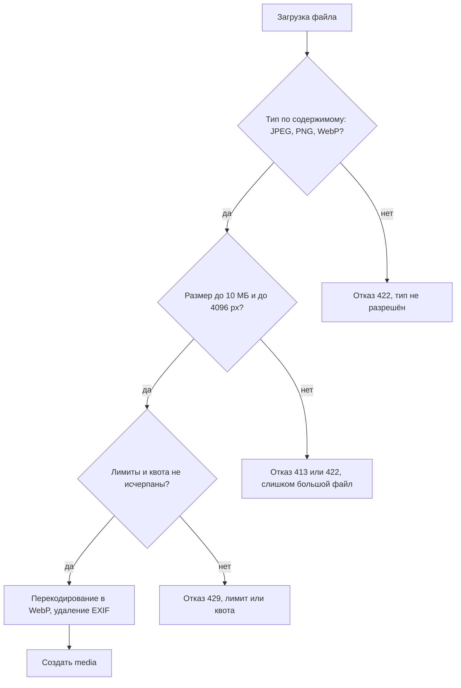
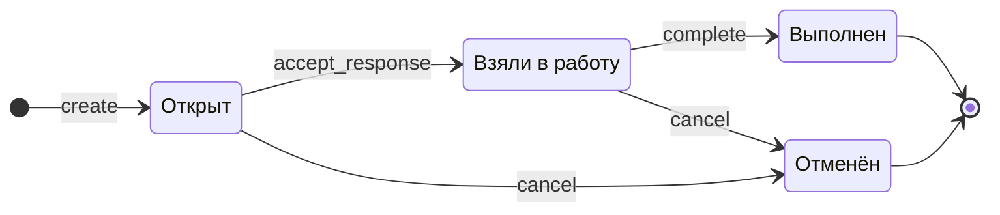
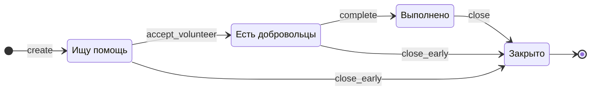

# MineOrt IV — Сценарии: раздел «Общение» (Social)

| Поле | Значение |
|---|---|
| Документ | `02-scenarios/02-scenarios-social.md` |
| Статус | Черновик для утверждения |
| Базовая дата | 13.11.2026 (пятница); запуск 10.12.2026 (четверг), 27 календарных дней |
| Источник | Аудит §8 (стр. 296–389), §15.3 (стр. 773–786), §20 (стр. 925–952), §17 (лимиты, стр. 839–849); решения владельца 13.11.2026 |
| Домены | SOC, POLL, EVT, REQ, GAL |
| Связанные файлы | [01-scenarios-access-p0.md](01-scenarios-access-p0.md), [03-scenarios-world-guilds.md](03-scenarios-world-guilds.md), [../01-product/03-roles-permissions.md](../01-product/03-roles-permissions.md), [../01-product/02-user-status-model.md](../01-product/02-user-status-model.md), [../00-analysis/03-open-decisions.md](../00-analysis/03-open-decisions.md), [../00-analysis/02-glossary.md](../00-analysis/02-glossary.md), [../03-architecture/04-nfr-security.md](../03-architecture/04-nfr-security.md), [../03-architecture/03-data-model.md](../03-architecture/03-data-model.md), [../05-qa/01-acceptance-tests.md](../05-qa/01-acceptance-tests.md) |

Теги: [ЗАКРЕПЛЕНО] / [ПРЕДЛАГАЕТСЯ] / [ПРОВЕРИТЬ] / [ОПРЕДЕЛИТЬ] / [РИСК] — из аудита; [ПРЕДЛОЖЕНИЕ КОМАНДЫ] — отсутствует в аудите; [РЕШЕНИЕ ВЛАДЕЛЬЦА 13.11.2026] — решения владельца.

## 1. О документе

Файл описывает 18 сценариев раздела «Общение» (код `social`): лента и новости (SOC), голосования (POLL), календарь (EVT), заказы и помощь (REQ), галерея (GAL). Формат каждого сценария: паспорт, основной поток, альтернативы и ошибки, постусловия, UI-состояния, аудит и события. Тест-кейсы (TC) здесь только перечисляются в строке «Связи»; Given/When/Then пишутся в [../05-qa/01-acceptance-tests.md](../05-qa/01-acceptance-tests.md). Идентификаторы TC из [../01-product/03-roles-permissions.md](../01-product/03-roles-permissions.md), §7 переиспользованы без изменений; новые следуют схеме `TC-<DOM>-NNx`, где `NN` — номер сценария.

**Релиз.** Владелец принял границу «весь P0 + P1 к 10.12.2026» [РЕШЕНИЕ ВЛАДЕЛЬЦА 13.11.2026]. Волны P1a / P1b / P1c — внутренние вехи внутри 27 дней: P1a — лента, новости, галерея, каталог игроков, история в кабинете; P1b — гильдии, опросы, календарь; P1c — заказы и помощь, атлас, `/marker new`. Сценарии этого файла относятся к P1a (SOC, GAL), P1b (POLL, EVT, пост от гильдии), P1c (REQ). Если волна не прошла go/no-go, она скрывается фича-флагом (см. [../04-plan/01-release-plan.md](../04-plan/01-release-plan.md)). По лестнице сокращений первыми срезаются комментарии (OD-05), перенос событий, лимит мест и посты от гильдий.

**Сквозные допущения** (действуют для всех сценариев):

1. Права проверяются на сервере для каждого действия с учётом объекта; скрытие кнопок — не защита ([../01-product/03-roles-permissions.md](../01-product/03-roles-permissions.md), §6). Для чужого закрытого объекта возвращается 404, а не 403 (не раскрывать существование).
2. Лимиты (NFR-LIM-04…LIM-15) — [ПРЕДЛОЖЕНИЕ КОМАНДЫ], вынесены в конфигурацию: посты 10 в час, комментарии 30 в час, загрузки 20 в час и 50 МБ в сутки, квота 500 МБ, изображение ≤10 МБ и ≤4096 px, JPEG/PNG/WebP, перекодирование в WebP, удаление EXIF, SVG запрещён, ≤10 изображений на пост, опросы 5 в сутки. Превышение: `429` с `Retry-After` и понятным текстом ([../03-architecture/04-nfr-security.md](../03-architecture/04-nfr-security.md), §2).
3. Время хранится в UTC, показывается в часовом поясе браузера с явной меткой (OD-42).
4. Удаление мягкое; файлы медиа удаляются физически через 30 дней, записи аудита сохраняются (OD-40, AC-24).
5. Имена событий `audit_log`, `site_activity`, `security_events` и коды ошибок прикладного API (например, `poll.already_voted`) — [ПРЕДЛОЖЕНИЕ КОМАНДЫ]; в аудите их нет.
6. Модерация: модераторов назначает владелец; жалобы рассматриваются ≤24 ч (OD-28, [ПРЕДЛОЖЕНИЕ КОМАНДЫ]).
7. Лента упорядочена хронологически, без рекомендательного алгоритма (аудит стр. 329).

## 2. Индекс сценариев

| SC | Название | Волна | AC |
|---|---|---|---|
| [SC-SOC-01](#sc-soc-01--пост-со-скриншотом) | Пост со скриншотом | P1a | AC-08 |
| [SC-SOC-02](#sc-soc-02--официальная-новость-и-закрепление) | Официальная новость, закрепление | P1a | — |
| [SC-SOC-03](#sc-soc-03--жалоба-и-модерация) | Жалоба и модерация | P1a | — |
| [SC-SOC-04](#sc-soc-04--удаление-поста-с-медиа) | Удаление поста с медиа | P1a | AC-24 |
| [SC-SOC-05](#sc-soc-05--недопустимый-файл) | Недопустимый файл (тип, размер, EXIF, SVG) | P1a | AC-08, AC-12 |
| [SC-SOC-06](#sc-soc-06--видимость-для-guest-и-applicant) | Видимость для guest и applicant | P1a | — |
| [SC-SOC-07](#sc-soc-07--лимит-частоты-и-спам) | Лимит частоты, спам | P1a | — |
| [SC-SOC-08](#sc-soc-08--пост-от-имени-гильдии) | Пост от имени гильдии | P1b | — |
| [SC-POLL-01](#sc-poll-01--создание-опроса-и-голос) | Создание опроса и голос | P1b | AC-09 |
| [SC-POLL-02](#sc-poll-02--повторный-голос-двойной-клик-гонка) | Повторный голос, двойной клик, гонка | P1b | AC-09 |
| [SC-POLL-03](#sc-poll-03--голос-после-закрытия-изменение-голоса) | Голос после закрытия, изменение голоса | P1b | AC-09 |
| [SC-EVT-01](#sc-evt-01--создание-события-и-часовой-пояс) | Событие, часовой пояс | P1b | AC-10 |
| [SC-EVT-02](#sc-evt-02--запись-отмена-записи-лимит-мест-перенос-и-отмена-события) | Запись, отмена записи, лимит мест, перенос и отмена события | P1b | AC-10 |
| [SC-REQ-01](#sc-req-01--цикл-заказа) | Цикл заказа | P1c | AC-11 |
| [SC-REQ-02](#sc-req-02--цикл-помощи) | Цикл помощи | P1c | AC-11 |
| [SC-REQ-03](#sc-req-03--отмена-автором-отказ-исполнителя-запрет-откликаться-на-своё) | Отмена автором, отказ исполнителя, запрет откликаться на своё | P1c | AC-11 |
| [SC-GAL-01](#sc-gal-01--галерея-добавление-скрытие-удаление) | Галерея: добавление, скрытие, удаление | P1a | AC-12 |
| [SC-GAL-02](#sc-gal-02--повторное-использование-медиа) | Повторное использование медиа | P1a | AC-12, AC-24 |

---

## 3. Лента и новости (SOC)

### SC-SOC-01 · Пост со скриншотом

| Поле | Значение |
|---|---|
| Релиз | P1a (E08) |
| Актор и уровень доступа | Одобренный участник: уровень `member`, `site_role=player`, `account_status=active` |
| Предусловия | `access_memberships.status=approved`; лимит постов не исчерпан (10 в час); квота хранилища не исчерпана; принята актуальная версия правил. Доступ в игру (`applied_state`) не требуется — публиковать можно и до первого входа [ПРЕДЛОЖЕНИЕ КОМАНДЫ] |
| Триггер | Участник нажимает «Новая публикация» в разделе «Общение» (`/social`) |
| Связи | AC-08 · TC-SOC-01a (guest, tg_user, applicant создают пост через API — 403), TC-SOC-01b (E2E: публикация с одним скриншотом, автор и медиа корректны), TC-SOC-01c (видимость `public` / `guild` / `private` для разных ролей), TC-SOC-01d (11-е изображение — отказ) · OD-02, OD-27 · TZ-06 · E08 · SC-SOC-05, SC-SOC-06, SC-SOC-07 |
| Источник в аудите | §8.2 (стр. 314–316), §8.3 (стр. 320–331), §8.9 (стр. 385–387), AC-08 (стр. 936) |

**Основной поток**

1. Участник открывает форму: текст (обязателен, если нет изображений), до 10 изображений, видимость (`public` / `guild` / `private`; по умолчанию `public`), необязательная привязка к событию, метке или опросу.
2. Выбирает файлы; клиент показывает превью и прогресс. Каждый файл проходит серверную проверку (SC-SOC-05).
3. Участник нажимает «Опубликовать». Сервер проверяет сессию, `account_status`, уровень доступа, лимиты и права на привязываемые объекты.
4. Создаётся `posts` (`kind=post`, `author_id` = пользователь из сессии, а не из тела запроса), `media` и `media_attachments`. `moderation_status=approved` сразу (пост-модерация по жалобам) [ПРЕДЛОЖЕНИЕ КОМАНДЫ]. Загруженные изображения получают видимость поста.
5. Пост появляется вверху хронологической ленты у аудитории, которой он виден; автор видит карточку со скином Minecraft, ником и цветным тегом гильдии (если состоит).

**Альтернативы и ошибки**

- A1. Пост без изображений — допустим, если текст не пуст (верхний предел текста 5000 символов [ПРЕДЛОЖЕНИЕ КОМАНДЫ]).
- A2. Автор выбирает видимость `guild`: поле доступно только членам гильдии; без гильдии вариант скрыт, сервер отклоняет значение с 422.
- A3. Редактирование и удаление своего поста — только автором (удаление: SC-SOC-04); в карточке остаётся пометка «изменено» с временем.
- E1. `guest`, `tg_user`, `applicant`, `restricted` вызывают создание — 403, пост не создан (TC-SOC-01a).
- E2. Лимит постов — 429, текст «Слишком много публикаций, попробуйте через N минут» (SC-SOC-07).
- E3. Недопустимый файл — 422, пост не создан целиком, загруженные части откатываются (SC-SOC-05).
- E4. Попытка подставить чужой `author_id` в запросе игнорируется: автор берётся из сессии («нельзя публиковать от чужого профиля», стр. 385).
- E5. Сеть оборвалась после загрузки файлов: черновик с файлами хранится в браузере; повторная отправка идемпотентна по ключу запроса [ПРЕДЛОЖЕНИЕ КОМАНДЫ].

**Постусловия (изменения статусов)**

- `posts`: новая запись, `moderation_status=approved`, `visibility` по выбору. `media.moderation_status=approved` для `guild` / `private`; для `public` — по правилам SC-GAL-01.
- Уровень доступа, `account_status`, `access_memberships`, `whitelist` не меняются.
- В `site_activity` добавляется запись `post.created` с видимостью поста.

**UI-состояния**

- Loading: кнопка «Опубликовать» блокируется, у файлов — прогресс; лента показывает скелетоны.
- Empty: «Пока нет публикаций. Станьте первым — поделитесь скриншотом».
- Error: «Не удалось опубликовать. Проверьте файлы и попробуйте ещё раз»; для 429 — оставшееся время; текст и выбранные файлы сохраняются.
- Success: пост вверху ленты, тост «Публикация опубликована».

**Аудит и события**

- `site_activity`: `post.created`. `audit_log` для обычной публикации не пишется (это пользовательская активность, не админ-действие).
- `security_events`: `authz.denied` при E1, `rate_limit.exceeded` при E2.
- `server_actions`: не создаются.

### SC-SOC-02 · Официальная новость и закрепление

| Поле | Значение |
|---|---|
| Релиз | P1a (E08) |
| Актор и уровень доступа | `member` + `site_role=moderator` с разрешением `news.publish`, либо `site_role=admin` |
| Предусловия | `account_status=active`; у модератора выдан ключ `news.publish` (по умолчанию не выдан никому) |
| Триггер | Администрация нажимает «Новость» в `/social` или в `/admin` (контент Social) |
| Связи | TC-SOC-02a (member публикует новость или закрепляет — 403), TC-SOC-02b (модератор публикует и закрепляет; новость видна `guest`), TC-SOC-02c (снятие закрепа и правка пишутся в аудит), TC-SOC-02d (модератор без `news.publish` — 403) · OD-02, OD-27 · TZ-06 · E08 |
| Источник в аудите | §8.3 (стр. 328), §8.1 (стр. 300–304), §12.2 (стр. 624) |

**Основной поток**

1. Модератор с `news.publish` или admin открывает форму новости: заголовок, текст, изображения (до 10), необязательная дата снятия закрепа.
2. Сервер проверяет ключ `news.publish` и пишет `posts` с `kind=news`, `visibility=public`, `moderation_status=approved`.
3. Для закрепа выставляется `pinned=true`; закреплённые новости всегда выше хронологии, не более 3 одновременно [ПРЕДЛОЖЕНИЕ КОМАНДЫ].
4. Новость видна всем уровням доступа, включая `guest` (OD-02), в разделе «Новости» и на главной (блок новостей, если предусмотрен IA).

**Альтернативы и ошибки**

- A1. Правка и снятие закрепа — теми же ключами; в новости остаётся пометка «обновлено».
- A2. Закреп 4-й новости: сервер предлагает снять самый старый закреп (409 до подтверждения).
- E1. Участник без ключа вызывает публикацию или закреп — 403 (TC-SOC-02a, TC-SOC-02d).
- E2. Пустой заголовок или текст > лимита — 422.

**Постусловия (изменения статусов)**

- `posts`: `kind=news`, `visibility=public`, `pinned` по выбору. Прочие статусы не затрагиваются.

**UI-состояния**

- Loading: скелетон ленты. Empty: «Новостей пока нет». Error: «Не удалось сохранить новость». Success: «Новость опубликована» и метка «Закреплено» на карточке.

**Аудит и события**

- `audit_log` (scope `global`): `news.published`, `news.pinned`, `news.unpinned`, `news.edited` с `actor_id` и идентификатором поста.
- `security_events`: `authz.denied` при E1.

### SC-SOC-03 · Жалоба и модерация

| Поле | Значение |
|---|---|
| Релиз | P1a (E08) |
| Актор и уровень доступа | Заявитель жалобы — `member`; модератор — `site_role=moderator` с `content.moderate` или `admin` |
| Предусловия | Материал существует и виден жалующемуся; жалующийся не автор материала |
| Триггер | Участник нажимает «Пожаловаться» на посте, комментарии, изображении (или метке) |
| Связи | TC-SOC-03a (жалоба → решение модератора: скрыть, отклонить), TC-SOC-03b (модератор без `content.moderate` — 403), TC-SOC-03c (повторная жалоба того же пользователя — 409; жалоба на свой материал — 422), TC-SOC-03d (скрытый материал недоступен по API и прямому URL — 404) · OD-28 · TZ-06, TZ-12 · E08 · SC-ADM-07 |
| Источник в аудите | §8.3 (стр. 331), §8.9 (стр. 386), §12.2 (стр. 624), §15.3 (стр. 784) |

**Основной поток**

1. Участник выбирает причину (список: спам, оскорбление, недопустимое изображение, приватные данные, другое [ПРЕДЛОЖЕНИЕ КОМАНДЫ]) и необязательный комментарий.
2. Сервер создаёт `moderation_reports` со статусом `new`; материал остаётся видимым.
3. Модератор открывает очередь жалоб (`/admin`, раздел контента), видит материал, автора, историю решений; цель по сроку — ≤24 ч (OD-28).
4. Решение: «Скрыть» (материал получает `moderation_status=hidden`, пропадает из выдачи), «Оставить» (жалоба закрывается как необоснованная), «Удалить» (мягкое удаление, SC-SOC-04). Причина обязательна для «Скрыть» и «Удалить».
5. Автор получает уведомление о скрытии с причиной (на сайте; в Telegram — если включено, иначе только на сайте).

**Альтернативы и ошибки**

- A1. Несколько жалоб на один материал объединяются в одну задачу очереди со счётчиком.
- A2. Автор оспаривает скрытие обращением к администрации; финальное решение — владелец через `/admin` с аудитом (OD-32).
- E1. Повторная жалоба того же пользователя на тот же материал — 409; жалоба на свой материал — 422.
- E2. Модератор без `content.moderate` — 403, `security_events`.
- E3. Повторное решение по уже решённой жалобе — 409, аудит без дубля.

**Постусловия (изменения статусов)**

- `moderation_reports.status`: `new` → `resolved` (с решением `hidden` / `dismissed` / `deleted`). `posts.moderation_status`: `approved` → `hidden` при скрытии.

**UI-состояния**

- Loading: очередь модерации с скелетоном. Empty: «Открытых жалоб нет». Error: «Не удалось отправить жалобу». Success: у жалующегося — «Жалоба отправлена, спасибо»; у модератора — материал уходит из очереди.

**Аудит и события**

- `audit_log`: `report.resolved`, `content.hidden`, `content.deleted` (кто, когда, причина).
- `site_activity` автора: `post.hidden_by_moderator` (виден только автору).
- `security_events`: `authz.denied` при E2.

### SC-SOC-04 · Удаление поста с медиа

| Поле | Значение |
|---|---|
| Релиз | P1a (E08); для меток — SC-MAP-05 (P1c) |
| Актор и уровень доступа | Автор поста (`member`) либо модератор с `content.moderate` / admin |
| Предусловия | Пост существует (`deleted_at` пуст); у поста могут быть изображения, комментарии, ссылки из событий и меток |
| Триггер | Автор нажимает «Удалить» на своём посте |
| Связи | AC-24 · TC-SOC-04a (удаление или правка чужого поста — 403, IDOR), TC-SOC-04b (удаление своего поста: пост и вложения исчезают), TC-SOC-04c (прямой URL удалённого изображения — 404), TC-SOC-04d (изображение, прикреплённое ещё к другому объекту, не удаляется), TC-SOC-04e (задача физической очистки через 30 дней) · OD-40 · TZ-06 · E08 · SC-GAL-02 |
| Источник в аудите | §8.9 (стр. 387–388), AC-24 (стр. 952), §11.3 (стр. 605–609) |

**Основной поток**

1. Автор нажимает «Удалить» и подтверждает в диалоге «Удалить публикацию? Изображения будут удалены через 30 дней».
2. Сервер проверяет авторство (или права модератора) и ставит `posts.deleted_at`; пост мгновенно исчезает из ленты, поиска, профиля и кабинета у всех, кроме модераторов.
3. Вложения `media_attachments` этого поста снимаются. Медиа без других вложений получают `media.deleted_at`; файл остаётся в хранилище 30 дней и недоступен по URL (404) (OD-40).
4. Ссылки на пост из событий, меток и запросов отображаются как «Материал удалён», без сломанных ссылок и без утечки текста.
5. Через 30 дней фоновая задача удаляет файлы; запись в `audit_log` и `site_activity` остаётся.

**Альтернативы и ошибки**

- A1. Медиа прикреплено также к другому объекту (галерея, метка): удаляется только вложение этого поста, файл остаётся (SC-GAL-02).
- A2. Комментарии и реакции удалённого поста скрываются вместе с ним.
- A3. Модератор удаляет чужой пост с причиной (SC-SOC-03); автор уведомляется.
- A4. Восстановление в течение 30 дней — только модератором/админом по обращению [ПРЕДЛОЖЕНИЕ КОМАНДЫ].
- E1. Чужой пост (IDOR) — 403 или 404; запись не меняется (TC-SOC-04a).
- E2. Повторное удаление — 404 или идемпотентный 200 без повторной записи.
- E3. Сбой фоновой очистки: задача повторяется; файл не возвращается в выдачу.

**Постусловия (изменения статусов)**

- `posts.deleted_at` задан; `media.deleted_at` задан у файлов без других вложений; `moderation_reports` по посту закрываются как `resolved` автоматически [ПРЕДЛОЖЕНИЕ КОМАНДЫ].

**UI-состояния**

- Loading: кнопка блокируется. Empty: пост исчезает, при пустой ленте — «Пока нет публикаций». Error: «Не удалось удалить публикацию». Success: «Публикация удалена».

**Аудит и события**

- `site_activity`: `post.deleted`. `audit_log`: `content.deleted` только при удалении модератором; для удаления автором — запись `post.deleted` в `site_activity` и системный журнал очистки `media.purged` (через 30 дней).
- `security_events`: `authz.denied` при E1.

### SC-SOC-05 · Недопустимый файл

| Поле | Значение |
|---|---|
| Релиз | P1a (E08) |
| Актор и уровень доступа | `member` (загрузка в пост, галерею, к метке) |
| Предусловия | Участник вызывает загрузку любого изображения |
| Триггер | Выбор или перетаскивание файла в поле загрузки; прямой вызов API загрузки |
| Связи | AC-08, AC-12 · TC-SOC-05a (доступ к `media` по ролям `anon`, `authenticated`, owner, moderator, admin — RLS), TC-SOC-05b (SVG, HTML или исполняемый файл под расширением изображения — отказ), TC-SOC-05c (файл >10 МБ или >4096 px — отказ), TC-SOC-05d (EXIF/GPS удалены, формат — WebP), TC-SOC-05e (квота 500 МБ, 20 загрузок в час, 50 МБ в сутки — 429/413) · NFR-LIM-06…LIM-12 · TZ-06 · E08 |
| Источник в аудите | §8.9 (стр. 386), §15.5 (стр. 806), §17 (стр. 840, 849) |

**Основной поток**

1. Клиент делает предварительную проверку (расширение, размер) — только для удобства; обязательная проверка выполняется на сервере.
2. Сервер определяет тип по содержимому (магическим байтам), а не по расширению и заголовку `Content-Type`.
3. Сервер проверяет: тип ∈ {JPEG, PNG, WebP}; размер ≤10 МБ; размеры ≤4096 px по большей стороне; нет анимации; декодирование успешно.
4. Изображение перекодируется в WebP, из него удаляются EXIF и прочие метаданные (в том числе геометки); имя файла заменяется на сгенерированное (`storage_key`), оригинальное имя не сохраняется [ПРЕДЛОЖЕНИЕ КОМАНДЫ].
5. Создаётся `media` с `visibility` объекта и `moderation_status` по правилам объекта; квота пользователя увеличивается на размер результата.

**Альтернативы и ошибки**

- E1. SVG, GIF-анимация, HTML, PDF, исполняемые файлы, архивы — 422 «Разрешены только JPEG, PNG и WebP».
- E2. Файл с расширением `.jpg`, но другим содержимым (полиглот) — отклоняется по содержимому; в `security_events` пишется `upload.type_mismatch`.
- E3. Размер >10 МБ — 413; >4096 px — 422 «Максимум 4096 пикселей по большей стороне».
- E4. Повреждённое изображение или «бомба декомпрессии» (превышение числа пикселей при декодировании) — 422, без падения сервера.
- E5. Квота 500 МБ, 20 загрузок в час или 50 МБ в сутки исчерпаны — 429 с `Retry-After`, текст «Лимит загрузок исчерпан».
- E6. Попытка загрузить без сессии — 401; загрузка от `applicant` — 403.
- A1. Прозрачный PNG сохраняется с альфа-каналом (WebP поддерживает).

**Постусловия (изменения статусов)**

- Создаётся `media`; при отказе не создаётся ничего (в хранилище не остаётся временных файлов дольше суток [ПРЕДЛОЖЕНИЕ КОМАНДЫ]).

**UI-состояния**

- Loading: прогресс-полоса и «Обрабатываем изображение». Empty: поле «Перетащите скриншот или выберите файл». Error: причина у конкретного файла, остальные файлы формы не теряются. Success: превью с кнопкой «Убрать».

**Аудит и события**

- `security_events`: `upload.type_mismatch`, `upload.rejected` (с типом причины). `audit_log` не пишется.

### SC-SOC-06 · Видимость для guest и applicant

| Поле | Значение |
|---|---|
| Релиз | P1a (E08) |
| Актор и уровень доступа | `guest`, `tg_user`, `applicant`, `member`, `restricted` |
| Предусловия | В ленте есть: официальные новости, публичные посты, `guild`-посты, `private`-посты, публичные и закрытые изображения галереи |
| Триггер | Пользователь открывает `/social`, `/social/news`, `/gallery` или вызывает публичный API ленты |
| Связи | TC-SOC-06a (гость читает ленту: видны только официальные новости и public-галерея), TC-SOC-06b (`applicant` читает ленту, но не может публиковать), TC-SOC-06c (`restricted` видит только `public`), TC-SOC-06d (гость вызывает API ленты и получает только разрешённые типы) · OD-02, OD-27 · TZ-06 · E08 · SC-SOC-01 |
| Источник в аудите | §24.1 вопрос OD-02 (стр. 1039), §8.3 (стр. 320), §8.9 (стр. 385–388) |

Матрица видимости по умолчанию (OD-02) [ПРЕДЛОЖЕНИЕ КОМАНДЫ]:

| Содержимое | guest | tg_user | applicant | member | restricted |
|---|---|---|---|---|---|
| Официальные новости (`kind=news`) | чтение | чтение | чтение | чтение | чтение |
| Галерея, `public` и `approved` | просмотр | просмотр | просмотр | просмотр | просмотр |
| Посты игроков `public` | — | — | чтение | чтение, запись | чтение |
| Посты `guild` | — | — | — | только члены этой гильдии | — |
| Посты и медиа `private` | — | — | — | только автор | — |
| События, опросы, заказы | — | — | чтение | чтение, запись | только публичное |

**Основной поток**

1. Пользователь открывает раздел; сервер определяет уровень доступа и применяет фильтр выдачи в запросе (не после выборки).
2. `guest` и `tg_user` получают ленту, состоящую только из новостей, и вкладку «Галерея» с публичными одобренными изображениями. Остальные фильтры («Публикации», «Ивенты», «Запросы») показывают приглашение войти.
3. `applicant` видит публичные посты в режиме чтения; кнопка «Новая публикация» заменяется текстом «Публиковать могут одобренные участники».
4. `member` видит всё по своим правам; публикация доступна.
5. `restricted` видит только `public`-материалы и экран статуса; создание и реакции закрыты.

**Альтернативы и ошибки**

- A1. Если OD-02 будет решён иначе (например, гостям открыта вся публичная лента), меняется только конфигурация матрицы, не логика проверок.
- E1. Прямой URL поста с видимостью выше уровня зрителя — 404 (не 403), без превью и метатегов Open Graph.
- E2. Параметры API (`?visibility=guild`) не расширяют выдачу: фильтр применяется после проверки прав.
- E3. Истёкшая сессия: пользователь деградирует до `guest`, закрытые блоки исчезают без ошибки 500.

**Постусловия (изменения статусов)**

- Статусы не меняются (только чтение).

**UI-состояния**

- Loading: скелетон ленты. Empty для гостя: «Войдите через Telegram, чтобы увидеть публикации игроков». Error: «Не удалось загрузить ленту». Success: лента по правам.

**Аудит и события**

- `security_events`: `authz.denied` при E1 и E2 (без раскрытия причины пользователю).

### SC-SOC-07 · Лимит частоты и спам

| Поле | Значение |
|---|---|
| Релиз | P1a (E08); комментарии — по лестнице сокращений (OD-05) |
| Актор и уровень доступа | `member` |
| Предусловия | Участник отправил подряд посты, комментарии или загрузки сверх лимита |
| Триггер | Серия запросов создания поста/комментария/загрузки |
| Связи | TC-SOC-07a (11-й пост в час — 429), TC-SOC-07b (31-й комментарий в час — 429), TC-SOC-07c (лимит не обходится несколькими сессиями и клиентами), TC-SOC-07d (повтор идентичного текста подряд отклоняется), TC-SOC-07e (в UI отображается время до разблокировки) · NFR-LIM-04, LIM-05, LIM-06 · TZ-06 · E08 · SC-SOC-01 |
| Источник в аудите | §8.9 (стр. 386), §17 (стр. 839) |

**Основной поток**

1. Сервер считает действия пользователя по `user_id` в скользящем окне (посты 10 в час, комментарии 30 в час, загрузки 20 в час и 50 МБ в сутки) — не по IP и не по сессии.
2. При превышении возвращается 429 с `Retry-After`; пост не создаётся; лимит не расходуется на отклонённые запросы.
3. Идентичный текст, отправленный повторно подряд (в окне 5 минут), отклоняется 409 «Такая публикация уже есть» [ПРЕДЛОЖЕНИЕ КОМАНДЫ].
4. Повторные нарушения (≥3 раза за сутки) формируют `security_events` для модераторов; модератор может приостановить пользователя (`players.suspend`) в рамках SC-ADM-05/SC-ACC-11.

**Альтернативы и ошибки**

- A1. Модераторы и админы подчиняются тем же лимитам, но порог можно поднять конфигурацией [ПРЕДЛОЖЕНИЕ КОМАНДЫ].
- E1. Параллельные запросы на границе лимита: допускается не больше лимита (атомарный счётчик).
- E2. Спам ссылками/упоминаниями: фильтрация содержимого — вне этого сценария; решение по жалобе (SC-SOC-03).

**Постусловия (изменения статусов)**

- Данные не меняются; увеличивается счётчик лимита и при повторах — запись `security_events`.

**UI-состояния**

- Loading: кнопка блокируется. Empty: не применимо. Error: «Слишком много публикаций. Подождите N минут» с таймером. Success: после окончания паузы кнопка снова активна.

**Аудит и события**

- `security_events`: `rate_limit.exceeded` (тип лимита, `user_id`); `spam.repeat_detected`.

### SC-SOC-08 · Пост от имени гильдии

| Поле | Значение |
|---|---|
| Релиз | P1b (E08, E11); зависит от гильдий |
| Актор и уровень доступа | `member`, активный участник гильдии с правом `guild.manage_posts` (глава, офицеры по шаблону ранга) |
| Предусловия | `guild_members.status=active`; гильдия не в архиве; право `guild.manage_posts` у ранга актора |
| Триггер | В форме поста участник выбирает автора «от имени гильдии [TAG]» |
| Связи | TC-SOC-08a (member без права публикует «от гильдии» — 403), TC-SOC-08b (офицер публикует от гильдии: автор — гильдия, подпись исполнителя), TC-SOC-08c (офицер гильдии A публикует от гильдии B — 403, IDOR), TC-SOC-08d (исключённый участник теряет право сразу) · OD-43, OD-08 · TZ-06, TZ-09 · E08, E11 · SC-GLD-08 |
| Источник в аудите | §8.2 (стр. 316), §8.3 (стр. 333), §10.7 (стр. 549) |

**Основной поток**

1. В форме поста для актора с правом показывается переключатель «Автор: я / гильдия [TAG]».
2. При выборе гильдии сервер проверяет членство актора в этой гильдии, право `guild.manage_posts` по его рангу и статус гильдии.
3. Создаётся `posts` с `author_id` = актор и `guild_id` = гильдия; карточка показывает название и цветной тег гильдии (на сайте), ник актора — мелким шрифтом.
4. Видимость поста — `public` или `guild`; для `guild` читают только текущие члены гильдии.

**Альтернативы и ошибки**

- A1. Если OD-43 будет решён иначе (всем членам), меняется только набор прав ранга `member` в `guild_ranks`.
- A2. Пост от гильдии редактируют и удаляют автор-актор и руководство (`guild.manage_posts`); модератор — по жалобе.
- E1. Актор без права — 403, вариант «от гильдии» скрыт в UI, но проверяется на сервере (TC-SOC-08a).
- E2. Гильдия в архиве — 409 `guild.archived`.
- E3. Чужая гильдия (IDOR) — 403 без раскрытия существования.
- E4. После исключения или ухода актор теряет право немедленно; существующие посты остаются за гильдией с сохранённым контекстом даты публикации (политика истории — [ОПРЕДЕЛИТЬ], аудит стр. 388).

**Постусловия (изменения статусов)**

- Новая запись `posts` с `guild_id`. Ранги и состав гильдии не меняются.

**UI-состояния**

- Loading: список гильдий актора подгружается. Empty: переключатель не показывается. Error: «Нет прав публиковать от имени гильдии». Success: пост с тегом гильдии в ленте и на странице гильдии.

**Аудит и события**

- `audit_log` (scope `guild`, `guild_id`): `guild.post_published` при публикации; при отказе — `security_events` `authz.denied`.

---

## 4. Голосования (POLL)

### SC-POLL-01 · Создание опроса и голос

| Поле | Значение |
|---|---|
| Релиз | P1b (E09) |
| Актор и уровень доступа | Создатель: `member` + `moderator` с `polls.create` / `admin`, либо глава или офицер в своей гильдии (OD-27). Голосующий: `member` |
| Предусловия | Создатель не исчерпал лимит 5 опросов в сутки; голосующий — `member`, `account_status=active`, имеет право голоса (не исключён кругом участников опроса) |
| Триггер | Создатель нажимает «Новое голосование» в разделе «Голосования» |
| Связи | AC-09 · TC-POLL-01a (member без права создаёт опрос; глава создаёт опрос чужой гильдии — 403), TC-POLL-01b (E2E: создание опроса и голос другим участником), TC-POLL-01c (валидация: менее 2 вариантов, срок в прошлом, превышение лимита), TC-POLL-01d (опрос гильдии виден только её членам) · OD-27 · TZ-07 · E09 · SC-POLL-02, SC-POLL-03 |
| Источник в аудите | §8.4 (стр. 337–341), §15.3 (стр. 780), AC-09 (стр. 937) |

**Основной поток**

1. Создатель заполняет: вопрос, 2–10 вариантов [ПРЕДЛОЖЕНИЕ КОМАНДЫ], срок окончания (`closes_at` в будущем), круг участников (все `member` / только гильдия), множественный выбор (по умолчанию выключен), разрешено ли менять голос (по умолчанию выключено), момент публикации результатов (по умолчанию — после голоса).
2. Сервер проверяет права (`polls.create` либо ранг в своей гильдии) и лимит; сохраняет `polls` и `poll_options`. Статус «идёт».
3. Участник из круга открывает опрос, выбирает вариант и нажимает «Проголосовать». Сервер проверяет сессию, уровень доступа, круг участников, статус опроса.
4. Создаётся `votes` (`poll_id`, `option_id`, `user_id`) — один голос на пользователя в одиночном опросе; результат отображается по настройке.
5. После `closes_at` опрос закрывается, итог показывается всем, кто имеет доступ.

**Альтернативы и ошибки**

- A1. Анонимность результатов — [ОПРЕДЕЛИТЬ] (аудит стр. 341); по умолчанию показываются только агрегаты, а список голосовавших виден только `admin` (автору опроса — нет) [ПРЕДЛОЖЕНИЕ КОМАНДЫ].
- A2. Опрос — рекомендация, а не обязательное решение; в карточке подпись «Результат носит рекомендательный характер» [ПРЕДЛОЖЕНИЕ КОМАНДЫ, аудит стр. 341 оставляет вопрос открытым].
- A3. Сохранение черновика: статус «черновик» до публикации (аудит стр. 339).
- E1. Создатель без права — 403 (TC-POLL-01a). Лимит 5 в сутки — 429.
- E2. 1 вариант, пустой вопрос, `closes_at` в прошлом — 422.
- E3. Голос от пользователя вне круга участников — 403; от `guest` — 401.

**Постусловия (изменения статусов)**

- `polls`: черновик → идёт → закрыт; `votes` содержит один голос на пользователя в одиночном опросе.

**UI-состояния**

- Loading: скелетон карточки опроса. Empty: «Голосований пока нет». Error: «Не удалось отправить голос». Success: «Ваш голос учтён» и отображение результатов по настройке.

**Аудит и события**

- `site_activity`: `poll.created`, `poll.voted` (у голосующего; сам выбор не публикуется). `audit_log` (scope `global` или `guild`): `poll.closed_by_moderator` при досрочном закрытии модератором.
- `security_events`: `authz.denied` при E1, E3.

### SC-POLL-02 · Повторный голос, двойной клик, гонка

| Поле | Значение |
|---|---|
| Релиз | P1b (E09) |
| Актор и уровень доступа | `member` (легитимный), атакующий — тот же пользователь с несколькими вкладками или скриптом; `guest` |
| Предусловия | Опрос идёт, пользователь уже проголосовал либо отправляет несколько запросов одновременно |
| Триггер | Повторный вызов голосования: повторный клик, второй запрос API, параллельные запросы |
| Связи | AC-09 · TC-POLL-02a (голос от гостя — 401/403), TC-POLL-02b (повторный голос через API, двойной клик, гонка — один голос, остальные 409), TC-POLL-02c (множественный выбор: повтор той же опции — 409, разные опции допустимы до лимита), TC-POLL-02d (UI блокирует кнопку и использует ключ идемпотентности), TC-POLL-02e (голос с `option_id` из чужого опроса — отказ, голос не записан; составной FK `(poll_id, option_id)`) · TZ-07 · E09 · SC-POLL-01 |
| Источник в аудите | §8.4 (стр. 339), AC-09 (стр. 937), §15.3 (стр. 780) |

**Основной поток**

1. Пользователь дважды кликает «Проголосовать» или отправляет параллельные запросы.
2. База данных гарантирует уникальность: `UNIQUE (poll_id, user_id)` в одиночном опросе, `UNIQUE (poll_id, option_id, user_id)` при множественном выборе. Проверка идёт на сервере, а не в приложении перед вставкой.
3. Первый запрос завершается успехом, остальные — 409 `poll.already_voted`; счётчики не меняются.
4. Клиент после первого клика блокирует кнопку и отправляет ключ идемпотентности; при ответе 409 показывает «Вы уже проголосовали».

**Альтернативы и ошибки**

- A1. Несколько вкладок: вторая вкладка после обновления видит состояние «Вы уже проголосовали».
- A2. Множественный выбор: общее число выбранных вариантов ≤ `max_choices` (по умолчанию число вариантов) [ПРЕДЛОЖЕНИЕ КОМАНДЫ].
- E1. Голос от гостя — 401; от `applicant` / `restricted` — 403 (право голоса только у `member`).
- E2. Сетевой повтор клиента с тем же ключом идемпотентности возвращает тот же результат (200), а не 409 [ПРЕДЛОЖЕНИЕ КОМАНДЫ].
- E3. Два разных аккаунта одного человека — вне охвата: правило «один подтверждённый профиль — один голос» (стр. 339).
- E4. `option_id` не принадлежит `poll_id` запроса (вариант из другого опроса, в том числе закрытого или чужой гильдии): 422/404 `poll.option_mismatch`, запись в `votes` не создаётся; на уровне БД — составной внешний ключ `(poll_id, option_id)` → `poll_options(poll_id, id)`, а признак множественного выбора берётся из денормализованного поля `votes.multi_choice`, поэтому частичный unique-индекс нельзя обойти, подставив чужой вариант [ПРЕДЛОЖЕНИЕ КОМАНДЫ] (TC-POLL-02e).

**Постусловия (изменения статусов)**

- В `votes` ровно одна запись на пользователя (одиночный выбор); итог голосования не искажается.

**UI-состояния**

- Loading: «Отправляем голос…» на кнопке. Empty: не применимо. Error: «Вы уже проголосовали» (409) или «Не удалось отправить голос». Success: кнопка заменена на «Ваш голос учтён».

**Аудит и события**

- `security_events`: `vote.duplicate_rejected` (счётчик, без IP при штатном повторе). `audit_log` не пишется.

### SC-POLL-03 · Голос после закрытия, изменение голоса

| Поле | Значение |
|---|---|
| Релиз | P1b (E09) |
| Актор и уровень доступа | `member` |
| Предусловия | Опрос закрыт либо идёт с настройкой «разрешено менять голос» |
| Триггер | Участник голосует после `closes_at` или нажимает «Изменить голос» |
| Связи | AC-09 · TC-POLL-03a (голос после закрытия — 409), TC-POLL-03b (смена голоса, когда разрешена: старый голос заменяется атомарно), TC-POLL-03c (смена голоса, когда запрещена — 409), TC-POLL-03d (граница по времени: серверные часы, клиентское время не учитывается) · TZ-07 · E09 · SC-POLL-02 |
| Источник в аудите | §8.4 (стр. 339), AC-09 (стр. 937) |

**Основной поток**

1. Пользователь пытается проголосовать в опросе, у которого `closes_at` ≤ серверное «сейчас» либо который закрыт вручную.
2. Сервер определяет статус «закрыт» при каждом запросе по `closes_at` и ручному флагу — без зависимости от фонового планировщика.
3. Ответ 409 `poll.closed`; голоса не меняются; клиент показывает итоговые результаты.
4. Если автор разрешил менять голос и опрос идёт, смена выполняется одной транзакцией «удалить старый + вставить новый»; число голосов не превышает одного на пользователя.

**Альтернативы и ошибки**

- A1. Досрочное закрытие автором или модератором: статус «закрыт», итоги публикуются.
- A2. Опрос с настройкой «результаты после закрытия»: до закрытия счётчики скрыты даже от автора.
- E1. Смена голоса при запрещённой настройке — 409 `poll.change_not_allowed`.
- E2. Часы клиента спешат/отстают: решающим является только серверное время.

**Постусловия (изменения статусов)**

- Закрытый опрос не меняется; при разрешённой смене голоса остаётся ровно один голос.

**UI-состояния**

- Loading: «Отправляем…». Empty: не применимо. Error: «Голосование завершено» (409). Success: «Голос изменён» или итоговая диаграмма после закрытия.

**Аудит и события**

- `site_activity`: `poll.vote_changed`. `audit_log`: `poll.closed_by_moderator` при досрочном закрытии модератором.

---

## 5. Календарь (EVT)

### SC-EVT-01 · Создание события и часовой пояс

| Поле | Значение |
|---|---|
| Релиз | P1b (E09) |
| Актор и уровень доступа | `member` (организатор), модератор/admin; читатели — `applicant` и выше (OD-02) |
| Предусловия | Участник вошёл, `account_status=active`; лимит создания событий не исчерпан (общий лимит публикаций 10 в час [ПРЕДЛОЖЕНИЕ КОМАНДЫ], отдельного лимита в аудите нет, «запреты на спам событиями» — [ОПРЕДЕЛИТЬ], стр. 351) |
| Триггер | Участник нажимает «Создать событие» в календаре |
| Связи | AC-10 · TC-EVT-01a (создание события: организатор, дата и время видны), TC-EVT-01b (показ времени в поясе браузера с меткой и в UTC; два разных пояса), TC-EVT-01c (валидация: дата в прошлом, отрицательная длительность, пустое название), TC-EVT-01d (guest и tg_user не создают — 401/403) · OD-27, OD-42 · TZ-07 · E09 · SC-EVT-02 |
| Источник в аудите | §8.5 (стр. 345–351), §17.3 (стр. 859), AC-10 (стр. 938) |

**Основной поток**

1. Организатор вводит: название, описание, дату и время начала в своём часовом поясе (браузер подставляет пояс), длительность, место (текст или метка атласа), категорию, лимит мест (необязательно), видимость, изображения.
2. Клиент отправляет время в ISO 8601 с указанием пояса; сервер сохраняет `starts_at_utc` (UTC) и исходный пояс организатора [ПРЕДЛОЖЕНИЕ КОМАНДЫ].
3. Событие появляется в календарной сетке и в хронологическом списке (два вида, аудит стр. 349).
4. Каждый зритель видит время в поясе своего браузера с подписью «20:00 (ваше время, UTC+3)» и вторым значением в UTC в подсказке; пояс сообщества — отдельное решение владельца (OD-42).
5. Если событие предполагает помощь, на карточке есть кнопка «Нужна помощь» — создаёт связанный запрос (SC-REQ-02) без дублирования данных события.

**Альтернативы и ошибки**

- A1. Связь со меткой атласа: выбор метки из доступных автору; чужие закрытые метки в поиске не отображаются.
- A2. Смена летнего/зимнего времени: хранение в UTC исключает смещение; в тестах проверяется на двух поясах (OD-42).
- E1. Начало в прошлом — 422 «Дата и время уже прошли».
- E2. Создание гостем или `tg_user` — 401/403.
- E3. Превышение лимита создания — 429.

**Постусловия (изменения статусов)**

- Новая запись `events` (статус «запланировано»); организатор автоматически записан участником [ПРЕДЛОЖЕНИЕ КОМАНДЫ].

**UI-состояния**

- Loading: скелетон календаря. Empty: «Событий пока нет. Создайте первое». Error: «Не удалось сохранить событие». Success: событие в сетке и списке, тост «Событие создано».

**Аудит и события**

- `site_activity`: `event.created`. `audit_log` не пишется.

### SC-EVT-02 · Запись, отмена записи, лимит мест, перенос и отмена события

| Поле | Значение |
|---|---|
| Релиз | P1b (E09); лимит мест и перенос — вторые в лестнице сокращений после комментариев |
| Актор и уровень доступа | `member` (участник), организатор события, модератор/admin |
| Предусловия | Событие в статусе «запланировано»; для записи есть свободные места (если задан лимит) |
| Триггер | Участник нажимает «Записаться» / «Отменить запись»; организатор нажимает «Перенести» / «Отменить событие» |
| Связи | AC-10 · TC-EVT-02a (не-автор переносит или отменяет событие — 403), TC-EVT-02b (запись и отмена записи), TC-EVT-02c (гонка за последнее место — записывается один), TC-EVT-02d (повторная запись — 409), TC-EVT-02e (перенос и отмена события уведомляют записавшихся), TC-EVT-02f (запись на прошедшее или отменённое событие — 409) · OD-27, OD-42 · TZ-07 · E09 · SC-EVT-01 |
| Источник в аудите | §8.5 (стр. 347–351), AC-10 (стр. 938), §15.3 (стр. 781) |

**Основной поток**

1. Участник нажимает «Записаться». Сервер проверяет: событие не прошло и не отменено, уровень доступа `member`, нет существующей записи, есть свободные места.
2. Создаётся `event_attendees`; число мест проверяется транзакционно (блокировка строки события либо условный `INSERT`), чтобы параллельные записи не превысили `seats_limit`.
3. Участник отменяет запись — запись удаляется, место освобождается.
4. Организатор переносит событие: меняется `starts_at_utc`; записавшиеся получают уведомление (opt-in; на сайте всегда). Организатор отменяет событие: `cancelled_at` задаётся, запись неактивна, карточка помечена «Отменено».

**Альтернативы и ошибки**

- A1. Лимит мест не задан — записей без ограничений.
- A2. Список ожидания при заполнении — [ПРЕДЛОЖЕНИЕ КОМАНДЫ], в P1 не входит.
- A3. Модератор переносит или отменяет любое событие с причиной (запись в аудит).
- E1. Не-автор (не модератор) переносит/отменяет — 403 (TC-EVT-02a).
- E2. Мест нет — 409 `event.full`, текст «Свободных мест нет».
- E3. Дубль записи — 409; запись на отменённое или прошедшее событие — 409.
- E4. Перенос события в прошлое — 422.

**Постусловия (изменения статусов)**

- `event_attendees`: запись добавлена/удалена; `events.cancelled_at` или `starts_at_utc` обновлены. Число записей ≤ `seats_limit`.

**UI-состояния**

- Loading: кнопка блокируется на время запроса. Empty: «Пока никто не записался». Error: «Не удалось записаться» / «Мест нет». Success: «Вы записаны» с кнопкой «Отменить запись»; счётчик «Записалось 7 из 10».

**Аудит и события**

- `site_activity`: `event.joined`, `event.left`, `event.rescheduled`, `event.cancelled`. `audit_log`: `event.cancelled_by_moderator`, `event.rescheduled_by_moderator`.
- `notifications`: «Событие перенесено/отменено» (opt-in для Telegram).

---

## 6. Заказы и помощь (REQ)

Заказы и помощь — одна таблица `requests` с `type = order | help`; статусы различаются по типу (C-07, аудит стр. 373, 786). Награда в заказе — свободный текст, валютных полей нет (C-13, аудит стр. 361, 367).

### SC-REQ-01 · Цикл заказа

| Поле | Значение |
|---|---|
| Релиз | P1c (E10) |
| Актор и уровень доступа | Автор — `member`; исполнитель — `member`; модератор/admin (вмешательство) |
| Предусловия | Автор имеет `account_status=active`; запрос создаётся с `type=order` |
| Триггер | Автор нажимает «Новый заказ» на вкладке «Заказы» |
| Связи | AC-11 · TC-REQ-01a (полный цикл: создание, отклик, выбор исполнителя, выполнение), TC-REQ-01b (награда — только свободный текст, денежные поля отсутствуют), TC-REQ-01c (недопустимый переход `open` → `done` — 409) · OD-27 · TZ-08 · E10 · SC-REQ-03 |
| Источник в аудите | §8.6 (стр. 355–367), §15.3 (стр. 782, 786), AC-11 (стр. 939) |

**Основной поток**

1. Автор заполняет карточку: что нужно получить или сделать, количество, срок, необязательная награда или условия (свободный текст), место передачи (необязательно), ссылка на метку или событие (необязательно).
2. Создаётся `requests` (`type=order`, `status=open`). Заказ виден читателям по OD-02 (`applicant` и выше).
3. Другой участник нажимает «Откликнуться» — создаётся `request_responses`; автор видит отклики.
4. Автор выбирает исполнителя: `assignee_id` задаётся, статус `open` → `in_progress`; исполнитель получает уведомление.
5. По итогу автор отмечает «Выполнен»: `in_progress` → `done`. Модератор может изменить статус при споре (с причиной, OD-32).

**Альтернативы и ошибки**

- A1. Несколько откликов: автор выбирает одного; остальные отклики получают статус «не выбран».
- A2. Срок прошёл: заказ не закрывается автоматически, помечается «Срок истёк» [ПРЕДЛОЖЕНИЕ КОМАНДЫ].
- E1. Недопустимый переход (`open` → `done`, `done` → `open`) — 409 `request.invalid_transition`.
- E2. Статус из цепочки помощи (`seeking` и т. п.) у `order` — 422 (TC-REQ-03c).
- E3. Валидация: пустое название, отрицательное количество — 422.

**Постусловия (изменения статусов)**

- `requests.status`: `open` → `in_progress` → `done`; `assignee_id` задан после выбора исполнителя.

**UI-состояния**

- Loading: скелетон карточек. Empty: «Заказов пока нет». Error: «Не удалось сохранить заказ». Success: статус «Взяли в работу» / «Выполнен» на карточке.

**Аудит и события**

- `site_activity`: `request.created`, `request.status_changed`. `audit_log`: `request.status_overridden` при вмешательстве модератора.
- `notifications`: «Вас выбрали исполнителем», «Заказ выполнен» (opt-in).

### SC-REQ-02 · Цикл помощи

| Поле | Значение |
|---|---|
| Релиз | P1c (E10) |
| Актор и уровень доступа | Автор — `member`; волонтёры — `member`; модератор/admin |
| Предусловия | Запрос создаётся с `type=help`; при создании из события — привязка к событию (SC-EVT-01) |
| Триггер | Автор нажимает «Попросить о помощи» либо кнопку «Нужна помощь» на событии |
| Связи | AC-11 · TC-REQ-02a (полный цикл: поиск помощи, волонтёры, выполнено, закрыто), TC-REQ-02b (запрос из события связан и не дублирует данные события), TC-REQ-02c (недопустимый переход, например `seeking` → `done` — 409) · TC-REQ-03c (несоответствие статуса типу) · OD-27 · TZ-08 · E10 · SC-EVT-01, SC-REQ-03 |
| Источник в аудите | §8.7 (стр. 371–375), §8.5 (стр. 349), AC-11 (стр. 939) |

**Основной поток**

1. Автор описывает, какая помощь нужна (добыть материалы, построить часть проекта, сопроводить игрока и т. п.), дату/время (необязательно), место и привязку к событию или метке.
2. Создаётся `requests` (`type=help`, `status=seeking`).
3. Добровольцы откликаются (`request_responses`); автор принимает одного или нескольких; при первом принятом статус `seeking` → `volunteers_found`.
4. После помощи автор отмечает «Выполнено» (`done`), позже закрывает запрос (`closed`) — вручную либо автоматически через 7 дней после `done` [ПРЕДЛОЖЕНИЕ КОМАНДЫ].
5. Если запрос создан из события, он ссылается на событие по идентификатору и показывает его дату и место, не копируя их (аудит стр. 349).

**Альтернативы и ошибки**

- A1. Закрытие без выполнения: автор нажимает «Закрыть запрос» — допускается переход `seeking` / `volunteers_found` → `closed` [ПРЕДЛОЖЕНИЕ КОМАНДЫ]: в цепочке помощи нет статуса «отменён» (аудит стр. 373), закрытие досрочно выполняет его роль.
- A2. Технические просьбы о помощи (настройка клиента и т. п.) — [ОПРЕДЕЛИТЬ] (аудит стр. 375); в P1 на вкладке «Помощь» допускаются только игровые просьбы, технические направляются в «Как играть» и к администрации.
- E1. Недопустимый переход — 409 `request.invalid_transition`.
- E2. Статус `open` или `in_progress` у `help` — 422 (TC-REQ-03c).

**Постусловия (изменения статусов)**

- `requests.status`: `seeking` → `volunteers_found` → `done` → `closed`.

**UI-состояния**

- Loading: скелетон. Empty: «Просьб о помощи пока нет». Error: «Не удалось отправить просьбу». Success: статусные подписи «Ищу помощь», «Есть добровольцы», «Выполнено», «Закрыто».

**Аудит и события**

- `site_activity`: `request.created`, `request.status_changed`. `audit_log`: `request.status_overridden` для вмешательства модератора.

### SC-REQ-03 · Отмена автором, отказ исполнителя, запрет откликаться на своё

| Поле | Значение |
|---|---|
| Релиз | P1c (E10) |
| Актор и уровень доступа | Автор запроса, исполнитель/волонтёр, посторонний `member`, модератор |
| Предусловия | Существует запрос в статусе `open` / `in_progress` (order) или `seeking` / `volunteers_found` (help) |
| Триггер | Автор отменяет запрос; исполнитель отказывается; автор откликается на собственный запрос |
| Связи | AC-11 · TC-REQ-03a (отклик на собственный запрос — 403), TC-REQ-03b (смена статуса не автором или недопустимая цепочка — 403/409), TC-REQ-03c (несоответствие статуса типу — 422), TC-REQ-03d (отмена автором на разных статусах), TC-REQ-03e (отказ исполнителя возвращает запрос в поиск), TC-REQ-03f (вмешательство модератора записывается в аудит) · TZ-08 · E10 · SC-REQ-01, SC-REQ-02 |
| Источник в аудите | §8.6 (стр. 363–365), §8.7 (стр. 373), AC-11 (стр. 939) |

**Основной поток**

1. Автор нажимает «Отменить»: для `order` статус `open` / `in_progress` → `cancelled`; для `help` — `seeking` / `volunteers_found` → `closed` (SC-REQ-02, A1). Назначенному исполнителю уходит уведомление.
2. Исполнитель нажимает «Отказаться»: его отклик получает статус «отозван»; `assignee_id` очищается; `order` из `in_progress` возвращается в `open`, `help` из `volunteers_found` — в `seeking`, если добровольцев не осталось [ПРЕДЛОЖЕНИЕ КОМАНДЫ]. Это единственные обратные переходы; они выполняются системой, а не произвольной сменой статуса.
3. Попытка автора откликнуться на собственный запрос блокируется: ограничение `request_responses.user_id ≠ requests.author_id` проверяется на сервере (триггер БД и проверка API).

**Альтернативы и ошибки**

- A1. Отказ исполнителя после `done` невозможен.
- A2. Посторонний игрок меняет статус чужого запроса — 403 (TC-REQ-03b).
- E1. Отклик на собственный запрос — 403.
- E2. Повторный отклик одного пользователя — 409 (`UNIQUE (request_id, user_id)`).
- E3. Отмена уже `done` / `cancelled` / `closed` запроса — 409.

**Постусловия (изменения статусов)**

- `requests.status`: `cancelled` (order) или `closed` (help) при отмене; при отказе исполнителя — возврат в `open` / `seeking`.

**UI-состояния**

- Loading: кнопки блокируются. Empty: список откликов пуст — «Откликов пока нет». Error: «Нельзя откликнуться на собственный запрос». Success: «Запрос отменён» / «Вы отказались от выполнения».

**Аудит и события**

- `site_activity`: `request.cancelled`, `request.response_withdrawn`. `audit_log`: `request.status_overridden` при вмешательстве модератора. `security_events`: `authz.denied` при E1, A2.

---

## 7. Галерея (GAL)

### SC-GAL-01 · Галерея: добавление, скрытие, удаление

| Поле | Значение |
|---|---|
| Релиз | P1a (E08) |
| Актор и уровень доступа | `member` (загрузка, скрытие и удаление своего); модератор с `content.moderate` / admin (чужое); `guest` — только просмотр публичного |
| Предусловия | `account_status=active`; квоты и лимиты загрузки не исчерпаны (NFR-LIM-06, LIM-07) |
| Триггер | Участник нажимает «Добавить скриншот» в `/gallery` (раздел «Общение») |
| Связи | AC-12 · TC-GAL-01a (скрытие или удаление чужого изображения — 403), TC-GAL-01b (прямой URL `guild` / `private` изображения без права — 404), TC-GAL-01c (E2E: добавить, найти по дате и категории, скрыть, удалить), TC-GAL-01d (публичное изображение до одобрения не видно гостю), TC-GAL-01e (скрытое изображение не отдаётся по прямому URL) · OD-02, OD-40 · TZ-06 · E08 · SC-SOC-05, SC-GAL-02 |
| Источник в аудите | §8.8 (стр. 379–381), §15.5 (стр. 806), AC-12 (стр. 940) |

**Основной поток**

1. Участник выбирает файл (SC-SOC-05), добавляет подпись, категорию, видимость (`public` / `guild` / `private`) и необязательную привязку к метке, гильдии или публикации.
2. Для `guild` и `private` изображение получает `moderation_status=approved` сразу. Для `public` изображение получает `pending` и попадает в очередь модерации; после одобрения (`approved`) становится видимым гостям. Предварительная модерация публичных изображений — [ПРЕДЛОЖЕНИЕ КОМАНДЫ], так как гость видит их без входа; переход на пост-модерацию — вариант лестницы сокращений.
3. Просмотр: сетка миниатюр, сортировка по дате, фильтр по категории, гильдии и автору; клик открывает исходное изображение (WebP, после перекодирования).
4. Автор может скрыть своё изображение (`hidden`), вернуть его, либо удалить (мягкое удаление, SC-SOC-04). Модератор может скрыть/удалить любое с причиной.

**Альтернативы и ошибки**

- A1. Привязка к публикации/метке создаёт `media_attachments`, а не копию файла (SC-GAL-02).
- A2. Изменение видимости на более закрытую действует немедленно, в том числе на кэш и CDN (параллель с AC-31).
- E1. Чужое изображение — скрытие/удаление 403 (TC-GAL-01a).
- E2. Прямой URL `guild` / `private` без права — 404 (TC-GAL-01b); файл не отдаётся.
- E3. Недопустимый файл или превышение квоты — SC-SOC-05.

**Постусловия (изменения статусов)**

- `media`: создана, `moderation_status` = `approved` (guild/private) или `pending` → `approved` / `hidden` (public); `deleted_at` при удалении.

**UI-состояния**

- Loading: сетка скелетонов. Empty: «В галерее пока нет изображений. Загрузите первый скриншот». Error: «Не удалось загрузить изображение». Success: «Скриншот добавлен»; для `public` — «Отправлено на проверку, появится после одобрения».

**Аудит и события**

- `site_activity`: `media.uploaded`, `media.hidden`, `media.deleted`. `audit_log`: `media.approved`, `media.hidden_by_moderator`, `media.deleted_by_moderator`.
- `security_events`: `authz.denied` при E1, E2.

### SC-GAL-02 · Повторное использование медиа

| Поле | Значение |
|---|---|
| Релиз | P1a (E08); привязка к меткам — P1c |
| Актор и уровень доступа | `member` — автор (загрузивший) изображения |
| Предусловия | Изображение в галерее принадлежит актору (`media.uploader_id`) и не удалено |
| Триггер | При создании поста, события или метки участник выбирает «Из моей галереи» |
| Связи | AC-12, AC-24 · TC-GAL-02a (одно изображение прикреплено к посту и к метке без повторной загрузки), TC-GAL-02b (чужое изображение — 403), TC-GAL-02c (приватное изображение в публичный пост — требует явного расширения видимости), TC-GAL-02d (удаление поста не удаляет изображение из галереи), TC-GAL-02e (квота учитывает файл один раз) · TZ-06, TZ-10 · E08 · SC-SOC-04, SC-MAP-03 |
| Источник в аудите | §8.8 (стр. 381), §15.3 (стр. 778), §8.9 (стр. 389) |

**Основной поток**

1. В форме объекта участник выбирает существующее изображение из своей галереи (а не загружает заново).
2. Сервер проверяет принадлежность изображения актору и сопоставляет видимость: видимость объекта не должна быть шире видимости изображения.
3. Создаётся `media_attachments` (`media_id`, `target_type`, `target_id`, подпись, позиция); файл в хранилище один (единое медиа-хранилище, аудит стр. 381).
4. Квота пользователя не увеличивается.
5. Удаление объекта снимает только вложение; файл удаляется только после снятия всех вложений и удаления самого изображения из галереи (SC-SOC-04, A1).

**Альтернативы и ошибки**

- A1. Привязка изображения `private` к `public`-посту: сервер предлагает «Сделать изображение публичным»; при согласии видимость расширяется, изображение переходит на премодерацию (`pending`), пост показывается без него до одобрения [ПРЕДЛОЖЕНИЕ КОМАНДЫ].
- A2. Удаление изображения из галереи автором снимает все его вложения с предупреждением «Изображение используется в N объектах».
- E1. Чужое изображение (IDOR) — 403 без раскрытия существования.
- E2. Изображение уже скрыто или удалено — 409.
- E3. Превышен лимит 10 изображений на пост или 5 на метку — 422.

**Постусловия (изменения статусов)**

- Добавляются записи `media_attachments`; `media` не копируется; квота не меняется.

**UI-состояния**

- Loading: «Загружаем вашу галерею…». Empty: «В галерее пока нет изображений — загрузите новое». Error: «Нельзя использовать это изображение». Success: изображение отображается в карточке объекта.

**Аудит и события**

- `site_activity`: `media.attached`, `media.detached`. `audit_log` не пишется. `security_events`: `authz.denied` при E1.

---

## 8. Замечания для сведения

1. **Видимость постов и OD-02.** Аудит не задаёт видимость постов игроков для `guest`. Принято (матрица SC-SOC-06): гость видит официальные новости и публичную галерею, посты игроков — с уровня `applicant`. Решение остаётся открытым (OD-02).
2. **Предмодерация публичной галереи.** Аудит требует «модерацию и ограничения загрузки» (стр. 379); для публичных изображений (видимых гостю) принята предварительная модерация (SC-GAL-01) — это нагрузка на модераторов при цели ≤24 ч (OD-28). При дефиците времени переключается на пост-модерацию по жалобам; решение — владелец.
3. **Цепочка помощи без «отменён».** Для `help` аудит (стр. 373) перечисляет «Ищу помощь, Есть добровольцы, Выполнено, Закрыто», отмены нет. Введены досрочное закрытие и обратные системные переходы при отказе исполнителя (SC-REQ-02, SC-REQ-03) — [ПРЕДЛОЖЕНИЕ КОМАНДЫ]; схема `CHECK` статусов по типу в [../03-architecture/03-data-model.md](../03-architecture/03-data-model.md) должна это учитывать.
4. **TC-SOC-05a.** В [../03-architecture/03-data-model.md](../03-architecture/03-data-model.md), §8, этот идентификатор использован для проверки доступа к `media` по ролям; здесь он сохранён за SC-SOC-05 как проверка доступа и RLS.
5. **Анонимность опросов, технические просьбы о помощи, лимит событий** остаются [ОПРЕДЕЛИТЬ] (аудит стр. 341, 351, 375); в сценариях заданы значения по умолчанию, помеченные [ПРЕДЛОЖЕНИЕ КОМАНДЫ].
6. **Политика исторических постов гильдии** при смене рангов и исключении (стр. 388) не определена; в SC-SOC-08 оставлено «контекст на дату публикации» как поведение по умолчанию.
7. **Уведомления.** Обязательными остаются только решение по заявке, «доступ готов» и подтверждение входа (OD-30); все уведомления этого файла (отклики, перенос событий, скрытие поста) — opt-in в Telegram и всегда на сайте. Настройки — SC-DSH-03 в [03-scenarios-world-guilds.md](03-scenarios-world-guilds.md).
8. **Файл и лестница сокращений.** При отставании первыми срезаются: комментарии (OD-05), перенос событий и лимит мест (SC-EVT-02), посты от гильдий (SC-SOC-08), повторное использование медиа (SC-GAL-02), затем целиком волна P1c (SC-REQ-*). Не режутся: проверки прав и видимости, ограничения загрузок, удаление медиа по политике (OD-40).
9. **Волны и AC.** AC-08, AC-12 — P1a; AC-09, AC-10 — P1b; AC-11 — P1c; AC-24 — P1a (посты) и P1c (метки); AC-31 проверяется для изображений метки в [03-scenarios-world-guilds.md](03-scenarios-world-guilds.md) (SC-MAP-04).
