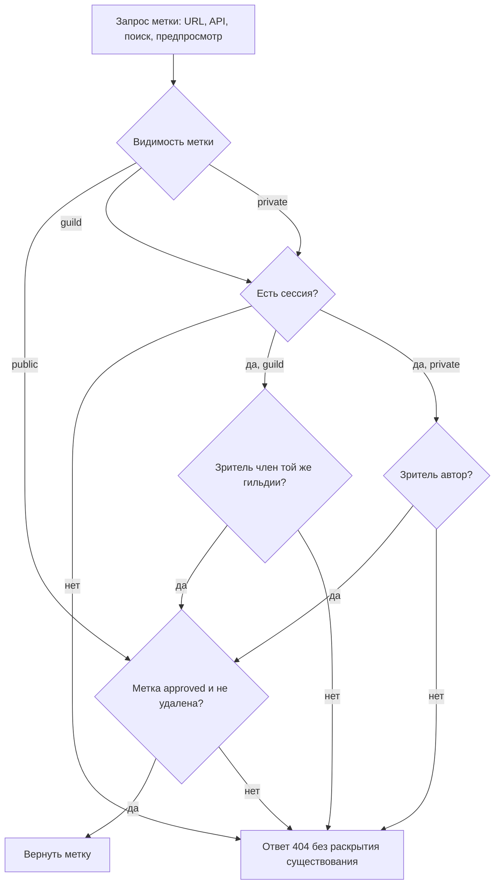
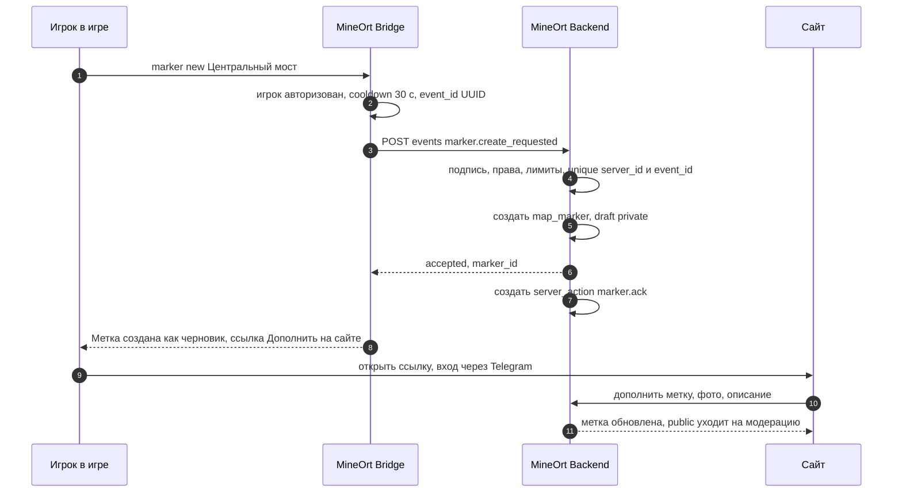
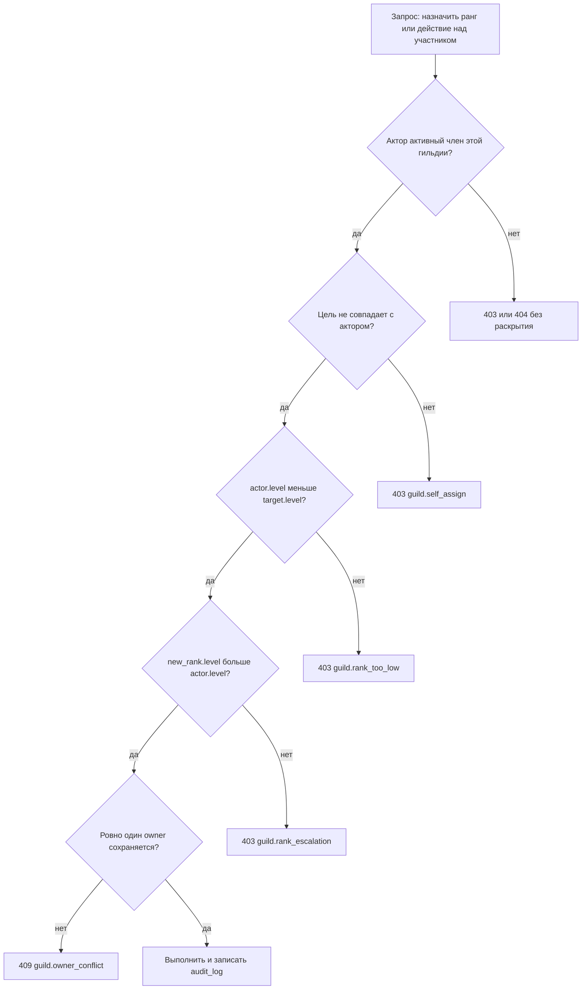

# MineOrt IV — Сценарии: карта, метки, игроки, гильдии, кабинет, модерация

| Поле | Значение |
|---|---|
| Документ | `02-scenarios/03-scenarios-world-guilds.md` |
| Статус | Черновик для утверждения |
| Базовая дата | 13.11.2026 (пятница); запуск 10.12.2026 (четверг), 27 календарных дней |
| Источник | Аудит §9 (стр. 393–461), §10 (стр. 463–585), §11 (стр. 587–611), §12 (стр. 613–637), §15.2, §15.4–15.5 (стр. 760–807), §16.2 (стр. 822–829), §20 (стр. 925–952); решения владельца 13.11.2026 |
| Домены | MAP, MRK, PLR, GLD, DSH (02, 03), ADM (07) |
| Связанные файлы | [01-scenarios-access-p0.md](01-scenarios-access-p0.md), [02-scenarios-social.md](02-scenarios-social.md), [../01-product/03-roles-permissions.md](../01-product/03-roles-permissions.md), [../01-product/02-user-status-model.md](../01-product/02-user-status-model.md), [../00-analysis/03-open-decisions.md](../00-analysis/03-open-decisions.md), [../00-analysis/02-glossary.md](../00-analysis/02-glossary.md), [../03-architecture/02-bridge-protocol.md](../03-architecture/02-bridge-protocol.md), [../03-architecture/03-data-model.md](../03-architecture/03-data-model.md), [../03-architecture/04-nfr-security.md](../03-architecture/04-nfr-security.md), [../05-qa/01-acceptance-tests.md](../05-qa/01-acceptance-tests.md) |

Теги: [ЗАКРЕПЛЕНО] / [ПРЕДЛАГАЕТСЯ] / [ПРОВЕРИТЬ] / [ОПРЕДЕЛИТЬ] / [РИСК] — из аудита; [ПРЕДЛОЖЕНИЕ КОМАНДЫ] — отсутствует в аудите; [РЕШЕНИЕ ВЛАДЕЛЬЦА 13.11.2026] — решения владельца.

## 1. О документе

Файл описывает 26 сценариев: атлас (MAP), быстрые метки из игры (MRK), каталог и профили игроков (PLR), гильдии (GLD), история, настройки и выгрузка данных в кабинете (DSH-02, DSH-03, DSH-05), модерацию меток и контента (ADM-07). Формат каждого сценария: паспорт, основной поток, альтернативы и ошибки, постусловия, UI-состояния, аудит и события. Тест-кейсы (TC) только перечисляются в строке «Связи»; Given/When/Then — в [../05-qa/01-acceptance-tests.md](../05-qa/01-acceptance-tests.md). TC из [../01-product/03-roles-permissions.md](../01-product/03-roles-permissions.md), §7 и [../03-architecture/02-bridge-protocol.md](../03-architecture/02-bridge-protocol.md), §10 переиспользованы без изменений; новые следуют схеме `TC-<DOM>-NNx`, где `NN` — номер сценария.

**Релиз.** Граница «весь P0 + P1 к 10.12.2026» принята владельцем [РЕШЕНИЕ ВЛАДЕЛЬЦА 13.11.2026]. Волны P1a / P1b / P1c — внутренние вехи внутри 27 дней: P1a — каталог игроков, история в кабинете; P1b — гильдии (все сценарии GLD); P1c — атлас, метки, `/marker new`. Каждая волна выпускается только после прохождения своих Blocker/Critical TC, иначе скрывается фича-флагом ([../04-plan/01-release-plan.md](../04-plan/01-release-plan.md)). **Никогда не режутся:** серверная проверка прав гильдий (AC-18, AC-23), приватность меток (AC-31), аудит админ-действий.

**Сквозные допущения** (для всех сценариев):

1. Права проверяются на сервере по трём измерениям (уровень доступа, `site_role`, `guild_rank`) и по принадлежности объекта; для чужого закрытого объекта — 404, а не 403 ([../01-product/03-roles-permissions.md](../01-product/03-roles-permissions.md), §6).
2. Правила уровней гильдии: уровни `owner`=1 … `member`=6; действие допустимо при `actor.level < target.level`, назначаемый ранг — при `new_rank.level > actor.level`; ровно один `owner`; последнего `owner` удалить/понизить нельзя. Коды ошибок: `guild.rank_too_low`, `guild.self_assign`, `guild.last_owner` (и `guild.rank_escalation`, `guild.owner_conflict`, `guild.already_member` из [../01-product/03-roles-permissions.md](../01-product/03-roles-permissions.md), §4).
3. Ранг гильдии не даёт OP, RCON, LuckPerms, `site_role` и данных чужой гильдии (аудит стр. 532, 829). Bridge принимает только белый список действий (`whitelist.add`, `whitelist.remove`, `player.kick`, `player.data_archive`, `player.data_migrate`, `player.data_restore`, `auth.release`, `marker.ack`, `tag.sync` (P2)).
4. Лимиты (NFR-LIM-13, LIM-14, LIM-17): метки 10 в час и 100 активных; `/marker new` cooldown 30 с; численность гильдии по умолчанию 50 (OD-10) — все числа [ПРЕДЛОЖЕНИЕ КОМАНДЫ].
5. Видимость меток и медиа: `public` / `guild` / `private` (OD-18); статус модерации `draft` / `pending` / `approved` / `hidden`.
6. Именование событий `audit_log` (scope `global` или `guild` + `guild_id`), `site_activity`, `security_events` и прикладных кодов ошибок — [ПРЕДЛОЖЕНИЕ КОМАНДЫ]; журнал гильдии ведётся в едином `audit_log` со `scope=guild` (C-10).
7. Цветной тег гильдии в P1 виден только на сайте; синхронизация в игру — P2 (OD-15, C-05).

## 2. Индекс сценариев

| SC | Название | Волна | AC |
|---|---|---|---|
| [SC-MAP-01](#sc-map-01--просмотр-атласа-слои-фильтры) | Просмотр атласа, слои, фильтры | P1c | — |
| [SC-MAP-02](#sc-map-02--метка-на-сайте) | Метка на сайте | P1c | — |
| [SC-MAP-03](#sc-map-03--фото-к-метке) | Фото к метке | P1c | AC-14 |
| [SC-MAP-04](#sc-map-04--закрытая-метка-не-утекает) | Приватная и гильдейская метка не утекает (URL, API, движок, тайлы) | P1c | AC-31 |
| [SC-MAP-05](#sc-map-05--удаление-метки) | Удаление метки | P1c | AC-24 |
| [SC-MAP-06](#sc-map-06--уход-из-гильдии-и-гильдейские-метки) | Уход из гильдии — гильдейские метки скрываются | P1c | — |
| [SC-MRK-01](#sc-mrk-01--marker-new-в-игре) | `/marker new` | P1c | AC-13 |
| [SC-MRK-02](#sc-mrk-02--marker-new-отказы) | `/marker new`: нет авторизации или права, лимит, имя, Bridge offline | P1c | AC-29 |
| [SC-MRK-03](#sc-mrk-03--дубль-marker-события) | Дубль события — одна метка | P1c | AC-32, AC-27 |
| [SC-PLR-01](#sc-plr-01--каталог-игроков) | Каталог, фильтр, кандидаты скрыты | P1a | AC-19 |
| [SC-PLR-02](#sc-plr-02--профиль-игрока-и-приватность) | Профиль и приватность | P1a | — |
| [SC-GLD-01](#sc-gld-01--администратор-создаёт-гильдию) | Админ создаёт гильдию, уникальность тега | P1b | AC-15 |
| [SC-GLD-02](#sc-gld-02--приглашение-в-гильдию) | Приглашение игрока в гильдию | P1b | AC-16 |
| [SC-GLD-03](#sc-gld-03--заявка-в-гильдию) | Заявка в гильдию | P1b | — |
| [SC-GLD-04](#sc-gld-04--назначение-ранга) | Назначение ранга | P1b | AC-17 |
| [SC-GLD-05](#sc-gld-05--самоповышение-и-ранг-не-ниже-своего) | Самоповышение, ранг не ниже своего | P1b | AC-18 |
| [SC-GLD-06](#sc-gld-06--последний-глава-и-уход-главы) | Последний глава, уход главы | P1b | AC-23 |
| [SC-GLD-07](#sc-gld-07--передача-главенства-через-администратора) | Передача главенства через admin | P1b | AC-23 |
| [SC-GLD-08](#sc-gld-08--исключение-и-уход-участника) | Исключение и уход, права пропадают сразу | P1b | — |
| [SC-GLD-09](#sc-gld-09--архив-и-роспуск-гильдии) | Архив, роспуск | P1b | — |
| [SC-GLD-10](#sc-gld-10--глава-пытается-админ-действие-или-rcon) | Глава пытается админ-действие или RCON | P1b | AC-18 |
| [SC-GLD-11](#sc-gld-11--бан-игрока-главы) | Бан игрока-главы | P1b | — |
| [SC-DSH-02](#sc-dsh-02--история-действий-и-приватность) | История действий и приватность | P1a | AC-20 |
| [SC-DSH-03](#sc-dsh-03--настройки-уведомлений-и-публичности) | Настройки уведомлений и публичности | P1a | — |
| [SC-DSH-05](#sc-dsh-05--выгрузка-своих-данных) | Выгрузка своих данных | P1a | — |
| [SC-ADM-07](#sc-adm-07--модерация-меток-и-контента) | Модерация меток и контента | P1a (контент) / P1c (метки) | — |

---

## 3. Атлас и метки (MAP)

### SC-MAP-01 · Просмотр атласа, слои, фильтры

| Поле | Значение |
|---|---|
| Релиз | P1c (E13) |
| Актор и уровень доступа | `guest`, `tg_user`, `applicant`, `member`, `restricted` — видят по своим правам |
| Предусловия | Движок карты (BlueMap/Dynmap, OD-16) развёрнут; метки в `map_markers` со статусом `approved` и нужной видимостью |
| Триггер | Пользователь открывает «Карта» (`/map`) |
| Связи | TC-MAP-01a (слои и фильтры по категориям, гильдии, поиску), TC-MAP-01b (гость видит только `public` и `approved`), TC-MAP-01c (переключение Overworld/Nether), TC-MAP-01d (позиции игроков в реальном времени и скрытые базы не отдаются), TC-MAP-01e (движок недоступен — страница не падает), TC-MAP-01f (ручной стресс-тест нагрузки движка и TPS на BisectHosting, G1c-04) · OD-16, OD-17, OD-18, OD-21 · TZ-10 · E13 · SC-MAP-04 |
| Источник в аудите | §9.1 (стр. 399–407), §9.3 (стр. 424–426), §9.5 (стр. 450–455), §9.6 (стр. 459) |

**Основной поток**

1. Пользователь открывает `/map`; сайт показывает оболочку «Атласа» (поверх движка): карту, список слоёв, фильтры, поиск.
2. Сервер формирует набор меток по правам зрителя: `public` и `approved` — всем; `guild` — членам той же гильдии; `private` — только автору (SC-MAP-04).
3. Пользователь включает слои по категориям (поселения, дома, общественные постройки, магазины, фермы, дороги, порталы, события, стройки, природные места, прочее), фильтрует по гильдии, ищет по названию. Миры: Overworld и Nether; End, территории и маршруты дорог — P2 (OD-21).
4. Клик по метке открывает карточку: название, описание, автор, категория, фото (для разрешённой аудитории), ссылки на гильдию, событие или публикацию, если связь есть.
5. Метаданные метки (автор, фото, права, история) хранятся в backend MineOrt; движок отображает только географию (аудит стр. 459).

**Альтернативы и ошибки**

- A1. Подтверждённые администрацией объекты отмечаются значком «Проверено администрацией» [ПРЕДЛАГАЕТСЯ], если решение будет принято (аудит стр. 454).
- A2. Поиск по метке с закрытой видимостью не находит её (не раскрывает существование).
- E1. Движок карты недоступен (перегрузка, остановка) — раздел показывает «Карта временно недоступна», сайт остаётся рабочим (NFR-PERF-07).
- E2. Позиции игроков в реальном времени не публикуются (стр. 450): слой «Игроки онлайн» отсутствует в P1.
- E3. Нет меток по фильтру — пустое состояние.

**Постусловия (изменения статусов)**

- Только чтение; статусы не меняются.

**UI-состояния**

- Loading: скелетон карты и панели слоёв. Empty: «По выбранным фильтрам меток нет». Error: «Карта временно недоступна». Success: карта со слоями; карточка метки.

**Аудит и события**

- Не пишутся (чтение). `security_events`: `authz.denied` при попытке открыть недоступную метку по идентификатору.

### SC-MAP-02 · Метка на сайте

| Поле | Значение |
|---|---|
| Релиз | P1c (E13) |
| Актор и уровень доступа | `member` (автор), модератор/admin |
| Предусловия | `access_memberships.status=approved`, `account_status=active`; не исчерпаны 10 меток в час и 100 активных меток |
| Триггер | Участник нажимает «Добавить метку» на карте |
| Связи | TC-MAP-02a (создание: название, описание, категория, мир, координаты), TC-MAP-02b (лимиты 10 в час и 100 активных), TC-MAP-02c (публичная метка уходит в `pending` и не видна гостям), TC-MAP-02d (валидация координат и мира), TC-MAP-02e (правка и смена видимости; чужую — 403) · OD-18, OD-19, OD-21 · TZ-10 · E13 · SC-MAP-03, SC-ADM-07 |
| Источник в аудите | §9.1 (стр. 403–405, 407), §9.3 (стр. 424), §9.5 (стр. 452–453) |

**Основной поток**

1. Участник вводит название (до 64 символов [ПРЕДЛОЖЕНИЕ КОМАНДЫ]), описание, категорию, мир (Overworld/Nether), координаты `x y z` (щелчок по карте подставляет их), видимость (`public` / `guild` / `private`, по умолчанию `private`) и необязательные связи (гильдия, событие, публикация).
2. Сервер проверяет права, лимиты, мир и диапазон координат, фильтрует название на недопустимые слова (SC-MRK-02).
3. Метка создаётся в `map_markers`: `private` и `guild` получают `moderation_status=approved`; `public` — `pending` до решения модератора (премодерация, OD-19).
4. Автор может позже править метку, менять видимость, добавлять фото (SC-MAP-03). Правка метки с сайта разрешена в P1; игровые `/marker list|edit|delete` не обещаются (C-09, аудит стр. 446).

**Альтернативы и ошибки**

- A1. Метка с `guild` доступна только при состоянии в активной гильдии (иначе вариант скрыт, сервер отклоняет 422).
- A2. Сужение видимости (`public` → `private`) вступает в силу немедленно, включая кэш и движок (SC-MAP-04).
- E1. Превышение лимитов — 429 / 409 «Достигнут лимит меток».
- E2. Координаты вне допустимого диапазона или неподдерживаемый мир (End) — 422.
- E3. Неприличное название — отклонение или отправка на модерацию (TC-MRK-02c).

**Постусловия (изменения статусов)**

- `map_markers`: новая запись (`approved` или `pending`); движок получает обновление только для `public` и `approved`.

**UI-состояния**

- Loading: кнопка «Сохранить» блокируется. Empty: «У вас пока нет меток». Error: «Не удалось сохранить метку». Success: «Метка сохранена»; для публичной — «Отправлена на проверку».

**Аудит и события**

- `site_activity`: `marker.created`, `marker.updated`. `audit_log`: `marker.moderated` (при решении модератора, SC-ADM-07). `security_events`: `rate_limit.exceeded`.

### SC-MAP-03 · Фото к метке

| Поле | Значение |
|---|---|
| Релиз | P1c (E13) |
| Актор и уровень доступа | `member` — автор метки |
| Предусловия | Метка принадлежит актору; на метке <5 изображений |
| Триггер | Автор нажимает «Прикрепить фото» в карточке метки |
| Связи | AC-14 · TC-MAP-03a (не-автор прикрепляет изображение — 403), TC-MAP-03b (E2E: фото отображается в карточке для разрешённой аудитории), TC-MAP-03c (6-е изображение — отказ), TC-MAP-03d (фото к `private`/`guild` метке недоступно по прямому URL посторонним), TC-MAP-03e (фото к публичной метке проходит премодерацию) · OD-19 · TZ-10 · E13 · SC-SOC-05, SC-GAL-02, SC-MAP-04 |
| Источник в аудите | §9.1 (стр. 404), AC-14 (стр. 942), §8.8 (стр. 381) |

**Основной поток**

1. Автор выбирает файл (проверки SC-SOC-05: JPEG/PNG/WebP, ≤10 МБ, ≤4096 px, перекодирование в WebP, EXIF удалены) либо изображение из своей галереи (SC-GAL-02).
2. Сервер проверяет авторство метки и число вложений (≤5 на метку, OD-19) и создаёт `media_attachments` (`target_type=marker`).
3. Видимость фото наследуется от метки; для `public`-метки новое изображение получает `pending` и показывается после одобрения (OD-19).
4. Карточка метки показывает фото только аудитории, которой доступна сама метка и само изображение.

**Альтернативы и ошибки**

- A1. Подпись к фото — необязательна, до 140 символов [ПРЕДЛОЖЕНИЕ КОМАНДЫ].
- A2. Снять фото с метки может автор или модератор; файл остаётся в галерее, если есть другие вложения (SC-SOC-04, A1).
- E1. Не-автор — 403 (TC-MAP-03a). Метка скрыта или удалена — 404.
- E2. 6-е изображение — 422 «К метке можно прикрепить до 5 изображений».
- E3. Недопустимый файл — SC-SOC-05.

**Постусловия (изменения статусов)**

- Добавлены `media_attachments`; для `public` — `media.moderation_status=pending` → `approved` / `hidden`.

**UI-состояния**

- Loading: прогресс загрузки. Empty: «К метке пока не прикреплено ни одного фото». Error: «Не удалось прикрепить фото». Success: фото в карточке; у публичной метки — «Фото на проверке».

**Аудит и события**

- `site_activity`: `marker.media_attached`. `audit_log`: `media.approved` / `media.hidden_by_moderator` при модерации. `security_events`: `authz.denied` при E1.

### SC-MAP-04 · Закрытая метка не утекает

| Поле | Значение |
|---|---|
| Релиз | P1c (E13); критерий go/no-go волны P1c |
| Актор и уровень доступа | Любой зритель без права: `guest`, `tg_user`, `applicant`, `member` другой гильдии, `restricted` |
| Предусловия | Существуют метки `private` и `guild` (и их медиа) в статусе `approved`; метка меняет видимость на более закрытую |
| Триггер | Запрос метки по прямому URL, API, поиску, предпросмотру ссылки, движку карты, тайлам, кэшу |
| Связи | AC-31 · TC-MAP-04a (гость запрашивает `private` или `guild` метку по URL и API — 404), TC-MAP-04b (не-член гильдии запрашивает `guild`-метку — 404), TC-MAP-04c (движок карты — маркеры, тайлы, JSON — не содержит закрытых меток и геометрии баз), TC-MAP-04d (после смены видимости кэш и CDN не отдают прежнюю версию), TC-MAP-04e (поиск, sitemap, Open Graph и уведомления не раскрывают закрытую метку), TC-GAL-01b (прямой URL закрытого изображения — 404) · R-21 · NFR-SEC-13 · TZ-10 · E13 · SC-MAP-06 |
| Источник в аудите | §9.5 (стр. 450–455), §15.5 (стр. 806), AC-31 — [ПРЕДЛОЖЕНИЕ КОМАНДЫ], AC-14 (стр. 942) |

**Основной поток**

1. Backend MineOrt — источник истины по видимости (аудит стр. 459). Любой путь к метке проходит одну серверную проверку: видимость → сессия → членство в гильдии/авторство → `approved` и не удалена.
2. В движок карты (BlueMap/Dynmap) передаются только `public` + `approved` метки. Метки `guild` и `private` отображаются поверх карты отдельным слоем оболочки, который запрашивается у backend под сессией зрителя и не попадает в статические файлы движка.
3. Все пути отдачи метки и её изображений (HTML, JSON API, поиск, sitemap, превью Open Graph, push/Telegram-тексты) строятся из того же проверяемого запроса; в ответах для запрещённого зрителя нет ни метки, ни её имени, ни числа.
4. При смене видимости на более закрытую или при скрытии/удалении метки backend синхронно обновляет движок и инвалидирует кэш/CDN; предыдущая версия не выдаётся после ответа об успехе операции.
5. Для чужой закрытой метки сервер всегда отвечает 404, как для несуществующей.

**Альтернативы и ошибки**

- A1. Автор видит свои `private`-метки в слое «Мои метки». Модератор/admin видят закрытые метки только в админ-разделе с записью в аудит (SC-ADM-07).
- A2. Тайлы и геометрия баз. Публичные тайлы раскрывают постройки в мире независимо от меток (C-15, R-21, G-11; аудит стр. 450–451, 455). Политика детализации тайлов для гостей и участников — [ОПРЕДЕЛИТЬ]; рекомендация [ПРЕДЛОЖЕНИЕ КОМАНДЫ]: тайлы отдаются только через домен сайта с проверкой сессии `member`, гостям — обзор низкого разрешения, скрытые зоны исключаются из рендера. Вопрос блокирует TC-MAP-04c и критерий go/no-go P1c.
- E1. Любое расхождение (метка видна в движке после скрытия) — Blocker, волна P1c остаётся под фича-флагом.
- E2. Прямое обращение к статическим файлам движка (`/map/data/*`) минуя оболочку — не должно содержать закрытых меток (TC-MAP-04c).

**Постусловия (изменения статусов)**

- Статусы не меняются; проверяется отсутствие утечки.

**UI-состояния**

- Loading: скелетон карточки. Empty: «Метка недоступна или удалена» (одинаково для несуществующей и закрытой). Error: «Не удалось загрузить метку». Success: метка отображается только разрешённым зрителям.

**Аудит и события**

- `security_events`: `authz.denied` (тип объекта `marker`, без раскрытия причины пользователю); при подозрительном переборе идентификаторов — `enumeration.suspected` [ПРЕДЛОЖЕНИЕ КОМАНДЫ].

### SC-MAP-05 · Удаление метки

| Поле | Значение |
|---|---|
| Релиз | P1c (E13) |
| Актор и уровень доступа | Автор метки (`member`), модератор с `markers.moderate` / admin |
| Предусловия | Метка существует; к ней могут быть прикреплены изображения и ссылки из публикаций и событий |
| Триггер | Автор нажимает «Удалить метку» |
| Связи | AC-24 · TC-MAP-05a (не-автор или не-moderator удаляет метку — 403), TC-MAP-05b (автор удаляет: метка исчезает отовсюду), TC-MAP-05c (движок и кэш обновлены), TC-MAP-05d (фото снимаются, ссылки показывают «Метка удалена», файлы удаляются через 30 дней) · OD-40 · TZ-10 · E13 · SC-SOC-04, SC-GAL-02 |
| Источник в аудите | AC-24 (стр. 952), §8.9 (стр. 387), §9.4 (стр. 446) |

**Основной поток**

1. Автор подтверждает удаление; сервер проверяет авторство или права модератора.
2. Задаётся `map_markers.deleted_at`; метка немедленно исчезает из карты, поиска и профиля; backend удаляет её из слоя движка и инвалидирует кэш.
3. Вложения `media_attachments` метки снимаются; файлы без других вложений получают `deleted_at` и удаляются физически через 30 дней (OD-40).
4. Ссылки из постов, событий и запросов отображаются как «Метка удалена» без сломанных ссылок.
5. История и аудит сохраняются.

**Альтернативы и ошибки**

- A1. Модератор удаляет метку с причиной; автор уведомляется.
- A2. Метка, созданная из игры (черновик `private`), удаляется так же; игровая команда `/marker delete` не обещается (OD-20).
- E1. Не-автор — 403 или 404.
- E2. Повторное удаление — идемпотентно, 404.

**Постусловия (изменения статусов)**

- `map_markers.deleted_at` задан; `media_attachments` метки сняты; движок и кэш синхронизированы.

**UI-состояния**

- Loading: кнопка блокируется. Empty: «У вас пока нет меток». Error: «Не удалось удалить метку». Success: «Метка удалена».

**Аудит и события**

- `site_activity`: `marker.deleted`. `audit_log`: `marker.deleted_by_moderator` (при удалении модератором). `security_events`: `authz.denied` при E1.

### SC-MAP-06 · Уход из гильдии и гильдейские метки

| Поле | Значение |
|---|---|
| Релиз | P1c (E13), зависит от гильдий (P1b) |
| Актор и уровень доступа | Бывший член гильдии (`member`); система |
| Предусловия | У гильдии есть метки `guild`; пользователь был активным участником |
| Триггер | Участник покинул гильдию (SC-GLD-08), исключён, забанен или гильдия архивирована (SC-GLD-09) |
| Связи | TC-MAP-06a (после ухода пользователь не видит гильдейские метки сразу), TC-MAP-06b (исключение и бан действуют так же), TC-MAP-06c (собственные `guild`-метки ушедшего автора переходят в `private`), TC-MAP-06d (архивная гильдия — её метки скрыты у всех, кроме admin) · OD-08, OD-14, OD-18 · TZ-10 · E13 · SC-GLD-08, SC-GLD-09 |
| Источник в аудите | §9.5 (стр. 452), §10.4 (стр. 497), §16.2 (стр. 826–827) |

**Основной поток**

1. Статус `guild_members` меняется на неактивный (уход, исключение) либо `account_status` ≠ `active`.
2. Следующий же запрос слоя «Гильдия» не включает метки гильдии: права читаются из БД на каждый запрос (R-LVL-6), клиентский кэш не используется.
3. Метки `guild`, созданные ушедшим автором, переводятся в `private` и остаются у автора, чтобы он не потерял собственные данные [ПРЕДЛОЖЕНИЕ КОМАНДЫ]; метки, привязанные к гильдии руководством, остаются за гильдией.
4. Кэш слоя и CDN инвалидируются; изображения таких меток недоступны по прямым URL (404).

**Альтернативы и ошибки**

- A1. Бывший участник вступает в другую гильдию: видит только её метки.
- A2. Гильдия архивирована: `guild`-метки скрываются у всех, кроме admin в админке; судьба меток при восстановлении — [ОПРЕДЕЛИТЬ].
- E1. Окно рассинхронизации в кэше недопустимо: нарушение трактуется как нарушение AC-31.

**Постусловия (изменения статусов)**

- Видимость `guild`-меток для бывшего участника отсутствует; собственные метки автора — `private`.

**UI-состояния**

- Loading: слой «Гильдия» перезагружается. Empty: «Метки гильдии недоступны». Error: «Не удалось обновить слой». Success: слой исчезает, список меток обновлён.

**Аудит и события**

- `audit_log` (scope `guild`): `guild.member_left` / `guild.member_removed` (из SC-GLD-08); `site_activity` автора: `marker.visibility_changed` (системное).

---

## 4. Быстрые метки из игры (MRK)

### SC-MRK-01 · `/marker new` в игре

| Поле | Значение |
|---|---|
| Релиз | P1c (E14) |
| Актор и уровень доступа | Игрок: `member`, `game_identity=confirmed`, `desired=on`, `applied_state=applied`, игровая авторизация пройдена |
| Предусловия | Bridge онлайн; игрок в Overworld или Nether; cooldown 30 с и лимиты метки не исчерпаны |
| Триггер | Игрок набирает `/marker new <название>` |
| Связи | AC-13 · TC-MRK-01a (команда создаёт черновик `private` с автором, миром и координатами), TC-MRK-01b (метка дополняется на сайте: описание, фото, публикация), TC-MRK-01c (в Энде и неподдерживаемом мире — отказ), TC-MRK-01d (координаты и мир берутся сервером, а не из ввода игрока) · OD-20, OD-21 · NFR-LIM-14 · TZ-10, TZ-04 · E14 · SC-MRK-02, SC-MRK-03 |
| Источник в аудите | §9.1 (стр. 406–407), §9.4 (стр. 428–446), AC-13 (стр. 941); протокол — [../03-architecture/02-bridge-protocol.md](../03-architecture/02-bridge-protocol.md), §7.5 |

**Основной поток**

1. Игрок вводит `/marker new Центральный мост`. Bridge проверяет, что игрок прошёл игровую авторизацию (не в limbo), и локальный cooldown 30 с.
2. Bridge формирует событие `marker.create_requested` с `event_id` (UUID), ником, UUID, миром, координатами `x y z`, предложенным именем; событие подписывается ключом Bridge ([../03-architecture/02-bridge-protocol.md](../03-architecture/02-bridge-protocol.md), §2).
3. Backend проверяет подпись, `unique (server_id, event_id)`, права (`member`, `game_identity=confirmed`, `applied_state=applied`), лимиты (100 активных меток) и название.
4. Создаётся `map_markers` с автором, миром и координатами **из события Bridge**, `visibility=private`, `moderation_status=draft` (OD-20).
5. Backend создаёт `server_actions` `marker.ack`; Bridge сообщает игроку: «Метка создана как черновик. Дополнить на сайте: <ссылка>».
6. Игрок открывает ссылку (вход через Telegram, если сессии нет), добавляет описание и фото, выбирает видимость; публикация `public` проходит премодерацию (SC-MAP-02, SC-ADM-07).

**Альтернативы и ошибки**

- A1. Ссылка ведёт на карточку метки в режиме редактирования; доступна только автору (иначе 404).
- A2. Игровые `/marker list`, `/marker edit`, `/marker delete` не обещаются в P1 (аудит стр. 446, C-09).
- E1. Мир не Overworld/Nether (например, End) — Bridge отказывает: «В этом измерении метки пока не поддерживаются» (OD-21).
- E2. Название пустое или длиннее 64 символов — отказ с подсказкой по использованию.
- E3. Прочие отказы — SC-MRK-02.

**Постусловия (изменения статусов)**

- `map_markers`: новая запись `visibility=private`, `moderation_status=draft`; `server_events` содержит `marker.create_requested`; `server_actions` `marker.ack` → `succeeded` после доставки.

**UI-состояния**

- В игре: сообщение об успехе с кликабельной ссылкой либо причина отказа. На сайте: Loading — «Загружаем метку»; Empty — в списке «Мои метки» ещё нет; Error — «Метка не найдена»; Success — карточка черновика с кнопкой «Опубликовать».

**Аудит и события**

- `server_events`: `marker.create_requested`. `server_actions`: `marker.ack`. `site_activity`: `marker.created_in_game`. `audit_log` не пишется.

### SC-MRK-02 · `/marker new`: отказы

| Поле | Значение |
|---|---|
| Релиз | P1c (E14) |
| Актор и уровень доступа | Игрок в игре: до авторизации, без допуска, с превышением лимита |
| Предусловия | Игрок вызывает `/marker new` в условиях, нарушающих предусловия SC-MRK-01 |
| Триггер | Команда `/marker new <название>` |
| Связи | AC-29 · TC-MRK-02a (без игровой авторизации или без права — метка не создана), TC-MRK-02b (cooldown 30 с и лимит 100 активных), TC-MRK-02c (неприличное название), TC-MRK-02d (Bridge не может связаться с backend — метка не создаётся, очередь не копится), TC-MRK-02e (длина и символы названия) · NFR-LIM-13, LIM-14 · TZ-10, TZ-04 · E14 · SC-MRK-01, SC-GAME-06 |
| Источник в аудите | §9.4 (стр. 435–436), §9.5 (стр. 453), принцип «до аутентификации не действовать» (стр. 232); AC-29 — [ПРЕДЛОЖЕНИЕ КОМАНДЫ] |

**Основной поток** (негативный)

1. Игрок вводит команду.
2. Bridge/backend проверяют условия по порядку: авторизация → право → cooldown → лимит → название → доступность backend.
3. На первом нарушении возвращается причина без технических деталей; метка и `server_events` не создаются.

**Альтернативы и ошибки**

- E1. Игрок в limbo (не авторизован) — команда заблокирована, как и все команды до авторизации (AC-29): метка не создаётся (TC-MRK-02a).
- E2. Нет права (`applicant`, `restricted`, `game_identity=unconfirmed`, `applied_state` ≠ `applied`) — «Метки доступны одобренным участникам».
- E3. Повтор чаще 30 с — «Подождите N секунд»; 100 активных меток — «Достигнут лимит меток».
- E4. Неприличное название — отказ или создание в `draft` с отметкой «на проверку» [ПРЕДЛОЖЕНИЕ КОМАНДЫ]; список запрещённых слов ведёт администрация.
- E5. Bridge offline или backend недоступен — «Сервис меток временно недоступен»; метка не создаётся и не ставится в локальную очередь (fail-closed, как в OD-46) [ПРЕДЛОЖЕНИЕ КОМАНДЫ].
- E6. Неподписанное/просроченное событие отклоняется backend (SC-MRK-03, `ERR_SIG_INVALID`).

**Постусловия (изменения статусов)**

- Никаких изменений в `map_markers`; запись в `security_events` при E1 и E6.

**UI-состояния**

- В игре: короткое понятное сообщение об отказе. На сайте — не применимо.

**Аудит и события**

- `security_events`: `marker.denied` (причина: unauthenticated / no_permission / rate_limited / invalid_name). `server_events` — не пишутся при отказе до отправки.

### SC-MRK-03 · Дубль marker-события

| Поле | Значение |
|---|---|
| Релиз | P1c (E14) |
| Актор и уровень доступа | Bridge (сервисный актор); атакующий с повтором запроса |
| Предусловия | Событие `marker.create_requested` уже принято; Bridge повторяет отправку из-за сетевой ошибки |
| Триггер | Повторный POST события с тем же `event_id` |
| Связи | AC-32, AC-27 · TC-MRK-03a (повторное событие — ровно одна метка), TC-MRK-03b (marker-событие с неверной подписью — отклонено), TC-MRK-03c (параллельные дубли обрабатываются одним победителем), TC-MRK-03d (второй `marker.ack` не создаётся, ответ `duplicate` возвращает прежний `marker_id`) · TZ-10, TZ-04 · E14 · SC-MRK-01, SC-OPS-04 |
| Источник в аудите | §14.1 (стр. 718–721), §15.1 (стр. 757), AC-13 (стр. 941); протокол — [../03-architecture/02-bridge-protocol.md](../03-architecture/02-bridge-protocol.md), §7.5 |

**Основной поток**

1. Bridge отправил событие, ответ потерялся; Bridge повторяет запрос с тем же `event_id`.
2. Backend обращается к `server_events` с ограничением `UNIQUE (server_id, event_id)` и к `map_markers.source_event_id` (UNIQUE).
3. При повторе сервер отвечает 200 со статусом элемента `duplicate` и прежним `marker_id`; новая метка не создаётся, `marker.ack` не дублируется.
4. При параллельных одинаковых запросах один выигрывает на уровне БД, остальные получают `duplicate`.

**Альтернативы и ошибки**

- A1. Две команды игрока с разными `event_id` подряд — не дубль: второе блокируется cooldown 30 с (SC-MRK-02), а не дедупликацией.
- E1. Подпись запроса неверна (`ERR_SIG_INVALID`), `nonce` повторён (`ERR_NONCE_REPLAY`), время вне окна (`ERR_TS_SKEW`) — 401, событие не принимается, метка не создаётся (TC-MRK-03b).
- E2. Событие от неизвестного `server_id` — `ERR_SERVER_MISMATCH` (403).

**Постусловия (изменения статусов)**

- В `map_markers` ровно одна запись на `event_id`; в `server_events` — одна запись.

**UI-состояния**

- Для игрока: ровно одно сообщение «Метка создана»; для сайта — одна метка в списке.

**Аудит и события**

- `server_events`: одна запись; повторы фиксируются счётчиком `duplicate`. `security_events`: `bridge.signature_rejected` при E1.

---

## 5. Игроки (PLR)

### SC-PLR-01 · Каталог игроков

| Поле | Значение |
|---|---|
| Релиз | P1a (E12) |
| Актор и уровень доступа | Любой (`guest` … `admin`); видимость полей зависит от настроек приватности |
| Предусловия | Опубликованы игроки, отвечающие критерию каталога; есть кандидаты (заявка `pending`) и отклонённые |
| Триггер | Пользователь открывает «Игроки» (`/players`) |
| Связи | AC-19 · TC-PLR-01a (кандидаты и отклонённые заявители отсутствуют в каталоге — UI и API), TC-PLR-01b (фильтр по гильдии), TC-PLR-01c (поиск по нику без учёта регистра и алфавитный порядок), TC-PLR-01d (игроки без гильдии показываются корректно), TC-PLR-01e (приостановленные и заблокированные не показываются), TC-PLR-01f (пагинация и пустой результат) · OD-01, OD-29 · TZ-09 · E12 · SC-PLR-02 |
| Источник в аудите | §10.2 (стр. 471–483), AC-19 (стр. 947), §4 (стр. 100) |

**Основной поток**

1. Пользователь открывает «Игроки»; вкладка «Гильдии» — `/players?tab=guilds` (OD-01).
2. Сервер строит каталог из игроков, соответствующих критерию «подтверждённый участник»: `access_memberships.status=approved`, `account_status=active`, `game_identity=confirmed` (то есть игрок хотя бы раз вошёл и подтвердил личность) — [ПРЕДЛОЖЕНИЕ КОМАНДЫ] на основе предложения аудита (стр. 483, вопрос [ОПРЕДЕЛИТЬ]). Кандидаты (`applicant`), отклонённые, приостановленные и заблокированные в публичный каталог не попадают.
3. Карточка содержит ник и скин, гильдию с цветным тегом и ранг (если гильдия есть), ссылку на профиль; онлайн-статус — опционально, если доступен и разрешён.
4. Фильтры: гильдия, поиск по нику, алфавит; страница на 24 карточки [ПРЕДЛОЖЕНИЕ КОМАНДЫ].
5. Игроки без гильдии отображаются корректно (группа «Без гильдии»).

**Альтернативы и ошибки**

- A1. Игрок скрыл гильдию/статистику в настройках (SC-DSH-03) — карточка показывает только разрешённые публичные поля (по умолчанию: ник, дата первого входа, гильдия; OD-29).
- A2. Если владелец расширит критерий каталога (все одобренные), меняется только фильтр запроса.
- E1. Кандидат или отклонённый заявитель найден прямым запросом к API/поиску — не возвращается (AC-19, TC-PLR-01a).
- E2. Пустой результат — понятное пустое состояние.

**Постусловия (изменения статусов)**

- Только чтение.

**UI-состояния**

- Loading: скелетон карточек. Empty: «Игроков по выбранным условиям не найдено». Error: «Не удалось загрузить список игроков». Success: каталог с фильтрами.

**Аудит и события**

- Не пишутся. `security_events`: `authz.denied` при попытке запроса скрытых полей через API.

### SC-PLR-02 · Профиль игрока и приватность

| Поле | Значение |
|---|---|
| Релиз | P1a (E12) |
| Актор и уровень доступа | Любой зритель; владелец профиля — `member` |
| Предусловия | Игрок присутствует в каталоге (SC-PLR-01) |
| Триггер | Переход на страницу игрока |
| Связи | TC-PLR-02a (публичный API профиля не возвращает Telegram ID, IP, коды), TC-PLR-02b (чтение закрытых таблиц ключом `anon` / `authenticated` — отказ, RLS), TC-PLR-02c (изменение настроек публичности отражается в профиле сразу), TC-PLR-02d (профиль кандидата, отклонённого или несуществующего — 404), TC-PLR-02e (удалённый аккаунт) · OD-29, OD-40 · NFR-SEC-13 · TZ-09, TZ-11 · E12 · SC-DSH-03 |
| Источник в аудите | §10.3 (стр. 487), §15.5 (стр. 803–808), §11.3 (стр. 609) |

**Основной поток**

1. Зритель открывает профиль: ник, скин/аватар, гильдия и ранг, краткое описание, дата участия, разрешённая статистика, публичные публикации и скриншоты.
2. Сервер возвращает только поля, разрешённые настройками приватности владельца (`privacy_settings`) и ролью зрителя. По умолчанию публичны дата первого входа и гильдия (OD-29).
3. Telegram ID, IP, коды входа, журналы действий, административные записи и внутренние идентификаторы никогда не возвращаются в публичном API (аудит стр. 487, 804).
4. Владелец видит на своём профиле ссылку «Настройки публичности» (SC-DSH-03).

**Альтернативы и ошибки**

- A1. Профиль `restricted`/приостановленного пользователя недоступен публично (404); сам он видит экран статуса.
- A2. Профиль удалённого аккаунта: «Игрок удалил аккаунт», публикации скрыты, идентификационные данные в аудите псевдонимизируются (OD-40).
- E1. Прямой запрос к закрытым таблицам (`telegram_identities`, `audit_log`) ключами `anon`/`authenticated` — отказ RLS (TC-PLR-02b).
- E2. Профиль кандидата — 404 (не раскрывать существование).

**Постусловия (изменения статусов)**

- Только чтение.

**UI-состояния**

- Loading: скелетон профиля. Empty: «Игрок пока ничего не опубликовал». Error: «Профиль недоступен». Success: профиль с публичными блоками.

**Аудит и события**

- Не пишутся. `security_events`: `authz.denied` при E1, E2.

---

## 6. Гильдии (GLD)

Общее для всех сценариев GLD: гильдии создаёт и расформировывает только `admin`; глава (`owner`) — единственный в гильдии; ранги — шаблон из 6 уровней в `guild_ranks`; журнал — `audit_log` со `scope=guild`; численность — по умолчанию 50 (OD-10); один активный членский статус на игрока (OD-08).

### SC-GLD-01 · Администратор создаёт гильдию

| Поле | Значение |
|---|---|
| Релиз | P1b (E11) |
| Актор и уровень доступа | `member` + `site_role=admin` (ключ `guild.create`), пройден step-up |
| Предусловия | Будущий глава: `access_memberships.status=approved`, `account_status=active`, `game_identity=confirmed`, нет активной гильдии |
| Триггер | Админ открывает `/admin/guilds` и нажимает «Создать гильдию» |
| Связи | AC-15 · TC-GLD-01a (не-admin, включая главу другой гильдии, создаёт гильдию через API — 403), TC-GLD-01b (дубль тега или slug, в том числе в другом регистре — 409), TC-GLD-01c (E2E: создание, страница гильдии, глава в составе), TC-GLD-01d (кандидат уже состоит в гильдии — 409), TC-GLD-01e (создание без step-up — отказ), TC-GLD-01f (кандидат не `approved` или не `active` — 409) · OD-07, OD-11, OD-39 · TZ-09 · E11 · SC-GLD-07 |
| Источник в аудите | §10.1 (стр. 467), §10.8 (стр. 560–566), AC-15 (стр. 943), §12.1 (стр. 617) |

**Основной поток**

1. Админ открывает форму: название, slug (предлагается из названия, уникален), короткий тег (формат и допустимые символы — [ОПРЕДЕЛИТЬ], стр. 574; предлагается 2–5 символов `A–Z`, `0–9` [ПРЕДЛОЖЕНИЕ КОМАНДЫ]), цвет, описание, эмблема (эмблему ORT Hertli не использовать до подтверждения прав, OD-39).
2. Выбирает будущего главу среди подходящих игроков; подтверждает операцию step-up (TOTP или passkey, действует 15 минут, AC-34).
3. Сервер проверяет `site_role=admin` и ключ `guild.create`, уникальность `slug` и `lower(tag)`, отсутствие у кандидата активной гильдии.
4. В одной транзакции создаются `guilds`, шаблон `guild_ranks` (6 уровней), `guild_members` для главы (`rank=owner`), запись `audit_log` (scope `guild`).
5. Появляются страница `/guilds/:slug` и панель `/guilds/:slug/manage` для главы; гильдия видна в каталоге.

**Альтернативы и ошибки**

- A1. Тег и цвет в P1 видны только на сайте; они не создают прав в игре (OD-15, C-05).
- A2. Тег может переиспользоваться после роспуска? — [ОПРЕДЕЛИТЬ]; по умолчанию тег архивной гильдии остаётся занятым.
- E1. Не-admin — 403 (TC-GLD-01a). Дубль тега/slug — 409 `guild.tag_taken` / `guild.slug_taken` (TC-GLD-01b).
- E2. Кандидат уже в гильдии — 409 `guild.already_member` (R-LVL-8).
- E3. Нет step-up — 403 `stepup.required`.
- E4. Кандидат не подтверждён (`applicant`, не `active`) — 409.

**Постусловия (изменения статусов)**

- `guilds.status=active`; `guild_members`: глава с рангом `owner`, `status=active`; ровно один `owner`.

**UI-состояния**

- Loading: форма проверяет уникальность тега на лету. Empty: список гильдий — «Гильдий пока нет». Error: «Тег уже занят». Success: «Гильдия создана», переход на страницу гильдии.

**Аудит и события**

- `audit_log` (scope `guild`, `guild_id`): `guild.created`, `guild.owner_assigned`, `guild.tag_changed` (если меняется). `security_events`: `authz.denied`.

### SC-GLD-02 · Приглашение в гильдию

| Поле | Значение |
|---|---|
| Релиз | P1b (E11) |
| Актор и уровень доступа | Приглашающий: глава, заместитель, помощник (✓* — по шаблону ранга), право `guild.invite`; приглашаемый — `member` |
| Предусловия | Гильдия `active`, не заполнена (<50); у кандидата `access_memberships.status=approved` (OD-13), нет активной гильдии |
| Триггер | Руководитель нажимает «Пригласить игрока» на панели гильдии |
| Связи | AC-16 · TC-GLD-02a (приглашение игрока, уже состоящего в другой гильдии — 409), TC-GLD-02b (приглашение без `access_membership=approved` — 409), TC-GLD-02c (офицер гильдии A приглашает от имени гильдии B — 403, IDOR), TC-GLD-02d (E2E: приглашение принято — игрок в составе), TC-GLD-02e (отклонение и истечение), TC-GLD-02f (гильдия заполнена — 409), TC-GLD-02g (приглашение самого себя, приостановленного или забаненного — 409) · OD-08, OD-10, OD-13 · TZ-09 · E11 · SC-GLD-03 |
| Источник в аудите | §10.7 (стр. 544), §10.8 (стр. 565), AC-16 (стр. 944), §24.2 (стр. 1048, 1053) |

**Основной поток**

1. Руководитель находит игрока (поиск по нику) и нажимает «Пригласить».
2. Сервер проверяет: актор — активный член этой гильдии с правом `guild.invite`; у цели `approved` и нет активной гильдии; нет другого `pending`-приглашения этой пары; место в гильдии есть.
3. Создаётся `guild_invitations` (`status=pending`, срок 7 дней [ПРЕДЛОЖЕНИЕ КОМАНДЫ]); приглашённый видит приглашение в «Кабинете» и получает уведомление (на сайте; Telegram — opt-in).
4. Игрок нажимает «Принять»: сервер повторно проверяет, что у него по-прежнему нет активной гильдии и есть место; создаётся `guild_members` (`rank=member`, `status=active`); приглашение переходит в `accepted`.
5. Игрок появляется в составе гильдии, в каталоге и на странице гильдии.

**Альтернативы и ошибки**

- A1. Игрок отклоняет приглашение — `declined`; повторное приглашение возможно после паузы 24 ч [ПРЕДЛОЖЕНИЕ КОМАНДЫ].
- A2. Приглашение истекло — `expired` (по запросу); принять нельзя.
- E1. Цель уже в другой гильдии — 409 `guild.already_member` (TC-GLD-02a).
- E2. Цель без `approved` — 409 (TC-GLD-02b); приостановлена/забанена — 409.
- E3. Актор чужой гильдии или без права — 403 (TC-GLD-02c).
- E4. Гильдия заполнена — 409 `guild.full`.
- E5. Между отправкой и принятием игрок вступил в другую гильдию — при принятии 409, приглашение закрывается.

**Постусловия (изменения статусов)**

- `guild_invitations`: `pending` → `accepted` | `declined` | `expired` | `revoked`; `guild_members`: новая активная запись у принявшего.

**UI-состояния**

- Loading: поиск игрока. Empty: «Нет подходящих игроков». Error: «Игрок уже состоит в гильдии». Success: «Приглашение отправлено»; у игрока — «Вы вступили в гильдию».

**Аудит и события**

- `audit_log` (scope `guild`): `guild.invitation_sent`, `guild.invitation_accepted`, `guild.member_joined`. `security_events`: `authz.denied` при E3.

### SC-GLD-03 · Заявка в гильдию

| Поле | Значение |
|---|---|
| Релиз | P1b (E11) |
| Актор и уровень доступа | Заявитель — `member` без активной гильдии; принимающий — руководитель с `guild.accept_request` |
| Предусловия | Гильдия `active` и принимает заявки; у заявителя `approved`; нет активной гильдии |
| Триггер | Игрок нажимает «Вступить в гильдию» на странице гильдии |
| Связи | TC-GLD-03a (заявка от состоящего в гильдии пользователя — 409), TC-GLD-03b (E2E: заявка принята — игрок в составе), TC-GLD-03c (решение по заявке гильдии A руководителем гильдии B — 403), TC-GLD-03d (дубль `pending` — 409), TC-GLD-03e (гильдия заполнена — 409), TC-GLD-03f (после вступления в одну гильдию остальные заявки закрываются) · OD-08, OD-13 · TZ-09 · E11 · SC-GLD-02 |
| Источник в аудите | §10.4 (стр. 498), §10.10 (стр. 579), §15.2 (стр. 768) |

**Основной поток**

1. Игрок нажимает «Вступить», пишет короткое сообщение (до 280 символов [ПРЕДЛОЖЕНИЕ КОМАНДЫ]).
2. Сервер проверяет, что у игрока нет активной гильдии и `approved`; создаётся `guild_join_requests` (`pending`). Заявка в гильдию — отдельный объект, не путать с заявкой на допуск (`applications`, C-10).
3. Руководитель с правом `guild.accept_request` видит очередь заявок и принимает или отклоняет (причина необязательна).
4. При принятии сервер повторно проверяет условия и создаёт `guild_members` (`rank=member`); остальные `pending`-заявки игрока закрываются автоматически.

**Альтернативы и ошибки**

- A1. Если гильдия закрыта для заявок политикой — кнопки нет, но игрока можно пригласить (SC-GLD-02).
- A2. Игрок может отозвать собственную заявку (`withdrawn`).
- E1. Заявка от члена гильдии — 409 (TC-GLD-03a). Дубль — 409 (TC-GLD-03d).
- E2. Решение по заявке чужой гильдии — 403 (TC-GLD-03c).
- E3. Гильдия заполнена — 409 `guild.full`.

**Постусловия (изменения статусов)**

- `guild_join_requests`: `pending` → `approved` | `rejected` | `withdrawn`; `guild_members`: новая запись при принятии.

**UI-состояния**

- Loading: «Отправляем заявку…». Empty: у руководителя — «Заявок нет». Error: «Вы уже состоите в гильдии». Success: «Заявка отправлена»; у игрока — «Вас приняли в гильдию».

**Аудит и события**

- `audit_log` (scope `guild`): `guild.join_request_decided`, `guild.member_joined`. `site_activity`: `guild.join_requested`.

### SC-GLD-04 · Назначение ранга

| Поле | Значение |
|---|---|
| Релиз | P1b (E11) |
| Актор и уровень доступа | Глава (все ранги ниже), заместитель и помощники (✓* — только ниже себя), `guild.assign_rank` |
| Предусловия | Актор и цель — активные члены этой гильдии; `actor.level < target.level` и `new_rank.level > actor.level` |
| Триггер | Руководитель выбирает ранг в карточке участника |
| Связи | AC-17 · TC-GLD-04a (участник `member` назначает ранг — 403), TC-GLD-04b (офицер назначает ранг участнику выше или равному себе — 403), TC-GLD-04c (глава гильдии A меняет ранг в гильдии B — 403), TC-GLD-04d (E2E: глава назначает `officer_1`, права и аудит обновлены сразу), TC-GLD-04e (заместитель назначает `officer_2`; повысить до `vice_leader` может только глава — 403), TC-GLD-04f (изменение рангов отражается на странице гильдии), TC-GLD-04g (назначение `rank_id` из чужой гильдии — 403, в том числе прямым API и прямой записью; составной FK `(guild_id, rank_id)`) · OD-09 · TZ-09 · E11 · SC-GLD-05 |
| Источник в аудите | §10.5 (стр. 507–518), §10.7 (стр. 546–547, 556), AC-17 (стр. 945) |

**Основной поток**

1. Руководитель открывает карточку участника и выбирает из списка только допустимые ранги (строго ниже собственного).
2. Сервер проверяет: актор — активный член гильдии объекта; `actor.level < target.level`; `new_rank.level > actor.level`; цель ≠ актор.
3. Для повышения до `vice_leader` дополнительно требуется ранг `owner` (✓ только у главы).
4. Сервер проверяет, что `rank_id` принадлежит той же гильдии, что и цель (`guild_ranks.guild_id = guild_members.guild_id`; на уровне БД составной внешний ключ `(guild_id, rank_id)`); обновляется `guild_members.rank_id` только через backend/RPC, прямая запись клиентской ролью закрыта [ПРЕДЛОЖЕНИЕ КОМАНДЫ]; права цели в гильдии меняются немедленно (кэш прав на клиенте не используется, R-LVL-6).
5. В `audit_log` (scope `guild`) записываются актор, цель, старый и новый ранг.

**Альтернативы и ошибки**

- A1. Имена рангов правит глава (OD-09); права рангов — только `admin`.
- A2. Понижение: допустимо для цели ниже актора; цель получает ранг не выше собственного прежнего.
- E1. `member` или актор без права — 403 `guild.rank_too_low` (TC-GLD-04a).
- E2. Цель равна/выше актора — 403 `guild.rank_too_low` (TC-GLD-04b). Новый ранг ≤ уровня актора — 403 `guild.rank_escalation`.
- E3. Чужая гильдия — 403 (TC-GLD-04c). Ранг из чужой гильдии (`rank_id` другой гильдии, подставленный в запрос своей) — 403 `guild.rank_foreign`, запись не меняется (TC-GLD-04g).
- E4. Попытка назначить второго `owner` — 409 `guild.owner_conflict` (только `guild.transfer_owner`).

**Постусловия (изменения статусов)**

- `guild_members.rank_id` цели изменён; `owner` остаётся единственным.

**UI-состояния**

- Loading: «Сохраняем ранг…». Empty: «Участников с рангом ниже вашего нет». Error: «Недостаточно прав для этого ранга». Success: «Ранг изменён» и обновлённый бейдж в составе.

**Аудит и события**

- `audit_log` (scope `guild`): `guild.rank_assigned` (актор, цель, from/to). `security_events`: `authz.denied` при E1–E3.

### SC-GLD-05 · Самоповышение и ранг не ниже своего

| Поле | Значение |
|---|---|
| Релиз | P1b (E11); критерий go/no-go волны P1b |
| Актор и уровень доступа | Участник гильдии любого ранга, атакующий через UI или прямой API |
| Предусловия | Актор — активный член гильдии |
| Триггер | Попытка назначить себе ранг; назначить ранг не ниже собственного; повысить цель, равную себе или выше |
| Связи | AC-18 · TC-GLD-05a (самоповышение через UI — кнопка недоступна), TC-GLD-05b (прямой вызов API — 403 `guild.self_assign`), TC-GLD-05c (назначение ранга ≤ собственного — 403 `guild.rank_escalation`), TC-GLD-05d (действие над целью с `target.level <= actor.level` — 403 `guild.rank_too_low`), TC-GLD-05e (параллельные повышения не создают второго `owner`) · OD-09 · NFR-SEC-12 · TZ-09 · E11 · SC-GLD-04, SC-GLD-06 |
| Источник в аудите | §10.7 (стр. 556), AC-18 (стр. 946), §16.2 (стр. 822–829) |

**Основной поток**

1. Участник пытается назначить себе более высокий ранг: в UI кнопки для своей строки и для рангов ≥ своего нет (TC-GLD-05a).
2. Атакующий отправляет запрос напрямую: `T = A` → отказ 403 `guild.self_assign`, независимо от ранга.
3. Запрос повысить участника, равного актору или выше, отклоняется `guild.rank_too_low`; назначение ранга с `new_rank.level ≤ actor.level` отклоняется `guild.rank_escalation`.
4. Параллельные запросы на повышение проверяются в транзакции с блокировкой строки гильдии; partial unique «один `owner`» гарантирует единственного главу (TC-GLD-05e).
5. Каждый отказ пишется в `security_events`; пользователю показывается общий текст без деталей проверки.

**Альтернативы и ошибки**

- A1. Админ действует через админку и не ограничен правилами уровней, но обязан записать аудит и пройти step-up для смены главы.
- E1. Подмена `guild_id` в запросе на чужую гильдию — 403/404 (SC-GLD-04, E3).
- E2. Подмена `rank` на `owner` для себя — 403 `guild.self_assign`; для другого — 409 `guild.owner_conflict`.
- E3. Устаревший токен/кэш: права читаются из БД на каждый запрос.

**Постусловия (изменения статусов)**

- Данные не меняются; в `security_events` — запись об отказе.

**UI-состояния**

- Loading: не применимо. Empty: не применимо. Error: «Недостаточно прав». Success (для легального назначения) — SC-GLD-04.

**Аудит и события**

- `security_events`: `guild.rank_denied` (код причины, актор, цель). `audit_log` для отказов не пишется (только для успешных изменений).

### SC-GLD-06 · Последний глава и уход главы

| Поле | Значение |
|---|---|
| Релиз | P1b (E11); критерий go/no-go волны P1b |
| Актор и уровень доступа | Глава гильдии; админ (через админку); атакующий через API |
| Предусловия | В гильдии один `owner` |
| Триггер | Глава нажимает «Покинуть гильдию»; кто-то пытается удалить, исключить или понизить главу |
| Связи | AC-23 · TC-GLD-06a (удаление или понижение последнего главы через API — 409 `guild.last_owner`), TC-GLD-06b (выход главы без передачи — 409), TC-GLD-06c (параллельные «выход» и «передача» не оставляют гильдию без главы), TC-GLD-06d (админ удаляет членство главы без замены — 409) · OD-12, OD-14 · TZ-09 · E11 · SC-GLD-07 |
| Источник в аудите | §10.7 (стр. 550, 554), §15.2 (стр. 771), AC-23 (стр. 951), C-08 |

**Основной поток**

1. Глава нажимает «Покинуть гильдию». Кнопка показывает «Сначала передайте главенство: обратитесь к администратору» и не выполняет действие (C-08: запрет «оставить гильдию без главы» приоритетнее условного «✓**»).
2. На сервере любое действие, после которого в активной гильдии не останется `owner` (выход, исключение, понижение, удаление членства), отклоняется 409 `guild.last_owner` — «last-owner guard» на уровне транзакции.
3. Админ, которому нужно заменить главу, использует передачу (SC-GLD-07), а не удаление.
4. Параллельные операции («выход главы» и «передача») выполняются в одной транзакции с блокировкой, итог — ровно один `owner`.

**Альтернативы и ошибки**

- A1. Формулировка AC-23 («глава удаляет последнего члена руководства») трактуется как защита от остатка гильдии без главы; заместители и помощники удаляются свободно по правилам уровней.
- A2. Роспуск гильдии — отдельный сценарий (SC-GLD-09) и единственный допустимый способ закрыть гильдию целиком.
- E1. Выход главы — 409 `guild.last_owner` (TC-GLD-06b). Понижение/исключение главы — 409 (TC-GLD-06a).
- E2. Админ удаляет членство главы — 409 (TC-GLD-06d).
- E3. Попытка обхода через два параллельных запроса — гильдия не остаётся без главы (TC-GLD-06c).

**Постусловия (изменения статусов)**

- Состав и ранги не меняются; число `owner` в активной гильдии = 1.

**UI-состояния**

- Loading: не применимо. Empty: не применимо. Error: «Нельзя покинуть гильдию, пока вы её глава. Попросите администратора передать главенство». Success: не применимо (операция запрещена).

**Аудит и события**

- `security_events`: `guild.last_owner_blocked`. `audit_log` для отказов не пишется.

### SC-GLD-07 · Передача главенства через администратора

| Поле | Значение |
|---|---|
| Релиз | P1b (E11) |
| Актор и уровень доступа | `site_role=admin` с ключом `guild.create` / `guild.admin`, пройден step-up |
| Предусловия | Новый глава — активный член этой гильдии, `access_memberships.status=approved`, `account_status=active` |
| Триггер | Админ нажимает «Передать главенство» в `/admin/guilds/:slug` |
| Связи | AC-23 · TC-GLD-07a (глава передаёт главенство сам — 403, P2), TC-GLD-07b (передача не-члену, не-`approved` или забаненному — 409), TC-GLD-07c (E2E: атомарная передача, ровно один `owner`), TC-GLD-07d (без step-up — отказ), TC-GLD-07e (права прежнего главы пропали сразу) · OD-12 · TZ-09 · E11 · SC-GLD-06, SC-GLD-11 |
| Источник в аудите | §10.10 (стр. 581), §12.3 (стр. 635), §10.7 (стр. 541) |

**Основной поток**

1. Админ выбирает гильдию и нового главу из активных членов; подтверждает step-up.
2. Сервер проверяет условия нового главы и выполняет одну транзакцию: прежний `owner` → `member` (по умолчанию), новый → `owner`; число `owner` остаётся ровно одним.
3. Права обоих меняются немедленно; пишется `audit_log` (`guild.owner_transferred`); оба получают уведомление.
4. Если прежний глава забанен или удалён, он снимается с гильдии (`status` неактивный) в той же транзакции.

**Альтернативы и ошибки**

- A1. Самостоятельная передача главой — P2 (OD-12); в P1 действие недоступно.
- A2. Прежнего главу можно оставить заместителем при передаче — опция админа [ПРЕДЛОЖЕНИЕ КОМАНДЫ].
- E1. Глава пытается передать через API — 403 (TC-GLD-07a).
- E2. Новый глава не в гильдии, не `approved` или `account_status` ≠ `active` — 409 (TC-GLD-07b).
- E3. Нет step-up — 403 `stepup.required`.
- E4. Сбой посреди операции — транзакция откатывается; состояние «два owner» или «ноль owner» недопустимо.

**Постусловия (изменения статусов)**

- `guild_members`: прежний `owner` → `member`; новый → `owner`; `guilds.needs_owner` сбрасывается.

**UI-состояния**

- Loading: «Передаём главенство…». Empty: нет кандидатов — «В гильдии нет подходящих участников». Error: «Новый глава не соответствует требованиям». Success: «Главенство передано».

**Аудит и события**

- `audit_log` (scope `guild`): `guild.owner_transferred` (прежний, новый, актор). `security_events`: `stepup.verified` / `authz.denied`.

### SC-GLD-08 · Исключение и уход участника

| Поле | Значение |
|---|---|
| Релиз | P1b (E11) |
| Актор и уровень доступа | Участник (уход), руководитель (исключение, `guild.kick`), admin |
| Предусловия | Цель — активный член гильдии; для исключения `actor.level < target.level`; цель не `owner` |
| Триггер | Участник нажимает «Покинуть гильдию»; руководитель нажимает «Исключить» |
| Связи | TC-GLD-08a (исключённый участник вызывает API со старой сессией — 403 сразу), TC-GLD-08b (добровольный уход), TC-GLD-08c (исключение участника ниже рангом), TC-GLD-08d (исключение равного или выше — 403 `guild.rank_too_low`), TC-GLD-08e (после ухода гильдейский контент и метки недоступны сразу) · OD-08, OD-14 · TZ-09 · E11 · SC-MAP-06, SC-SOC-08 |
| Источник в аудите | §10.7 (стр. 548, 550, 556), §16.2 (стр. 826–827), §10.10 (стр. 582) |

**Основной поток**

1. Участник уходит или руководитель исключает: сервер проверяет права и уровни, цель — не главу (SC-GLD-06).
2. `guild_members.status` меняется на неактивный (`left` — добровольный уход, `removed` — исключение), записываются время и инициатор.
3. Права в гильдии исчезают немедленно: следующий запрос с любой сессией не проходит проверку членства (права читаются из БД, не из токена).
4. Гильдейский контент (`guild`-посты, события, метки, изображения) становится недоступным бывшему участнику (SC-MAP-06); его собственные публикации остаются, контекст «на дату публикации» сохраняется.
5. Ожидающие приглашения и заявки пользователя в эту гильдию закрываются; вступить в другую гильдию можно сразу (OD-08).

**Альтернативы и ошибки**

- A1. Админ принудительно корректирует состав через админку с аудитом (`guild.admin`).
- A2. Участник, исключённый руководителем, может подать заявку снова (повторная заявка заблокирована 24 ч [ПРЕДЛОЖЕНИЕ КОМАНДЫ]).
- E1. Исключение равного/выше — 403 `guild.rank_too_low` (TC-GLD-08d). Исключение главы — 409 `guild.last_owner`.
- E2. Исключённый продолжает вызывать API — 403 (TC-GLD-08a).
- E3. Бан или приостановка: права исчезают так же, плюс отзыв сессий (SC-GLD-11).

**Постусловия (изменения статусов)**

- `guild_members.status`: `active` → `left` | `removed`; метки и контент гильдии скрыты для пользователя.

**UI-состояния**

- Loading: «Выполняем…». Empty: после ухода страница гильдии показывает публичные блоки. Error: «Недостаточно прав». Success: «Вы покинули гильдию» / «Участник исключён».

**Аудит и события**

- `audit_log` (scope `guild`): `guild.member_left`, `guild.member_removed` (актор, цель, причина). `security_events`: `authz.denied` при E2.

### SC-GLD-09 · Архив и роспуск гильдии

| Поле | Значение |
|---|---|
| Релиз | P1b (E11) |
| Актор и уровень доступа | `site_role=admin` (ключ `guild.archive`) |
| Предусловия | Гильдия `active` |
| Триггер | Админ нажимает «Распустить / архивировать» в `/admin/guilds/:slug` |
| Связи | TC-GLD-09a (не-admin архивирует или распускает — 403), TC-GLD-09b (действия над архивной гильдией — приглашение, посты — 409), TC-GLD-09c (E2E: архивирование освобождает членов и скрывает контент), TC-GLD-09d (бывшие члены могут вступить в другую гильдию), TC-GLD-09e (тег архивной гильдии остаётся занятым) · OD-14 · TZ-09, TZ-12 · E11 · SC-MAP-06 |
| Источник в аудите | §10.7 (стр. 551), §10.10 (стр. 582), §12.2 (стр. 623) |

**Основной поток**

1. Админ вводит название гильдии для подтверждения и причину.
2. Сервер ставит `guilds.status=archived`; активные `guild_members` переводятся в `ended` (системное завершение) — этот единственный путь допустим при активном `owner`, так как гильдия перестаёт быть активной.
3. Страница гильдии показывается как «Гильдия распущена» (только публичная история), панель управления закрыта.
4. Гильдейский контент скрывается от членов; публичные посты остаются с пометкой.
5. Бывшие участники свободны и могут вступить в другую гильдию.

**Альтернативы и ошибки**

- A1. Восстановление из архива — [ОПРЕДЕЛИТЬ]; по умолчанию через админа с аудитом.
- A2. Переименование и споры решает владелец через админку и журнал (OD-32).
- E1. Не-admin — 403 (TC-GLD-09a).
- E2. Любое действие над архивной гильдией (приглашение, пост, назначение ранга) — 409 `guild.archived`.

**Постусловия (изменения статусов)**

- `guilds.status=archived`; активных `guild_members` нет; метки/контент `guild` скрыты.

**UI-состояния**

- Loading: «Архивируем…». Empty: «Распущенных гильдий нет». Error: «Нужно подтверждение названия». Success: «Гильдия архивирована».

**Аудит и события**

- `audit_log` (scope `guild`): `guild.archived` (актор, причина). `site_activity` участников: `guild.ended`.

### SC-GLD-10 · Глава пытается админ-действие или RCON

| Поле | Значение |
|---|---|
| Релиз | P1b (E11) |
| Актор и уровень доступа | Глава (`owner`) или другой ранг гильдии, `site_role=player` |
| Предусловия | Актор — активный член гильдии |
| Триггер | Вызов `/api/admin/*`; попытка повысить собственную `site_role`; постановка в очередь консольной команды; ожидание прав от тега гильдии |
| Связи | AC-18 · TC-GLD-10a (глава вызывает `/api/admin/*` — 403), TC-GLD-10b (глава пытается получить OP или повысить `site_role` — невозможно, события нет), TC-GLD-10c (попытка поставить в очередь произвольную консольную команду — отказ, в `server_actions` нет), TC-GLD-10d (в интерфейсе нет пунктов админки для главы) · NFR-SEC-12 · TZ-09, TZ-04 · E11 · SC-OPS-04 |
| Источник в аудите | §10.5 (стр. 503–505), §10.6 (стр. 520–532), §16.2 (стр. 829) |

**Основной поток**

1. Глава открывает панель гильдии; пунктов `/admin` в меню нет (меню строится по `site_role`).
2. Прямой запрос к `/api/admin/*`: проверка `site_role` и ключей админки, а не гильдейского ранга → 403.
3. Запрос изменить `site_role`, выдать разрешения или права OP через API сайта → 403; `roles.manage` недоступно.
4. Постановка в очередь действия вне белого списка (`rcon`, `op`, `lp`, произвольная команда) отклоняется на backend (`ERR_ACTION_TYPE_FORBIDDEN`/400); `server_actions` не создаётся; Bridge в любом случае отклонил бы такой тип.
5. Тег и цвет гильдии не создают игровых прав (синхронизация — P2, `tag.sync`).

**Альтернативы и ошибки**

- A1. Админ-владелец, одновременно являющийся главой, действует как `admin` через админку; гильдейский ранг на его админ-права не влияет и наоборот.
- E1. Любая попытка эскалации пишется в `security_events` с актором и целью.
- E2. Неподписанная команда напрямую в Bridge — отклоняется (AC-27, SC-OPS-04).

**Постусловия (изменения статусов)**

- Никаких изменений в `users.site_role`, `server_actions`, правах Minecraft.

**UI-состояния**

- Loading: не применимо. Empty: не применимо. Error: «Нет доступа». Success: не применимо.

**Аудит и события**

- `security_events`: `escalation.attempt` (тип: admin_api / role_change / console_command). `audit_log` не пишется.

### SC-GLD-11 · Бан игрока-главы

| Поле | Значение |
|---|---|
| Релиз | P1b (E11) |
| Актор и уровень доступа | `site_role=admin` (ключ `players.ban`), пройден step-up |
| Предусловия | Забаненный игрок — глава активной гильдии |
| Триггер | Админ банит игрока (SC-ADM-05) |
| Связи | TC-GLD-11a (забаненный глава пытается управлять гильдией — 403; гильдия отмечена «нужен глава»), TC-GLD-11b (гильдия попадает в очередь админа), TC-GLD-11c (заместитель сохраняет свои права над нижестоящими, но не получает права главы), TC-GLD-11d (разбан не восстанавливает главенство, если оно передано) · OD-14 · TZ-09, TZ-12 · E11 · SC-ADM-05, SC-GLD-07 |
| Источник в аудите | §10.10 (стр. 581–582), §12.3 (стр. 635), §16.2 (стр. 826–827) |

**Основной поток**

1. Админ банит игрока: `account_status=banned`, отзыв сессий, `membership.revoked`, Bridge: `whitelist.remove`, `player.kick` (модель статусов, §3.6).
2. Гильдия остаётся активной; забаненный глава теряет права мгновенно (`restricted`), в публичных списках не отображается.
3. Гильдия получает пометку «нужен глава» (`needs_owner`), попадает в очередь админа; в админке — предупреждение.
4. Админ передаёт главенство подходящему члену (SC-GLD-07). Автоматического правопреемства нет — заместитель не становится главой [ПРЕДЛОЖЕНИЕ КОМАНДЫ].
5. До передачи заместитель и помощники действуют по своим правам над нижестоящими; действия, требующие `owner` (повышение до `vice_leader`), недоступны.

**Альтернативы и ошибки**

- A1. При разбане прежнего главы он не возвращает главенство автоматически, если оно уже передано; если не передано — возврат ранга решает админ [ОПРЕДЕЛИТЬ].
- A2. Приостановка (а не бан) — те же последствия для прав гильдии, пока приостановка действует.
- E1. Забаненный вызывает API со старой сессией — 403 (сессия отозвана).
- E2. Бан без step-up — отказ (AC-34, SC-ADM-02).

**Постусловия (изменения статусов)**

- `users.account_status=banned`; гильдия `needs_owner=true`; `guild_members` забаненного не удаляется, пока админ не завершит передачу.

**UI-состояния**

- Loading: не применимо. Empty: не применимо. Error: «У гильдии нет главы. Обратитесь к администрации» (страница гильдии для членов). Success: в админке — «Нужен глава: 1 гильдия».

**Аудит и события**

- `audit_log` (scope `global` и `guild`): `user.banned`, `guild.needs_owner_flagged`. `security_events`: `authz.denied` при E1.

---

## 7. Кабинет: история и настройки (DSH)

### SC-DSH-02 · История действий и приватность

| Поле | Значение |
|---|---|
| Релиз | P1a (E15); статусная часть кабинета — P0 (SC-DSH-01) |
| Актор и уровень доступа | Владелец кабинета — `member`; посторонние — только публичная часть |
| Предусловия | Пользователь вошёл; есть записи `site_activity` и `player_statistics` |
| Триггер | Пользователь открывает «Кабинет» (`/dashboard`) → «Моя активность» |
| Связи | AC-20 · TC-DSH-02a (чтение истории или настроек другого пользователя — 403), TC-DSH-02b (история показывает собственные действия), TC-DSH-02c (скрытые и приватные материалы не попадают в чужую выдачу), TC-DSH-02d (базовая статистика с указанием источника и времени обновления), TC-DSH-02e (игровые логи и журналы безопасности не показываются) · OD-29, OD-40 · TZ-11 · E15 · SC-DSH-01, SC-DSH-03 |
| Источник в аудите | §11.1–11.3 (стр. 589–609), AC-20 (стр. 948) |

**Основной поток**

1. Пользователь открывает «Моя активность»: список значимых событий платформы — посты, комментарии, голоса, заявки, заказы и помощь, метки, действия в гильдии — в обратном хронологическом порядке с фильтром по типу.
2. Сервер отдаёт только записи самого пользователя (`site_activity.user_id` = сессия) с учётом видимости материалов.
3. Блок «Статистика» показывает подтверждённые показатели: дата первого входа, время игры, последний вход; рядом — «Обновлено …» и пометка об ограниченной точности источника (аудит стр. 598).
4. Публичная часть (то, что видят другие) определяется настройками (SC-DSH-03); по умолчанию — дата первого входа и гильдия (OD-29).
5. Веб-история ≠ игровой лог: сырые игровые события и журналы безопасности в истории не отображаются (аудит стр. 605–607).

**Альтернативы и ошибки**

- A1. Записи удалённых материалов показываются как «Материал удалён» без содержимого (SC-SOC-04).
- A2. Срок хранения истории — [ОПРЕДЕЛИТЬ] (стр. 609); по умолчанию 1 год, как `audit_log` [ПРЕДЛОЖЕНИЕ КОМАНДЫ].
- E1. Запрос чужой истории (подмена `user_id`) — 403 (TC-DSH-02a, IDOR).
- E2. Источник статистики недоступен — «Данные временно недоступны», остальные блоки работают.
- E3. Нет событий — пустое состояние.

**Постусловия (изменения статусов)**

- Только чтение.

**UI-состояния**

- Loading: скелетон списка. Empty: «Здесь появятся ваши действия на сайте». Error: «Не удалось загрузить историю». Success: список с фильтрами и блок статистики.

**Аудит и события**

- Чтение не пишется в аудит. `security_events`: `authz.denied` при E1.

### SC-DSH-03 · Настройки уведомлений и публичности

| Поле | Значение |
|---|---|
| Релиз | P1a (E15, E16); обязательные уведомления — P0 |
| Актор и уровень доступа | `tg_user` и выше (свои настройки); `restricted` — только просмотр обязательных |
| Предусловия | Пользователь вошёл через Telegram; для Telegram-уведомлений дано согласие на ЛС от бота (OD-41) |
| Триггер | Пользователь открывает «Кабинет» → «Настройки» |
| Связи | TC-DSH-03a (opt-in уведомления сохраняются и применяются), TC-DSH-03b (обязательные уведомления нельзя отключить — 422), TC-DSH-03c (переключатель публичности скрывает поле в каталоге и профиле сразу), TC-DSH-03d (бот не может писать в ЛС — предупреждение и доставка на сайте), TC-DSH-02a (чужие настройки — 403) · OD-29, OD-30, OD-41 · TZ-11 · E15, E16 · SC-AUTH-07, SC-PLR-02 |
| Источник в аудите | §11.2 (стр. 603), §24.5 (стр. 1078–1079), §5.4 (стр. 207) |

**Основной поток**

1. Раздел «Уведомления»: обязательные (решение по заявке, «доступ готов», подтверждение входа) — включены, отключить нельзя (OD-30); необязательные — комментарии и ответы, напоминания о событиях, закрытие опроса, приглашение в гильдию, отклики на заказы — по умолчанию выключены (opt-in).
2. Раздел «Публичность»: переключатели «Показывать дату первого входа», «Показывать гильдию», «Показывать статистику»; по умолчанию публично только первые два (OD-29).
3. При сохранении сервер проверяет принадлежность настроек сессии; обязательные не могут быть отключены.
4. Изменение публичности действует на каталог и профиль немедленно (кэш инвалидируется).
5. Если бот не может писать в ЛС (пользователь не запускал бота или заблокировал), в разделе показывается предупреждение «Бот не может написать вам. Откройте бота и нажмите Start»; все уведомления остаются доступными на сайте (SC-AUTH-07).

**Альтернативы и ошибки**

- A1. `restricted` видит обязательные уведомления о статусе, но не может включать необязательные.
- A2. Отписка по ссылке из сообщения бота — выключает конкретный тип.
- E1. Попытка отключить обязательное через API — 422 `notification.mandatory`.
- E2. Чужие настройки — 403 (TC-DSH-02a).
- E3. Недоступность Telegram: уведомления копятся в `notifications` и показываются на сайте; доставка в бота повторяется по `notification_deliveries`.

**Постусловия (изменения статусов)**

- `notification_preferences` и `privacy_settings` обновлены; публичные страницы отражают изменения.

**UI-состояния**

- Loading: скелетон формы. Empty: не применимо. Error: «Не удалось сохранить настройки». Success: «Настройки сохранены».

**Аудит и события**

- `site_activity`: `settings.updated`. `audit_log` не пишется. `security_events`: `authz.denied` при E2.

---

### SC-DSH-05 · Выгрузка своих данных

| Поле | Значение |
|---|---|
| Релиз | P1a (E15, E16) [ПРЕДЛОЖЕНИЕ КОМАНДЫ] |
| Актор и уровень доступа | `tg_user` и выше (свои данные); `restricted` — тоже может запросить выгрузку (право на доступ к своим данным не отключается ограничением) |
| Предусловия | Пользователь вошёл через Telegram; `account_status ∈ {active, suspended, banned}`; свежая сессия |
| Триггер | «Кабинет» → «Настройки» → «Скачать мои данные» |
| Связи | TC-DSH-05a (выгрузка содержит только данные запросившего: без чужих данных и без секретов), TC-DSH-05b (rate limit и повторный запрос) · OD-40, OD-45 · NFR-SEC-06, NFR-SEC-13 · TZ-11 · E15, E16 · SC-DSH-03, SC-DSH-04, SC-PLR-02 |
| Источник в аудите | OD-40 (хранение и удаление данных, стр. 1078–1079); сама выгрузка и её параметры — [ПРЕДЛОЖЕНИЕ КОМАНДЫ] |

**Основной поток**

1. Пользователь нажимает «Скачать мои данные»; сервер проверяет сессию и лимит запросов (TC-DSH-05b).
2. Backend создаёт задачу выгрузки для `user_id` из серверной сессии (идентификатор пользователя из запроса не принимается).
3. Формируется архив (JSON + список медиа-ссылок): профиль, настройки уведомлений и публичности, ник и статусы допуска, заявки и решения (без внутренних заметок модераторов), посты, голоса, события и запросы, метки, членство и ранг в гильдии, собственная история действий.
4. В архив **не** попадают: данные других пользователей (чужие комментарии показываются только как собственный текст автора), `telegram_id` других лиц, хэши кодов и приглашений, ключи и секреты Bridge, `security_events`/внутренние заметки администрации, IP других людей, содержимое закрытых таблиц.
5. Пользователь получает уведомление «Выгрузка готова» и скачивает файл по одноразовой ссылке с ограниченным сроком жизни (24 ч [ПРЕДЛОЖЕНИЕ КОМАНДЫ]); ссылка привязана к его сессии.

**Альтернативы и ошибки**

- A1. Выгрузка ещё готовится: «Готовим файл. Обычно это занимает до N минут» (значение — [ОПРЕДЕЛИТЬ → ТЗ]).
- A2. Повторный запрос во время подготовки или чаще лимита (по умолчанию 1 запрос в 24 часа [ПРЕДЛОЖЕНИЕ КОМАНДЫ]): возвращается текущая задача либо 429 с `Retry-After` (TC-DSH-05b).
- A3. Аккаунт `banned`: выгрузка своих данных остаётся доступной, содержимое — без внутренних причин бана и заметок модераторов.
- E1. Подмена `user_id` в API: игнорируется/403, выгрузка только своих данных (TC-DSH-05a).
- E2. Ссылка скачивания открыта в чужой сессии либо по истечении срока: 403/410, файл не отдаётся.
- E3. Сбой генерации: «Не удалось подготовить файл. Повторить», лимит не списывается [ПРЕДЛОЖЕНИЕ КОМАНДЫ].

**Постусловия (изменения статусов)**

- Бизнес-статусы не меняются; создаётся запись о выгрузке (`data_export_requests`, срок хранения файла 24 ч) [ПРЕДЛОЖЕНИЕ КОМАНДЫ].

**UI-состояния**

- Loading: «Готовим файл…». Empty: не применимо. Error: «Не удалось подготовить файл», «Слишком часто. Попробуйте позже». Success: «Файл готов. Скачать».

**Аудит и события**

- `audit_log` (scope `global`): `user.data_exported` (user_id, время; содержимое не логируется). `security_events`: `authz.denied` при E1–E2, `rate_limit` при A2.

---

## 8. Администрирование контента и карты (ADM-07)

### SC-ADM-07 · Модерация меток и контента

| Поле | Значение |
|---|---|
| Релиз | P1a (контент: посты, изображения, жалобы); P1c (метки и категории атласа) |
| Актор и уровень доступа | `member` + `site_role=moderator` с ключами `markers.moderate` / `content.moderate` либо `admin` |
| Предусловия | Существуют `public` метки/изображения со статусом `pending`, жалобы `new`; у модератора выданы нужные ключи |
| Триггер | Модератор открывает очередь в `/admin` (контент и атлас) |
| Связи | TC-ADM-07a (модератор без `markers.moderate` одобряет публичную метку — 403), TC-ADM-07b (одобрение: метка видна в атласе и движке), TC-ADM-07c (скрытие: метка исчезает отовсюду, кэш инвалидирован), TC-ADM-07d (просмотр `private`-метки админом требует причины и пишется в аудит), TC-ADM-07e (причина обязательна при скрытии и отклонении), TC-ADM-07f (повторное решение — 409) · OD-19, OD-28, OD-32 · TZ-12, TZ-10 · E13, E08 · SC-SOC-03, SC-MAP-04 |
| Источник в аудите | §12.2 (стр. 624–626), §12.3 (стр. 637), §9.5 (стр. 452) |

**Основной поток**

1. Модератор открывает очередь: публичные метки и изображения на премодерации (`pending`), жалобы, скрытые материалы; сортировка по возрасту; цели: жалобы ≤24 ч (OD-28).
2. Для метки видит название, описание, координаты, мир, автора, изображения, видимость, жалобы.
3. Решение «Одобрить» → `moderation_status=approved`, метка передаётся в движок и становится видимой; «Скрыть» / «Отклонить» → `hidden` с обязательной причиной, метка исчезает из движка и выдачи, кэш инвалидируется; «Удалить» → мягкое удаление (SC-MAP-05).
4. Автор получает уведомление с причиной.
5. Просмотр чужой `private`-метки (по жалобе) возможен только в админке, с обязательным указанием причины; факт просмотра записывается в `audit_log`.

**Альтернативы и ошибки**

- A1. Админ изменяет категории атласа (добавить, переименовать) — запись в аудит.
- A2. Автор обжалует решение: финальное слово у владельца через `/admin` с аудитом (OD-32).
- E1. Модератор без нужного ключа — 403 (TC-ADM-07a); ключ выдаётся админом, модератор не расширяет свои права.
- E2. Повторное решение по уже решённому объекту — 409, аудит без дубля.
- E3. Скрытие без причины — 422.
- E4. Сбой синхронизации с движком: решение сохраняется, повторная синхронизация идёт по задаче; метка при этом не отдаётся из backend-выдачи (приоритет — AC-31).

**Постусловия (изменения статусов)**

- `map_markers.moderation_status`: `pending` → `approved` | `hidden`; для изображений — то же; `moderation_reports.status` → `resolved`.

**UI-состояния**

- Loading: скелетон очереди. Empty: «Очередь модерации пуста». Error: «Не удалось сохранить решение». Success: «Метка одобрена» / «Метка скрыта»; объект уходит из очереди.

**Аудит и события**

- `audit_log` (scope `global`): `marker.approved`, `marker.hidden`, `marker.private_viewed`, `media.approved`, `media.hidden_by_moderator`, `category.updated`. `security_events`: `authz.denied` при E1.

---

## 9. Замечания для сведения

1. **Коды ошибок гильдий.** [../03-architecture/02-bridge-protocol.md](../03-architecture/02-bridge-protocol.md), §8, описывает `guild.rank_too_low` одновременно для «актор не выше цели» и «новый ранг не ниже уровня актора», тогда как [../01-product/03-roles-permissions.md](../01-product/03-roles-permissions.md), §4 и TC-GLD-05c разделяют их на `guild.rank_too_low` и `guild.rank_escalation`. В сценариях использованы два кода по roles-permissions; таблица §8 в файле протокола дополнена кодом `guild.rank_escalation` (F1 закрыт).
2. **Критерий каталога игроков.** Аудит оставляет вопрос открытым (стр. 483, [ОПРЕДЕЛИТЬ]); принято «approved + active + `game_identity=confirmed`» [ПРЕДЛОЖЕНИЕ КОМАНДЫ]. Если владелец выберет «все одобренные», TC-PLR-01 и AC-19 остаются неизменными, меняется фильтр.
3. **Тайлы и геометрия баз.** Утечка через тайлы (C-15, R-21, G-11) не снимается проверкой видимости меток; в SC-MAP-04 вынесена открытая политика тайлов. Решение нужно до M2 (26.11), иначе TC-MAP-04c не пройти и волна P1c остаётся под фича-флагом. Связано со спайком движка (OD-16, OD-24).
4. **Трактовка AC-23.** Формулировка «Глава удаляет последнего члена руководства» (стр. 951) неоднозначна. Защита реализована для последнего `owner` (guard) и для отсутствия гильдии без главы; заместители и помощники удаляются свободно.
5. **Архив и guard последнего главы.** R-LVL-5 запрещает «архивировать вместе с членством». В SC-GLD-09 принято: при архивировании `guilds.status=archived`, а активные `guild_members` завершаются системой (`ended`); для активной гильдии guard действует без исключений.
6. **Статусы `guild_members`, `guild_invitations`, `guild_join_requests`.** Значения (`left`, `removed`, `ended`, `accepted`, `declined`, `expired`, `revoked`, `approved`, `rejected`, `withdrawn`) в аудите и канонических перечислениях пакета не заданы; приняты как [ПРЕДЛОЖЕНИЕ КОМАНДЫ] и зафиксированы в [../03-architecture/03-data-model.md](../03-architecture/03-data-model.md) (раунд исправлений F2: `kicked` заменён на `removed`).
7. **Пометка «нужен глава».** Поле `guilds.needs_owner` и очередь админа для SC-GLD-11 введены командой; в аудите их нет, в [модели данных](../03-architecture/03-data-model.md) поле `guilds.needs_owner` добавлено (F4); в roles-permissions §4 они описаны как предложение.
8. **Метки ушедшего автора.** Перевод `guild`-меток ушедшего автора в `private` (SC-MAP-06) — [ПРЕДЛОЖЕНИЕ КОМАНДЫ]; альтернатива — оставить их за гильдией.
9. **Игровые теги и OD-15.** В P1 тег гильдии виден только на сайте; `tag.sync` — P2 (E17). Сценарий SC-GLD-10 проверяет отсутствие игровых прав у тега.
10. **Лестница сокращений для этого файла.** Первыми срезаются: фото к меткам (SC-MAP-03), кастомизация атласа сверх оболочки (OD-17), заявки в гильдию (SC-GLD-03, остаётся приглашение), архивирование как отдельный сценарий (SC-GLD-09). Не режутся: SC-MAP-04, SC-GLD-05, SC-GLD-06, SC-GLD-10, SC-GLD-11, SC-ADM-07 (часть аудита).
11. **Волны AC.** P1a — AC-19, AC-20 (история); P1b — AC-15, AC-16, AC-17, AC-18, AC-23; P1c — AC-13, AC-14, AC-31, AC-32; AC-24 — P1c для меток (SC-MAP-05). AC-27 в SC-MRK-03 проверяется через TC-MRK-03b.
