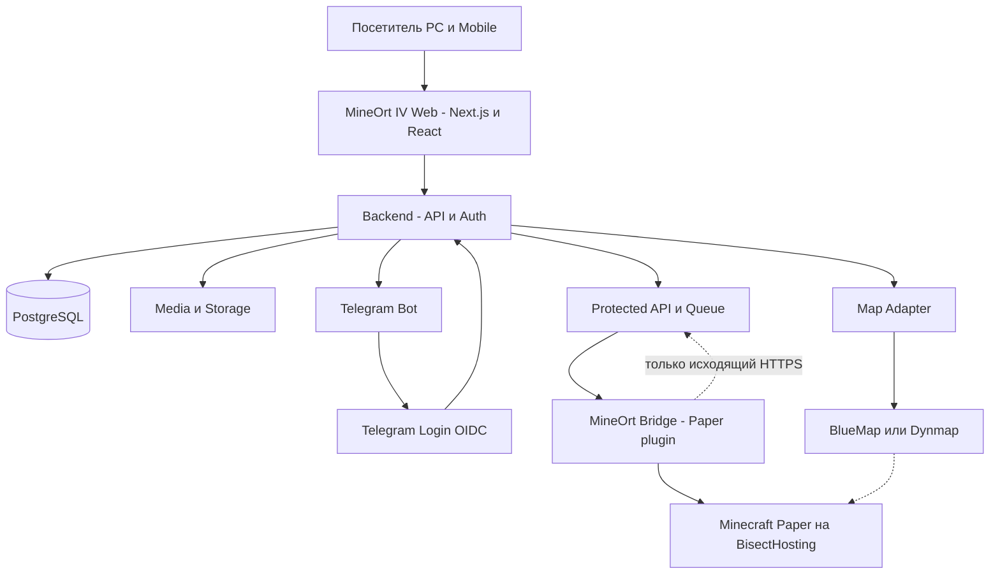
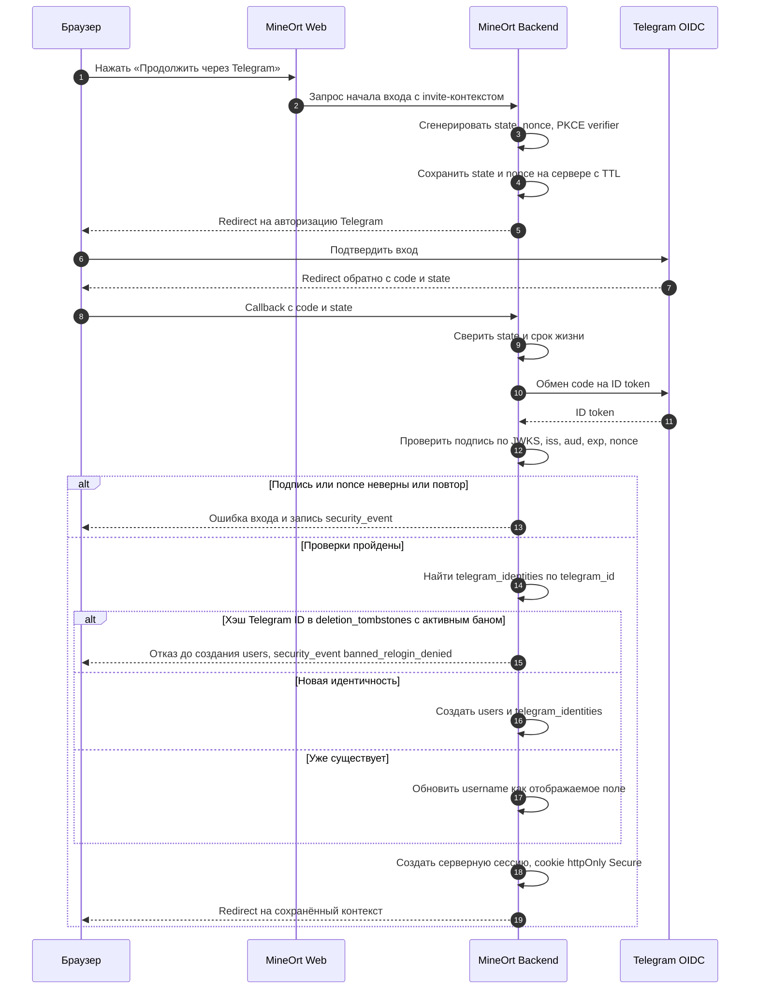

# MineOrt IV — Архитектура системы

| Поле | Значение |
|---|---|
| Статус | Черновик для утверждения |
| Базовая дата | 13.11.2026 (пятница); запуск 10.12.2026 (четверг), 27 календарных дней |
| Источник | Аудит концепции v2, §13–§14 (стр. 641–737) |
| Связанные файлы | [Протокол Bridge](02-bridge-protocol.md), [Модель данных](03-data-model.md), [NFR и безопасность](04-nfr-security.md) |

Теги: [ЗАКРЕПЛЕНО] / [ПРЕДЛАГАЕТСЯ] / [ПРОВЕРИТЬ] / [ОПРЕДЕЛИТЬ] / [РИСК] — из аудита; [ПРЕДЛОЖЕНИЕ КОМАНДЫ] — добавлено командой пакета (число, правило или механизм, которого нет в аудите); [РЕШЕНИЕ ВЛАДЕЛЬЦА 13.11.2026] — решения владельца.

> Весь документ описывает целевую архитектуру. Стек не утверждён (аудит §13.1, стр. 682; OD-35). Конкретный выбор остаётся за техлидом и фиксируется решением по OD-35.

## 1. Принципы

Принципы перенесены из аудита (стр. 672–680). Пометка [ПРЕДЛАГАЕТСЯ] относится ко всему разделу §13 (стр. 645).

| № | Принцип | Источник | Как проверяется |
|---|---|---|---|
| P-1 | Сайт и БД продолжают работать, даже если Minecraft отключён | аудит стр. 674, 846 | SC-OPS-02, AC-21 |
| P-2 | Не вызывать произвольные игровые команды из браузера, не открывать RCON наружу | аудит стр. 675 | [02-bridge-protocol.md](02-bridge-protocol.md), §1 (белый список действий) |
| P-3 | Все действия игрока проверяются по серверной сессии и правам | аудит стр. 676, 824 | негативные тесты прав (будущий 05-qa) |
| P-4 | Bridge выполняет только белый список разрешённых действий | аудит стр. 677 | TC-OPS-04, TC-GAME-03 |
| P-5 | Состояния синхронизации доступны игроку и администрации (честные статусы) | аудит стр. 678 | SC-DSH-01, SC-ADM-04 |
| P-6 | Карта и медиа отделены от авторизации и защищены от обхода через прямые URL | аудит стр. 679, 806 | AC-31, SC-MAP-04 |
| P-7 | Интеграция не получает преимущества ценой безопасности offline-режима | аудит стр. 680, 835 | AC-05, AC-29, AC-30 |
| P-8 | Ошибки Bridge не повреждают веб-данные и не подтверждают действие до реального применения | аудит стр. 847 | AC-28 |
| P-9 | Фоновые процессы восстанавливаются после сбоев и не выполняют действие многократно | аудит стр. 850 | идемпотентность по action_id, см. [02-bridge-protocol.md](02-bridge-protocol.md), §4 |

## 2. Компоненты

### 2.1. Схема

Схема воспроизводит ASCII-диаграмму аудита (стр. 647–670) и дополняет её границами доверия (границы доверия — [ПРЕДЛОЖЕНИЕ КОМАНДЫ]).

Пояснения:

- Стрелка «BR — Q» пунктиром: инициатор соединения всегда Bridge. Входящих портов на игровом узле нет [ПРЕДЛОЖЕНИЕ КОМАНДЫ]; применимость на BisectHosting — [ПРОВЕРИТЬ] (см. §8).
- Движок карты читает мир на игровом узле; его размещение — предмет OD-24 (стресс-тест) и риска R-16.

### 2.2. Таблица компонентов

| Компонент | Ответственность | Интерфейс | Хостинг | Статус стека |
|---|---|---|---|---|
| Web (Next.js + TypeScript) | Маршруты, SEO публичных страниц, кабинет, админка, компоненты UI | HTTPS, SSR/CSR | Vercel или другой (аудит стр. 690) | [ПРЕДЛАГАЕТСЯ], OD-35 |
| Backend / API / Auth | Бизнес-правила, проверка сессии и прав на каждое действие, источник истины по профилям, гильдиям, заявкам, голосам; **единственный писатель привилегированных колонок** (B2): клиентские роли не пишут напрямую в такие таблицы, переходы статусов идут через backend/RPC `SECURITY DEFINER` ([03-data-model.md](03-data-model.md), §8) [ПРЕДЛОЖЕНИЕ КОМАНДЫ]; подписывает команды и решения входа Ed25519 | REST/JSON `/api/*` (внутренний) и `/api/bridge/v1/*` (для Bridge) | Серверная часть Next.js и/или отдельный сервис; Supabase [ПРОВЕРИТЬ] | [ПРЕДЛАГАЕТСЯ], OD-35 |
| PostgreSQL | Хранение, ограничения целостности, RLS (аудит стр. 807) | SQL, права по ролям | Supabase Postgres или иной управляемый | [ПРЕДЛАГАЕТСЯ], OD-35 |
| Media / Storage | Хранение изображений, квоты, жизненный цикл файлов (аудит стр. 849) | подписанные URL или проксирование через backend | Supabase Storage или S3-совместимое [ПРОВЕРИТЬ] | [ПРЕДЛАГАЕТСЯ] |
| Telegram Bot | Уведомления, подтверждение входа в игру, подтверждение важных действий | Telegram Bot API; webhook на backend | Telegram + backend | [ПРЕДЛАГАЕТСЯ], OD-41 |
| Map Adapter | Создание, изменение, скрытие меток в движке карты с учётом видимости | внутренний модуль backend + API движка | backend | [ПРЕДЛАГАЕТСЯ], OD-16, OD-17 |
| BlueMap / Dynmap | Рендер и отдача тайлов | HTTP на отдельном поддомене или за прокси | рядом с Paper либо вне игрового узла (OD-24) | [ПРЕДЛАГАЕТСЯ], OD-16 |
| MineOrt Bridge | Исполнение белого списка действий, игровая авторизация (limbo), события, reconciliation | исходящий HTTPS к `/api/bridge/v1/*` | плагин Paper на BisectHosting | [ПРЕДЛАГАЕТСЯ], OD-23, OD-35 |
| Minecraft (Paper) | Игровой мир, whitelist, фактический онлайн | Bukkit/Paper API | BisectHosting | [ПРЕДЛАГАЕТСЯ], OD-22 |

## 3. Предлагаемый стек (не утверждён)

Таблица воспроизводит аудит §13.1 (стр. 682–697). Колонка «Проверка» — [ПРОВЕРИТЬ] по аудиту (стр. 699) и дополнения команды.

| Слой | Вариант | Проверка |
|---|---|---|
| UI | Next.js + TypeScript | [ПРОВЕРИТЬ] версия Next.js и режим рендера на Vercel [ПРЕДЛОЖЕНИЕ КОМАНДЫ] |
| Стили | Tailwind CSS / библиотека компонентов | Единый дизайн-гайд и адаптивность (аудит стр. 687) |
| Backend и БД | Supabase / PostgreSQL, возможно отдельный API | [ПРОВЕРИТЬ] лимиты бесплатного плана и паузу неактивного проекта (R-19) |
| Авторизация | Telegram OIDC + серверная проверка сессии | [ПРОВЕРИТЬ] официальную документацию https://core.telegram.org/bots/telegram-login (аудит стр. 207) |
| Веб-хостинг | Vercel или другой | [ПРОВЕРИТЬ] лимиты серверных функций (long-poll Bridge) [ПРЕДЛОЖЕНИЕ КОМАНДЫ] |
| Бот | Telegram Bot API | Механизм разрешения ЛС — OD-41, G-06 |
| Игровой сервер | Paper на BisectHosting | [ПРОВЕРИТЬ] версия MC, Paper, Java (OD-22), порты и ограничения хостинга |
| Интеграция | Собственный Java Paper-плагин MineOrt Bridge | [ПРОВЕРИТЬ] совместимость с итоговой версией |
| Карта | BlueMap или Dynmap + собственный UI | Спайк OD-16 |
| Игровая статистика | Plan либо собственные события | Только если данные достоверны (аудит стр. 695) |
| Игровая авторизация | AuthMe или альтернативная безопасная система | [ПРОВЕРИТЬ] AuthMe/LibreLogin; схема — OD-23 (гибрид, [02-bridge-protocol.md](02-bridge-protocol.md), §6) |
| Игровые теги | LuckPerms + форматирующий слой или собственная интеграция | P2 (OD-15), после теста |

[ПРОВЕРИТЬ] Совместимость с версией Minecraft, Paper, Java, хостингом, плагинами, лимитами карты, портами и условиями использования (аудит стр. 699).

## 4. Потоки данных

Таблица воспроизводит аудит §14 (стр. 703–712); колонка «Реализация» — наша привязка к документам пакета.

| № | Источник | Получатель | Данные / операция | Требования (аудит) | Реализация |
|---|---|---|---|---|---|
| F-1 | Telegram | Сайт | Подтверждённая идентичность | Проверить подлинность OIDC, не доверять username | §6 этого файла |
| F-2 | Сайт | Minecraft | `whitelist.add/remove` | Только разрешённые аккаунты, idempotency, подтверждение | [02-bridge-protocol.md](02-bridge-protocol.md), §3–§5 |
| F-3 | Minecraft | Сайт | Первый вход, игровые сессии, базовая статистика | Связать с профилем после авторизации | [02-bridge-protocol.md](02-bridge-protocol.md), §3, §6 |
| F-4 | Minecraft | Сайт | `marker.create_requested` | Координаты, автор, измерение, права, дедупликация | [02-bridge-protocol.md](02-bridge-protocol.md), §7 |
| F-5 | Сайт | Map Adapter | Создать/изменить/скрыть метку | Ограничения видимости и консистентность | [03-data-model.md](03-data-model.md), §6 |
| F-6 | Сайт | Minecraft | Гильдейский тег/ранг (если включена игровая интеграция) | Без выдачи OP и широких permissions | P2 (E17), действие `tag.sync` |
| F-7 | Сайт | Telegram Bot | Уведомление об ивенте, заявке, ответе | Согласие, настройки, rate limit | `notification_deliveries`, [03-data-model.md](03-data-model.md) |
| F-8 | Minecraft | Сайт | Взносы в общественные проекты (позднее) | Учёт фактической транзакции без дублей | Вне объёма P0/P1 |

## 5. Источник истины

Таблица воспроизводит аудит §14.2 (стр. 727–737).

| Домен | Источник истины | Следствие для реализации |
|---|---|---|
| Telegram-идентичность | Подтверждённый Telegram ID + связка с MineOrt User ID | `telegram_identities.telegram_id` — ключ, `@username` — изменяемое поле (AC-25) |
| Профиль MineOrt, гильдии, лента, заявки, голоса | Backend / PostgreSQL | Только backend пишет эти данные |
| Реально применённый whitelist | Minecraft/Paper; сайт хранит желаемое и подтверждённое состояние | Два поля: `desired` и `applied_state` в `whitelist_entries` |
| Фактический игровой онлайн и события | Minecraft и источник статистики | `server_events`, дедуплицированные |
| Публичная география и карта | Картографический движок + Minecraft-мир | Геометрия мира не хранится на сайте |
| Авторство, подписи, фото, права доступа к меткам | MineOrt backend | `map_markers`, `media`, видимость public / guild / private |
| Уведомления | Backend планирует; Telegram API подтверждает отправку или ошибку | `notification_deliveries` |

Дополнение [ПРЕДЛОЖЕНИЕ КОМАНДЫ]: при расхождении сайта и Paper по whitelist побеждает Paper как факт, а сайт показывает `drift` и не меняет игровое состояние без решения администратора (подробности — [02-bridge-protocol.md](02-bridge-protocol.md), §5).

## 6. Вход через Telegram (OIDC)

Последовательность ниже — [ПРЕДЛОЖЕНИЕ КОМАНДЫ]: аудит требует «подтверждённый Telegram Login, защита OAuth-потока, безопасные сессии и отзыв доступа» (стр. 836) и [ПРОВЕРИТЬ] реализацию через официальный Telegram OIDC (стр. 207). Точные эндпоинты, имена claims и поддерживаемые потоки — [ПРОВЕРИТЬ] по https://core.telegram.org/bots/telegram-login перед реализацией.

Правила (все — [ПРЕДЛОЖЕНИЕ КОМАНДЫ], кроме указанных в аудите):

1. `state` и `nonce` генерируются на сервере, хранятся с TTL (рекомендуется 10 минут) и гасятся при первом использовании — защита от replay (угроза T-REPLAY-OIDC в [04-nfr-security.md](04-nfr-security.md)).
2. Идентичность определяется только по подтверждённому Telegram ID; `@username` не используется как ключ (аудит стр. 705, 731).
3. Контекст инвайт-ссылки (`/invite/:code`) переживает редирект на Telegram и возвращается после callback (закрывает G-19; SC-ONB-04). Код приглашения хранится в серверном хранилище сессии онбординга, а не в URL после логина [ПРЕДЛОЖЕНИЕ КОМАНДЫ].
4. Сессия — серверная, cookie httpOnly, Secure, SameSite=Lax; отзыв — удалением записи сессии (числа — [04-nfr-security.md](04-nfr-security.md), раздел «Сессии»).
5. Telegram-вход не даёт права писать в ЛС; согласие на сообщения бота — отдельный шаг (G-06, OD-41).
6. Заблокированный (`account_status` = banned или suspended) получает отказ после проверки подписи, но до создания сессии (SC-AUTH-06).
7. Перед созданием `users` для нового Telegram ID backend ищет HMAC-хэш в `deletion_tombstones`: запись с `banned = true` и действующим `ban_until` (или бессрочным) — вход отклоняется (`auth.account_blocked`). Самоудаление при banned/suspended запрещено (`ERR_DELETE_FORBIDDEN_BANNED`), поэтому бан не обходится удалением и повторной регистрацией (R3-06 / MAJOR-6, TC-DSH-04d) [ПРЕДЛОЖЕНИЕ КОМАНДЫ].

## 7. Окружения, секреты, тестовый Paper

Раздел — [ПРЕДЛОЖЕНИЕ КОМАНДЫ] целиком (в аудите окружения не описаны).

| Окружение | Назначение | Web / API | БД | Игровой сервер | Секреты |
|---|---|---|---|---|---|
| local | Разработка | `localhost` | локальный Postgres или отдельный dev-проект | Локальный Paper (тестовый) | `.env.local`, не коммитить |
| staging | Сквозная проверка M2, QA, pentest-lite | отдельный проект Vercel | отдельный проект БД с обезличенными данными | Тестовый Paper-инстанс, отдельный `server_id` и ключи Bridge | отдельные ключи, отдельный Telegram-бот |
| prod | Рабочая среда | прод-домен [ОПРЕДЕЛИТЬ → OD-26] | отдельный проект БД с бэкапами | Paper на BisectHosting | менеджер секретов хостинга, не в репозитории |

Правила:

- Тестовый Paper (локальный или на втором слоте хостинга [ПРОВЕРИТЬ]) обязателен: на нём прогоняются TC подмены ника, fail-closed, reconciliation и дедупликации `marker`.
- Ключи Bridge разных окружений различаются по `key_id` и `server_id`; ключ staging не принимается продом.
- Секреты (HMAC-секрет Bridge, приватный ключ Ed25519, токен Telegram-бота, ключ БД service role) недоступны клиенту и браузерному коду (аудит стр. 808). Приватный ключ Ed25519 хранится только у backend, у Bridge — публичный.
- Миграции БД применяются версионированно и сначала на staging (аудит стр. 864); версия Bridge отображается в админке (`/admin/bridge`).

## 8. Деплой и сеть

- Bridge инициирует только исходящие HTTPS-соединения к backend; открытых входящих портов у плагина нет, RCON наружу не открывается (аудит стр. 675, [ПРЕДЛОЖЕНИЕ КОМАНДЫ] по реализации).
- [ПРОВЕРИТЬ на BisectHosting]: разрешены ли исходящие HTTPS из плагина, допустимы ли сторонние плагины и собственный JAR, нужны ли дополнительные порты для карты, условия использования. Результат проверки блокирует E04 и входит в риск R-16.
- Backend не обращается к игровому узлу напрямую: все команды лежат в очереди `server_actions`, Bridge забирает их сам (lease). Это позволяет сайту работать при выключенном Minecraft (P-1).
- Web и API на Vercel: длинные запросы (long-poll 25 с) могут упереться в лимиты функций [ПРОВЕРИТЬ]; запасной вариант — короткий опрос раз в 5 с (см. [02-bridge-protocol.md](02-bridge-protocol.md), §3). Статус подтверждений входа опрашивается **пакетно** (`GET /auth/challenges?ids=`, один запрос на сервер, а не на игрока) и учитывается в отдельной квоте auth (§3.7 протокола, M5) [ПРЕДЛОЖЕНИЕ КОМАНДЫ].
- Serverless-экземпляры не делят память: кэш nonce HMAC-запросов и счётчики rate limit хранятся в общем хранилище (таблицы `bridge_nonces`, `rate_limit_counters` в PostgreSQL либо Redis), иначе повтор запроса на другом экземпляре не будет замечен (MINOR 6) [ПРЕДЛОЖЕНИЕ КОМАНДЫ].
- Восстановление БД выполняется только в режиме восстановления (M11, расширен в R3-03): сайт в режиме обслуживания (только чтение), глобальный отзыв сессий и смена секрета сессий, внешний append-only приёмник `audit_log` и `security_events` (RPO ≤ 5 мин), diff по внешнему журналу (включая удаления аккаунтов, повторные выдачи ников и архивы, смены ника; R4-06) применяется до снятия режима, Bridge на паузе (`bridge_servers.status = paused`), `/auth/join` при паузе — отказ (fail-closed), сверка без авто-add ([02-bridge-protocol.md](02-bridge-protocol.md), §5.1).
- Карта: отдельный поддомен допустим, но не должен обходить ограничения доступа сайта (аудит стр. 455). Приватные и гильдейские метки не попадают в публичные тайлы и публичный JSON движка (AC-31, G-11, R-21).
- Время: всё хранится в UTC, отображение — по поясу браузера с меткой (OD-42).

## 9. Границы доверия

[ПРЕДЛОЖЕНИЕ КОМАНДЫ]

| Граница | Что пересекает | Контроль |
|---|---|---|
| Браузер — Backend | Любые пользовательские данные | Серверная сессия, проверка прав на объект, CSRF-защита, валидация входа |
| Telegram — Backend | ID token | Подпись, nonce, state, TTL |
| Bridge — Backend | События, результаты, запросы lease, решения входа | HMAC-SHA256 + nonce + окно времени; Bridge не доверяет backend без подписи Ed25519 на каждой команде **и на каждом решении входа** (M1, [02-bridge-protocol.md](02-bridge-protocol.md), §2.2a); при неверной подписи limbo остаётся (fail-closed) |
| Backend — БД | Все операции | Права ролей БД, RLS, `GRANT` по колонкам, запись привилегированных колонок только через backend/RPC (B2), секреты на сервере; внешний append-only приёмник журналов вне БД (R3-03) |
| Клиентская роль БД (REST/Realtime) — БД | Прямые запросы мимо backend | Нет прав записи в привилегированные колонки; составные FK не дают подставить чужой `rank_id`/`option_id` (M6); **нет `SELECT` на базовые таблицы с закрытыми колонками, чтение только через представления `public_members`, `public_profiles`, `public_guilds` (R3-07)**; TC-OPS-06g, TC-OPS-06h |
| Игрок — Minecraft | Ник, команды, чат | Игровая авторизация (limbo) до любых действий, fail-closed; в limbo разрешён только `/login`; проверка точного регистра ника и offline-UUID на pre-login; второе подключение при pending и вход под ником, который уже в сети, отклоняются (M2, M3, MINOR 7, 10); освобождённый ник — в карантине, данные архивируются при повторной выдаче ника, выдача только при готовом архиве (B1, R3-04); challenge живёт, пока жив limbo (`/abandon`, R3-02); бот даёт один выбор (R3-01); сообщение challenge владельцу отправляется всегда, а чужой источник ограничен бюджетом challenge (3 за 10 мин, R4-01); limbo — 5 мин для `first_join`, 120 с для повторных входов (R4-08) |
| Карта — Публика | Тайлы и JSON метки | Видимость public / guild / private; приватное не отдаётся движком |

## 10. Ссылки на остальные документы

- Протокол Bridge, очередь, reconciliation, игровая авторизация: [02-bridge-protocol.md](02-bridge-protocol.md).
- Логическая модель данных и ограничения: [03-data-model.md](03-data-model.md).
- Нефункциональные требования, лимиты и модель угроз: [04-nfr-security.md](04-nfr-security.md).
- Статусные модели (канонические перечисления): [../01-product/02-user-status-model.md](../01-product/02-user-status-model.md).
- Права и роли: [../01-product/03-roles-permissions.md](../01-product/03-roles-permissions.md).
- Открытые решения (OD-16, 22, 23, 24, 26, 35, 41, 46): [../00-analysis/03-open-decisions.md](../00-analysis/03-open-decisions.md).

## 11. Замечания для сведения

| № | Замечание | Действие |
|---|---|---|
| N-1 | Схема аудита (стр. 647–670) не показывает Redis или иной брокер; очередь реализуется таблицей `server_actions` в PostgreSQL [ПРЕДЛОЖЕНИЕ КОМАНДЫ]. Отдельный брокер не требуется при объёме сервера сообщества | Пересмотреть, если lease-нагрузка вырастет |
| N-2 | Стек на 13.11 не утверждён (OD-35); документ оперирует предлагаемым стеком и оговаривает зависимые места [ПРОВЕРИТЬ] | Закрыть OD-35 на M0 (16.11) |
| N-3 | Аудит указывает «26.3 и 26.4» как версии Minecraft (стр. 699); корректность версий — [ПРОВЕРИТЬ] (OD-22) | Не использовать эти номера в ТЗ без проверки |
| N-4 | Аудит предлагает Supabase или «отдельный API» (стр. 688); для Bridge выделен отдельный префикс `/api/bridge/v1`, чтобы его можно было вынести без изменения протокола [ПРЕДЛОЖЕНИЕ КОМАНДЫ] | — |
| N-5 (B2) | Добавлен принцип «единственный писатель привилегированных колонок» (§2.2, §9): клиентские роли не пишут напрямую, переходы статусов — через backend/RPC; матрица RLS переписана в модели данных (§8) | TC-OPS-06g |
| N-6 (M1) | В границу Bridge — Backend добавлена подпись Ed25519 решений входа | TC-OPS-04g |
| N-7 (M5, MINOR 6) | Пакетный опрос подтверждений и отдельная квота auth (§8); общее хранилище для nonce и rate limit. N-1 уточняется: отдельный брокер по-прежнему не нужен, но допустим Redis для nonce/rate limit вместо таблиц | Пересмотреть при росте нагрузки |
| N-8 (M2, M3, MINOR 7, 10, B1) | Граница Игрок — Minecraft дополнена: параллельный вход, точный регистр и UUID, только `/login` в limbo, карантин ника | TC-GAME-07a–07c, TC-ACC-11d, TC-ACC-12d |
| N-9 (M11) | Режим восстановления БД добавлен в §8 | TC-OPS-01c; окно теста 03.12–07.12 (не ранее чем за 7 и не позднее чем за 3 дня до запуска) |
| N-10 (R3-01, R3-02) | Один выбор на challenge; `POST /auth/challenges/{id}/abandon`; статус `abandoned` (протокол §6.10). |
| N-11 (R3-03) | §8: режим восстановления расширен (read-only, глобальный отзыв сессий, внешний append-only журнал, diff, отказ `/auth/join` при `paused`); `bridge_servers.status` = `online | offline | paused`. |
| N-12 (R3-04, R3-05, R3-08) | Отложенная архивация, `player.data_restore`, `player.data_migrate`, карантин только при игровой истории (протокол §6.7, §6.9). Граница Игрок — Minecraft обновлена в §9. |
| N-13 (R3-06) | Проверка `deletion_tombstones` до создания `users` в §6 (диаграмма и правило 7); TC-DSH-04d. |
| N-14 (R3-07) | Граница Клиентская роль БД — БД: чтение только через представления; TC-OPS-06h. |
| N-15 (R4-01…R4-08) | Согласовано с раундом 4: граница Игрок — Minecraft (бюджет challenge, challenge владельцу отправляется всегда, таймауты limbo 5 мин / 120 с) и режим восстановления (расширенный diff). Остальные решения R4-02…R4-07 (карантин `max(now() + 90 дней, banned_until)`, гонка reinstate/архив, RPC архива в отдельной транзакции, политики `view_owner`, порядок `player.data_migrate` → `whitelist.add`) описаны в [02-bridge-protocol.md](02-bridge-protocol.md) и [03-data-model.md](03-data-model.md). |
