# MineOrt IV — Протокол MineOrt Bridge

| Поле | Значение |
|---|---|
| Статус | Черновик для утверждения |
| Базовая дата | 13.11.2026; запуск 10.12.2026 |
| Источник требований | Аудит §14.1 «Надёжная очередь команд» (стр. 714–725), §13 (стр. 677), §6.4 (стр. 228–234), §21 (стр. 954–970), §26 п. 7 (стр. 1112) |
| Связанные файлы | [Архитектура](01-architecture.md), [Модель данных](03-data-model.md), [NFR и безопасность](04-nfr-security.md) |

> Обязательный принцип §6.4 (стр. 232): до успешной аутентификации в Minecraft нельзя двигаться, пользоваться вещами, командами и правами; схема входа помечена [ОПРЕДЕЛИТЬ] (стр. 234, OD-23).

## 0. Что из аудита, что от команды

Из аудита (§14.1, стр. 714–725) взяты только такие требования: уникальные идентификаторы действий (UUID), подтверждение подлинности на стороне Bridge, ограниченные повторные попытки, журнал, таймауты, мониторинг, обработка офлайн-сервера, сверка whitelist после перезапуска, статус «Доступ готов» только после подтверждения. **Всё остальное в этом файле — [ПРЕДЛОЖЕНИЕ КОМАНДЫ]**: форматы заголовков, эндпоинты, числа, коды ошибок, схема игровой авторизации (в части реализации), диаграммы. Платформенные факты (AuthMe/LibreLogin, Mojang-сессия, ограничения BisectHosting) — [ПРОВЕРИТЬ].

## 1. Цели и инварианты

1. Bridge — единственный канал, через который сайт влияет на игровой сервер. Прямых вызовов сайт → Paper и RCON наружу нет (аудит стр. 675).
2. Белый список типов действий (расширяется только релизом Bridge, не настройкой):

| Тип действия | Назначение | Релиз | Максимальный срок жизни (`expires_at`) |
|---|---|---|---|
| `whitelist.add` | Добавить ник в whitelist Paper | P0 | 24 ч |
| `whitelist.remove` | Удалить ник из whitelist | P0 | Без срока: действует до применения (отзыв доступа не должен «протухнуть», MINOR 1); верхняя граница возраста по `issued_at` — 30 суток (§2.2), далее сверку ведёт случай C (§5) |
| `player.kick` | Отключить игрока от сервера с текстом причины | P0 | 10 мин на одну выдачу; для отзыва доступа backend повторно создаёт `player.kick`, пока игрок виден в сети (heartbeat/события) и membership ≠ `approved` либо account ≠ `active` (MINOR 1) |
| `auth.release` | Снять limbo после подтверждения личности на стороне backend | P0 | 5 мин |
| `player.data_archive` | Заархивировать и сбросить игровые данные ника **при фактической повторной выдаче ника другому пользователю** (досрочно админом со step-up или после карантина; отложенная архивация, §6.9) [ПРЕДЛОЖЕНИЕ КОМАНДЫ, B1, R3-04] | P0 | Без срока, но выдаётся только пока запись ника в `released` и ник реально передаётся другому пользователю (§6.9) |
| `player.data_restore` | Вернуть данные ника из архива прежнему владельцу, если ник ещё не выдан другому (§6.9) [ПРЕДЛОЖЕНИЕ КОМАНДЫ, R3-04] | P0 | 24 ч |
| `player.data_migrate` | Перенести данные со старого ника на новый при смене ника: `old_uuid` → `new_uuid` (§6.7, SC-ACC-10) [ПРЕДЛОЖЕНИЕ КОМАНДЫ, R3-05] | P0 | 24 ч |
| `marker.ack` | Сообщить игроку результат `/marker new` | P1c | 1 ч |
| `tag.sync` | Синхронизировать тег гильдии в игре | P2 (E17, OD-15) | 24 ч |

3. Произвольных консольных команд, шаблонов команд и передачи строк в `dispatchCommand` нет. Каждое действие реализовано в плагине как фиксированный код с валидацией аргументов.
4. Bridge никогда не подтверждает результат, который не применил. Успех — только после фактического применения и проверки состояния Paper (аудит стр. 847).
5. Все числа ниже — [ПРЕДЛОЖЕНИЕ КОМАНДЫ] и входят в конфигурацию (значения по умолчанию), а не в код.

Формат аргументов (`args`) по типам:

| Тип | `args` | Валидация в Bridge |
|---|---|---|
| `whitelist.add` | `nickname`, `uuid` (если известен) | `nickname` соответствует правилам ника Java Edition (3–16 символов, латиница, цифры, `_`) [ПРОВЕРИТЬ] |
| `whitelist.remove` | `nickname`, `uuid` (если известен) | то же |
| `player.kick` | `nickname`, `reason_code` | `reason_code` из фиксированного списка, текст берётся из локализации плагина |
| `player.data_archive` | `archive_id`, `nickname`, `uuid`, `reason_code` (`reissue_after_quarantine` / `reissue_early_admin`) | `uuid` совпадает с вычисленным offline-UUID ника либо с `mc_uuid` из привязки; набор областей фиксирован в плагине (playerdata, эндер-сундук, данные LuckPerms, приваты); игрок не в сети, иначе `ERR_PLAYER_ONLINE` (повторяемая) |
| `player.data_restore` | `archive_id`, `nickname`, `uuid` | архив с этим `archive_id` существует в плагине и в статусе `archived`; `uuid` равен UUID, под которым данные архивированы; игрок не в сети, иначе `ERR_PLAYER_ONLINE` (повторяемая); данные восстанавливаются целиком по тому же фиксированному набору областей |
| `player.data_migrate` | `migration_id`, `old_nickname`, `old_uuid`, `new_nickname`, `new_uuid` | `old_uuid` равен вычисленному offline-UUID старого ника либо его `mc_uuid`; `new_uuid` равен вычисленному offline-UUID нового ника; набор областей фиксирован в плагине (playerdata с инвентарём, эндер-сундук, данные LuckPerms, приваты, статистика); ни один из двух игроков не в сети, иначе `ERR_PLAYER_ONLINE`; данные нового ника на момент переноса пусты, иначе `ERR_ARGS_INVALID` (перезапись запрещена) |
| `auth.release` | `challenge_id`, `nickname`, `uuid` | существует локальный limbo с этим `challenge_id`; точное совпадение регистра ника и `uuid` с соединением (MINOR 10) |
| `marker.ack` | `event_id`, `nickname`, `result_code`, `marker_id` (если создан) | `result_code` из фиксированного списка |
| `tag.sync` | `nickname`, `guild_tag`, `guild_color` | P2, не реализуется в P0/P1 |

Действия отзыва (MINOR 1) [ПРЕДЛОЖЕНИЕ КОМАНДЫ]: `whitelist.remove` и `player.kick` не должны молча «протухать» — иначе забаненный игрок остаётся в whitelist, пока Bridge был выключен дольше срока. Поэтому: (1) у `whitelist.remove` нет `expires_at` (в подписанном объекте `expires_at = null`); (2) `player.kick` для отзыва доступа выдаётся повторно, пока не получен результат `succeeded` (в том числе `not_online`), а при повторных сбоях попытки не прекращаются после 8-й (см. §4, правило 4); (3) если action всё же `expired` или `failed`, случай C сверки (§5) удаляет запись автоматически, потому что на сайте есть запись об отзыве.

## 2. Аутентификация: два слоя

### 2.1. Слой (a): Bridge → backend (HMAC-SHA256 поверх HTTPS)

Закрывает G-01 (аудит стр. 719: «проверил подлинность» без описания механизма).

Каждый запрос Bridge к `/api/bridge/v1/*` содержит заголовки:

| Заголовок | Значение |
|---|---|
| `X-MineOrt-Key-Id` | Идентификатор ключа (идентифицирует `server_id`) |
| `X-MineOrt-Timestamp` | Unix-время в секундах |
| `X-MineOrt-Nonce` | 128-битное случайное число, hex |
| `X-MineOrt-Signature` | `hex(HMAC-SHA256(secret, canonical))` |

Каноническая строка подписи:

```text
canonical = METHOD + "\n" + PATH + "\n" + TS + "\n" + NONCE + "\n" + SHA256(body)
```

- `METHOD` — в верхнем регистре; `PATH` — путь вместе с query-строкой, как отправлен; `SHA256(body)` — hex сырых байт тела (для пустого тела — хэш пустой строки).
- Окно времени ±60 с; запрос вне окна отклоняется (`ERR_TS_SKEW`).
- Коррекция смещения часов (MINOR 3) [ПРЕДЛОЖЕНИЕ КОМАНДЫ]: ответ `ERR_TS_SKEW` (как и любой ответ) содержит `server_time`. Bridge вычисляет смещение `offset = server_time − local_now`, применяет его ко всем следующим меткам времени (заголовок `X-MineOrt-Timestamp`, проверки `issued_at`/`expires_at` из §2.2) и повторяет запрос один раз. При старте и раз в час Bridge сверяет часы с NTP [ПРОВЕРИТЬ: доступность UDP 123 на хостинге]; если NTP недоступен, ориентиром служит `server_time`. Расхождение > 30 с — предупреждение, > 60 с — оповещение админов (метрика §9, поле `clock_skew_ms` в heartbeat).
- Кэш nonce (MINOR 6) [ПРЕДЛОЖЕНИЕ КОМАНДЫ]: backend хранит nonce 5 минут на пару (`key_id`, `nonce`) в **общем хранилище** (таблица `bridge_nonces` в PostgreSQL либо Redis), а не в памяти процесса: на Vercel/serverless запросы попадают на разные экземпляры, и локальный кэш не отразил бы повтор. Запись — атомарный `INSERT ... ON CONFLICT DO NOTHING`; конфликт = `ERR_NONCE_REPLAY`. Счётчики rate limit (§3.7) также лежат в общем хранилище.
- Повтор nonce отклоняется (`ERR_NONCE_REPLAY`).
- Одновременно могут быть активны два ключа на сервер (слоты A и B) для ротации без простоя.
- Сравнение подписей — в постоянном времени. Ответы без аутентификации не раскрывают, существует ли `key_id`.
- Для проверки HMAC backend должен знать секрет, поэтому секрет хранится зашифрованным (envelope-шифрование ключом приложения), а не хэшем. См. [03-data-model.md](03-data-model.md), `bridge_servers`.

### 2.2. Слой (b): подпись каждой команды backend (Ed25519)

Назначение: компрометация канала или HMAC-секрета не позволяет подставить Bridge произвольную команду.

- Backend подписывает каждое действие приватным ключом Ed25519; подпись считается по каноническому JSON (JCS, RFC 8785) объекта:

```json
{
  "action_id": "uuid",
  "server_id": "uuid",
  "type": "whitelist.add",
  "args": { "nickname": "Steve_01" },
  "issued_at": "2026-12-01T10:00:00Z",
  "expires_at": "2026-12-02T10:00:00Z"
}
```

- В ответе `lease` каждое действие приходит вместе с полями `signature` (base64) и `sig_kid` (идентификатор подписывающего ключа).
- Bridge хранит только публичные ключи (до двух: текущий и следующий) и проверяет: подпись, `server_id` совпадает с собственным, `type` в белом списке, `expires_at` не истёк по часам с поправкой §2.1, `args` проходят валидацию, `action_id` ещё не применён. Любая неудача — действие не исполняется, в результат уходит `failed` с кодом ошибки и пишется локальный журнал (AC-27).
- Приватный ключ Ed25519 хранится только у backend в менеджере секретов, не в БД и не в репозитории.

Временны́е проверки и журнал идемпотентности (MINOR 2) [ПРЕДЛОЖЕНИЕ КОМАНДЫ]:

- Backend сохраняет в `server_actions` ровно те байты, которые подписал: колонки `issued_at` и `signed_payload` (канонический JCS-объект). Повторная выдача отдаёт сохранённый payload и подпись, а не пересобирает их.
- Bridge отклоняет действие с `ERR_ACTION_TIME_INVALID`, если: `issued_at` раньше **эпохи журнала** Bridge; `issued_at` в будущем (> now + 60 с с учётом поправки §2.1); возраст `now − issued_at` больше 30 суток (срок хранения журнала, N-4); для типов с `expires_at` — `expires_at − issued_at` больше максимума из таблицы §1 либо `expires_at` отсутствует; для `whitelist.remove` и `player.data_archive` — `expires_at` обязан быть `null`, любое другое значение отклоняется.
- Эпоха журнала — момент создания журнала применённых `action_id` либо его восстановления из резервной копии. Если журнал потерян или откатился (восстановление мира из бэкапа), эпоха сбрасывается на момент восстановления: старые подписанные действия (в том числе перехваченные раньше) повторно применить нельзя, а нужное состояние вернёт сверка §5. Bridge передаёт `journal_epoch` в heartbeat; backend показывает смену эпохи админу.
- Журнал применённых `action_id` входит в резервную копию мира/данных плагина (NFR-REL-04, NFR-OPS-05) и восстанавливается вместе с ней; восстановление мира без журнала запрещено регламентом (SC-OPS-01).

### 2.2a. Подпись ответов решения входа (Ed25519, M1)

Закрывает M1 [ПРЕДЛОЖЕНИЕ КОМАНДЫ]: ответ backend на `POST /auth/join` и на `GET /auth/challenges` решает, снимать ли limbo. Без подписи компрометация HTTPS-канала, прокси или HMAC-секрета позволила бы подделать `allowed`/`confirmed` и впустить атакующего без подтверждения. Поэтому каждое решение подписывается тем же ключом Ed25519 (`sig_kid` из §2.3), что и действия.

Подписываемый канонический JSON (JCS, RFC 8785):

```json
{
  "challenge_id": "uuid",
  "server_id": "uuid",
  "nickname": "Steve_01",
  "uuid": "uuid игрока",
  "decision": "confirmed",
  "issued_at": "2026-12-10T18:00:00Z",
  "expires_at": "2026-12-10T18:02:00Z",
  "request_nonce": "значение X-MineOrt-Nonce запроса Bridge"
}
```

- `decision`: `allowed` (premium с проверенной сессией), `confirmed`, `denied`, `expired`, `pending` (подписывается и `pending`, чтобы нельзя было подменить его на `confirmed`). Решение `denied` может нести необязательное поле `reason_code` (например `ERR_SERVER_PAUSED`, §5.1; `ERR_CHALLENGE_BUDGET`, §6.5, R4-01), оно входит в подпись. Статус `abandoned` (§6.10) Bridge не получает: его инициирует сам Bridge вызовом `/abandon`.
- Ответ содержит `decision_signature` (base64) и `sig_kid`. В `GET /auth/challenges?ids=...` подписан каждый элемент массива, и `request_nonce` в нём — nonce этого GET-запроса.
- Bridge снимает limbo только если одновременно: подпись верна; `server_id` собственный; `nickname` и `uuid` в точности (с учётом регистра) совпадают с локальным limbo-соединением; `challenge_id` совпадает с известным локальным; `request_nonce` равен nonce, который Bridge отправил в этом запросе; `now` в [`issued_at`, `expires_at`] по часам с поправкой §2.1; `expires_at − issued_at` ≤ 2 мин.
- Решение `confirmed`/`allowed` принимается один раз на `challenge_id` (локальный журнал): повторённый ответ (replay) игнорируется, limbo не снимается повторно.
- Любая неудача проверки трактуется как недоступность backend (fail-closed, §6.6): игрок остаётся в limbo, код `ERR_AUTH_DECISION_INVALID`, событие `security.violation` и запись `security_events` типа `auth_decision_rejected`.
- Действие `auth.release` подписывается по §2.2 и независимо от этого проходит те же проверки ника и UUID.
- Тест: TC-OPS-04g (неподписанный, подделанный, повторённый ответ). Событие безопасности: `auth_decision_rejected`.

### 2.3. Хранение, ротация, отзыв (SC-OPS-04, AC-27)

| Что | Где хранится | Ротация | Отзыв |
|---|---|---|---|
| HMAC-секрет Bridge | Backend: зашифрованное поле `bridge_servers`; Bridge: файл конфигурации плагина с правами только для процесса сервера [ПРОВЕРИТЬ на хостинге] | Плановая: раз в 90 дней; внеплановая: по подозрению | Слот помечается revoked, запросы с ним получают `ERR_KEY_REVOKED` |
| Публичный ключ Ed25519 | Bridge: конфигурация | При смене приватного ключа: сначала выкатить новый публичный ключ в Bridge (второй слот), затем переключить подпись | Удаляется из конфигурации Bridge в новой версии |
| Приватный ключ Ed25519 | Backend: менеджер секретов | Плановая: раз в 180 дней | Новый `sig_kid`, старый перестаёт приниматься после выката Bridge |

Процедура ротации HMAC (без простоя):

1. Админ создаёт ключ в слоте B через `/admin/bridge` (требует step-up, AC-34), секрет показывается один раз.
2. Владелец хоста прописывает слот B в конфигурации Bridge и перезагружает конфигурацию.
3. Heartbeat приходит с ключом B; админ видит в `/admin/bridge` «ключ B активен».
4. Слот A отзывается; все запросы с ним получают `ERR_KEY_REVOKED`.

Процедура при подозрении на компрометацию секрета (SC-OPS-04):

1. Немедленный отзыв затронутого слота (step-up). Запросы с ним прекращаются мгновенно.
2. Очередь `server_actions` в статусах queued и leased для этого сервера ставится на паузу (`bridge_servers.status = paused`, `paused_reason = key_revoked` [ПРЕДЛОЖЕНИЕ КОМАНДЫ]). Пока сервер на паузе, `POST /auth/join` отвечает подписанным `denied` с `ERR_SERVER_PAUSED` (fail-closed, вход в игру закрыт, §5.1, R3-03).
3. Выпускается новый ключ, настраивается Bridge, очередь возобновляется.
4. В `security_events` фиксируется инцидент; в `audit_log` — действия админа; проверяются `server_events` и `server_actions` за период подозрения.
5. Если подозревается ключ Ed25519 — дополнительно меняется `sig_kid` и обновляется Bridge.

## 3. API v1

Базовый путь: `/api/bridge/v1`. Все эндпоинты только HTTPS. Тела — JSON, UTF-8. Все ответы содержат `server_time` (для контроля расхождения часов).

| Метод и путь | Назначение | Параметры по умолчанию |
|---|---|---|
| `POST /heartbeat` | Состояние сервера и Bridge | Каждые 30 с; сервер считается offline после 90 с без heartbeat |
| `POST /actions/lease` | Забрать до N действий для исполнения | `max` до 20; lease 30 с; long-poll до 25 с либо короткий опрос раз в 5 с |
| `POST /actions/{id}/result` | Сообщить результат исполнения | Идемпотентно по (`action_id`, `attempt`) |
| `POST /events` | Пакет игровых событий | До 100 событий в пакете; уникально (`server_id`, `event_id`) |
| `POST /reconcile` | Снимок whitelist | При старте и каждые 15 мин |
| `POST /auth/join` | Игрок зашёл, запрос игровой авторизации; ответ подписан (§2.2a). При `bridge_servers.status = paused` — отказ `denied` / `ERR_SERVER_PAUSED` (R3-03); при исчерпанном бюджете challenge пары — `denied` / `ERR_CHALLENGE_BUDGET` без сообщения в бот (R4-01б) | см. §6 |
| `POST /auth/challenges/{id}/abandon` | Bridge сообщает, что limbo-соединение завершено (`player.quit`, кик, таймаут limbo); challenge `pending` → `abandoned`; запрос подписан HMAC (R3-02). Идемпотентен | Вызывается сразу при выходе; повтор по `Retry-After` |
| `GET /auth/challenges?ids=` | Пакетный статус подтверждений (M5): до 50 `challenge_id` за запрос; подписан каждый элемент (§2.2a) | Long-poll до 25 с (ответ — при первом изменении статуса) либо короткий опрос раз в 2 с, пока есть игроки в limbo; один запрос на весь сервер, а не на каждого игрока |
| `GET /auth/challenges/{id}` | Частный случай пакетного запроса для одного `challenge_id` (сохранён для совместимости) | то же |

### 3.1. `POST /heartbeat`

Запрос: `bridge_version`, `server_version` (Paper/MC), `online_count`, `uptime_s`, `queue_applied_total`, `last_reconcile_at`, `auth_mode` (`hybrid`), `clock_skew_ms` (оценка на стороне Bridge), `journal_epoch` (§2.2), `ntp_offset_ms` (если измерен, §2.1). Ответ: `server_time`, `min_bridge_version`, флаги (`paused`).

Backend обновляет `bridge_servers.last_heartbeat_at` и `status` (`online` либо `offline` после 90 с). Статусы `bridge_servers`: `online | offline | paused`. Heartbeat **не снимает** `paused`: выход из паузы — только действие админа со step-up (отзыв ключа, §2.3; режим восстановления, §5.1). При переходе сервера в `offline` все его `pending`-challenge переводятся в `abandoned` (R3-02). Сайт показывает «сервер недоступен» вместо ожидания; новые действия продолжают ставиться в очередь (SC-OPS-02, AC-21).

### 3.2. `POST /actions/lease`

Запрос: `max` (1–20), `wait_s` (0–25). Ответ: массив действий со всеми полями §2.2, `attempt`, `lease_until`.

Правила:

- Backend выдаёт действия в статусах `queued` либо `failed_retryable` (если `next_attempt_at` наступил) и атомарно переводит их в `leased` с `lease_until = now + 30 с`.
- Если результат не получен до `lease_until`, действие считается неудачной попыткой (`failed_retryable`) и вернётся в выдачу по графику §4.
- Без новых действий long-poll завершается пустым массивом по истечении `wait_s`. Если платформа хостинга не допускает long-poll [ПРОВЕРИТЬ], Bridge опрашивает раз в 5 с.
- Режим `paused` (отзыв ключа, режим восстановления §5.1): lease возвращает пустой массив и флаг `paused`; действия остаются в `queued`. Флаг `paused` Bridge получает в ответах heartbeat и lease и до его снятия сам не пускает новые подключения в limbo (вход закрыт, §6.1).

### 3.3. `POST /actions/{id}/result`

Запрос: `attempt`, `status` (`succeeded` либо `failed`), `retryable` (bool), `error_code`, `detail` (короткий текст), `applied_at`, `observed_state` (для whitelist — фактическое наличие ника).

- `succeeded` переводит действие в `succeeded`; для `whitelist.add` — `whitelist_entries.applied_state = applied`.
- `failed` с `retryable = true` — `failed_retryable`; с `retryable = false` — сразу `failed`.
- Повторная отправка результата (после сетевой ошибки) возвращает тот же ответ без изменений.
- Поздний результат (MINOR 5) [ПРЕДЛОЖЕНИЕ КОМАНДЫ]: если результат пришёл после `lease_until`, но действие ещё в `failed_retryable` либо `leased` с тем же `attempt` и **повторная выдача не произошла** (в `server_action_attempts` нет более новой попытки), backend принимает результат как обычный; применённое действие не должно выполняться заново только потому, что Bridge был медленным. Если действие уже выдано повторно (`attempt` больше) — `ERR_LEASE_EXPIRED` (409): результат записывается в `server_action_attempts` для журнала, статус не меняется, а Bridge по журналу `action_id` вернёт сохранённый результат на повторной выдаче.

### 3.4. `POST /events`

Пакет событий; каждое со своим `event_id` (UUID, генерируется Bridge) и `occurred_at`. Поддерживаемые типы:

| Тип | Содержимое | Релиз |
|---|---|---|
| `player.join` | ник, UUID, тип аккаунта (`premium` / `offline` / `unknown`), результат игровой авторизации | P0 |
| `player.quit` | ник, длительность сессии | P0 |
| `auth.failed` | ник, причина, счётчик попыток | P0 |
| `security.violation` | ник, тип нарушения (попытка действия в limbo) | P0 |
| `marker.create_requested` | `event_id`, ник, UUID, мир, x/y/z, предложенное имя | P1c |

Дедупликация: `INSERT ... ON CONFLICT (server_id, event_id) DO NOTHING`. Повтор того же `event_id` возвращает результат первой обработки и не создаёт дублей (AC-32). Ответ содержит для каждого события `accepted`, `duplicate` либо `rejected` с кодом.

### 3.5. `POST /reconcile`

Запрос: `snapshot_id` (UUID), `taken_at`, `reason` (`startup` / `periodic` / `manual`), `entries[]` (`nickname`, `uuid`). Ответ: число добавленных, расхождений, поставленных действий. Логика — §5.

### 3.6. `POST /auth/join` и `GET /auth/challenges`

Подробно в §6. Кратко: `POST /auth/join` — запрос игровой авторизации при входе (ник, UUID, тип аккаунта, признак проверенной Mojang-сессии). Ответ — режим: `first_confirmation` (код в игре), `telegram_confirmation` (запрос кнопки в боте), `password_fallback`, `denied`, либо `allowed` (только для premium при проверенной сессии). `GET /auth/challenges?ids=` отдаёт для каждого `challenge_id` `pending` / `confirmed` / `denied` / `expired`. Все ответы подписаны (§2.2a). `POST /auth/challenges/{id}/abandon` (R3-02): тело `nickname`, `uuid`, `reason` (`quit` / `kick` / `limbo_timeout` / `bridge_start`); backend проверяет, что challenge принадлежит этому серверу, нику и UUID (иначе `ERR_CHALLENGE_NOT_FOUND`), переводит `pending` → `abandoned` и гасит кнопки в сообщении бота; для challenge не в `pending` ничего не меняет и отвечает 200 с текущим статусом. `abandoned` **не** считается неудачей пары (§6.5). Квота — класс auth (§3.7).

### 3.7. Лимиты запросов Bridge и отдельная квота auth (M5)

[ПРЕДЛОЖЕНИЕ КОМАНДЫ]. Счётчики — в общем хранилище (§2.1).

| Класс | Эндпоинты | Лимит по `key_id` |
|---|---|---|
| general | `heartbeat`, `actions/lease`, `actions/{id}/result`, `events`, `reconcile` | 120 запросов в минуту (NFR-LIM-18) |
| auth | `auth/join`, `auth/challenges`, `auth/challenges/{id}/abandon` | 600 запросов в минуту, всплеск 100 за 10 с (NFR-LIM-19); пересматривается как max(600, 20 × пиковый онлайн) |

Расчёт: N = 30 одновременных входов дают 30 `auth/join` и (при пакетном long-poll) 1–3 запроса опроса в минуту на сервер, при коротком опросе раз в 2 с — 30 запросов в минуту; запас более 5×. Квота auth не делится с general: поток `lease` не вытесняет входы. Превышение auth-лимита (`429`) **не** считается недоступностью backend: Bridge повторяет запрос по `Retry-After`, а игрок остаётся в limbo до таймаута fail-closed 120 с (§6.6; challenge не создан, R4-08). Тест: TC-GAME-04d.

### 3.8. Версии и совместимость (MINOR 4)

[ПРЕДЛОЖЕНИЕ КОМАНДЫ]:

- Если `bridge_version` ниже `min_bridge_version`, backend отвечает на все эндпоинты, кроме `heartbeat`, ошибкой `ERR_BRIDGE_OUTDATED` (HTTP 426), и не выдаёт действия. `heartbeat` продолжает работать, чтобы админ видел причину в `/admin/bridge`.
- **Порядок выката: сначала Bridge, потом backend.** Новая версия Bridge обязана работать со старым backend; backend, ожидающий новых полей, выкатывается после обновления Bridge. `min_bridge_version` повышается только после того, как Bridge с этой версией отработал на проде, и не раньше чем через окно совместимости.
- Окно совместимости: backend принимает текущую и предыдущую минорную версию Bridge не менее 14 суток.
- `server_version` (Paper/MC) из heartbeat сверяется со списком поддерживаемых версий, который определяется решением OD-22 [ОПРЕДЕЛИТЬ → OD-22]; несовпадение — оповещение админам `server_version_unsupported`, но не блокировка.

## 4. Жизненный цикл `server_actions`

Статусы канонические: `queued | leased | succeeded | failed_retryable | failed | expired | cancelled`.

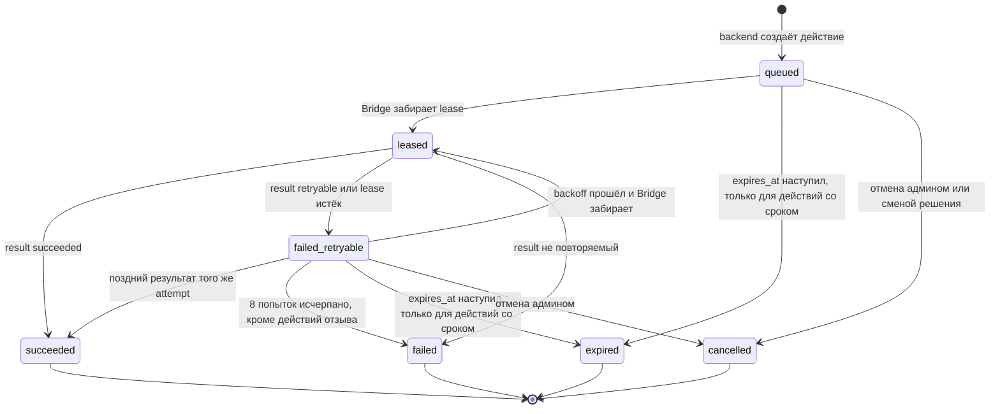

Правила:

1. **At-least-once.** Backend может выдать действие повторно; Bridge может получить его дважды. Корректность обеспечивает идемпотентность.
2. **Идемпотентность по `action_id`.** Bridge хранит журнал применённых `action_id` (локальный файл или SQLite, не менее 30 дней). При повторной выдаче уже применённого действия Bridge не исполняет его снова и отправляет сохранённый результат.
3. **Идемпотентность операций.** `whitelist.add` на уже добавленный ник — успех с пометкой `already_applied`; `whitelist.remove` на отсутствующий ник — успех с `already_applied`; `player.kick` игрока не в сети — успех с `not_online`.
4. **Backoff.** Попытки: 1-я сразу, далее через 5 с, 15 с, 45 с, 2 мин, 5 мин, затем каждые 5 мин; всего до 8 попыток. После 8-й неудачи — `failed`, действие попадает в админ-очередь (`/admin/bridge`), админ видит `error_code`, историю попыток и может повторить (SC-ADM-04). Исключение (MINOR 1): для действий отзыва (`whitelist.remove`, `player.kick` по отзыву доступа, `player.data_archive`) 8-я попытка не переводит в `failed` — действие остаётся `failed_retryable`, повторяется каждые 5 мин, после 8-й неудачи уходит оповещение админам.
5. **Срок жизни.** `expires_at` — 24 ч для `whitelist.add` (таблица §1). По истечении — `expired`; повтор создаёт админ новым действием (новый `action_id`, ссылка `retry_of_action_id`). У `whitelist.remove` и `player.data_archive` срока нет (`expires_at = null`), они не переходят в `expired`; у `player.data_restore` и `player.data_migrate` — 24 ч (при `expired`/`failed` админ повторяет новым действием, а смена ника не завершается, §6.7); у `player.kick` срок 10 мин на выдачу, а факт отзыва поддерживается повторной выдачей (§1).
6. **Отмена.** `cancelled` — при смене решения (например, заявку одобрили и затем отозвали до применения): `whitelist.add` отменяется, и ставится `whitelist.remove`, если действие уже было применено. Действие `player.data_archive` отменяется (при reinstate) только в статусе `queued`; в `leased` его не отменяют, reinstate ждёт финального статуса, а поздний `succeeded` отменённого архива ставит `player.data_restore` (§6.9, R4-03).
7. **Гонки.** Для одного ника исполняется не более одного действия `whitelist.*` одновременно; порядок — по `created_at` (последнее намерение побеждает).
8. **Связь со статусами сущностей.** `succeeded` для `whitelist.add` — единственное основание для `applied_state = applied`. `failed` и `expired` переводят `applied_state` в `failed`.
9. **Журнал.** Каждая попытка пишется в `server_action_attempts` (см. [03-data-model.md](03-data-model.md)): время, `attempt`, ответ Bridge, ошибка.
10. **Поздний результат (MINOR 5).** Результат после `lease_until` принимается, если `attempt` совпадает и повторной выдачи не было (§3.3); иначе `ERR_LEASE_EXPIRED`, статус не меняется.
11. **Временны́е проверки (MINOR 2).** `issued_at` и канонический payload фиксируются в `server_actions` при создании; Bridge проверяет эпоху журнала, будущее время, возраст и TTL по типу (§2.2).
12. **Отзыв всегда побеждает (MINOR 1).** Пока по нику есть неприменённый отзыв (`whitelist.remove` в `queued`/`failed_retryable`), новое `whitelist.add` для него не ставится; `whitelist.add` ставится только если membership = `approved`, account = `active` и ник не в `released` (инвариант I-02 = K-12, [03-data-model.md](03-data-model.md), §5).

## 5. Reconciliation (сверка whitelist)

Закрывает требование аудита «сверка состояния whitelist после перезапуска» (стр. 725). Числа и логика — [ПРЕДЛОЖЕНИЕ КОМАНДЫ].

Когда: при старте Bridge, затем каждые 15 мин; вручную из `/admin/bridge`.

Алгоритм на стороне backend после `POST /reconcile`:

| Случай | Что видит backend | Действие | Результат для `applied_state` |
|---|---|---|---|
| A | Ник `desired = on`, нет в снимке | Поставить `whitelist.add` (если membership = `approved`, account = `active`, ник не `released`; инвариант I-02 = K-12) | `applied` → `drift`, затем после успеха → `applied` |
| B | Ник `desired = on`, есть в снимке | Подтверждение | `pending` → `applied` (если ещё не было) |
| C-1 | Ник в снимке, на сайте `desired = off` **и есть запись об отзыве** (membership `revoked`/`suspended`, account `banned`/`deleted` либо identity `released`; для неё создавалось `whitelist.remove`) | **Автоматически** поставить `whitelist.remove` (+ `player.kick`, если игрок в сети) — это довыполнение собственного решения сайта, а не удаление «лишнего» (MINOR 1) | `applied_state` → `drift` до подтверждения удаления |
| C-2 | Ник в снимке, нет записи на сайте либо `desired = off` без записи об отзыве (неизвестная запись) | Не удалять. Создать запись drift для админа | Админ решает вручную: удалить (`whitelist.remove`) либо принять в список |
| D | Ник `desired = off`, нет в снимке | Подтверждение | `applied` для удаления не требуется |

Правила:

- Автоматическое удаление *неизвестных* записей запрещено: ошибка в источнике (пустой снимок после сбоя плагина) удалила бы всех игроков. Пустой снимок при непустом списке на сайте помечается подозрительным, расхождения не применяются (в том числе C-1), админу уходит предупреждение. Автоудаление C-1 ограничено 5 записями за один запуск сверки; больше — остановка и ручной разбор [ПРЕДЛОЖЕНИЕ КОМАНДЫ].
- Сайт отображает «Доступ готов» только при `applied_state = applied` (AC-21, AC-28). `drift` показывается игроку как «Идёт проверка доступа» без вывода «Можно подключаться».
- Расхождения сохраняются в `reconciliation_runs` и `reconciliation_diffs` (см. [03-data-model.md](03-data-model.md)).
- Результат сверки не подтверждает ничего ложно: статус `applied` выставляется только на основании снимка Paper либо подтверждённого `result`.

### 5.1. Режим восстановления БД (M11, R3-03 / MAJOR-3)

[ПРЕДЛОЖЕНИЕ КОМАНДЫ]. После восстановления БД из резервной копии на сайте могут «воскреснуть» записи, которые были отозваны в последние сутки (RPO ≤ 24 ч): забаненный снова `approved`, отозванное приглашение снова активно, прежняя роль `site_role`, прежняя привязка Telegram, а отозванные сессии снова действуют. Обычная сверка (случай A) тогда сама выдала бы им whitelist. Поэтому восстановление выполняется только в режиме восстановления. Режим расширен (R3-03) и состоит из пяти частей:

1. **Режим обслуживания сайта (только чтение).** До запуска приложения на восстановленной БД админ открывает режим восстановления (запись `ops.restore_mode_opened` — в `audit_log` и во внешний журнал, п. 3). Выставляется `system_flags.maintenance_mode = true`: все изменяющие запросы клиентов получают `site.read_only` (503), чтение работает. Разрешены только вход админа (Telegram + step-up) и действия разбора diff. Режим держится до закрытия diff (п. 4 процедуры).
2. **Глобальный отзыв сессий.** Все записи `user_sessions` помечаются отозванными, `system_flags.session_secret_version` увеличивается (секрет подписи cookie сессий меняется: ни одна ранее выданная cookie, в том числе из состояния «до сбоя», не принимается). Пользователи входят заново через Telegram после снятия режима; админ — с новым step-up.
3. **Внешний append-only приёмник `audit_log` и `security_events`.** Записи обеих таблиц с задержкой RPO ≤ 5 мин зеркалируются в приёмник вне основной БД (log drain либо отдельное хранилище с запретом изменения и удаления); при восстановлении БД приёмник не откатывается. Провайдер приёмника — [ПРЕДЛОЖЕНИЕ КОМАНДЫ, ПРОВЕРИТЬ провайдера]. Отставание экспорта > 5 мин — оповещение (§9, NFR-OPS-26); колонка `exported_at` в обеих таблицах показывает неотправленные записи.
4. **Diff по внешнему журналу и повторное применение до снятия режима.** Админ сверяет восстановленную БД с внешним журналом за период от момента резервной копии. Diff охватывает: whitelist (`approved`/`desired`), баны и `suspended`, `site_role`, перепривязки Telegram, отзывы приглашений, отзывы сессий, а также (R4-06) **удаления аккаунтов** (записи `deletion_tombstones` и стёртые профили: «воскресший» удалённый аккаунт стирается повторно, tombstone с HMAC-хэшем Telegram ID сохраняется), **повторные выдачи ников и архивы** (`player_data_archives`, `minecraft_identities` со сменой владельца: ник, выданный другому пользователю после резервной копии, не возвращается прежнему владельцу, а архив, выполненный в игре, но отсутствующий в восстановленной БД, восстанавливается записью по `archive_id` из журнала Bridge) и **смены ника** (`player.data_migrate`, `identity.nickname_changed`: привязка ника сверяется с применёнными `action_id` Bridge). Каждое расхождение повторно применяется (бан, отзыв, роль, перепривязка, отзыв приглашения и сессии, повторное удаление, фиксация выдачи/архива/смены ника; для игры — новые `whitelist.remove`/`player.kick`) и фиксируется решением в `audit_log` (step-up). Режим снимается только когда в diff нет открытых строк.
5. **Вход в игру закрыт.** Все серверы переводятся в `bridge_servers.status = paused` (`paused_reason = restore_mode`): lease отдаёт пустой массив и флаг `paused`, очередь не исполняется, а **`POST /auth/join` при `paused` отвечает подписанным `denied` с `ERR_SERVER_PAUSED`** (fail-closed: игра закрыта для всех новых входов до закрытия diff; уже авторизованные сессии не прерываются).

Процедура:

1. Админ открывает режим (п. 1), отзывает сессии (п. 2), ставит серверы на паузу (п. 5). Приёмник журнала (п. 3) должен быть доступен; если нет — режим не закрывается.
2. Bridge продолжает слать heartbeat и `POST /reconcile`; backend сохраняет снимок и diff, но **не создаёт** `whitelist.add` и не снимает `drift` автоматически (случай A отключён; C-1 не создаёт действий).
3. Админ разбирает diff (п. 4 выше), сверяет записи с журналом Bridge (применённые `action_id` и отзывы), внешним журналом и сообщениями в Telegram. Отзывы и изменения, потерянные при восстановлении, применяются повторно.
4. Только после разбора всех строк diff и записи итога админ возвращает `status = online` и снимает `maintenance_mode` (step-up). Закрытие режима — запись `ops.restore_mode_closed`. Возобновление без закрытого diff запрещено.
5. Тест процедуры — в окне теста восстановления 03.12–07.12 (не ранее чем за 7 и не позднее чем за 3 дня до запуска); TC-OPS-01c: сессии отозваны, роли, баны и перепривязки сверены с внешним журналом, сайт в read-only, вход в игру закрыт, бан/отзыв из последних суток не воскресает; в diff присутствуют удаления аккаунтов (tombstone), повторные выдачи ников с архивами и смены ника (R4-06).

## 6. Игровая авторизация (OD-23, гибрид)

Закрывает блокер «безопасность offline-входа» (аудит §6.4 и §21: Критический риск; общий вывод — аудит, раздел 26, п. 7, стр. 1112). Схема — гибрид (по умолчанию из OD-23, прототип в W1). Выбор между AuthMe, LibreLogin и собственной реализацией — [ПРОВЕРИТЬ].

### 6.1. Состояния игрока

| Состояние | Что разрешено |
|---|---|
| Не в whitelist | Paper отклоняет соединение на pre-login (ниже limbo не доходит) |
| Сервер на паузе (R3-03) | Пока heartbeat/lease сообщают `paused` (отзыв ключа, режим восстановления §5.1), Bridge не пускает новые подключения в limbo, а backend на `POST /auth/join` отвечает `denied` / `ERR_SERVER_PAUSED`: вход в игру закрыт (fail-closed) |
| Ник не прошёл проверку pre-login (MINOR 10, M3) | На `AsyncPlayerPreLoginEvent` Bridge отклоняет соединение, если: регистр ника не совпадает в точности с привязанным (Paper сопоставляет whitelist без учёта регистра) — `ERR_NICK_CASE_MISMATCH`; вычисленный offline-UUID не равен `mc_uuid` привязки (для `account_type` ≠ `premium` с проверенной сессией, §6.4); ник уже в сети и авторизован либо уже есть limbo с pending-подтверждением (§6.8) |
| Limbo (до подтверждения) | Заморозка (нет движения), нет чата, нет взаимодействия с миром и предметами, инвентарь скрыт, неуязвимость и невидимость для других, не отображается в списке онлайн сайта. **Из команд разрешён только `/login`** (MINOR 7); все остальные команды отменяются на уровне Bridge. Таймаут limbo равен TTL challenge (R3-02): **5 мин** для `first_join` (TTL кода), **120 с** для повторных входов; по таймауту — `kick`. При выходе или кике limbo-соединения Bridge вызывает `/abandon` (§6.10) |
| Авторизован | Обычная игра |

Одно и то же поведение limbo для `premium` и `offline` (разрешение C-14).

### 6.2. Первый вход (game_identity = unconfirmed → confirmed)

1. Игрок с whitelist (`applied_state = applied`) заходит под ником; Bridge проверяет pre-login (§6.1), переводит игрока в limbo и вызывает `POST /auth/join` с точным ником, `uuid` и типом аккаунта.
2. Backend находит `minecraft_identities` с `binding_status = confirmed` либо `reserved`. **Отказ** (`denied`, `ERR_NICK_NOT_BOUND`), если membership ≠ `approved` либо account ≠ `active` (MINOR 1), запись в `released` (в том числе в карантине, §6.9), регистр ника или UUID не совпадают с привязкой (MINOR 10: сверка точного регистра и вычисленного offline-UUID) либо по этому нику уже есть pending-challenge с живым limbo-соединением (`ERR_LOGIN_IN_PROGRESS`, §6.8), либо сервер на паузе (`ERR_SERVER_PAUSED`, §5.1, R3-03), либо исчерпан бюджет challenge пары «ник + источник» (подписанный `denied` / `ERR_CHALLENGE_BUDGET`, без challenge и без сообщения в бот, §6.5, R4-01б). Иначе создаёт `login_challenges` типа `first_join`: 6-значный код, TTL 5 мин (таймаут limbo для `first_join` равен TTL, R3-02), хранится хэш; код возвращается Bridge **в подписанном ответе** (§2.2a) и показывается только в игровом клиенте этого соединения.
3. Игрок открывает `/dashboard` под своей Telegram-сессией. Пользователь с Telegram-сессией должен быть владельцем этого ника (запись `minecraft_identities.user_id`).
4. Игрок вводит код. Backend проверяет код, TTL, принадлежность ника сессии, лимит попыток и подтверждает `challenge`; `game_identity = confirmed`, фиксируются UUID и тип аккаунта.
5. Bridge получает подписанное решение `confirmed` через `GET /auth/challenges?ids=` (или действие `auth.release`), проверяет его по §2.2a и снимает limbo.

Замечания:

- Нападающий, подключившийся под чужим ником, видит код, но не может подтвердить его без Telegram-сессии владельца (AC-05).
- Социальная инженерия «введи этот код» возможна. Контроль: на странице подтверждения пишется «Вводите только код из вашей игры» и показывается время запроса и тип аккаунта; остаточный риск фиксируется в [04-nfr-security.md](04-nfr-security.md).

### 6.3. Последующие входы

| Способ | Описание | Статус |
|---|---|---|
| Кнопка в Telegram-боте со сверкой числа (основной, M2) | Backend выбирает случайное двузначное число и возвращает его Bridge (в подписанном ответе); в limbo игрок видит «Число для подтверждения: 47». Боту владельца уходит сообщение: «Вход в MineOrt под ником X в 12:34, источник: Россия, домашняя сеть. Выберите число, которое видно в игре». Кнопки — три числа (одно верное) и «Это не я». **Один выбор на challenge (R3-01, MAJOR-1):** верное число — `confirmed`; неверное число или «Это не я» — `denied`, кнопки в сообщении гаснут, засчитывается неудача пары ник+источник (§6.5) + `security_events`, limbo-соединение кикается. Повторного выбора на тот же challenge нет: следующая попытка — новое подключение и новый challenge. **Сообщение challenge владельцу отправляется всегда (R4-01а):** лимит оповещений §6.5 относится только к оповещениям об отказах и не к challenge живого входа; от спама challenge защищает бюджет challenge пары (§6.5, R4-01б) | Требует согласия на ЛС бота (OD-41, G-06). Сверка числа защищает от нажатия «Это я» по привычке (TC-GAME-01c) |
| Игровой пароль (резерв, MINOR 7) | Пароль задаётся **не в игре**, а в `/dashboard` под Telegram-сессией (backend проверяет политику и хранит argon2id-хэш). В limbo игрок вводит `/login <пароль>` — единственная разрешённая команда; Bridge отправляет пароль на backend по HTTPS, не пишет его в журналы и не показывает в чате; проверку делает backend | Резервный путь, если бот недоступен |

Политика пароля (MINOR 7, R3-11) [ПРЕДЛОЖЕНИЕ КОМАНДЫ]: длина ≥ 10 символов; не совпадает с ником и не входит в список частых паролей; сменить можно только в `/dashboard` (step-up не требуется, но нужна Telegram-сессия). Блокировка пароля — **по паре «ник + источник»** по единому правилу §6.5 (5 неудач за 10 мин → 15 мин), плюс **глобальный бюджет на ник**: 20 неверных паролей за час суммарно со всех источников отключают **только парольный путь** этого ника на 1 час (`password_credentials.budget_locked_until`); игровой бот остаётся доступен владельцу. Это явное исключение из принципа «перебор по нику не блокирует владельца» (§6.5): бюджет закрывает перебор пароля распределённым атакующим, а бот-путь сверки числа от перебора не зависит. **Источники, где владелец уже подтверждал вход** (`login_attempt_locks.last_confirmed_at`, §6.5), от бюджета освобождены (R4-01в): неверные пароли с такого источника не засчитываются в глобальный бюджет и не отключаются им; остаётся единая блокировка пары (5 за 10 мин). Нарастающая блокировка 1 ч / 6 ч / 24 ч прежней редакции удалена: её заменяют единое правило и бюджет на ник; серия по-прежнему пишется в `security_events`.

Выбор способа: по умолчанию кнопка в боте; если у владельца нет подтверждённого согласия на ЛС либо бот недоступен — пароль (если он задан в `/dashboard`).

### 6.4. Premium

Автологин без подтверждения допускается **только** при одновременном выполнении трёх условий (M4, TC-GAME-02d) [ПРЕДЛОЖЕНИЕ КОМАНДЫ]:

1. плагин проверил сессию Mojang для этого соединения [ПРОВЕРИТЬ реализуемость на Paper при offline-режиме сервера: AuthMe и LibreLogin поддерживают разные механизмы];
2. `account_type = premium` был зафиксирован при **подтверждённом первом входе** (§6.2: код + Telegram-сессия владельца) — нельзя «стать premium» самообъявлением при последующем входе;
3. проверенный Mojang-UUID равен `mc_uuid` привязки.

Иначе работает обычный путь (§6.3). Тип `premium` записывается в `account_type`, лишь когда проверка подтверждена; иначе `unknown` либо `offline`.

Единая политика UUID (M4) [ОПРЕДЕЛИТЬ → OD-22/OD-23]: `mc_uuid` фиксируется при подтверждённом первом входе и далее не меняется; для offline — вычисленный offline-UUID ника, для premium — проверенный Mojang-UUID. Какой UUID использует сервер как ключ данных игрока (offline-режим сервера при Mojang-проверке в плагине даёт расхождение UUID) — зависит от выбора плагина авторизации и версии Paper; при любом сомнении (UUID не совпал, проверка сессии недоступна) игрок идёт по обычному пути. Смена типа аккаунта или UUID — только через админа (SC-ACC-10).

### 6.5. Лимиты и блокировки (единое правило, R3-10 / MINOR-4)

[ПРЕДЛОЖЕНИЕ КОМАНДЫ]. Блокировка одна для всех путей входа (код, пароль, бот):

- **Что считается неудачей пары.** Любое из: неверный код или пароль; неверное число в боте; «Это не я»; неотвеченный challenge (`expired` — TTL истёк без ответа). `abandoned` (игрок сам вышел или потерял соединение до истечения TTL, §6.10) неудачей **не** считается. Счётчик один на пару «ник + источник» (`login_attempt_locks.failures`) и общий для всех путей.
- **Порог.** 5 неудач за 10 минут для **пары «ник + источник»** → блокировка этой пары на 15 минут + запись `security_events` (тип `game_auth_bruteforce`) + уведомление владельцу в бот (M3); `pending`-challenge этой пары переводится в `denied`. Источник — рабочее определение: хэш с солью от IP, огрублённого до подсети (/24 для IPv4, /56 для IPv6) [ОПРЕДЕЛИТЬ → OD-23]; полный IP не показывается в боте и хранится не дольше 30 дней (NFR-OPS-03). Блокировки только по IP нет: соседи за общим NAT с другими никами не блокируются, а атакующий не может заблокировать владельца с другого источника.
- **Снятие блокировки владельцем — только через бот со сверкой числа.** Сообщение «Заблокирована попытка входа под вашим ником» содержит кнопку «Это я», но она **не снимает блокировку сама**: она «взводит» разблокировку на 5 минут (`login_attempt_locks.unlock_armed_until`). Первое подключение этой пары в течение 5 минут допускается **только** на путь «бот со сверкой числа» (§6.3; коды и пароль остаются закрыты): верное число → `confirmed` и блокировка снята; неверное число или «Это не я» → `denied`, блокировка продолжается на полный срок, взвод сбрасывается (TC-GAME-07c). Нажатие «Это я» без последующей сверки числа вход не открывает.
- **Лимит оповещений об отказах (R3-10, уточнён R4-01а).** Не больше **3 сообщений в час на ник** (счётчик в `rate_limit_counters`, scope `bot_login_alert`, ключ — ник) и дайджест относятся **только к оповещениям об отказах**: `concurrent_join_denied`, заблокированные попытки (`ERR_NICK_LOCKED`), блокировка пары. Сверх лимита такие оповещения собираются в дайджест — одно сообщение в час с числом попыток и огрублёнными источниками. **Сообщение challenge живого входа (число для сверки, §6.3) владельцу отправляется всегда** и в этот лимит не входит: иначе серия «подключился–вышел» с чужого источника исчерпывала бы лимит, и подтверждение входа владельца уходило бы в дайджест. Остаточный риск — R-8 в [04-nfr-security.md](04-nfr-security.md).
- **Бюджет challenge на пару «ник + источник» (R4-01б)** [ПРЕДЛОЖЕНИЕ КОМАНДЫ]. Источник, ни разу не подтверждавший вход под этим ником (`login_attempt_locks.last_confirmed_at IS NULL`), получает **не более 3 challenge за 10 минут, включая `abandoned`** (счётчик `challenge_count` в окне `challenge_window_start`; увеличивается при создании challenge, до отправки сообщения в бот). Четвёртый и следующие `POST /auth/join` этой пары в окне отвечают **подписанным `denied`** (`reason_code = ERR_CHALLENGE_BUDGET`) **без challenge, без сообщения в бот и без записи в дайджест владельца**; пишется только `security_events` типа `challenge_budget_exceeded` (одна запись на пару за окно с числом отказанных попыток). Бюджет не блокирует пару на 15 минут и не накапливает неудачи: он лишь ограничивает число сообщений владельцу с одного чужого источника. Прогон: 30 циклов «подключился–вышел» с чужого источника → в бот уходит не более 3 challenge, и владелец входит в игру с первого раза (TC-GAME-07c).
- **Источники, подтверждавшие вход владельца (R4-01в).** `login_attempt_locks.last_confirmed_at` ставится, когда challenge пары становится `confirmed` (верное число, код). Пара с `last_confirmed_at` не старше 30 дней (срок хранения `source_hash`, NFR-OPS-03) освобождена от лимита оповещений об отказах, не подпадает под бюджет challenge и под глобальный бюджет игрового пароля (§6.3); единое правило блокировки пары (5 неудач за 10 мин) остаётся. Остаточный риск — угон источника владельца (домашняя сеть, общий NAT с подтверждённым входом) [ПРОВЕРИТЬ допустимость срока 30 дней], R-8.
- **Аномалия по самому нику** (≥ 20 неудач за час с разных источников) блокировку владельца не вызывает: только `security_events` и оповещение (метрика §9), чтобы нельзя было вывести владельца из игры перебором. **Единственное исключение (R3-11)** — глобальный бюджет игрового пароля (§6.3): он отключает только парольный путь ника на 1 час, бот остаётся доступен.
- Код погашается при первой успешной проверке; повторное использование — `ERR_CHALLENGE_EXPIRED`.
- Второе подключение под ником с pending-challenge и живым limbo-соединением **отклоняется**, а не инвалидирует первый challenge (§6.8); раньше действовало правило «новый вход инвалидирует предыдущий» — оно позволяло атакующему сбросить подтверждение владельца.

### 6.6. Недоступный backend — fail-closed (OD-46, AC-30)

- Если `POST /auth/join` не отвечает (сеть, ошибка 5xx, таймаут), игрок остаётся в limbo, видит сообщение «Проверка входа недоступна. Попробуйте позже» и через 120 с отключается (challenge при этом не создан, `/abandon` не требуется; таймаут fail-closed единый для `first_join` и повторных входов: 5-минутный таймаут limbo `first_join` относится к созданному challenge, §6.10).
- То же при невалидной подписи решения (§2.2a): `ERR_AUTH_DECISION_INVALID` → limbo остаётся.
- `POST /auth/join` при `bridge_servers.status = paused` — подписанный `denied` / `ERR_SERVER_PAUSED`: вход закрыт, пока админ не снимет паузу (§5.1, R3-03).
- Ответ `429` из квоты auth (§3.7) недоступностью не считается: Bridge ждёт `Retry-After` и повторяет, игрок остаётся в limbo; кик по fail-closed — только по таймауту 120 с (TC-GAME-04d).
- Никаких локальных исключений, «запомненных» входов или режима «пустить без проверки» нет для новых сессий.
- Уже авторизованные сессии не прерываются из-за недоступности backend.
- Каждое срабатывание пишется в локальный журнал Bridge и попадает в `security_events`, когда связь восстановлена.

### 6.7. Смена ника и UUID (OD-37, R3-05 / MAJOR-5)

Offline-UUID вычисляется из ника (поэтому смена ника меняет UUID) [ПРОВЕРИТЬ в документации Paper/Mojang]. Смена ника — только через админа со step-up и аудитом (SC-ACC-10). Данные **переносятся**, а не теряются: действие `player.data_migrate` (`old_uuid` → `new_uuid`: инвентарь, эндер-сундук, приваты, LuckPerms, статистика). Порядок:

1. Создаётся новая запись `reserved` (проверки K-11 и предусловие «архив» §6.9 для нового ника).
2. Ставятся `whitelist.remove` старого ника (первым: старый ник не должен войти во время переноса) и `player.data_migrate` (оба ника не в сети, иначе `ERR_PLAYER_ONLINE`, повтор по backoff). **`whitelist.add` нового ника не ставится, пока `player.data_migrate` не завершён `succeeded` (R4-07):** порядок — `player.data_migrate`, затем `whitelist.add`; иначе новый ник мог бы войти и создать данные под новым UUID до переноса, и перенос перезаписал бы их либо потерялся.
3. Только по `succeeded` ставится `whitelist.add` нового ника, а старая запись получает `binding_status = released` и **уходит в карантин без данных**: архивировать нечего, поэтому в `player_data_archives` создаётся запись `status = archived`, `reason = migrated` (`migrated_to_identity_id` — новая запись). Предусловие выдачи старого ника (§6.9) выполнено сразу.
4. Если `player.data_migrate` в `failed`/`expired` — `whitelist.add` нового ника не ставится, старая запись остаётся активной, смена не завершается, админ повторяет (новое действие).
5. Новый ник проходит процедуру первого входа (§6.2).

### 6.8. Параллельный и повторный вход под тем же ником (M2, M3; SC-GAME-07)

[ПРЕДЛОЖЕНИЕ КОМАНДЫ]. Правила применяются и в Bridge (быстро, в пределах одного сервера), и в backend (источник истины при нескольких серверах). Проверка «вход уже идёт» (R3-14, MINOR-8) — **не отдельный эндпоинт**: это локальная проверка Bridge на pre-login плюс ответ 409 (`ERR_LOGIN_IN_PROGRESS` либо `ERR_NICK_ALREADY_ONLINE`) от `POST /auth/join`.

1. **Pending-challenge не вытесняется, пока жив limbo (TC-GAME-07a).** Пока по нику есть `pending` challenge **и его limbo-соединение живо**, второе подключение отклоняется на pre-login (`ERR_LOGIN_IN_PROGRESS`; backend отвечает 409 на `POST /auth/join`). Первый challenge и его код/число не инвалидируются. При отказе пишется `security_events` типа `concurrent_join_denied`; оповещение владельцу об отказе — в пределах лимита оповещений об отказах (§6.5). Блокировка «вход уже идёт» действует только пока соединение живо (R3-02): при `player.quit` или кике limbo Bridge вызывает `/abandon`, challenge становится `abandoned`, и второй игрок может войти сразу (прогон TC-GAME-07a: X отключился → O входит сразу). Если Bridge только что вызвал `/abandon`, а новое подключение пришло раньше, чем backend обработал вызов, Bridge повторяет `POST /auth/join` через ≤ 3 с (не более 3 раз) вместо отказа игроку. Остаточный риск: атакующий может занимать ник на время жизни своего limbo-соединения (≤ 120 с; для `first_join` — ≤ TTL кода 5 мин) — риск R-6 в [04-nfr-security.md](04-nfr-security.md); владелец при уведомлении в боте нажимает «Это не я» — challenge становится `denied`, засчитывается неудача пары ник+источник (§6.5) и limbo чужого соединения кикается (§6.3).
2. **Ник уже в сети и авторизован (TC-GAME-07b).** Подключение под тем же ником отклоняется на `AsyncPlayerPreLoginEvent` (`ERR_NICK_ALREADY_ONLINE`, `security_events` типа `concurrent_join_denied`; backend — 409 на `POST /auth/join` при нескольких серверах), владелец **не выбивается** (стандартное поведение Paper «кикнуть прежнюю сессию» отключено плагином).
3. **Перебор по паре ник+источник (TC-GAME-07c)** — §6.5 (единое правило, снятие только со сверкой числа, лимит оповещений об отказах, бюджет challenge). Прогон R4-01г: 30 циклов «подключился–вышел» с чужого источника не лишают владельца challenge: владелец входит в игру с первого раза.

### 6.9. Карантин ника и отложенная архивация данных (B1; MAJOR-4, MINOR-11, MINOR-1; SC-ACC-11, SC-ACC-12)

[ПРЕДЛОЖЕНИЕ КОМАНДЫ]. Проблема: при бане, отзыве, удалении аккаунта или смене ника ник освобождался; новый владелец ника получал тот же offline-UUID, а значит инвентарь, эндер-сундук, приваты и права прежнего игрока. Решение раунда 3 (R3-04): данные игрока **не сбрасываются сразу**. Бан, отзыв и удаление обратимы (разбан, reinstate, OD-48), поэтому немедленный сброс уничтожал бы данные, которые нужно вернуть. Архивация привязана к моменту, когда ник действительно передаётся другому человеку.

1. **Освобождение.** При переходе записи в `released` (бан, отзыв, удаление аккаунта, смена ника; **перепривязка Telegram ник не освобождает**, SC-ADM-06, MINOR-2):
   - если ник **никогда не имел игровой истории** (ни разу `whitelist_entries.applied_state = applied` и ни разу `game_identity = confirmed`; флаг `has_game_history = false`, R3-08) — ник освобождается сразу, карантина и архива нет;
   - иначе backend выставляет `released_at` и `quarantine_until = max(now() + 90 дней, banned_until)` (90 дней по умолчанию, настраивается; R4-02: карантин не короче срока бана; продление бана пересчитывает `quarantine_until`), создаёт `whitelist.remove` и `player.kick` (если в сети). **`player.data_archive` не ставится, данные в игре остаются нетронутыми.**
2. **Карантин.** При **бессрочном бане** (`account_status = banned`, `banned_until IS NULL`) `quarantine_until = 'infinity'`: ник не выдаётся никому, а фоновая задача окончания карантина его не освобождает; выдать такой ник может только admin со step-up (R4-02). Ник в карантине **нельзя занять** никому, кроме прежнего владельца (reinstate после разбана, OD-48 — возвращает тот же ник и ту же запись с нетронутыми данными) и admin со step-up; попытка — `nick.quarantined` и запись `security_events`/`audit_log` типа `nick_quarantine_denied` (TC-ACC-12d).
3. **Повторная выдача ника другому пользователю — единственный триггер архивации.** Пути выдачи: (а) обычный — пользователь резервирует ник после окончания карантина; (б) админский досрочный — admin со step-up выдаёт ник до окончания карантина; (в) фоновая задача окончания карантина. **На всех путях действует одно предусловие:** для последней `released`-записи этого ника существует запись `player_data_archives` со `status = archived` (включая `reason = migrated`, §6.7). Проверка реализована дважды: в RPC выдачи и в триггере БД на `minecraft_identities` (обход через прямую запись невозможен, B2).
   - Если архива нет, запрос на архив создаёт **RPC в отдельной зафиксированной (committed) транзакции**: `player_data_archives` (`requested`) и действие `player.data_archive`; транзакция выдачи ника после этого отклоняется с `nick.archive_required` (409, «ник проверяется, повторите позже») и откатывается, не затрагивая уже зафиксированный запрос на архив (R4-04). **Триггер БД на `minecraft_identities` только отклоняет** выдачу (`nick.archive_required`) и ничего не создаёт: запись внутри откатываемой транзакции выдачи пропала бы вместе с ней. Выдача завершается повторным запросом после `succeeded` и `archived`.
   - Если архив в `failed` (или действие не применено за 15 мин при Bridge online) — выдача отклоняется, пишется `security_events` типа `nick_issue_blocked_no_archive` и оповещение админам; админ повторяет архивацию (новое действие), пока ник остаётся недоступным.
   - Фоновая задача (в) очищает `quarantine_until` (кроме `'infinity'` при бессрочном бане, R4-02) и освобождает ник только после `archived`; без архива ник остаётся в карантине и поднимается алерт.
4. **Действие `player.data_archive`.** Bridge переносит playerdata, эндер-сундук, данные LuckPerms и приваты под offline-UUID ника в архив плагина (`archive_id`), сбрасывает их в игре и возвращает `result` с перечнем областей. Игрок не в сети, иначе повторяемая `ERR_PLAYER_ONLINE`. Каждое действие — запись в `audit_log` (TC-ACC-11d: новый владелец ника не получает ничего из старого).
5. **Reinstate и восстановление данных.** Reinstate в карантине до архивации возвращает ник с нетронутыми данными; `whitelist.add` ставится с проверкой I-02 (TC-ACC-11d). **Гонка reinstate и архивации (R4-03):** отменяется только `player.data_archive` в статусе `queued` (архив → `cancelled`); если действие уже `leased` (Bridge его выполняет), reinstate **ждёт финального статуса** действия (ответ `reinstate.archive_in_progress`, 409, повтор после финала); при `succeeded` данные возвращает автоматически поставленный `player.data_restore`, при `failed`/`expired` reinstate завершается без восстановления (данные в игре нетронуты). Если архивное действие, уже отменённое (`cancelled`), всё же вернуло **поздний `succeeded`** (Bridge выполнил его до отмены), backend автоматически ставит `player.data_restore` по `archive_id` (`player_data_archives.restore_action_id`), и reinstate завершается после его `succeeded`. Если архив уже выполнен, а ник ещё не выдан другому (выдача отменена админом, архив выполнен досрочно), данные возвращает действие `player.data_restore` (из архива, `archive_id` из `player_data_archives`), ставится автоматически при reinstate либо админом со step-up. Reinstate невозможен, если ник уже выдан другому пользователю.
6. **Окончание хранения.** Архив хранится не менее 90 дней с момента `archived` (NFR-OPS-21).

### 6.10. Жизненный цикл challenge (R3-01, R3-02)

[ПРЕДЛОЖЕНИЕ КОМАНДЫ]. Статусы `login_challenges.status`: `pending | confirmed | denied | expired | abandoned`.

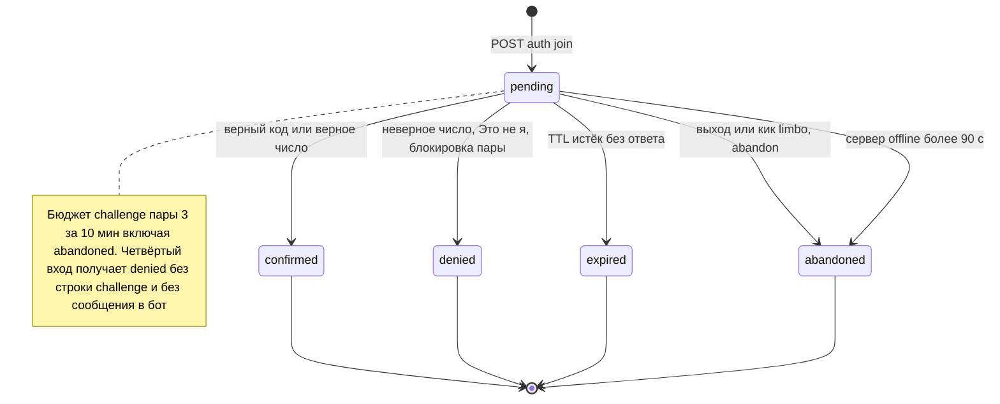

Правила:

1. **Время жизни challenge равно времени жизни limbo-соединения.** `first_join`: TTL кода и таймаут limbo — 5 мин. Повторные входы (бот, пароль): TTL challenge и таймаут limbo — 120 с (R4-08: «120 с → kick» без разделения не используется).
2. **Один выбор** в боте (R3-01): после верного числа challenge `confirmed`, после неверного числа или «Это не я» — `denied`, кнопки гаснут; повторного выбора нет. Для ввода кода и пароля действует счётчик попыток (`attempts`, `ERR_CHALLENGE_ATTEMPTS`), каждая неудача идёт в счётчик пары (§6.5).
3. **`abandon`.** `player.quit`, кик (в том числе по `denied` и по таймауту) и старт Bridge (все «осиротевшие» limbo) вызывают `POST /auth/challenges/{id}/abandon`. Challenge `pending` → `abandoned`; сообщение в боте редактируется, кнопки гаснут. Блокировка `ERR_LOGIN_IN_PROGRESS` действует только пока challenge `pending`, то есть пока соединение живо.
4. `abandoned` не создаёт `security_events` типа неудачи и не увеличивает счётчик неудач пары, но **входит в бюджет challenge** (§6.5, R4-01б). Если вызов `/abandon` не дошёл, challenge закроет `expired` по TTL (не позже 120 с для повторных входов) и засчитается как неотвеченный (§6.5); поэтому Bridge повторяет `/abandon` по `Retry-After` до подтверждения.
5. Единственное `pending`-challenge на ник: partial UNIQUE по `minecraft_identity_id` WHERE `status = pending` ([03-data-model.md](03-data-model.md), §3.2).

## 7. Диаграммы последовательностей

### 7.1. Одобрение заявки → whitelist

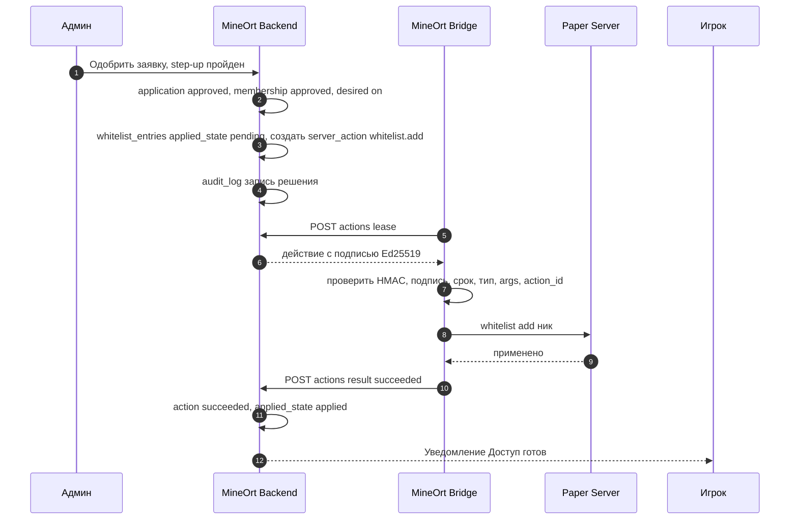

### 7.2. Одобрение при выключенном Minecraft (AC-21)

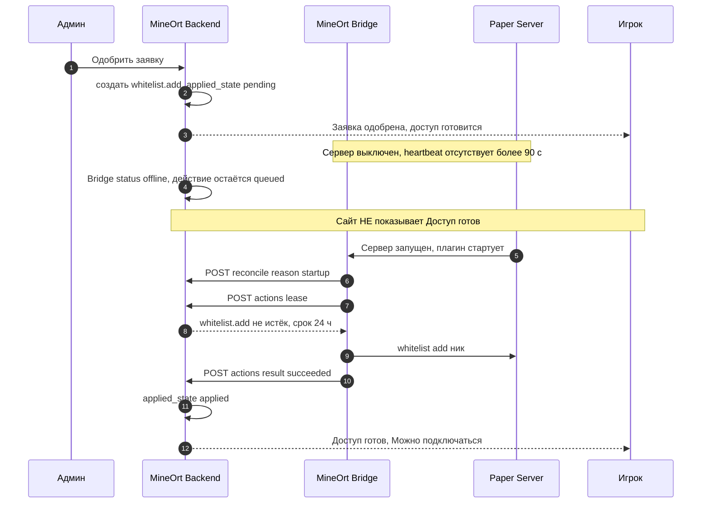

Если сервер выключен дольше 24 ч, действие становится `expired`, `applied_state = failed`, админ повторяет вручную (SC-ACC-08).

### 7.3. Первый вход с подтверждением

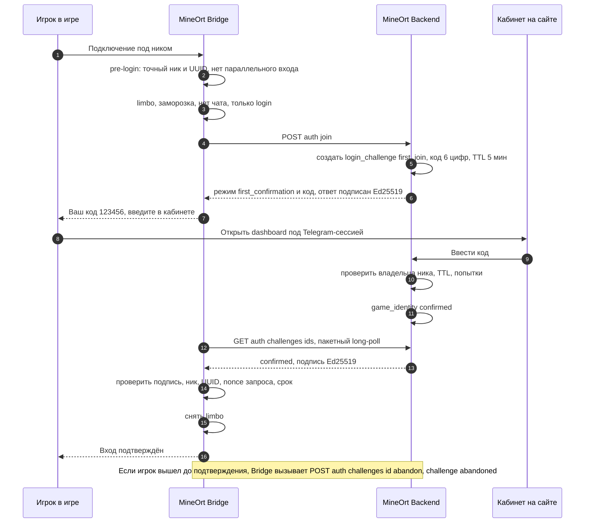

### 7.4. Подмена ника (AC-05)

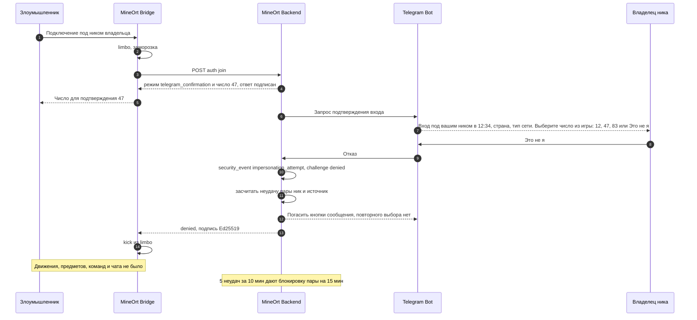

Неверное число в боте даёт тот же результат: `denied`, кнопки гаснут, неудача пары, kick. Если у владельца нет доступа к боту, работает игровой пароль (§6.3); если пароля нет, атакующий остаётся в limbo до таймаута (120 с для повторных входов) и отключается (fail-closed); неотвеченный challenge (`expired`) тоже засчитывается как неудача пары (§6.5). Таймаут 120 с относится к повторным входам; для `first_join` limbo живёт 5 мин (R4-08). Чужой источник, не подтверждавший вход под этим ником, получает не более 3 challenge за 10 минут: следующие входы получают `denied` без сообщения владельцу (бюджет challenge, R4-01б).

### 7.5. `/marker new` с дедупликацией (AC-13, AC-32)

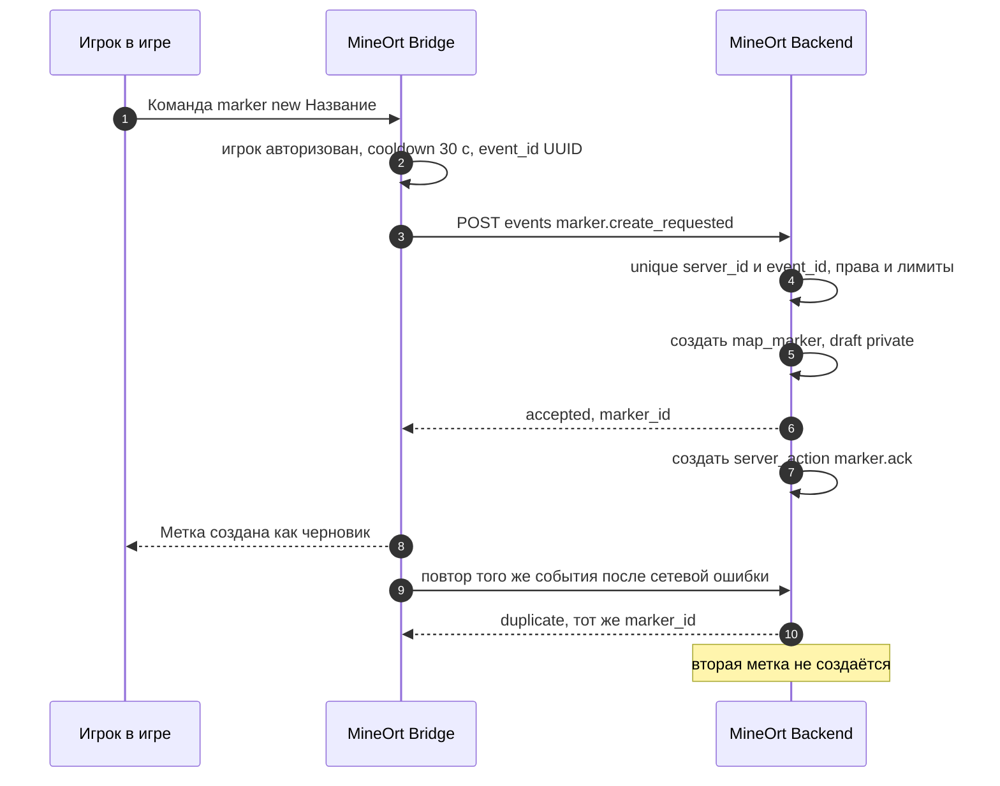

### 7.6. Reconciliation с drift

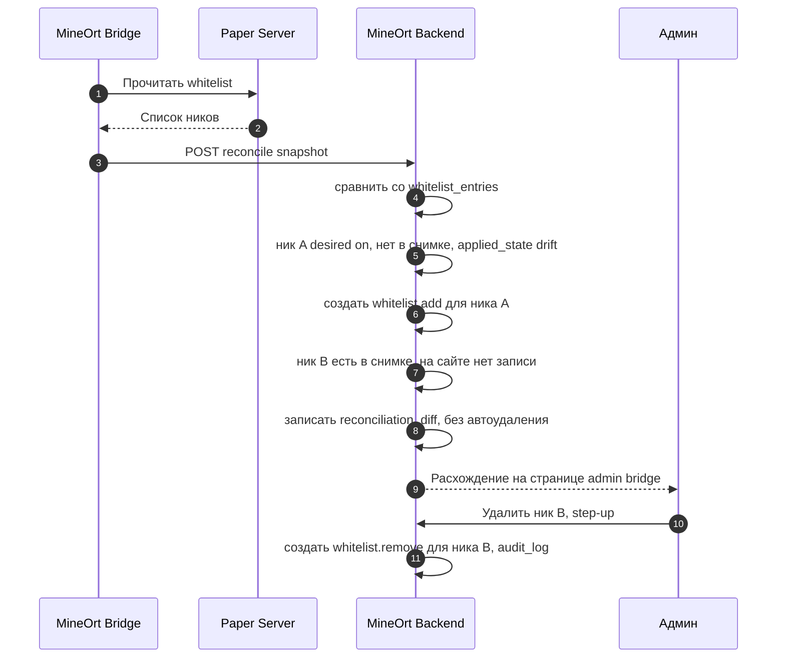

### 7.7. Параллельный вход под тем же ником (M2, M3, SC-GAME-07)

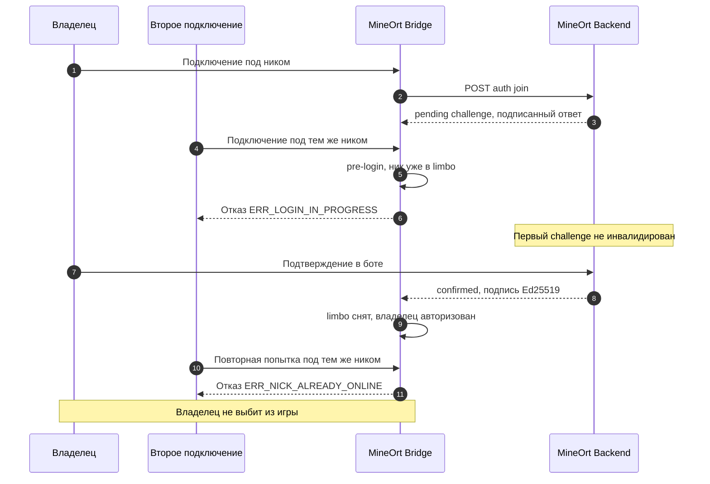

### 7.8. Первое соединение вышло, второе входит сразу (R3-02, TC-GAME-07a)

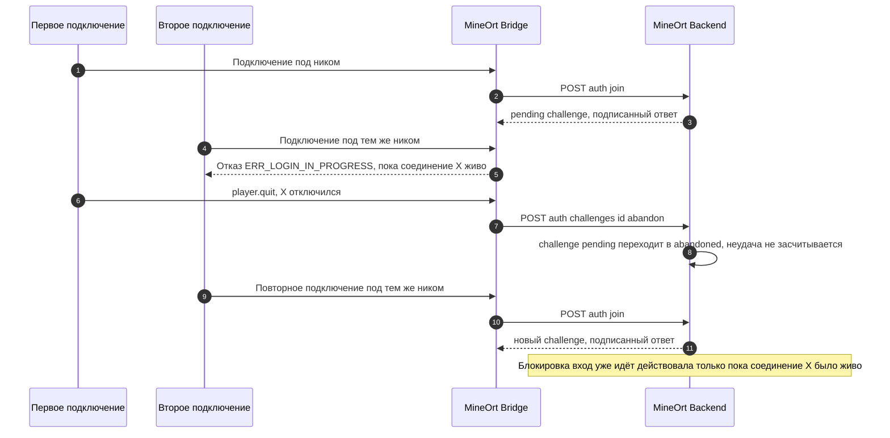

### 7.9. Освобождение ника и отложенная архивация (R3-04, TC-ACC-11d)

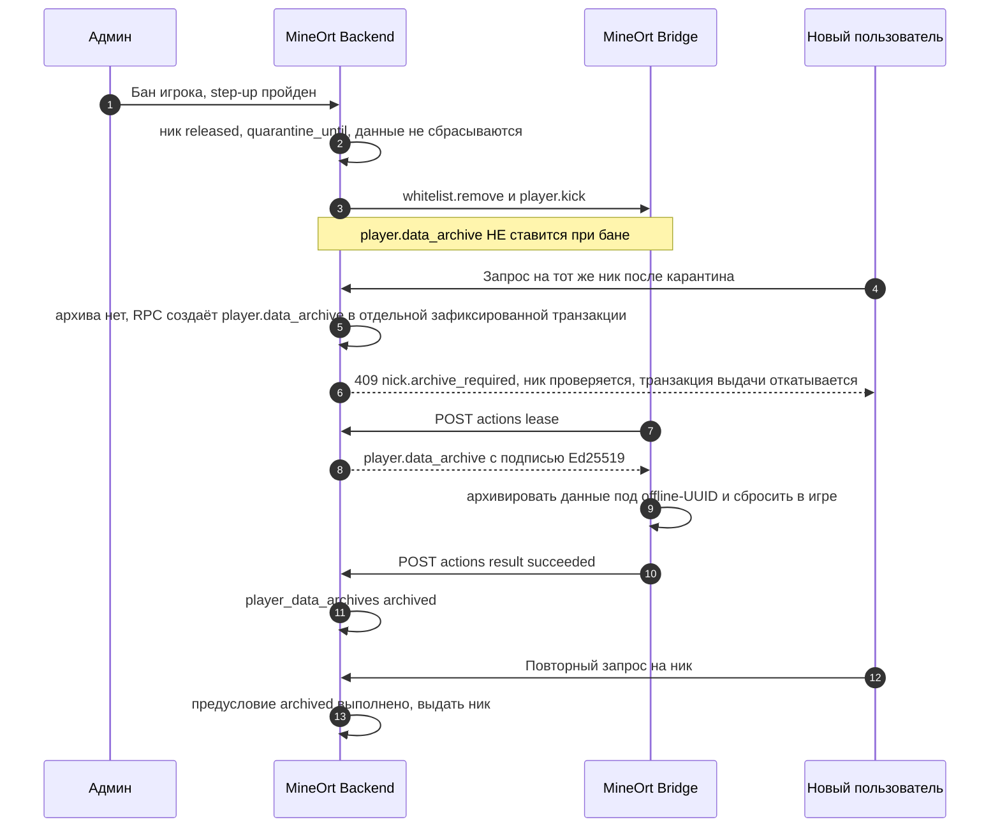

## 8. Таблица кодов ошибок

| Код | HTTP | Где возникает | Значение | Повторять? |
|---|---|---|---|---|
| `ERR_SIG_INVALID` | 401 | backend (HMAC) | Подпись запроса неверна | Нет |
| `ERR_TS_SKEW` | 401 | backend | Временная метка вне окна ±60 с | После синхронизации часов |
| `ERR_NONCE_REPLAY` | 401 | backend | Nonce уже использован | Нет, новый nonce |
| `ERR_BRIDGE_OUTDATED` | 426 | backend | `bridge_version` ниже `min_bridge_version` (MINOR 4, §3.8) | Нет, обновить Bridge |
| `ERR_KEY_REVOKED` | 401 | backend | Ключ отозван либо слот не активен | Нет |
| `ERR_SERVER_MISMATCH` | 403 | backend / Bridge | `server_id` не совпадает с ключом либо с локальным | Нет |
| `ERR_ACTION_SIG_INVALID` | локально | Bridge | Подпись Ed25519 неверна (AC-27) | Нет |
| `ERR_ACTION_EXPIRED` | локально / 410 | Bridge / backend | `expires_at` истёк | Нет, новое действие |
| `ERR_ACTION_TIME_INVALID` | локально | Bridge | `issued_at` раньше эпохи журнала, в будущем или старше 30 суток; TTL больше максимума типа; `expires_at` задан там, где должен быть `null` (MINOR 2, §2.2) | Нет, новое действие |
| `ERR_ACTION_TYPE_FORBIDDEN` | локально | Bridge | Тип не из белого списка | Нет |
| `ERR_ARGS_INVALID` | локально / 422 | Bridge / backend | Аргументы не прошли валидацию | Нет |
| `ERR_LEASE_EXPIRED` | 409 | backend | Результат пришёл после `lease_until`, и действие уже выдано повторно (иначе поздний результат принимается, §3.3) | Нет, действие выдаётся заново |
| `ERR_PLAYER_ONLINE` | в result | Bridge | `player.data_archive`, `player.data_restore`, `player.data_migrate`: игрок в сети, операция с данными невозможна | Да, по backoff |
| `ERR_ACTION_NOT_LEASED` | 409 | backend | Результат для действия не в `leased` | Нет |
| `ERR_WHITELIST_APPLY_FAILED` | в result | Bridge | Paper отказал или состояние не подтвердилось | Да, по backoff |
| `ERR_RATE_LIMIT` | 429 | backend | Превышен лимит запросов | Да, после `Retry-After` |
| `ERR_EVENT_REJECTED` | 200 (в массиве) | backend | Событие не принято (права, лимит, формат) | Нет |
| `ERR_CHALLENGE_EXPIRED` | 410 | backend | Код истёк либо погашен | Новый вход |
| `ERR_CHALLENGE_ATTEMPTS` | 429 | backend | Исчерпаны попытки ввода | Через 15 мин |
| `ERR_NICK_LOCKED` | 423 | backend | Заблокирована пара «ник + источник» по единому правилу (5 неудач за 10 мин, §6.5); владелец снимает только через бот со сверкой числа | Через 15 мин либо через бот со сверкой числа |
| `ERR_CHALLENGE_BUDGET` | 200 (`denied`) | backend | Бюджет challenge пары исчерпан (3 за 10 мин включая `abandoned`, источник не подтверждал вход под этим ником, §6.5, R4-01б); подписанный `denied` без challenge и без сообщения в бот | Через 10 мин (скользящее окно) |
| `reinstate.archive_in_progress` | 409 | backend | Reinstate при `player.data_archive` в статусе `leased`: ждать финального статуса (§6.9, R4-03) | После финала действия |
| `ERR_NICK_NOT_BOUND` | 403 | backend | Ник не связан с участником, нет доступа (membership ≠ `approved` или account ≠ `active`) либо привязка `released` | Нет |
| `ERR_NICK_CASE_MISMATCH` | 403 / локально | Bridge / backend | Регистр ника или вычисленный offline-UUID не совпадают с привязкой (MINOR 10) | Нет, войти под точным ником |
| `ERR_LOGIN_IN_PROGRESS` | 409 / локально | backend / Bridge | По нику уже есть pending-challenge с живым limbo-соединением, второе подключение отклонено (§6.8, R3-14); снимается сразу после `/abandon` | После выхода первого соединения либо по TTL challenge |
| `ERR_NICK_ALREADY_ONLINE` | локально / 409 | Bridge / backend | Ник уже в сети и авторизован, подключение отклонено, владелец не выбит (§6.8, R3-14) | Нет |
| `ERR_SERVER_PAUSED` | 200 (`denied`) / локально | backend / Bridge | Сервер на паузе (`bridge_servers.status = paused`: отзыв ключа, режим восстановления); `POST /auth/join` отвечает подписанным `denied`, вход закрыт (§5.1, R3-03) | Нет, до снятия паузы админом |
| `ERR_CHALLENGE_NOT_FOUND` | 404 | backend | `/abandon`: challenge не существует либо не принадлежит этому серверу, нику и UUID (§3.6) | Нет |
| `ERR_AUTH_DECISION_INVALID` | локально | Bridge | Подпись, ник, UUID, nonce или срок решения входа неверны либо решение повторено (§2.2a) | Новый запрос статуса; limbo остаётся |
| `ERR_AUTH_BACKEND_UNAVAILABLE` | локально | Bridge | Backend не ответил, fail-closed | Новый вход |

Коды прикладного API (не Bridge), используемые правами гильдий (см. [../01-product/03-roles-permissions.md](../01-product/03-roles-permissions.md)):

| Код | HTTP | Значение |
|---|---|---|
| `guild.rank_too_low` | 403 | Уровень актора не выше уровня цели (нарушено `actor.level < target.level`, R-LVL-1) |
| `guild.rank_escalation` | 403 | Назначаемый ранг не ниже уровня актора (нарушено `new_rank.level > actor.level`, R-LVL-2; [ПРЕДЛОЖЕНИЕ КОМАНДЫ], F1) |
| `guild.self_assign` | 403 | Попытка назначить себе ранг |
| `guild.last_owner` | 409 | Нельзя удалить или понизить последнего owner (в том числе удалением аккаунта главы, SC-DSH-04) |
| `guild.rank_foreign` | 403 | `rank_id` принадлежит другой гильдии (M6, TC-GLD-04g); дополнительно защищено составным FK |
| `poll.option_mismatch` | 422 | `option_id` не принадлежит опросу (M6, TC-POLL-02e); дополнительно защищено составным FK |
| `nick.quarantined` | 409 | Ник в карантине (B1, TC-ACC-12d); обход — только admin со step-up |
| `nick.archive_required` | 409 | Выдача ника другому пользователю отклонена: для последней `released`-записи нет архива в статусе `archived` (в процессе или `failed`); R3-04, TC-ACC-12d |
| `ERR_DELETE_FORBIDDEN_BANNED` | 403 | Самоудаление запрещено при `account_status` ∈ {`banned`, `suspended`}; удалить может только admin со step-up (R3-06, TC-DSH-04d) |
| `auth.reauth_required` | 401 | Для удаления аккаунта нужен свежий Telegram-вход (re-auth не старше 5 мин; R3-15, TC-DSH-04a) |
| `auth.account_blocked` | 403 | Telegram-вход отклонён до создания `users`: аккаунт banned/suspended либо хэш Telegram ID найден в `deletion_tombstones` с активным баном (R3-06, SC-AUTH-06, TC-DSH-04d) |
| `site.read_only` | 503 | Сайт в режиме обслуживания (только чтение), изменяющий запрос отклонён (режим восстановления §5.1, R3-03) |
| `poll.has_votes` | 409 | Правка опроса и вариантов отклонена: в опросе уже есть голоса (проверка в триггере `SECURITY DEFINER`, R3-17, K-17) |
| `auth.password_weak` | 422 | Пароль не проходит политику (§6.3, MINOR 7) |
| `data.privileged_write_denied` | 403 | Прямая запись клиентской ролью в привилегированную колонку (B2, TC-OPS-06g) |

Дубликат события (`duplicate`) — не ошибка: ответ 200, статус элемента `duplicate`.

## 9. Наблюдаемость

Метрики очереди и Bridge (экспортируются backend; [ПРЕДЛОЖЕНИЕ КОМАНДЫ]):

| Метрика | Алерт (по умолчанию) |
|---|---|
| Возраст самого старого `queued` | > 5 мин при Bridge online; > 24 ч при offline (до `expired`) |
| Количество `failed` за сутки | ≥ 1 — уведомление админам |
| Количество `failed_retryable` одновременно | > 10 |
| Время до `succeeded` (p95) `whitelist.add` | > 60 с при online — нарушение SLO (см. [04-nfr-security.md](04-nfr-security.md)) |
| Возраст последнего heartbeat | > 90 с — Bridge offline; > 5 мин — оповещение |
| Число отклонённых подписей (`ERR_SIG_INVALID`, `ERR_NONCE_REPLAY`) | ≥ 5 за 10 мин — `security_events` + оповещение |
| Число drift в последней сверке | > 0 — виден в админке; > 5 — оповещение |
| `auth.failed` и `ERR_NICK_LOCKED` | ≥ 3 разных ника за 10 мин — оповещение (возможная атака) |
| Расхождение часов Bridge (`clock_skew_ms`, NTP) | > 30 с — предупреждение; > 60 с — оповещение админов (MINOR 3) |
| Отклонённые решения входа (`ERR_AUTH_DECISION_INVALID`) | ≥ 1 — `security_events` + оповещение (M1) |
| Квота auth (доля использованного лимита) | > 70 % за минуту — оповещение; любой `429` на auth — предупреждение (M5) |
| Неудачи входа по одному нику с разных источников | ≥ 20 за час — оповещение владельцу ника и админам (M3) |
| `ERR_BRIDGE_OUTDATED`, `server_version_unsupported`, смена `journal_epoch` | любое появление — оповещение админов (MINOR 2, 4) |
| Действия отзыва, не применённые за 15 мин при Bridge online | ≥ 1 — оповещение (MINOR 1) |
| Отставание внешнего приёмника `audit_log` и `security_events` (записи с пустым `exported_at`) | > 5 мин — оповещение админам (RPO ≤ 5 мин, §5.1, R3-03) |
| Выдача ника заблокирована архивом (`nick.archive_required` дольше 15 мин, `nick_issue_blocked_no_archive`) | ≥ 1 — оповещение админам (R3-04) |
| Исчерпан лимит оповещений об отказах по нику (3 в час, переход на дайджест; challenge живого входа в лимит не входит, R4-01а) | информативно в `/admin/bridge`; ≥ 3 ников за час — оповещение (возможная атака, R3-10) |
| Исчерпан бюджет challenge пары (`challenge_budget_exceeded`, R4-01б) | информативно; ≥ 3 ников за час — оповещение (возможная атака на ник владельца) |
| Исчерпан бюджет игрового пароля по нику (20 неудач за час) | оповещение владельцу ника и админам (R3-11) |
| `ERR_SERVER_PAUSED` на `POST /auth/join` | пока сервер на паузе — напоминание админам раз в 15 мин (вход в игру закрыт) |

Страница `/admin/bridge` показывает очередь (фильтры по статусам), историю попыток, состояние heartbeat, версию Bridge, слоты ключей и кнопки retry / cancel (SC-ADM-04, step-up на критичные операции).

## 10. Тест-план протокола

Ссылки на будущие TC (идентификаторы согласуются с `05-qa/01-acceptance-tests.md`; схема TC-<DOM>-NN[a-z]).

| Область | TC | Уровень | Приоритет |
|---|---|---|---|
| Одобрение → применение whitelist | TC-ACC-07a, TC-ACC-08a | Plugin-интеграция на тестовом Paper | Blocker |
| Одобрение при выключенном MC (AC-21) | TC-ACC-07b, TC-ACC-07c | Plugin-интеграция | Blocker |
| Ошибка и таймаут, backoff, ручной retry | TC-ACC-08b, TC-ADM-04a | API + плагин | Critical |
| Reconciliation: missing, extra, пустой снимок (AC-28) | TC-ACC-09a, TC-ACC-09b, TC-ACC-09c | Plugin-интеграция | Blocker |
| Приостановка → remove + kick | TC-ACC-11a | Plugin-интеграция | Critical |
| Неподписанная/просроченная/чужая команда (AC-27) | TC-OPS-04a, TC-OPS-04b, TC-OPS-04c | API + плагин | Blocker |
| Replay HMAC-запроса, окно времени | TC-OPS-04d | API | Blocker |
| Неподписанный, подделанный, повторённый ответ решения входа (M1) | TC-OPS-04g | API + плагин | Blocker |
| Восстановление БД в режиме восстановления: сессии отозваны, роли/баны/перепривязки сверены с внешним журналом, сайт в read-only, вход в игру закрыт, бан/отзыв из последних суток не воскресает (M11, R3-03) | TC-OPS-01c | Ручной + API | Critical (R3-12; был Blocker) |
| Прямая запись клиентской ролью в привилегированные колонки (B2); ожидается `data.privileged_write_denied` и запись `security_events` (R3-22) | TC-OPS-06g | API/SQL | Blocker |
| Прямой SELECT закрытых колонок под `anon` и `authenticated` → отказ; публичные данные доступны через представления `public_members`, `public_profiles`, `public_guilds` (R3-07) | TC-OPS-06h | API/SQL | Blocker, P0 |
| Самоудаление при `banned`/`suspended` запрещено; повторный Telegram-вход после админ-удаления забаненного отклонён по tombstone до создания `users` (R3-06) | TC-DSH-04d | E2E + API | Blocker, P0 |
| Удаление аккаунта требует свежего Telegram-входа (re-auth ≤ 5 мин; новый прогон, R3-15) | TC-DSH-04a | E2E | Critical |
| Карантин ника, отложенная архивация, новый владелец не получает данные прежнего (B1). Новые прогоны (R3-04): TC-ACC-11d — бан не сбрасывает данные до повторной выдачи, reinstate возвращает данные; TC-ACC-12d — админ со step-up, архив не выполнен → выдача отказана | TC-ACC-11d, TC-ACC-12d | Plugin-интеграция + API | Blocker (TC-ACC-11d), Critical (TC-ACC-12d) |
| Смена ника переносит данные: инвентарь на новый UUID, старый ник в карантине без данных (`player.data_migrate`; новый прогон, R3-05) | TC-ACC-10b | Plugin-интеграция + API | Critical |
| Ротация и отзыв ключа | TC-OPS-04e | Ручной + API | Critical |
| Первый вход с подтверждением (AC-29) | TC-GAME-01a, TC-GAME-06a | Plugin-интеграция | Blocker |
| Подмена ника (AC-05), три проверки: позитив, негатив, прямой API | TC-GAME-03a, TC-GAME-03b, TC-GAME-03c | Plugin-интеграция + API | Blocker |
| Backend недоступен, fail-closed (AC-30) | TC-GAME-04a, TC-GAME-04b, TC-GAME-04c | Plugin-интеграция | Blocker |
| Перебор и истечение кода | TC-GAME-05a, TC-GAME-05b | API | Critical |
| Подтверждение в боте со сверкой числа (M2); новый прогон: неверное число → `denied`, кнопки гаснут, kick, повторного выбора нет (R3-01) | TC-GAME-01c | Plugin-интеграция + бот | Blocker (R3-12; был Critical) |
| Нагрузка: N ≥ 30 одновременных входов без 429 и без fail-closed-кика (M5) | TC-GAME-04d | Нагрузочный, Plugin-интеграция | Critical |
| Параллельный и повторный вход: pending не вытесняется; ник в сети — отказ, владелец не выбит; блокировка пары ник+источник (M2, M3). Новые прогоны (R3-02, R3-10): TC-GAME-07a — X отключился, O входит сразу (`/abandon`); TC-GAME-07c — снятие блокировки только со сверкой числа, лимит оповещений об отказах 3 в час, бюджет challenge и прогон «30 циклов с чужого источника → владелец входит с первого раза» (R4-01г) | TC-GAME-07a, TC-GAME-07b, TC-GAME-07c | Plugin-интеграция + API | Blocker (TC-GAME-07b), Critical (остальные) |
| Premium: автологин только при проверке Mojang | TC-GAME-02a, TC-GAME-02b | Plugin-интеграция | Critical |
| Premium: фиксация типа при подтверждённом первом входе и UUID = `mc_uuid` (M4) | TC-GAME-02d | Plugin-интеграция | Critical |
| `/marker new` (AC-13) | TC-MRK-01a | Plugin-интеграция | Major |
| Дедупликация marker-события (AC-32) | TC-MRK-03a | Plugin-интеграция | Critical |
| `/marker new` без игровой авторизации или без права (AC-29) | TC-MRK-02a | Plugin-интеграция | Blocker |
| `/marker new`: cooldown и лимит | TC-MRK-02b | Plugin-интеграция | Major |

Для проверок MINOR 1–6 и 10 (отзыв без срока, временны́е проверки и эпоха журнала, коррекция часов, `ERR_BRIDGE_OUTDATED`, поздний результат, nonce в общем хранилище, точный регистр ника) отдельные TC-ID в списке раунда 2 не заданы: их нужно привязать к существующим TC-ACC-08/11, TC-OPS-04 и TC-GAME-03 либо завести новые буквенные варианты в `05-qa` (см. N-12 ниже).

Приоритеты TC-MRK-02a/02b/03a выровнены по [../01-product/03-roles-permissions.md](../01-product/03-roles-permissions.md), §7 и [../05-qa/01-acceptance-tests.md](../05-qa/01-acceptance-tests.md) (F11).

## 11. Замечания для сведения

| № | Замечание |
|---|---|
| N-1 | План пакета предполагал «хэш секрета» в `bridge_servers`. Для проверки HMAC backend должен знать сам секрет, поэтому здесь предложено шифрованное хранение (см. §2.1). Отклонение зафиксировано и в [03-data-model.md](03-data-model.md). |
| N-2 | Действие `auth.release` в схеме §6 продублировано опросом `GET /auth/challenges/{id}`: Bridge берёт решение из опроса (основной путь), `auth.release` служит принудительным снятием/снижает задержку и в P0 допускает реализацию только одного из двух путей. Решение за техлидом (OD-23). |
| N-3 | Типы аккаунта в `minecraft_identities.account_type`: `premium | offline | unknown`. Автологин premium без подтверждения возможен только при проверке сессии Mojang [ПРОВЕРИТЬ], иначе действует схема offline (разрешение C-14). |
| N-4 | Время жизни `player.kick` и `auth.release` (10 и 5 минут), срок хранения журнала применённых `action_id` (30 дней), размер пакета событий (100) — [ПРЕДЛОЖЕНИЕ КОМАНДЫ], в аудите нет. |
| N-5 (M1) | Добавлена подпись Ed25519 для ответов `POST /auth/join` и `GET /auth/challenges` (§2.2a); Bridge снимает limbo только после проверки подписи, ника, UUID, nonce запроса и срока; ошибка — fail-closed (`ERR_AUTH_DECISION_INVALID`). Тест: TC-OPS-04g. |
| N-6 (M2, M3) | Второе подключение при pending отклоняется (раньше «новый вход инвалидирует предыдущий»); ник в сети — отказ без выбивания владельца; блокировка перебора переведена с ника на пару «ник + источник», владелец обходит её подтверждением в боте; в сообщении бота — число для сверки и грубый признак источника (страна, тип сети). Блокировок только по адресу источника в документе нет (§6.5, §6.8; SC-GAME-07, TC-GAME-01c, TC-GAME-07a–07c). |
| N-7 (M4) | Premium-автологин — только при трёх условиях (§6.4, TC-GAME-02d); единая политика UUID помечена [ОПРЕДЕЛИТЬ → OD-22/OD-23]. |
| N-8 (M5) | Добавлены пакетный опрос `GET /auth/challenges?ids=` (long-poll) и отдельная квота auth (§3.7); NFR-LIM-18 пересчитан, добавлен NFR-LIM-19. 429 из auth-квоты не приводит к fail-closed-кику (TC-GAME-04d). |
| N-9 (M11) | Режим восстановления БД (§5.1): `bridge_servers.status = paused`, сверка без авто-add, ручной разбор diff с `audit_log` и журналом Bridge. Тест: TC-OPS-01c, окно 03.12–07.12 (не ранее чем за 7 и не позднее чем за 3 дня до запуска). |
| N-10 (B1) | Карантин ника, действие `player.data_archive` в белом списке (§1, §6.9), код `nick.quarantined`; угроза закреплена в T-IMPERSONATION ([04-nfr-security.md](04-nfr-security.md)). Тесты: TC-ACC-11d, TC-ACC-12d. |
| N-11 (MINOR 1–7, 10) | MINOR 1: `whitelist.remove` без срока, `player.kick` повторяется, сверка C-1/C-2, отказ §6.2 при membership ≠ approved или account ≠ active. MINOR 2: `issued_at`/`signed_payload`, эпоха журнала, `ERR_ACTION_TIME_INVALID`. MINOR 3: поправка часов по `server_time`, NTP, алерт. MINOR 4: `ERR_BRIDGE_OUTDATED`, порядок выката, окно совместимости. MINOR 5: поздний результат. MINOR 6: nonce-кэш и rate limit в общем хранилище (`bridge_nonces`, `rate_limit_counters`). MINOR 7: в limbo только `/login`, пароль из `/dashboard`, политика и нарастающая блокировка. MINOR 10: точный регистр и offline-UUID (`ERR_NICK_CASE_MISMATCH`). |
| N-12 | Для MINOR 1–6 и 10 в списке раунда 2 нет собственных TC-ID; в §10 они не сопоставлены, нужна привязка в `05-qa`. |
| N-13 (B2) | Паттерн записи (клиентские роли не пишут в таблицы с привилегированными колонками, всё через API/RPC) описан в [03-data-model.md](03-data-model.md), §8; добавлен код `data.privileged_write_denied`; TC-OPS-06g. |
| N-14 (согласование с 02/05-qa) | Имена выровнены с Coder B: события безопасности `concurrent_join_denied`, `nick_quarantine_denied`, `auth_decision_rejected`; аудит `ops.restore_mode_opened` / `ops.restore_mode_closed`, `user.data_exported`; коды `guild.rank_foreign`, `poll.option_mismatch`. Определение «источника» для блокировки пары ник+источник — [ОПРЕДЕЛИТЬ → OD-23]; политика premium/UUID — [ОПРЕДЕЛИТЬ → OD-22/OD-23]. |
| N-15 (MAJOR-1, R3-01) | Один выбор на challenge в боте: верное число — `confirmed`; неверное число или «Это не я» — `denied`, кнопки гаснут, неудача пары, kick limbo; повторного выбора нет (§6.3, §6.10, диаграмма 7.4). Новый прогон TC-GAME-01c. |
| N-16 (MAJOR-2, R3-02) | Challenge живёт столько же, сколько limbo-соединение: эндпоинт `POST /auth/challenges/{id}/abandon` (HMAC), статус `abandoned` в `login_challenges`, таймаут limbo `first_join` = TTL кода 5 мин, повторные входы 120 с (§3.6, §6.1, §6.8, §6.10, диаграмма 7.8). Риск R-6 в 04-nfr переписан. Новый прогон TC-GAME-07a. |
| N-17 (MAJOR-3, R3-03) | Режим восстановления расширен до пяти частей: read-only сайта, глобальный отзыв сессий и смена секрета сессий, внешний append-only приёмник `audit_log`/`security_events` (RPO ≤ 5 мин; провайдер — [ПРЕДЛОЖЕНИЕ КОМАНДЫ, ПРОВЕРИТЬ провайдера]), diff по внешнему журналу (whitelist, баны/suspended, site_role, перепривязки Telegram, отзывы приглашений, отзывы сессий), `POST /auth/join` при `paused` — отказ `ERR_SERVER_PAUSED` (§5.1). Статусы `bridge_servers`: `online | offline | paused`; значение `status=active` не используется. |
| N-18 (MAJOR-4, MINOR-11, R3-04) | Отложенная архивация: при бане/отзыве/удалении данные не сбрасываются, `player.data_archive` ставится только при фактической повторной выдаче ника (§6.9); предусловие `player_data_archives.status = archived` на всех путях выдачи (обычный, админский досрочный, фоновая задача) в RPC и триггере; добавлено действие `player.data_restore`; коды `nick.archive_required`, событие `nick_issue_blocked_no_archive`. Диаграмма 7.9. Новые прогоны TC-ACC-11d, TC-ACC-12d. |
| N-19 (MAJOR-5, R3-05) | Смена ника переносит данные действием `player.data_migrate`; старый ник уходит в карантин без данных (запись `archived`, `reason = migrated`) (§6.7). Новый прогон TC-ACC-10b. |
| N-20 (MAJOR-6, R3-06) | Самоудаление запрещено при banned/suspended (`ERR_DELETE_FORBIDDEN_BANNED`); `deletion_tombstones` хранит HMAC-хэш Telegram ID, `banned`, `ban_until` и проверяется при Telegram-входе до создания `users` (`auth.account_blocked`). Тест TC-DSH-04d (Blocker, P0). |
| N-21 (MAJOR-7, R3-07) | Чтение закрытых колонок — только через представления `public_members`, `public_profiles`, `public_guilds`; тест TC-OPS-06h (Blocker, P0); детали — [03-data-model.md](03-data-model.md), §6, §8. |
| N-22 (MINOR-1, R3-08) | Карантин и архив — только для ников с игровой историей (`applied_state = applied` или `game_identity = confirmed` хотя бы раз); резерв без игровой истории освобождается сразу (§6.9). |
| N-23 (MINOR-2, R3-09) | Перепривязка Telegram (SC-ADM-06) ник не освобождает (§6.9). |
| N-24 (MINOR-4, R3-10) | Единое правило блокировки: неудача пары = неверный код/пароль, неверное число, «Это не я», неотвеченный challenge (`expired`); 5 за 10 мин → блок пары на 15 мин; снятие владельцем только через бот со сверкой числа (кнопка «Это я» лишь «взводит» разблокировку на 5 мин); не больше 3 уведомлений в час на ник, дальше дайджест (§6.5). Прежняя нарастающая блокировка пароля 1 ч / 6 ч / 24 ч удалена. |
| N-25 (MINOR-5, R3-11) | Блокировка игрового пароля — по паре «ник + источник» плюс глобальный бюджет 20 неудач в час на ник, отключающий только парольный путь (бот остаётся доступен); явное исключение из §6.5 (§6.3). |
| N-26 (MINOR-6, MINOR-7, R3-12) | Приоритеты в §10: TC-OPS-01c — Critical, TC-GAME-01c — Blocker. |
| N-27 (MINOR-8, R3-14) | SC-GAME-07 шаг 1: проверка «вход уже идёт» — не отдельный эндпоинт, а локальная проверка Bridge плюс 409 (`ERR_LOGIN_IN_PROGRESS` / `ERR_NICK_ALREADY_ONLINE`) от `POST /auth/join` (§6.8). |
| N-28 (MINOR-12, R3-17) | Правка опроса только через API; проверка «нет голосов» в триггере `SECURITY DEFINER` (`poll.has_votes`); см. [03-data-model.md](03-data-model.md), K-17. |
| N-29 (NIT-3, R3-21) | `guild_members.rank_id` NOT NULL, UNIQUE (`guild_id`, `level`) DEFERRABLE INITIALLY DEFERRED; см. [03-data-model.md](03-data-model.md), K-2a. |
| N-30 (QA-3, R3-22) | Для TC-OPS-06g ожидается `data.privileged_write_denied` плюс запись `security_events` (§10). |
| N-31 (согласование с 01/05-qa, раунд 3) | Новые имена: события безопасности `nick_issue_blocked_no_archive`, `banned_relogin_denied`; аудит `nick.reissued`, `player.data_migrated`; коды `nick.archive_required`, `ERR_DELETE_FORBIDDEN_BANNED`, `auth.account_blocked`, `auth.reauth_required`, `site.read_only`, `poll.has_votes`, `ERR_SERVER_PAUSED`, `ERR_CHALLENGE_NOT_FOUND`. Остаточный риск R-8 (исчерпание лимита уведомлений) — в 04-nfr. |
| N-32 (согласование с Coder B, раунд 3) | Имена выровнены: код самоудаления при banned/suspended — `ERR_DELETE_FORBIDDEN_BANNED` (403); событие/оповещение отказа выдачи ника без готового архива — `nick_issue_blocked_no_archive`; reinstate после архивации идёт через `player.data_restore`; запись архива старого ника при смене ника — `archived` с пометкой `migrated`; неотвеченный challenge — неудача пары (120 с для повторных входов); инварианты I-02 (= K-12) и I-12 (карантин). |
| N-33 (R4-01) | Отрезание владельца от входа закрыто: (а) лимит 3 сообщения в час и дайджест относятся только к оповещениям об отказах (`concurrent_join_denied`, заблокированные попытки), сообщение challenge владельцу отправляется всегда; (б) бюджет challenge пары «ник + источник» — не более 3 за 10 мин включая `abandoned` для источника, не подтверждавшего вход под этим ником, дальше подписанный `denied` / `ERR_CHALLENGE_BUDGET` без сообщения в бот и без дайджеста, только `security_events` `challenge_budget_exceeded`; (в) источники, подтверждавшие вход (`login_attempt_locks.last_confirmed_at`, 30 дней), освобождены от лимита оповещений, бюджета challenge и бюджета пароля; (г) прогон TC-GAME-07c «30 циклов с чужого источника → владелец входит с первого раза». Новые: код `ERR_CHALLENGE_BUDGET`, тип события `challenge_budget_exceeded`, колонки `login_attempt_locks.challenge_count`, `challenge_window_start`, `last_confirmed_at`. Остаточный риск (угон источника владельца, срок 30 дней) — [ПРОВЕРИТЬ], R-8. §6.3, §6.5, §6.8, §6.10, диаграмма 6.10 обновлены. |
| N-34 (R4-02) | `quarantine_until = max(now() + 90 дней, banned_until)`; при бессрочном бане `quarantine_until = 'infinity'`, ник выдаёт только admin со step-up (§6.9 п. 1, 2). |
| N-35 (R4-03) | Гонка reinstate и архива: отменяется только `player.data_archive` в `queued`; для `leased` reinstate ждёт финала (`reinstate.archive_in_progress`, 409); поздний `succeeded` по отменённому архиву автоматически ставит `player.data_restore` (`player_data_archives.restore_action_id`). |
| N-36 (R4-04) | Запрос на архив создаёт RPC в отдельной зафиксированной транзакции; триггер выдачи ника только отклоняет (`nick.archive_required`). Диаграмма 7.9 обновлена. |
| N-37 (R4-06) | Diff режима восстановления (§5.1 п. 4) дополнен категориями: удаления аккаунтов (tombstone), повторные выдачи ников и архивы, смены ника; TC-OPS-01c расширен. |
| N-38 (R4-07) | Смена ника (§6.7): порядок `whitelist.remove` старого, `player.data_migrate`, затем (только по `succeeded`) `whitelist.add` нового. |
| N-39 (R4-08) | Таймауты limbo: `first_join` — 5 мин (= TTL кода), повторные входы — 120 с; «120 с» без разделения в §6.6, §6.10, 7.4 уточнено (при недоступном backend challenge не создаётся, поэтому таймаут fail-closed 120 с для всех видов входа). |
