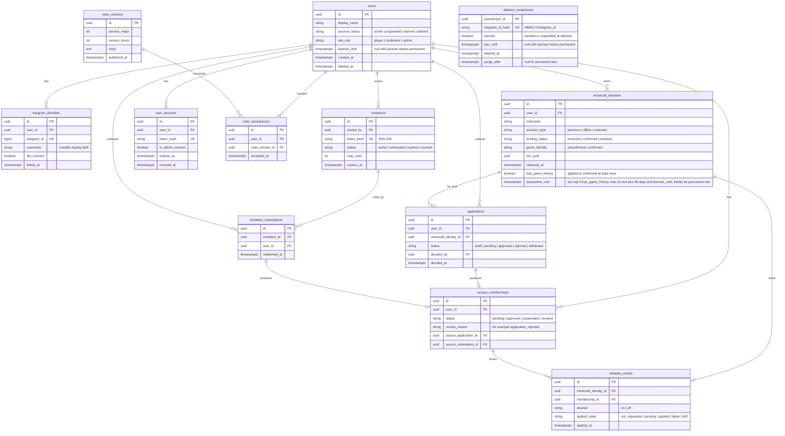
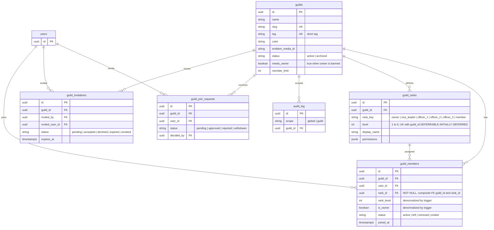
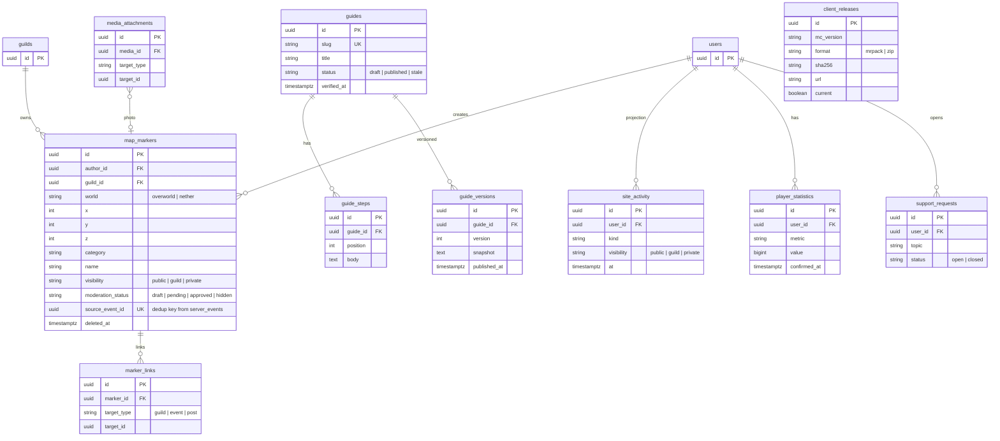

# MineOrt IV — Логическая модель данных

| Поле | Значение |
|---|---|
| Статус | Черновик для утверждения |
| Базовая дата | 13.11.2026; запуск 10.12.2026 |
| Источник | Аудит §15 «Логическая модель данных (черновая)» (стр. 741–808), §14.2 (стр. 727–737), §10.7 (стр. 534–556) |
| Связанные файлы | [Архитектура](01-architecture.md), [Протокол Bridge](02-bridge-protocol.md), [NFR и безопасность](04-nfr-security.md), [Модель статусов](../01-product/02-user-status-model.md) |

> Это логическая (предметная) модель, а не миграции SQL (аудит стр. 743). Типы, индексы и RLS-политики уточняются в ТЗ и миграциях. Всё, чего нет в аудите, помечено [ПРЕДЛОЖЕНИЕ КОМАНДЫ].

## 1. Принципы

1. Логическая модель, не миграции; конкретные поля, индексы и RLS оформляются в ТЗ (аудит стр. 743).
2. Первичные ключи — UUID [ПРЕДЛОЖЕНИЕ КОМАНДЫ]. Для `server_actions` первичный ключ = `action_id`.
3. Время — `timestamptz` в UTC; пояс применяется только при отображении (OD-42).
4. Мягкое удаление (`deleted_at`) для пользовательского контента и профилей (OD-40); физическое удаление медиа — через 30 дней [ПРЕДЛОЖЕНИЕ КОМАНДЫ].
5. Статусы хранятся как текст с `CHECK` либо enum. Значения — **канонические** (раздел 2 пакета) и одинаковые во всех документах.
6. Производный `onboarding_stage` **не хранится**: вычисляется функцией от независимых измерений (см. [02-user-status-model.md](../01-product/02-user-status-model.md)). Хранение допустимо только как кэш в представлении [ПРЕДЛОЖЕНИЕ КОМАНДЫ].
7. RLS включается на всех таблицах с пользовательскими данными (Supabase, аудит стр. 807); проверка владельца записи не сводится к роли `authenticated`.
8. Привилегированные операции выполняет backend; секреты недоступны клиенту (аудит стр. 808).
8a. **Модель записи данных (B2)** [ПРЕДЛОЖЕНИЕ КОМАНДЫ]: клиентские роли (`anon`, `authenticated`) **не пишут напрямую** в таблицы с привилегированными колонками. Все переходы статусов и ролей идут через backend/RPC `SECURITY DEFINER` с проверкой прав и инвариантов в коде; где прямая запись с клиента допустима (например, `display_name`, `privacy_settings`), права выдаются `GRANT` по колонкам, а не на всю таблицу. Подробности и список привилегированных колонок — §8.
8b. **Чтение только через представления (R3-07)**: `anon` и `authenticated` не получают `SELECT` на базовые таблицы с закрытыми колонками; публичное чтение — через `public_members`, `public_profiles`, `public_guilds` (§6.1).
9. Единый `audit_log` для административных изменений и гильдейских событий (разрешение C-10, §4).

## 2. Диаграммы ERD

Атрибуты показаны не полностью (ключевые и статусные); полный перечень — в разделе 3. Значения перечислений в комментариях — канонические.

### 2.1. Identity & Access

Примечания:

- `site_roles` / `permissions` из аудита (стр. 755) реализованы как поле `users.site_role` + таблица `role_permissions` (на диаграмме не показана). Роль «владелец» — `admin` с разрешением `roles.manage`.
- Доступ к платформе (guest / tg_user / applicant / member / restricted) — вычисляется из `account_status`, `access_memberships`, `applications`, а не хранится.

### 2.2. Bridge & Game

```mermaid
erDiagram
    bridge_servers ||--o{ server_actions : receives
    bridge_servers ||--o{ server_events : emits
    bridge_servers ||--o{ reconciliation_runs : reports
    server_actions ||--o{ server_action_attempts : tried
    server_actions ||--o| server_actions : retry_of
    reconciliation_runs ||--o{ reconciliation_diffs : finds
    minecraft_identities ||--o{ login_challenges : confirms
    minecraft_identities ||--o{ player_data_archives : archived
    server_actions ||--o| player_data_archives : performs
    users ||--o| password_credentials : sets
    bridge_servers ||--o{ bridge_nonces : replay_guard
    users ||--o{ security_events : subject
    users ||--o{ audit_log : actor
    bridge_servers {
        uuid id PK
        string key_id_a UK
        string key_id_b UK
        bytea secret_a_enc "encrypted HMAC secret"
        bytea secret_b_enc
        string signing_kid
        string signing_public_key "Ed25519 public"
        string status "online | offline | paused"
        string paused_reason "key_revoked | restore_mode"
        timestamptz last_heartbeat_at
        string bridge_version
        string journal_epoch "reported by Bridge"
    }
    server_actions {
        uuid action_id PK
        uuid server_id FK
        string type "whitelist.add | whitelist.remove | player.kick | auth.release | player.data_archive | player.data_restore | player.data_migrate | marker.ack | tag.sync"
        jsonb args
        string status "queued | leased | succeeded | failed_retryable | failed | expired | cancelled"
        int attempt_count
        timestamptz next_attempt_at
        timestamptz lease_until
        timestamptz issued_at "signed"
        timestamptz expires_at "null for whitelist.remove and player.data_archive only"
        jsonb signed_payload "canonical JCS bytes"
        uuid retry_of_action_id FK
        string signature
    }
    server_action_attempts {
        uuid id PK
        uuid action_id FK
        int attempt
        string result "succeeded | failed"
        string error_code
        timestamptz at
    }
    server_events {
        uuid id PK
        uuid server_id FK
        uuid event_id "UK with server_id"
        string type
        jsonb payload
        timestamptz occurred_at
    }
    login_challenges {
        uuid id PK
        uuid minecraft_identity_id FK
        string kind "first_join | telegram_confirm | password"
        string code_hash
        string status "pending | confirmed | denied | expired | abandoned"
        int attempts
        string match_number "2 digits for bot number matching"
        string source_hash "salted hash of coarse source"
        timestamptz expires_at
    }
    login_attempt_locks {
        uuid id PK
        string nickname_lower
        string source_hash
        int failures
        timestamptz window_start
        timestamptz locked_until
        timestamptz unlock_armed_until "armed by owner in bot, number matching still required"
        int challenge_count "challenges issued in the window incl abandoned, budget 3 per 10 min"
        timestamptz challenge_window_start
        timestamptz last_confirmed_at "owner confirmed login from this source, exempt from budgets"
    }
    player_data_archives {
        uuid archive_id PK
        uuid minecraft_identity_id FK
        uuid action_id FK
        string status "requested | archived | failed | cancelled"
        string reason "reissue | migrated"
        uuid restore_action_id FK "auto player.data_restore after late succeeded of cancelled archive"
        uuid migrated_to_identity_id FK
        timestamptz archived_at
        timestamptz retain_until
    }
    password_credentials {
        uuid user_id PK
        string password_hash "argon2id"
        int budget_failures "per nick budget in current hour"
        timestamptz budget_window_start
        timestamptz budget_locked_until "disables password path only"
    }
    system_flags {
        string flag_key PK "maintenance_mode | session_secret_version"
        string value
        uuid set_by FK
        timestamptz set_at
    }
    bridge_nonces {
        uuid server_id FK
        string nonce
        timestamptz expires_at
    }
    reconciliation_runs {
        uuid id PK
        uuid server_id FK
        uuid snapshot_id UK
        string reason "startup | periodic | manual"
        timestamptz taken_at
    }
    reconciliation_diffs {
        uuid id PK
        uuid run_id FK
        string kind "missing_on_server | extra_on_server"
        string nickname
        string resolution "open | resolved | ignored"
    }
    security_events {
        uuid id PK
        uuid user_id FK
        string type
        string severity
        inet ip
        timestamptz at
        timestamptz exported_at "null until shipped to external sink"
    }
    audit_log {
        uuid id PK
        uuid actor_id FK
        string scope "global | guild"
        uuid guild_id FK
        string action
        jsonb details
        timestamptz at
        timestamptz exported_at "null until shipped to external sink"
    }
```

### 2.3. Guilds

### 2.4a. Social, Media, Notifications

```mermaid
erDiagram
    users ||--o{ posts : writes
    posts ||--o{ comments : has
    posts ||--o{ reactions : gets
    users ||--o{ polls : creates
    polls ||--o{ poll_options : has
    poll_options ||--o{ votes : receives
    users ||--o{ votes : casts
    users ||--o{ events : organizes
    events ||--o{ event_attendees : has
    users ||--o{ requests : opens
    requests ||--o{ request_responses : has
    media ||--o{ media_attachments : attached
    users ||--o{ media : uploads
    users ||--o{ notifications : receives
    notifications ||--o{ notification_deliveries : delivered
    users ||--o| notification_preferences : sets
    users ||--o| privacy_settings : sets
    users ||--o{ moderation_reports : files
    posts {
        uuid id PK
        uuid author_id FK
        uuid guild_id FK
        string kind "post | news | update"
        string visibility "public | guild | private"
        string moderation_status "draft | pending | approved | hidden"
        timestamptz deleted_at
    }
    comments {
        uuid id PK
        uuid post_id FK
        uuid author_id FK
        string moderation_status "draft | pending | approved | hidden"
    }
    reactions {
        uuid id PK
        uuid post_id FK
        uuid user_id FK
        string kind
    }
    polls {
        uuid id PK
        uuid author_id FK
        uuid guild_id FK
        boolean multi_choice
        timestamptz closes_at
    }
    poll_options {
        uuid id PK
        uuid poll_id FK "UK with id"
        string label
    }
    votes {
        uuid id PK
        uuid poll_id FK
        uuid option_id FK "composite FK poll_id and option_id"
        uuid user_id FK
        boolean multi_choice "denormalized from polls"
    }
    events {
        uuid id PK
        uuid organizer_id FK
        timestamptz starts_at_utc
        int seats_limit
        string visibility "public | guild | private"
    }
    event_attendees {
        uuid event_id FK
        uuid user_id FK
        timestamptz joined_at
    }
    requests {
        uuid id PK
        uuid author_id FK
        string type "order | help"
        string status "open | in_progress | done | cancelled | seeking | volunteers_found | closed"
        uuid assignee_id FK
        string reward_text
    }
    request_responses {
        uuid id PK
        uuid request_id FK
        uuid user_id FK
        string status "offered | accepted | declined | withdrawn"
    }
    media {
        uuid id PK
        uuid uploader_id FK
        string storage_key
        string mime "image/jpeg | image/png | image/webp"
        int bytes
        string visibility "public | guild | private"
        string moderation_status "draft | pending | approved | hidden"
        timestamptz deleted_at
    }
    media_attachments {
        uuid id PK
        uuid media_id FK
        string target_type "post | marker | gallery | guild | event"
        uuid target_id
        string caption
    }
    notifications {
        uuid id PK
        uuid user_id FK
        string kind
        jsonb payload
        boolean mandatory
    }
    notification_deliveries {
        uuid id PK
        uuid notification_id FK
        string channel "telegram | site"
        string status "queued | sent | failed"
        timestamptz sent_at
    }
    notification_preferences {
        uuid user_id PK
        jsonb opt_in
    }
    privacy_settings {
        uuid user_id PK
        boolean show_first_join
        boolean show_guild
        boolean show_stats
    }
    moderation_reports {
        uuid id PK
        uuid reporter_id FK
        string target_type
        uuid target_id
        string status "open | actioned | dismissed"
    }
```

### 2.4b. Map, Guide, Dashboard

Примечание. Диаграмма 2.4 разбита на 2.4a и 2.4b из-за ограничения «не более ~25 узлов на диаграмму» (в одной было бы 26+ сущностей). Всего четыре домена, пять диаграмм.

## 3. Реестр сущностей

Колонка «Релиз»: P0 / P1a / P1b / P1c / P2 (по волнам плана; все P1 — к 10.12 по решению владельца, [РЕШЕНИЕ ВЛАДЕЛЬЦА 13.11.2026]). «Н» в колонке «Источник» — новая сущность [ПРЕДЛОЖЕНИЕ КОМАНДЫ].

### 3.1. Пользователи и доступ

| Сущность | Назначение | Ключевые поля | Ограничения и индексы | Источник | Релиз |
|---|---|---|---|---|---|
| `users` | Внутренний профиль | `id`, `display_name`, `account_status`, `site_role`, `banned_until`, `deleted_at` | `CHECK` на статусы и роли; индекс по `account_status`; `banned_until` — срок бана (NULL при `account_status` = `banned` означает бессрочный; R3-06); `account_status`, `site_role`, `banned_until` — привилегированные колонки (§8); **прямое чтение базовой таблицы закрыто для `anon`/`authenticated`**, публичная часть — представление `public_profiles` (R3-07, §6) | §15.1 (стр. 749) | P0 |
| `telegram_identities` | Привязка Telegram | `user_id`, `telegram_id`, `username`, `dm_consent`, `linked_at` | UNIQUE `telegram_id`; UNIQUE `user_id` при политике «один Telegram на профиль»; история смены username в отдельной таблице `telegram_identity_history` [Н] | §15.1 (стр. 750) | P0 |
| `minecraft_identities` | Ник, тип аккаунта, UUID, состояние привязки | `user_id`, `nickname`, `mc_uuid`, `account_type`, `binding_status`, `game_identity`, `has_game_history` (R3-08), `released_at`, `quarantine_until` (B1) [ПРЕДЛОЖЕНИЕ КОМАНДЫ] | partial UNIQUE (`lower(nickname)`) WHERE `binding_status` IN (`reserved`, `confirmed`) — один активный владелец ника (SC-ACC-12); `mc_uuid` не пересекается между подтверждёнными; `has_game_history` ставится триггером в `true`, когда у записи хотя бы раз `whitelist_entries.applied_state = applied` или `game_identity = confirmed`, и не сбрасывается; **освобождение** (бан, отзыв, удаление аккаунта, смена ника; перепривязка Telegram ник не освобождает): триггер при переходе в `released` ставит `released_at = now()` и, **только если `has_game_history`**, `quarantine_until = max(now() + 90 дней, banned_until)` (90 дней по умолчанию; при бессрочном бане — `'infinity'`: ник не выдаётся, только admin со step-up; R4-02); запись без игровой истории освобождается сразу без карантина и архива (R3-08, I-12); данные игрока при освобождении **не сбрасываются**, `player.data_archive` не создаётся (R3-04); **предусловие выдачи ника (K-11):** триггер на INSERT/UPDATE, переводящий запись другого пользователя в `reserved`/`confirmed` для `lower(nickname)`, отклоняет операцию (`nick.quarantined`), если есть `released`-запись с `quarantine_until > now()`; а если у последней `released`-записи с игровой историей нет `player_data_archives.status = archived` — отклоняет с `nick.archive_required` (**триггер только отклоняет и ничего не создаёт**: запрос на архив создаёт RPC в отдельной зафиксированной транзакции, иначе он откатывался бы вместе с отклонённой выдачей, R4-04); проверка одинакова для обычного пути, админской досрочной выдачи (RPC со step-up) и фоновой задачи окончания карантина; возврат прежнему владельцу (reinstate, OD-48) разрешён; индекс (`lower(nickname)`, `quarantine_until`); `binding_status`, `game_identity`, `mc_uuid`, `account_type`, `has_game_history`, `quarantine_until` — привилегированные колонки (§8); **прямое чтение базовой таблицы закрыто для `anon`/`authenticated`**, публичная часть — представление `public_members` (R3-07, §6) | §15.1 (стр. 751) | P0 |
| `user_sessions` | Серверные сессии | `user_id`, `token_hash`, `is_admin_session`, `expires_at`, `revoked_at` | UNIQUE `token_hash`; индекс (`user_id`, `revoked_at`) | Н | P0 |
| `recovery_requests` | Запросы восстановления доступа при потере Telegram (SC-AUTH-05, OD-31) [ПРЕДЛОЖЕНИЕ КОМАНДЫ] | `nickname` (как введён), `user_id` (если найден), `contact_note`, `status` (`received` / `verified` / `delay_pending` / `completed` / `rejected` / `cancelled`), `verified_by`, `execute_after` (≥ 72 ч), `source_ip_hash`, `created_at` | индекс (`status`, `execute_after`); ответ пользователю одинаков независимо от существования ника; запись создаётся без сессии, лимит по IP; изменения — в `audit_log` | Н (SC-AUTH-05, OD-31) | P0 |
| `telegram_rebind_tokens` | Одноразовая ссылка перепривязки Telegram (SC-ADM-06) [ПРЕДЛОЖЕНИЕ КОМАНДЫ] | `user_id`, `recovery_request_id`, `token_hash` (SHA-256), `created_by`, `expires_at`, `used_at` | UNIQUE `token_hash`; короткий TTL (значение — [ОПРЕДЕЛИТЬ → TZ-02]); токен не хранится в открытом виде; одноразовый (`used_at`); выдаётся только после step-up | Н (SC-ADM-06) | P0 |
| `rules_versions` | Версии правил | `version_major`, `version_minor`, `body`, `published_at` | UNIQUE (`version_major`, `version_minor`); одна «текущая» версия | Н (G-04, OD-06) | P0 |
| `rules_acceptances` | Принятие правил | `user_id`, `rules_version_id`, `accepted_at` | UNIQUE (`user_id`, `rules_version_id`); предусловие needs_access | Н (G-04, AC-07, AC-33) | P0 |
| `applications` | Заявка на допуск | `user_id`, `minecraft_identity_id`, `status`, `text`, `decided_by`, `decided_at` | partial UNIQUE (`user_id`) WHERE `status` = `pending` (одна pending-заявка); повтор после отклонения — через 7 дней (в приложении) | §15.1 (стр. 752) | P0 |
| `invitations` | Приглашение | `issued_by`, `token_hash`, `status`, `max_uses`, `used_count`, `expires_at` | UNIQUE `token_hash` (SHA-256); `used_count <= max_uses`; индекс (`status`, `expires_at`) | §15.1 (стр. 753) | P0 |
| `invitation_redemptions` | Использование приглашения | `invitation_id`, `user_id`, `redeemed_at` | UNIQUE (`invitation_id`, `user_id`); атомарное увеличение `used_count` | Н | P0 |
| `access_memberships` | Доступ в сообщество и история | `user_id`, `status`, `source_application_id`, `source_redemption_id`, `revoke_reason` (например `application_rejected`), `decided_at` | partial UNIQUE (`user_id`) WHERE `status` IN (`pending`, `approved`, `suspended`); история — в `audit_log` | §15.1 (стр. 754) | P0 |
| `role_permissions` | Глобальные права ролей | `site_role`, `permission` | UNIQUE (`site_role`, `permission`) | §15.1 (стр. 755) | P0 |
| `whitelist_entries` | Желаемое и применённое состояние whitelist | `minecraft_identity_id`, `membership_id`, `desired`, `applied_state`, `applied_at` | UNIQUE `minecraft_identity_id`; инвариант I-02 = K-12: `desired = on` ⇔ membership `approved` ∧ account `active` ∧ ник не `released` (триггер); индекс (`applied_state`) | Н (§14.2, стр. 733) | P0 |
| `password_credentials` | Резервный игровой пароль (§6.3 протокола, MINOR 7) [ПРЕДЛОЖЕНИЕ КОМАНДЫ] | `user_id`, `password_hash` (argon2id), `set_at`, `budget_failures`, `budget_window_start`, `budget_locked_until` | PK `user_id`; задаётся только backend в `/dashboard` под Telegram-сессией; хэш недоступен клиентским ролям; **блокировка по паре «ник + источник»** лежит в `login_attempt_locks` (единое правило, R3-10); здесь — только **глобальный бюджет на ник** (20 неверных паролей за час со всех источников → `budget_locked_until = now() + 1 час`, отключается только парольный путь, бот доступен; R3-11; неверные пароли с источника, где владелец уже подтверждал вход (`login_attempt_locks.last_confirmed_at`), в бюджет не засчитываются, R4-01в); нарастающая блокировка `lock_level` удалена | Н (MINOR 7, R3-11) | P0 |
| `data_export_requests` | Запросы выгрузки своих данных (SC-DSH-05, P1a); при выдаче пишется `audit_log` `user.data_exported` [ПРЕДЛОЖЕНИЕ КОМАНДЫ] | `user_id`, `status` (`queued` / `ready` / `expired` / `failed`), `requested_at`, `ready_at`, `expires_at` | индекс (`user_id`, `requested_at`); не более 1 выгрузки в 24 ч на пользователя; ссылка живёт 24 ч (TC-DSH-05b); выгрузка включает только строки пользователя и не включает `token_hash`, `code_hash`, `secret_*`, чужие данные | Н (SC-DSH-05) | P1a |
| `deletion_tombstones` | Метка удалённого аккаунта (SC-DSH-04) [ПРЕДЛОЖЕНИЕ КОМАНДЫ] | `pseudonym_id`, `telegram_id_hash` (HMAC-SHA256 с серверным ключом, детерминированный, чтобы по нему можно было искать), `banned` (true, если на момент удаления `account_status` ∈ {`banned`, `suspended`}), `ban_until` (NULL при `banned` — бессрочно), `deleted_at`, `purge_after` | UNIQUE `telegram_id_hash`; хранится не меньше срока бана: `purge_after = max(deleted_at + 30 дней, ban_until)`, при бессрочном бане `purge_after` = NULL (не удаляется); **проверяется при Telegram-входе до создания `users`**: если найдена запись с `banned = true` и (`ban_until` IS NULL или `ban_until > now()`) — вход отклоняется (`auth.account_blocked`, `security_events` `banned_relogin_denied`); без бана повторный вход создаёт **новый** аккаунт без старых данных (TC-DSH-04c). Самоудаление при `banned`/`suspended` запрещено (`ERR_DELETE_FORBIDDEN_BANNED`), удалить такой аккаунт может только admin со step-up — именно он создаёт запись с `banned = true` (R3-06, TC-DSH-04d) | Н (SC-DSH-04, R3-06) | P0 |

### 3.2. Bridge и игра

| Сущность | Назначение | Ключевые поля | Ограничения и индексы | Источник | Релиз |
|---|---|---|---|---|---|
| `bridge_servers` | Реестр серверов и ключей Bridge | `key_id_a`, `key_id_b`, `secret_a_enc`, `secret_b_enc`, `signing_kid`, `signing_public_key`, `status`, `paused_reason`, `last_heartbeat_at`, `bridge_version`, `journal_epoch` | UNIQUE `key_id_a`, `key_id_b`; секрет хранится зашифрованным (для проверки HMAC нужен сам секрет, хэш не годится) — отклонение от плана, см. §9; `status` ∈ `online` / `offline` / `paused` (значения `active` нет); `paused` ставится при отзыве ключа (`paused_reason = key_revoked`) и в режиме восстановления БД (`restore_mode`, M11, [протокол §5.1](02-bridge-protocol.md)); heartbeat `paused` не снимает, снятие — только админом со step-up; при `paused` `POST /auth/join` отвечает `denied` / `ERR_SERVER_PAUSED` (fail-closed, R3-03) | Н (G-01) | P0 |
| `bridge_nonces` | Кэш nonce HMAC-запросов в общем хранилище (MINOR 6) [ПРЕДЛОЖЕНИЕ КОМАНДЫ] | `server_id`, `nonce`, `expires_at` | PK (`server_id`, `nonce`) — вставка `ON CONFLICT DO NOTHING`, конфликт = `ERR_NONCE_REPLAY`; TTL 5 минут, очистка фоновой задачей; допустима замена на Redis | Н (MINOR 6) | P0 |
| `rate_limit_counters` | Счётчики rate limit в общем хранилище (MINOR 6; NFR-LIM-18/19) [ПРЕДЛОЖЕНИЕ КОМАНДЫ] | `scope` (`bridge_general` / `bridge_auth` / `telegram_login` и др.), `subject` (`key_id`, IP, пользователь), `window_start`, `count` | PK (`scope`, `subject`, `window_start`); атомарный `UPDATE ... SET count = count + 1`; очистка окон старше суток; допустима замена на Redis; scope `bot_login_alert` считает только оповещения об отказах (`concurrent_join_denied`, заблокированные попытки), но не сообщения challenge живого входа (R4-01а) | Н (MINOR 6) | P0 |
| `server_actions` | Очередь команд | `action_id` (PK), `server_id`, `type`, `args`, `status`, `attempt_count`, `next_attempt_at`, `lease_until`, `issued_at`, `expires_at`, `signed_payload`, `retry_of_action_id`, `signature` | PK `action_id` (идемпотентность); индекс (`status`, `next_attempt_at`); `CHECK` на `type` из белого списка (`whitelist.add`, `whitelist.remove`, `player.kick`, `auth.release`, `player.data_archive`, `player.data_restore`, `player.data_migrate`, `marker.ack`, `tag.sync`) и `status` из канона; `issued_at` и `signed_payload` пишутся при создании и далее неизменны (MINOR 2); `expires_at` = NULL допустим только для `whitelist.remove` и `player.data_archive`, для остальных типов `expires_at − issued_at` ≤ максимума типа (`CHECK`; для `player.data_restore` и `player.data_migrate` — 24 ч) | §15.1 (стр. 757) | P0 |
| `server_action_attempts` | Журнал попыток | `action_id`, `attempt`, `result`, `error_code`, `at` | UNIQUE (`action_id`, `attempt`) | Н | P0 |
| `server_events` | Дедуплицированные игровые события | `server_id`, `event_id`, `type`, `payload`, `occurred_at` | UNIQUE (`server_id`, `event_id`); индекс (`type`, `occurred_at`) | §15.1 (стр. 757) | P0 |
| `login_challenges` | Одноразовые подтверждения игрового входа | `minecraft_identity_id`, `kind`, `code_hash`, `status`, `attempts`, `match_number`, `source_hash`, `expires_at` | `status` ∈ `pending` / `confirmed` / `denied` / `expired` / `abandoned` (R3-02); код хранится хэшем; TTL равен времени жизни limbo-соединения: `first_join` — 5 мин, повторные входы — 120 с; partial UNIQUE (`minecraft_identity_id`) WHERE `status` = `pending` — не более одного pending-challenge на ник, второй вход отклоняется, а не инвалидирует первый (M2); `pending` → `abandoned` по `POST /auth/challenges/{id}/abandon` от Bridge (выход, кик, старт Bridge) и при переходе сервера в `offline`; бот даёт один выбор: верное число → `confirmed`, неверное число/«Это не я» → `denied` (R3-01); `match_number` — двузначное число для сверки в боте, `source_hash` — хэш с солью от огрублённой подсети (M2, M3); индекс (`minecraft_identity_id`, `status`) | §15.1 (стр. 756) | P0 |
| `login_attempt_locks` | Единая блокировка по паре «ник + источник» (M3, R3-10; определение источника — [ОПРЕДЕЛИТЬ → OD-23]) [ПРЕДЛОЖЕНИЕ КОМАНДЫ] | `nickname_lower`, `source_hash`, `failures`, `window_start`, `locked_until`, `unlock_armed_until`, `challenge_count`, `challenge_window_start`, `last_confirmed_at` (R4-01) | UNIQUE (`nickname_lower`, `source_hash`); **бюджет challenge (R4-01б):** `challenge_count` растёт при создании каждого challenge пары (включая те, что станут `abandoned`), окно 10 мин от `challenge_window_start`; при `last_confirmed_at IS NULL` и `challenge_count` ≥ 3 в окне `POST /auth/join` отвечает подписанным `denied` (`ERR_CHALLENGE_BUDGET`) без строки `login_challenges` и без сообщения в бот, пишется `security_events` `challenge_budget_exceeded`; `last_confirmed_at` ставится при `confirmed` challenge пары и освобождает пару от бюджета challenge, лимита оповещений об отказах и бюджета пароля (R4-01в; хранится 30 дней, см. §7); счётчик общий для всех путей (код, пароль, бот): неудача = неверный код/пароль, неверное число, «Это не я», `expired` без ответа (`abandoned` не считается); 5 неудач за 10 мин → `locked_until = now() + 15 мин`; снятие — только через бот: «Это я» ставит `unlock_armed_until = now() + 5 мин`, и следующий вход пары допускается лишь на путь «бот со сверкой числа», верное число снимает блокировку; блокировки только по адресу или только по нику нет | Н (M3, R3-10) | P0 |
| `player_data_archives` | Архив игровых данных ника, создаваемый при повторной выдаче ника, либо запись о переносе при смене ника (B1, R3-04, R3-05) [ПРЕДЛОЖЕНИЕ КОМАНДЫ] | `archive_id`, `minecraft_identity_id` (освобождённая запись), `action_id`, `status` (`requested` / `archived` / `failed` / `cancelled`), `reason` (`reissue` / `migrated`), `migrated_to_identity_id`, `areas`, `archived_at`, `retain_until`, `restore_action_id` (R4-03) | UNIQUE `action_id`; **создаётся не при бане/отзыве, а при фактической повторной выдаче ника другому пользователю** (досрочно админом со step-up, после карантина обычным путём или фоновой задачей окончания карантина); для смены ника — запись `status = archived`, `reason = migrated` после `player.data_migrate`; `retain_until` ≥ `archived_at` + 90 дней; предусловие выдачи ника — `status = archived` для последней released-записи с игровой историей (триггер, §3.1); `player.data_restore` читает `archive_id`; **гонка с reinstate (R4-03):** в `cancelled` переводится только архив с действием `player.data_archive` в статусе `queued`; для `leased` reinstate ждёт финального статуса (`reinstate.archive_in_progress`), а поздний `succeeded` по уже отменённому архиву автоматически ставит `player.data_restore` (его `action_id` пишется в `restore_action_id`); запись создаёт RPC в отдельной зафиксированной транзакции (R4-04); файлы архива — на стороне Bridge, здесь только запись и результат | Н (B1, R3-04) | P0 |
| `reconciliation_runs` | Запуски сверки | `server_id`, `snapshot_id`, `reason`, `taken_at`, `summary` | UNIQUE `snapshot_id` | Н | P0 |
| `reconciliation_diffs` | Расхождения | `run_id`, `kind`, `nickname`, `resolution` | индекс (`resolution`) | Н | P0 |
| `security_events` | События безопасности | `user_id`, `type`, `severity`, `ip`, `details`, `at`, `exported_at` | индекс (`type`, `at`); IP хранится ограниченно (раздел 7); append-only; копии записей уходят во внешний append-only приёмник с задержкой RPO ≤ 5 мин (`exported_at` NULL до отправки; [протокол §5.1](02-bridge-protocol.md), R3-03) | §15.1 (стр. 758) | P0 |
| `audit_log` | Единый журнал админ- и гильдейских изменений | `actor_id`, `scope`, `guild_id`, `action`, `target_type`, `target_id`, `details`, `at`, `exported_at` | только INSERT; `CHECK` (`scope` = `guild` ⇒ `guild_id` NOT NULL); индекс (`scope`, `guild_id`, `at`); копии записей уходят во внешний append-only приёмник (RPO ≤ 5 мин; приёмник не откатывается при восстановлении БД, по нему сверяется diff режима восстановления, [протокол §5.1](02-bridge-protocol.md), R3-03) | §15.1 (стр. 758), C-10 | P0 |
| `system_flags` | Системные флаги: режим обслуживания сайта (только чтение) и версия секрета сессий (R3-03) [ПРЕДЛОЖЕНИЕ КОМАНДЫ] | `flag_key` (`maintenance_mode` / `session_secret_version`), `value`, `set_by`, `set_at` | PK `flag_key`; пишет только backend/RPC со step-up; `maintenance_mode = true` → изменяющие запросы клиентов отклоняются (`site.read_only`, 503), разрешены вход админа и разбор diff; рост `session_secret_version` делает недействительными все ранее выданные cookie сессий; изменения — в `audit_log` и во внешний журнал | Н (R3-03) | P0 |

### 3.3. Гильдии

| Сущность | Назначение | Ключевые поля | Ограничения и индексы | Источник | Релиз |
|---|---|---|---|---|---|
| `guilds` | Гильдия | `name`, `slug`, `tag`, `color`, `emblem_media_id`, `status`, `needs_owner`, `member_limit` | `needs_owner` (boolean, по умолчанию false) — пометка «нужен глава» при бане главы (SC-GLD-11) [ПРЕДЛОЖЕНИЕ КОМАНДЫ]; UNIQUE `slug`; UNIQUE `lower(tag)`; `member_limit` по умолчанию 50 (OD-10); служебные колонки (`needs_owner`, `member_limit`) закрыты для `anon`/`authenticated`: публичные поля гильдии читаются через представление `public_guilds` (R3-07) | §15.2 (стр. 764) | P1b |
| `guild_ranks` | Ранги гильдии | `guild_id`, `rank_key`, `level`, `display_name`, `permissions` | шаблон из 6 уровней; UNIQUE (`guild_id`, `rank_key`); UNIQUE (`guild_id`, `level`) **DEFERRABLE INITIALLY DEFERRED** (M6, R3-21: допускает перестановку уровней рангов в одной транзакции, проверка в конце транзакции); UNIQUE (`guild_id`, `id`) — цель составного FK из `guild_members`; `level` 1→6 (owner = 1); `permissions` не содержит прав сайта и Minecraft | §15.2 (стр. 765) | P1b |
| `guild_members` | Состав | `guild_id`, `user_id`, `rank_id`, `rank_level`, `is_owner`, `status`, `joined_at` | `status`: `active` / `left` (добровольный уход) / `removed` (исключение) / `ended` (системное завершение при архивации гильдии) [ПРЕДЛОЖЕНИЕ КОМАНДЫ]; **составной FK** (`guild_id`, `rank_id`) → `guild_ranks` (`guild_id`, `id`): ранг из чужой гильдии невозможен на уровне БД (M6, TC-GLD-04g); `rank_level` и `is_owner` — денормализованные копии `guild_ranks.level` и признака `rank_key = owner`, поддерживаются триггером при смене `rank_id` и при изменении ранга; partial UNIQUE (`user_id`) WHERE `status` = `active` (одна активная гильдия, OD-08); partial UNIQUE (`guild_id`) WHERE `is_owner` AND `status` = `active` (ровно один owner; строится по денормализованному полю, т. к. partial-индекс не может ссылаться на другую таблицу); `rank_id` **NOT NULL** (R3-21: участник без ранга невозможен; при удалении ранга обязателен перенос участников); `rank_id`, `rank_level`, `is_owner` — привилегированные колонки (§8); **прямое чтение базовой таблицы закрыто для `anon`/`authenticated`**: публичный состав — через представления `public_members` (участник, ранг при `show_guild`) и `public_guilds` (счётчики), R3-07 | §15.2 (стр. 766) | P1b |
| `guild_invitations` | Адресные приглашения игроков в гильдию | `guild_id`, `invited_by`, `invited_user_id`, `status`, `expires_at` | `status`: `pending` / `accepted` / `declined` / `expired` / `revoked` [ПРЕДЛОЖЕНИЕ КОМАНДЫ]; partial UNIQUE (`guild_id`, `invited_user_id`) WHERE `status` = `pending` | §15.2 (стр. 767) | P1b |
| `guild_join_requests` | Заявки игроков в гильдию | `guild_id`, `user_id`, `status`, `decided_by` | `status`: `pending` / `approved` / `rejected` / `withdrawn` [ПРЕДЛОЖЕНИЕ КОМАНДЫ]; partial UNIQUE (`guild_id`, `user_id`) WHERE `status` = `pending` | §15.2 (стр. 768) | P1b |

### 3.4. Social, медиа, уведомления

| Сущность | Назначение | Ключевые поля | Ограничения и индексы | Источник | Релиз |
|---|---|---|---|---|---|
| `posts` | Публикации и новости | `author_id`, `guild_id`, `kind`, `body`, `visibility`, `moderation_status`, `pinned`, `deleted_at` | индекс (`visibility`, `moderation_status`, `created_at`) | §15.3 (стр. 777) | P1a |
| `comments` | Комментарии | `post_id`, `author_id`, `body`, `moderation_status` | индекс (`post_id`, `created_at`); первыми в лестнице сокращений (OD-05) | §15.3 (стр. 779) | P1a |
| `reactions` | Реакции | `post_id`, `user_id`, `kind` | UNIQUE (`post_id`, `user_id`, `kind`) | §15.3 (стр. 779) | P1a |
| `polls` | Опросы | `author_id`, `guild_id`, `question`, `multi_choice`, `closes_at` | `closes_at` > `created_at`; **правка опроса и вариантов — только через API** (R3-17, K-17): клиентской роли `UPDATE`/`DELETE` не выдаётся; триггер `BEFORE UPDATE/DELETE` на `polls` и `poll_options` (`SECURITY DEFINER`) отклоняет изменение `question`, `multi_choice`, `closes_at`, `label`, `position`, если в опросе уже есть хотя бы один голос (`poll.has_votes`); продление `closes_at` с голосами — отдельное действие автора/админа через API с записью в `audit_log` | §15.3 (стр. 780) | P1b |
| `poll_options` | Варианты | `poll_id`, `label`, `position` | UNIQUE (`poll_id`, `position`); UNIQUE (`poll_id`, `id`) — цель составного FK из `votes` (M6); изменение и удаление вариантов — только через API и только пока нет голосов (триггер, R3-17) | §15.3 (стр. 780) | P1b |
| `votes` | Голоса | `poll_id`, `option_id`, `user_id`, `multi_choice` | **составной FK** (`poll_id`, `option_id`) → `poll_options` (`poll_id`, `id`): голос за вариант чужого опроса невозможен (M6, TC-POLL-02e); `multi_choice` — денормализованная копия `polls.multi_choice` (триггер; после первого голоса `polls.multi_choice` не меняется); partial UNIQUE (`poll_id`, `user_id`) WHERE NOT `multi_choice`; partial UNIQUE (`poll_id`, `option_id`, `user_id`) WHERE `multi_choice`; запись — только через API (проверка `closes_at`) | §15.3 (стр. 780) | P1b |
| `events` | Ивенты | `organizer_id`, `title`, `starts_at_utc`, `location`, `seats_limit`, `visibility`, `cancelled_at` | UTC (OD-42) | §15.3 (стр. 781) | P1b |
| `event_attendees` | Записи на ивент | `event_id`, `user_id`, `joined_at` | PK (`event_id`, `user_id`); лимит мест проверяется транзакционно | §15.3 (стр. 781) | P1b |
| `requests` | Заказы и помощь | `author_id`, `type`, `status`, `title`, `body`, `reward_text`, `assignee_id` | `CHECK` статуса по типу (раздел 5) | §15.3 (стр. 782, 786) | P1c |
| `request_responses` | Отклики на заказ или помощь | `request_id`, `user_id`, `status` | UNIQUE (`request_id`, `user_id`); `CHECK` (`user_id` ≠ `requests.author_id`) через триггер | §15.3 (стр. 782) | P1c |
| `media` | Файл в хранилище | `uploader_id`, `storage_key`, `mime`, `bytes`, `width`, `height`, `visibility`, `moderation_status`, `deleted_at` | `mime` из `image/jpeg`, `image/png`, `image/webp`; `bytes` ≤ 10 МБ; `width`, `height` ≤ 4096 | §15.3 (стр. 778) | P1a |
| `media_attachments` | Полиморфная связь медиа с объектом | `media_id`, `target_type`, `target_id`, `caption`, `position` | UNIQUE (`media_id`, `target_type`, `target_id`); индекс (`target_type`, `target_id`) | Н (C-10) | P1a |
| `notifications` | События для пользователя | `user_id`, `kind`, `payload`, `mandatory`, `created_at` | индекс (`user_id`, `created_at`) | §15.3 (стр. 783) | P0 (обязательные), P1 |
| `notification_deliveries` | Попытки доставки | `notification_id`, `channel`, `status`, `error`, `sent_at` | UNIQUE (`notification_id`, `channel`); подтверждение доставки — от Telegram API (аудит стр. 737) | Н | P0 |
| `notification_preferences` | Согласия и настройки | `user_id`, `opt_in` | PK `user_id`; обязательные уведомления: решение по заявке, «доступ готов», подтверждение входа (OD-30) | §15.3 (стр. 783) | P1 |
| `privacy_settings` | Настройки публичности профиля | `user_id`, `show_first_join`, `show_guild`, `show_stats` | PK `user_id`; по умолчанию публично только дата первого входа и гильдия (OD-29) | Н | P1a |
| `moderation_reports` | Жалобы и решения | `reporter_id`, `target_type`, `target_id`, `status`, `decided_by` | индекс (`status`, `created_at`) | §15.3 (стр. 784) | P1a |

### 3.5. Карта, гайды, кабинет

| Сущность | Назначение | Ключевые поля | Ограничения и индексы | Источник | Релиз |
|---|---|---|---|---|---|
| `map_markers` | Метки атласа | `author_id`, `guild_id`, `world`, `x`, `y`, `z`, `category`, `name`, `visibility`, `moderation_status`, `source_event_id` | UNIQUE `source_event_id` (дедуп `/marker new`, AC-32); `world` из `overworld`, `nether` (OD-21); лимит 100 активных на автора (в приложении) | §15.4 (стр. 792) | P1c |
| `marker_links` | Связь метки с гильдией, ивентом, публикацией | `marker_id`, `target_type`, `target_id` | UNIQUE (`marker_id`, `target_type`, `target_id`) | §15.4 (стр. 794) | P1c |
| `guides`, `guide_steps`, `guide_versions` | Каталог статей, шаги, версии | `slug`, `title`, `status`, `verified_at` | UNIQUE `slug`; версия неизменяема после публикации | §15.4 (стр. 795) | P0 |
| `client_releases` | Версии сборки клиента | `mc_version`, `format`, `sha256`, `url`, `current` | partial UNIQUE (`current`) WHERE `current` = true | §15.4 (стр. 796) | P0 |
| `player_statistics` | Подтверждённые игровые показатели | `user_id`, `metric`, `value`, `confirmed_at` | UNIQUE (`user_id`, `metric`) | §15.4 (стр. 797) | P1a |
| `site_activity` | Пользовательская проекция значимых событий (не аудит) | `user_id`, `kind`, `visibility`, `ref_type`, `ref_id`, `at` | индекс (`user_id`, `at`) | §15.4 (стр. 798) | P1a |
| `support_requests` | Технические обращения | `user_id`, `topic`, `status`, `body` | — | §15.4 (стр. 799) | P2 |

Дополнения:

- `login_challenges` (имя из аудита, стр. 756; в продуктовых документах может называться game_auth_challenges): наличие `pending`/`confirmed` игрового `challenge` отличает `first_login_pending` от `ready_to_install` в `onboarding_stage`.
- Новая мажорная версия `rules_versions` требует повторного принятия (`rules_acceptances` по новой версии); минорная — нет.
- Один ник на пользователя Telegram: partial UNIQUE (`user_id`) WHERE `binding_status` IN (`reserved`, `confirmed`) — дополнительно к уникальности ника (K-11).
- «Доступ готов» = только `applied_state` = `applied`; `game_identity` — следующий шаг, не часть этого статуса.

## 4. Разрешение C-10 (дублирующиеся сущности)

C-10 в аудите: три пары/тройки сущностей с пересекающимся назначением (стр. 752–753 и 767–768, 778 и 793, 758 и 769, 798).

| Пара | Решение | Обоснование |
|---|---|---|
| `applications` и `guild_join_requests` | **Раздельно.** Первая — допуск на сервер; вторая — вступление в уже существующую гильдию | Разные акторы, статусы, права и жизненный цикл |
| `invitations` и `guild_invitations` | **Раздельно.** `invitations` — токен допуска на платформу (хранится SHA-256 хэш токена, использование в `invitation_redemptions`); `guild_invitations` — адресное приглашение конкретного игрока в гильдию | Токен одноразового доступа vs. адресное приглашение; разные срок, лимиты и аудит |
| `post_media`, `marker_media`, `media` | **Единая `media` + полиморфная `media_attachments`** (`target_type`, `target_id`) | Одна квота, одно удаление (AC-24), единая политика модерации и повторное использование (SC-GAL-02) |
| `audit_log` и `guild_audit_events` | **Единый `audit_log`** с `scope` (`global` / `guild`) и `guild_id` | Один запрос для расследований; гильдейский журнал — фильтр по `scope` и `guild_id` |
| `site_activity` и `audit_log` | **Разные сущности.** `site_activity` — проекция для кабинета пользователя; `audit_log` — административный журнал | Разные аудитории и срок хранения |

## 5. Ключевые ограничения (сводка)

| № | Ограничение | Реализация | Проверка |
|---|---|---|---|
| K-1 | Одна активная `guild_member` на пользователя (OD-08) | partial UNIQUE (`user_id`) WHERE `status` = `active` | TC-GLD-02, TC-GLD-03 |
| K-2 | Ровно один `owner` на гильдию | partial UNIQUE (`guild_id`) WHERE `is_owner` AND `status` = `active` (денормализованное поле, M6) | TC-GLD-06 |
| K-2a | Ранг принадлежит той же гильдии и обязателен; уровни рангов уникальны в гильдии (M6, R3-21) | `guild_members.rank_id` NOT NULL; составной FK (`guild_id`, `rank_id`) → `guild_ranks` (`guild_id`, `id`); UNIQUE (`guild_ranks.guild_id`, `level`) DEFERRABLE INITIALLY DEFERRED; `rank_level`/`is_owner` — триггер | TC-GLD-04g |
| K-3 | Last-owner guard: нельзя удалить или понизить последнего owner | триггер/транзакция: `UPDATE`/`DELETE` на owner отклоняется, если нет другого | TC-GLD-06a, AC-23 |
| K-4 | Уникальность `votes`: одиночный выбор — UNIQUE (`poll_id`, `user_id`); множественный — UNIQUE (`poll_id`, `option_id`, `user_id`); вариант принадлежит опросу | два partial-индекса по денормализованному `votes.multi_choice`; составной FK (`poll_id`, `option_id`) → `poll_options` (`poll_id`, `id`) (M6) | TC-POLL-02a, TC-POLL-02e, AC-09 |
| K-5 | Дедупликация игровых событий | UNIQUE (`server_events.server_id`, `server_events.event_id`) | TC-MRK-03a, AC-32 |
| K-6 | Идемпотентность действий | PK `server_actions.action_id`; в Bridge — журнал применённых | TC-ACC-08b |
| K-7 | Уникальные `guilds.slug` и `guilds.tag` | UNIQUE (`slug`), UNIQUE (`lower(tag)`) | TC-GLD-01 |
| K-8 | Статусы `requests` по `type` | `CHECK`: для `order` — `open`, `in_progress`, `done`, `cancelled`; для `help` — `seeking`, `volunteers_found`, `done`, `closed`. Допустимые переходы (триггер/сервис): `order` — `open` → `in_progress` → `done`, `open`/`in_progress` → `cancelled`, откат `in_progress` → `open` при отказе исполнителя; `help` — `seeking` → `volunteers_found` → `done` → `closed`, досрочное закрытие `seeking`/`volunteers_found` → `closed`, откат `volunteers_found` → `seeking` при отказе исполнителя [ПРЕДЛОЖЕНИЕ КОМАНДЫ] | TC-REQ-01, TC-REQ-02, TC-REQ-03 |
| K-9 | Одна `pending`-заявка на пользователя | partial UNIQUE (`user_id`) WHERE `status` = `pending` | TC-ACC-05 |
| K-10 | Приглашение: `used_count <= max_uses`, атомарное гашение | UPDATE ... WHERE `used_count < max_uses` в транзакции; `status` → `exhausted`/`expired`/`revoked` | TC-ACC-02, TC-ACC-03 |
| K-11 (карантин = инвариант I-12) | Один активный владелец ника; ник в карантине занять нельзя; выдача ника другому пользователю возможна только при `player_data_archives.status = archived` для последней released-записи с игровой историей (B1, R3-04, R3-08) | partial UNIQUE (`lower(nickname)`) WHERE `binding_status` IN (`reserved`, `confirmed`); триггер карантина по `quarantine_until` (в том числе `'infinity'` при бессрочном бане) и триггер предусловия «архив» на всех путях выдачи: обычном, админском досрочном и фоновой задаче окончания карантина (§3.1); триггер только отклоняет, архив запрашивает RPC в отдельной зафиксированной транзакции (R4-04) | TC-ACC-12, TC-ACC-12d, TC-ACC-11d |
| K-12 (= I-02) | `whitelist_entries.desired = on` ⇔ membership `approved` ∧ account `active` ∧ ник не `released` (MINOR 8); прежняя формулировка «`suspended` ⇒ `desired` = `off`» — частный случай | триггер на `access_memberships`, `users` и `minecraft_identities`; единый инвариант I-02 в [02-user-status-model.md](../01-product/02-user-status-model.md) | TC-ACC-11, TC-ACC-11d |
| K-13 | «Доступ готов» только при `applied_state` = `applied` | вычисляется функцией `onboarding_stage`; запрещены прямые записи в `applied_state` из пользовательских запросов (§8, TC-OPS-06g) | TC-ACC-07 |
| K-14 | Метка с игры по умолчанию `visibility` = `private`, `moderation_status` = `draft` (OD-20) | **значения по умолчанию** при создании из события `marker.create_requested` (не `CHECK`: после модерации автор/модератор законно меняют статус и видимость; MINOR 8); `CHECK` только для `source_event_id` IS NOT NULL у меток из игры | TC-MRK-01 |
| K-15 | Удаление медиа и ссылок при удалении поста или метки | `deleted_at` + задача очистки через 30 дней (OD-40); `media_attachments` каскадно помечаются | TC-SOC-04, TC-MAP-05, AC-24 |
| K-16 | Уровни рангов: `actor.level` < `target.level` и `new_rank.level` > `actor.level` | проверка на backend в транзакции с блокировкой строк участника | TC-GLD-05, AC-18 |
| K-17 | Опрос с голосами не редактируется (R3-17) | правка только через API; триггер `SECURITY DEFINER` на `polls` и `poll_options` отклоняет изменение, если есть голоса (`poll.has_votes`) | TC-POLL-02a, TC-OPS-06g |
| K-18 | Бан не обходится удалением аккаунта (R3-06) | запрет самоудаления при `banned`/`suspended`; `deletion_tombstones` (`banned`, `ban_until`) проверяется при Telegram-входе до создания `users` | TC-DSH-04d |
| K-19 | Не более одного `pending` challenge на ник; challenge живёт, пока жив limbo (R3-01, R3-02) | partial UNIQUE (`minecraft_identity_id`) WHERE `status` = `pending`; статус `abandoned` по `/abandon` | TC-GAME-07a, TC-GAME-01c |

## 6. Данные, закрытые для публичного API

Аудит (стр. 804): Telegram ID, одноразовые токены, IP и административные журналы не попадают в публичный API.

| Данные | Кто видит | Как обеспечивается |
|---|---|---|
| `telegram_identities.telegram_id`, `dm_consent` | Владелец записи (частично, через API), admin | Нет `GRANT SELECT` для `anon`/`authenticated` на таблицу; в публичных представлениях колонки отсутствуют |
| `invitations.token_hash`, `login_challenges.code_hash`, `user_sessions.token_hash` | Никто через API | Колонки не входят ни в одно представление; чтение — только backend с service role |
| `bridge_servers.secret_*_enc`, ключи | Только backend | Отдельная схема либо роль без прав чтения для клиентских ролей |
| `security_events.ip`, `audit_log` | admin (и moderator — без IP) | RLS по `site_role`; журналы без UPDATE/DELETE |
| `minecraft_identities.mc_uuid`, `account_type`, `quarantine_until`, `released_at` | Владелец, admin | Публично только ник **подтверждённого** участника (`binding_status` = `confirmed` ∧ membership `approved` ∧ account `active`) и только в объёме `privacy_settings` — **исключительно через представление `public_members`** без остальных колонок; на базовую таблицу у `anon`/`authenticated` нет `SELECT`; ники в `reserved`/`released`/карантине и ники заявителей `anon` не видит (MINOR 9, R3-07) |
| `login_challenges.match_number`, `source_hash`, `login_attempt_locks`, `password_credentials`, `bridge_nonces`, `rate_limit_counters`, `player_data_archives` | Только backend | Нет политик для клиентских ролей; чтение — service role (B2) |
| `applications.text`, решения | Автор, moderator, admin | RLS: `author_id` = `auth.uid()` либо роль |
| `map_markers` со `visibility` `private` / `guild` | Автор; участники гильдии (для `guild`); moderator, admin | Фильтр на backend и RLS; движок карты получает только `public` и `approved` (AC-31) |
| `media` со `visibility` не `public` | как соответствующий объект | Подписанные URL с коротким TTL либо проксирование через backend; прямые публичные URL запрещены |
| `server_events.payload`, `server_actions.args` | admin | RLS |
| `whitelist_entries` | Владелец (статус), admin | RLS |

### 6.1. Чтение только через представления (R3-07 / MAJOR-7)

[ПРЕДЛОЖЕНИЕ КОМАНДЫ]. RLS ограничивает строки, а не колонки: политика «читать строки подтверждённых участников» открыла бы вместе с ником и `mc_uuid`, `quarantine_until`, `account_status`. Поэтому:

1. **`anon` и `authenticated` не получают `SELECT` на базовые таблицы с закрытыми колонками**: `users`, `minecraft_identities`, `telegram_identities`, `guild_members`, `guilds` (служебные колонки `needs_owner`, `member_limit`), `whitelist_entries`, `access_memberships` и остальные из §8.1 п. 3. Realtime-подписки на эти таблицы закрыты тем же правом. Владелец читает свои строки через API (`/api/me/*`), moderator/admin — через backend с проверкой `site_role` (service role).
2. **Публичное чтение — только через три представления**:

| Представление | Что отдаёт | Фильтр внутри представления |
|---|---|---|
| `public_members` | ник подтверждённого участника, `user_id`, дата первого входа (при `show_first_join`), гильдия и ранг (при `show_guild`) | `binding_status` = `confirmed` ∧ membership `approved` ∧ account `active` ∧ ник не в `released`/карантине; поля по `privacy_settings` |
| `public_profiles` | `user_id`, `display_name`, публичные показатели (при `show_stats`) | account `active`; поля по `privacy_settings`; без `site_role`, `account_status`, `telegram_*` |
| `public_guilds` | `id`, `name`, `slug`, `tag`, `color`, `emblem_media_id`, `status`, число активных участников, названия рангов | `status` = `active` (архивные — только участникам); без `needs_owner`, `member_limit`, `permissions` |

3. **Как задана безопасность представлений:** владелец представления — отдельная роль `view_owner` (NOLOGIN, **без BYPASSRLS**), которой выдан `SELECT` только на нужные колонки базовых таблиц; **на каждую базовую таблицу, из которой читает представление, создаётся явная политика `CREATE POLICY view_owner_read ON <таблица> FOR SELECT TO view_owner USING (<фильтр строк>)`** (R4-05; без неё при включённом RLS представление вернуло бы пустой результат, а `view_owner` с BYPASSRLS в ограниченной схеме отклонён: BYPASSRLS обходит все политики, и ошибка в теле представления открыла бы всю таблицу); представления создаются с `security_invoker = false` (выполняются с правами владельца), а фильтр по `privacy_settings` и статусам вшит в тело представления и дублируется в `USING` политики; `anon`/`authenticated` получают `GRANT SELECT` только на представления. Допустимая альтернатива — `GRANT SELECT (col, …)` по колонкам вместо представления, если политика RLS проверяет строки и перечень колонок не содержит закрытых (выбор — техлид, OD-35).
4. **Проверка (TC-OPS-06h):** наличие политики `view_owner_read` на каждой базовой таблице представления; прямой `SELECT` закрытых колонок (`users.account_status`, `minecraft_identities.mc_uuid`, `quarantine_until`, `guild_members.rank_id`, `telegram_identities.telegram_id`…) под `anon` и `authenticated` через REST/Realtime возвращает отказ (ошибка прав); те же публичные данные доступны через `public_members`, `public_profiles`, `public_guilds` и не содержат закрытых колонок; ник в `reserved`/`released`/карантине в представлении отсутствует.

## 7. Хранение и удаление (OD-40, AC-24)

Всё в таблице — [ПРЕДЛОЖЕНИЕ КОМАНДЫ], кроме отмеченного как решение по умолчанию из аудита.

| Данные | Срок | Действие |
|---|---|---|
| Пост, комментарий, метка | Soft-delete сразу | `deleted_at`; скрыты везде; физическое удаление записи — через 30 дней (OD-40) |
| Медиа удалённого объекта | 30 дней | Затем физическое удаление файла; ссылки в `media_attachments` удаляются сразу |
| `audit_log` | 1 год | Хранится, в том числе по удалённым объектам; при удалении пользователя поля идентификации сохраняются псевдонимом |
| `security_events` | 180 дней | Далее удаление |
| IP-адреса | 30 дней | Обнуление поля `ip` по истечении срока |
| `login_challenges` | 7 дней после истечения | Удаление |
| `server_events` | 90 дней | Агрегированная статистика сохраняется в `player_statistics` |
| `server_actions` и `server_action_attempts` | 1 год | Для расследований |
| `user_sessions` | До `expires_at` + 7 дней | Удаление |
| `notification_deliveries` | 90 дней | Удаление |
| Профиль при удалении аккаунта (SC-DSH-04) | `account_status` = `deleted` | Персональные поля стираются (`display_name` → «Удалённый игрок»); `rules_acceptances` и записи аудита сохраняются в обезличенном виде [ОПРЕДЕЛИТЬ → OD-45, G-09]. Удаление аккаунта требует свежего Telegram-входа (re-auth не старше 5 мин, не ввода ника; R3-15, TC-DSH-04a) и **запрещено самому пользователю при `banned`/`suspended`** (`ERR_DELETE_FORBIDDEN_BANNED`; удалить такой аккаунт может только admin со step-up, R3-06). В той же транзакции: `whitelist.remove` + `player.kick`, привязка ника → `released` (с карантином, если у ника была игровая история, R3-08; **данные игрока не сбрасываются**, архивация — только при повторной выдаче ника, §3.1, R3-04), сессии отзываются, медиа — по OD-40. Привязка Telegram разрывается **сразу** (повторный вход создаёт новый аккаунт, TC-DSH-04c); для антиабьюза остаётся только `deletion_tombstones` (HMAC-хэш Telegram ID, `banned`, `ban_until`): 30 дней для обычного удаления, а для удаления забаненного/suspended — не меньше срока бана, бессрочно для перманентного бана; запись проверяется при Telegram-входе **до** создания `users` и отклоняет вход (R3-06, TC-DSH-04d) [ПРЕДЛОЖЕНИЕ КОМАНДЫ — уточняет прежнее «Telegram ID удаляется после 30 дней»]. Удаление главы гильдии блокируется (`guild.last_owner`) до передачи (TC-DSH-04b) |
| Карантин ника | `quarantine_until = max(now() + 90 дней, banned_until)` (90 дней по умолчанию после `released_at`; при бессрочном бане `'infinity'`; только для ника с игровой историей; R4-02) | После срока ник свободен **только при `player_data_archives.status = archived`** (фоновая задача сначала ставит `player.data_archive`); архив хранится не менее 90 дней с момента `archived` (NFR-OPS-21) [ПРЕДЛОЖЕНИЕ КОМАНДЫ] |
| `audit_log`, `security_events` (внешний append-only приёмник) | не меньше срока в БД (1 год / 180 дней) | Копия вне основной БД с задержкой ≤ 5 мин; не откатывается при восстановлении БД; удаление только по сроку (NFR-REL-13, R3-03) [ПРЕДЛОЖЕНИЕ КОМАНДЫ] |
| `data_export_requests` и готовые выгрузки | Ссылка и файл — 24 ч после `ready_at`, запись — 1 год | Затем удаление файла (SC-DSH-05) [ПРЕДЛОЖЕНИЕ КОМАНДЫ] |
| `bridge_nonces`, `rate_limit_counters` | 5 минут / 1 сутки | Фоновая очистка (MINOR 6) |
| `login_attempt_locks`, `login_challenges.source_hash` | 30 дней | Удаление/обнуление вместе с IP (NFR-OPS-03); строка пары живёт 30 дней с последней активности либо с `last_confirmed_at`, поэтому исключение подтверждённого источника (R4-01в) действует не дольше 30 дней |
| `deletion_tombstones` | 30 дней после `deleted_at`; при `banned` — не меньше срока бана, бессрочно при перманентном | Удаляется по `purge_after`; запись с активным баном не удаляется (R3-06) |

## 8. Матрица RLS-тестов

### 8.1. Паттерн записи (B2)

[ПРЕДЛОЖЕНИЕ КОМАНДЫ]. Риск: в Supabase клиентская роль с RLS-политикой «`UPDATE` своей строки» может изменить **любую колонку** этой строки (`site_role`, `account_status`, `binding_status`…), если политика проверяет только владельца. RLS ограничивает строки, а не колонки. Поэтому принят единый паттерн:

1. **Клиентские роли не пишут напрямую в таблицы с привилегированными колонками.** Все переходы статусов, ролей и привязок выполняет backend либо RPC `SECURITY DEFINER` с проверкой прав, инвариантов и аудита в коде. В матрице ниже вместо «З» для таких таблиц стоит «через API».
2. **Где запись с клиента разрешена** (непривилегированные поля: `users.display_name`, `privacy_settings`, `notification_preferences`, тело своего поста и т. п.), права выдаются `GRANT UPDATE (col1, col2)` **по колонкам**; на всю таблицу `UPDATE` клиентским ролям не выдаётся. RLS-политика проверяет строку (владельца), `GRANT` — колонки.
3. **Привилегированные колонки** (минимальный перечень): `users.site_role`, `users.account_status`, `users.banned_until`; `minecraft_identities.game_identity`, `binding_status`, `mc_uuid`, `account_type`, `has_game_history`, `quarantine_until`; `access_memberships.status`; `applications.status`, `decided_by`, `decided_at`; `whitelist_entries.*`; `guild_members.rank_id`, `rank_level`, `is_owner`, `status`; `guild_join_requests.status`; `guild_invitations.status`; `posts/comments/media/map_markers.moderation_status`; `polls.*`, `poll_options.*` (правка только через API, R3-17), `votes.*`; `invitations.status`, `used_count`; `deletion_tombstones.*`, `system_flags.*`.
4. **Проверка (TC-OPS-06g):** прямой `PATCH`/`INSERT` через REST/Realtime под клиентской ролью в любую из привилегированных колонок возвращает отказ (`data.privileged_write_denied`, на уровне БД — ошибка прав) и создаёт запись `security_events` (R3-22); значение в БД не меняется; то же при `INSERT` строки с чужим `user_id` или с заранее выставленным привилегированным значением.

### 8.2. Матрица

Роли: `anon` (без входа), `authenticated` (любой вошедший), `owner` (владелец записи), `moderator`, `admin`. «Ч» — чтение, «З*» — прямая запись только в колонки, перечисленные в `GRANT` (не привилегированные), «через API» — запись только backend/RPC по правам и инвариантам (клиентской роли доступа на запись нет), «—» — запрещено, «Ч*» — частично по правилу из §6 (RLS по строкам; применяется только к таблицам **без закрытых колонок**), «через представление» — публичное чтение только через `public_members` / `public_profiles` / `public_guilds` (§6.1), на базовую таблицу у `anon`/`authenticated` нет `SELECT` (R3-07). Чтение базовых таблиц с закрытыми колонками для `owner`, `moderator`, `admin` выполняет backend (service role) с проверкой прав: в этих строках «Ч» означает «через API». TC-идентификаторы будут сверены с будущим `05-qa/01-acceptance-tests.md` (домен ADM / OPS).

| Таблица | anon | authenticated | owner | moderator | admin | TC |
|---|---|---|---|---|---|---|
| `users` | через представление `public_profiles` | через представление `public_profiles` | Ч (через API); запись только в колонки `display_name` и др. по GRANT (З*), `site_role`/`account_status` — через API | Ч (через API) | Ч, через API | TC-OPS-06a, TC-OPS-06g, TC-OPS-06h |
| `telegram_identities` | — | — | Ч (через API) | — | Ч (через API) | TC-OPS-06b, TC-OPS-06h |
| `minecraft_identities` | через представление `public_members` (ник подтверждённого участника, MINOR 9) | через представление `public_members` | Ч (через API), запись через API | Ч (через API) | Ч, через API | TC-OPS-06c, TC-OPS-06g, TC-OPS-06h |
| `applications` | — | — | Ч, через API (создать, отозвать) | Ч, через API (решение) | Ч, через API | TC-ACC-05a, TC-OPS-06g |
| `invitations` | — | — | — | — | Ч, через API | TC-ACC-02a |
| `access_memberships`, `whitelist_entries` | — | — | Ч | Ч | Ч, через API | TC-OPS-06d, TC-OPS-06g |
| `server_actions`, `server_events`, `bridge_servers` | — | — | — | — | Ч, через API | TC-OPS-06e |
| `security_events`, `audit_log` | — | — | — | Ч (без IP) | Ч | TC-OPS-06f |
| `guilds`, `guild_ranks` | через представление `public_guilds` | через представление `public_guilds` | — | Ч (через API) | Ч, через API | TC-GLD-01a, TC-OPS-06h |
| `guild_members` | — | через представления `public_members` и `public_guilds` (состав публичной гильдии при `show_guild`) | Ч (через API), через API (выход, назначение ранга) | Ч (через API) | Ч, через API | TC-GLD-08a, TC-GLD-05a, TC-GLD-04g, TC-OPS-06g, TC-OPS-06h |
| `guild_invitations`, `guild_join_requests` | — | — | Ч, через API (свои) | Ч | Ч, через API | TC-GLD-02a, TC-GLD-03a |
| `posts`, `comments`, `reactions` | Ч* (`public`, `approved`) | Ч* | Ч, З* (текст и свои поля; `moderation_status` — через API) | Ч, через API (модерация) | Ч, через API | TC-SOC-06a |
| `polls`, `poll_options` | Ч* | Ч* | Ч, через API (правка своего опроса только пока нет голосов; триггер, K-17) | Ч, через API | Ч, через API | TC-POLL-02a, TC-OPS-06g |
| `votes` | через RPC `poll_results` (агрегаты без `user_id`; на базовую таблицу `SELECT` нет, R4-05) | Ч (свой голос, политика `owner`), через API (один голос); агрегаты — RPC `poll_results` | Ч, через API | Ч | Ч, через API | TC-POLL-02a, TC-POLL-02e |
| `requests`, `request_responses` | — | Ч*, через API (отклик) | Ч, З* (текст), через API (статус) | Ч | Ч, через API | TC-REQ-03a |
| `media` | Ч* (`public`) | Ч* | Ч, через API (загрузка, видимость) | Ч, через API | Ч, через API | TC-SOC-05a |
| `map_markers` | Ч* (`public`, `approved`) | Ч* (плюс `guild` для своих гильдий) | Ч, З* (имя и описание), через API (видимость, статус) | Ч, через API | Ч, через API | TC-MAP-04a, TC-MAP-04b |
| `site_activity` | — | Ч* (публичная часть) | Ч | Ч | Ч | TC-DSH-02a |
| `notification_*`, `privacy_settings` | — | — | Ч, З* | — | Ч | TC-DSH-03a |
| `password_credentials`, `login_challenges`, `login_attempt_locks`, `player_data_archives`, `bridge_nonces`, `rate_limit_counters`, `data_export_requests`, `deletion_tombstones`, `system_flags` | — | — | — | — | Ч (без хэшей), через API | TC-OPS-06g, TC-OPS-06h |

Каждая «—» в матрице — негативный тест: запрос под ролью получает пусто либо отказ, прямые обращения (по ID, через REST/Realtime, через публичный URL файла) также. Каждая запись «через API» — негативный тест на прямую запись клиентской ролью (TC-OPS-06g). Каждая запись «через представление» — негативный тест на прямой `SELECT` базовой таблицы под `anon`/`authenticated` (TC-OPS-06h) и позитивный на чтение представления. Прямая запись в привилегированную колонку возвращает `data.privileged_write_denied` и пишет `security_events` (TC-OPS-06g, R3-22).

## 9. Замечания для сведения

| № | Замечание |
|---|---|
| N-1 | План пакета упоминал «хэш секрета» в `bridge_servers`. Для проверки HMAC серверу нужен сам секрет, поэтому предложено шифрование на уровне приложения (`secret_*_enc`); хэш подходит для токенов приглашений, кодов и сессий. Подробности — [02-bridge-protocol.md](02-bridge-protocol.md), §2.1. |
| N-2 | Диаграмма «Social / Media / Map / Guide / Dashboard» разбита на 2.4a и 2.4b из-за ограничения по числу узлов. |
| N-3 | Для `guild_members.status` (`active | left | removed | ended`; `ended` — системное завершение при архивации, сценарий SC-GLD-09; `kicked` в сценариях заменён на `removed`), `guild_invitations.status`, `guild_join_requests.status` и `request_responses.status` в аудите нет перечислений. Значения предложены командой и подлежат согласованию с [02-user-status-model.md](../01-product/02-user-status-model.md) и [03-roles-permissions.md](../01-product/03-roles-permissions.md). |
| N-4 | Статусы `requests` хранятся одним полем и проверяются `CHECK` по `type` (разрешение C-07): `order` — `open` → `in_progress` → `done` / `cancelled`; `help` — `seeking` → `volunteers_found` → `done` → `closed`. |
| N-5 | В аудите «последний owner» помечен «если так утверждено» (стр. 771); пакет принимает «ровно один owner» как требование по умолчанию (OD-09, OD-12, OD-14). |
| N-6 (B2) | Добавлен паттерн записи (§1 п. 8a, §8.1): клиентские роли не пишут напрямую в таблицы с привилегированными колонками, всё через backend/RPC `SECURITY DEFINER`; где прямая запись допустима — `GRANT` по колонкам. В матрице RLS «З» заменено на «через API» (владелец) либо «З*» (только непривилегированные колонки). Тест: TC-OPS-06g. |
| N-7 (B1) | `minecraft_identities.released_at` и `quarantine_until`, триггер карантина, таблица `player_data_archives`, действие `player.data_archive` ([02-bridge-protocol.md](02-bridge-protocol.md), §6.9). Перечисление `binding_status` не менялось (`reserved` / `confirmed` / `released`). Тесты: TC-ACC-11d, TC-ACC-12d. |
| N-8 (M6) | Денормализованные `guild_members.rank_level`, `is_owner` (триггер), составной FK (`guild_id`, `rank_id`) → `guild_ranks`, UNIQUE (`guild_id`, `level`); `votes` — составной FK (`poll_id`, `option_id`) и денормализованный `multi_choice`; partial-индексы строятся по денормализованным полям (partial-индекс не ссылается на другую таблицу). Диаграммы 2.3 и 2.4a обновлены. Тесты: TC-GLD-04g, TC-POLL-02e. |
| N-9 (M2, M3, M5) | `login_challenges`: `match_number`, `source_hash`, partial UNIQUE на pending по нику; таблица `login_attempt_locks` (пара ник+источник). |
| N-10 (MINOR 2, 6) | `server_actions.issued_at`, `signed_payload`, `expires_at` NULL для `whitelist.remove`/`player.data_archive`; `bridge_servers.journal_epoch`; таблицы `bridge_nonces`, `rate_limit_counters`. |
| N-11 (MINOR 7) | Таблица `password_credentials` (argon2id, нарастающая блокировка); пароль задаётся только в `/dashboard`. |
| N-12 (MINOR 8) | K-12 приведён к I-02 (`desired = on` ⇔ `approved` ∧ `active` ∧ ник не `released`); K-14 — значения по умолчанию, а не `CHECK`. |
| N-13 (MINOR 9) | `anon` видит только ник подтверждённых участников в рамках `privacy_settings` (представление `public_members`, §6). |
| N-14 (M10, SC-DSH-04/05) | Добавлены `data_export_requests` и `deletion_tombstones`; §7: удаление аккаунта разрывает привязку Telegram сразу, ник — в карантин, last-owner блокирует удаление главы гильдии. Срок «Telegram ID удаляется после 30 дней» заменён: 30 дней живёт только хэш с солью. Решение по персональным данным остаётся [ОПРЕДЕЛИТЬ → OD-45, G-09]. |
| N-16 (согласование с 02/05-qa) | Имена событий и кодов выровнены с Coder B: `concurrent_join_denied`, `nick_quarantine_denied`, `auth_decision_rejected` (`security_events`), `ops.restore_mode_opened` / `ops.restore_mode_closed`, `user.data_exported` (`audit_log`), `guild.rank_foreign`, `poll.option_mismatch`; срок ссылки выгрузки 24 ч. Матрица RLS ссылается на TC-OPS-06a…06g. |
| N-15 (M11) | `bridge_servers.status = paused` используется и в режиме восстановления БД ([протокол §5.1](02-bridge-protocol.md)); тест восстановления — в окне 03.12–07.12 (не ранее чем за 7 и не позднее чем за 3 дня до запуска). |
| N-17 (MAJOR-1, MAJOR-2, R3-01, R3-02) | `login_challenges.status` дополнен значением `abandoned` (канон: `pending | confirmed | denied | expired | abandoned`); challenge живёт, пока жив limbo; бот — один выбор. Диаграмма 2.2 и [протокол §6.10](02-bridge-protocol.md) обновлены. |
| N-18 (MAJOR-3, R3-03) | `bridge_servers.status` = `online | offline | paused` (+ `paused_reason`); новая таблица `system_flags` (`maintenance_mode`, `session_secret_version`); `exported_at` в `audit_log` и `security_events` для внешнего append-only приёмника (RPO ≤ 5 мин, провайдер — [ПРЕДЛОЖЕНИЕ КОМАНДЫ, ПРОВЕРИТЬ провайдера]). Прежнее значение `active` для `bridge_servers` не используется. |
| N-19 (MAJOR-4, MINOR-1, MINOR-11, R3-04, R3-08) | `player_data_archives` создаётся при фактической повторной выдаче ника (а не при бане); триггер предусловия «архив `archived`» на всех путях выдачи ника; `minecraft_identities.has_game_history`: карантин и архив только при игровой истории; действия `player.data_restore`/`player.data_migrate` добавлены в `CHECK` типов `server_actions`. |
| N-20 (MAJOR-5, R3-05) | Смена ника: `player.data_migrate`; запись `player_data_archives` с `reason = migrated`, `migrated_to_identity_id`. |
| N-21 (MAJOR-6, R3-06) | `deletion_tombstones`: HMAC-хэш Telegram ID, `banned`, `ban_until`, `purge_after` не меньше срока бана; `users.banned_until`; запрет самоудаления при banned/suspended (K-18); TC-DSH-04d. |
| N-22 (MAJOR-7, R3-07) | §6.1: чтение закрытых колонок только через представления `public_members`, `public_profiles`, `public_guilds`; в матрице RLS «Ч*» для таблиц с закрытыми колонками заменено на «через представление»; TC-OPS-06h. |
| N-23 (MINOR-3, R3-13) | Карантин ника отмечен как инвариант I-12 (K-11); K-12 остаётся формулировкой I-02 как эквивалентности «desired = on ⇔ approved ∧ active ∧ ник не released». |
| N-24 (MINOR-4, MINOR-5, R3-10, R3-11) | `login_attempt_locks` — единая блокировка пары (5 за 10 мин → 15 мин, `unlock_armed_until`); `password_credentials`: вместо `lock_level` — глобальный бюджет на ник (`budget_failures`, `budget_locked_until`), отключающий только парольный путь. |
| N-25 (MINOR-12, R3-17) | Правка опроса только через API; триггер `SECURITY DEFINER` проверяет отсутствие голосов (K-17, `poll.has_votes`). |
| N-26 (NIT-3, R3-21) | `guild_members.rank_id` NOT NULL; UNIQUE (`guild_id`, `level`) DEFERRABLE INITIALLY DEFERRED (K-2a). |
| N-27 (QA-3, R3-22) | Прямая запись клиентской ролью в привилегированную колонку возвращает `data.privileged_write_denied` и создаёт `security_events` (§8.1). |
| N-28 (согласование с Coder B, раунд 3) | Имена: `ERR_DELETE_FORBIDDEN_BANNED`, `nick_issue_blocked_no_archive`; инварианты I-02 (= K-12) и I-12 (= карантин, K-11). Всего в пакете 360 TC. |
| N-29 (R4-01) | `login_attempt_locks`: `challenge_count`, `challenge_window_start` (бюджет challenge пары: 3 за 10 мин включая `abandoned`), `last_confirmed_at` (источник, подтверждавший вход: исключение из бюджета challenge, лимита оповещений об отказах и бюджета пароля; хранится 30 дней); scope `bot_login_alert` в `rate_limit_counters` считает только оповещения об отказах; `password_credentials.budget_*` не засчитывает подтверждённые источники. Диаграмма ERD обновлена. |
| N-30 (R4-02) | `minecraft_identities.quarantine_until = max(now() + 90 дней, banned_until)`, при бессрочном бане `'infinity'`; триггер карантина сравнивает с `now()` без изменений. |
| N-31 (R4-03, R4-04) | `player_data_archives.restore_action_id` (автовосстановление после позднего `succeeded` по отменённому архиву); `cancelled` — только для `queued`; запрос на архив создаёт RPC в отдельной зафиксированной транзакции, триггер выдачи ника только отклоняет (`nick.archive_required`). |
| N-32 (R4-05) | §6.1 п. 3: явные политики `CREATE POLICY view_owner_read … TO view_owner USING (…)` на каждую базовую таблицу представления (вариант BYPASSRLS отклонён); `votes` для `anon` — только RPC `poll_results`, а не «Ч* (агрегаты)» на базовой таблице. Новый RPC `poll_results` — [ПРЕДЛОЖЕНИЕ КОМАНДЫ]. |
