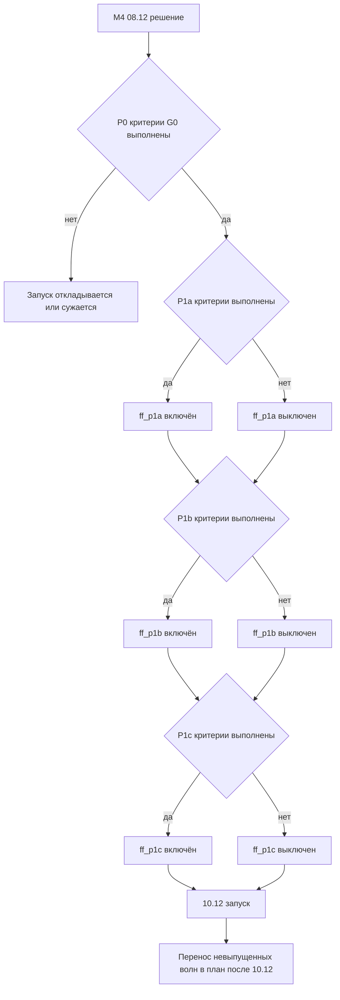
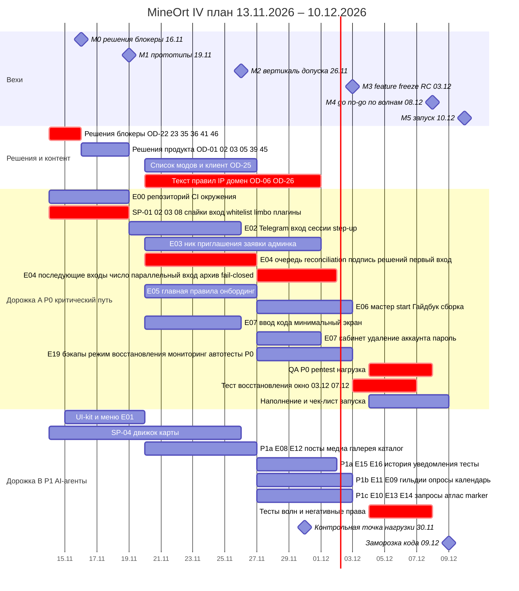

# MineOrt IV — план релиза: P0 + P1 к 10.12.2026

**Статус:** черновик для утверждения · **Базовая дата:** 13.11.2026 (пятница) · **Запуск:** 10.12.2026 (четверг), 27 календарных дней (14.11…10.12).

**Источник:** [аудит концепции и разработки v2.0](<../MineOrt_IV_Аудит_концепции_и_разработки_v2 (1).md>) §19 (стр. 888–923), §21 (стр. 954–970), §22 (стр. 972–1007), §23 (стр. 1009–1032). Ссылки вида `(аудит §23.2, стр. 1030)` указывают на номера строк этого файла. «33 дня» в аудите (стр. 1030) — историческая цифра от 7.11.2026 ([анализ аудита, C-01](../00-analysis/01-audit-analysis.md#3-противоречия-c-01c-18)); здесь везде 27 дней.

**Теги:** [ЗАКРЕПЛЕНО] / [ПРЕДЛАГАЕТСЯ] / [ПРОВЕРИТЬ] / [ОПРЕДЕЛИТЬ] / [РИСК] — как в аудите; [ПРЕДЛОЖЕНИЕ КОМАНДЫ] — число, правило, механизм или дата, которых нет в аудите; [РЕШЕНИЕ ВЛАДЕЛЬЦА 13.11.2026] — решения владельца.

**Раунд 4 (v0.5 пакета):** итоги пересчитаны скриптом от 154 историй / 914 ч (P0 — 550 ч), добавлена нагрузка владельца на P0 и формула ступени 7, ТЗ и наполнение вынесены в истории, таблица п. 7 пересобрана; подробности — [бэклог](02-backlog.md#6-замечания-для-сведения) и [план разработки MVP](04-mvp-development-plan.md).

Связанные файлы: [бэклог](02-backlog.md) · [реестр рисков](03-risk-register.md) · [открытые решения](../00-analysis/03-open-decisions.md) · [анализ аудита](../00-analysis/01-audit-analysis.md) · [IA](../01-product/01-information-architecture.md) · [модель статусов](../01-product/02-user-status-model.md) · [роли и права](../01-product/03-roles-permissions.md) · [Bridge](../03-architecture/02-bridge-protocol.md) · [NFR](../03-architecture/04-nfr-security.md) · [приёмочные тесты](../05-qa/01-acceptance-tests.md) · [TZ-00](../06-tz/TZ-00-product-scope.md).

## Содержание

1. [Допущения и ёмкость](#1-допущения-и-ёмкость)
2. [Состав к 10.12](#2-состав-к-1012)
3. [Недельный план и вехи M0–M5](#3-недельный-план-и-вехи-m0m5)
4. [Критерии go/no-go](#4-критерии-gono-go)
5. [Лестница сокращений](#5-лестница-сокращений)
6. [Диаграмма Ганта](#6-диаграмма-ганта)
7. [Связь с эпиками и вехами](#7-связь-с-эпиками-и-вехами)
8. [План после 10.12](#8-план-после-1012)
9. [Замечания для сведения](#9-замечания-для-сведения)

---

## 1. Допущения и ёмкость

### 1.1. Решения владельца и даты

| Допущение | Значение | Тег |
|---|---|---|
| Базовая дата | 13.11.2026 (пятница); день решений, в расчёт часов не входит | [ПРЕДЛОЖЕНИЕ КОМАНДЫ] |
| Запуск | 10.12.2026 (четверг); от 14.11 до 10.12 включительно — **27 календарных дней** | [ПРЕДЛОЖЕНИЕ КОМАНДЫ], C-01 |
| Ёмкость (OD-33) | Один основной поток разработки (владелец) + AI-агенты; отдельных разработчиков и тестировщиков нет | [РЕШЕНИЕ ВЛАДЕЛЬЦА 13.11.2026] |
| Граница релиза (OD-34) | К 10.12.2026 выпускается весь P0 + P1 (аудит §19, стр. 888–911) | [РЕШЕНИЕ ВЛАДЕЛЬЦА 13.11.2026] |
| Оценка аудита | P0 — 45–65 задач; P0+P1 — 116–205 задач; ориентир 250–550 ч «при одном основном потоке» (стр. 1017–1024); полный P0+P1 к дате — «высокорисковая цель» (стр. 923, 1030) | аудит |
| Риск | Аудит считает цель высокорисковой; решение владельца этот риск не снимает — он фиксируется как R-09 (критический, балл 9) и R-15 (bus factor, высокий) в [реестре рисков](03-risk-register.md) | [РИСК] (аудит стр. 966) |

### 1.2. Расчёт ёмкости

Числа ёмкости и оценки аудита переиспользованы из [анализа аудита, раздел 6](../00-analysis/01-audit-analysis.md#6-реалистичность-сроков-на-13112026) без пересчёта [ПРЕДЛОЖЕНИЕ КОМАНДЫ]; часы в день в аудите не указаны — два сценария:

| Показатель | Сценарий A: 6 ч/день | Сценарий B: 10 ч/день |
|---|---|---|
| Доступные часы за 27 дней | 27 × 6 = **162 ч** | 27 × 10 = **270 ч** |
| Нужно по аудиту, нижняя граница 250 ч | дефицит 88 ч | запас 20 ч |
| Нужно по аудиту, верхняя граница 550 ч | дефицит 388 ч | дефицит 280 ч |
| Требуемый множитель «AI-агенты + человек» к 250 ч | ≈ 1,5× | ≈ 0,9× |
| Требуемый множитель к 550 ч | ≈ 3,4× | ≈ 2,0× |
| Середина диапазона (400 ч) | 2,5× | 1,5× |

Допущение множителя: **AI-агенты берут на себя написание кода по ТЗ, тесты и черновики документации; человек остаётся узким местом на ревью, решениях, ручной проверке безопасности и приёмке** [ПРЕДЛОЖЕНИЕ КОМАНДЫ]. Множитель — допущение, а не измерение (аудит стр. 1026 требует замера на пилотном спринте); замер — спайк SP-07 в W1, точка пересмотра — веха M1 (19.11).

Распределение по неделям (человек-часы владельца) [ПРЕДЛОЖЕНИЕ КОМАНДЫ]:

| Неделя | Даты | Дней | Ёмкость 6 ч/день | Ёмкость 10 ч/день |
|---|---|---:|---:|---:|
| W1 | 13.11–19.11 (13.11 — день решений, в часы не входит) | 6 | 36 ч | 60 ч |
| W2 | 20.11–26.11 | 7 | 42 ч | 70 ч |
| W3 | 27.11–03.12 | 7 | 42 ч | 70 ч |
| W4 | 04.12–09.12 | 6 | 36 ч | 60 ч |
| Запуск | 10.12 | 1 | 6 ч | 10 ч |
| **Итого** | 14.11–10.12 | **27** | **162 ч** | **270 ч** |

### 1.3. Сверка со снизу-вверх оценкой бэклога

Бэклог содержит **154 истории** (P0 — 89, P1 — 65). Сумма по размерам S/M/L = 2/6/12 ч без ускорения AI — **914 ч** (P0 — 550 ч; P1a — 120 ч; P1b — 134 ч; P1c — 110 ч) [ПРЕДЛОЖЕНИЕ КОМАНДЫ] ([бэклог, раздел 5](02-backlog.md#5-сверка-объёма-с-231-аудита-и-с-ёмкостью-27-дней)). Это на 364 ч выше верхней границы аудита (550 ч); единицы разные (аудит предполагает работу Codex), поэтому сравнение ориентировочное. Нагрузка владельца как узкого места (часы «В» целиком + 30 % «AI+В» + 15 % «AI») — **415 ч** против 162 / 270 ч доступных; на P0 приходится 300 ч, и в пике W3 — 122 ч (из них 92 ч «В») против 42 / 70 ч. История пересчётов: в v0.2 (раунд ревью безопасности) к 121 истории / 728 ч добавлено 11 историй / 68 ч (10 в P0, 62 ч; 1 в P1a, 6 ч); в v0.3 (раунд 3) к 132 историям / 796 ч добавлено 11 историй / 54 ч (9 в P0, 50 ч; 2 в P1b, 4 ч); в v0.4 (раунд 4) к 143 историям / 850 ч добавлено 11 историй / 64 ч (8 в P0, 46 ч; по одной в P1a, P1b, P1c, по 6 ч): стенд PAPER-T, домен и TLS, ТЗ, тестовый вход для E2E, Java CI Bridge, наполнение (расщепление US-E19-07).

| Показатель | 6 ч/день (162 ч) | 10 ч/день (270 ч) |
|---|---|---|
| Бэклог 914 ч ÷ ёмкость | 5,6× | 3,4× |
| P0 550 ч ÷ ёмкость | 3,4× | 2,0× |
| Нагрузка владельца 415 ч ÷ ёмкость | 2,6× | 1,5× |
| **P0, нагрузка владельца 300 ч ÷ ёмкость** | 1,9× | 1,1× |
| **W3: P0, нагрузка владельца 122 ч (из них 92 ч «В») против 42 / 70 ч** | 2,9× | 1,7× |

**Вывод:** план строится под цель P0 + P1, но без кратного ускорения силами AI-агентов и без лестницы сокращений ([п. 5](#5-лестница-сокращений)) он не выполним ни в одном из сценариев. Цель принята владельцем, поэтому лестница сокращений и go/no-go по волнам — обязательные механизмы, а не запасные.

---

## 2. Состав к 10.12

[РЕШЕНИЕ ВЛАДЕЛЬЦА 13.11.2026]: к 10.12 выпускается **весь P0 и весь P1**. Волны P1a / P1b / P1c — **внутренние вехи внутри 27 дней**, а не пост-релизные этапы; их приоритет: P0 → P1a → P1b → P1c.

| Блок | Состав | Строки аудита | Эпики | Историй / часов |
|---|---|---|---|---|
| **P0** | Лендинг, CTA, секция правил; Telegram-вход и профиль, ник; приглашения и заявки; Bridge, whitelist, честные статусы; защищённый вход offline и Premium, тесты подмены ника; мастер «Начать играть» и сборка; базовый кабинет; админ-допуск, бэкапы, тесты безопасности | 892–899 | E00–E07, E19 (P0) | 89 / 550 ч |
| **P1a** | Лента и официальные новости, галерея и медиа-хранилище, каталог игроков, кабинет с историей действий (+ обязательные уведомления) | 903, 906, 907, 909 | E08, E12 (каталог), E15, E16 (P1), E19 | 23 / 120 ч |
| **P1b** | Админ-создание гильдий, глава, приглашения, ранги, цветные теги (на сайте); опросы; календарь; посты от гильдии | 904, 908 | E09, E11, E12 (гильдии), E16 (опт-ин), E19 | 24 / 134 ч |
| **P1c** | Табло заказов и помощи; атлас на BlueMap или Dynmap в первичной интеграции с метками и изображениями; `/marker new` | 905, 910, 911 | E10, E13, E14, E19 | 18 / 110 ч |
| **P2 (после 10.12)** | Полная оболочка атласа, игровые теги гильдий (E17), проекты и взносы (E18), богатый Social, ImageFrame, поддержка и редактор гайдов, Mini App | 913–921 | E17, E18 и расширения | на уровне эпиков ([бэклог, п. 3.4](02-backlog.md)) |

Правило честности [ПРЕДЛАГАЕТСЯ в аудите, «предлагаемый подход», стр. 1032; принято планом как обязательное]: нельзя выдавать неработающие заглушки за готовую функциональность. Волна, не прошедшая go/no-go, **скрывается фича-флагом целиком** (меню, маршрут, API); допустима только строка «скоро» в описании планов без интерактивных элементов.

---

## 3. Недельный план и вехи M0–M5

Две параллельные дорожки [РЕШЕНИЕ ВЛАДЕЛЬЦА 13.11.2026 — разделение; содержание — ПРЕДЛОЖЕНИЕ КОМАНДЫ]:

- **Дорожка A — «P0-критический путь»:** делает владелец (при необходимости с помощью AI-агентов), он же ревьюит. Безопасность, Bridge, вход, допуск.
- **Дорожка B — «P1-фичи»:** AI-агенты по ТЗ; владелец ревьюит. ТЗ для P1a должны быть готовы к 17.11, для P1b / P1c — к 24.11 [ПРЕДЛОЖЕНИЕ КОМАНДЫ]; без ТЗ агенты не стартуют.

Состав недель — в терминах историй из [бэклога](02-backlog.md).

### 3.1. W1 · 13.11–19.11 · решения, основа, спайки

| Дорожка | Работа | Результат на конец недели |
|---|---|---|
| A (P0) | E00 целиком (US-E00-01…09: репозиторий, CI, окружения, миграции и RLS, флаги, паттерн записи через API US-E00-06, закрытое чтение US-E00-07, стенд PAPER-T US-E00-08, домен, TLS и BotFather US-E00-09), E01 старт (токены), E02 Telegram-вход (SP-01) и тестовый вход для E2E (US-E02-09), E04 скелет Bridge и API (US-E04-01, 02), прототип limbo и кода (SP-03), плагины и данные игрока (SP-08) | Репозиторий, CI, staging; подписанный `whitelist.add` работает на тестовом Paper; прототип игрового входа |
| B (P1) | UI-kit и меню (US-E01-02, 03); спайк движка карты SP-04 начат; ТЗ P0-остатка (US-E00-10) и ТЗ P1a (US-E08-14, к 17.11); пилотный замер скорости SP-07 | Каркас интерфейса; первые данные о скорости агентов |
| Решения | OD-22 (кандидат версии), OD-23, OD-35, OD-36, OD-41, OD-46 — к 16.11; OD-01, OD-02, OD-03, OD-05, OD-06 (механизм), OD-22 (фиксация), OD-39, OD-45 — к 19.11 | M0 и M1 |

**M0 · 16.11 (понедельник).** Приняты OD-22 (кандидат), OD-23, OD-35, OD-36, OD-41, OD-46 (OD-33 и OD-34 уже приняты владельцем 13.11). Критерий: статусы в [реестре OD](../00-analysis/03-open-decisions.md) изменены; при пропуске срока — «принято по умолчанию».

**M1 · 19.11 (четверг).** Прототипы работают: SP-01 (Telegram-вход на staging), SP-02 (подписанный `whitelist.add`), SP-03 (limbo, игровой код, fail-closed на прототипе; таймаут limbo — `first_join` 5 мин, равен TTL кода, для повторных входов 120 с), SP-08 (плагин приватов, LuckPerms и статистика на PAPER-T; пересмотр размеров US-E04-18, US-E04-22, US-E04-23). RLS-матрица TC-OPS-06a…06h пройдена на staging (единый срок, US-E00-06 и US-E00-07 в W1). OD-22 зафиксирован. Замер SP-07 → пересмотр множителя и состава волн (первая точка лестницы сокращений); триггер — фактическая скорость владельца на «В»-историях W1.

### 3.2. W2 · 20.11–26.11 · вертикаль допуска и P1a

| Дорожка | Работа | Результат на конец недели |
|---|---|---|
| A (P0) | E02 (сессии, step-up, бот, согласие), E03 (ник, приглашения, заявки, админ-очередь, аудит), E04 (очередь `server_actions`, Ed25519, подпись решений входа US-E04-15, общее хранилище nonce и окно версий US-E04-19, Java CI и выкладка Bridge US-E04-24, конвейер whitelist, reconciliation, первый вход), E07 (US-E07-03: минимальный экран ввода кода — нужен для подтверждения первого входа на M2), E05 (главная, CTA, правила, онбординг); внешний append-only журнал `audit_log` и `security_events` (US-E19-14, RPO ≤ 5 мин) | Вертикаль guest → Telegram → ник → приглашение → `applied` → подтверждение первого входа на staging |
| B (P1a) | E08 (медиа-конвейер, посты, новости, видимость, жалобы, удаление, галерея), E12 (каталог, профиль), SP-06; ТЗ P1b и P1c (US-E11-13, US-E13-09, к 24.11); старт моделей P1b / P1c (US-E11-01, US-E13-01); SP-05 закрывается 24.11 вместе с US-E11-01 | P1a на staging; решение по движку карты |
| Решения | OD-07…OD-14, OD-16…OD-21, OD-27, OD-31, OD-37, OD-38, OD-40, OD-42, OD-43, OD-44 — к 26.11; OD-25 (клиент) — 27.11 | M2 |

**M2 · 26.11 (четверг).** Сквозная вертикаль на staging: guest → Telegram → ник → приглашение → `applied` → подтверждение первого входа; P1a в staging; OD-16 (движок) принят. Критерий M2 — основание для решения о ступени 2–3 лестницы.

### 3.3. W3 · 27.11–03.12 · клиент, кабинет, P1b и P1c

| Дорожка | Работа | Результат на конец недели |
|---|---|---|
| A (P0) | E06 (мастер `/start`, сборка, Гайдбук), E07 (кабинет, удаление аккаунта US-E07-05, игровой пароль US-E07-06), E03 (бан, перепривязка, смена ника, отзыв доступа, карантин ника US-E03-12, предусловие архива при выдаче ника US-E03-13), E04 (последующие входы со сверкой числа и одним выбором в боте US-E04-21, параллельный вход US-E04-16, `/abandon` и жизненный цикл challenge US-E04-20, пакетный опрос US-E04-17, защита от подмены, fail-closed, отложенный архив данных `player.data_archive` US-E04-18, `player.data_migrate` US-E04-22 и `player.data_restore` US-E04-23, `/admin/bridge`, ротация секрета), E07 (tombstone бана и запрет самоудаления при бане US-E07-07), E19 (бэкапы, режим восстановления US-E19-13 и его расширение US-E19-15, мониторинг, автотесты P0) | P0 функционально готов; тест подмены ника пройден; бэкапы настроены |
| B (P1b, P1c) | P1b: E11 гильдии (движок прав, приглашения, ранги, представление `public_guilds` US-E11-12), E09 опросы и календарь (в том числе триггер правки опроса US-E09-07), E12 страница гильдии; P1c: E10 заказы и помощь, E13 атлас, E14 `/marker new`; доработка P1a (E15 в том числе выгрузка данных US-E15-05, E16-01, тесты) | P1b и P1c реализованы на staging |
| Решения | OD-15, OD-28, OD-29, OD-30, OD-32 — к 03.12; до 01.12: OD-06 (текст правил), OD-24 (хостинг карты), OD-26 (IP/домен) | M3 |

**M3 · 03.12 (четверг).** **Feature freeze P0 + P1**, релиз-кандидат (RC) на staging. После M3 новые функции не принимаются, только исправления дефектов.

### 3.4. W4 · 04.12–09.12 · QA, безопасность, наполнение

| Дорожка | Работа | Результат на конец недели |
|---|---|---|
| A (P0) | QA P0, pentest-lite, нагрузка и замер SLO, **тест восстановления** (в окне 03.12–07.12, не ранее чем за 7 и не позднее чем за 3 дня до запуска; включая расширенный режим восстановления: режим обслуживания, отзыв сессий, сверка с внешним журналом, TC-OPS-01c), наполнение: правила v1 (US-E19-16), не менее пяти статей Гайдбука (US-E19-17), адрес сервера и клиентская сборка (US-E19-18), затем чек-лист запуска и go/no-go (US-E19-07) | Все критерии P0 go/no-go проверены |
| B (P1) | Автотесты P1b и P1c, тест утечки меток, сквозная регрессия, подготовка флагов | Критерии волн проверены |

**M4 · 08.12 (вторник).** Go/no-go **по каждой волне отдельно** ([п. 4](#4-критерии-gono-go)): P0 обязателен; P1a / P1b / P1c выпускаются только те, что прошли критерии, остальные скрываются фича-флагом. **09.12 (среда)** — заморозка: только исправление блокеров.

**M5 · 10.12 (четверг).** Запуск. Окно запуска и первая смена мониторинга — владелец.

### 3.5. Загрузка по неделям против ёмкости

Часы бэклога по неделям — размещение историй по неделям; нагрузка владельца — часы «В» целиком + 30 % «AI+В» + 15 % «AI» ([бэклог, п. 5.2](02-backlog.md#52-часы-снизу-вверх-и-ёмкость)) [ПРЕДЛОЖЕНИЕ КОМАНДЫ]:

| Неделя | Часы бэклога (без AI-ускорения) | Нагрузка владельца, ч | Доступно владельцу 6 / 10 ч/день | Перегрузка владельца |
|---|---:|---:|---|---|
| W1 | 132 | 76 | 36 / 60 | 2,1× / 1,3× |
| W2 | 270 | 101 | 42 / 70 | 2,4× / 1,4× |
| W3 | 438 | 193 | 42 / 70 | 4,6× / 2,8× |
| W4 | 74 | 45 | 36 / 60 | 1,3× / 0,8× |
| **Итого** | **914** | **415** | **162 / 270** | **2,6× / 1,5×** |

Строка «P0, нагрузка владельца» (R4-09): 300 ч против 162 / 270 ч — 1,9× / 1,1×; в W3 на P0 приходится 122 ч нагрузки владельца (из них 92 ч «В») против 42 / 70 ч — 2,9× / 1,7×.

Распределение по неделям пересчитано в v0.2: в W1 добавлена US-E00-06; в W2 — US-E04-15, US-E04-19 и US-E07-03 (перенесена из W3); в W3 — US-E03-12, US-E04-16…18, US-E07-05, US-E07-06, US-E19-13 и US-E15-05. В v0.3 добавлены: в W2 — US-E00-07 и US-E19-14; в W3 — US-E03-13, US-E04-20…23, US-E07-07, US-E19-15, US-E09-07 и US-E11-12. **В v0.4 (раунд 4):** US-E00-07 перенесена из W2 в W1 (единый срок TC-OPS-06a…06h — M1, R4-13); в W1 добавлены US-E00-08, US-E00-09, US-E00-10, US-E02-09, US-E08-14 (+38 ч бэклога с учётом переноса), в W2 — US-E04-24, US-E11-13, US-E13-09 (+12 ч с учётом переноса), в W4 — US-E19-16, US-E19-17, US-E19-18 (+14 ч). Нагрузка владельца по неделям округлена до целых так, чтобы сумма равнялась 415 ч.

**Пик — W3.** В неделю, когда одновременно идут завершение P0 и вся P1b / P1c, нагрузка владельца в 2,8–4,6 раза выше ёмкости. Это главный структурный риск расписания. Меры [ПРЕДЛОЖЕНИЕ КОМАНДЫ]: (1) основа P1b и P1c (US-E11-01, US-E13-01) и их ТЗ (US-E11-13, US-E13-09) начинается во второй половине W2; (2) на M2 (26.11) проверяется выполнение W2 и применяется ступень 1 лестницы автоматически; (3) промежуточная проверка 30.11 (понедельник) — если выполнено менее 50 % часов W3, включается ступень 3 ([п. 5](#5-лестница-сокращений)); (4) ревью агентов идёт пакетами по волнам, а не по историям.

---

## 4. Критерии go/no-go

Решение принимается на M4 (08.12) по каждому блоку отдельно. Критерий считается выполненным, если проверка пройдена на **окружении, конфигурация которого равна продовой** (для Bridge — на Paper с продовой конфигурацией плагинов) [ПРЕДЛОЖЕНИЕ КОМАНДЫ]. Тест-кейсы — [05-qa](../05-qa/01-acceptance-tests.md); приоритеты Blocker / Critical и ID — оттуда; ID `TC-GLD-05a…e` и т. п. взяты из [перечня негативных проверок](../01-product/03-roles-permissions.md#7-обязательные-негативные-проверки-будущие-tc).

### 4.1. P0 (обязательные для запуска)

| № | Критерий | Как проверяется |
|---|---|---|
| G0-01 | 100 % тест-кейсов P0 с приоритетом Blocker и Critical пройдены (AC-01…07, AC-20 в части статуса, AC-21, AC-22, AC-25…30, AC-33, AC-34); к Blocker добавлены TC-GAME-01c, TC-GAME-07b, TC-OPS-06g, TC-OPS-06h, TC-ACC-11d, TC-OPS-04g, TC-DSH-04a, TC-DSH-04d | отчёт прогона 05-qa, матрица AC → TC |
| G0-02 | 0 открытых дефектов безопасности уровня Critical и High (включая TC-OPS-06g: прямая запись клиентской ролью, TC-OPS-06h: прямое чтение закрытых колонок, TC-ACC-11d и TC-ACC-12d: карантин ника и отложенная архивация, TC-DSH-04d: обход бана удалением) | реестр дефектов; pentest-lite (US-E19-04) |
| G0-03 | Тесты подмены ника (TC-GAME-03a, 03b), сверки числа с одним выбором на challenge (TC-GAME-01c), параллельного и повторного входа (TC-GAME-07a, 07b, 07c), fail-closed при недоступном backend (TC-GAME-04a) и под нагрузкой без 429 (TC-GAME-04d) и limbo (TC-GAME-06a) пройдены на продовой конфигурации | AC-05, AC-29, AC-30 |
| G0-04 | Reconciliation проверен: drift выявляется, «Доступ готов» не показывается ложно | AC-28; TC-ACC-09* |
| G0-05 | Одобрение при выключенном Minecraft остаётся `pending`, после запуска сервера действие применяется | AC-21; TC-ACC-07* |
| G0-06 | Bridge отклоняет неподписанную, просроченную, чужую команду; не снимает limbo по неподписанному, подделанному или повторённому ответу решения входа; ротация секрета проверена | AC-27; TC-OPS-04a…04g |
| G0-07 | Тест восстановления из бэкапа выполнен **в окне 03.12–07.12 (не ранее чем за 7 и не позднее чем за 3 дня до запуска)** и уложился в RTO ≤4 ч; режим восстановления отработан (TC-OPS-01c, Critical: сайт в режиме только чтения, сессии отозваны, роли, баны и перепривязки сверены с внешним журналом, вход в игру закрыт, бан и отзыв из последних суток не воскресают); бэкап мира перед запуском сделан | SC-OPS-01; NFR-REL-06, NFR-REL-11, NFR-REL-13 |
| G0-08 | Правила v1 опубликованы (текст от владельца — OD-06, до 01.12; US-E19-16) | AC-07; AC-33 |
| G0-09 | У 100 % учётных записей администраторов настроен step-up (TOTP или passkey) | AC-34 |
| G0-10 | Сайт работает при выключенном Minecraft | SC-OPS-02 |
| G0-11 | IP или домен сервера и клиентская сборка (с контрольной суммой) опубликованы (OD-25, OD-26; US-E19-18) | AC-06; SC-GUIDE-01 |
| G0-12 | Время применения whitelist p95 <60 с при онлайн-сервере; LCP <2,5 с на `/` и `/start` (mid-mobile 4G) | NFR-PERF [ПРЕДЛОЖЕНИЕ КОМАНДЫ] |

Если любой из G0-01…G0-12 не выполнен — **запуск откладывается или сужается**: P0 нельзя выпускать с известной дырой входа или ложными статусами.

### 4.2. Волны P1 и фича-флаги

Флаги [ПРЕДЛОЖЕНИЕ КОМАНДЫ]: `ff_p1a`, `ff_p1b`, `ff_p1c` (волны) и модульные `ff_p1b_guilds`, `ff_p1b_social` (опросы и календарь), `ff_p1c_atlas` (E13 + E14), `ff_p1c_requests` (E10), `ff_social_comments`. Состояние «выключено» = нет пункта меню, маршрут и API возвращают 404, данные в БД сохраняются, редиректов на несуществующие разделы нет (US-E00-05). Флаги переключаются без релиза кода.

Для **каждой** волны дополнительно: 0 открытых дефектов безопасности Critical / High в её модулях; прогон smoke-набора регрессии P0 не сломан; ревью владельца завершено [ПРЕДЛОЖЕНИЕ КОМАНДЫ].

| Волна | Флаг | Входит | Критерии (кроме общих) | Если не выполнено |
|---|---|---|---|---|
| **P1a** | `ff_p1a` | Лента, новости, галерея, каталог игроков, история в кабинете | G1a-01: Blocker/Critical TC по AC-08, AC-12, AC-19, AC-20 (история), AC-24 (посты) пройдены; G1a-02: проверка безопасности медиа (US-E19-09: SVG, polyglot, EXIF, квоты, прямой URL) — 0 High; G1a-03: видимость для гостя и заявителя (TC-SOC-06a) и приватность профиля (TC-PLR-02a, 02b) пройдены; G1a-04: лимиты (TC-SOC-07a) и жалобы (TC-SOC-03*) работают; выгрузка своих данных не раскрывает чужого (TC-DSH-05a, 05b) | Волна скрыта `ff_p1a`; галерея и Social недоступны; сайт остаётся рабочим на P0 |
| **P1b** | `ff_p1b` (или `ff_p1b_guilds` + `ff_p1b_social`) | Гильдии, ранги, опросы, календарь, посты от гильдии | G1b-01: Blocker/Critical TC по AC-09, AC-10, AC-15, AC-16, AC-17, AC-18, AC-23 пройдены; G1b-02: **серверная проверка прав гильдий через прямой API** — TC-GLD-05a…05e (самоповышение, ранг не ниже своего), TC-GLD-06a…06d (последний глава), TC-GLD-10a…10c (нет эскалации в права сайта), TC-GLD-04g (ранг из чужой гильдии → 403) — 100 %; G1b-03: повторный голос, гонка и голос с вариантом чужого опроса — TC-POLL-02a, 02b, 02e пройдены; G1b-04: часовой пояс событий (TC-EVT-01*) | Гильдии скрываются `ff_p1b_guilds`; опросы и календарь могут выйти отдельно, если G1b-03 и G1b-04 выполнены |
| **P1c** | `ff_p1c` (или `ff_p1c_atlas` + `ff_p1c_requests`) | Заказы и помощь, атлас, метки, `/marker new` | G1c-01: Blocker/Critical TC по AC-11, AC-13, AC-14, AC-31, AC-32, AC-24 (метки) пройдены; G1c-02: **закрытая метка недоступна** через прямой URL, API, движок и тайлы — TC-MAP-04a…04d — 100 %; G1c-03: дубль события `/marker new` не создаёт метку (TC-MRK-03a, 03b); G1c-04: стресс-тест движка на BisectHosting выполнен, пороги нагрузки заданы владельцем [ОПРЕДЕЛИТЬ] и не нарушены; G1c-05: тайлы отдаются только за сессией сайта (OD-47, C-15) | Атлас скрывается `ff_p1c_atlas`; заказы и помощь — `ff_p1c_requests`; игровая команда `/marker new` отключается в плагине конфигурацией |

Серверные проверки прав гильдий (AC-18, AC-23) и видимость меток (AC-31) — **жёсткие**: нарушение этих критериев не компенсируется другими результатами, волна под флагом (аудит стр. 959, 963).

### 4.3. Схема решения на M4

Журнал решения M4 (кто, когда, по каким критериям, какие флаги) ведётся в [реестре OD](../00-analysis/03-open-decisions.md) как решение владельца с датой.

---

## 5. Лестница сокращений

Применяется при отставании на вехах M1, M2, M3 (и контрольной точке 30.11). Порядок обязателен [РЕШЕНИЕ ВЛАДЕЛЬЦА 13.11.2026]: **сначала глубина P1, затем перенос целых волн P1c → P1b на после 10.12, затем P0-упрощения; если и этого мало — ступень 7 (решение владельца о дате или закрытом запуске только P0).** Ступени, часы и состав — [ПРЕДЛОЖЕНИЕ КОМАНДЫ]; часы — по размерам бэклога (человеко-часы без ускорения).

### 5.1. Ступени

| Ступень | Что режется | Истории | Освобождает (приращение) |
|---|---|---|---|
| **1. Глубина P1 (Could)** | Комментарии; запись на событие и лимит мест; перенос и отмена событий; посты от имени гильдии; опт-ин уведомления | US-E08-11, US-E09-05, US-E09-06, US-E08-13, US-E16-02 | 22 ч |
| **2. Глубина P1 (Should)** | Фото к меткам; премодерация публичных меток (публичные метки отключаются — только `guild` и `private`); крайние случаи `/marker new`; игровая статистика; настройки публичности; обязательные уведомления в Telegram (статусы остаются на сайте); реакции; изменение голоса; отказ от запроса; заявки в гильдию | US-E13-05, US-E13-06, US-E14-03, US-E15-03, US-E15-04, US-E16-01, US-E08-10, US-E09-03, US-E10-03, US-E11-05 | 40 ч |
| **3. Волна P1c целиком** | Заказы и помощь, атлас, `/marker new` переносятся на после 10.12 | E10, E13 (в том числе ТЗ US-E13-09), E14, US-E19-11 | 88 ч |
| **4. Волна P1b целиком** | Гильдии, опросы, календарь переносятся на после 10.12 | E09, E11 (в том числе ТЗ US-E11-13), US-E12-03, US-E19-10 | 110 ч |
| **5. P0-упрощения** | Заявка — минимальная форма (ник и короткое сообщение); кабинет — только статус допуска (без настроек); Гайдбук — только статьи из репозитория без `/admin/guides`; нагрузочный тест сокращённый; **требует подтверждения владельца для каждого пункта:** восстановление при потере Telegram, перепривязка и смена ника — по runbook владельца со скриптом, пишущим в `audit_log` (это пути захвата аккаунта: скрипт только со step-up и записью в `audit_log`, без подтверждения владельца пункт не применяется) | US-E07-04, US-E06-04, US-E06-05, US-E19-05; с подтверждением владельца — US-E02-08, US-E03-09, US-E03-10 | 30 ч (16 ч без трёх пунктов, требующих подтверждения) |
| **6. Аварийная: P1a под флагом** | Если P0 не укладывается даже после ступеней 1–5 — вся P1a скрывается флагом (в том числе выгрузка данных US-E15-05; до включения запросы на выгрузку выполняет владелец вручную, OD-45); сокращаются только пункты, не входящие в «никогда не режем» | E08 (в том числе ТЗ US-E08-14), E12 (каталог), E15, US-E19-08, US-E19-09 | 98 ч |
| **7. Сдвиг даты или закрытый запуск только P0 — решение владельца** | Если после ступеней 1–6 остаток не помещается в ёмкость: владелец решает, сдвигать ли дату запуска или открыть закрытый запуск только с P0 (без публичного анонса, с ограниченным списком игроков); ступень не применяется автоматически, не режет ничего из «никогда не режем» | остаток: P0 за вычетом ступени 5 и US-E19-12 | — (решение; см. остаток ниже) |

В ступенях 1–2 удаление идёт через флаги модулей или отложенную готовность, а не через неработающие заглушки (аудит стр. 1032). Колонка «Освобождает» — приращение без учёта уже срезанного на предыдущих ступенях. Накопленно: ступени 1–2 — 62 ч, 1–3 — 150 ч, 1–4 — 260 ч, 1–5 — 290 ч, 1–6 — 388 ч (из 394 ч Could-, Should- и Must-историй этих блоков; остаток — сквозная регрессия US-E19-12).

**Остаток после всех ступеней 1–6:** 914 − 388 = **526 ч** (P0 за вычетом ступени 5 — 520 ч, плюс US-E19-12 — 6 ч). Это 3,2× ёмкости при 6 ч/день (162 ч) и 1,9× при 10 ч/день (270 ч): даже в самом сжатом виде план требует ускорения агентов не менее 1,9×, поэтому добавлена ступень 7 — решение владельца о дате или закрытом запуске только P0. Часы лестницы пересчитаны в v0.2 (добавлены US-E15-05 в ступень 6; новые P0-истории в лестницу не входят, так как относятся к «никогда не режем»), в v0.3 (+4 ч в ступени 4: US-E09-07 и US-E11-12 уходят вместе с волной P1b; остаток был 430 ч) и в v0.4 (+6 ч в ступенях 3, 4 и 6: ТЗ волн US-E13-09, US-E11-13, US-E08-14 уходят вместе со своей волной; остаток был 480 ч, 3,0× / 1,8×; новые P0-истории раунда 4 в лестницу не входят).

**Ступень 7 — формула новой даты (R4-09).** Если множитель SP-07 (фактическая скорость владельца на «В»-историях W1) ниже 1,9× при 10 ч/день, запуск в срок не выполним ни при каком составе ступеней 1–6: решение владельца о новой дате или закрытом запуске только P0 принимается в день M1. Формула: **новая дата = 13.11 + остаток_ч ÷ (множитель × ч/день)** календарных дней; остаток — 526 ч. Примеры: множитель 1,9× — 11.12.2026 при 10 ч/день и 30.12.2026 при 6 ч/день; 1,5× — 19.12.2026 и 11.01.2027; 1,0× — 05.01.2027 и 09.02.2027. Закрытый запуск только с P0 **не устраняет разрыв по часам**: P0 — 550 ч бэклога и 300 ч нагрузки владельца против 162 / 270 ч, поэтому при множителе ниже 1,9× реальна только смена даты.

### 5.2. Что и когда проверяется на вехах

| Веха | Дата | Проверка (триггер) | Действие |
|---|---|---|---|
| **M1** | 19.11 | SP-01, SP-02, SP-03, SP-08 не работают (нет подписанного `whitelist.add`, limbo, кода или переноса данных игрока) **или** SP-07 показывает выполнение менее 70 % плановых часов W1 **или** фактический множитель из SP-07 ниже порога. Множитель считается по фактической скорости владельца на «В»-историях W1 (плановые часы «В» ÷ фактические часы владельца); пороги: **< 3,4×** (бэклог целиком, 914 ч, при 10 ч/день; 5,6× при 6 ч/день) → ступени 3–4 готовятся и включаются по плану; **< 2,4×** (остаток 654 ч после ступеней 1–4 при 10 ч/день; 4,0× при 6 ч/день) → готовятся ступени 5–6; **< 1,9×** (остаток 526 ч после всех ступеней 1–6 при 10 ч/день; 3,2× при 6 ч/день) → ступень 7: запуск только P0 или сдвиг даты по формуле выше, решение владельца (R3-16, R4-09; пороги пересчитаны от итогов v0.4) | Дорожка B приостанавливается, агенты переключаются на P0; ступень 1 применяется заранее; множитель пересматривается и фиксируется в бэклоге; при пороге 1,9× — решение владельца о дате или закрытом запуске только P0 в тот же день |
| **M2** | 26.11 | Вертикаль guest → Telegram → ник → приглашение → `applied` → подтверждение первого входа не проходит на staging **или** P1a не в staging **или** движок карты не выбран | Ступень 1 включается автоматически; при неработающей вертикали — ступень 2 и подготовка к ступени 3 (старт P1c откладывается); при невыбранном движке — ступень 3 |
| **30.11** | 30.11 | Выполнено менее 50 % часов W3 | Ступень 3 (волна P1c на после 10.12); если и P0 не готов — ступень 4 |
| **M3** | 03.12 | Открыты Blocker по P0 **или** RC P1b / P1c не собран | P1c → ступень 3; P1b → ступень 4; P0-упрощения (ступень 5) по необходимости; **feature freeze не переносится** |
| **M4** | 08.12 | Критерии волны не выполнены | Флаг выключен для волны ([п. 4.2](#42-волны-p1-и-фича-флаги)); ступень 6 — только если страдает P0 |

### 5.3. Никогда не режем

Следующее неприкосновенно при любой ступени и любом сроке ([РЕШЕНИЕ ВЛАДЕЛЬЦА 13.11.2026] — перечень; обоснование — аудит стр. 232, 556, 822–829, 958–959, 963):

1. **Offline-безопасность входа:** limbo, подтверждение личности со сверкой числа, подпись решений входа, защита от подмены ника и параллельного входа, карантин ника и архив данных, fail-closed (AC-05, AC-29, AC-30, US-E04-07…11, US-E04-15…18, US-E04-20…23, US-E03-12, US-E03-13), а также стенд PAPER-T и выкладка плагина Bridge (US-E00-08, US-E04-24), без которых эти проверки невозможны.
2. **Честные статусы:** «Доступ готов» только при `applied_state=applied`, нет ложного успеха при выключенном Minecraft (AC-21, AC-28).
3. **Бэкапы, режим восстановления и тест восстановления** (US-E19-02, US-E19-03, US-E19-13…15).
4. **Аудит админ-действий**, подпись команд Bridge и паттерн записи данных только через API (AC-22, AC-27, US-E03-07, US-E04-04, US-E00-06), чтение закрытых данных только через представления (US-E00-07) и запрет обхода бана удалением (US-E07-07).
5. **Серверная проверка прав гильдий** (AC-18, AC-23, US-E11-03, US-E11-08, US-E11-10) — если волна P1b выходит.
6. **Приватность меток** (AC-31, US-E13-04) — если волна P1c выходит.

Дополнения v0.2 и v0.3 к пунктам 1, 3 и 4 (подпись решений входа, сверка числа, карантин ника и отложенная архивация, `/abandon`, `player.data_migrate` и `player.data_restore`, режим восстановления с внешним журналом, паттерн записи только через API, чтение через представления, tombstone бана) — [ПРЕДЛОЖЕНИЕ КОМАНДЫ] в рамках существующих категорий перечня владельца; перечень не расширен, дополнения подтверждает владелец.

В ступенях 1–6 нет ни одной истории категорий 1–4 (проверено скриптом); истории категорий 5 и 6 уходят только вместе со своей волной целиком (ступени 4 и 3).

Правило: **если защита из этого списка не готова, функция, которая от неё зависит, не выходит** (она скрывается флагом), а не выходит «без защиты».

---

## 6. Диаграмма Ганта

Даты — ISO. Идентификаторы задач — ASCII; названия без двоеточий, решёток и точек с запятой. Дорожки и вехи соответствуют [п. 3](#3-недельный-план-и-вехи-m0m5).

---

## 7. Связь с эпиками и вехами

Эпики — аудит §22 (стр. 976–997). «Вехи» — в какую веху эпик должен быть готов. Колонка «Часы» — по [бэклогу](02-backlog.md). Разбивка недель на блоки, задачи и дни, критический путь и лестницу сокращений по задачам — в [плане разработки MVP](04-mvp-development-plan.md).

| Эпик | Релиз | Дорожка | W1 | W2 | W3 | W4 | Готов к вехе | Историй / часов |
|---|---|---|---|---|---|---|---|---|
| E00 Репозиторий, CI, окружения, паттерн записи через API, стенд PAPER-T, домен | P0 | A, B (ТЗ) | старт и завершение (в том числе US-E00-07, стенд, домен) | — | — | — | M1 | 10 / 54 |
| E01 UI-kit, навигация | P0 | A (токены), B (kit, меню) | токены, kit | — | — | — | M2 | 3 / 18 |
| E02 Telegram-вход, сессия, step-up | P0 | A | SP-01, вход, тестовый вход для E2E | сессии, step-up, бот | восстановление | — | M2 (вход), M3 | 9 / 58 |
| E03 Ник, приглашения, заявки, админ-допуск, карантин ника | P0 | A | — | ядро | админ-расширения, карантин | — | M3 | 13 / 74 |
| E04 Bridge, whitelist, игровая авторизация | P0 | A | SP-02, SP-03, SP-08, скелет | очередь, подпись, подпись решений входа, reconciliation, первый вход, Java CI | последующие входы со сверкой числа, параллельный вход, пакетный опрос, архив данных, защита, fail-closed | — | M1 (прототип), M3 | 24 / 166 |
| E05 Главная, правила, онбординг | P0 | A | — | ядро | — | — | M2 | 5 / 26 |
| E06 Гайдбук, MineOrt Client | P0 | A | — | — | мастер, сборка, Гайдбук | наполнение (US-E19-17) | M3 | 5 / 32 |
| E07 Кабинет — доступ | P0 | A | — | ввод кода (US-E07-03) | кабинет, удаление аккаунта, игровой пароль | — | M2 (ввод кода), M3 | 7 / 36 |
| E08 Social: посты, медиа, галерея | P1a | B | ТЗ P1a | ядро | доработка | — | M2 (staging), M3 | 14 / 70 |
| E09 Опросы и календарь | P1b | B | — | — | реализация | тесты | M3 | 7 / 30 |
| E10 Заказы и помощь | P1c | B | — | — | реализация | тесты | M3 | 4 / 20 |
| E11 Гильдии | P1b | B | — | ТЗ P1b, основа | реализация | тесты | M3 | 13 / 78 |
| E12 Каталог игроков, страницы гильдий | P1a, P1b | B | — | каталог | страница гильдии | — | M3 | 3 / 18 |
| E13 Карта, атлас, метки | P1c | B | SP-04 | ТЗ P1c, выбор движка | реализация | тесты | M2 (OD-16), M3 | 9 / 58 |
| E14 `/marker new` | P1c | B | — | — | реализация | тесты | M3 | 3 / 14 |
| E15 История, статистика, выгрузка данных | P1a | B | — | — | реализация | — | M3 | 5 / 22 |
| E16 Бот и уведомления (P1) | P1a, P1b | B | — | — | реализация | — | M3 | 2 / 12 |
| E19 QA, безопасность, бэкапы, релиз | P0 и P1 | A, B | — | внешний журнал | бэкапы, режим восстановления, мониторинг, автотесты | QA, pentest, restore, правила v1, гайды, адрес и клиент, go/no-go | M4 | 18 / 128 |
| E17, E18 | P2 | — | — | — | — | — | после 10.12 | эпик |
| **Итого** | | | | | | | | **154 / 914** |

Сводка по вехам: M0 — решения; M1 — прототипы E02 / E04 и E00; M2 — вертикаль допуска (E02–E05) и P1a в staging; M3 — функциональная готовность P0 + P1; M4 — go/no-go; M5 — запуск.

---

## 8. План после 10.12

Все даты и сроки раздела — [ПРЕДЛОЖЕНИЕ КОМАНДЫ]: их нет в аудите. Поддерживать период стабилизации после запуска сложнее при одном потоке, поэтому он планируется явно.

| Период | Работа |
|---|---|
| 11.12–17.12 | Стабилизация: наблюдение за очередью Bridge, drift, ошибками, обращениями; исправление дефектов запуска; решения по жалобам и заявкам в SLA (≤24 ч и ≤48 ч — OD-28) |
| 18.12–31.12 | Включение волн, скрытых флагом, по мере выполнения критериев ([п. 4.2](#42-волны-p1-и-фича-флаги)); перенесённые по ступеням 3–4 функции: сначала P1b, затем P1c; обязательный повторный тест восстановления |
| С января 2027 | P2: игровые теги гильдий (E17, OD-15), полная оболочка атласа, продвинутые проекты (E18), богатый Social, ImageFrame (с защитой от SSRF), поддержка и редактор гайдов, Mini App ([бэклог, п. 3.4](02-backlog.md)). Оценка P2 — отдельная после базовой реализации (аудит стр. 1024) |
| Постоянно | Версионирование MineOrt Client и Гайдбука, регулярные бэкапы и проверка восстановления (аудит стр. 863–867); перепроверка [реестра рисков](03-risk-register.md) раз в неделю (R-14: праздничные дни и каникулы снижают доступность владельца после запуска) |

---

## 9. Замечания для сведения

- В аудите сказано «около 33 календарных дней» до 10.12 (стр. 1030) — это значение на 7.11.2026; на 13.11.2026 осталось 27 дней (C-01). Расчёт ёмкости не считает 13.11 рабочим днём (планирование и решения).
- Нагрузка владельца по неделям (п. 3.5) — верхняя оценка: она не учитывает ускорение работы самого владельца ИИ-помощью на дорожке A. Фактический множитель определяет SP-07; план пересматривается на M1.
- Пик W3 — следствие требуемого порядка (P1b и P1c параллельно с завершением P0). Предложенные меры (п. 3.5) не гарантируют выполнимость; без ступеней лестницы расписание нереалистично.
- Окно теста восстановления — «в окне 03.12–07.12 (не ранее чем за 7 и не позднее чем за 3 дня до запуска)» (NFR-REL-06, NFR-OPS-20, [NFR](../03-architecture/04-nfr-security.md)): нижняя граница следует из критерия «не позднее чем за 7 дней до запуска», верхняя оставляет 3 дня на исправление найденного; тест в W3 (до 03.12) не засчитывается.
- Пороги нагрузки движка карты (G1c-04) и сроки наполнения контента не определены аудитом и зависят от OD-24, OD-06, OD-26 — помечены [ОПРЕДЕЛИТЬ] или привязаны к решениям владельца. Наполнение вынесено в истории US-E19-16 (правила v1), US-E19-17 (гайды), US-E19-18 (адрес и клиент).
- Раунд 4 (v0.4): добавлены 11 историй и спайк SP-08; ТЗ P0 и волн P1 — истории с часами (US-E00-10, US-E08-14, US-E11-13, US-E13-09); у каждого TC один владелец; таблица п. 7 пересобрана из CSV плана MVP; итоги и пороги M1 пересчитаны скриптом.
- ID тест-кейсов (`TC-…`) закрепляются файлом 05-qa; здесь использованы ID из перечня негативных проверок [ролей и прав](../01-product/03-roles-permissions.md#7-обязательные-негативные-проверки-будущие-tc), остальные — в виде `TC-XXX-NN*` (все кейсы сценария).
- Файлы 05-qa, 06-tz и сценарии мира и гильдий на момент написания могут быть ещё не созданы или не обновлены: ссылки ведут на их плановые пути.
