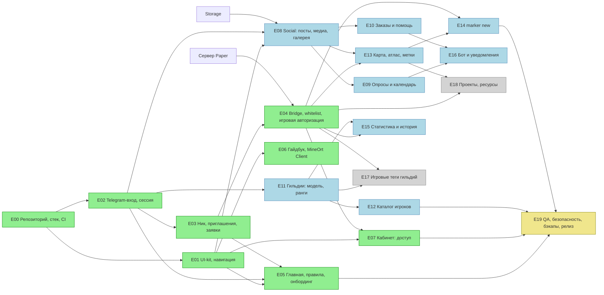

# MineOrt IV — бэклог: эпики и пользовательские истории

**Статус:** черновик для утверждения · **Базовая дата:** 13.11.2026 (пятница) · **Запуск:** 10.12.2026 (четверг), 27 календарных дней.

**Источник:** [аудит концепции и разработки v2.0](<../MineOrt_IV_Аудит_концепции_и_разработки_v2 (1).md>) §19 (стр. 888–923), §22 (стр. 972–1007), §23 (стр. 1009–1032). Ссылки вида `(аудит §22, стр. 976–997)` указывают на номера строк этого файла.

**Теги:** [ЗАКРЕПЛЕНО] / [ПРЕДЛАГАЕТСЯ] / [ПРОВЕРИТЬ] / [ОПРЕДЕЛИТЬ] / [РИСК] — как в аудите; [ПРЕДЛОЖЕНИЕ КОМАНДЫ] — число, правило, механизм, дата или формулировка, которых нет в аудите; [РЕШЕНИЕ ВЛАДЕЛЬЦА 13.11.2026] — решение владельца. Все истории, размеры, исполнители и зависимости ниже — [ПРЕДЛОЖЕНИЕ КОМАНДЫ]: аудит содержит только эпики и порядок величин, но не истории (стр. 974: «каждая задача должна быть достаточно мала для код-ревью»).

**Версия v0.2 (раунд ревью безопасности):** добавлено 11 историй (10 в P0, 1 в P1a) под дополнительный объём защиты входа, данных и удаления аккаунта: US-E00-06, US-E03-12, US-E04-15…19, US-E07-05, US-E07-06, US-E19-13, US-E15-05. Итог: **132 истории, 796 ч** (было 121 / 728 ч; P0 — 454 ч вместо 392 ч). Часы — [ПРЕДЛОЖЕНИЕ КОМАНДЫ].

**Версия v0.3 (раунд 3, повторное ревью):** добавлено 11 историй (9 в P0, 2 в P1b) под решения R3-01…R3-07 и R3-17: US-E00-07, US-E03-13, US-E04-20…23, US-E07-07, US-E19-14, US-E19-15, US-E09-07, US-E11-12; уточнены US-E03-10, US-E03-12, US-E04-09, US-E04-10, US-E04-16, US-E04-18, US-E07-05, US-E07-06, US-E19-13, US-E11-01. Итог: **143 истории, 850 ч** (было 132 / 796 ч; P0 — 504 ч вместо 454 ч; P1b — 128 ч вместо 124 ч). Часы — [ПРЕДЛОЖЕНИЕ КОМАНДЫ].

**Версия v0.4 (раунд 4, финальное ревью плана MVP):** добавлено 11 историй (8 в P0, по одной в P1a, P1b, P1c) и спайк SP-08 под решения R4-10 и R4-13: US-E00-08 (стенд PAPER-T), US-E00-09 (домен сайта, DNS и TLS, BotFather), US-E00-10 (ТЗ P0-остатка), US-E02-09 (тестовый вход и seed для E2E), US-E04-24 (Java CI и выкладка Bridge), US-E08-14, US-E11-13, US-E13-09 (ТЗ волн P1a, P1b, P1c), US-E19-16, US-E19-17, US-E19-18 (правила v1, гайды, адрес и клиент — расщепление прежней US-E19-07); US-E00-07 перенесена в W1; у каждого TC теперь один владелец (R4-11), остальные ссылки — «не ломает»; уточнены US-E04-07 (таймаут limbo), US-E19-01, US-E19-07, US-E06-03. Итог: **154 историй, 914 ч** (было 143 / 850 ч; P0 — 550 ч вместо 504 ч; P1a — 120 ч вместо 114 ч; P1b — 134 ч вместо 128 ч; P1c — 110 ч вместо 104 ч). Часы — [ПРЕДЛОЖЕНИЕ КОМАНДЫ].

Связанные файлы: [план релиза](01-release-plan.md) · [реестр рисков](03-risk-register.md) · [открытые решения](../00-analysis/03-open-decisions.md) · [анализ аудита, раздел 6](../00-analysis/01-audit-analysis.md#6-реалистичность-сроков-на-13112026) · [IA](../01-product/01-information-architecture.md) · [модель статусов](../01-product/02-user-status-model.md) · [роли и права](../01-product/03-roles-permissions.md) · [сценарии доступа P0](../02-scenarios/01-scenarios-access-p0.md) · [сценарии Social](../02-scenarios/02-scenarios-social.md) · [сценарии мира и гильдий](../02-scenarios/03-scenarios-world-guilds.md) · [приёмочные тесты](../05-qa/01-acceptance-tests.md) · [TZ-00](../06-tz/TZ-00-product-scope.md).

## Содержание

1. [Легенда](#1-легенда)
2. [Граф эпиков](#2-граф-эпиков)
3. [Эпики и истории](#3-эпики-и-истории)
4. [Прототипы и спайки](#4-прототипы-и-спайки-аудит-221-стр-9991007)
5. [Сверка объёма с аудитом и с ёмкостью 27 дней](#5-сверка-объёма-с-231-аудита-и-с-ёмкостью-27-дней)
6. [Замечания для сведения](#6-замечания-для-сведения)

---

## 1. Легенда

**Решения владельца** [РЕШЕНИЕ ВЛАДЕЛЬЦА 13.11.2026]: OD-33 — один основной поток разработки (владелец) + AI-агенты; OD-34 — к 10.12.2026 выпускается весь P0 + P1. Волны P1a / P1b / P1c — внутренние вехи внутри 27 дней, а не пост-релиз ([план релиза](01-release-plan.md)).

| Поле | Значения |
|---|---|
| MoSCoW | **Must** — без этого волна/релиз не проходит go/no-go; **Should** — важно, режется на второй ступени лестницы; **Could** — режется первым (глубина); **Won't** — осознанно не делается к 10.12 (раздел 3.2, P2). [ПРЕДЛОЖЕНИЕ КОМАНДЫ] |
| Релиз | **P0** — обязательные технические условия (аудит §19, стр. 890–899); **P1a** — лента/новости, галерея, каталог игроков, история в кабинете; **P1b** — гильдии, опросы, календарь; **P1c** — заказы и помощь, атлас, `/marker new`; **P2** — после 10.12. Деление P1 на волны — [РЕШЕНИЕ ВЛАДЕЛЬЦА 13.11.2026] (приоритет), состав волн — [ПРЕДЛОЖЕНИЕ КОМАНДЫ] |
| Размер | **S ≈ 2 ч**, **M ≈ 6 ч**, **L ≈ 12 ч** [ПРЕДЛОЖЕНИЕ КОМАНДЫ]. Единица — часы инженерной работы **до применения ускорения AI-агентами** (человеко-часы). Это не то же самое, что «задача» аудита (2,2–2,7 ч, см. раздел 5) |
| Исполнитель | **В** — владелец делает сам или ведёт руками (критичный путь, безопасность); **AI** — AI-агент по ТЗ, ревью владельца; **AI+В** — агент пишет, владелец делает глубокое ревью и ручную проверку |
| Связи | SC — сценарий ([файлы сценариев](../02-scenarios/01-scenarios-access-p0.md)); AC — приёмочный критерий (аудит §20, стр. 927–952; AC-25…AC-34 — команды); `TC-XXX-NN*` — все тест-кейсы сценария `SC-XXX-NN` в [05-qa](../05-qa/01-acceptance-tests.md) (ID планируемые, закрепляются в 05-qa); OD — [открытое решение](../00-analysis/03-open-decisions.md); SP — спайк (раздел 4) |
| Зависит от | ID историй; зависимости эпиков — аудит §22 (стр. 976–997) |

Формат истории: «Как <роль>, я хочу <действие>, чтобы <результат>». Каждая история должна быть достаточно мала для код-ревью и запуска тестов (аудит стр. 974).

---

## 2. Граф эпиков

Зависимости — по таблице аудита §22 (стр. 976–997); узлы `PAPER` и `STOR` — внешние зависимости из столбца «Зависит от» (сервер Paper — E04, Storage — E08, E13). Зелёный — P0, голубой — P1, серый — P2, жёлтый — сквозной эпик QA.

Примечания к графу: стрелки в E19 показаны к ключевым эпикам для читаемости — E19 зависит от всех релизных эпиков (аудит стр. 997). Админ-панель в аудитных эпиках не выделена и распределена по эпикам (см. замечания, раздел 6). E16 в аудите — «P1/P2» (стр. 994): здесь P1 — обязательные уведомления и опт-ин, остальное P2.

---

## 3. Эпики и истории

### 3.1. Сводка по эпикам

| Эпик | Содержание (аудит §22, стр. 978–997) | Зависит от | Приоритет аудита | Релиз в плане | Историй |
|---|---|---|---|---|---|
| E00 | Репозиторий, стек, CI, окружения, секреты, паттерн записи через API, чтение закрытых таблиц только через представления (+ стенд PAPER-T, домен и TLS, ТЗ P0-остатка) | — | P0 | P0 (US-E00-01…10) | 10 |
| E01 | UI-kit, зелёный фирменный стиль, навигация | E00 | P0 | P0 | 3 |
| E02 | Telegram Login, профиль, сессия (+ админская сессия и step-up, тестовый вход для E2E) | E00 | P0 | P0 | 9 |
| E03 | Minecraft-ник, приглашения, заявки (+ админ-интерфейс допуска и аудит, карантин ника) | E02 | P0 | P0 | 13 |
| E04 | Bridge, whitelist и офлайн-авторизация (+ подпись решений, сверка числа, пакетный опрос, отложенный архив данных, `player.data_migrate` / `player.data_restore`, `/abandon` и жизненный цикл challenge, Java CI и выкладка плагина) | E03, сервер Paper | P0 | P0 | 24 |
| E05 | Главная/CTA, правила, онбординг | E01–E03 | P0 | P0 | 5 |
| E06 | Гайдбук, MineOrt Client, инструкции | E01, версия/плагины | P0 | P0 | 5 |
| E07 | Личный кабинет — доступ и состояние (+ удаление аккаунта и tombstone бана, игровой пароль) | E01–E04 | P0 | P0 | 7 |
| E19 (P0-часть) | Полное QA, безопасность, бэкапы, режим восстановления с внешним журналом, релиз (+ правила v1, гайды, адрес и клиент) | все релизные эпики | каждый этап | P0 | 13 |
| E08 | Social: посты, новости, медиа, галерея (+ ТЗ P1a) | E01, E02, Storage | P1 | P1a (+1 в P1b) | 14 |
| E09 | Social: опросы и календарь | E08 / общие компоненты | P1 | P1b | 7 |
| E10 | Social: заказы и помощь | E08 | P1 | P1c | 4 |
| E11 | Гильдии: модель, ранги, админ-создание (+ ТЗ P1b) | E02, разрешения | P1 | P1b | 13 |
| E12 | Каталог игроков и страницы гильдий | E11 | P1 | P1a (каталог, профиль), P1b (гильдии) | 3 |
| E13 | Карта, движок, атлас, маркеры и медиа (+ ТЗ P1c) | E04, E08 / Storage | P1 | P1c | 9 |
| E14 | `/marker new` и синхронизация с атласом | E04, E13 | P1 | P1c | 3 |
| E15 | Расширенная статистика, история действий и выгрузка своих данных | E04, E07–E12 | P1 | P1a | 5 |
| E16 | Telegram-бот, уведомления и напоминания | E02, E09, E10 | P1/P2 | P1a (обязательные), P1b (опт-ин) | 2 |
| E19 (P1-часть) | QA, безопасность, интеграция по волнам | все релизные эпики | каждый этап | P1a / P1b / P1c | 5 |
| E17 | Игровые цветные гильдейские теги | E04, E11, плагины | P2 | P2 | эпик |
| E18 | Продвинутые проекты, ресурсные взносы | E04, Social, карта | P2 | P2 | эпик |

ТЗ по эпикам: TZ-02 (Telegram-вход, профили — E02), TZ-03 (заявки, whitelist — E03, часть E05), TZ-04 (безопасность Minecraft и Bridge — E04); остальные ТЗ — по реестру TZ-00…TZ-13 в [TZ-00](../06-tz/TZ-00-product-scope.md). Авторство и часы ТЗ — истории US-E00-10 (P0-остаток), US-E08-14 (P1a), US-E11-13 (P1b), US-E13-09 (P1c) с исполнителем AI+В.

### 3.2. P0 — полностью (аудит §19, стр. 890–899; объём 45–65 задач — стр. 1017)

#### E00 · Репозиторий, стек, CI, окружения, секреты

Цель: общие рамки для одного потока и AI-агентов. Зависит от: — (решение OD-35 стек, срок 16.11). ТЗ: TZ-00 (раздел зависимостей).

| ID | История | MoSCoW | Релиз | Зависит от | Размер | Исп. | Связи |
|---|---|---|---|---|---|---|---|
| US-E00-01 | Как владелец, я хочу репозиторий со скелетом Next.js + TypeScript + Tailwind, линтером и форматтером, чтобы AI-агенты работали в единых рамках | Must | P0 | — | S | В | SC/TC: n/a (enabler); OD-35; SP-07 |
| US-E00-02 | Как владелец, я хочу CI (typecheck, lint, unit, Playwright smoke) и preview-сборку на каждый PR, чтобы ошибки ловились до слияния | Must | P0 | US-E00-01 | M | AI | SC/TC: n/a (enabler; прогоняет TC всех сценариев); NFR-OPS; [05-qa](../05-qa/01-acceptance-tests.md) |
| US-E00-03 | Как владелец, я хочу окружения local / staging / prod, проекты БД, хранилище секретов и переменных, чтобы секреты не попадали в репозиторий | Must | P0 | US-E00-01 | M | В | SC/TC: n/a (enabler); OD-35; R-19; R-20 |
| US-E00-04 | Как разработчик, я хочу систему миграций БД и базовую схему (users, audit_log, security_events) с RLS «по умолчанию закрыто», чтобы дальнейшие таблицы добавлялись безопасно | Must | P0 | US-E00-03 | M | AI+В | SC/TC: n/a (enabler; RLS «закрыто по умолчанию»; матрицу RLS ведёт и закрывает US-E00-07) · [модель данных](../03-architecture/03-data-model.md) · NFR-SEC · не ломает: TC-OPS-06a…f |
| US-E00-05 | Как владелец, я хочу механизм фича-флагов волн (`ff_p1a`, `ff_p1b`, `ff_p1c`) и модулей: выключенный флаг убирает пункт меню, маршрут и API (404), чтобы неготовая волна скрывалась без заглушек | Must | P0 | US-E00-01 | S | AI | SC/TC: n/a (enabler; флаги проверяются в go/no-go волн); [план релиза, п. 4](01-release-plan.md#4-критерии-gono-go); аудит стр. 1032 |
| US-E00-06 | Как разработчик, я хочу единый паттерн записи данных через backend и RPC `SECURITY DEFINER` (клиентские роли не пишут напрямую в таблицы с привилегированными колонками; где запись с клиента разрешена — `GRANT UPDATE` по колонкам) и автотест на прямую запись, чтобы нельзя было сменить роль, статус или привязку через REST | Must | P0 | US-E00-04 | M | AI+В | TC-OPS-06g (в SC-DSH-01, SC-ADM-01, SC-GLD-04) · NFR-SEC-15 · [модель данных, п. 8.1](../03-architecture/03-data-model.md#81-паттерн-записи-b2) · B2 · не ломает: TC-OPS-06a…f |
| US-E00-07 | Как владелец, я хочу, чтобы `anon` и `authenticated` не имели `SELECT` на базовые таблицы с закрытыми колонками (`users`, `minecraft_identities`, `telegram_identities`, `guild_members` и др.), а публичное чтение шло только через представления `public_members` и `public_profiles` (владелец представления задан явно, фильтр `privacy_settings` внутри) по матрице RLS (на каждую базовую таблицу, из которой читает представление, — явная `CREATE POLICY … TO view_owner USING (…)`; агрегаты `votes` для `anon` — только через представление или RPC), и чтобы автотест прямого `SELECT` закрытых колонок падал при регрессии, чтобы публичный API не раскрывал `account_status`, `mc_uuid`, `quarantine_until` и Telegram ID | Must | P0 | US-E00-04, US-E00-06 | M | AI+В | TC-OPS-06h · TC-OPS-06a…f · TC-PLR-02b · NFR-SEC-19 · [модель данных, п. 6.1](../03-architecture/03-data-model.md#61-чтение-только-через-представления-r3-07--major-7) |
| US-E00-08 | Как владелец, я хочу тестовый стенд PAPER-T: отдельный тестовый Paper той же версии и с той же конфигурацией плагинов, что и продовый (локально или второй слот BisectHosting), и seed — тестовые игроки (premium и offline), whitelist, плагины limbo и приватов, мир с постройками для проверки приватов и данных, команда пересоздания стенда, чтобы прототипы SP-02, SP-03, SP-08 и все проверки уровня «плагин-интеграция» гонялись на воспроизводимом сервере | Must | P0 | US-E00-03 | M | AI+В | SC/TC: n/a (enabler; стенд для проверок Bridge и игрового входа); SP-02 · SP-03 · SP-08 · OD-22 · R-16 · [архитектура, п. 7](../03-architecture/01-architecture.md#7-окружения-секреты-тестовый-paper) |
| US-E00-09 | Как владелец, я хочу купленный домен сайта с DNS и TLS для staging и prod (отдельные имена, автообновление сертификата, редирект на https) и привязку домена в BotFather (`/setdomain` для staging и prod; виджет и OIDC Telegram работают только на привязанном домене), чтобы вход и cookie работали на стабильных адресах; домен или IP игрового сервера — отдельное решение OD-26, сюда не входит | Must | P0 | US-E00-03 | S | В | SC/TC: n/a (enabler); OD-35 · R-17 · SP-01 |
| US-E00-10 | Как владелец, я хочу ТЗ P0-остатка по [шаблону](../06-tz/TZ-template.md): TZ-01 (токены, kit, меню), TZ-05 (лендинг, `/start`, Гайдбук), TZ-11 (кабинет, часть E07), TZ-12 (админка и модерация), TZ-13 (QA, релиз, эксплуатация) — черновики пишут агенты, приёмка и правки владельца, чтобы эпики P0 стартовали с ТЗ (TZ-05 — до старта E05 в W2, остальное — до старта своего эпика); TZ-02, TZ-03, TZ-04 уже имеют каркасы | Must | P0 | — | L | AI+В | SC/TC: n/a (enabler; ТЗ); [TZ-00, п. 10.2](../06-tz/TZ-00-product-scope.md#102-реестр-тз-tz-00tz-13-и-соответствие-эпиков) |

#### E01 · UI-kit, зелёный фирменный стиль, навигация

Цель: единый каркас интерфейса. Зависит от: E00. ТЗ: TZ-01 (макеты) — вне объёма пакета.

| ID | История | MoSCoW | Релиз | Зависит от | Размер | Исп. | Связи |
|---|---|---|---|---|---|---|---|
| US-E01-01 | Как посетитель, я хочу единый зелёный стиль (токены цвета, типографика, состояния), чтобы сайт выглядел цельно; эмблема ORT Hertli не используется до подтверждения прав | Must | P0 | US-E00-01 | M | AI | SC/TC: n/a (enabler); OD-39; G-07; аудит стр. 64–68 |
| US-E01-02 | Как посетитель, я хочу базовые компоненты (кнопки, формы, карточки, бейдж статуса, тосты) и шаблоны состояний loading / empty / error с поддержкой клавиатуры, фокуса и ширины 320 px, чтобы все экраны вели себя одинаково | Must | P0 | US-E01-01 | M | AI | SC/TC: n/a (enabler); NFR-A11Y; [IA, п. 17.3](../01-product/01-information-architecture.md) |
| US-E01-03 | Как посетитель, я хочу меню desktop и mobile по IA, где пункты выключенных волн скрыты, чтобы не видеть неработающих разделов | Must | P0 | US-E01-02, US-E00-05 | M | AI | SC/TC: n/a (enabler; каркас для SC-ONB-01); [IA](../01-product/01-information-architecture.md); OD-01 |

#### E02 · Telegram-вход, профиль, сессия

Цель: Telegram-first вход, устойчивый `user_id`, сессии, админский step-up. Зависит от: E00. ТЗ: TZ-02.

| ID | История | MoSCoW | Релиз | Зависит от | Размер | Исп. | Связи |
|---|---|---|---|---|---|---|---|
| US-E02-01 | Как гость, я хочу войти через Telegram (OIDC: проверка подписи, nonce), чтобы без пароля получить профиль MineOrt | Must | P0 | US-E00-04, US-E00-09 | L | В | SC-AUTH-01 · AC-01 · TC-AUTH-01* · SP-01 |
| US-E02-02 | Как игрок, я хочу сессию (httpOnly, Secure, SameSite=Lax, 30 дней rolling), выход и отзыв всех сессий, чтобы управлять входом | Must | P0 | US-E02-01 | M | AI+В | SC-AUTH-02 · TC-AUTH-02* · NFR-SEC |
| US-E02-03 | Как владелец, я хочу корректную обработку отмены виджета, невалидной подписи, повторного использования (replay) и лимит 10 входов в минуту на IP, чтобы вход нельзя было атаковать | Must | P0 | US-E02-01 | M | AI | SC-AUTH-04 · TC-AUTH-04* · NFR-LIM |
| US-E02-04 | Как игрок, я хочу, чтобы смена моего Telegram `@username` не ломала профиль и вход, чтобы идентичность определялась Telegram ID | Must | P0 | US-E02-01 | S | AI | SC-AUTH-03 · AC-25 · TC-AUTH-03* |
| US-E02-05 | Как игрок, я хочу шаг «подключить бота» с проверкой, может ли бот писать мне в ЛС, и понятным сообщением при отказе, чтобы получать уведомления и подтверждать вход | Must | P0 | US-E02-01 | M | AI+В | SC-AUTH-07 · TC-AUTH-07* · OD-41 · G-06 |
| US-E02-06 | Как участник, я хочу видеть политику конфиденциальности `/privacy` и дать согласие при первом входе (для несовершеннолетних — по ветке OD-45: самодекларация возраста и согласие родителя, текст от владельца), и чек-лист хранимого (аккаунт и привязки, журналы и IP, медиа, согласия, `deletion_tombstones` с HMAC-хэшем Telegram ID и сроком хранения — OD-45), чтобы понимать, какие данные хранятся | Must | P0 | US-E02-01 | S | AI | OD-45 · G-13 · SC-ONB-03 · не ломает: TC-ONB-03* |
| US-E02-07 | Как администратор, я хочу админскую сессию 12 ч и step-up (TOTP или passkey) на 15 мин для критичных операций, чтобы украденная сессия не давала полного контроля | Must | P0 | US-E02-02 | L | В | AC-34 · SC-ADM-02 · TC-ADM-02* · G-18 |
| US-E02-08 | Как игрок, потерявший Telegram (в том числе из-за удаления или автоудаления Telegram-аккаунта), я хочу вернуть доступ через администратора (проверка игровых данных, подтверждение главы или модератора, step-up, задержка 72 ч), чтобы не потерять аккаунт | Should | P0 | US-E02-07, US-E03-07 | M | AI+В | SC-AUTH-05 · TC-AUTH-05* · OD-31 · G-02 · R-13 |
| US-E02-09 | Как QA-инженер и AI-агент, я хочу тестовый вход для E2E: провайдер входа только на local, staging и preview (в prod маршрут отсутствует и отвечает 404; включается переменной окружения и одноразовым подписанным токеном из CI), выпускающий настоящую сессию тестового пользователя, и seed с fixtures (пользователи в каждой стадии `onboarding_stage`, админ с настроенным step-up, тестовые ники, приглашения, версия правил), чтобы Playwright E2E проходил без Telegram: виджет Telegram Login не работает на preview-URL, потому что домен бота в BotFather привязан к одному домену (US-E00-09) | Must | P0 | US-E02-01, US-E00-02 | M | AI+В | SC/TC: n/a (enabler; основа E2E для TC всех сценариев; реальный Telegram Login проверяется вручную на staging в SP-01); SP-01 · NFR-SEC · R-17 |

#### E03 · Minecraft-ник, приглашения, заявки, админ-интерфейс допуска

Цель: ник, допуск по приглашению или заявке, решения администратора с аудитом. Зависит от: E02. ТЗ: TZ-03. Админ-панель допуска в аудитных эпиках отдельно не выделена (см. замечания).

| ID | История | MoSCoW | Релиз | Зависит от | Размер | Исп. | Связи |
|---|---|---|---|---|---|---|---|
| US-E03-01 | Как участник, я хочу указать Minecraft-ник (формат, уникальность, предупреждение о premium-нике) и видеть отказ, если ник уже занят другим Telegram или находится в карантине после освобождения (правило карантина — US-E03-12), чтобы моя привязка была однозначной | Must | P0 | US-E02-01, US-E05-04 | M | AI | SC-ACC-01 · SC-ACC-12 · TC-ACC-01* · TC-ACC-12a · TC-ACC-12b · не ломает: TC-ACC-12c, TC-ACC-12d |
| US-E03-02 | Как администратор, я хочу создавать и отзывать приглашения (128-бит токен, хранится хэш, TTL 7 дней, одноразовое) в `/admin/invitations`, чтобы контролировать допуск | Must | P0 | US-E03-07 | M | AI | SC-ADM-08 · TC-ADM-08* · OD-36 · G-20 |
| US-E03-03 | Как приглашённый, я хочу открыть `/invite/:code` до входа и не потерять приглашение при логине через Telegram, чтобы продолжить с того же шага | Must | P0 | US-E02-01, US-E03-02 | M | AI | SC-ONB-04 · TC-ONB-04* · G-19 |
| US-E03-04 | Как приглашённый, я хочу погасить приглашение и получить допуск `approved`, а при истёкшем, отозванном или исчерпанном приглашении увидеть понятную причину, чтобы знать, что делать дальше | Must | P0 | US-E03-03, US-E05-04 | M | AI+В | SC-ACC-02 · SC-ACC-03 · AC-03 · AC-26 · AC-33 · TC-ACC-02* · TC-ACC-03* |
| US-E03-05 | Как игрок без приглашения, я хочу подать заявку (одна pending, повтор через 7 дней после отклонения, отзыв заявки) и видеть её статус, чтобы получить допуск | Must | P0 | US-E03-01, US-E05-04 | M | AI | SC-ACC-05 · SC-ACC-06 · AC-04 · AC-33 · TC-ACC-05* · TC-ACC-06* |
| US-E03-06 | Как модератор, я хочу очередь заявок, где решение «одобрить / отклонить с причиной» пишется в аудит, а посторонний не может его воспроизвести, чтобы решения были прозрачными (SLA заявок ≤48 ч — OD-28) | Must | P0 | US-E03-05, US-E03-07 | M | AI+В | SC-ADM-01 · AC-22 · TC-ADM-01* · OD-28 |
| US-E03-07 | Как администратор, я хочу единый сервис `audit_log` и просмотр `/admin/audit`, чтобы все админ-действия были прослеживаемы | Must | P0 | US-E00-04 | M | AI+В | SC-ADM-01 · AC-22 · NFR-OPS · [модель данных](../03-architecture/03-data-model.md) |
| US-E03-08 | Как администратор, я хочу искать игроков, приостанавливать, банить и разбанивать (бан главы гильдии обрабатывается отдельно в P1b; разбан возвращает тот же ник, если он в карантине, OD-48), чтобы реагировать на нарушения; заблокированный пользователь при входе видит причину и контакт | Must | P0 | US-E03-07, US-E02-07 | M | AI+В | SC-ADM-05 · SC-AUTH-06 · TC-ADM-05* · TC-AUTH-06* · OD-48 |
| US-E03-09 | Как администратор, я хочу перепривязать Telegram игрока и видеть историю привязок, чтобы помогать при потере аккаунта | Should | P0 | US-E03-08, US-E02-07 | S | AI+В | SC-ADM-06 · TC-ADM-06* · OD-31 |
| US-E03-10 | Как администратор, я хочу сменить ник игрока с переносом данных действием `player.data_migrate` (порядок: сначала `data_migrate`, затем `whitelist.add` нового ника; инвентарь, эндер-сундук, приваты, LuckPerms, статистика на новый UUID) и аудитом, а прежний ник отправить в карантин без данных (запись архива `migrated`), чтобы смена ника не ломала данные offline-игрока и старый ник не достался чужому | Should | P0 | US-E03-08, US-E04-05, US-E03-12, US-E04-22 | M | AI+В | SC-ACC-10 · TC-ACC-10* · OD-37 · G-08 · [протокол, п. 6.7](../03-architecture/02-bridge-protocol.md#67-смена-ника-и-uuid-od-37-r3-05--major-5) |
| US-E03-11 | Как администратор, я хочу при приостановке или отзыве доступа переводить `desired=off`, ставить whitelist.remove и kick (без срока годности или с повтором до применения), чтобы отозванный игрок не мог зайти | Must | P0 | US-E03-08, US-E04-05 | M | AI+В | SC-ACC-11 · TC-ACC-11a…c · не ломает: TC-ACC-11d |
| US-E03-12 | Как система, я хочу при освобождении ника (бан, отзыв, удаление, смена ника; перепривязка Telegram ник не освобождает) выставлять `binding_status = released` и `quarantine_until` `quarantine_until = max(now() + 90 дней, banned_until)` (по умолчанию 90 дней; при бессрочном бане ник не выдаётся, только админом со step-up) только для ника с игровой историей (когда-либо `whitelist applied` или `game_identity = confirmed`; резерв без игровой истории освобождается сразу), запрещать занять такой ник кому-либо, кроме прежнего владельца (reinstate с нетронутыми данными) и администратора со step-up, и писать `audit_log`; данные игрока при этом не сбрасываются до повторной выдачи ника (US-E03-13), чтобы новый владелец ника не получил чужой инвентарь, эндер-сундук, приваты и права, а разбан не уничтожал данные | Must | P0 | US-E03-08, US-E04-05 | M | AI+В | SC-ACC-11 · SC-ACC-12 · SC-ACC-10 · SC-ADM-05 · SC-ADM-06 · TC-ACC-11d · NFR-SEC-18 · I-12 · [протокол, п. 6.9](../03-architecture/02-bridge-protocol.md#69-карантин-ника-и-отложенная-архивация-данных-b1-major-4-minor-11-minor-1-sc-acc-11-sc-acc-12) · OD-48 · не ломает: TC-ACC-12d |
| US-E03-13 | Как система, я хочу единое предусловие выдачи ника на всех путях (обычный, админский досрочный со step-up, фоновая задача окончания карантина): ник отдаётся другому пользователю только если для последней `released`-записи есть `player_data_archives.status = archived`; иначе — `nick.archive_required` (409) и постановка `player.data_archive`, при архиве `failed` — отказ, `security_events` `nick_issue_blocked_no_archive` и оповещение админам; запрос на архив создаёт RPC в отдельной зафиксированной транзакции, а триггер БД на `minecraft_identities` только отклоняет выдачу (`nick.archive_required`) на `minecraft_identities`, чтобы новый владелец ника не получил чужие данные ни одним путём | Must | P0 | US-E03-12, US-E04-18 | M | AI+В | SC-ACC-12 · SC-ACC-11 · TC-ACC-12c · TC-ACC-12d · NFR-SEC-18 · NFR-OPS-27 · I-12 · [протокол, п. 6.9](../03-architecture/02-bridge-protocol.md#69-карантин-ника-и-отложенная-архивация-данных-b1-major-4-minor-11-minor-1-sc-acc-11-sc-acc-12) · не ломает: TC-ACC-11d |

#### E04 · Bridge, whitelist и офлайн-авторизация

Цель: подписанный обмен сайта с Paper, честные статусы whitelist, защищённый игровой вход (главный блокер — аудит стр. 1112, 958). Зависит от: E03, сервер Paper (тестовый стенд — SP-02). ТЗ: TZ-04; [протокол Bridge](../03-architecture/02-bridge-protocol.md).

| ID | История | MoSCoW | Релиз | Зависит от | Размер | Исп. | Связи |
|---|---|---|---|---|---|---|---|
| US-E04-01 | Как владелец, я хочу Java-плагин Bridge для Paper (конфиг, heartbeat 30 с, публичный ключ, только исходящий HTTPS), чтобы сервер связывался с сайтом без открытых портов и RCON | Must | P0 | US-E00-03, US-E00-08 | L | В | SC/TC: n/a (enabler; проверяется SP-02 и SP-08; сквозные проверки Bridge и «Доступ готов» ведут US-E04-02, US-E04-04, US-E04-05) · SP-02 · [Bridge](../03-architecture/02-bridge-protocol.md) · R-16 · не ломает: TC-ACC-07*, TC-OPS-04* |
| US-E04-02 | Как владелец, я хочу API Bridge v1 с подписью HMAC, окном ±60 с, кэшем nonce в общем хранилище и двумя активными ключами, чтобы запросы нельзя было подделать или повторить | Must | P0 | US-E00-04 | L | В | AC-27 · G-01 · TC-OPS-04d · не ломает: TC-OPS-04a…c, TC-OPS-04e…g |
| US-E04-03 | Как система, я хочу очередь `server_actions` (lease, result, backoff до 8 попыток, `issued_at` и канонический payload, expires_at 24 ч для обычных действий; действия отзыва `whitelist.remove` и `player.kick` — без срока годности или с повтором до применения; приём позднего результата при совпадении attempt; канонические статусы), чтобы действия применялись надёжно и идемпотентно | Must | P0 | US-E04-02 | L | AI+В | SC-ADM-04 · AC-21 · [Bridge](../03-architecture/02-bridge-protocol.md) |
| US-E04-04 | Как Bridge, я хочу проверять Ed25519-подпись каждой команды и отклонять неподписанные, просроченные, чужие, выпущенные раньше эпохи журнала или из будущего, чтобы компрометация канала не давала произвольных команд | Must | P0 | US-E04-01, US-E04-02 | M | В | AC-27 · TC-OPS-04a…c · NFR-SEC · не ломает: TC-OPS-04d…g |
| US-E04-05 | Как администратор, я хочу, чтобы одобрение создавало `whitelist_entries(desired=on)` и `server_action`, а статус «Доступ готов» показывался только при `applied_state=applied`; при выключенном Minecraft действие остаётся pending, чтобы не было ложного успеха | Must | P0 | US-E04-03, US-E04-04, US-E03-06, US-E04-24 | M | AI+В | SC-ACC-07 · SC-ACC-08 · AC-21 · TC-ACC-07* · TC-ACC-08* |
| US-E04-06 | Как система, я хочу сверку whitelist при старте Bridge и каждые 15 минут: недостающих approved добавлять, лишних помечать drift для админа без автоудаления, чтобы расхождения не оставались незамеченными; запись с отзывом (`desired=off`) снимается автоматически, неизвестная запись — drift | Must | P0 | US-E04-05 | M | AI+В | SC-ACC-09 · AC-28 · TC-ACC-09* |
| US-E04-07 | Как игрок, я хочу, чтобы при входе я попадал в limbo (заморозка, нет команд, чата, взаимодействий, скрытый инвентарь; таймаут limbo: `first_join` — 5 мин (= TTL кода), повторные входы — 120 с, затем kick), чтобы никто не действовал от моего ника до авторизации | Must | P0 | US-E04-01 | L | В | SC-GAME-06 · AC-29 · TC-GAME-06* · SP-03 · OD-23 |
| US-E04-08 | Как игрок при первом входе, я хочу получить в игре 6-значный код (TTL 5 мин) и подтвердить его в кабинете под своей Telegram-сессией, чтобы подтвердить, что ник мой (`game_identity=confirmed`) | Must | P0 | US-E04-07, US-E07-03 (минимальный экран ввода кода, W2) | M | В | SC-GAME-01 · SC-GAME-05 · AC-29 · TC-GAME-01a · TC-GAME-01b · TC-GAME-05b · OD-23 · не ломает: TC-GAME-01c |
| US-E04-09 | Как подтверждённый игрок, я хочу при последующих входах подтверждать вход кнопкой в Telegram-боте со сверкой числа (limbo показывает 2 цифры, бот даёт выбрать из трёх; один выбор на challenge: верное число — `confirmed`, неверное число или «Это не я» — `denied`, кнопки гаснут, limbo кикается, засчитывается неудача пары; резерв — игровой пароль), а premium-игрок получает автологин только если `account_type=premium` зафиксирован при подтверждённом первом входе и проверенный UUID равен `mc_uuid`, иначе работает как offline, чтобы вход был защищён и удобен | Must | P0 | US-E04-08, US-E02-05, US-E04-15, US-E04-16, US-E07-06, US-E04-20 | L | В | SC-GAME-01 · SC-GAME-02 · TC-GAME-01c · TC-GAME-02* · OD-22 · OD-23 · C-14 · [ПРОВЕРИТЬ AuthMe/LibreLogin] |
| US-E04-10 | Как владелец, я хочу защиту от подмены ника и перебора (единое правило: неудача пары — неверный код или пароль, неверное число, «Это не я», неотвеченный challenge; 5 неудач за 10 мин → блок пары «ник + источник» на 15 мин + security_event; владелец снимает блокировку только через бот со сверкой числа; соседи за общим NAT не блокируются; блока по IP нет) и набор тестов атак, чтобы вход под чужим ником не давал доступа и не выводил владельца из игры | Must | P0 | US-E04-08 | M | В | SC-GAME-03 · SC-GAME-05 · SC-GAME-07 · AC-05 · TC-GAME-03* · TC-GAME-05a · TC-GAME-05c · OD-23 (определение «источника») · не ломает: TC-GAME-05b, TC-GAME-07c |
| US-E04-11 | Как владелец, я хочу, чтобы при недоступном backend или невалидной подписи решения новые игровые сессии оставались в limbo и завершались kick (fail-closed; ответ 429 из квоты auth недоступностью не считается), чтобы отказ сайта не открывал сервер | Must | P0 | US-E04-07, US-E04-15 | M | В | SC-GAME-04 · AC-30 · TC-GAME-04a…c · OD-46 · G-10 · не ломает: TC-GAME-04d |
| US-E04-12 | Как администратор, я хочу экран `/admin/bridge` (очередь, ошибки, retry, cancel; критичные отмены — со step-up), чтобы вручную обрабатывать сбои | Must | P0 | US-E04-03, US-E02-07 | M | AI | SC-ADM-04 · TC-ADM-04* |
| US-E04-13 | Как владелец, я хочу runbook и механизм ротации и отзыва секрета Bridge (два ключа, step-up), чтобы утечку можно было закрыть без простоя | Must | P0 | US-E04-02, US-E02-07 | M | В | SC-OPS-04 · AC-27 · TC-OPS-04e · TC-OPS-04f · R-20 · не ломает: TC-OPS-04a…d, TC-OPS-04g |
| US-E04-14 | Как система, я хочу принимать пакеты событий Bridge (`/events`, идемпотентность по `(server_id, event_id)`: вход, выход, позже marker), чтобы события не терялись и не дублировались | Must | P0 | US-E04-02 | S | AI+В | AC-32 · [Bridge](../03-architecture/02-bridge-protocol.md) · не ломает: TC-MRK-03a |
| US-E04-15 | Как Bridge, я хочу, чтобы backend подписывал Ed25519 каждое решение входа (`/auth/join`, `/auth/challenges`: `challenge_id`, `server_id`, `nickname`, `uuid`, `decision`, `issued_at`, `expires_at`, nonce запроса Bridge), а Bridge снимал limbo только после проверки подписи, ника с учётом регистра, вычисленного offline-UUID и однократности решения, чтобы подмена ответа по HTTPS не впускала чужого | Must | P0 | US-E04-02, US-E04-04, US-E04-07 | M | В | SC-OPS-04 · SC-GAME-02 · TC-OPS-04g · AC-27 · AC-29 · NFR-SEC-16 · [протокол, п. 2.2a](../03-architecture/02-bridge-protocol.md#22a-подпись-ответов-решения-входа-ed25519-m1) |
| US-E04-16 | Как игрок, я хочу, чтобы подтверждение входа в боте шло со сверкой числа, второе подключение под моим ником, пока жив limbo с pending-challenge, отклонялось (не сбрасывая первый challenge; после выхода первого соединения владелец входит сразу, US-E04-20), а вход под ником, который уже в сети и авторизован, отклонялся без выбивания владельца, чтобы чужой не занял или не сбросил мой вход | Must | P0 | US-E04-07, US-E02-05 | M | В | SC-GAME-01 · SC-GAME-02 · SC-GAME-07 · TC-GAME-07b · AC-05 · AC-29 · [протокол, пп. 6.3, 6.8](../03-architecture/02-bridge-protocol.md#68-параллельный-и-повторный-вход-под-тем-же-ником-m2-m3-sc-game-07) · не ломает: TC-GAME-01c, TC-GAME-07a, TC-GAME-07c |
| US-E04-17 | Как система, я хочу пакетный опрос решений `GET /auth/challenges?ids=` (или long-poll) и отдельную квоту auth, рассчитанную от пикового онлайна и не зависящую от общего лимита Bridge, чтобы N ≥ 30 одновременных входов не получали 429 и не кикались по fail-closed | Must | P0 | US-E04-02, US-E04-07 | M | AI+В | SC-GAME-04 · SC-GAME-01 · TC-GAME-04d · AC-30 · NFR-LIM-18 · NFR-LIM-19 · [протокол, п. 3.7](../03-architecture/02-bridge-protocol.md#37-лимиты-запросов-bridge-и-отдельная-квота-auth-m5) |
| US-E04-18 | Как владелец, я хочу действие Bridge `player.data_archive` (в белом списке) с ожиданием выхода игрока: архивировать и сбросить playerdata, эндер-сундук, данные LuckPerms и приваты под offline-UUID освобождённого ника с записью в `audit_log` и таблицу `player_data_archives`; действие ставится не при освобождении ника, а только при фактической повторной выдаче ника другому пользователю (досрочно админом со step-up или по окончании карантина; предусловие — US-E03-13), чтобы новый владелец ника не унаследовал данные, а бан и разбан не уничтожали их | Must | P0 | US-E04-03, US-E04-04, US-E03-12 | M | В | SC-ACC-11 · SC-ACC-10 · SC-DSH-04 · NFR-OPS-21 · [протокол, п. 6.9](../03-architecture/02-bridge-protocol.md#69-карантин-ника-и-отложенная-архивация-данных-b1-major-4-minor-11-minor-1-sc-acc-11-sc-acc-12) · не ломает: TC-ACC-11d, TC-ACC-12c, TC-ACC-12d, TC-DSH-04a |
| US-E04-19 | Как владелец, я хочу, чтобы протокол Bridge пережил выкат и сбои: окно совместимости версий и ошибка `ERR_BRIDGE_OUTDATED` (сначала выкатывается Bridge), коррекция смещения часов по `server_time` из `ERR_TS_SKEW` и алерт NTP, nonce-кэш и счётчики лимитов в общем хранилище (Postgres или Redis), чтобы повторы и сбои часов не открывали и не закрывали вход | Must | P0 | US-E04-02 | M | AI+В | AC-27 · NFR-OPS-22 · NFR-OPS-23 · NFR-REL-12 · [протокол, п. 3.8](../03-architecture/02-bridge-protocol.md#38-версии-и-совместимость-minor-4) · не ломает: TC-OPS-04* |
| US-E04-20 | Как Bridge, я хочу вызывать подписанный HMAC `POST /auth/challenges/{id}/abandon` при `player.quit`, кике limbo, таймауте и старте Bridge (осиротевшие limbo), чтобы challenge жил столько же, сколько limbo-соединение (статусы `pending`, `confirmed`, `denied`, `expired`, `abandoned`); блокировка «вход уже идёт» (`ERR_LOGIN_IN_PROGRESS`) действует только пока соединение живо; для `first_join` таймаут limbo равен TTL кода (5 мин), для повторных входов limbo и TTL challenge — 120 с; `abandoned` не засчитывается как неудача пары; повтор `/abandon` по `Retry-After` | Must | P0 | US-E04-15, US-E04-16 | M | В | SC-GAME-07 · SC-GAME-01 · SC-GAME-02 · TC-GAME-07a · NFR-SEC-21 · NFR-SEC-11 · [протокол, п. 6.10](../03-architecture/02-bridge-protocol.md#610-жизненный-цикл-challenge-r3-01-r3-02) · [протокол, п. 6.8](../03-architecture/02-bridge-protocol.md#68-параллельный-и-повторный-вход-под-тем-же-ником-m2-m3-sc-game-07) · не ломает: TC-GAME-01c |
| US-E04-21 | Как владелец, я хочу, чтобы в боте был ровно один выбор на challenge (верное число — `confirmed`; неверное число или «Это не я» — `denied`, кнопки гаснут, засчитывается неудача пары, limbo кикается), а лимит 3 в час на ник и часовой дайджест относились только к оповещениям об отказах (`concurrent_join_denied`, заблокированные попытки; счётчик `bot_login_alert`), но не к challenge живого входа — он уходит владельцу всегда; для источника, ни разу не подтверждавшего вход этого ника, действует бюджет challenge ≤ 3 за 10 мин (включая `abandoned`), дальше `/auth/join` отвечает `denied` без сообщения в бот и без записи в дайджест (только `security_event`); источники из `confirmed` освобождены от лимита и бюджета, чтобы подбор нажатием был невозможен, а владельца не отрезали от входа чужими попытками; остаточный риск — угон источника владельца, R-23 [ПРОВЕРИТЬ] | Must | P0 | US-E04-16, US-E04-10 | M | AI+В | SC-GAME-02 · SC-GAME-07 · TC-GAME-07c · NFR-SEC-21 · NFR-LIM-23 · R-23 · [протокол, п. 6.3](../03-architecture/02-bridge-protocol.md#63-последующие-входы) · [протокол, п. 6.5](../03-architecture/02-bridge-protocol.md#65-лимиты-и-блокировки-единое-правило-r3-10--minor-4) · не ломает: TC-GAME-01c, TC-GAME-02c |
| US-E04-22 | Как владелец, я хочу действие Bridge `player.data_migrate` (`old_uuid` → `new_uuid`: инвентарь, эндер-сундук, приваты, LuckPerms, статистика; оба игрока не в сети, иначе `ERR_PLAYER_ONLINE`), чтобы смена ника не уничтожала данные offline-игрока; при `failed` или `expired` смена не завершается, старая запись остаётся активной | Must | P0 | US-E04-03, US-E04-04 | M | В | SC-ACC-10 · OD-37 · [протокол, п. 6.7](../03-architecture/02-bridge-protocol.md#67-смена-ника-и-uuid-od-37-r3-05--major-5) · не ломает: TC-ACC-10b, TC-ACC-10c |
| US-E04-23 | Как владелец, я хочу действие Bridge `player.data_restore` (из `player_data_archives` по `archive_id`; ставится при reinstate, если архив уже выполнен, а ник ещё не выдан другому; при reinstate отменяется только `player.data_archive` в статусе `queued`; для `leased` ждать финального статуса, а поздний `succeeded` по отменённому архиву автоматически ставит `player.data_restore`), чтобы разбан возвращал игроку его данные | Must | P0 | US-E04-18, US-E03-08 | S | В | SC-ACC-11 · OD-48 · [протокол, п. 6.9](../03-architecture/02-bridge-protocol.md#69-карантин-ника-и-отложенная-архивация-данных-b1-major-4-minor-11-minor-1-sc-acc-11-sc-acc-12) · не ломает: TC-ACC-11d |
| US-E04-24 | Как владелец, я хочу Java CI и выкладку плагина Bridge: Gradle-сборка под версию Paper (OD-22), юнит-тесты и MockBukkit, интеграционный прогон на PAPER-T, версионирование jar по semver с контрольной суммой и привязкой к окну версий протокола (US-E04-19), автоматическая выкладка на PAPER-T и ручная по кнопке на BisectHosting с откатом на предыдущий jar, чтобы плагин выкатывался воспроизводимо и раньше сайта | Must | P0 | US-E04-01, US-E00-08, US-E00-02 | M | AI+В | SC/TC: n/a (enabler; прогоняет проверки Bridge на PAPER-T); AC-27 · NFR-OPS-22 · R-16 · [протокол, п. 3.8](../03-architecture/02-bridge-protocol.md#38-версии-и-совместимость-minor-4) |

#### E05 · Главная/CTA, правила, онбординг

Цель: путь «Начать играть» без тупиков и согласие с правилами. Зависит от: E01–E03. ТЗ: TZ-03 (правила и согласие), TZ-00.

| ID | История | MoSCoW | Релиз | Зависит от | Размер | Исп. | Связи |
|---|---|---|---|---|---|---|---|
| US-E05-01 | Как гость, я хочу главную с главным CTA «Начать играть», блоком «Правила сервера» и статусом сервера, чтобы сразу понять, как попасть в игру | Must | P0 | US-E01-03 | M | AI | SC-ONB-01 · AC-01 · TC-ONB-01* |
| US-E05-02 | Как авторизованный участник, я хочу, чтобы CTA вёл на нужный шаг по моему `onboarding_stage` (производному от независимых статусов), чтобы не проходить вход заново | Must | P0 | US-E05-01, US-E02-01 | M | AI+В | SC-ONB-02 · AC-02 · TC-ONB-02* · OD-44 · [модель статусов](../01-product/02-user-status-model.md) |
| US-E05-03 | Как участник, я хочу мастер `/onboarding/minecraft` (правила → ник → приглашение или заявка) с возвратом на незавершённый шаг, чтобы пройти онбординг без ошибок | Must | P0 | US-E05-02 | M | AI | SC-ONB-02 · [IA](../01-product/01-information-architecture.md) · не ломает: TC-ONB-02* |
| US-E05-04 | Как участник, я хочу прочитать и принять актуальную версию правил (`rules_versions`, `rules_acceptances`, `/rules`); при новой мажорной версии принять повторно, чтобы без согласия нельзя было подать заявку или погасить приглашение | Must | P0 | US-E02-01, US-E00-10 | M | AI+В | SC-ONB-03 · AC-07 · AC-33 · TC-ONB-03* · OD-06 · OD-38 |
| US-E05-05 | Как администратор, я хочу публиковать версии правил в `/admin/rules`, чтобы главная показывала актуальную версию | Must | P0 | US-E05-04, US-E03-07 | S | AI | SC-ADM-03 · AC-07 · TC-ADM-03* |

#### E06 · Гайдбук, MineOrt Client, инструкции

Цель: самообслуживание установки. Зависит от: E01, версия и плагины (OD-22, OD-25). ТЗ: по реестру TZ-00.

| ID | История | MoSCoW | Релиз | Зависит от | Размер | Исп. | Связи |
|---|---|---|---|---|---|---|---|
| US-E06-01 | Как авторизованный пользователь, я хочу мастер `/start` (шаги установки и подключения), где адрес сервера и «Можно подключаться» показываются только при `applied_state=applied`, чтобы не получить ложных обещаний до допуска | Must | P0 | US-E01-03, US-E07-01, US-E00-10 | M | AI+В | SC-GUIDE-01 · SC-GUIDE-02 · AC-06 · TC-GUIDE-01* · TC-GUIDE-02* · OD-03 |
| US-E06-02 | Как игрок, я хочу готовую сборку MineOrt Client (`.mrpack` + `.zip`) с версией и контрольной суммой, а владелец — список модов с проверенными лицензиями, чтобы установка была воспроизводимой; устаревшая сборка помечается предупреждением | Must | P0 | OD-22, OD-25 | L | В | SC-GUIDE-03 · TC-GUIDE-03* · OD-25 · R-18 |
| US-E06-03 | Как игрок, я хочу Гайдбук (категории, карточка статьи, поиск, сообщение «не найдено», 404 на несуществующий `slug`) на тестовых статьях из seed; боевое наполнение — не менее пяти статей — US-E19-17, чтобы решать типовые проблемы самому | Must | P0 | US-E01-03 | M | AI | SC-GUIDE-04 · TC-GUIDE-04* |
| US-E06-04 | Как администратор, я хочу `/admin/guides` (статьи, версии, дата проверки, файлы сборки), чтобы обновлять гайды без релиза кода | Should | P0 | US-E06-03, US-E03-07 | M | AI | SC-GUIDE-04 · R-12 |
| US-E06-05 | Как игрок, я хочу видеть версию Minecraft и сборки и предупреждение, если моя сборка устарела, чтобы вовремя обновиться | Should | P0 | US-E06-02 | S | AI | SC-GUIDE-03 · OD-22 |

#### E07 · Личный кабинет — доступ и состояние

Цель: честный статус допуска, подтверждение ника, удаление аккаунта. Зависит от: E01–E04. Граница кабинета P0/P1 — C-12. US-E07-03 — исключение: минимальный экран ввода кода делается в W2 дорожки A (зависит только от сессии и kit), чтобы не блокировать US-E04-08. ТЗ: по реестру TZ-00.

| ID | История | MoSCoW | Релиз | Зависит от | Размер | Исп. | Связи |
|---|---|---|---|---|---|---|---|
| US-E07-01 | Как участник, я хочу в `/dashboard` видеть статусы заявки, допуска, whitelist и подтверждения личности с честными текстами (в том числе `restricted`), чтобы понимать, на каком я шаге | Must | P0 | US-E01-03, US-E05-02, US-E00-10 | M | AI | SC-DSH-01 · AC-20 · AC-21 · TC-DSH-01* · C-12 |
| US-E07-02 | Как допущенный игрок, я хочу видеть адрес сервера и ссылку на гайд после `applied_state=applied`, чтобы подключиться | Must | P0 | US-E07-01, US-E04-05 | S | AI | SC-DSH-01 · AC-21 · OD-26 |
| US-E07-03 | Как игрок при первом входе, я хочу ввести код из игры на минимальном экране кабинета (поле кода, результат: успех, истёк, перебор; сроки — W2 дорожки A, полный кабинет — W3), чтобы подтвердить, что ник мой | Must | P0 | US-E02-02, US-E01-02 | M | AI+В | SC-GAME-01 · SC-GAME-05 · AC-29 · не ломает: TC-GAME-01* |
| US-E07-04 | Как участник, я хочу в настройках видеть привязки (Telegram, бот, ник) и переподключить бота, чтобы получать уведомления | Should | P0 | US-E07-01, US-E02-05 | S | AI | SC-DSH-03 · SC-AUTH-07 · TC-DSH-03d · не ломает: TC-DSH-03a…c |
| US-E07-05 | Как игрок, я хочу удалить свой аккаунт из кабинета (свежий Telegram-вход не старше 5 минут, идемпотентность; при `banned` или `suspended` самоудаление запрещено, US-E07-07): сессии отзываются, ставятся `whitelist.remove` и `player.kick`, ник уходит в карантин (данные не сбрасываются; `player.data_archive` ставится только при повторной выдаче ника другому), медиа удаляются по OD-40, привязка Telegram разрывается сразу (остаётся только соль и хэш на 30 дней), а удаление главы гильдии блокируется до передачи главенства, чтобы я мог уйти без следов и без чужого доступа к моему нику | Must | P0 | US-E07-01, US-E03-12, US-E03-13 | L | AI+В | SC-DSH-04 · TC-DSH-04a…c · AC-22 · AC-24 · OD-40 · OD-45 · [модель данных, п. 7](../03-architecture/03-data-model.md#7-хранение-и-удаление-od-40-ac-24) · не ломает: TC-DSH-04d |
| US-E07-06 | Как подтверждённый игрок, я хочу задать резервный игровой пароль в `/dashboard` под Telegram-сессией (в игре в limbo разрешён только `/login`; политика стойкости; блокировка по паре «ник + источник» по единому правилу и бюджет на ник — 20 неверных паролей за час отключают только парольный путь на 1 час, бот остаётся доступен; нарастающей эскалации 1 ч / 6 ч / 24 ч нет), чтобы входить, когда бот недоступен | Must | P0 | US-E07-01, US-E04-08 | S | AI+В | SC-GAME-02 · NFR-SEC-17 · NFR-LIM-22 · OD-23 · не ломает: TC-GAME-02* |
| US-E07-07 | Как система, я хочу не позволять обходить бан удалением аккаунта: самоудаление при `account_status` ∈ {`banned`, `suspended`} отклоняется (`ERR_DELETE_FORBIDDEN_BANNED`, удалить такой аккаунт может только админ со step-up), а `deletion_tombstones` хранит HMAC-хэш Telegram ID, `banned`, `ban_until` не меньше срока бана (бессрочно для перманентного) и проверяется при Telegram-входе до создания `users` (вход отклоняется), чтобы забаненный не вернулся новым аккаунтом | Must | P0 | US-E07-05, US-E03-08 | M | AI+В | SC-DSH-04 · SC-AUTH-06 · TC-DSH-04d · NFR-SEC-20 · [модель данных, п. 7](../03-architecture/03-data-model.md#7-хранение-и-удаление-od-40-ac-24) · не ломает: TC-DSH-04c |

#### E19 (P0-часть) · QA, безопасность, бэкапы, релиз

Цель: проверяемый запуск P0. Зависит от: все релизные эпики P0. ТЗ: [05-qa](../05-qa/01-acceptance-tests.md).

| ID | История | MoSCoW | Релиз | Зависит от | Размер | Исп. | Связи |
|---|---|---|---|---|---|---|---|
| US-E19-01 | Как владелец, я хочу сквозной регресс P0 на релиз-кандидате (Playwright E2E цепочек между историями, API-тесты по контрактам, smoke-набор в CI), нагрузочные и негативные наборы, которые не принадлежат одной истории, и проверку «сайт работает при выключенном Minecraft»; тесты Definition of Done каждой истории пишет сама история, здесь они не дублируются, чтобы регрессия ловилась автоматически | Must | P0 | US-E00-02 | L | AI | SC-OPS-02 · TC-OPS-02* · [05-qa](../05-qa/01-acceptance-tests.md) |
| US-E19-02 | Как владелец, я хочу ежедневные бэкапы БД (RPO ≤24 ч), бэкап мира Minecraft [ПРОВЕРИТЬ] и ручной бэкап перед запуском, чтобы данные можно было вернуть | Must | P0 | US-E00-03 | M | В | SC-OPS-01 · TC-OPS-01a · NFR-REL · не ломает: TC-OPS-01b, TC-OPS-01c |
| US-E19-03 | Как владелец, я хочу тест восстановления из бэкапа в окне 03.12–07.12 (не ранее чем за 7 и не позднее чем за 3 дня до запуска), чтобы убедиться, что бэкапы рабочие (RTO ≤4 ч) | Must | P0 | US-E19-02, US-E19-13, US-E19-15 | M | В | SC-OPS-01 · TC-OPS-01b · NFR-REL-06 · не ломает: TC-OPS-01a, TC-OPS-01c |
| US-E19-04 | Как владелец, я хочу pentest-lite (подмена ника, IDOR, CSRF, XSS, replay OIDC, утечка секрета Bridge, откат ошибочных прав), чтобы не выпускать Critical/High дефекты безопасности (в том числе прямая запись клиентской ролью и прямое чтение закрытых колонок, подделка решения входа, параллельный вход под ником) | Must | P0 | US-E04-10, US-E04-13, US-E04-15, US-E04-16, US-E00-06, US-E00-07 | L | В | SC-OPS-03 · TC-AUTH-08* · TC-OPS-03* · TC-OPS-08* · NFR-SEC · [NFR](../03-architecture/04-nfr-security.md) · не ломает: TC-GAME-07*, TC-OPS-04g, TC-OPS-06g, TC-OPS-06h |
| US-E19-05 | Как владелец, я хочу нагрузочную проверку и замер LCP, p95 и времени применения whitelist, чтобы подтвердить SLO | Should | P0 | US-E04-05, US-E05-01 | M | AI+В | SC/TC: n/a (NFR-PERF; нагрузка входов — US-E04-17) · NFR-PERF · не ломает: TC-GAME-04d |
| US-E19-06 | Как владелец, я хочу мониторинг и алерты (очередь Bridge, drift, ошибки, недоступность) и план инцидентов, чтобы сбои замечались быстро | Must | P0 | US-E04-03 | M | В | SC/TC: n/a (enabler); NFR-OPS · аудит стр. 867 · G-17 |
| US-E19-07 | Как владелец, я хочу чек-лист запуска и прогон go/no-go (G0-01…G0-12 и критерии волн; наполнение вынесено в US-E19-16 правила v1, US-E19-17 гайды, US-E19-18 адрес и клиент), чтобы 10.12 открыться осознанно | Must | P0 | US-E06-02, US-E05-05, US-E19-16, US-E19-17, US-E19-18 | M | В | SC/TC: n/a (чек-лист go/no-go и smoke-набор в [05-qa](../05-qa/01-acceptance-tests.md)); [план релиза](01-release-plan.md#4-критерии-gono-go) |
| US-E19-13 | Как владелец, я хочу режим восстановления БД: после восстановления `bridge_servers.status = paused` (статусы online / offline / paused; `POST /auth/join` при `paused` — подписанный отказ `ERR_SERVER_PAUSED`, вход в игру закрыт), сверка без авто-добавления, ручной разбор diff с записью в `audit_log` и сверкой с журналом Bridge, возобновление только после закрытого diff, чтобы бан или отзыв из последних суток не воскресали; режим обслуживания, глобальный отзыв сессий и внешний журнал — US-E19-14, US-E19-15 | Must | P0 | US-E19-02, US-E04-06 | M | В | SC-OPS-01 · NFR-REL-11 · NFR-REL-12 · NFR-REL-13 · [протокол, п. 5.1](../03-architecture/02-bridge-protocol.md#51-режим-восстановления-бд-m11-r3-03--major-3) · не ломает: TC-OPS-01c |
| US-E19-14 | Как владелец, я хочу внешний append-only приёмник `audit_log` и `security_events` (log drain или отдельное хранилище вне основной БД, запрет изменения и удаления, RPO ≤ 5 мин, колонка `exported_at`, алерт при отставании более 5 мин), чтобы журнал не откатывался вместе с БД при восстановлении; провайдер — [ПРОВЕРИТЬ] | Must | P0 | US-E03-07, US-E00-03 | M | В | SC-OPS-01 · NFR-REL-13 · NFR-OPS-26 · [протокол, п. 5.1](../03-architecture/02-bridge-protocol.md#51-режим-восстановления-бд-m11-r3-03--major-3) · не ломает: TC-OPS-01c |
| US-E19-15 | Как владелец, я хочу расширенный режим восстановления: сайт в режиме обслуживания (только чтение, `site.read_only`) до закрытия diff, глобальный отзыв всех `user_sessions` со сменой секрета сессий, diff по внешнему журналу (whitelist, баны и `suspended`, `site_role`, перепривязки Telegram, отзывы приглашений и сессий, удаления аккаунтов с tombstone, повторные выдачи ников и архивы, смены ника) с повторным применением до снятия режима и закрытием режима только при пустом diff, чтобы потерянные при восстановлении отзывы и роли не воскресали | Must | P0 | US-E19-13, US-E19-14, US-E02-02 | M | В | SC-OPS-01 · TC-OPS-01c · NFR-REL-11 · [протокол, п. 5.1](../03-architecture/02-bridge-protocol.md#51-режим-восстановления-бд-m11-r3-03--major-3) · не ломает: TC-OPS-01b |
| US-E19-16 | Как владелец, я хочу внести текст правил сервера v1 (текст даёт владелец — OD-06, до 01.12) через `/admin/rules` как первую мажорную версию, вычитать его и опубликовать, чтобы G0-08 выполнялся, а принятие правил (US-E05-04) работало на реальном тексте | Must | P0 | US-E05-05, US-E05-04 | M | В | SC-ADM-03 · SC-ONB-03 · AC-07 · AC-33 · OD-06 · R-22 · не ломает: TC-ADM-03*, TC-ONB-03* |
| US-E19-17 | Как владелец, я хочу не менее пяти статей Гайдбука (установка клиента, первый вход и код, подтверждение входа в боте и игровой пароль, правила и команды, что делать при проблемах) с версией и датой проверки: черновики пишет агент, каждая статья проверена владельцем на PAPER-T, чтобы к запуску игрок мог подключиться по гайду | Must | P0 | US-E06-02, US-E06-03 | M | AI+В | SC-GUIDE-04 · AC-06 · R-12 · R-22 · не ломает: TC-GUIDE-04* |
| US-E19-18 | Как владелец, я хочу опубликовать адрес сервера (IP или домен — OD-26) и клиентскую сборку с контрольной суммой (OD-25) на `/start` и в Гайдбуке и проверить публичную ссылку скачивания, чтобы G0-11 выполнялся | Must | P0 | US-E06-02, US-E07-02 | S | В | SC-GUIDE-01 · SC-GUIDE-03 · AC-06 · OD-25 · OD-26 · R-22 · не ломает: TC-GUIDE-01*, TC-GUIDE-03* |

### 3.3. P1 — на уровне историй, все с волной

Приоритет внутри P1 — [РЕШЕНИЕ ВЛАДЕЛЬЦА 13.11.2026]: P1a → P1b → P1c. Волна, не прошедшая go/no-go (веха M4, 08.12), скрывается фича-флагом ([план релиза](01-release-plan.md)).

#### E08 · Social: посты, новости, медиа, галерея

Цель: лента, официальные новости, медиа-конвейер, галерея. Зависит от: E01, E02, Storage. ТЗ: по реестру TZ-00. Сценарии: [SC-SOC, SC-GAL](../02-scenarios/02-scenarios-social.md).

| ID | История | MoSCoW | Релиз | Зависит от | Размер | Исп. | Связи |
|---|---|---|---|---|---|---|---|
| US-E08-01 | Как участник, я хочу безопасную загрузку изображений (тип JPEG/PNG/WebP, ≤10 МБ, ≤4096 px, перекодирование в WebP, удаление EXIF, без SVG, квоты), чтобы загрузки не несли угроз | Must | P1a | US-E00-04, US-E08-14 | L | AI+В | SC-SOC-05 · AC-08 · TC-SOC-05* · NFR-LIM · R-07 |
| US-E08-02 | Как система, я хочу единые таблицы `media` и `media_attachments` и выдачу файлов по подписанным URL с проверкой видимости, чтобы файл нельзя было получить в обход прав | Must | P1a | US-E08-01 | M | AI+В | AC-12 · AC-24 · C-10 · [модель данных](../03-architecture/03-data-model.md) |
| US-E08-03 | Как участник, я хочу опубликовать пост со скриншотом с видимостью public / guild / private и видеть его в ленте `/social`, чтобы делиться событиями сервера | Must | P1a | US-E08-02, US-E01-03 | M | AI | SC-SOC-01 · AC-08 · TC-SOC-01* |
| US-E08-04 | Как посетитель, я хочу фильтры ленты «Всё / Новости / Публикации» и состояния empty / error, чтобы находить нужное | Must | P1a | US-E08-03 | S | AI | SC-SOC-01 · C-06 |
| US-E08-05 | Как модератор, я хочу публиковать официальные новости и закреплять их, чтобы важное было вверху | Must | P1a | US-E08-03 | M | AI | SC-SOC-02 · TC-SOC-02* · OD-27 |
| US-E08-06 | Как владелец, я хочу правила видимости Social для гостя, заявителя и участника (гость — новости и public-галерея; заявитель — чтение; участник — публикация), чтобы закрытое не утекало | Must | P1a | US-E08-03 | S | AI+В | SC-SOC-06 · TC-SOC-06* · OD-02 |
| US-E08-07 | Как участник, я хочу пожаловаться на пост, а модератор — видеть очередь жалоб в `/admin/moderation` и скрывать контент, чтобы спам и нарушения убирались (жалобы ≤24 ч — OD-28) | Must | P1a | US-E08-03, US-E03-07 | M | AI | SC-SOC-03 · SC-ADM-07 · TC-SOC-03* · OD-28 |
| US-E08-08 | Как автор, я хочу удалить пост: soft-delete, связанные медиа удаляются через 30 дней, аудит сохраняется, чтобы удаление было предсказуемым | Must | P1a | US-E08-03 | M | AI | SC-SOC-04 · AC-24 · TC-SOC-04* · OD-40 |
| US-E08-09 | Как владелец, я хочу лимиты частоты (посты 10/ч, загрузки 20/ч, 50 МБ/сутки), чтобы ограничить спам | Must | P1a | US-E08-03 | S | AI | SC-SOC-07 · TC-SOC-07* · NFR-LIM |
| US-E08-10 | Как участник, я хочу ставить реакции на посты, чтобы откликаться без комментария | Should | P1a | US-E08-03 | S | AI | OD-05 |
| US-E08-11 | Как участник, я хочу комментировать посты (модуль под флагом `ff_social_comments`), чтобы обсуждать публикации | Could | P1a | US-E08-03, US-E08-07 | M | AI | OD-05 · лестница сокращений, ступень 1 |
| US-E08-12 | Как участник, я хочу галерею `/social/gallery`: добавлять, скрывать, удалять свои изображения и повторно использовать их в постах и метках, чтобы собирать скриншоты сообщества | Must | P1a | US-E08-02 | M | AI | SC-GAL-01 · SC-GAL-02 · AC-12 · TC-GAL-01* · TC-GAL-02* |
| US-E08-13 | Как глава или офицер, я хочу публиковать пост от имени гильдии, чтобы гильдия вела свою ленту | Could | P1b | US-E08-03, US-E11-03 | S | AI | SC-SOC-08 · TC-SOC-08* · OD-43 |
| US-E08-14 | Как владелец, я хочу ТЗ волны P1a по [шаблону](../06-tz/TZ-template.md): TZ-06 (Social и UGC), TZ-09 (каталог игроков), TZ-11 (E15: история, статистика, выгрузка данных, уведомления) — черновики пишут агенты, приёмка владельца, чтобы агенты P1a стартовали с ТЗ к 17.11 | Must | P1a | — | M | AI+В | SC/TC: n/a (enabler; ТЗ); [TZ-00, п. 10.2](../06-tz/TZ-00-product-scope.md#102-реестр-тз-tz-00tz-13-и-соответствие-эпиков) |

#### E09 · Social: опросы и календарь

Цель: голосования и ивенты. Зависит от: E08 / общие компоненты. Сценарии: [SC-POLL, SC-EVT](../02-scenarios/02-scenarios-social.md).

| ID | История | MoSCoW | Релиз | Зависит от | Размер | Исп. | Связи |
|---|---|---|---|---|---|---|---|
| US-E09-01 | Как модератор или глава гильдии, я хочу создать опрос с вариантами и сроком, чтобы собрать мнения | Must | P1b | US-E08-03, US-E11-13 | M | AI | SC-POLL-01 · AC-09 · TC-POLL-01* · OD-27 |
| US-E09-02 | Как участник, я хочу проголосовать один раз; повторный голос, двойной клик и гонка запросов не создают второй голос (уникальность на уровне БД; составной внешний ключ `(poll_id, option_id)` не даёт проголосовать вариантом чужого опроса), чтобы результат был честным | Must | P1b | US-E09-01 | M | AI+В | SC-POLL-02 · AC-09 · TC-POLL-02* |
| US-E09-03 | Как участник, я хочу, чтобы после закрытия опроса голос не принимался, а изменение голоса работало по правилам опроса, чтобы результаты не менялись задним числом | Should | P1b | US-E09-02 | S | AI | SC-POLL-03 · TC-POLL-03* |
| US-E09-04 | Как участник, я хочу создать событие и увидеть календарь: время хранится в UTC и показывается в поясе браузера с меткой, чтобы не путать часовые пояса | Must | P1b | US-E08-03 | M | AI | SC-EVT-01 · AC-10 · TC-EVT-01* · OD-42 |
| US-E09-05 | Как участник, я хочу записаться на событие и отменить запись, а организатор — задать лимит мест, чтобы планировать участие | Could | P1b | US-E09-04 | M | AI | SC-EVT-02 · TC-EVT-02* · лестница сокращений, ступень 1 |
| US-E09-06 | Как организатор, я хочу перенести или отменить событие с уведомлением записанных, чтобы участники знали об изменениях | Could | P1b | US-E09-05, US-E16-02 | S | AI | SC-EVT-02 · лестница сокращений, ступень 1 |
| US-E09-07 | Как система, я хочу, чтобы правка опроса и вариантов шла только через API, а проверка «нет голосов» выполнялась в триггере `SECURITY DEFINER` (опрос с голосами не редактируется), чтобы автор не менял вопрос задним числом | Must | P1b | US-E09-01, US-E00-06 | S | AI | SC-POLL-01 · SC-POLL-02 · K-17 · NFR-SEC-15 · отдельный TC правки опроса с голосами — [ОПРЕДЕЛИТЬ] в 05-qa · не ломает: TC-OPS-06g, TC-POLL-02b |

#### E10 · Social: заказы и помощь

Цель: табло запросов. Зависит от: E08. Сценарии: [SC-REQ](../02-scenarios/02-scenarios-social.md).

| ID | История | MoSCoW | Релиз | Зависит от | Размер | Исп. | Связи |
|---|---|---|---|---|---|---|---|
| US-E10-01 | Как участник, я хочу создать заказ (`open → in_progress → done или cancelled`, награда — свободный текст без валюты), чтобы найти исполнителя | Must | P1c | US-E08-03, US-E13-09 | M | AI | SC-REQ-01 · AC-11 · TC-REQ-01* · C-07 · C-13 |
| US-E10-02 | Как участник, я хочу создать просьбу о помощи (`seeking → volunteers_found → done → closed`), чтобы найти добровольцев | Must | P1c | US-E10-01 | M | AI | SC-REQ-02 · AC-11 · TC-REQ-02* |
| US-E10-03 | Как автор или исполнитель, я хочу отменять запрос, отказываться от исполнения и не иметь возможности откликаться на свой запрос, чтобы табло не застревало | Should | P1c | US-E10-01 | S | AI | SC-REQ-03 · TC-REQ-03* |
| US-E10-04 | Как посетитель, я хочу табло `/social/requests` с вкладками «Заказы» и «Помощь» и фильтрами, чтобы быстро находить запросы | Must | P1c | US-E10-02 | M | AI | SC-REQ-01 · SC-REQ-02 |

#### E11 · Гильдии: модель, ранги, админ-создание

Цель: гильдии с серверной проверкой прав (риск 2 «Критический» — аудит стр. 959). Зависит от: E02, разрешения. Сценарии: [SC-GLD](../02-scenarios/03-scenarios-world-guilds.md). Права — [03-roles-permissions](../01-product/03-roles-permissions.md).

| ID | История | MoSCoW | Релиз | Зависит от | Размер | Исп. | Связи |
|---|---|---|---|---|---|---|---|
| US-E11-01 | Как система, я хочу модель гильдий (`guilds`, `guild_ranks` с шаблоном из 6 уровней, `guild_members`, ограничения: одна активная гильдия на пользователя, ровно один owner, составной внешний ключ `(guild_id, rank_id)` на `guild_ranks`, `guild_members.rank_id NOT NULL`, UNIQUE `(guild_id, level)` DEFERRABLE INITIALLY DEFERRED, денормализованные `rank_level` и `is_owner` через триггер), чтобы недопустимые состояния были невозможны в БД | Must | P1b | US-E00-04, US-E11-13 | L | AI+В | AC-23 · OD-08 · OD-09 · [модель данных](../03-architecture/03-data-model.md) · SP-05 |
| US-E11-02 | Как администратор, я хочу создать гильдию (название, тег с проверкой уникальности, цвет, глава), чтобы запустить гильдию | Must | P1b | US-E11-01 | M | AI | SC-GLD-01 · AC-15 · TC-GLD-01* · OD-11 |
| US-E11-03 | Как владелец, я хочу серверный движок прав гильдии (ранг актора ниже цели; новый ранг не выше своего; коды ошибок `guild.rank_too_low`, `guild.self_assign`, `guild.last_owner`), чтобы скрытие кнопок не было единственной защитой | Must | P1b | US-E11-01 | L | В | SC-GLD-04 · SC-GLD-05 · AC-17 · AC-18 · TC-GLD-04a…c · TC-GLD-04e · TC-GLD-04g · TC-GLD-05* · не ломает: TC-GLD-04d, TC-GLD-04f |
| US-E11-04 | Как глава или офицер, я хочу пригласить игрока в гильдию; кандидат уже в гильдии или ещё не `approved` получает понятный отказ, чтобы состав был корректным | Must | P1b | US-E11-03 | M | AI+В | SC-GLD-02 · AC-16 · TC-GLD-02* · OD-13 |
| US-E11-05 | Как игрок, я хочу подать заявку в гильдию, а глава или офицер — принять или отклонить, чтобы вступать без приглашения | Should | P1b | US-E11-03 | M | AI | SC-GLD-03 · TC-GLD-03* |
| US-E11-06 | Как глава, я хочу в `/guilds/:slug/manage` назначать допустимые ранги, чтобы права обновлялись на сайте с записью в аудит | Must | P1b | US-E11-03, US-E12-03 | M | AI | SC-GLD-04 · AC-17 · TC-GLD-04d · TC-GLD-04f · не ломает: TC-GLD-04a…c, TC-GLD-04e, TC-GLD-04g |
| US-E11-07 | Как глава или участник, я хочу исключать и уходить из гильдии, при этом права гильдии пропадают сразу, чтобы бывший член не сохранял полномочий | Must | P1b | US-E11-03 | S | AI+В | SC-GLD-08 · TC-GLD-08* |
| US-E11-08 | Как система, я хочу запретить уход и удаление последнего главы (last-owner guard), чтобы гильдия не оставалась без главы | Must | P1b | US-E11-03 | M | В | SC-GLD-06 · AC-23 · TC-GLD-06* · C-08 · OD-14 |
| US-E11-09 | Как администратор, я хочу передавать главенство, архивировать и распускать гильдию в `/admin/guilds` с аудитом, чтобы решать конфликты | Should | P1b | US-E11-08, US-E03-07 | M | AI+В | SC-GLD-07 · SC-GLD-09 · TC-GLD-07* · TC-GLD-09* · OD-12 |
| US-E11-10 | Как владелец, я хочу, чтобы бан главы оставлял гильдию с пометкой «нужен глава», а глава гильдии не мог выполнять админ-действия, RCON или менять LuckPerms, чтобы ранги гильдии не превращались в права сайта | Must | P1b | US-E11-08 | M | В | SC-GLD-10 · SC-GLD-11 · TC-GLD-10* · TC-GLD-11* · R-02 |
| US-E11-11 | Как администратор, я хочу единый аудит действий гильдии (`audit_log`, scope = guild), чтобы все изменения состава и рангов были прослеживаемы | Must | P1b | US-E11-03, US-E03-07 | S | AI | AC-17 · C-10 |
| US-E11-12 | Как посетитель, я хочу читать публичные данные гильдий (название, `slug`, тег, цвет, эмблема, статус `active`, число участников, названия рангов) только через представление `public_guilds`, а состав — через `public_members` при `show_guild`, чтобы закрытые колонки `guilds` и `guild_members` не были доступны напрямую | Must | P1b | US-E11-01, US-E00-07 | S | AI | SC-GLD-01 · SC-PLR-01 · NFR-SEC-19 · [модель данных, п. 6.1](../03-architecture/03-data-model.md#61-чтение-только-через-представления-r3-07--major-7) · не ломает: TC-OPS-06h, TC-PLR-02b |
| US-E11-13 | Как владелец, я хочу ТЗ волны P1b по [шаблону](../06-tz/TZ-template.md): TZ-07 (опросы и календарь), TZ-09 (гильдии, ранги, серверная проверка прав) — черновики пишут агенты, приёмка владельца, чтобы агенты P1b стартовали с ТЗ к 24.11 | Must | P1b | — | M | AI+В | SC/TC: n/a (enabler; ТЗ); [TZ-00, п. 10.2](../06-tz/TZ-00-product-scope.md#102-реестр-тз-tz-00tz-13-и-соответствие-эпиков) |

#### E12 · Каталог игроков и страницы гильдий

Цель: «Игроки» с вкладкой «Гильдии». Зависит от: E11. Сценарии: [SC-PLR](../02-scenarios/03-scenarios-world-guilds.md).

| ID | История | MoSCoW | Релиз | Зависит от | Размер | Исп. | Связи |
|---|---|---|---|---|---|---|---|
| US-E12-01 | Как участник, я хочу каталог `/players` с поиском и фильтром по гильдии; кандидаты и отклонённые не показываются; данные читаются через представление `public_members`, чтобы находить игроков | Must | P1a | US-E02-01, US-E03-05, US-E00-07, US-E08-14 | M | AI | SC-PLR-01 · AC-19 · TC-PLR-01* · OD-01 |
| US-E12-02 | Как участник, я хочу профиль игрока, где публичны только разрешённые поля (дата первого входа и гильдия по умолчанию; Telegram ID и IP никогда; чтение через представление `public_profiles`), чтобы приватность соблюдалась | Must | P1a | US-E12-01 | M | AI+В | SC-PLR-02 · TC-PLR-02a · TC-PLR-02c…e · OD-29 · не ломает: TC-PLR-02b |
| US-E12-03 | Как посетитель, я хочу страницу гильдии `/guilds/:slug` и вкладку «Гильдии» в `/players?tab=guilds` с тегом, цветом, главой и составом, чтобы видеть структуру сообщества | Must | P1b | US-E11-02, US-E12-01, US-E11-12 | M | AI | SC-GLD-01 · SC-PLR-01 · [IA](../01-product/01-information-architecture.md) |

#### E13 · Карта, движок, атлас, маркеры и медиа

Цель: атлас на open source движке; метки с видимостью. Зависит от: E04, E08 / Storage. Сценарии: [SC-MAP](../02-scenarios/03-scenarios-world-guilds.md).

| ID | История | MoSCoW | Релиз | Зависит от | Размер | Исп. | Связи |
|---|---|---|---|---|---|---|---|
| US-E13-01 | Как владелец, я хочу выбрать и развернуть движок карты (BlueMap или Dynmap) по итогам спайка и стресс-теста на BisectHosting, а тайлы отдавать только за сессией сайта, чтобы карта не раскрывала геометрию баз | Must | P1c | SP-04, US-E04-01, US-E13-09 | L | В | OD-16 · OD-24 · G-11 · C-15 · R-05 · R-21 · AC-31 |
| US-E13-02 | Как игрок, я хочу оболочку атласа `/map` (слои, список, фильтры, карточка метки), чтобы пользоваться картой в стиле сайта | Must | P1c | US-E13-01, US-E01-03 | M | AI | SC-MAP-01 · TC-MAP-01* · OD-17 |
| US-E13-03 | Как игрок, я хочу создавать и править метки на сайте (категории, Overworld и Nether), чтобы отмечать места | Must | P1c | US-E13-02 | M | AI | SC-MAP-02 · AC-13 · TC-MAP-02* · OD-21 |
| US-E13-04 | Как владелец, я хочу серверную проверку видимости public / guild / private для метки при прямом URL, API, в движке и в тайлах, чтобы закрытая метка не утекала | Must | P1c | US-E13-03 | L | В | SC-MAP-04 · AC-31 · TC-MAP-04* · OD-18 · R-06 |
| US-E13-05 | Как игрок, я хочу прикрепить до 5 фото к метке, видимых только разрешённой аудитории, чтобы показывать место | Should | P1c | US-E13-03, US-E08-02 | M | AI | SC-MAP-03 · AC-14 · TC-MAP-03* · OD-19 · лестница сокращений, ступень 1 |
| US-E13-06 | Как модератор, я хочу премодерацию публичных меток и фото в `/admin/map`, чтобы не публиковать лишнего | Should | P1c | US-E13-03, US-E03-07 | M | AI | SC-ADM-07 · TC-ADM-07* · OD-19 |
| US-E13-07 | Как автор, я хочу удалить метку вместе с изображениями по политике удаления, чтобы не оставлять следов | Must | P1c | US-E13-03 | S | AI | SC-MAP-05 · AC-24 · TC-MAP-05* · OD-40 |
| US-E13-08 | Как система, я хочу скрывать гильдейские метки при выходе игрока из гильдии, чтобы бывший член не видел закрытое | Must | P1c | US-E13-04, US-E11-07 | S | AI+В | SC-MAP-06 · TC-MAP-06* |
| US-E13-09 | Как владелец, я хочу ТЗ волны P1c по [шаблону](../06-tz/TZ-template.md): TZ-08 (заказы и помощь), TZ-10 (атлас, метки, `/marker new`; раздел движка — после решения OD-16) — черновики пишут агенты, приёмка владельца, чтобы агенты P1c стартовали с ТЗ к 24.11 | Must | P1c | — | M | AI+В | SC/TC: n/a (enabler; ТЗ); OD-16 · [TZ-00, п. 10.2](../06-tz/TZ-00-product-scope.md#102-реестр-тз-tz-00tz-13-и-соответствие-эпиков) |

#### E14 · `/marker new` и синхронизация с атласом

Цель: создание метки из игры. Зависит от: E04, E13. Сценарии: [SC-MRK](../02-scenarios/03-scenarios-world-guilds.md).

| ID | История | MoSCoW | Релиз | Зависит от | Размер | Исп. | Связи |
|---|---|---|---|---|---|---|---|
| US-E14-01 | Как авторизованный игрок, я хочу команду `/marker new` в игре (автор, измерение, координаты, cooldown 30 с), чтобы быстро создать метку | Must | P1c | US-E04-09, US-E13-03 | M | AI+В | SC-MRK-01 · AC-13 · TC-MRK-01* · OD-20 |
| US-E14-02 | Как система, я хочу обработать событие создания метки с дедупликацией по `event_id`: черновик `private`, привязка к учётной записи, одна метка на событие, чтобы повторы не создавали дубли | Must | P1c | US-E14-01, US-E04-14 | M | AI+В | SC-MRK-03 · AC-32 · TC-MRK-03* |
| US-E14-03 | Как игрок, я хочу понятные отказы: без авторизации или права, при лимите 100 меток, при неприличном имени, при недоступном Bridge, чтобы понимать причину | Should | P1c | US-E14-01 | S | AI | SC-MRK-02 · TC-MRK-02* · NFR-LIM |

#### E15 · Расширенная статистика и история действий

Цель: кабинет P1. Зависит от: E04, E07–E12. Сценарии: [SC-DSH-02, 03, 05](../02-scenarios/03-scenarios-world-guilds.md).

| ID | История | MoSCoW | Релиз | Зависит от | Размер | Исп. | Связи |
|---|---|---|---|---|---|---|---|
| US-E15-01 | Как игрок, я хочу видеть в `/dashboard/activity` свою историю действий, доступную только мне, чтобы понимать, что я делал на сайте | Must | P1a | US-E07-01, US-E15-02, US-E08-14 | M | AI | SC-DSH-02 · AC-20 · TC-DSH-02* |
| US-E15-02 | Как система, я хочу пользовательскую проекцию событий `site_activity` (не аудит), чтобы история строилась без доступа к `audit_log` | Must | P1a | US-E00-04 | S | AI | AC-20 · C-10 |
| US-E15-03 | Как игрок, я хочу базовую игровую статистику (дата первого входа, время онлайн) из событий Bridge, чтобы видеть свой прогресс | Should | P1a | US-E04-14, US-E15-01 | M | AI | OD-29 · лестница сокращений, ступень 1 |
| US-E15-04 | Как игрок, я хочу настройки публичности и уведомлений в кабинете (по умолчанию приватно, opt-in), чтобы управлять видимостью | Should | P1a | US-E07-04, US-E12-02 | S | AI | SC-DSH-03 · TC-DSH-03a…c · OD-29 · OD-30 · не ломает: TC-DSH-03d |
| US-E15-05 | Как игрок, я хочу выгрузить свои данные из кабинета (профиль, настройки, ник и статусы, свои заявки, посты, голоса, метки, членство; без чужих данных и без секретов; 1 выгрузка в 24 ч, ссылка живёт 24 ч), чтобы получить копию своих данных | Must | P1a | US-E07-05, US-E15-02 | M | AI | SC-DSH-05 · TC-DSH-05a · TC-DSH-05b · NFR-LIM-20 · OD-45 · [модель данных, п. 7](../03-architecture/03-data-model.md#7-хранение-и-удаление-od-40-ac-24) |

#### E16 · Telegram-бот, уведомления и напоминания (P1-часть)

Зависит от: E02, E09, E10. Остальное содержание эпика — P2 (раздел 3.4).

| ID | История | MoSCoW | Релиз | Зависит от | Размер | Исп. | Связи |
|---|---|---|---|---|---|---|---|
| US-E16-01 | Как игрок, я хочу обязательные уведомления в Telegram (решение по заявке, «доступ готов»; подтверждение входа в игру — P0, US-E04-09), чтобы не заходить на сайт за статусом | Should | P1a | US-E02-05, US-E04-05 | M | AI+В | OD-30 · OD-41 · [ПРОВЕРИТЬ доставка при блокировке бота] |
| US-E16-02 | Как игрок, я хочу необязательные уведомления (события, опросы, запросы) с включением в настройках, чтобы получать только нужное | Could | P1b | US-E16-01, US-E15-04 | M | AI | OD-30 · лестница сокращений, ступень 1 |

#### E19 (P1-часть) · QA, безопасность, интеграция по волнам

Зависит от: все релизные эпики соответствующей волны. Ссылки на тесты — [05-qa](../05-qa/01-acceptance-tests.md).

| ID | История | MoSCoW | Релиз | Зависит от | Размер | Исп. | Связи |
|---|---|---|---|---|---|---|---|
| US-E19-08 | Как владелец, я хочу автотесты волны P1a (E2E и API по SC-SOC, SC-GAL, SC-PLR, SC-DSH-02, SC-DSH-05), чтобы решение go/no-go P1a опиралось на результаты | Must | P1a | US-E08-12, US-E12-02, US-E15-01 | M | AI | AC-08 · AC-12 · AC-19 · AC-20 · AC-24 |
| US-E19-09 | Как владелец, я хочу проверку безопасности медиа (SVG, polyglot-файлы, EXIF, превышение квот, прямой доступ к файлу), чтобы загрузки не стали вектором атаки | Must | P1a | US-E08-02 | M | AI+В | SC-SOC-05 · R-07 · NFR-SEC |
| US-E19-10 | Как владелец, я хочу автотесты P1b и негативные тесты прав гильдий через прямой API (самоповышение, ранг не ниже своего, последний глава, эскалация в права сайта), чтобы серверная проверка была доказана | Must | P1b | US-E11-10, US-E09-02 | L | AI+В | AC-09 · AC-10 · AC-15…AC-18 · AC-23 · не ломает: TC-GLD-05*, TC-GLD-06*, TC-GLD-10* |
| US-E19-11 | Как владелец, я хочу автотесты P1c и тест утечки закрытых меток через URL, API, движок и тайлы, чтобы приватность карты была доказана | Must | P1c | US-E13-04, US-E14-02 | L | AI+В | AC-11 · AC-13 · AC-14 · AC-31 · AC-32 · не ломает: TC-MAP-04* |
| US-E19-12 | Как владелец, я хочу сквозную регрессию на релиз-кандидате и панель критериев go/no-go по волнам, чтобы решение 08.12 принималось по данным | Must | P1c | US-E19-08, US-E19-10, US-E19-11 | M | AI+В | [план релиза, п. 4](01-release-plan.md#4-критерии-gono-go) |

### 3.4. P2 — на уровне эпиков (аудит §19, стр. 913–921; после 10.12)

Оценка P2 — «отдельная после базовой реализации» (аудит стр. 1024). Истории не детализируются. Состав — [ЗАКРЕПЛЕНО как P2 в аудите §19]; привязка к эпикам и порядок — [ПРЕДЛОЖЕНИЕ КОМАНДЫ].

| Эпик / тема | Содержание (аудит) | Строки | Условия начала |
|---|---|---|---|
| E17 · Игровые цветные теги гильдий | Синхронизация тегов с игровым чатом, TAB и другими UI после проверки совместимости; действие Bridge `tag.sync` | 916, 995 | E04, E11, плагины; OD-15 |
| E18 · Проекты и ресурсные взносы | Проекты со сбором ресурсов, связь заказов с игровыми контейнерами, расширенная аналитика | 917, 996 | E04, Social, карта |
| E13 (полная оболочка) | Полная собственная оболочка атласа, дополнительные слои, связи, навигация; End, территории, дороги | 915; OD-21 | движок выбран, P1c стабилен |
| E14 (расширение) | Игровые команды `/marker list`, `edit`, `delete` | C-09; 446 | `/marker new` стабилен |
| E16 (расширение) | Богатые комментарии, подписки, упоминания, расширенные уведомления и модерация | 918, 994 | E08–E10 стабильны |
| ImageFrame | Загрузка изображений в игру через сайт, генератор команд; защита от SSRF (allowlist схем и хостов) | 919, 964 | E08 медиа-конвейер, NFR-SEC |
| Поддержка и гайды | Диагностика ошибок, тикеты поддержки, редактор гайдов | 920 | E06 |
| Платформа | Telegram Mini App, отдельная летопись MineOrt I–IV, расширенные сообщества | 921 | — |
| Самостоятельная передача главенства | Глава передаёт главенство без admin | OD-12 | P1b стабилен |

---

## 4. Прототипы и спайки (аудит §22.1, стр. 999–1007)

Аудит просит прототипировать первыми пять вертикальных сценариев (стр. 1001–1005), «чтобы рано выявить риски и получить рабочие вертикали, а не экраны-заглушки» (стр. 1007). Спайки — [ПРЕДЛОЖЕНИЕ КОМАНДЫ] по срокам и критериям результата. Спайки не добавляются к сумме историй: код прототипа становится основой историй, поэтому их часы уже содержатся в историях-«хозяевах» (см. раздел 5); SP-07 — замер скорости без кода. SP-08 (стек серверных плагинов и плагин приватов) добавлен в раунде 4 (R4-10): до M1 даёт интеграцию для `player.data_archive`, `player.data_migrate`, `player.data_restore`; размеры US-E04-18, US-E04-22, US-E04-23 пересматриваются по его результату. SP-05 выровнен по срокам с US-E11-01: срок 24.11.

| ID | Прототип (аудит) | Стр. | Что доказываем (критерий результата) | Срок | История-хозяин | Исп. | Риск |
|---|---|---|---|---|---|---|---|
| SP-01 | 1. Telegram-вход и создание профиля | 1001 | Подпись и nonce проверены, `user` создан на staging, отмена и replay отклоняются | 19.11 (M1) | US-E02-01 | В | R-17 |
| SP-02 | 2a. Связка сайта и whitelist: подписанный `whitelist.add` на тестовом Paper | 1002 | Команда подписана, Bridge её проверяет и применяет, неподписанная отклоняется, результат виден на сайте | 19.11 (M1) | US-E04-01…05 | В | R-03, R-16 |
| SP-03 | 2b. Безопасная offline-авторизация: limbo + игровой код | 1002 | Заморозка до подтверждения, код 6 цифр TTL 5 мин подтверждается в кабинете, таймаут limbo: `first_join` 5 мин (= TTL кода), повторные входы 120 с → kick, backend выключен → fail-closed; решение входа подписано Ed25519, неподписанное не снимает limbo | 19.11 (M1) | US-E04-07…11, US-E04-15, US-E04-16 | В | R-01 |
| SP-04 | 4. Движок карты: одна метка с фото → событие `/marker new` → отражение в веб-карте | 1004 | Решение OD-16 (BlueMap или Dynmap); нагрузка на BisectHosting измерена; тайлы закрываются за сессией | начат W1, решение 26.11 (M2) | US-E13-01 | В | R-04, R-05, R-21 |
| SP-05 | 3. Гильдия: админ создаёт → назначает главу → приглашает игрока → меняет ранг с серверной проверкой | 1003 | Вертикальный срез с отказом на самоповышение через прямой API | 24.11 (W2, вместе с US-E11-01) | US-E11-01…03 | В | R-02 |
| SP-06 | 5. Пост со скриншотом → показ в Social и профиле | 1005 | Загрузка → проверка → WebP → пост в ленте и в профиле автора | W2 (до 26.11) | US-E08-01…03 | AI+В | R-07 |
| SP-07 | Пилотный замер скорости AI-агентов (аудит стр. 1026: производительность нужно измерить на пилотном спринте) | 1026 | Фактические часы человека и агентов на истории W1 против размеров S/M/L; пересмотр множителя на M1; триггер M1 — фактическая скорость владельца на «В»-историях W1 | W1 (13.11–19.11) | US-E00-01…05 | В | R-09, R-15 |
| SP-08 | Стек серверных плагинов Paper и плагин приватов: LuckPerms, приваты, статистика → способ чтения, архивации, переноса и восстановления данных игрока для `player.data_archive`, `player.data_migrate`, `player.data_restore` | — | На PAPER-T выбран плагин приватов и зафиксированы версии LuckPerms и статистики [ПРОВЕРИТЬ]; для тестового игрока экспорт, сброс и импорт инвентаря, эндер-сундука, прав, приватов и статистики под offline-UUID выполняются из Bridge без простоя сервера; по итогу пересмотрены размеры US-E04-18, US-E04-22, US-E04-23 (фиксируется на M1) | 19.11 (M1) | US-E04-18, US-E04-22, US-E04-23 | В | R-01, R-10 |

---

## 5. Сверка объёма с §23.1 аудита и с ёмкостью 27 дней

### 5.1. Количество историй против диапазонов аудита

| Класс работ (аудит §23.1, стр. 1017–1022) | Задач по аудиту | Историй здесь | Соответствие |
|---|---:|---:|---|
| P0: подключение и безопасный запуск | 45–65 | 89 | выше верхней границы: +24 истории защиты и обеспечения (v0.2 — 10: подпись решений входа, сверка числа, карантин и архив данных, режим восстановления, удаление аккаунта, паттерн записи через API и др.; v0.3 — 9: `/abandon`, один выбор в боте, `data_migrate` / `data_restore`, предусловие архива при выдаче ника, tombstone бана, внешний журнал, расширенный режим восстановления, чтение через представления; v0.4 — 8: стенд PAPER-T, домен и TLS, ТЗ P0-остатка, тестовый вход для E2E, Java CI Bridge, правила v1, гайды, адрес и клиент) |
| P1: Social + медиа + календарь + голосования + запросы | 25–45 | 25 (E08 + E09 + E10) | в диапазоне |
| P1: гильдии + каталог + ранги | 18–35 | 16 (E11 + E12) | ниже нижней границы: истории крупнее задач аудита (см. 5.2) |
| P1: атлас + фотографии + `/marker new` | 18–35 | 12 (E13 + E14) | ниже нижней границы: те же причины |
| P1: кабинет / статистика / интеграция / доп. QA | 10–25 | 12 (E15 + E16 + E19-P1) | в диапазоне |
| **Итого P0 + P1** | **116–205** | **154** | P1 здесь 65 против 71–140 задач аудита |

### 5.2. Часы снизу вверх и ёмкость

Сумма по размерам S/M/L (2/6/12 ч, человеко-часы без ускорения AI) [ПРЕДЛОЖЕНИЕ КОМАНДЫ]:

| Релиз | Историй | S | M | L | Часы |
|---|---:|---:|---:|---:|---:|
| P0 | 89 | 14 | 63 | 12 | 550 |
| P1a | 23 | 6 | 16 | 1 | 120 |
| P1b | 24 | 7 | 14 | 3 | 134 |
| P1c | 18 | 4 | 11 | 3 | 110 |
| **Итого** | **154** | 31 | 104 | 19 | **914** |

Нагрузка владельца как узкого места [ПРЕДЛОЖЕНИЕ КОМАНДЫ]: часы историй «В» целиком плюс 30 % часов «AI+В» плюс 15 % часов «AI» (на ревью, ручную проверку и приёмку) = **415 ч** на весь P0 + P1 при доступных владельцу 162 ч (6 ч/день) или 270 ч (10 ч/день): нагрузка превышает даже 10-часовой сценарий (на 145 ч, около 54 %), а при 6 ч/день — в 2,6 раза. Это верхняя оценка без ускорения работы самого владельца ИИ-помощью; расчёт ёмкости — см. [расчёт ёмкости](../00-analysis/01-audit-analysis.md#6-реалистичность-сроков-на-13112026). Доли: P0 — 300 ч (1,9× / 1,1× ёмкости); P1 — 115 ч. В пике W3 нагрузка владельца на P0 — 122 ч (из них 92 ч «В», их нельзя передать агентам) против 42 / 70 ч; по неделям (все волны): W1 — 76 ч, W2 — 101 ч, W3 — 193 ч, W4 — 45 ч. Триггер M1 по SP-07 привязан к фактической скорости владельца на «В»-историях W1.

Три сопоставления (числа ёмкости и оценки аудита переиспользованы из [анализа аудита, п. 6](../00-analysis/01-audit-analysis.md#6-реалистичность-сроков-на-13112026)):

| Сопоставление | Значение | Вывод |
|---|---|---|
| Аудит: 250–550 ч на P0+P1 (стр. 1024) против 162 ч (6 ч/день) / 270 ч (10 ч/день) | множитель «AI + человек» 1,5–3,4× (6 ч/день) или 0,9–2,0× (10 ч/день) | допущение множителя — [ПРЕДЛОЖЕНИЕ КОМАНДЫ], проверяется SP-07 на M1 |
| Бэклог снизу вверх: 914 ч против 162 ч / 270 ч | 5,6× (6 ч/день) / 3,4× (10 ч/день) | на 364 ч (около 66 %) выше верхней границы аудита (550 ч); единицы разные — S/M/L здесь без AI-ускорения, аудитная оценка предполагает работу Codex (стр. 1024) |
| P0 отдельно: 550 ч против 162 / 270 ч | 3,4× / 2,0× | P0 один уже не помещается без ускорения агентами даже в 10-часовом сценарии; P1 строго параллельно |

Вывод: P0 + P1 к 10.12 при одном потоке достижим только при кратном ускорении силами AI-агентов; это подтверждает оценку аудита «высокорисковая цель» (стр. 923, 1030) и риск R-09 ([реестр рисков](03-risk-register.md)). Поэтому лестница сокращений ([план релиза, п. 5](01-release-plan.md#5-лестница-сокращений)) — обязательная часть плана, а не запасной вариант.

Часы Could-историй (первая ступень лестницы): 22 ч; Should: 76 ч; Must: 816 ч.

---

## 6. Замечания для сведения

- Аудит не содержит историй и часов по ним: все ID `US-Exx-NN`, размеры S/M/L, MoSCoW и исполнители — [ПРЕДЛОЖЕНИЕ КОМАНДЫ]. Размеры 2/6/12 ч заданы планом пакета; они сопоставимы с «задачами» аудита (2,2–2,7 ч) только для S-историй.
- Эпиков для админ-панели в аудите нет (стр. 976–997); панель допуска размещена в E02 (step-up), E03 (заявки, приглашения, игроки, аудит), E04 (очередь Bridge), E05 (правила), E06 (гайды), модерация и гильдии админки — в E08, E11, E13. Предложение команды: не заводить отдельный эпик, чтобы не нарушать нумерацию аудита.
- E16 (бот и уведомления) помечен в аудите «P1/P2» (стр. 994): обязательные уведомления (OD-30) включены в P1a, опт-ин — в P1b, остальное — P2. Шаг «подключить бота» (US-E02-05) относится к P0 по OD-41.
- E15 в аудите зависит от E04, E07–E12 (стр. 993), но в плане P1a сделан ранним (история действий) — зависимость от E10–E12 учтена как «по мере готовности»: история строится из проекции `site_activity`, не из самих модулей.
- US-E03-01 зависит от US-E05-04 (согласие с правилами — предусловие подачи ника, G-04), хотя эпик E05 в аудите зависит от E03: зависимость по историям идёт в обе стороны, поэтому E05-04 выполняется первой в W2.
- Сценарий SC-ACC-04 намеренно отсутствует в пакете (нумерация сценариев пропускает 04) — историй на него нет.
- Пилотный замер скорости (SP-07) может изменить размеры и множитель: этот файл пересматривается на M1 (19.11).
- Раунд ревью безопасности (v0.2) добавил 11 историй и 68 ч (P0 +62 ч, P1a +6 ч); все новые истории — Must, ни одна не режется лестницей сокращений (они закрывают инварианты INV-1…INV-4 из [TZ-00](../06-tz/TZ-00-product-scope.md#14-инварианты-которыми-нельзя-жертвовать)), кроме US-E15-05 (P1a: выгрузка данных уходит под флаг вместе с P1a, ступень 6; обязательство по запросам данных до включения — ручной процесс владельца, OD-45).
- Раунд 4 (v0.4) добавил 11 историй и 64 ч (P0 +46 ч, P1a +6 ч, P1b +6 ч, P1c +6 ч); все 8 P0-историй — Must и не режутся ступенями 1–6 (US-E00-08 и US-E04-24 входят в категорию 1 «никогда не режем»); ТЗ волн (US-E08-14, US-E11-13, US-E13-09) уходят вместе со своей волной по ступеням 6, 4, 3. Расщепление US-E19-07 (6 ч) на US-E19-07, 16, 17, 18 добавило 14 ч. Итог: 154 историй, 914 ч; ступени 1–6 — 388 ч, остаток — 526 ч.
- У каждого TC ровно один владелец — история, где он впервые может стать зелёным (R4-11); в колонке «Связи» остальные ссылки записаны как «не ломает». Три TC без истории (TC-AUTH-08a, 08b, TC-OPS-08a) закреплены за US-E19-04.
- US-E00-07 перенесена из W2 в W1 (R4-13): единый срок TC-OPS-06a…06h — M1.
- Раунд 3 (v0.3) добавил 11 историй и 54 ч (P0 +50 ч, P1b +4 ч); все новые истории — Must и входят в «никогда не режем» ([план релиза, п. 5.3](01-release-plan.md#53-никогда-не-режем)), кроме двух P1b-историй (US-E09-07, US-E11-12): они уходят вместе с волной P1b (ступень 4). Часы ступеней 1–6 пересчитаны: ступень 4 — 104 ч, накопленно 1–6 — 370 ч; остаток после ступеней — 480 ч.
- US-E09-07: отдельного тест-кейса на правку опроса с голосами в [05-qa](../05-qa/01-acceptance-tests.md) нет; история опирается на TC-POLL-02b и TC-OPS-06g, а недостающий TC — [ОПРЕДЕЛИТЬ] (замечание для следующего прохода по 05-qa).
- Остаточный риск «подключился–вышел» против лимита уведомлений бота (US-E04-21) записан как R-23 в [реестре рисков](03-risk-register.md); исключение лимита для источника, уже подтверждавшего вход, — [ПРОВЕРИТЬ].
- Провайдер внешнего append-only журнала (US-E19-14) не выбран — [ПРОВЕРИТЬ]; если подходящего бесплатного варианта нет, остаточные часы и стоимость решает владелец (R-19).
- US-E07-03 (ввод кода) сделан минимальным экраном в W2 дорожки A и больше не зависит от полного кабинета US-E07-01, поэтому зависимость US-E04-08 → US-E07-03 не блокирует вход в W2.
