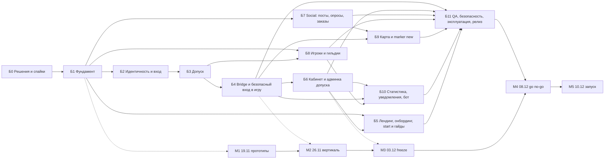
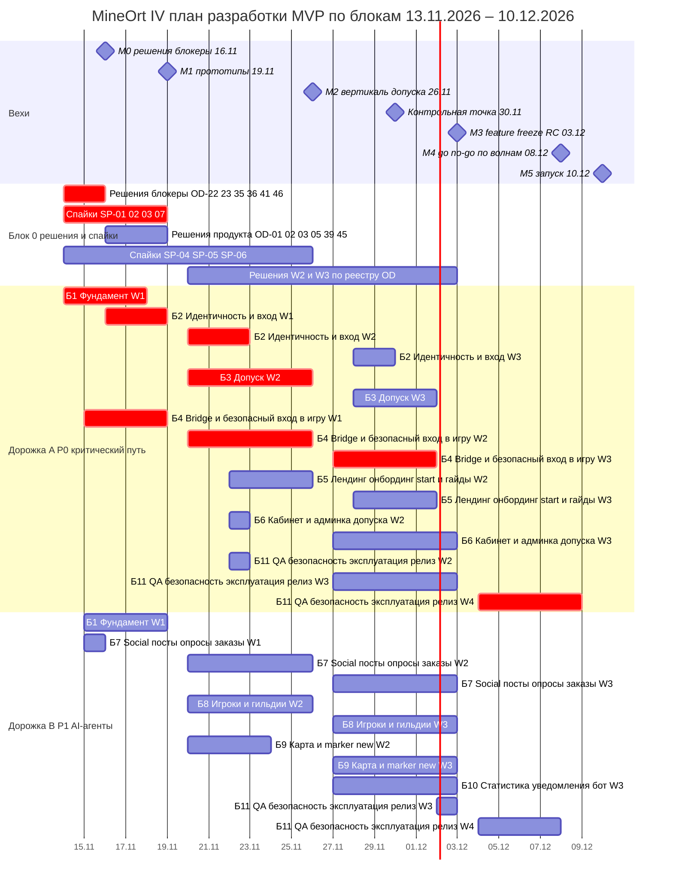

# MineOrt IV — план разработки MVP: блоки, задачи, порядок исполнения

**Статус:** черновик для утверждения · **Версия:** v0.2 (пакет документации v0.5, раунд 4) · **Базовая дата:** 13.11.2026 (пятница) · **Запуск:** 10.12.2026 (четверг), 27 календарных дней (14.11…10.12).

**Источники:** [бэклог](02-backlog.md) (154 историй — единственный источник задач), [план релиза](01-release-plan.md) (недели W1–W4, вехи M0–M5, go/no-go, лестница сокращений, флаги, спайки), [реестр рисков](03-risk-register.md), [TZ-00](../06-tz/TZ-00-product-scope.md) (реестр TZ-00…TZ-13, инварианты), [архитектура](../03-architecture/01-architecture.md), [NFR](../03-architecture/04-nfr-security.md), [приёмочные тесты](../05-qa/01-acceptance-tests.md) (индекс и трассировка, 360 TC), [реестр OD](../00-analysis/03-open-decisions.md), [README пакета](../README.md). Исходный аудит ([аудит концепции и разработки v2](<../MineOrt_IV_Аудит_концепции_и_разработки_v2 (1).md>)) не изменялся.

**Теги:** [ЗАКРЕПЛЕНО] / [ПРЕДЛАГАЕТСЯ] / [ПРОВЕРИТЬ] / [ОПРЕДЕЛИТЬ] / [РИСК] — как в аудите; [ПРЕДЛОЖЕНИЕ КОМАНДЫ] — всё, чего нет в документах пакета (разбивка на блоки, неделя и даты по каждой истории, формулировки задач и критериев приёмки, процесс исполнения); [РЕШЕНИЕ ВЛАДЕЛЬЦА 13.11.2026] — OD-33 и OD-34; [РЕШЕНИЕ ВЛАДЕЛЬЦА 14.11.2026] — OD-23, OD-35, OD-36, OD-41, OD-46 (старт Блока 0). **Весь документ, кроме явно помеченного как «из бэклога» или «из плана релиза», — [ПРЕДЛОЖЕНИЕ КОМАНДЫ] и не утверждён, пока владелец не примет план.**

**Машиночитаемая версия:** [mvp-tasks.csv](mvp-tasks.csv) — 154 строки (по одной на историю), UTF-8 с BOM, разделитель `;`, столбцы `block;story_id;title;epic;wave;moscow;size;hours;executor;depends_on;week;SC;TC;TZ;OD;status`. Таблицы задач этого файла и CSV сформированы одним скриптом из одних и тех же данных бэклога; расхождение между ними — ошибка плана.

Связанные файлы: [бэклог](02-backlog.md) · [план релиза](01-release-plan.md) · [реестр рисков](03-risk-register.md) · [открытые решения](../00-analysis/03-open-decisions.md) · [Bridge](../03-architecture/02-bridge-protocol.md) · [модель данных](../03-architecture/03-data-model.md) · [роли и права](../01-product/03-roles-permissions.md) · [модель статусов](../01-product/02-user-status-model.md) · [IA](../01-product/01-information-architecture.md).

## Содержание

0. [Паспорт](#0-паспорт)
1. [Как исполнять план](#1-как-исполнять-план)
2. [Карта блоков](#2-карта-блоков)
3. [Блоки: цели, критерии готовности, задачи](#3-блоки-цели-критерии-готовности-задачи)
4. [Порядок исполнения](#4-порядок-исполнения)
5. [Лестница сокращений на уровне задач](#5-лестница-сокращений-на-уровне-задач)
6. [Спайки и решения до начала кодирования](#6-спайки-и-решения-до-начала-кодирования)
7. [План тестирования и релиза](#7-план-тестирования-и-релиза)
8. [После запуска (10.12 и далее)](#8-после-запуска-1012-и-далее)
9. [Открытые вопросы и допущения](#9-открытые-вопросы-и-допущения)
10. [Замечания для сведения](#10-замечания-для-сведения)

---

## 0. Паспорт

| Поле | Значение |
|---|---|
| Назначение | Исполняемый план разработки MVP MineOrt IV: блоки работ, задачи с критериями приёмки, зависимости, исполнители, недели и даты, проверки по вехам. Единица учёта — история бэклога `US-Exx-NN` (154 шт.; раунд 4 добавил в бэклог 11 историй, R4-10); ID вне бэклога план не вводит |
| Базовая дата и срок | 13.11.2026 (пятница, день решений, в часы не входит); запуск 10.12.2026 (четверг); **27 календарных дней** (14.11…10.12) |
| Решения владельца | OD-33: один основной поток разработки (владелец) + AI-агенты, отдельных разработчиков и тестировщиков нет. OD-34: к 10.12.2026 выпускается весь P0 + P1 [РЕШЕНИЕ ВЛАДЕЛЬЦА 13.11.2026] |
| Что здесь означает «MVP» | **P0 + P1a + P1b + P1c** (аудит §18, стр. 875–884; §19, стр. 888–911): обязательные технические условия запуска плюс базовая социальная платформа. Волны P1a / P1b / P1c — внутренние вехи внутри 27 дней, а не пост-релиз; приоритет P0 → P1a → P1b → P1c. Каждая волна выпускается только после go/no-go на M4 (08.12); не прошедшая волна скрывается фича-флагом целиком (`ff_p1a`, `ff_p1b`, `ff_p1c` и модульные), без неработающих заглушек. P2 (E17, E18 и расширения) — после 10.12 ([раздел 8](#8-после-запуска-1012-и-далее)) |
| Объём | **154 истории, 914 ч** без AI-ускорения (S ≈ 2 ч, M ≈ 6 ч, L ≈ 12 ч): P0 — 89 / 550 ч; P1a — 23 / 120 ч; P1b — 24 / 134 ч; P1c — 18 / 110 ч. Размещение по неделям: W1 — 132 ч / W2 — 270 ч / W3 — 438 ч / W4 — 74 ч (совпадает с [планом релиза, п. 3.5](01-release-plan.md#35-загрузка-по-неделям-против-ёмкости)) |
| Исполнители | В — владелец; AI — AI-агент по ТЗ, ревью владельца; AI+В — агент пишет, владелец делает глубокое ревью и ручную проверку ([бэклог, п. 1](02-backlog.md#1-легенда)) |
| Блоки | Блок 0 (решения и спайки) и блоки 1–11 — [раздел 2](#2-карта-блоков); каждая из 154 историй принадлежит ровно одному блоку |
| Версия пакета | README пакета v0.5 «раунд 4: недостающая работа, владельцы TC, пересчёт итогов» |

### Честная оценка ёмкости (из плана релиза, без пересчёта)

Ёмкость (162 / 270 ч) и оценка аудита взяты из [плана релиза, п. 1.2–1.3](01-release-plan.md#1-допущения-и-ёмкость) и [анализа аудита, п. 6](../00-analysis/01-audit-analysis.md#6-реалистичность-сроков-на-13112026); итоги бэклога, нагрузка владельца и множители пересчитаны скриптом в раунде 4 от 154 историй и совпадают с планом релиза.

| Показатель | 6 ч/день | 10 ч/день |
|---|---|---|
| Доступные часы за 27 дней | 162 ч | 270 ч |
| Бэклог 914 ч ÷ ёмкость | 5,6× | 3,4× |
| P0 550 ч ÷ ёмкость | 3,4× | 2,0× |
| Нагрузка владельца как узкого места (часы «В» + 30 % «AI+В» + 15 % «AI») — 415 ч ÷ ёмкость | 2,6× | 1,5× |
| **P0, нагрузка владельца 300 ч ÷ ёмкость** | 1,9× | 1,1× |
| **W3: P0, нагрузка владельца 122 ч (из них 92 ч «В») против 42 / 70 ч** | 2,9× | 1,7× |
| Остаток 526 ч после всех ступеней лестницы 1–6 ÷ ёмкость | 3,2× | 1,9× |

**Что показывает строка про владельца (R4-09).** Часы «В» нельзя передать агентам: даже если весь остальной объём возьмут AI-агенты, нагрузка владельца на P0 остаётся 300 ч против 162 / 270 ч, а в пике W3 — 122 ч (из них 92 ч «В») против 42 / 70 ч. Поэтому **триггер M1 привязан к фактической скорости владельца на «В»-историях W1** (плановые часы «В» ÷ фактические часы владельца, SP-07), а не к скорости агентов. Закрытый запуск только с P0 **не устраняет разрыв по часам**: P0 — это 550 ч бэклога и 300 ч владельца; при множителе SP-07 ниже 1,9× реальна только смена даты запуска. Формула ступени 7: `новая дата = 13.11 + остаток_ч ÷ (множитель × ч/день)` календарных дней; остаток после ступеней 1–6 — 526 ч ([раздел 5](#5-лестница-сокращений-на-уровне-задач)).

Оценка аудита — 250–550 ч при одном основном потоке (стр. 1017–1024); требуемый множитель «AI-агенты + человек» к 250–550 ч — 1,5–3,4× при 6 ч/день и 0,9–2,0× при 10 ч/день. Множитель — допущение, а не измерение: его проверяет спайк SP-07 в W1, точка пересмотра — M1 (19.11). Вывод плана релиза: «без кратного ускорения силами AI-агентов и без лестницы сокращений он не выполним ни в одном из сценариев»; цель принята владельцем, поэтому лестница сокращений и go/no-go по волнам — **обязательные механизмы**, а не запасные ([раздел 5](#5-лестница-сокращений-на-уровне-задач), [план релиза, п. 5](01-release-plan.md#5-лестница-сокращений)). Пик нагрузки — W3 (438 ч бэклога, нагрузка владельца 193 ч против 42 / 70 ч доступных владельцу); риски R-09 (критический, 9) и R-15 (bus factor) — [реестр рисков](03-risk-register.md).

---

## 1. Как исполнять план

### 1.1. Карточка задачи

Единица исполнения — история `US-Exx-NN`. Карточка (строка таблицы блока в [разделе 3](#3-блоки-цели-критерии-готовности-задачи) или строка [mvp-tasks.csv](mvp-tasks.csv)) содержит поля [ПРЕДЛОЖЕНИЕ КОМАНДЫ]:

| Поле | Содержимое |
|---|---|
| ID | `US-Exx-NN` из бэклога (подзадачи L-историй — `US-Exx-NN.a`, `.b`: отдельные чекбоксы, но не отдельные единицы учёта) |
| Задача | Глагол + результат |
| Описание | Текст истории из бэклога («Как <роль>, я хочу …, чтобы …») и пометки: «Не режем», ступень лестницы |
| Критерии приёмки | Проверяемые условия; ссылки на SC, TC, AC, NFR (колонка «SC / TC») |
| Зависит от | ID историй, OD, SP; зависимость от истории более поздней недели запрещена; внутри недели — только из более ранней группы или из той же группы с явным порядком (п. 4.2) |
| Размер / часы | S 2 ч, M 6 ч, L 12 ч (человеко-часы без AI-ускорения) |
| Исполнитель | В / AI / AI+В |
| Неделя | W1–W4 и веха, до которой история должна быть `done` |
| SC / TC | Сценарии, **собственные** тест-кейсы (у каждого из 360 TC ровно один владелец — история, где он впервые может стать зелёным; остальные ссылки — «не ломает», R4-11), критерии приёмки, NFR из бэклога |
| ТЗ / OD | ТЗ по реестру [TZ-00, п. 10.2](../06-tz/TZ-00-product-scope.md#102-реестр-тз-tz-00tz-13-и-соответствие-эпиков), блокирующие OD, спайки, риски |
| Статус | `todo` / `in-progress` / `blocked` / `review` / `done` (в CSV — столбец `status`, исходно `todo`) |

### 1.2. Definition of Ready (можно брать в работу)

1. Все истории из «Зависит от» в статусе `done`; блокирующие OD приняты или «приняты по умолчанию» ([реестр OD](../00-analysis/03-open-decisions.md#2-сводная-таблица)).
2. ТЗ нужной области готово: P0 — до старта эпика (TZ-02, TZ-03, TZ-04 имеют каркасы; TZ-05, TZ-11 — до W2 и W3); P1a — к 17.11; P1b и P1c — к 24.11 ([план релиза, п. 3](01-release-plan.md#3-недельный-план-и-вехи-m0m5)). ТЗ пишутся историями US-E00-10, US-E08-14, US-E11-13, US-E13-09 (они — зависимости первых историй своих эпиков). Без ТЗ агенты не стартуют.
3. Критерии приёмки сведены к существующим TC из 05-qa (ID проверяются по [05-qa](../05-qa/01-acceptance-tests.md)); если TC нет — в карточке пометка [ОПРЕДЕЛИТЬ] и задача на добавление кейса.
4. Размер ≤ L; L-история разбита на подзадачи (список — под таблицей блока).
5. Назначен исполнитель; для AI-задачи подготовлен промпт по шаблону [1.5](#15-как-передать-задачу-ai-агенту).
6. Известны окружение (local, staging, PAPER-T для Bridge) и состояние флага.

### 1.3. Definition of Done (можно закрывать)

1. Собственные TC из колонки «SC / TC» зелёные в CI на staging (чужие TC, помеченные «не ломает», не должны покраснеть); Blocker и Critical — 100 % ([05-qa, п. 1.3](../05-qa/01-acceptance-tests.md#13-приоритеты-и-критерии-прохождения)); для историй Bridge — на PAPER-T с продовой конфигурацией плагинов.
2. В PR указаны ссылки на SC, TC, AC и NFR истории; регрессия Smoke P0 (и Smoke своей волны) зелёная.
3. Проверки безопасности (по применимости): серверная проверка прав, а не только скрытие кнопок; RLS-матрица TC-OPS-06a…06h не сломана; секреты не в репозитории; для входа и Bridge — TC-GAME-03a, 03b, TC-OPS-04a…04g; запись только через backend/RPC (US-E00-06).
4. Ревью владельца пройдено: для «AI» — ревью; для «AI+В» — глубокое ревью и ручная проверка; для «В» — самопроверка по чек-листу и просмотр diff агентом-ревьюером [ПРЕДЛОЖЕНИЕ КОМАНДЫ].
5. Документация обновлена: ТЗ или сценарий, журнал решений OD (если принято решение), runbook (для операций), UI-тексты по [глоссарию](../00-analysis/02-glossary.md).
6. Состояние флага зафиксировано: P0 — без флага; P1 — под `ff_*`, на staging включён, на prod решается на M4.
7. Статус `done` выставлен в чек-листе блока и в [mvp-tasks.csv](mvp-tasks.csv); часы факта записаны для SP-07 (W1) и далее для пересмотра множителя.

### 1.4. Ветки, коммиты, PR [ПРЕДЛОЖЕНИЕ КОМАНДЫ]

| Элемент | Правило |
|---|---|
| Ветка | `feat/US-E04-02-bridge-hmac`, `fix/…`, `chore/…`: ID истории первым, slug на английском |
| Коммиты | На английском, с ID истории в начале: `US-E04-02: verify HMAC signature and nonce`; один смысловой шаг на коммит |
| PR | Один PR на историю (размер ≤ L, чтобы помещался в код-ревью — аудит стр. 974); заголовок `US-Exx-NN …`; описание: ссылки на SC / TC / AC / NFR, состояние флага, чек-лист DoD, скриншоты для UI |
| Слияние | Только при зелёном CI (typecheck, lint, unit, Playwright smoke — US-E00-02); squash в `main`; `main` → staging; prod — отдельным выпуском после M4 |
| Миграции БД | Версионированные; сначала на staging ([архитектура, п. 7](../03-architecture/01-architecture.md#7-окружения-секреты-тестовый-paper)) |
| Ревью агентских PR | Пакетами по волнам (мера из [плана релиза, п. 3.5](01-release-plan.md#35-загрузка-по-неделям-против-ёмкости)), не по историям |

### 1.5. Как передать задачу AI-агенту

Готовый шаблон промпта (поля обязательны; без ТЗ и критериев приёмки задача не отдаётся):

```text
ЗАДАЧА: <US-Exx-NN> — <название задачи из таблицы блока>
БЛОК / НЕДЕЛЯ / ВЕХА: <Б#> / <W#> / <M#>
РАЗМЕР И ИСПОЛНИТЕЛЬ: <S|M|L>, <AI|AI+В>

КОНТЕКСТ (прочитать до кода):
- docs/04-plan/02-backlog.md — строка <US-Exx-NN> и её зависимости
- ТЗ: docs/06-tz/<TZ-nn>.md (разделы: ...)
- Сценарии: <SC-XXX-NN> в docs/02-scenarios/...
- Протокол/модель данных/NFR: <пункты, например docs/03-architecture/02-bridge-protocol.md, п. 6.3>
- Рамки репозитория: README (структура, команды, запреты)

ЧТО СДЕЛАТЬ: <описание из таблицы блока; подзадачи .a/.b/.c>

КРИТЕРИИ ПРИЁМКИ (проверяемые):
- <критерий из таблицы блока>
- TC, которые должны быть зелёными: <TC-...>
- AC / NFR: <AC-.., NFR-..>

ТЕСТЫ: написать или обновить автотесты по перечисленным TC; не ослаблять и не удалять существующие; запустить typecheck, lint, unit и Playwright smoke

БЕЗОПАСНОСТЬ: серверная проверка прав; запись привилегированных колонок только через backend/RPC; секреты не в коде и не в логах; RLS по умолчанию закрыто

ВНЕ ОБЪЁМА: <что НЕ делать: соседние истории, P2, UI-макеты вне ТЗ; новые ID историй не заводить>

ФЛАГ: <ff_*|без флага>; выключенный флаг = 404 для маршрута и API

ВЫХОД: список изменённых файлов, результат запуска typecheck / lint / тестов, что не удалось сделать
```

### 1.6. Статусы

| Статус | Значение | Переход |
|---|---|---|
| `todo` | Не начато | → `in-progress`, когда выполнен DoR |
| `in-progress` | В работе (исполнитель назначен) | → `review` при открытом PR; → `blocked` при внешнем препятствии |
| `blocked` | Остановлено: указан ID блокера (история, OD, SP, внешний фактор) | → `in-progress` после снятия; блокировка дольше суток выносится на ежедневный разбор |
| `review` | PR открыт, идёт ревью владельца (пакетное для агентов) | → `in-progress` при замечаниях; → `done` по DoD |
| `done` | DoD выполнен | Пересмотр только по результатам регрессии |

### 1.7. Ритм работы [ПРЕДЛОЖЕНИЕ КОМАНДЫ]

| Периодичность | Что делается |
|---|---|
| Ежедневно, утро | Взять следующую группу задач своей дорожки из [4.2](#42-дорожки-a-и-b-по-неделям); проверить DoR; поставить задачи агентам дорожки B |
| Ежедневно, вечер | Закрыть `review`-задачи пакетом; обновить статусы и факт-часы; записать принятые решения в журнал OD; отметить блокеры |
| Вехи | M0 16.11, M1 19.11, M2 26.11, контрольная точка 30.11, M3 03.12, M4 08.12, заморозка 09.12, M5 10.12 — чек-листы [4.4](#44-вехи-ворота-m0m5); проверка триггеров лестницы по [п. 5.2 плана релиза](01-release-plan.md#52-что-и-когда-проверяется-на-вехах) |
| Раз в неделю | Перепроверка [реестра рисков](03-risk-register.md); пересчёт нагрузки по [таблице W1–W4](01-release-plan.md#35-загрузка-по-неделям-против-ёмкости); сверка CSV с чек-листами |

### 1.8. Где фиксируются решения

Любое решение (в том числе «принято по умолчанию» при пропуске срока и журнал решения M4 по флагам волн) записывается в [реестр OD](../00-analysis/03-open-decisions.md#4-журнал-решений): кто, когда, вариант, ссылка на затронутые истории. Новые вопросы получают следующий свободный номер реестра OD [ПРЕДЛОЖЕНИЕ КОМАНДЫ]. Изменения размеров, множителя SP-07 и состава волн фиксируются в [бэклоге](02-backlog.md) и повторяются здесь.

---

## 2. Карта блоков

Блоки — логические группы историй по функциональной области [ПРЕДЛОЖЕНИЕ КОМАНДЫ]; каждая из 154 историй принадлежит ровно одному блоку. Отличия от предложенной схемы: US-E05-04 и US-E05-05 (правила и согласие) вынесены в Блок 3 «Допуск», так как US-E03-01, 04, 05 зависят от согласия с правилами; US-E03-08 и US-E03-09 (поиск, бан, перепривязка) — в Блок 6 «Кабинет и админка допуска»; Блок 0 содержит решения и спайки, а не истории (ТЗ вынесены в истории US-E00-10, US-E08-14, US-E11-13, US-E13-09; часы спайков уже в историях-хозяевах — [бэклог, п. 4](02-backlog.md#4-прототипы-и-спайки-аудит-221-стр-9991007)).

| Блок | Эпики / состав | Историй | Часы | из них P0 / P1 | Волны | Недели | Дорожка | Зависит от блоков | Флаги |
|---|---|---:|---:|---|---|---|---|---|---|
| [Б0 Решения и спайки](#блок-0--решения-и-спайки) | OD M0/M1/M2…, SP-01…SP-08, ТЗ-готовность (истории US-E00-10, US-E08-14, US-E11-13, US-E13-09) | 0 (часы в историях-хозяевах) | — | — | — | W1–W3 | A, B | — | — |
| [Б1 Фундамент](#блок-1--фундамент) | E00, E01 | 13 | 72 | 72 / 0 | P0 | W1 | A, B | — | создаёт флаги |
| [Б2 Идентичность и вход](#блок-2--идентичность-и-вход) | E02 | 9 | 58 | 58 / 0 | P0 | W1, W2, W3 | A | Б1, Б3 | — |
| [Б3 Допуск](#блок-3--допуск) | E03 (кроме US-E03-08, US-E03-09) + US-E05-04, US-E05-05 | 13 | 74 | 74 / 0 | P0 | W2, W3 | A | Б1, Б2, Б4, Б6 | — |
| [Б4 Bridge и безопасный вход в игру](#блок-4--bridge-и-безопасный-вход-в-игру) | E04 | 24 | 166 | 166 / 0 | P0 | W1, W2, W3 | A | Б1, Б2, Б3, Б6 | — |
| [Б5 Лендинг, онбординг, /start и гайды](#блок-5--лендинг-онбординг-start-и-гайды) | E05 (US-E05-01…03), E06 | 8 | 50 | 50 / 0 | P0 | W2, W3 | A | Б1, Б2, Б3, Б6 | — |
| [Б6 Кабинет и админка допуска](#блок-6--кабинет-и-админка-допуска) | E07 + US-E03-08, US-E03-09 | 9 | 44 | 44 / 0 | P0 | W2, W3 | A | Б1, Б2, Б3, Б4, Б5 | — |
| [Б7 Social: посты, опросы, заказы](#блок-7--social-посты-опросы-заказы) | E08, E09, E10 | 25 | 120 | 0 / 120 | P1a, P1b, P1c | W1, W2, W3 | B | Б1, Б3, Б8, Б9, Б10 | ff_p1a, ff_p1b(_social), ff_p1c(_requests), ff_social_comments |
| [Б8 Игроки и гильдии](#блок-8--игроки-и-гильдии) | E11, E12 | 16 | 96 | 0 / 96 | P1a, P1b | W2, W3 | B | Б1, Б2, Б3, Б7 | ff_p1a, ff_p1b_guilds |
| [Б9 Карта и /marker new](#блок-9--карта-и-marker-new) | E13, E14 | 12 | 72 | 0 / 72 | P1c | W2, W3 | B | Б1, Б3, Б4, Б7, Б8 | ff_p1c_atlas |
| [Б10 Статистика, уведомления, бот](#блок-10--статистика-уведомления-бот) | E15, E16 | 7 | 34 | 0 / 34 | P1a, P1b | W3 | B | Б1, Б2, Б4, Б6, Б7, Б8 | ff_p1a, ff_p1b |
| [Б11 QA, безопасность, эксплуатация, релиз](#блок-11--qa-безопасность-эксплуатация-релиз) | E19 | 18 | 128 | 86 / 42 | P0, P1a, P1b, P1c | W2, W3, W4 | A, B | Б1, Б2, Б3, Б4, Б5, Б6, Б7, Б8, Б9, Б10 | подготовка флагов к M4 |
| **Итого** | | **154** | **914** | **550 / 364** | | | | | |

Часы по неделям (сумма по историям): W1 — 132 ч · W2 — 270 ч · W3 — 438 ч · W4 — 74 ч — совпадает с таблицей [плана релиза, п. 3.5](01-release-plan.md#35-загрузка-по-неделям-против-ёмкости).



Диаграмма показывает основной поток (порядок старта блоков), а не все зависимости. **На уровне историй зависимости ациклические** (проверено скриптом), но на уровне блоков есть взаимные связи: Б2↔Б3 (US-E02-08 зависит от US-E03-07), Б3↔Б4 (US-E04-05 зависит от US-E03-06, US-E03-12 — от US-E04-05), Б3↔Б6 (US-E03-12 зависит от US-E03-08), Б4↔Б6 (US-E04-08 зависит от US-E07-03, US-E07-06 — от US-E04-08). Поэтому порядок работ определяется историями и неделями ([раздел 4](#4-порядок-исполнения)), а не последовательностью блоков. Колонка «Зависит от блоков» выше вычислена по историям.

`P2` (E17, E18 и расширения) — отдельный раздел «после 10.12»: [раздел 8](#8-после-запуска-1012-и-далее).

---

## 3. Блоки: цели, критерии готовности, задачи

Поля каждого блока: цель; входит и не входит; зависимости; волна и даты; блокирующие OD; риски; флаги; критерии готовности (мерки из go/no-go, TC-группы, NFR); таблица задач. Таблица задач содержит все истории блока с точными ID, размерами, исполнителями и зависимостями из [бэклога](02-backlog.md); столбцы «Задача», «Описание» (с пометками «Не режем» и ступени лестницы) и «Критерии приёмки» составлены планом [ПРЕДЛОЖЕНИЕ КОМАНДЫ] по тексту историй и перечням TC; ID TC, SC, AC, NFR, OD, R, G проверены по пакету. Колонка «Неделя» — W# и веха, до которой история должна быть `done`.

**Как читается неделя.** Бэклог и план релиза задают состав недель текстом ([п. 3.1–3.4 плана релиза](01-release-plan.md#3-недельный-план-и-вехи-m0m5)) и итоговые часы W1–W4 (132 / 270 / 438 / 74 ч), но не размещают каждую историю явно. Размещение по неделям здесь восстановлено из текста плана и **воспроизводит эти итоги точно**; отдельные истории, которых план не называет поимённо (например US-E04-14 в W3, US-E19-01 в W3), размещены по правилу «не раньше, чем готовы зависимости, и не позже, чем нужны зависимым» [ПРЕДЛОЖЕНИЕ КОМАНДЫ]. Недельные итоги пересчитаны в раунде 4: в W1 перенесена US-E00-07 (R4-13) и добавлены истории стенда, домена, ТЗ и тестового входа; в W2 — Java CI Bridge и ТЗ P1b, P1c; в W4 — наполнение (правила v1, гайды, адрес и клиент).

---

### Блок 0 · Решения и спайки

| Поле | Значение |
|---|---|
| Цель | Снять блокирующие решения и доказать риск-прототипы до того, как на них встанет остальной код; подготовить ТЗ к срокам, после которых агенты стартуют |
| Входит | Решения OD по вехам M0–M3; спайки SP-01…SP-08 (SP-07 — замер скорости, без кода); готовность ТЗ — истории US-E00-10 (P0), US-E08-14 (P1a, к 17.11), US-E11-13 и US-E13-09 (P1b и P1c, к 24.11) с часами в блоках 1, 7, 8, 9 |
| Не входит | Часы спайков: код прототипа уже входит в часы историй-хозяев ([бэклог, п. 4](02-backlog.md#4-прототипы-и-спайки-аудит-221-стр-9991007)), поэтому спайки не прибавляются к 914 ч и в CSV нет; SP-07 — замер без кода |
| Зависимости | Блоков нет; стенд PAPER-T (US-E00-08) нужен SP-02, SP-03, SP-08, домен и BotFather (US-E00-09) — SP-01. Источник сроков — [план релиза, п. 3](01-release-plan.md#3-недельный-план-и-вехи-m0m5) и [TZ-00, п. 10.1](../06-tz/TZ-00-product-scope.md#101-блокирующие-открытые-решения-и-варианты-по-умолчанию) |
| Волна и даты | W1 13.11–19.11 (M0 16.11, M1 19.11); SP-04 и SP-05 — до M2 и 24.11; решения продукта — до 26.11 (M2), 27.11, 01.12, 03.12 (M3) |
| Риски | R-09, R-15 (общие); R-01 (SP-03, SP-08); R-10 (SP-08); R-16 (SP-02); R-17 (SP-01); R-04, R-05, R-21 (SP-04); R-02 (SP-05); R-07 (SP-06); R-19 (лимиты Supabase) |
| Флаги | — |

**Критерии готовности блока:**

- Г-0.1. M0 (16.11): OD-22 (кандидат), OD-23, OD-35, OD-36, OD-41, OD-46 приняты или «приняты по умолчанию» с записью в журнал; OD-33 и OD-34 уже приняты 13.11.2026. **Состояние на 14.11.2026:** OD-23, OD-35, OD-36, OD-41, OD-46 приняты владельцем (запись в журнале решений); осталось подтвердить кандидат OD-22 (рабочий кандидат — Paper 26.3 + Java 25, фиксация 19.11).
- Живой трекер Блока 0 (спайки, решения, инфраструктура, дневной план 14.–19.11): [block-0/00-status.md](block-0/00-status.md); материалы: [руководство владельца](block-0/01-owner-setup-guide.md), [карточки спайков](block-0/02-spike-cards.md), [журнал замера SP-07](block-0/03-sp07-measurement-log.md), [лист решений M1](block-0/04-m1-decision-sheet.md).
- Г-0.2. M1 (19.11): SP-01, SP-02, SP-03, SP-08 работают на staging и PAPER-T; OD-22 зафиксирован; замер SP-07 даёт множитель; пересмотр состава волн и размеров US-E04-18, US-E04-22, US-E04-23.
- Г-0.3. M2 (26.11): SP-04 закрыт решением OD-16; SP-05 закрыт к 24.11; SP-06 закрыт; остальные OD по списку до 26.11 приняты.

**Задачи блока** (строки — спайки и группы решений; единица — ID спайка или OD, не история бэклога; в CSV не входят):

| ID (US-…) | Задача | Описание / что именно сделать | Критерии приёмки | Зависит от | Размер / часы | Исполнитель | Неделя | SC / TC | ТЗ / OD |
|---|---|---|---|---|---|---|---|---|---|
| SP-01 | Доказать: Telegram-вход и создание профиля | Вертикальный срез на staging: вход Telegram на домене из US-E00-09 → проверка подписи и nonce → создание `user`; отмена виджета и replay отклоняются. Код прототипа — основа US-E02-01; срок: 19.11 (M1) | Подпись и nonce проверены, `user` создан на staging, отмена и replay отклоняются | US-E00-09 (домен и BotFather) | — (часы в US-E02-01) | В | W1 (M1) | SC-AUTH-01 | R-17 |
| SP-02 | Доказать: подписанный `whitelist.add` на тестовом Paper | Сайт создаёт команду, Bridge проверяет подпись и применяет её на PAPER-T, неподписанная отклоняется, результат виден на сайте. Код прототипа — основа US-E04-01…05; срок: 19.11 (M1) | Команда подписана, Bridge её проверяет и применяет, неподписанная отклоняется, результат виден на сайте | US-E00-08 (стенд PAPER-T) | — (часы в US-E04-01…05) | В | W1 (M1) | SC-ADM-04 · SC-ACC-07 · SC-ACC-08 | R-03, R-16 |
| SP-03 | Доказать: limbo + игровой код + fail-closed + подпись решения входа | На PAPER-T: заморозка до подтверждения, код 6 цифр (TTL 5 мин) подтверждается в кабинете, таймаут limbo — `first_join` 5 мин (= TTL кода), повторные входы 120 с → kick; backend выключен → fail-closed; неподписанное решение limbo не снимает. Код прототипа — основа US-E04-07…11, 15, 16; срок: 19.11 (M1) | Заморозка до подтверждения, код 6 цифр TTL 5 мин подтверждается в кабинете, таймаут limbo: `first_join` 5 мин (= TTL кода), повторные входы 120 с → kick, backend выключен → fail-closed; решение входа подписано Ed25519, неподписанное не снимает limbo | US-E00-08 (стенд PAPER-T) | — (часы в US-E04-07…11, US-E04-15, US-E04-16) | В | W1 (M1) | SC-GAME-06 · SC-GAME-01 · SC-GAME-05 · SC-GAME-02 · SC-GAME-03 · SC-GAME-07 · SC-GAME-04 · SC-OPS-04 | R-01 |
| SP-04 | Решить: движок карты BlueMap или Dynmap | Стресс-тест обоих движков на BisectHosting (нагрузка рендера, тайлы закрыты за сессией сайта) и срез «метка → событие → отражение на карте»; результат — решения OD-16 и OD-47. Код среза — основа US-E13-01 и E14; срок: начат W1, решение 26.11 (M2) | Решение OD-16 (BlueMap или Dynmap); нагрузка на BisectHosting измерена; тайлы закрываются за сессией | — | — (часы в US-E13-01) | В | W1–W2 (M2) | — | R-04, R-05, R-21 |
| SP-05 | Доказать: гильдия с серверной проверкой прав | Тонкий срез на staging: админ создаёт гильдию → назначает главу → приглашает игрока → меняет ранг; самоповышение через прямой API отклоняется. Выполняется вместе с US-E11-01 (22–24.11) и заканчивается 24.11; полный серверный движок прав US-E11-03 (27–29.11) развивает срез; срок: 24.11 (W2, вместе с US-E11-01) | Вертикальный срез с отказом на самоповышение через прямой API | — | — (часы в US-E11-01…03) | В | W2 (до 24.11) | SC-GLD-01 · SC-GLD-04 · SC-GLD-05 | R-02 |
| SP-06 | Доказать: пост со скриншотом | Загрузка → проверка → WebP → пост в ленте и в профиле автора на staging. Код среза — основа US-E08-01…03; срок: W2 (до 26.11) | Загрузка → проверка → WebP → пост в ленте и в профиле автора | — | — (часы в US-E08-01…03) | AI+В | W2 (M2) | SC-SOC-05 · SC-SOC-01 | R-07 |
| SP-07 | Измерить: скорость владельца и агентов на историях W1 | Это замер, а не прототип: кода нет. Фиксируются плановые и фактические часы историй W1 — отдельно «В»-истории (скорость владельца, триггер M1) и AI / AI+В (скорость агентов). Результат — множитель и пересмотр состава волн на M1 (19.11); срок: W1 (13.11–19.11) | Фактические часы человека и агентов на истории W1 против размеров S/M/L; пересмотр множителя на M1 | US-E00-01…05 (материал замера) | — (замер, кода нет) | В | W1 (M1) | — | R-09, R-15 |
| SP-08 | Решить: стек серверных плагинов Paper и плагин приватов | На PAPER-T выбрать плагин приватов и зафиксировать версии LuckPerms и статистики [ПРОВЕРИТЬ]; для тестового игрока выполнить из Bridge экспорт, сброс, импорт и перенос инвентаря, эндер-сундука, прав, приватов и статистики под offline-UUID. Результат — способ интеграции для `player.data_archive`, `player.data_migrate`, `player.data_restore` и пересмотр размеров US-E04-18, US-E04-22, US-E04-23 на M1; срок: 19.11 (M1) | На PAPER-T выбран плагин приватов и зафиксированы версии LuckPerms и статистики [ПРОВЕРИТЬ]; для тестового игрока экспорт, сброс и импорт инвентаря, эндер-сундука, прав, приватов и статистики под offline-UUID выполняются из Bridge без простоя сервера; по итогу пересмотрены размеры US-E04-18, US-E04-22, US-E04-23 (фиксируется на M1) | US-E00-08 (стенд PAPER-T) | — (часы в US-E04-18, US-E04-22, US-E04-23) | В | W1 (M1) | SC-ACC-11 · SC-ACC-10 · SC-DSH-04 | R-01, R-10 |
| OD-22, OD-23, OD-35, OD-36, OD-41, OD-46 | Принять решения-блокеры M0 | Закрыть карточки блокеров в реестре OD (вариант по умолчанию — из реестра) | Статусы в реестре OD изменены; при пропуске срока записано «принято по умолчанию» | — | — | Владелец, техлид | 16.11 (M0) | — | — |
| OD-01, OD-02, OD-03, OD-05, OD-06 (механизм), OD-22 (фиксация), OD-39, OD-45 | Принять решения продукта M1 | Меню, видимость Social, `/start` до одобрения, реакции и комментарии, механизм правил, фиксация версии Minecraft/Paper, эмблема, персональные данные | Статусы изменены; ветка несовершеннолетних OD-45 имеет текст от владельца | — | — | Владелец | 19.11 (M1) | — | — |
| OD-07…OD-14, OD-16…OD-21, OD-27, OD-31, OD-37, OD-38, OD-40, OD-42, OD-43, OD-44, OD-47, OD-48, OD-49 | Принять решения W2 до M2 | Гильдии (OD-07…14), карта (OD-16…21, OD-47), роли Social (OD-27), восстановление при потере Telegram (OD-31), смена ника (OD-37), правила в меню (OD-38), удаление и хранение (OD-40), часовой пояс (OD-42), посты от гильдии (OD-43), CTA игрока (OD-44), разбан и отзыв заявки (OD-48, OD-49) | Статусы изменены к 26.11 | — | — | Владелец, техлид | 26.11 (M2) | — | — |
| OD-25, OD-06 (текст), OD-24, OD-26 | Получить контент и данные сервера | Список модов и клиент (OD-25, 27.11); текст правил v1 (OD-06, 01.12) — вносится историей US-E19-16; хостинг карты (OD-24, 01.12); IP или домен игрового сервера (OD-26, 01.12; домен сайта — US-E00-09, не OD-26) | Данные получены; без них нельзя закрыть G0-08 и G0-11 (US-E19-16, US-E19-18) | — | — | Владелец | 27.11 / 01.12 | — | — |
| OD-15, OD-28, OD-29, OD-30, OD-32 | Принять решения M3 | Теги в игре (OD-15, остаётся P2), модерация и сроки (OD-28), публичность показателей (OD-29), уведомления (OD-30), споры (OD-32) | Статусы изменены к 03.12 | — | — | Владелец | 03.12 (M3) | — | — |

**Проверенные факты для спайков (14.11.2026, публичные источники; остальное — [ПРОВЕРИТЬ]).** Paper 26.3 — последняя версия Minecraft с поддержкой (сборка 249, STABLE, 11.11.2026), 26.2 снята с поддержки 03.11.2026, для 26.1+ нужна Java 25; LuckPerms 5.5.71, BlueMap 5.29 и AuthMe 6.0.1 подтверждены для 26.3; Dynmap, LibreLogin и FastLogin для 26.x не подтверждены (Dynmap — аргумент в пользу BlueMap в SP-04 / OD-16; FastLogin-класс — premium-ветка TC-GAME-02d остаётся [ПРОВЕРИТЬ]). Следствие для SP-03: схема C реализуется Bridge (limbo и challenge), поэтому сначала пробуется limbo **без** плагина авторизации, AuthMe — необязательный резерв для парольного пути; плагины SP-08 — LuckPerms (подтверждён), плагин приватов (не выбран), статистика. Источники и подробности — [карточка OD-22](../00-analysis/03-open-decisions.md#od-22--версия-minecraft--paper--java), [карточки спайков](block-0/02-spike-cards.md).

**ТЗ как истории.** Авторство и часы ТЗ вынесены из «решений» в истории (исполнитель AI+В: черновик пишет агент, принимает владелец): US-E00-10 — TZ-01, TZ-05, TZ-11 (E07), TZ-12, TZ-13 (W1; TZ-05 — до старта E05 в W2); US-E08-14 — TZ-06, TZ-09 (каталог), TZ-11 (E15), к 17.11; US-E11-13 — TZ-07 и TZ-09 (гильдии), US-E13-09 — TZ-08 и TZ-10, обе к 24.11. TZ-02, TZ-03, TZ-04 уже имеют каркасы.

**Чек-лист блока:**

- [ ] SP-01 — Доказать: Telegram-вход и создание профиля (срок: 19.11 (M1))
- [ ] SP-02 — Доказать: подписанный `whitelist.add` на тестовом Paper (срок: 19.11 (M1))
- [ ] SP-03 — Доказать: limbo + игровой код + fail-closed + подпись решения входа (срок: 19.11 (M1))
- [ ] SP-04 — Решить: движок карты BlueMap или Dynmap (срок: начат W1, решение 26.11 (M2))
- [ ] SP-05 — Доказать: гильдия с серверной проверкой прав (срок: 24.11 (W2, вместе с US-E11-01))
- [ ] SP-06 — Доказать: пост со скриншотом (срок: W2 (до 26.11))
- [ ] SP-07 — Измерить: скорость владельца и агентов на историях W1 (срок: W1 (13.11–19.11))
- [ ] SP-08 — Решить: стек серверных плагинов Paper и плагин приватов (срок: 19.11 (M1))
- [ ] OD-22, OD-23, OD-35, OD-36, OD-41, OD-46 — Принять решения-блокеры M0 (16.11 (M0)). **Частично (14.11.2026):** приняты владельцем OD-23 (C), OD-35 (A), OD-36 (A), OD-41 (A), OD-46 (A) [РЕШЕНИЕ ВЛАДЕЛЬЦА 14.11.2026]; OD-22 остаётся открытым до фиксации 19.11 (кандидат A: Paper 26.3 + Java 25, проверенные факты — [карточка OD-22](../00-analysis/03-open-decisions.md#od-22--версия-minecraft--paper--java)). Строку не закрывать, пока OD-22 не зафиксирован
- [ ] OD-01, OD-02, OD-03, OD-05, OD-06 (механизм), OD-22 (фиксация), OD-39, OD-45 — Принять решения продукта M1 (19.11 (M1))
- [ ] OD-07…OD-14, OD-16…OD-21, OD-27, OD-31, OD-37, OD-38, OD-40, OD-42, OD-43, OD-44, OD-47, OD-48, OD-49 — Принять решения W2 до M2 (26.11 (M2))
- [ ] OD-25, OD-06 (текст), OD-24, OD-26 — Получить контент и данные сервера (27.11 / 01.12)
- [ ] OD-15, OD-28, OD-29, OD-30, OD-32 — Принять решения M3 (03.12 (M3))


### Блок 1 · Фундамент

| Поле | Значение |
|---|---|
| Цель | Дать одному потоку и AI-агентам общие рамки: репозиторий, CI, окружения, секреты, миграции с RLS «закрыто по умолчанию», единый паттерн записи только через backend/RPC, чтение закрытых данных только через представления, фича-флаги волн, UI-kit и меню. |
| Входит | US-E00-01…10 (репозиторий, CI, окружения, миграции и RLS, флаги, паттерн записи, закрытое чтение, стенд PAPER-T, домен и TLS, ТЗ P0-остатка); US-E01-01…03 (токены, базовые компоненты, меню desktop и mobile). |
| Не входит | Макеты разделов (TZ-01 вне пакета); бизнес-таблицы эпиков (их миграции делают блоки своих эпиков); страницы контента. |
| Зависимости | Блоки: Б0. OD: OD-35 (стек, 16.11), OD-39 (эмблема, 19.11), OD-01 (меню, 19.11). Стенд и домен: PAPER-T (US-E00-08), домен сайта и BotFather (US-E00-09; домен игрового сервера — OD-26, отдельно). Спайки: SP-07 (замер скорости на US-E00-01…05, W1). |
| Объём | 13 историй, 72 ч (P0 72 ч, P1 0 ч); эпики: E00, E01 |
| Волна и даты | P0, дорожка A (E00, токены) и B (kit, меню, ТЗ). W1 14.11–19.11, веха M1 (19.11); US-E00-06 и US-E00-07 — W1 (единый срок TC-OPS-06a…06h, R4-13). |
| Блокирующие OD и сроки | OD-35 (16.11), OD-01 (19.11), OD-39 (19.11) |
| Риски | R-19 — лимиты и пауза бесплатного плана Supabase [ПРОВЕРИТЬ]; R-20 — утечка секретов (секреты вне репозитория); R-15 — bus factor = 1; R-09 — перегрузка объёма |
| Флаги | Блок создаёт механизм флагов `ff_p1a`, `ff_p1b`, `ff_p1c` и модульных `ff_p1b_guilds`, `ff_p1b_social`, `ff_p1c_atlas`, `ff_p1c_requests`, `ff_social_comments`; сам P0 не флагируется. |
| TC-группы блока | TC-OPS-06, TC-PLR-02 |

**Критерии готовности блока** (мерки из go/no-go [плана релиза](01-release-plan.md#4-критерии-gono-go) и [05-qa](../05-qa/01-acceptance-tests.md#5-чек-лист-gono-go)):

- Г-1.1. CI зелёный, preview на PR, три окружения с раздельными ключами (M1 «E00 готов», [план релиза, п. 7](01-release-plan.md#7-связь-с-эпиками-и-вехами)).
- Г-1.2. Единый срок M1 (W1): RLS-матрица TC-OPS-06a…06h пройдена на staging; владельцы — US-E00-06 (TC-OPS-06g, Blocker: прямая запись) и US-E00-07 (TC-OPS-06a…06f и TC-OPS-06h, Blocker: прямое чтение закрытых колонок), обе в W1.
- Г-1.3. Выключенный флаг убирает пункт меню, маршрут и API (404) без релиза кода (US-E00-05, критерий волн в [п. 4.2 плана релиза](01-release-plan.md#42-волны-p1-и-фича-флаги)).
- Г-1.4. NFR-A11Y: клавиатура, фокус, ширина 320 px в kit.

**Задачи блока** (порядок — по неделе и дате старта; единица учёта — история бэклога):

| ID (US-…) | Задача | Описание / что именно сделать | Критерии приёмки | Зависит от | Размер / часы | Исполнитель | Неделя | SC / TC | ТЗ / OD |
|---|---|---|---|---|---|---|---|---|---|
| US-E00-01 | Развернуть репозиторий Next.js + TypeScript + Tailwind с линтером и форматтером | **Владелец** хочет: репозиторий со скелетом Next.js + TypeScript + Tailwind, линтером и форматтером, чтобы AI-агенты работали в единых рамках | Чистый клон собирается и запускается по README одной командой; typecheck, lint и format-check проходят без ошибок; в README описаны рамки для AI-агентов (структура, команды, запреты) | — | S · 2 ч | В | W1 (M1) | n/a (enabler) | TZ-00, TZ-13 · OD-35 · SP-07 |
| US-E00-02 | Настроить CI (typecheck, lint, unit, Playwright smoke) и preview-сборку на PR | **Владелец** хочет: CI (typecheck, lint, unit, Playwright smoke) и preview-сборку на каждый PR, чтобы ошибки ловились до слияния | PR с намеренной ошибкой типов или линтера краснеет; PR без ошибок получает preview-URL; Playwright smoke запускается в CI на staging-конфигурации | US-E00-01 | M · 6 ч | AI | W1 (M1) | NFR-OPS · n/a (enabler) | TZ-00, TZ-13 |
| US-E00-03 | Создать окружения local / staging / prod, проекты БД и хранилище секретов | **Владелец** хочет: окружения local / staging / prod, проекты БД, хранилище секретов и переменных, чтобы секреты не попадали в репозиторий | Три окружения различаются ключами и проектами БД; поиск по репозиторию не находит секретов; ключ staging не принимается продом; лимиты бесплатного плана БД проверены и записаны (R-19) | US-E00-01 | M · 6 ч | В | W1 (M1) | n/a (enabler) | TZ-00, TZ-13 · OD-35 · R-19 · R-20 |
| US-E00-05 | Реализовать фича-флаги `ff_p1a`, `ff_p1b`, `ff_p1c` и модульные флаги | **Владелец** хочет: механизм фича-флагов волн (`ff_p1a`, `ff_p1b`, `ff_p1c`) и модулей: выключенный флаг убирает пункт меню, маршрут и API (404), чтобы неготовая волна скрывалась без заглушек | При выключенном флаге пункт меню отсутствует, маршрут и API отвечают 404, данные в БД сохраняются, редиректов нет; переключение без релиза кода; проверено на каждом из трёх флагов волн | US-E00-01 | S · 2 ч | AI | W1 (M1) | n/a (enabler) | TZ-00, TZ-13 |
| US-E00-04 | Внедрить миграции БД и базовую схему users, audit_log, security_events с RLS «закрыто по умолчанию» | **Разработчик** хочет: систему миграций БД и базовую схему (users, audit_log, security_events) с RLS «по умолчанию закрыто», чтобы дальнейшие таблицы добавлялись безопасно | Миграции применяются на пустую БД и сначала на staging; у `anon` и `authenticated` нет доступа к базовым таблицам без явной политики; не ломает TC-OPS-06a…f (матрицу RLS ведёт и закрывает US-E00-07) | US-E00-03 | M · 6 ч | AI+В | W1 (M1) | NFR-SEC · n/a (enabler) · не ломает: TC-OPS-06a…f | TZ-00, TZ-13 |
| US-E00-08 | Развернуть тестовый стенд PAPER-T и seed | **Владелец** хочет: тестовый стенд PAPER-T: отдельный тестовый Paper той же версии и с той же конфигурацией плагинов, что и продовый (локально или второй слот BisectHosting), и seed — тестовые игроки (premium и offline), whitelist, плагины limbo и приватов, мир с постройками для проверки приватов и данных, команда пересоздания стенда, чтобы прототипы SP-02, SP-03, SP-08 и все проверки уровня «плагин-интеграция» гонялись на воспроизводимом сервере — **Не режем** (п. 5.3 плана релиза) | PAPER-T запускается одной командой, версия Paper и список плагинов равны продовым; seed создаёт тестовых игроков (premium и offline), whitelist и мир с постройками для проверки приватов; команда пересоздания возвращает стенд в исходное состояние; Bridge (US-E04-01) подключается к стенду | US-E00-03 | M · 6 ч | AI+В | W1 (M1) | n/a (enabler) | TZ-00, TZ-13 · OD-22 · SP-02 · SP-03 · SP-08 · R-16 |
| US-E00-09 | Подключить домен сайта, DNS и TLS для staging и prod и привязать домен в BotFather | **Владелец** хочет: купленный домен сайта с DNS и TLS для staging и prod (отдельные имена, автообновление сертификата, редирект на https) и привязку домена в BotFather (`/setdomain` для staging и prod; виджет и OIDC Telegram работают только на привязанном домене), чтобы вход и cookie работали на стабильных адресах; домен или IP игрового сервера — отдельное решение OD-26, сюда не входит | staging и prod открываются по https на своих именах, сертификат продлевается автоматически, http перенаправляется на https; в BotFather привязаны домены staging и prod (вход Telegram работает на них); домен или IP игрового сервера (OD-26) не смешан с доменом сайта | US-E00-03 | S · 2 ч | В | W1 (M1) | n/a (enabler) | TZ-00, TZ-13, TZ-02 · OD-35 · SP-01 · R-17 |
| US-E01-01 | Задать зелёные токены стиля: цвет, типографика, состояния | **Посетитель** хочет: единый зелёный стиль (токены цвета, типографика, состояния), чтобы сайт выглядел цельно; эмблема ORT Hertli не используется до подтверждения прав | Токены вынесены в одно место и применены в kit; эмблема ORT Hertli не используется (OD-39); контраст основных пар цветов проходит WCAG AA [ПРЕДЛОЖЕНИЕ КОМАНДЫ] | US-E00-01 | M · 6 ч | AI | W1 (M1) | n/a (enabler) | TZ-01 · OD-39 · G-07 |
| US-E00-06 | Ввести единый паттерн записи через backend и RPC SECURITY DEFINER с автотестом прямой записи | **Разработчик** хочет: единый паттерн записи данных через backend и RPC `SECURITY DEFINER` (клиентские роли не пишут напрямую в таблицы с привилегированными колонками; где запись с клиента разрешена — `GRANT UPDATE` по колонкам) и автотест на прямую запись, чтобы нельзя было сменить роль, статус или привязку через REST — **Не режем** (п. 5.3 плана релиза) | Прямая запись клиентской ролью (REST `PATCH`) в `site_role`, `account_status` и привязки отклоняется; где запись с клиента разрешена — `GRANT UPDATE` только по колонкам; TC-OPS-06g (Blocker) зелёный | US-E00-04 | M · 6 ч | AI+В | W1 (M1) | SC-DSH-01 · SC-ADM-01 · SC-GLD-04 · TC-OPS-06g · NFR-SEC-15 · не ломает: TC-OPS-06a…f | TZ-00, TZ-13 |
| US-E00-07 | Закрыть чтение базовых таблиц и открыть публичное чтение только через представления public_members и public_profiles | **Владелец** хочет: чтобы `anon` и `authenticated` не имели `SELECT` на базовые таблицы с закрытыми колонками (`users`, `minecraft_identities`, `telegram_identities`, `guild_members` и др.), а публичное чтение шло только через представления `public_members` и `public_profiles` (владелец представления задан явно, фильтр `privacy_settings` внутри) по матрице RLS (на каждую базовую таблицу, из которой читает представление, — явная `CREATE POLICY … TO view_owner USING (…)`; агрегаты `votes` для `anon` — только через представление или RPC), и чтобы автотест прямого `SELECT` закрытых колонок падал при регрессии, чтобы публичный API не раскрывал `account_status`, `mc_uuid`, `quarantine_until` и Telegram ID — **Не режем** (п. 5.3 плана релиза) | У `anon` и `authenticated` нет `SELECT` на `users`, `minecraft_identities`, `telegram_identities`, `guild_members`; публичное чтение идёт через представления с явным владельцем и фильтром `privacy_settings`; на каждую базовую таблицу, из которой читает представление, есть явная политика `CREATE POLICY … TO view_owner USING (…)`; агрегаты `votes` для `anon` — только через представление или RPC; матрица RLS строится по списку таблиц схемы, поэтому таблицы эпиков, добавленные позже, попадают в неё без правки теста; TC-OPS-06a…f, TC-OPS-06h (Blocker) и TC-PLR-02b зелёные и падают при регрессии; срок 06g и 06h — M1 (W1), по владельцам US-E00-06 и US-E00-07 | US-E00-04, US-E00-06 | M · 6 ч | AI+В | W1 (M1) | TC-OPS-06h · TC-OPS-06a…f · TC-PLR-02b · NFR-SEC-19 | TZ-00, TZ-13 |
| US-E00-10 | Написать ТЗ P0-остатка: TZ-01, TZ-05, TZ-11 (E07), TZ-12, TZ-13 | **Владелец** хочет: ТЗ P0-остатка по [шаблону](../06-tz/TZ-template.md): TZ-01 (токены, kit, меню), TZ-05 (лендинг, `/start`, Гайдбук), TZ-11 (кабинет, часть E07), TZ-12 (админка и модерация), TZ-13 (QA, релиз, эксплуатация) — черновики пишут агенты, приёмка и правки владельца, чтобы эпики P0 стартовали с ТЗ (TZ-05 — до старта E05 в W2, остальное — до старта своего эпика); TZ-02, TZ-03, TZ-04 уже имеют каркасы — подзадачи — ниже таблицы | Файлы TZ-01, TZ-05, TZ-11 (раздел E07), TZ-12, TZ-13 созданы по шаблону, разделы заполнены и приняты владельцем; TZ-05 готово до старта US-E05-04 (W2); статусы в реестре TZ-00, п. 10.2 обновлены | — | L · 12 ч | AI+В | W1 (M1) | n/a (enabler) | TZ-01, TZ-05, TZ-11, TZ-12, TZ-13 |
| US-E01-02 | Собрать базовые компоненты и шаблоны состояний loading / empty / error | **Посетитель** хочет: базовые компоненты (кнопки, формы, карточки, бейдж статуса, тосты) и шаблоны состояний loading / empty / error с поддержкой клавиатуры, фокуса и ширины 320 px, чтобы все экраны вели себя одинаково | Кнопки, формы, карточки, бейдж статуса и тосты работают с клавиатуры и с видимым фокусом; вёрстка корректна при ширине 320 px; три состояния доступны как шаблоны для всех экранов (NFR-A11Y) | US-E01-01 | M · 6 ч | AI | W1 (M1) | NFR-A11Y · n/a (enabler) | TZ-01 |
| US-E01-03 | Сделать меню desktop и mobile по IA со скрытием пунктов выключенных волн | **Посетитель** хочет: меню desktop и mobile по IA, где пункты выключенных волн скрыты, чтобы не видеть неработающих разделов | Меню соответствует IA; при выключенном `ff_p1x` пункт отсутствует и на desktop, и на mobile; ссылок на 404 нет | US-E01-02, US-E00-05 | M · 6 ч | AI | W1 (M1) | SC-ONB-01 · n/a (enabler) | TZ-01 · OD-01 |

**Подзадачи L-историй** [ПРЕДЛОЖЕНИЕ КОМАНДЫ] (часы и учёт — по истории, подзадачи в сумму не входят):

- US-E00-10 — Написать ТЗ P0-остатка: TZ-01, TZ-05, TZ-11 (E07), TZ-12, TZ-13
  - [ ] US-E00-10.a. TZ-01 (токены, kit, меню) и TZ-05 (лендинг, `/start`, Гайдбук)
  - [ ] US-E00-10.b. TZ-11 (раздел E07) и TZ-12 (админка и модерация)
  - [ ] US-E00-10.c. TZ-13 (QA, релиз, эксплуатация) и приёмка владельца

**Чек-лист блока:**

- [ ] US-E00-01 — Развернуть репозиторий Next.js + TypeScript + Tailwind с линтером и форматтером (S, В, W1)
- [ ] US-E00-02 — Настроить CI (typecheck, lint, unit, Playwright smoke) и preview-сборку на PR (M, AI, W1)
- [ ] US-E00-03 — Создать окружения local / staging / prod, проекты БД и хранилище секретов (M, В, W1)
- [ ] US-E00-05 — Реализовать фича-флаги `ff_p1a`, `ff_p1b`, `ff_p1c` и модульные флаги (S, AI, W1)
- [ ] US-E00-04 — Внедрить миграции БД и базовую схему users, audit_log, security_events с RLS «закрыто по умолчанию» (M, AI+В, W1)
- [ ] US-E00-08 — Развернуть тестовый стенд PAPER-T и seed (M, AI+В, W1)
- [ ] US-E00-09 — Подключить домен сайта, DNS и TLS для staging и prod и привязать домен в BotFather (S, В, W1)
- [ ] US-E01-01 — Задать зелёные токены стиля: цвет, типографика, состояния (M, AI, W1)
- [ ] US-E00-06 — Ввести единый паттерн записи через backend и RPC SECURITY DEFINER с автотестом прямой записи (M, AI+В, W1)
- [ ] US-E00-07 — Закрыть чтение базовых таблиц и открыть публичное чтение только через представления public_members и public_profiles (M, AI+В, W1)
- [ ] US-E00-10 — Написать ТЗ P0-остатка: TZ-01, TZ-05, TZ-11 (E07), TZ-12, TZ-13 (L, AI+В, W1)
- [ ] US-E01-02 — Собрать базовые компоненты и шаблоны состояний loading / empty / error (M, AI, W1)
- [ ] US-E01-03 — Сделать меню desktop и mobile по IA со скрытием пунктов выключенных волн (M, AI, W1)

### Блок 2 · Идентичность и вход

| Поле | Значение |
|---|---|
| Цель | Telegram-first вход с устойчивым `user_id`, сессии, шаг «подключить бота», согласие и /privacy, админская сессия со step-up, восстановление при потере Telegram. |
| Входит | US-E02-01…09 (US-E02-09 — тестовый вход и seed для E2E). |
| Не входит | Привязка ника и допуск (Б3); бот для подтверждения игрового входа (Б4); уведомления (Б10). |
| Зависимости | Блоки: Б1 (US-E00-04); для US-E02-08 — Б3 (US-E03-07 аудит). OD: OD-35, OD-41 (16.11), OD-45 (19.11), OD-31 (26.11). Спайки: SP-01 (Telegram-вход на staging, 19.11). |
| Объём | 9 историй, 58 ч (P0 58 ч, P1 0 ч); эпики: E02 |
| Волна и даты | P0, дорожка A. W1: US-E02-01 (SP-01), US-E02-09 (тестовый вход); W2: US-E02-02…07; W3: US-E02-08. Вехи: M1 (SP-01), M2 (вход), M3. |
| Блокирующие OD и сроки | OD-41 (16.11), OD-45 (19.11), OD-31 (26.11) |
| Риски | R-17 — Telegram Login (OIDC) и домен у BotFather [ПРОВЕРИТЬ]; R-13 — потеря Telegram; R-15 — bus factor |
| Флаги | Без флага (P0). |
| TC-группы блока | TC-ADM-02, TC-AUTH-01, TC-AUTH-02, TC-AUTH-03, TC-AUTH-04, TC-AUTH-05, TC-AUTH-07 |

**Критерии готовности блока** (мерки из go/no-go [плана релиза](01-release-plan.md#4-критерии-gono-go) и [05-qa](../05-qa/01-acceptance-tests.md#5-чек-лист-gono-go)):

- Г-2.1. SP-01 закрыт к 19.11: подпись и nonce проверены, `user` создан на staging, отмена и replay отклоняются.
- Г-2.2. G0-09: у 100 % учётных записей администраторов настроен step-up (TC-ADM-02a…02c).
- Г-2.3. Smoke P0 «Вход и сессии»: TC-AUTH-01a, TC-AUTH-02b, TC-AUTH-04a, TC-AUTH-06a.
- Г-2.4. Лимит 10 входов в минуту на IP и replay закрыты (TC-AUTH-04a, TC-AUTH-04b).

**Задачи блока** (порядок — по неделе и дате старта; единица учёта — история бэклога):

| ID (US-…) | Задача | Описание / что именно сделать | Критерии приёмки | Зависит от | Размер / часы | Исполнитель | Неделя | SC / TC | ТЗ / OD |
|---|---|---|---|---|---|---|---|---|---|
| US-E02-01 | Реализовать вход через Telegram OIDC с проверкой подписи и nonce | **Гость** хочет: войти через Telegram (OIDC: проверка подписи, nonce), чтобы без пароля получить профиль MineOrt — подзадачи — ниже таблицы | На staging новый пользователь входит и получает запись `users`; подпись и nonce проверяются на сервере; TC-AUTH-01* зелёные; спайк SP-01 закрыт к M1 (19.11) | US-E00-04, US-E00-09 | L · 12 ч | В | W1 (M1) | SC-AUTH-01 · TC-AUTH-01* · AC-01 | TZ-02 · SP-01 |
| US-E02-09 | Сделать тестовый вход и seed для E2E на local, staging и preview | **QA-инженер и AI-агент** хочет: тестовый вход для E2E: провайдер входа только на local, staging и preview (в prod маршрут отсутствует и отвечает 404; включается переменной окружения и одноразовым подписанным токеном из CI), выпускающий настоящую сессию тестового пользователя, и seed с fixtures (пользователи в каждой стадии `onboarding_stage`, админ с настроенным step-up, тестовые ники, приглашения, версия правил), чтобы Playwright E2E проходил без Telegram: виджет Telegram Login не работает на preview-URL, потому что домен бота в BotFather привязан к одному домену (US-E00-09) | На local, staging и preview тестовый вход выдаёт настоящую сессию тестового пользователя в любой стадии `onboarding_stage`; в prod маршрут отвечает 404 (проверка конфигурации в CI); одноразовый токен повторно не принимается; seed воспроизводим одной командой; Playwright E2E входит без Telegram; реальный Telegram Login проверяется вручную на staging (SP-01) | US-E02-01, US-E00-02 | M · 6 ч | AI+В | W1 (M1) | NFR-SEC · n/a (enabler) | TZ-02, TZ-13 · SP-01 · R-17 |
| US-E02-02 | Реализовать сессии 30 дней rolling, выход и отзыв всех сессий | **Игрок** хочет: сессию (httpOnly, Secure, SameSite=Lax, 30 дней rolling), выход и отзыв всех сессий, чтобы управлять входом | Cookie `httpOnly`, `Secure`, `SameSite=Lax`; без активности 30 дней сессия истекает, при активности продлевается; «выйти везде» отзывает все сессии, что видно в БД; TC-AUTH-02* зелёные | US-E02-01 | M · 6 ч | AI+В | W2 (M2) | SC-AUTH-02 · TC-AUTH-02* · NFR-SEC | TZ-02 |
| US-E02-03 | Обработать отмену виджета, невалидную подпись, replay и лимит 10 входов в минуту на IP | **Владелец** хочет: корректную обработку отмены виджета, невалидной подписи, повторного использования (replay) и лимит 10 входов в минуту на IP, чтобы вход нельзя было атаковать | Отмена, подделанная подпись и повтор токена отклоняются без создания сессии; 11-й вход с одного IP за минуту получает отказ; TC-AUTH-04a и TC-AUTH-04b зелёные | US-E02-01 | M · 6 ч | AI | W2 (M2) | SC-AUTH-04 · TC-AUTH-04* · NFR-LIM | TZ-02 |
| US-E02-04 | Привязать идентичность к Telegram ID, а не к @username | **Игрок** хочет: чтобы смена моего Telegram `@username` не ломала профиль и вход, чтобы идентичность определялась Telegram ID | После смены `@username` в Telegram тот же пользователь входит в тот же профиль; дубль профиля не создаётся (AC-25) | US-E02-01 | S · 2 ч | AI | W2 (M2) | SC-AUTH-03 · TC-AUTH-03* · AC-25 | TZ-02 |
| US-E02-05 | Добавить шаг «подключить бота» с проверкой возможности писать в ЛС | **Игрок** хочет: шаг «подключить бота» с проверкой, может ли бот писать мне в ЛС, и понятным сообщением при отказе, чтобы получать уведомления и подтверждать вход | Если бот не может писать, показывается понятное сообщение и способ исправления; при успехе шаг помечается пройденным; TC-AUTH-07* зелёные | US-E02-01 | M · 6 ч | AI+В | W2 (M2) | SC-AUTH-07 · TC-AUTH-07* | TZ-02 · OD-41 · G-06 |
| US-E02-06 | Опубликовать /privacy и собрать согласие при первом входе с веткой для несовершеннолетних | **Участник** хочет: видеть политику конфиденциальности `/privacy` и дать согласие при первом входе (для несовершеннолетних — по ветке OD-45: самодекларация возраста и согласие родителя, текст от владельца), и чек-лист хранимого (аккаунт и привязки, журналы и IP, медиа, согласия, `deletion_tombstones` с HMAC-хэшем Telegram ID и сроком хранения — OD-45), чтобы понимать, какие данные хранятся | До согласия кабинет недоступен; факт и версия согласия сохраняются; ветка несовершеннолетних реализована по OD-45 (самодекларация возраста и согласие родителя, текст от владельца); `/privacy` содержит чек-лист хранимого: аккаунт и привязки, журналы и IP, медиа, согласия и `deletion_tombstones` с HMAC-хэшем Telegram ID и сроком хранения (OD-45); не ломает TC-ONB-03* (владелец — US-E05-04) | US-E02-01 | S · 2 ч | AI | W2 (M2) | SC-ONB-03 · TC: собственных нет · не ломает: TC-ONB-03* | TZ-02 · OD-45 · G-13 |
| US-E02-07 | Реализовать админскую сессию 12 ч и step-up (TOTP или passkey) на 15 мин | **Администратор** хочет: админскую сессию 12 ч и step-up (TOTP или passkey) на 15 мин для критичных операций, чтобы украденная сессия не давала полного контроля — подзадачи — ниже таблицы | Админ-сессия истекает через 12 ч; критичная операция без свежего step-up отклоняется, после подтверждения действует 15 мин; у 100 % администраторов настроен step-up (AC-34, G0-09) | US-E02-02 | L · 12 ч | В | W2 (M2) | SC-ADM-02 · TC-ADM-02* · AC-34 | TZ-02 · G-18 |
| US-E02-08 | Реализовать восстановление доступа при потере Telegram через администратора | **Игрок, потерявший Telegram (в том числе из-за удаления или автоудаления Telegram-аккаунта)** хочет: вернуть доступ через администратора (проверка игровых данных, подтверждение главы или модератора, step-up, задержка 72 ч), чтобы не потерять аккаунт — Лестница: ступень 5* | Запрос проходит проверку игровых данных, подтверждение главой или модератором, step-up и задержку 72 ч; все шаги пишутся в `audit_log`; без подтверждения доступ не возвращается | US-E02-07, US-E03-07 | M · 6 ч | AI+В | W3 (M3) | SC-AUTH-05 · TC-AUTH-05* | TZ-02 · OD-31 · R-13 · G-02 |

**Подзадачи L-историй** [ПРЕДЛОЖЕНИЕ КОМАНДЫ] (часы и учёт — по истории, подзадачи в сумму не входят):

- US-E02-01 — Реализовать вход через Telegram OIDC с проверкой подписи и nonce
  - [ ] US-E02-01.a. Зарегистрировать домен и redirect URI у BotFather (R-17)
  - [ ] US-E02-01.b. Серверная проверка подписи и nonce, создание `users`
  - [ ] US-E02-01.c. Тест отмены и replay на staging (SP-01)
- US-E02-07 — Реализовать админскую сессию 12 ч и step-up (TOTP или passkey) на 15 мин
  - [ ] US-E02-07.a. Админская сессия 12 ч
  - [ ] US-E02-07.b. TOTP и passkey, step-up 15 мин
  - [ ] US-E02-07.c. Принудительная настройка step-up для всех администраторов

**Чек-лист блока:**

- [ ] US-E02-01 — Реализовать вход через Telegram OIDC с проверкой подписи и nonce (L, В, W1)
- [ ] US-E02-09 — Сделать тестовый вход и seed для E2E на local, staging и preview (M, AI+В, W1)
- [ ] US-E02-02 — Реализовать сессии 30 дней rolling, выход и отзыв всех сессий (M, AI+В, W2)
- [ ] US-E02-03 — Обработать отмену виджета, невалидную подпись, replay и лимит 10 входов в минуту на IP (M, AI, W2)
- [ ] US-E02-04 — Привязать идентичность к Telegram ID, а не к @username (S, AI, W2)
- [ ] US-E02-05 — Добавить шаг «подключить бота» с проверкой возможности писать в ЛС (M, AI+В, W2)
- [ ] US-E02-06 — Опубликовать /privacy и собрать согласие при первом входе с веткой для несовершеннолетних (S, AI, W2)
- [ ] US-E02-07 — Реализовать админскую сессию 12 ч и step-up (TOTP или passkey) на 15 мин (L, В, W2)
- [ ] US-E02-08 — Реализовать восстановление доступа при потере Telegram через администратора (M, AI+В, W3)

### Блок 3 · Допуск

| Поле | Значение |
|---|---|
| Цель | Допуск игрока: правила и согласие, ник, приглашения, заявки, решения администратора с аудитом, отзыв доступа, карантин ника, смена ника, предусловие архива при выдаче ника. |
| Входит | US-E03-01…07, US-E03-10…13; US-E05-04 (принятие правил), US-E05-05 (`/admin/rules`) — вынесены сюда, так как US-E03-01, 04, 05 зависят от согласия с правилами (G-04). |
| Не входит | Поиск, бан, разбан, перепривязка Telegram (Б6); конвейер whitelist и действия Bridge (Б4); экран кабинета (Б6). |
| Зависимости | Блоки: Б1, Б2, Б4 (US-E04-05, US-E04-18, US-E04-22), Б6 (US-E03-08). OD: OD-36 (16.11), OD-06 (механизм 19.11, текст 01.12), OD-38, OD-37, OD-48, OD-49 (26.11), OD-28 (03.12), OD-40. |
| Объём | 13 историй, 74 ч (P0 74 ч, P1 0 ч); эпики: E03 (кроме US-E03-08, US-E03-09) + US-E05-04, US-E05-05 |
| Волна и даты | P0, дорожка A. W2: ядро (US-E03-01…07, US-E05-04, US-E05-05); W3: US-E03-10…13. Вехи: M2 (ядро), M3. |
| Блокирующие OD и сроки | OD-36 (16.11), OD-06 (механизм 19.11, текст 01.12), OD-45 (19.11), OD-37 (26.11), OD-38 (26.11), OD-44 (26.11), OD-49 (26.11) |
| Риски | R-01 — захват ника и инвентаря (карантин, архив); R-10 — смена ника offline-игрока; R-13 — потеря Telegram; R-22 — текст правил и контент не готовы |
| Флаги | Без флага (P0). |
| TC-группы блока | TC-ACC-01, TC-ACC-02, TC-ACC-03, TC-ACC-05, TC-ACC-06, TC-ACC-10, TC-ACC-11, TC-ACC-12, TC-ADM-01, TC-ADM-03, TC-ADM-08, TC-ONB-03, TC-ONB-04 |

**Критерии готовности блока** (мерки из go/no-go [плана релиза](01-release-plan.md#4-критерии-gono-go) и [05-qa](../05-qa/01-acceptance-tests.md#5-чек-лист-gono-go)):

- Г-3.1. G0-08: правила v1 опубликованы (TC-ADM-03a…03c, TC-ONB-03a…03c); текст от владельца — до 01.12.
- Г-3.2. Blocker TC карантина и архива пройдены: TC-ACC-11d, TC-ACC-12d (G0-02).
- Г-3.3. Решения заявок и приглашений пишутся в аудит, посторонний их не воспроизводит (TC-ADM-01b, TC-ADM-08*).
- Г-3.4. Smoke P0 «Ник, приглашения, заявки»: TC-ACC-01a, TC-ACC-02a, TC-ACC-02c, TC-ACC-05a; NFR-SEC-18.

**Задачи блока** (порядок — по неделе и дате старта; единица учёта — история бэклога):

| ID (US-…) | Задача | Описание / что именно сделать | Критерии приёмки | Зависит от | Размер / часы | Исполнитель | Неделя | SC / TC | ТЗ / OD |
|---|---|---|---|---|---|---|---|---|---|
| US-E03-07 | Реализовать единый сервис audit_log и просмотр /admin/audit | **Администратор** хочет: единый сервис `audit_log` и просмотр `/admin/audit`, чтобы все админ-действия были прослеживаемы — **Не режем** (п. 5.3 плана релиза) | Любое админ-действие создаёт запись с актором, целью и временем; просмотр доступен только админам; записи нельзя изменить из клиента (AC-22) | US-E00-04 | M · 6 ч | AI+В | W2 (M2) | SC-ADM-01 · AC-22 · NFR-OPS · TC: собственных нет | TZ-03, TZ-12 |
| US-E05-04 | Реализовать принятие актуальной версии правил и повторное принятие мажорной версии | **Участник** хочет: прочитать и принять актуальную версию правил (`rules_versions`, `rules_acceptances`, `/rules`); при новой мажорной версии принять повторно, чтобы без согласия нельзя было подать заявку или погасить приглашение | Без принятия актуальной версии нельзя подать заявку или погасить приглашение; при новой мажорной версии требуется повторное принятие; TC-ONB-03* зелёные (AC-07, AC-33) | US-E02-01, US-E00-10 | M · 6 ч | AI+В | W2 (M2) | SC-ONB-03 · TC-ONB-03* · AC-07 · AC-33 | TZ-03, TZ-05 · OD-06 · OD-38 |
| US-E03-01 | Реализовать ввод Minecraft-ника с проверкой формата, уникальности, premium-предупреждением и карантина | **Участник** хочет: указать Minecraft-ник (формат, уникальность, предупреждение о premium-нике) и видеть отказ, если ник уже занят другим Telegram или находится в карантине после освобождения (правило карантина — US-E03-12), чтобы моя привязка была однозначной | Невалидный формат, ник другого Telegram и ник в карантине отклоняются с понятной причиной; повторный запрос идемпотентен; TC-ACC-01*, TC-ACC-12a, TC-ACC-12b зелёные; не ломает TC-ACC-12c, 12d (владелец — US-E03-13) | US-E02-01, US-E05-04 | M · 6 ч | AI | W2 (M2) | SC-ACC-01 · SC-ACC-12 · TC-ACC-01* · TC-ACC-12a · TC-ACC-12b · не ломает: TC-ACC-12c, TC-ACC-12d | TZ-03 |
| US-E03-02 | Реализовать создание и отзыв приглашений в /admin/invitations | **Администратор** хочет: создавать и отзывать приглашения (128-бит токен, хранится хэш, TTL 7 дней, одноразовое) в `/admin/invitations`, чтобы контролировать допуск | Токен 128 бит, в БД только хэш; TTL 7 дней; одноразовое; отозванное приглашение не гасится; действия видны в аудите; TC-ADM-08* зелёные | US-E03-07 | M · 6 ч | AI | W2 (M2) | SC-ADM-08 · TC-ADM-08* | TZ-03, TZ-12 · OD-36 · G-20 |
| US-E05-05 | Реализовать публикацию версий правил в /admin/rules | **Администратор** хочет: публиковать версии правил в `/admin/rules`, чтобы главная показывала актуальную версию | Админ публикует версию, главная показывает актуальную; публикация пишется в аудит; TC-ADM-03* зелёные (AC-07) | US-E05-04, US-E03-07 | S · 2 ч | AI | W2 (M2) | SC-ADM-03 · TC-ADM-03* · AC-07 | TZ-03, TZ-12, TZ-05 |
| US-E03-03 | Реализовать /invite/:code до входа с сохранением приглашения при логине | **Приглашённый** хочет: открыть `/invite/:code` до входа и не потерять приглашение при логине через Telegram, чтобы продолжить с того же шага | Гость открывает ссылку, входит через Telegram и возвращается на тот же шаг; приглашение не теряется при отказе и повторном входе | US-E02-01, US-E03-02 | M · 6 ч | AI | W2 (M2) | SC-ONB-04 · TC-ONB-04* | TZ-03 · G-19 |
| US-E03-04 | Реализовать погашение приглашения и допуск approved с понятными причинами отказа | **Приглашённый** хочет: погасить приглашение и получить допуск `approved`, а при истёкшем, отозванном или исчерпанном приглашении увидеть понятную причину, чтобы знать, что делать дальше | Валидное приглашение даёт `approved`; истёкшее, отозванное и исчерпанное показывают разные причины; без принятых правил погашение невозможно (AC-33) | US-E03-03, US-E05-04 | M · 6 ч | AI+В | W2 (M2) | SC-ACC-02 · SC-ACC-03 · TC-ACC-02* · TC-ACC-03* · AC-03 · AC-26 · AC-33 | TZ-03 |
| US-E03-05 | Реализовать подачу заявки: одна pending, повтор через 7 дней, отзыв, статус | **Игрок без приглашения** хочет: подать заявку (одна pending, повтор через 7 дней после отклонения, отзыв заявки) и видеть её статус, чтобы получить допуск | Вторая pending-заявка отклоняется; повтор раньше 7 дней после отклонения отклоняется; отзыв переводит заявку в `withdrawn`; статус виден заявителю (AC-04) | US-E03-01, US-E05-04 | M · 6 ч | AI | W2 (M2) | SC-ACC-05 · SC-ACC-06 · TC-ACC-05* · TC-ACC-06* · AC-04 · AC-33 | TZ-03 |
| US-E03-06 | Реализовать очередь заявок и решения с аудитом, не воспроизводимые посторонним | **Модератор** хочет: очередь заявок, где решение «одобрить / отклонить с причиной» пишется в аудит, а посторонний не может его воспроизвести, чтобы решения были прозрачными (SLA заявок ≤48 ч — OD-28) | Одобрение и отклонение (с причиной) пишутся в `audit_log`; решение от постороннего или повтор чужого запроса отклоняется; TC-ADM-01b зелёный (AC-22) | US-E03-05, US-E03-07 | M · 6 ч | AI+В | W2 (M2) | SC-ADM-01 · TC-ADM-01* · AC-22 | TZ-03, TZ-12 · OD-28 |
| US-E03-11 | Реализовать отзыв и приостановку доступа с whitelist.remove и kick без срока годности | **Администратор** хочет: при приостановке или отзыве доступа переводить `desired=off`, ставить whitelist.remove и kick (без срока годности или с повтором до применения), чтобы отозванный игрок не мог зайти | При отзыве `desired=off`, ставятся `whitelist.remove` и `player.kick` без срока годности или с повтором до применения; отозванный игрок не заходит; TC-ACC-11a…11c зелёные; не ломает TC-ACC-11d (владелец — US-E03-12) | US-E03-08, US-E04-05 | M · 6 ч | AI+В | W3 (M3) | SC-ACC-11 · TC-ACC-11a…c · не ломает: TC-ACC-11d | TZ-03 |
| US-E03-12 | Реализовать карантин освобождённого ника (по умолчанию 90 дней) | **Система** хочет: при освобождении ника (бан, отзыв, удаление, смена ника; перепривязка Telegram ник не освобождает) выставлять `binding_status = released` и `quarantine_until` `quarantine_until = max(now() + 90 дней, banned_until)` (по умолчанию 90 дней; при бессрочном бане ник не выдаётся, только админом со step-up) только для ника с игровой историей (когда-либо `whitelist applied` или `game_identity = confirmed`; резерв без игровой истории освобождается сразу), запрещать занять такой ник кому-либо, кроме прежнего владельца (reinstate с нетронутыми данными) и администратора со step-up, и писать `audit_log`; данные игрока при этом не сбрасываются до повторной выдачи ника (US-E03-13), чтобы новый владелец ника не получил чужой инвентарь, эндер-сундук, приваты и права, а разбан не уничтожал данные — **Не режем** (п. 5.3 плана релиза) | Для ника с игровой историей ставятся `binding_status=released` и `quarantine_until`; чужой не может занять ник; прежний владелец и админ со step-up могут; данные не сбрасываются; `quarantine_until = max(now() + 90 дней, banned_until)`, при бессрочном бане ник не выдаётся (только админом со step-up); TC-ACC-11d (Blocker) зелёный; не ломает TC-ACC-12d (владелец — US-E03-13) | US-E03-08, US-E04-05 | M · 6 ч | AI+В | W3 (M3) | SC-ACC-11 · SC-ACC-12 · SC-ACC-10 · SC-ADM-05 · SC-ADM-06 · TC-ACC-11d · NFR-SEC-18 · не ломает: TC-ACC-12d | TZ-04, TZ-03 · OD-48 |
| US-E03-10 | Реализовать смену ника с переносом данных через player.data_migrate и карантином прежнего ника | **Администратор** хочет: сменить ник игрока с переносом данных действием `player.data_migrate` (порядок: сначала `data_migrate`, затем `whitelist.add` нового ника; инвентарь, эндер-сундук, приваты, LuckPerms, статистика на новый UUID) и аудитом, а прежний ник отправить в карантин без данных (запись архива `migrated`), чтобы смена ника не ломала данные offline-игрока и старый ник не достался чужому — Лестница: ступень 5* | Сначала выполняется `player.data_migrate`, затем `whitelist.add` нового ника; инвентарь, эндер-сундук, приваты и LuckPerms переехали на новый UUID; при `failed` или `expired` смена не завершается и старая запись остаётся активной; прежний ник в карантине без данных; TC-ACC-10b, TC-ACC-10c зелёные | US-E03-08, US-E04-05, US-E03-12, US-E04-22 | M · 6 ч | AI+В | W3 (M3) | SC-ACC-10 · TC-ACC-10* | TZ-03 · OD-37 · G-08 |
| US-E03-13 | Реализовать единое предусловие архива данных при выдаче ника другому пользователю | **Система** хочет: единое предусловие выдачи ника на всех путях (обычный, админский досрочный со step-up, фоновая задача окончания карантина): ник отдаётся другому пользователю только если для последней `released`-записи есть `player_data_archives.status = archived`; иначе — `nick.archive_required` (409) и постановка `player.data_archive`, при архиве `failed` — отказ, `security_events` `nick_issue_blocked_no_archive` и оповещение админам; запрос на архив создаёт RPC в отдельной зафиксированной транзакции, а триггер БД на `minecraft_identities` только отклоняет выдачу (`nick.archive_required`) на `minecraft_identities`, чтобы новый владелец ника не получил чужие данные ни одним путём — **Не режем** (п. 5.3 плана релиза) | Выдача возможна только при `player_data_archives.status=archived`; иначе `nick.archive_required` (409) и постановка `player.data_archive`; при `failed` — отказ, `security_events` и оповещение админам; проверка есть и в RPC, и в триггере БД; запрос на архив создаёт RPC в отдельной зафиксированной транзакции, а триггер БД только отклоняет выдачу (`nick.archive_required`); TC-ACC-12c и TC-ACC-12d (Blocker) зелёные; не ломает TC-ACC-11d (владелец — US-E03-12) | US-E03-12, US-E04-18 | M · 6 ч | AI+В | W3 (M3) | SC-ACC-12 · SC-ACC-11 · TC-ACC-12c · TC-ACC-12d · NFR-SEC-18 · NFR-OPS-27 · не ломает: TC-ACC-11d | TZ-04, TZ-03 |

**Чек-лист блока:**

- [ ] US-E03-07 — Реализовать единый сервис audit_log и просмотр /admin/audit (M, AI+В, W2)
- [ ] US-E05-04 — Реализовать принятие актуальной версии правил и повторное принятие мажорной версии (M, AI+В, W2)
- [ ] US-E03-01 — Реализовать ввод Minecraft-ника с проверкой формата, уникальности, premium-предупреждением и карантина (M, AI, W2)
- [ ] US-E03-02 — Реализовать создание и отзыв приглашений в /admin/invitations (M, AI, W2)
- [ ] US-E05-05 — Реализовать публикацию версий правил в /admin/rules (S, AI, W2)
- [ ] US-E03-03 — Реализовать /invite/:code до входа с сохранением приглашения при логине (M, AI, W2)
- [ ] US-E03-04 — Реализовать погашение приглашения и допуск approved с понятными причинами отказа (M, AI+В, W2)
- [ ] US-E03-05 — Реализовать подачу заявки: одна pending, повтор через 7 дней, отзыв, статус (M, AI, W2)
- [ ] US-E03-06 — Реализовать очередь заявок и решения с аудитом, не воспроизводимые посторонним (M, AI+В, W2)
- [ ] US-E03-11 — Реализовать отзыв и приостановку доступа с whitelist.remove и kick без срока годности (M, AI+В, W3)
- [ ] US-E03-12 — Реализовать карантин освобождённого ника (по умолчанию 90 дней) (M, AI+В, W3)
- [ ] US-E03-10 — Реализовать смену ника с переносом данных через player.data_migrate и карантином прежнего ника (M, AI+В, W3)
- [ ] US-E03-13 — Реализовать единое предусловие архива данных при выдаче ника другому пользователю (M, AI+В, W3)

### Блок 4 · Bridge и безопасный вход в игру

| Поле | Значение |
|---|---|
| Цель | Подписанный обмен сайта с Paper, честные статусы whitelist, защищённый игровой вход в offline-режиме (limbo, подтверждение личности, защита от подмены и параллельного входа, fail-closed), отложенная архивация данных ника. Главный блокер запуска (аудит стр. 1112, 958). |
| Входит | US-E04-01…24 (US-E04-24 — Java CI и выкладка плагина). |
| Не входит | Бизнес-правила допуска (Б3); экран ввода кода и пароль в кабинете — US-E07-03, US-E07-06 (Б6); тесты pentest (Б11). |
| Зависимости | Блоки: Б1 (US-E00-03, 04), Б2 (US-E02-05, 07), Б3 (US-E03-06, US-E03-08, US-E03-12), Б6 (US-E07-03, US-E07-06). OD: OD-22 (кандидат 16.11, фиксация 19.11), OD-23 (16.11, прототип 19.11), OD-46, OD-41 (16.11), OD-37 (26.11). Спайки: SP-02, SP-03, SP-08 (19.11). Стенд: PAPER-T (US-E00-08). |
| Объём | 24 истории, 166 ч (P0 166 ч, P1 0 ч); эпики: E04 |
| Волна и даты | P0, дорожка A. W1: US-E04-01, 02, 07 (прототипы SP-02, SP-03); W2: US-E04-03…06, 08, 15, 19, 24; W3: остальные. Вехи: M1 (прототипы), M2 (первый вход), M3. |
| Блокирующие OD и сроки | OD-22 (16.11 (кандидат), 19.11 (фиксация)), OD-23 (16.11), OD-41 (16.11), OD-46 (16.11), OD-37 (26.11) |
| Риски | R-01 — захват ника (критический, 9); R-03 — ошибочный whitelist; R-16 — ограничения BisectHosting; R-20 — утечка секрета Bridge; R-23 — угон источника владельца (остаточный риск защиты от перебора challenge; закрыт частично) |
| Флаги | Без флага (P0); игровая команда `/marker new` (Б9) отключается конфигурацией плагина. |
| TC-группы блока | TC-ACC-07, TC-ACC-08, TC-ACC-09, TC-ADM-04, TC-GAME-01, TC-GAME-02, TC-GAME-03, TC-GAME-04, TC-GAME-05, TC-GAME-06, TC-GAME-07, TC-OPS-04 |

**Критерии готовности блока** (мерки из go/no-go [плана релиза](01-release-plan.md#4-критерии-gono-go) и [05-qa](../05-qa/01-acceptance-tests.md#5-чек-лист-gono-go)):

- Г-4.1. G0-03: TC-GAME-01c, 03a, 03b, 03c, 04a, 04b, 04d, 06a, 06b, 06c, 07a, 07b, 07c пройдены на продовой конфигурации Paper.
- Г-4.2. G0-04 и G0-05: reconciliation (TC-ACC-09a…09d), «Доступ готов» только при `applied`, одобрение при выключенном Minecraft остаётся `pending` (TC-ACC-07a…07c).
- Г-4.3. G0-06: Bridge отклоняет неподписанную, просроченную, чужую команду и не снимает limbo по неподписанному решению (TC-OPS-04a…04g); ротация секрета проверена (TC-OPS-04e).
- Г-4.4. G0-12: p95 применения whitelist < 60 с при онлайн-сервере (TC-ACC-07a).
- Г-4.5. NFR: NFR-SEC-16, NFR-SEC-21, NFR-LIM-18, NFR-LIM-19, NFR-OPS-22, NFR-OPS-23, NFR-REL-12.

**Задачи блока** (порядок — по неделе и дате старта; единица учёта — история бэклога):

| ID (US-…) | Задача | Описание / что именно сделать | Критерии приёмки | Зависит от | Размер / часы | Исполнитель | Неделя | SC / TC | ТЗ / OD |
|---|---|---|---|---|---|---|---|---|---|
| US-E04-01 | Написать Java-плагин Bridge для Paper: конфиг, heartbeat 30 с, публичный ключ, только исходящий HTTPS | **Владелец** хочет: Java-плагин Bridge для Paper (конфиг, heartbeat 30 с, публичный ключ, только исходящий HTTPS), чтобы сервер связывался с сайтом без открытых портов и RCON — подзадачи — ниже таблицы | Плагин ставится на тестовый Paper (PAPER-T, US-E00-08), отправляет heartbeat раз в 30 с, не открывает входящих портов и не использует RCON; проверено в SP-02 на хостинге BisectHosting (R-16); не ломает TC-OPS-04* и TC-ACC-07* (владельцы — US-E04-02, US-E04-04, US-E04-05) | US-E00-03, US-E00-08 | L · 12 ч | В | W1 (M1) | n/a (enabler) · не ломает: TC-ACC-07*, TC-OPS-04* | TZ-04 · SP-02 · SP-08 · R-16 |
| US-E04-02 | Реализовать API Bridge v1 с подписью HMAC, окном ±60 с, кэшем nonce и двумя ключами | **Владелец** хочет: API Bridge v1 с подписью HMAC, окном ±60 с, кэшем nonce в общем хранилище и двумя активными ключами, чтобы запросы нельзя было подделать или повторить — подзадачи — ниже таблицы | Запрос без подписи, с просроченным `timestamp` (больше ±60 с) или с повторным nonce отклоняется; два активных ключа принимаются; TC-OPS-04d зелёный (AC-27); не ломает TC-OPS-04a…04c, 04e…04g (владельцы — US-E04-04, US-E04-13, US-E04-15) | US-E00-04 | L · 12 ч | В | W1 (M1) | TC-OPS-04d · AC-27 · не ломает: TC-OPS-04a…c, TC-OPS-04e…g | TZ-04 · G-01 |
| US-E04-07 | Реализовать limbo: заморозка до авторизации, таймаут first_join 5 мин и повторных входов 120 с → kick | **Игрок** хочет: чтобы при входе я попадал в limbo (заморозка, нет команд, чата, взаимодействий, скрытый инвентарь; таймаут limbo: `first_join` — 5 мин (= TTL кода), повторные входы — 120 с, затем kick), чтобы никто не действовал от моего ника до авторизации — **Не режем** (п. 5.3 плана релиза); подзадачи — ниже таблицы | До подтверждения у игрока нет команд, чата, взаимодействий и виден скрытый инвентарь; таймаут limbo: `first_join` — 5 мин (= TTL кода), повторные входы — 120 с, затем kick; прототип SP-03 работает к M1; TC-GAME-06* зелёные (AC-29) | US-E04-01 | L · 12 ч | В | W1 (M1) | SC-GAME-06 · TC-GAME-06* · AC-29 | TZ-04 · OD-23 · SP-03 |
| US-E04-03 | Реализовать очередь server_actions: lease, result, backoff до 8 попыток, сроки годности | **Система** хочет: очередь `server_actions` (lease, result, backoff до 8 попыток, `issued_at` и канонический payload, expires_at 24 ч для обычных действий; действия отзыва `whitelist.remove` и `player.kick` — без срока годности или с повтором до применения; приём позднего результата при совпадении attempt; канонические статусы), чтобы действия применялись надёжно и идемпотентно — подзадачи — ниже таблицы | Действие применяется ровно один раз при повторах (идемпотентность); `expires_at` 24 ч для обычных действий; `whitelist.remove` и `player.kick` без срока годности; поздний результат принимается при совпадении attempt; канонические статусы (AC-21) | US-E04-02 | L · 12 ч | AI+В | W2 (M2) | SC-ADM-04 · AC-21 · TC: собственных нет | TZ-04 |
| US-E04-04 | Реализовать проверку Ed25519-подписи команд в Bridge | **Bridge** хочет: проверять Ed25519-подпись каждой команды и отклонять неподписанные, просроченные, чужие, выпущенные раньше эпохи журнала или из будущего, чтобы компрометация канала не давала произвольных команд — **Не режем** (п. 5.3 плана релиза) | Неподписанная, просроченная, чужая, выпущенная раньше эпохи журнала и «из будущего» команды отклоняются; подписанная применяется; TC-OPS-04a…04c зелёные (AC-27); не ломает TC-OPS-04d, 04g | US-E04-01, US-E04-02 | M · 6 ч | В | W2 (M2) | TC-OPS-04a…c · AC-27 · NFR-SEC · не ломает: TC-OPS-04d…g | TZ-04 |
| US-E04-19 | Обеспечить совместимость версий Bridge, коррекцию часов и общее хранилище nonce и лимитов | **Владелец** хочет: чтобы протокол Bridge пережил выкат и сбои: окно совместимости версий и ошибка `ERR_BRIDGE_OUTDATED` (сначала выкатывается Bridge), коррекция смещения часов по `server_time` из `ERR_TS_SKEW` и алерт NTP, nonce-кэш и счётчики лимитов в общем хранилище (Postgres или Redis), чтобы повторы и сбои часов не открывали и не закрывали вход | Устаревший Bridge получает `ERR_BRIDGE_OUTDATED`; смещение часов корректируется по `server_time` из `ERR_TS_SKEW` с алертом NTP; nonce-кэш и счётчики лимитов лежат в общем хранилище (Postgres или Redis) и переживают перезапуск; проверяется интеграционными тестами протокола; не ломает TC-OPS-04* | US-E04-02 | M · 6 ч | AI+В | W2 (M2) | AC-27 · NFR-OPS-22 · NFR-OPS-23 · NFR-REL-12 · TC: собственных нет · не ломает: TC-OPS-04* | TZ-04 |
| US-E04-24 | Настроить Java CI и выкладку плагина Bridge на PAPER-T и BisectHosting | **Владелец** хочет: Java CI и выкладку плагина Bridge: Gradle-сборка под версию Paper (OD-22), юнит-тесты и MockBukkit, интеграционный прогон на PAPER-T, версионирование jar по semver с контрольной суммой и привязкой к окну версий протокола (US-E04-19), автоматическая выкладка на PAPER-T и ручная по кнопке на BisectHosting с откатом на предыдущий jar, чтобы плагин выкатывался воспроизводимо и раньше сайта — **Не режем** (п. 5.3 плана релиза) | Gradle-сборка и юнит-тесты (MockBukkit) идут в CI на каждый PR; jar получает версию semver и контрольную сумму; после слияния jar выкладывается на PAPER-T автоматически, на BisectHosting — вручную по кнопке с откатом на предыдущий jar; устаревший Bridge получает `ERR_BRIDGE_OUTDATED` (US-E04-19) | US-E04-01, US-E00-08, US-E00-02 | M · 6 ч | AI+В | W2 (M2) | AC-27 · NFR-OPS-22 · n/a (enabler) | TZ-04, TZ-13 · R-16 |
| US-E04-15 | Подписывать Ed25519 каждое решение входа и проверять подпись в Bridge | **Bridge** хочет: чтобы backend подписывал Ed25519 каждое решение входа (`/auth/join`, `/auth/challenges`: `challenge_id`, `server_id`, `nickname`, `uuid`, `decision`, `issued_at`, `expires_at`, nonce запроса Bridge), а Bridge снимал limbo только после проверки подписи, ника с учётом регистра, вычисленного offline-UUID и однократности решения, чтобы подмена ответа по HTTPS не впускала чужого — **Не режем** (п. 5.3 плана релиза) | Bridge снимает limbo только после проверки подписи, ника с учётом регистра, вычисленного offline-UUID и однократности решения; неподписанный, подделанный и повторённый ответ limbo не снимает; TC-OPS-04g (Blocker) зелёный | US-E04-02, US-E04-04, US-E04-07 | M · 6 ч | В | W2 (M2) | SC-OPS-04 · SC-GAME-02 · TC-OPS-04g · AC-27 · AC-29 · NFR-SEC-16 | TZ-04 |
| US-E04-08 | Реализовать игровой код 6 цифр (TTL 5 мин) и подтверждение первого входа в кабинете | **Игрок при первом входе** хочет: получить в игре 6-значный код (TTL 5 мин) и подтвердить его в кабинете под своей Telegram-сессией, чтобы подтвердить, что ник мой (`game_identity=confirmed`) — **Не режем** (п. 5.3 плана релиза) | Код из игры, введённый в кабинете под своей Telegram-сессией, ставит `game_identity=confirmed`; просроченный и подобранный коды отклоняются; TC-GAME-01a, TC-GAME-01b, TC-GAME-05b зелёные; не ломает TC-GAME-01c (владелец — US-E04-09) | US-E04-07, US-E07-03 | M · 6 ч | В | W2 (M2) | SC-GAME-01 · SC-GAME-05 · TC-GAME-01a · TC-GAME-01b · TC-GAME-05b · AC-29 · не ломает: TC-GAME-01c | TZ-04 · OD-23 |
| US-E04-05 | Реализовать конвейер одобрения: whitelist_entries(desired=on) + server_action и честный статус «Доступ готов» | **Администратор** хочет: чтобы одобрение создавало `whitelist_entries(desired=on)` и `server_action`, а статус «Доступ готов» показывался только при `applied_state=applied`; при выключенном Minecraft действие остаётся pending, чтобы не было ложного успеха — **Не режем** (п. 5.3 плана релиза) | «Доступ готов» показывается только при `applied_state=applied`; при выключенном Minecraft действие остаётся `pending` и применяется после запуска сервера; TC-ACC-07*, TC-ACC-08* зелёные (G0-05) | US-E04-03, US-E04-04, US-E03-06, US-E04-24 | M · 6 ч | AI+В | W2 (M2) | SC-ACC-07 · SC-ACC-08 · TC-ACC-07* · TC-ACC-08* · AC-21 | TZ-04 |
| US-E04-06 | Реализовать reconciliation whitelist при старте Bridge и каждые 15 минут | **Система** хочет: сверку whitelist при старте Bridge и каждые 15 минут: недостающих approved добавлять, лишних помечать drift для админа без автоудаления, чтобы расхождения не оставались незамеченными; запись с отзывом (`desired=off`) снимается автоматически, неизвестная запись — drift — **Не режем** (п. 5.3 плана релиза) | Недостающие `approved` добавляются; лишние помечаются drift для админа без автоудаления; запись с `desired=off` снимается автоматически; TC-ACC-09* зелёные (AC-28, G0-04) | US-E04-05 | M · 6 ч | AI+В | W2 (M2) | SC-ACC-09 · TC-ACC-09* · AC-28 | TZ-04 |
| US-E04-10 | Реализовать защиту от подмены ника и перебора (блок пары «ник + источник») и набор тестов атак | **Владелец** хочет: защиту от подмены ника и перебора (единое правило: неудача пары — неверный код или пароль, неверное число, «Это не я», неотвеченный challenge; 5 неудач за 10 мин → блок пары «ник + источник» на 15 мин + security_event; владелец снимает блокировку только через бот со сверкой числа; соседи за общим NAT не блокируются; блока по IP нет) и набор тестов атак, чтобы вход под чужим ником не давал доступа и не выводил владельца из игры — **Не режем** (п. 5.3 плана релиза) | 5 неудач за 10 мин блокируют пару на 15 мин с `security_event`; соседи за общим NAT не блокируются; блока по IP нет; владелец снимает блок только через бот со сверкой числа; TC-GAME-03*, TC-GAME-05a, TC-GAME-05c зелёные (AC-05); не ломает TC-GAME-05b, TC-GAME-07c (владельцы — US-E04-08, US-E04-21) | US-E04-08 | M · 6 ч | В | W3 (M3) | SC-GAME-03 · SC-GAME-05 · SC-GAME-07 · TC-GAME-03* · TC-GAME-05a · TC-GAME-05c · AC-05 · не ломает: TC-GAME-05b, TC-GAME-07c | TZ-04 · OD-23 |
| US-E04-12 | Сделать экран /admin/bridge: очередь, ошибки, retry, cancel | **Администратор** хочет: экран `/admin/bridge` (очередь, ошибки, retry, cancel; критичные отмены — со step-up), чтобы вручную обрабатывать сбои | Админ видит очередь и ошибки, может повторить и отменить действие; критичные отмены требуют step-up; видна версия Bridge; TC-ADM-04* зелёные | US-E04-03, US-E02-07 | M · 6 ч | AI | W3 (M3) | SC-ADM-04 · TC-ADM-04* | TZ-04, TZ-12 |
| US-E04-13 | Написать runbook и механизм ротации и отзыва секрета Bridge | **Владелец** хочет: runbook и механизм ротации и отзыва секрета Bridge (два ключа, step-up), чтобы утечку можно было закрыть без простоя | Ротация на два ключа выполняется без простоя на staging; отозванный ключ перестаёт приниматься; шаги описаны в runbook со step-up; TC-OPS-04e (ручной) и TC-OPS-04f зелёные (AC-27, R-20) | US-E04-02, US-E02-07 | M · 6 ч | В | W3 (M3) | SC-OPS-04 · TC-OPS-04e · TC-OPS-04f · AC-27 · не ломает: TC-OPS-04a…d, TC-OPS-04g | TZ-04 · R-20 |
| US-E04-14 | Реализовать приём пакетов событий Bridge /events с идемпотентностью по (server_id, event_id) | **Система** хочет: принимать пакеты событий Bridge (`/events`, идемпотентность по `(server_id, event_id)`: вход, выход, позже marker), чтобы события не терялись и не дублировались | Повторная отправка пакета не создаёт дублей; события входа и выхода сохраняются; тип `marker` принимается (подготовка к P1c); идемпотентность проверяется интеграционным тестом `/events`; не ломает TC-MRK-03a (владелец — US-E14-02) | US-E04-02 | S · 2 ч | AI+В | W3 (M3) | AC-32 · TC: собственных нет · не ломает: TC-MRK-03a | TZ-04 |
| US-E04-16 | Реализовать подтверждение в боте со сверкой числа и отказ параллельного входа под тем же ником | **Игрок** хочет: чтобы подтверждение входа в боте шло со сверкой числа, второе подключение под моим ником, пока жив limbo с pending-challenge, отклонялось (не сбрасывая первый challenge; после выхода первого соединения владелец входит сразу, US-E04-20), а вход под ником, который уже в сети и авторизован, отклонялся без выбивания владельца, чтобы чужой не занял или не сбросил мой вход — **Не режем** (п. 5.3 плана релиза) | Второе подключение при живом limbo с pending-challenge отклоняется без сброса первого challenge; вход под ником, уже авторизованным в сети, отклоняется без выбивания владельца; сквозной случай «после выхода первого соединения владелец входит сразу» проверяет US-E04-20; TC-GAME-07b зелёный; не ломает TC-GAME-01c, TC-GAME-07a, TC-GAME-07c (владельцы — US-E04-09, US-E04-20, US-E04-21) | US-E04-07, US-E02-05 | M · 6 ч | В | W3 (M3) | SC-GAME-01 · SC-GAME-02 · SC-GAME-07 · TC-GAME-07b · AC-05 · AC-29 · не ломает: TC-GAME-01c, TC-GAME-07a, TC-GAME-07c | TZ-04 |
| US-E04-17 | Реализовать пакетный опрос решений GET /auth/challenges?ids= и отдельную квоту auth | **Система** хочет: пакетный опрос решений `GET /auth/challenges?ids=` (или long-poll) и отдельную квоту auth, рассчитанную от пикового онлайна и не зависящую от общего лимита Bridge, чтобы N ≥ 30 одновременных входов не получали 429 и не кикались по fail-closed — **Не режем** (п. 5.3 плана релиза) | N ≥ 30 одновременных входов не получают 429 и не кикаются по fail-closed; квота auth не зависит от общего лимита Bridge; TC-GAME-04d зелёный (NFR-LIM-18, NFR-LIM-19) | US-E04-02, US-E04-07 | M · 6 ч | AI+В | W3 (M3) | SC-GAME-04 · SC-GAME-01 · TC-GAME-04d · AC-30 · NFR-LIM-18 · NFR-LIM-19 | TZ-04 |
| US-E04-11 | Реализовать fail-closed при недоступном backend или невалидной подписи решения | **Владелец** хочет: чтобы при недоступном backend или невалидной подписи решения новые игровые сессии оставались в limbo и завершались kick (fail-closed; ответ 429 из квоты auth недоступностью не считается), чтобы отказ сайта не открывал сервер — **Не режем** (п. 5.3 плана релиза) | При недоступном backend и при невалидной подписи новые сессии остаются в limbo и кикаются; ответ 429 из квоты auth недоступностью не считается; TC-GAME-04a…04c зелёные на продовой конфигурации (AC-30, OD-46); не ломает TC-GAME-04d (владелец — US-E04-17) | US-E04-07, US-E04-15 | M · 6 ч | В | W3 (M3) | SC-GAME-04 · TC-GAME-04a…c · AC-30 · не ломает: TC-GAME-04d | TZ-04 · OD-46 · G-10 |
| US-E04-20 | Реализовать /abandon и жизненный цикл challenge, равный жизни limbo | **Bridge** хочет: вызывать подписанный HMAC `POST /auth/challenges/{id}/abandon` при `player.quit`, кике limbo, таймауте и старте Bridge (осиротевшие limbo), чтобы challenge жил столько же, сколько limbo-соединение (статусы `pending`, `confirmed`, `denied`, `expired`, `abandoned`); блокировка «вход уже идёт» (`ERR_LOGIN_IN_PROGRESS`) действует только пока соединение живо; для `first_join` таймаут limbo равен TTL кода (5 мин), для повторных входов limbo и TTL challenge — 120 с; `abandoned` не засчитывается как неудача пары; повтор `/abandon` по `Retry-After` — **Не режем** (п. 5.3 плана релиза) | Подписанный HMAC `POST /auth/challenges/{id}/abandon` вызывается при quit, kick, таймауте и старте Bridge; `ERR_LOGIN_IN_PROGRESS` действует только пока соединение живо; `abandoned` не засчитывается как неудача пары; TC-GAME-07a зелёный (второе подключение отклоняется, после выхода первого владелец входит сразу); не ломает TC-GAME-01c (владелец — US-E04-09) | US-E04-15, US-E04-16 | M · 6 ч | В | W3 (M3) | SC-GAME-07 · SC-GAME-01 · SC-GAME-02 · TC-GAME-07a · NFR-SEC-21 · NFR-SEC-11 · не ломает: TC-GAME-01c | TZ-04 |
| US-E04-18 | Реализовать действие Bridge player.data_archive с архивом данных освобождённого ника | **Владелец** хочет: действие Bridge `player.data_archive` (в белом списке) с ожиданием выхода игрока: архивировать и сбросить playerdata, эндер-сундук, данные LuckPerms и приваты под offline-UUID освобождённого ника с записью в `audit_log` и таблицу `player_data_archives`; действие ставится не при освобождении ника, а только при фактической повторной выдаче ника другому пользователю (досрочно админом со step-up или по окончании карантина; предусловие — US-E03-13), чтобы новый владелец ника не унаследовал данные, а бан и разбан не уничтожали их — **Не режем** (п. 5.3 плана релиза) | Playerdata, эндер-сундук, LuckPerms и приваты под offline-UUID архивируются и сбрасываются с записью в `audit_log` и `player_data_archives`; действие ставится только при фактической повторной выдаче ника; проверяется интеграционным тестом на PAPER-T (результат SP-08); не ломает TC-ACC-11d, TC-ACC-12c, TC-ACC-12d, TC-DSH-04a (владельцы — US-E03-12, US-E03-13, US-E07-05) | US-E04-03, US-E04-04, US-E03-12 | M · 6 ч | В | W3 (M3) | SC-ACC-11 · SC-ACC-10 · SC-DSH-04 · NFR-OPS-21 · TC: собственных нет · не ломает: TC-ACC-11d, TC-ACC-12c, TC-ACC-12d, TC-DSH-04a | TZ-04 |
| US-E04-21 | Реализовать ровно один выбор на challenge в боте и лимит уведомлений 3 в час на ник | **Владелец** хочет: чтобы в боте был ровно один выбор на challenge (верное число — `confirmed`; неверное число или «Это не я» — `denied`, кнопки гаснут, засчитывается неудача пары, limbo кикается), а лимит 3 в час на ник и часовой дайджест относились только к оповещениям об отказах (`concurrent_join_denied`, заблокированные попытки; счётчик `bot_login_alert`), но не к challenge живого входа — он уходит владельцу всегда; для источника, ни разу не подтверждавшего вход этого ника, действует бюджет challenge ≤ 3 за 10 мин (включая `abandoned`), дальше `/auth/join` отвечает `denied` без сообщения в бот и без записи в дайджест (только `security_event`); источники из `confirmed` освобождены от лимита и бюджета, чтобы подбор нажатием был невозможен, а владельца не отрезали от входа чужими попытками; остаточный риск — угон источника владельца, R-23 [ПРОВЕРИТЬ] — **Не режем** (п. 5.3 плана релиза) | Повторное нажатие после выбора невозможно; сверх 3 уведомлений в час на ник приходит часовой дайджест (счётчик `bot_login_alert`); ровно один выбор на challenge (кнопки гаснут; не ломает TC-GAME-01c, владелец — US-E04-09); лимит 3 в час и часовой дайджест относятся только к оповещениям об отказах, challenge живого входа уходит владельцу всегда; источник, ни разу не подтверждавший вход ника, получает ≤ 3 challenge за 10 мин (включая `abandoned`), дальше `denied` без сообщения в бот и без записи в дайджест (только `security_event`); источники из `confirmed` освобождены от лимита и бюджета; TC-GAME-07c зелёный (прогон: 30 циклов «подключился–вышел» с чужого источника — владелец входит в игру с первого раза); не ломает TC-GAME-01c, TC-GAME-02c; остаточный риск — угон источника владельца, R-23 [ПРОВЕРИТЬ]; остаточный риск R-23 записан | US-E04-16, US-E04-10 | M · 6 ч | AI+В | W3 (M3) | SC-GAME-02 · SC-GAME-07 · TC-GAME-07c · NFR-SEC-21 · NFR-LIM-23 · не ломает: TC-GAME-01c, TC-GAME-02c | TZ-04 · R-23 |
| US-E04-22 | Реализовать действие Bridge player.data_migrate (old_uuid → new_uuid) | **Владелец** хочет: действие Bridge `player.data_migrate` (`old_uuid` → `new_uuid`: инвентарь, эндер-сундук, приваты, LuckPerms, статистика; оба игрока не в сети, иначе `ERR_PLAYER_ONLINE`), чтобы смена ника не уничтожала данные offline-игрока; при `failed` или `expired` смена не завершается, старая запись остаётся активной — **Не режем** (п. 5.3 плана релиза) | Инвентарь, эндер-сундук, приваты, LuckPerms и статистика переносятся; при игроках онлайн — `ERR_PLAYER_ONLINE`; при `failed` или `expired` смена не завершается; действие проверяется интеграционным тестом на PAPER-T (результат SP-08); не ломает TC-ACC-10b, TC-ACC-10c (владелец — US-E03-10) | US-E04-03, US-E04-04 | M · 6 ч | В | W3 (M3) | SC-ACC-10 · TC: собственных нет · не ломает: TC-ACC-10b, TC-ACC-10c | TZ-04 · OD-37 |
| US-E04-09 | Реализовать последующие входы: подтверждение в боте со сверкой числа, автологин premium, резервный пароль | **Подтверждённый игрок** хочет: при последующих входах подтверждать вход кнопкой в Telegram-боте со сверкой числа (limbo показывает 2 цифры, бот даёт выбрать из трёх; один выбор на challenge: верное число — `confirmed`, неверное число или «Это не я» — `denied`, кнопки гаснут, limbo кикается, засчитывается неудача пары; резерв — игровой пароль), а premium-игрок получает автологин только если `account_type=premium` зафиксирован при подтверждённом первом входе и проверенный UUID равен `mc_uuid`, иначе работает как offline, чтобы вход был защищён и удобен — **Не режем** (п. 5.3 плана релиза); подзадачи — ниже таблицы | Limbo показывает 2 цифры, бот даёт выбрать из трёх; верное число → `confirmed`, неверное или «Это не я» → `denied`, кнопки гаснут, limbo кикается; premium-автологин только при совпадении UUID с `mc_uuid`; TC-GAME-01c (Blocker), TC-GAME-02* зелёные | US-E04-08, US-E02-05, US-E04-15, US-E04-16, US-E07-06, US-E04-20 | L · 12 ч | В | W3 (M3) | SC-GAME-01 · SC-GAME-02 · TC-GAME-01c · TC-GAME-02* | TZ-04 · OD-22 · OD-23 |
| US-E04-23 | Реализовать действие Bridge player.data_restore из player_data_archives | **Владелец** хочет: действие Bridge `player.data_restore` (из `player_data_archives` по `archive_id`; ставится при reinstate, если архив уже выполнен, а ник ещё не выдан другому; при reinstate отменяется только `player.data_archive` в статусе `queued`; для `leased` ждать финального статуса, а поздний `succeeded` по отменённому архиву автоматически ставит `player.data_restore`), чтобы разбан возвращал игроку его данные — **Не режем** (п. 5.3 плана релиза) | При reinstate с готовым архивом и не выданным другому ником данные возвращаются по `archive_id`; незавершённый `player.data_archive` отменяется; при reinstate отменяется только `player.data_archive` в статусе `queued`, для `leased` ждать финального статуса, поздний `succeeded` по отменённому архиву автоматически ставит `player.data_restore`; не ломает TC-ACC-11d (владелец — US-E03-12) | US-E04-18, US-E03-08 | S · 2 ч | В | W3 (M3) | SC-ACC-11 · TC: собственных нет · не ломает: TC-ACC-11d | TZ-04 · OD-48 |

**Подзадачи L-историй** [ПРЕДЛОЖЕНИЕ КОМАНДЫ] (часы и учёт — по истории, подзадачи в сумму не входят):

- US-E04-01 — Написать Java-плагин Bridge для Paper: конфиг, heartbeat 30 с, публичный ключ, только исходящий HTTPS
  - [ ] US-E04-01.a. Каркас плагина и конфиг
  - [ ] US-E04-01.b. Heartbeat 30 с и исходящий HTTPS-клиент
  - [ ] US-E04-01.c. Проверка на BisectHosting (SP-02, R-16)
- US-E04-02 — Реализовать API Bridge v1 с подписью HMAC, окном ±60 с, кэшем nonce и двумя ключами
  - [ ] US-E04-02.a. Подпись HMAC и окно ±60 с
  - [ ] US-E04-02.b. Кэш nonce в общем хранилище
  - [ ] US-E04-02.c. Два активных ключа и `key_id`
- US-E04-07 — Реализовать limbo: заморозка до авторизации, таймаут first_join 5 мин и повторных входов 120 с → kick
  - [ ] US-E04-07.a. Заморозка и скрытие инвентаря
  - [ ] US-E04-07.b. Блокировка команд, чата и взаимодействий
  - [ ] US-E04-07.c. Таймаут (`first_join` 5 мин, повторные входы 120 с) и kick; прототип SP-03
- US-E04-03 — Реализовать очередь server_actions: lease, result, backoff до 8 попыток, сроки годности
  - [ ] US-E04-03.a. Таблица `server_actions` и статусы
  - [ ] US-E04-03.b. Lease, result, backoff до 8 попыток
  - [ ] US-E04-03.c. Приём позднего результата и сроки годности
- US-E04-09 — Реализовать последующие входы: подтверждение в боте со сверкой числа, автологин premium, резервный пароль
  - [ ] US-E04-09.a. Число в limbo и выбор из трёх в боте
  - [ ] US-E04-09.b. Статусы `confirmed` и `denied`, гашение кнопок
  - [ ] US-E04-09.c. Premium-автологин по `mc_uuid`
  - [ ] US-E04-09.d. Резервный игровой пароль

**Чек-лист блока:**

- [ ] US-E04-01 — Написать Java-плагин Bridge для Paper: конфиг, heartbeat 30 с, публичный ключ, только исходящий HTTPS (L, В, W1)
- [ ] US-E04-02 — Реализовать API Bridge v1 с подписью HMAC, окном ±60 с, кэшем nonce и двумя ключами (L, В, W1)
- [ ] US-E04-07 — Реализовать limbo: заморозка до авторизации, таймаут first_join 5 мин и повторных входов 120 с → kick (L, В, W1)
- [ ] US-E04-03 — Реализовать очередь server_actions: lease, result, backoff до 8 попыток, сроки годности (L, AI+В, W2)
- [ ] US-E04-04 — Реализовать проверку Ed25519-подписи команд в Bridge (M, В, W2)
- [ ] US-E04-19 — Обеспечить совместимость версий Bridge, коррекцию часов и общее хранилище nonce и лимитов (M, AI+В, W2)
- [ ] US-E04-24 — Настроить Java CI и выкладку плагина Bridge на PAPER-T и BisectHosting (M, AI+В, W2)
- [ ] US-E04-15 — Подписывать Ed25519 каждое решение входа и проверять подпись в Bridge (M, В, W2)
- [ ] US-E04-08 — Реализовать игровой код 6 цифр (TTL 5 мин) и подтверждение первого входа в кабинете (M, В, W2)
- [ ] US-E04-05 — Реализовать конвейер одобрения: whitelist_entries(desired=on) + server_action и честный статус «Доступ готов» (M, AI+В, W2)
- [ ] US-E04-06 — Реализовать reconciliation whitelist при старте Bridge и каждые 15 минут (M, AI+В, W2)
- [ ] US-E04-10 — Реализовать защиту от подмены ника и перебора (блок пары «ник + источник») и набор тестов атак (M, В, W3)
- [ ] US-E04-12 — Сделать экран /admin/bridge: очередь, ошибки, retry, cancel (M, AI, W3)
- [ ] US-E04-13 — Написать runbook и механизм ротации и отзыва секрета Bridge (M, В, W3)
- [ ] US-E04-14 — Реализовать приём пакетов событий Bridge /events с идемпотентностью по (server_id, event_id) (S, AI+В, W3)
- [ ] US-E04-16 — Реализовать подтверждение в боте со сверкой числа и отказ параллельного входа под тем же ником (M, В, W3)
- [ ] US-E04-17 — Реализовать пакетный опрос решений GET /auth/challenges?ids= и отдельную квоту auth (M, AI+В, W3)
- [ ] US-E04-11 — Реализовать fail-closed при недоступном backend или невалидной подписи решения (M, В, W3)
- [ ] US-E04-20 — Реализовать /abandon и жизненный цикл challenge, равный жизни limbo (M, В, W3)
- [ ] US-E04-18 — Реализовать действие Bridge player.data_archive с архивом данных освобождённого ника (M, В, W3)
- [ ] US-E04-21 — Реализовать ровно один выбор на challenge в боте и лимит уведомлений 3 в час на ник (M, AI+В, W3)
- [ ] US-E04-22 — Реализовать действие Bridge player.data_migrate (old_uuid → new_uuid) (M, В, W3)
- [ ] US-E04-09 — Реализовать последующие входы: подтверждение в боте со сверкой числа, автологин premium, резервный пароль (L, В, W3)
- [ ] US-E04-23 — Реализовать действие Bridge player.data_restore из player_data_archives (S, В, W3)

### Блок 5 · Лендинг, онбординг, /start и гайды

| Поле | Значение |
|---|---|
| Цель | Лендинг с главным CTA, онбординг по `onboarding_stage`, мастер `/start`, сборка MineOrt Client, Гайдбук и его админка. |
| Входит | US-E05-01…03; US-E06-01…05. |
| Не входит | Принятие правил и `/admin/rules` (Б3); наполнение контентом (US-E19-16…18) и чек-лист запуска (US-E19-07), Б11. |
| Зависимости | Блоки: Б1 (US-E01-03), Б2 (US-E02-01), Б6 (US-E07-01 для US-E06-01), Б3 (US-E03-07 для US-E06-04). OD: OD-03, OD-44, OD-38, OD-39, OD-22 (19.11), OD-25 (27.11), OD-26 (01.12), OD-06. |
| Объём | 8 историй, 50 ч (P0 50 ч, P1 0 ч); эпики: E05 (US-E05-01…03), E06 |
| Волна и даты | P0, дорожка A. W2: US-E05-01…03; W3: US-E06-01…05; наполнение — W4 (US-E19-16…18, US-E19-07). Вехи: M2 (E05), M3 (E06). |
| Блокирующие OD и сроки | OD-22 (16.11 (кандидат), 19.11 (фиксация)), OD-03 (19.11), OD-06 (механизм 19.11, текст 01.12), OD-45 (19.11), OD-38 (26.11), OD-44 (26.11), OD-25 (27.11), OD-26 (01.12) |
| Риски | R-12 — устаревающие гайды и клиент; R-18 — лицензии модов и ресурсов; R-22 — контент, правила, IP не готовы |
| Флаги | Без флага (P0). |
| TC-группы блока | TC-GUIDE-01, TC-GUIDE-02, TC-GUIDE-03, TC-GUIDE-04, TC-ONB-01, TC-ONB-02 |

**Критерии готовности блока** (мерки из go/no-go [плана релиза](01-release-plan.md#4-критерии-gono-go) и [05-qa](../05-qa/01-acceptance-tests.md#5-чек-лист-gono-go)):

- Г-5.1. G0-11: IP или домен и клиентская сборка (с контрольной суммой) опубликованы (TC-GUIDE-01a, 01b, 03a, 03b).
- Г-5.2. G0-12: LCP < 2,5 с на `/` и `/start` (TC-ONB-01b, TC-GUIDE-01a) на mid-mobile 4G.
- Г-5.3. До `applied` адрес и «Можно подключаться» не показываются (TC-GUIDE-02a, 02b).
- Г-5.4. Smoke P0 «Главная, CTA, онбординг»: TC-ONB-01a, TC-ONB-02a, TC-ONB-03a.

**Задачи блока** (порядок — по неделе и дате старта; единица учёта — история бэклога):

| ID (US-…) | Задача | Описание / что именно сделать | Критерии приёмки | Зависит от | Размер / часы | Исполнитель | Неделя | SC / TC | ТЗ / OD |
|---|---|---|---|---|---|---|---|---|---|
| US-E05-01 | Сделать главную с CTA «Начать играть», блоком «Правила сервера» и статусом сервера | **Гость** хочет: главную с главным CTA «Начать играть», блоком «Правила сервера» и статусом сервера, чтобы сразу понять, как попасть в игру | На `/` виден главный CTA, блок правил и статус сервера; LCP < 2,5 с на mid-mobile 4G (G0-12); TC-ONB-01* зелёные (AC-01) | US-E01-03 | M · 6 ч | AI | W2 (M2) | SC-ONB-01 · TC-ONB-01* · AC-01 | TZ-05 |
| US-E05-02 | Сделать CTA по onboarding_stage: ведёт на нужный шаг без повторного входа | **Авторизованный участник** хочет: чтобы CTA вёл на нужный шаг по моему `onboarding_stage` (производному от независимых статусов), чтобы не проходить вход заново | Авторизованный пользователь на любом `onboarding_stage` попадает на свой шаг; активный игрок видит «Как подключиться» и ссылку в кабинет (OD-44); TC-ONB-02* зелёные (AC-02) | US-E05-01, US-E02-01 | M · 6 ч | AI+В | W2 (M2) | SC-ONB-02 · TC-ONB-02* · AC-02 | TZ-05 · OD-44 |
| US-E05-03 | Реализовать мастер /onboarding/minecraft: правила → ник → приглашение или заявка | **Участник** хочет: мастер `/onboarding/minecraft` (правила → ник → приглашение или заявка) с возвратом на незавершённый шаг, чтобы пройти онбординг без ошибок | Пользователь возвращается на незавершённый шаг; шаги нельзя пропустить; не ломает TC-ONB-02* (владелец — US-E05-02) | US-E05-02 | M · 6 ч | AI | W2 (M2) | SC-ONB-02 · TC: собственных нет · не ломает: TC-ONB-02* | TZ-05 |
| US-E06-01 | Сделать мастер /start: адрес сервера и «Можно подключаться» только при applied | **Авторизованный пользователь** хочет: мастер `/start` (шаги установки и подключения), где адрес сервера и «Можно подключаться» показываются только при `applied_state=applied`, чтобы не получить ложных обещаний до допуска | До `applied_state=applied` адрес и «Можно подключаться» не показываются; после — показываются; LCP < 2,5 с на `/start`; TC-GUIDE-01*, TC-GUIDE-02* зелёные (AC-06, OD-03) | US-E01-03, US-E07-01, US-E00-10 | M · 6 ч | AI+В | W3 (M3) | SC-GUIDE-01 · SC-GUIDE-02 · TC-GUIDE-01* · TC-GUIDE-02* · AC-06 | TZ-05 · OD-03 |
| US-E06-03 | Сделать Гайдбук: категории, карточка, поиск и сообщение «не найдено» | **Игрок** хочет: Гайдбук (категории, карточка статьи, поиск, сообщение «не найдено», 404 на несуществующий `slug`) на тестовых статьях из seed; боевое наполнение — не менее пяти статей — US-E19-17, чтобы решать типовые проблемы самому | Статьи из seed открываются; поиск находит статью по ключевому слову; пустой запрос и «не найдено» обрабатываются; несуществующий `slug` — 404; боевое наполнение (не менее пяти статей) — US-E19-17; TC-GUIDE-04* зелёные | US-E01-03 | M · 6 ч | AI | W3 (M3) | SC-GUIDE-04 · TC-GUIDE-04* | TZ-05 |
| US-E06-02 | Собрать MineOrt Client (.mrpack + .zip) с версией, контрольной суммой и таблицей лицензий | **Игрок** хочет: готовую сборку MineOrt Client (`.mrpack` + `.zip`) с версией и контрольной суммой, а владелец — список модов с проверенными лицензиями, чтобы установка была воспроизводимой; устаревшая сборка помечается предупреждением — подзадачи — ниже таблицы | Сборка воспроизводима, на странице есть версия и контрольная сумма; в сборку входят только проверенные по лицензиям позиции (R-18); устаревшая сборка помечается предупреждением; TC-GUIDE-03* зелёные | OD-22, OD-25 | L · 12 ч | В | W3 (M3) | SC-GUIDE-03 · TC-GUIDE-03* | TZ-05 · OD-25 · R-18 |
| US-E06-04 | Сделать /admin/guides: статьи, версии, дата проверки, файлы сборки | **Администратор** хочет: `/admin/guides` (статьи, версии, дата проверки, файлы сборки), чтобы обновлять гайды без релиза кода — Лестница: ступень 5 | Админ меняет статью без релиза кода; у статьи видна дата проверки; версия сборки обновляется из админки (R-12) | US-E06-03, US-E03-07 | M · 6 ч | AI | W3 (M3) | SC-GUIDE-04 · TC: собственных нет | TZ-05, TZ-12 · R-12 |
| US-E06-05 | Показать версию Minecraft и сборки и предупреждение об устаревшей сборке | **Игрок** хочет: видеть версию Minecraft и сборки и предупреждение, если моя сборка устарела, чтобы вовремя обновиться — Лестница: ступень 5 | На странице видны версия Minecraft и версия сборки; при несовпадении с актуальной (OD-22) показывается предупреждение | US-E06-02 | S · 2 ч | AI | W3 (M3) | SC-GUIDE-03 · TC: собственных нет | TZ-05 · OD-22 |

**Подзадачи L-историй** [ПРЕДЛОЖЕНИЕ КОМАНДЫ] (часы и учёт — по истории, подзадачи в сумму не входят):

- US-E06-02 — Собрать MineOrt Client (.mrpack + .zip) с версией, контрольной суммой и таблицей лицензий
  - [ ] US-E06-02.a. Зафиксировать список модов (OD-25) и таблицу лицензий
  - [ ] US-E06-02.b. Собрать `.mrpack` и `.zip`
  - [ ] US-E06-02.c. Версия и контрольная сумма

**Чек-лист блока:**

- [ ] US-E05-01 — Сделать главную с CTA «Начать играть», блоком «Правила сервера» и статусом сервера (M, AI, W2)
- [ ] US-E05-02 — Сделать CTA по onboarding_stage: ведёт на нужный шаг без повторного входа (M, AI+В, W2)
- [ ] US-E05-03 — Реализовать мастер /onboarding/minecraft: правила → ник → приглашение или заявка (M, AI, W2)
- [ ] US-E06-01 — Сделать мастер /start: адрес сервера и «Можно подключаться» только при applied (M, AI+В, W3)
- [ ] US-E06-03 — Сделать Гайдбук: категории, карточка, поиск и сообщение «не найдено» (M, AI, W3)
- [ ] US-E06-02 — Собрать MineOrt Client (.mrpack + .zip) с версией, контрольной суммой и таблицей лицензий (L, В, W3)
- [ ] US-E06-04 — Сделать /admin/guides: статьи, версии, дата проверки, файлы сборки (M, AI, W3)
- [ ] US-E06-05 — Показать версию Minecraft и сборки и предупреждение об устаревшей сборке (S, AI, W3)

### Блок 6 · Кабинет и админка допуска

| Поле | Значение |
|---|---|
| Цель | Личный кабинет (статусы, адрес сервера, настройки, удаление аккаунта, игровой пароль, tombstone бана) и админка игроков: поиск, приостановка, бан, разбан, перепривязка Telegram. |
| Входит | US-E07-01…07; US-E03-08 (поиск, приостановка, бан, разбан), US-E03-09 (перепривязка Telegram). |
| Не входит | Экран `/admin/bridge` (US-E04-12, Б4); история действий и выгрузка данных (Б10); `/admin/audit` (US-E03-07, Б3). |
| Зависимости | Блоки: Б1, Б2 (US-E02-02, 05, 07), Б3 (US-E03-07, US-E03-12, 13, US-E05-02 в Б5), Б4 (US-E04-05, 08). OD: OD-26 (01.12), OD-40, OD-45, OD-48 (26.11), OD-31. |
| Объём | 9 историй, 44 ч (P0 44 ч, P1 0 ч); эпики: E07 + US-E03-08, US-E03-09 |
| Волна и даты | P0, дорожка A. W2: US-E07-03 (минимальный экран кода — нужен для M2); W3: остальное. Вехи: M2 (US-E07-03), M3. |
| Блокирующие OD и сроки | OD-36 (16.11), OD-37 (26.11), OD-48 (26.11), OD-49 (26.11), OD-26 (01.12), OD-28 (03.12), OD-32 (03.12) |
| Риски | R-13 — потеря Telegram (перепривязка); R-01 — обход карантина и бана; R-22 — IP или домен сервера не получены от владельца |
| Флаги | Без флага (P0). |
| TC-группы блока | TC-ADM-05, TC-ADM-06, TC-AUTH-06, TC-DSH-01, TC-DSH-03, TC-DSH-04 |

**Критерии готовности блока** (мерки из go/no-go [плана релиза](01-release-plan.md#4-критерии-gono-go) и [05-qa](../05-qa/01-acceptance-tests.md#5-чек-лист-gono-go)):

- Г-6.1. TC-DSH-01* (статусы), Blocker TC-DSH-04a и TC-DSH-04d (удаление и обход бана) пройдены; Smoke P0 «Кабинет и админка»: TC-DSH-01c, TC-DSH-04a, TC-DSH-04d, TC-ADM-01b, TC-ADM-02a.
- Г-6.2. TC-ADM-05* (бан и разбан), TC-ADM-06* (перепривязка), TC-AUTH-06* (заблокированный видит причину).
- Г-6.3. G0-02: TC-DSH-04d — обход бана удалением закрыт; NFR-SEC-20.
- Г-6.4. NFR-SEC-17, NFR-LIM-22 — игровой пароль и бюджет попыток.

**Задачи блока** (порядок — по неделе и дате старта; единица учёта — история бэклога):

| ID (US-…) | Задача | Описание / что именно сделать | Критерии приёмки | Зависит от | Размер / часы | Исполнитель | Неделя | SC / TC | ТЗ / OD |
|---|---|---|---|---|---|---|---|---|---|
| US-E07-03 | Сделать минимальный экран ввода кода из игры в кабинете | **Игрок при первом входе** хочет: ввести код из игры на минимальном экране кабинета (поле кода, результат: успех, истёк, перебор; сроки — W2 дорожки A, полный кабинет — W3), чтобы подтвердить, что ник мой | Поле кода и результаты «успех», «истёк», «перебор»; работает до готовности полного кабинета (W2); не ломает TC-GAME-01* (владелец TC-GAME-01a, 01b — US-E04-08) | US-E02-02, US-E01-02 | M · 6 ч | AI+В | W2 (M2) | SC-GAME-01 · SC-GAME-05 · AC-29 · TC: собственных нет · не ломает: TC-GAME-01* | TZ-11 |
| US-E03-08 | Реализовать поиск игроков, приостановку, бан и разбан с экраном причины при входе | **Администратор** хочет: искать игроков, приостанавливать, банить и разбанивать (бан главы гильдии обрабатывается отдельно в P1b; разбан возвращает тот же ник, если он в карантине, OD-48), чтобы реагировать на нарушения; заблокированный пользователь при входе видит причину и контакт | Бан и разбан требуют step-up и пишутся в аудит; заблокированный при входе видит причину и контакт; TC-ADM-05*, TC-AUTH-06* зелёные | US-E03-07, US-E02-07 | M · 6 ч | AI+В | W3 (M3) | SC-ADM-05 · SC-AUTH-06 · TC-ADM-05* · TC-AUTH-06* | TZ-03, TZ-12 · OD-48 |
| US-E07-01 | Сделать /dashboard со статусами заявки, допуска, whitelist и подтверждения личности | **Участник** хочет: в `/dashboard` видеть статусы заявки, допуска, whitelist и подтверждения личности с честными текстами (в том числе `restricted`), чтобы понимать, на каком я шаге | Четыре статуса показываются раздельно с честными текстами, включая `restricted`; «Доступ готов» только при `applied`; TC-DSH-01* зелёные (AC-20, AC-21) | US-E01-03, US-E05-02, US-E00-10 | M · 6 ч | AI | W3 (M3) | SC-DSH-01 · TC-DSH-01* · AC-20 · AC-21 | TZ-11 |
| US-E03-09 | Реализовать перепривязку Telegram игрока с историей привязок | **Администратор** хочет: перепривязать Telegram игрока и видеть историю привязок, чтобы помогать при потере аккаунта — Лестница: ступень 5* | Перепривязка только со step-up; история привязок видна админу; запись в аудите; ник при перепривязке не освобождается | US-E03-08, US-E02-07 | S · 2 ч | AI+В | W3 (M3) | SC-ADM-06 · TC-ADM-06* | TZ-03 · OD-31 |
| US-E07-02 | Показывать адрес сервера и ссылку на гайд после applied | **Допущенный игрок** хочет: видеть адрес сервера и ссылку на гайд после `applied_state=applied`, чтобы подключиться | До `applied_state=applied` адрес не виден; после — виден (OD-26), ссылка на гайд работает; не ломает TC-DSH-01* (владелец — US-E07-01) | US-E07-01, US-E04-05 | S · 2 ч | AI | W3 (M3) | SC-DSH-01 · AC-21 · TC: собственных нет | TZ-11 · OD-26 |
| US-E07-04 | Показать в настройках привязки (Telegram, бот, ник) и переподключение бота | **Участник** хочет: в настройках видеть привязки (Telegram, бот, ник) и переподключить бота, чтобы получать уведомления — Лестница: ступень 5 | В настройках видны три привязки; переподключение бота возвращает возможность получать уведомления; TC-DSH-03d зелёный; не ломает TC-DSH-03a…03c (владелец — US-E15-04) и TC-AUTH-07* (владелец — US-E02-05) | US-E07-01, US-E02-05 | S · 2 ч | AI | W3 (M3) | SC-DSH-03 · SC-AUTH-07 · TC-DSH-03d · не ломает: TC-DSH-03a…c | TZ-11 |
| US-E07-06 | Реализовать резервный игровой пароль в /dashboard и бюджет попыток | **Подтверждённый игрок** хочет: задать резервный игровой пароль в `/dashboard` под Telegram-сессией (в игре в limbo разрешён только `/login`; политика стойкости; блокировка по паре «ник + источник» по единому правилу и бюджет на ник — 20 неверных паролей за час отключают только парольный путь на 1 час, бот остаётся доступен; нарастающей эскалации 1 ч / 6 ч / 24 ч нет), чтобы входить, когда бот недоступен | Пароль задаётся под Telegram-сессией; в limbo разрешён только `/login`; 20 неверных паролей за час отключают только парольный путь на 1 час, бот остаётся доступен; не ломает TC-GAME-02* (владелец — US-E04-09) (NFR-SEC-17, NFR-LIM-22) | US-E07-01, US-E04-08 | S · 2 ч | AI+В | W3 (M3) | SC-GAME-02 · NFR-SEC-17 · NFR-LIM-22 · TC: собственных нет · не ломает: TC-GAME-02* | TZ-11 · OD-23 |
| US-E07-05 | Реализовать удаление аккаунта из кабинета со свежим Telegram-входом (не старше 5 минут) | **Игрок** хочет: удалить свой аккаунт из кабинета (свежий Telegram-вход не старше 5 минут, идемпотентность; при `banned` или `suspended` самоудаление запрещено, US-E07-07): сессии отзываются, ставятся `whitelist.remove` и `player.kick`, ник уходит в карантин (данные не сбрасываются; `player.data_archive` ставится только при повторной выдаче ника другому), медиа удаляются по OD-40, привязка Telegram разрывается сразу (остаётся только соль и хэш на 30 дней), а удаление главы гильдии блокируется до передачи главенства, чтобы я мог уйти без следов и без чужого доступа к моему нику — подзадачи — ниже таблицы | Сессии отзываются, ставятся `whitelist.remove` и `player.kick`, ник уходит в карантин без сброса данных, привязка Telegram рвётся сразу (остаётся соль и хэш на 30 дней), медиа удаляются по OD-40; глава гильдии не удаляется до передачи главенства; TC-DSH-04a…04c зелёные | US-E07-01, US-E03-12, US-E03-13 | L · 12 ч | AI+В | W3 (M3) | SC-DSH-04 · TC-DSH-04a…c · AC-22 · AC-24 · не ломает: TC-DSH-04d | TZ-11 · OD-40 · OD-45 |
| US-E07-07 | Запретить обход бана удалением аккаунта и хранить tombstone бана | **Система** хочет: не позволять обходить бан удалением аккаунта: самоудаление при `account_status` ∈ {`banned`, `suspended`} отклоняется (`ERR_DELETE_FORBIDDEN_BANNED`, удалить такой аккаунт может только админ со step-up), а `deletion_tombstones` хранит HMAC-хэш Telegram ID, `banned`, `ban_until` не меньше срока бана (бессрочно для перманентного) и проверяется при Telegram-входе до создания `users` (вход отклоняется), чтобы забаненный не вернулся новым аккаунтом — **Не режем** (п. 5.3 плана релиза) | Самоудаление при `banned` или `suspended` отклоняется (`ERR_DELETE_FORBIDDEN_BANNED`); `deletion_tombstones` хранит HMAC-хэш Telegram ID и `ban_until`; вход забаненного отклоняется до создания `users`; TC-DSH-04d (Blocker) зелёный | US-E07-05, US-E03-08 | M · 6 ч | AI+В | W3 (M3) | SC-DSH-04 · SC-AUTH-06 · TC-DSH-04d · NFR-SEC-20 · не ломает: TC-DSH-04c | TZ-11 |

**Подзадачи L-историй** [ПРЕДЛОЖЕНИЕ КОМАНДЫ] (часы и учёт — по истории, подзадачи в сумму не входят):

- US-E07-05 — Реализовать удаление аккаунта из кабинета со свежим Telegram-входом (не старше 5 минут)
  - [ ] US-E07-05.a. Свежий Telegram-вход не старше 5 минут
  - [ ] US-E07-05.b. Отзыв сессий, `whitelist.remove`, `player.kick`
  - [ ] US-E07-05.c. Карантин ника, удаление медиа, разрыв привязки

**Чек-лист блока:**

- [ ] US-E07-03 — Сделать минимальный экран ввода кода из игры в кабинете (M, AI+В, W2)
- [ ] US-E03-08 — Реализовать поиск игроков, приостановку, бан и разбан с экраном причины при входе (M, AI+В, W3)
- [ ] US-E07-01 — Сделать /dashboard со статусами заявки, допуска, whitelist и подтверждения личности (M, AI, W3)
- [ ] US-E03-09 — Реализовать перепривязку Telegram игрока с историей привязок (S, AI+В, W3)
- [ ] US-E07-02 — Показывать адрес сервера и ссылку на гайд после applied (S, AI, W3)
- [ ] US-E07-04 — Показать в настройках привязки (Telegram, бот, ник) и переподключение бота (S, AI, W3)
- [ ] US-E07-06 — Реализовать резервный игровой пароль в /dashboard и бюджет попыток (S, AI+В, W3)
- [ ] US-E07-05 — Реализовать удаление аккаунта из кабинета со свежим Telegram-входом (не старше 5 минут) (L, AI+В, W3)
- [ ] US-E07-07 — Запретить обход бана удалением аккаунта и хранить tombstone бана (M, AI+В, W3)

### Блок 7 · Social: посты, опросы, заказы

| Поле | Значение |
|---|---|
| Цель | Social: безопасная загрузка медиа, лента, официальные новости, галерея, модерация (P1a); опросы и календарь (P1b); заказы и помощь (P1c). |
| Входит | US-E08-01…14 (US-E08-14 — ТЗ P1a); US-E09-01…07; US-E10-01…04. |
| Не входит | Метки с фото (Б9); история действий в кабинете (Б10); комментарии и опт-ин уведомления глубже плана (P2). |
| Зависимости | Блоки: Б1 (US-E00-04, 06, US-E01-03), Б3 (US-E03-07), Б8 (US-E11-03 для US-E08-13), Б10 (US-E16-02 для US-E09-06). OD: OD-02, OD-05 (19.11), OD-27, OD-42, OD-43 (26.11), OD-28, OD-40. Спайки: SP-06 (до 26.11). |
| Объём | 25 историй, 120 ч (P0 0 ч, P1 120 ч); эпики: E08, E09, E10 |
| Волна и даты | Дорожка B. P1a: E08 (W2 ядро, W3 доработка); P1b: E09 и US-E08-13 (W3, тесты W4); P1c: E10 (W3, тесты W4). Вехи: M2 (P1a на staging), M3. |
| Блокирующие OD и сроки | OD-04 (13.11), OD-02 (19.11), OD-05 (19.11), OD-27 (26.11), OD-40 (26.11), OD-42 (26.11), OD-43 (26.11) |
| Риски | R-07 — загрузка вредоносных файлов и URL; R-11 — спам в Social, заказах и метках |
| Флаги | `ff_p1a` (E08), `ff_p1b` или `ff_p1b_social` (E09, US-E08-13 вместе с `ff_p1b_guilds`), `ff_p1c` или `ff_p1c_requests` (E10), `ff_social_comments` (US-E08-11). |
| TC-группы блока | TC-EVT-01, TC-EVT-02, TC-GAL-01, TC-GAL-02, TC-POLL-01, TC-POLL-02, TC-POLL-03, TC-REQ-01, TC-REQ-02, TC-REQ-03, TC-SOC-01, TC-SOC-02, TC-SOC-03, TC-SOC-04, TC-SOC-05, TC-SOC-06, TC-SOC-07, TC-SOC-08 |

**Критерии готовности блока** (мерки из go/no-go [плана релиза](01-release-plan.md#4-критерии-gono-go) и [05-qa](../05-qa/01-acceptance-tests.md#5-чек-лист-gono-go)):

- Г-7.1. G1a-01…G1a-04: TC-SOC-01a…01c, TC-SOC-04a…04c, TC-GAL-01a…01e, TC-GAL-02b, 02c; безопасность медиа TC-SOC-05a…05e, видимость TC-SOC-06a…06d, лимиты и жалобы TC-SOC-07a, 07c, TC-SOC-03a…03d.
- Г-7.2. G1b-01, G1b-03, G1b-04: TC-POLL-01b, 02a, 02b, 02c, 02e; TC-EVT-01a…01d, 02c.
- Г-7.3. G1c-01 (часть заказов): TC-REQ-01a, TC-REQ-02a; Smoke P1c: TC-REQ-01a, TC-REQ-03c.
- Г-7.4. NFR-LIM, NFR-SEC-15 (правка опроса через API).

**Задачи блока** (порядок — по неделе и дате старта; единица учёта — история бэклога):

| ID (US-…) | Задача | Описание / что именно сделать | Критерии приёмки | Зависит от | Размер / часы | Исполнитель | Неделя | SC / TC | ТЗ / OD |
|---|---|---|---|---|---|---|---|---|---|
| US-E08-14 | Написать ТЗ волны P1a: TZ-06, TZ-09 (каталог), TZ-11 (E15) | **Владелец** хочет: ТЗ волны P1a по [шаблону](../06-tz/TZ-template.md): TZ-06 (Social и UGC), TZ-09 (каталог игроков), TZ-11 (E15: история, статистика, выгрузка данных, уведомления) — черновики пишут агенты, приёмка владельца, чтобы агенты P1a стартовали с ТЗ к 17.11 — Лестница: ступень 6 | Файлы TZ-06, TZ-09 (раздел каталога), TZ-11 (раздел E15) по шаблону приняты владельцем к 17.11; без них агенты P1a не стартуют | — | M · 6 ч | AI+В | W1 (M1) | n/a (enabler) | TZ-06, TZ-09, TZ-11 |
| US-E08-01 | Реализовать безопасную загрузку изображений: тип, размер, перекодирование в WebP, EXIF, квоты | **Участник** хочет: безопасную загрузку изображений (тип JPEG/PNG/WebP, ≤10 МБ, ≤4096 px, перекодирование в WebP, удаление EXIF, без SVG, квоты), чтобы загрузки не несли угроз — Лестница: ступень 6; подзадачи — ниже таблицы | Принимаются только JPEG/PNG/WebP ≤10 МБ и ≤4096 px; файл перекодируется в WebP, EXIF удаляется; SVG и polyglot отклоняются; квоты действуют; TC-SOC-05* зелёные (AC-08, R-07) | US-E00-04, US-E08-14 | L · 12 ч | AI+В | W2 (M2) | SC-SOC-05 · TC-SOC-05* · AC-08 · NFR-LIM | TZ-06 · R-07 |
| US-E08-02 | Создать таблицы media и media_attachments и выдачу файлов по подписанным URL с проверкой видимости | **Система** хочет: единые таблицы `media` и `media_attachments` и выдачу файлов по подписанным URL с проверкой видимости, чтобы файл нельзя было получить в обход прав — Лестница: ступень 6 | Файл недоступен по прямому URL без прав видимости; ссылка подписана и ограничена по времени; AC-12 и AC-24 выполняются | US-E08-01 | M · 6 ч | AI+В | W2 (M2) | AC-12 · AC-24 · TC: собственных нет | TZ-06 |
| US-E08-03 | Реализовать публикацию поста со скриншотом и видимостью public / guild / private в ленте /social | **Участник** хочет: опубликовать пост со скриншотом с видимостью public / guild / private и видеть его в ленте `/social`, чтобы делиться событиями сервера — Лестница: ступень 6 | Пост виден в ленте и профиле автора согласно видимости; SP-06 (загрузка → WebP → пост) закрыт к M2; TC-SOC-01* зелёные (AC-08) | US-E08-02, US-E01-03 | M · 6 ч | AI | W2 (M2) | SC-SOC-01 · TC-SOC-01* · AC-08 | TZ-06 |
| US-E08-04 | Реализовать фильтры ленты «Всё / Новости / Публикации» и состояния empty / error | **Посетитель** хочет: фильтры ленты «Всё / Новости / Публикации» и состояния empty / error, чтобы находить нужное — Лестница: ступень 6 | Каждый фильтр показывает свою выборку; пустая лента и ошибка загрузки показывают шаблоны состояний | US-E08-03 | S · 2 ч | AI | W2 (M2) | SC-SOC-01 · TC: собственных нет | TZ-06 |
| US-E08-05 | Реализовать публикацию и закрепление официальных новостей | **Модератор** хочет: публиковать официальные новости и закреплять их, чтобы важное было вверху — Лестница: ступень 6 | Новость публикует только `moderator` и выше (OD-27); закреплённая показывается вверху; TC-SOC-02* зелёные | US-E08-03 | M · 6 ч | AI | W2 (M2) | SC-SOC-02 · TC-SOC-02* | TZ-06 · OD-27 |
| US-E08-06 | Реализовать правила видимости Social для гостя, заявителя и участника | **Владелец** хочет: правила видимости Social для гостя, заявителя и участника (гость — новости и public-галерея; заявитель — чтение; участник — публикация), чтобы закрытое не утекало — Лестница: ступень 6 | Гость видит новости и public-галерею; заявитель — только чтение; публикует участник (OD-02); закрытое не утекает по прямому API; TC-SOC-06* зелёные | US-E08-03 | S · 2 ч | AI+В | W2 (M2) | SC-SOC-06 · TC-SOC-06* | TZ-06 · OD-02 |
| US-E08-07 | Реализовать жалобы на посты и очередь /admin/moderation | **Участник** хочет: пожаловаться на пост, а модератор — видеть очередь жалоб в `/admin/moderation` и скрывать контент, чтобы спам и нарушения убирались (жалобы ≤24 ч — OD-28) — Лестница: ступень 6 | Участник жалуется на пост, модератор видит очередь и скрывает контент; действие в аудите; цель ответа на жалобы ≤24 ч (OD-28); TC-SOC-03* зелёные | US-E08-03, US-E03-07 | M · 6 ч | AI | W2 (M2) | SC-SOC-03 · SC-ADM-07 · TC-SOC-03* | TZ-06, TZ-12 · OD-28 |
| US-E08-08 | Реализовать удаление поста: soft-delete, медиа удаляются через 30 дней, аудит сохраняется | **Автор** хочет: удалить пост: soft-delete, связанные медиа удаляются через 30 дней, аудит сохраняется, чтобы удаление было предсказуемым — Лестница: ступень 6 | Удалённый пост исчезает из ленты; связанные медиа удаляются через 30 дней; запись аудита остаётся; TC-SOC-04* зелёные (AC-24) | US-E08-03 | M · 6 ч | AI | W2 (M2) | SC-SOC-04 · TC-SOC-04* · AC-24 | TZ-06 · OD-40 |
| US-E08-09 | Реализовать лимиты частоты: посты 10/ч, загрузки 20/ч, 50 МБ/сутки | **Владелец** хочет: лимиты частоты (посты 10/ч, загрузки 20/ч, 50 МБ/сутки), чтобы ограничить спам — Лестница: ступень 6 | 11-й пост за час и превышение суточной квоты отклоняются понятной ошибкой; TC-SOC-07* зелёные | US-E08-03 | S · 2 ч | AI | W2 (M2) | SC-SOC-07 · TC-SOC-07* · NFR-LIM | TZ-06 |
| US-E08-12 | Реализовать галерею /social/gallery: добавление, скрытие, удаление и повторное использование | **Участник** хочет: галерею `/social/gallery`: добавлять, скрывать, удалять свои изображения и повторно использовать их в постах и метках, чтобы собирать скриншоты сообщества — Лестница: ступень 6 | Участник добавляет, скрывает, удаляет свои изображения и использует их в постах и метках; TC-GAL-01*, TC-GAL-02* зелёные (AC-12) | US-E08-02 | M · 6 ч | AI | W2 (M2) | SC-GAL-01 · SC-GAL-02 · TC-GAL-01* · TC-GAL-02* · AC-12 | TZ-06 |
| US-E08-10 | Реализовать реакции на посты | **Участник** хочет: ставить реакции на посты, чтобы откликаться без комментария — Лестница: ступень 2 | Участник ставит и снимает реакцию, счётчик обновляется; повторная реакция не удваивает счёт (OD-05) | US-E08-03 | S · 2 ч | AI | W3 (M3) | TC: собственных нет | TZ-06 · OD-05 |
| US-E08-11 | Реализовать комментарии к постам под флагом ff_social_comments | **Участник** хочет: комментировать посты (модуль под флагом `ff_social_comments`), чтобы обсуждать публикации — Лестница: ступень 1 | При выключенном флаге комментарии недоступны (404 API); при включённом — создаются и скрываются модератором; жалобы работают (OD-05) | US-E08-03, US-E08-07 | M · 6 ч | AI | W3 (M3) | TC: собственных нет | TZ-06 · OD-05 |
| US-E09-01 | Реализовать создание опроса с вариантами и сроком | **Модератор или глава гильдии** хочет: создать опрос с вариантами и сроком, чтобы собрать мнения — Лестница: ступень 4 | Создают `moderator`+ и главы в своей гильдии (OD-27); опрос виден участникам; TC-POLL-01* зелёные (AC-09) | US-E08-03, US-E11-13 | M · 6 ч | AI | W3 (M3) | SC-POLL-01 · TC-POLL-01* · AC-09 | TZ-07 · OD-27 |
| US-E09-04 | Реализовать создание события и календарь с хранением в UTC и показом в поясе браузера | **Участник** хочет: создать событие и увидеть календарь: время хранится в UTC и показывается в поясе браузера с меткой, чтобы не путать часовые пояса — Лестница: ступень 4 | Время хранится в UTC и показывается в поясе браузера с меткой; TC-EVT-01a…01d зелёные (AC-10, OD-42) | US-E08-03 | M · 6 ч | AI | W3 (M3) | SC-EVT-01 · TC-EVT-01* · AC-10 | TZ-07 · OD-42 |
| US-E10-01 | Реализовать создание заказа с циклом open → in_progress → done или cancelled | **Участник** хочет: создать заказ (`open → in_progress → done или cancelled`, награда — свободный текст без валюты), чтобы найти исполнителя — Лестница: ступень 3 | Допустимы только разрешённые переходы статусов; награда — свободный текст без валюты; TC-REQ-01* зелёные (AC-11) | US-E08-03, US-E13-09 | M · 6 ч | AI | W3 (M3) | SC-REQ-01 · TC-REQ-01* · AC-11 | TZ-08 |
| US-E09-02 | Реализовать голосование один раз с защитой от повтора, двойного клика, гонки и чужого варианта | **Участник** хочет: проголосовать один раз; повторный голос, двойной клик и гонка запросов не создают второй голос (уникальность на уровне БД; составной внешний ключ `(poll_id, option_id)` не даёт проголосовать вариантом чужого опроса), чтобы результат был честным — Лестница: ступень 4 | Один голос на пользователя гарантирован уникальностью в БД; составной FK `(poll_id, option_id)` отклоняет вариант чужого опроса; TC-POLL-02a, 02b, 02e зелёные | US-E09-01 | M · 6 ч | AI+В | W3 (M3) | SC-POLL-02 · TC-POLL-02* · AC-09 | TZ-07 |
| US-E09-05 | Реализовать запись на событие, отмену записи и лимит мест | **Участник** хочет: записаться на событие и отменить запись, а организатор — задать лимит мест, чтобы планировать участие — Лестница: ступень 1 | Запись и отмена работают; сверх лимита мест запись отклоняется; TC-EVT-02* зелёные | US-E09-04 | M · 6 ч | AI | W3 (M3) | SC-EVT-02 · TC-EVT-02* | TZ-07 |
| US-E10-02 | Реализовать просьбу о помощи с циклом seeking → volunteers_found → done → closed | **Участник** хочет: создать просьбу о помощи (`seeking → volunteers_found → done → closed`), чтобы найти добровольцев — Лестница: ступень 3 | Допустимы только разрешённые переходы; добровольцы отображаются; TC-REQ-02* зелёные (AC-11) | US-E10-01 | M · 6 ч | AI | W3 (M3) | SC-REQ-02 · TC-REQ-02* · AC-11 | TZ-08 |
| US-E10-03 | Реализовать отмену запроса, отказ исполнителя и запрет откликаться на свой запрос | **Автор или исполнитель** хочет: отменять запрос, отказываться от исполнения и не иметь возможности откликаться на свой запрос, чтобы табло не застревало — Лестница: ступень 2 | Автор отменяет запрос, исполнитель отказывается, отклик на свой запрос отклоняется на сервере; TC-REQ-03* зелёные | US-E10-01 | S · 2 ч | AI | W3 (M3) | SC-REQ-03 · TC-REQ-03* | TZ-08 |
| US-E09-03 | Реализовать запрет голоса после закрытия опроса и правила изменения голоса | **Участник** хочет: чтобы после закрытия опроса голос не принимался, а изменение голоса работало по правилам опроса, чтобы результаты не менялись задним числом — Лестница: ступень 2 | После закрытия голос не принимается; изменение голоса работает только по правилам опроса; TC-POLL-03* зелёные | US-E09-02 | S · 2 ч | AI | W3 (M3) | SC-POLL-03 · TC-POLL-03* | TZ-07 |
| US-E09-06 | Реализовать перенос и отмену события с уведомлением записанных | **Организатор** хочет: перенести или отменить событие с уведомлением записанных, чтобы участники знали об изменениях — Лестница: ступень 1 | После переноса или отмены записанные получают уведомление; зависит от уведомлений US-E16-02 | US-E09-05, US-E16-02 | S · 2 ч | AI | W3 (M3) | SC-EVT-02 · TC: собственных нет | TZ-07 |
| US-E09-07 | Реализовать правку опроса только через API с триггером «нет голосов» в SECURITY DEFINER | **Система** хочет: чтобы правка опроса и вариантов шла только через API, а проверка «нет голосов» выполнялась в триггере `SECURITY DEFINER` (опрос с голосами не редактируется), чтобы автор не менял вопрос задним числом — Лестница: ступень 4 | Опрос с голосами не редактируется ни через UI, ни через прямой REST; не ломает TC-POLL-02b (владелец — US-E09-02) и TC-OPS-06g (владелец — US-E00-06); недостающий TC правки опроса с голосами — [ОПРЕДЕЛИТЬ] в 05-qa; недостающий TC правки опроса с голосами — [ОПРЕДЕЛИТЬ] в 05-qa | US-E09-01, US-E00-06 | S · 2 ч | AI | W3 (M3) | SC-POLL-01 · SC-POLL-02 · NFR-SEC-15 · TC: собственных нет · не ломает: TC-OPS-06g, TC-POLL-02b | TZ-07 |
| US-E10-04 | Сделать табло /social/requests с вкладками «Заказы» и «Помощь» и фильтрами | **Посетитель** хочет: табло `/social/requests` с вкладками «Заказы» и «Помощь» и фильтрами, чтобы быстро находить запросы — Лестница: ступень 3 | Обе вкладки показывают свои запросы; фильтры работают; при `ff_p1c_requests` выключенном маршрут отвечает 404 | US-E10-02 | M · 6 ч | AI | W3 (M3) | SC-REQ-01 · SC-REQ-02 · TC: собственных нет | TZ-08 |
| US-E08-13 | Реализовать публикацию поста от имени гильдии | **Глава или офицер** хочет: публиковать пост от имени гильдии, чтобы гильдия вела свою ленту — Лестница: ступень 1 | Публикуют только глава и офицеры (OD-43); у не-члена гильдии публикация отклоняется на сервере; TC-SOC-08* зелёные | US-E08-03, US-E11-03 | S · 2 ч | AI | W3 (M3) | SC-SOC-08 · TC-SOC-08* | TZ-06 · OD-43 |

**Подзадачи L-историй** [ПРЕДЛОЖЕНИЕ КОМАНДЫ] (часы и учёт — по истории, подзадачи в сумму не входят):

- US-E08-01 — Реализовать безопасную загрузку изображений: тип, размер, перекодирование в WebP, EXIF, квоты
  - [ ] US-E08-01.a. Проверка типа, размера и пикселей
  - [ ] US-E08-01.b. Перекодирование в WebP и удаление EXIF
  - [ ] US-E08-01.c. Квоты и отказ для SVG

**Чек-лист блока:**

- [ ] US-E08-14 — Написать ТЗ волны P1a: TZ-06, TZ-09 (каталог), TZ-11 (E15) (M, AI+В, W1)
- [ ] US-E08-01 — Реализовать безопасную загрузку изображений: тип, размер, перекодирование в WebP, EXIF, квоты (L, AI+В, W2)
- [ ] US-E08-02 — Создать таблицы media и media_attachments и выдачу файлов по подписанным URL с проверкой видимости (M, AI+В, W2)
- [ ] US-E08-03 — Реализовать публикацию поста со скриншотом и видимостью public / guild / private в ленте /social (M, AI, W2)
- [ ] US-E08-04 — Реализовать фильтры ленты «Всё / Новости / Публикации» и состояния empty / error (S, AI, W2)
- [ ] US-E08-05 — Реализовать публикацию и закрепление официальных новостей (M, AI, W2)
- [ ] US-E08-06 — Реализовать правила видимости Social для гостя, заявителя и участника (S, AI+В, W2)
- [ ] US-E08-07 — Реализовать жалобы на посты и очередь /admin/moderation (M, AI, W2)
- [ ] US-E08-08 — Реализовать удаление поста: soft-delete, медиа удаляются через 30 дней, аудит сохраняется (M, AI, W2)
- [ ] US-E08-09 — Реализовать лимиты частоты: посты 10/ч, загрузки 20/ч, 50 МБ/сутки (S, AI, W2)
- [ ] US-E08-12 — Реализовать галерею /social/gallery: добавление, скрытие, удаление и повторное использование (M, AI, W2)
- [ ] US-E08-10 — Реализовать реакции на посты (S, AI, W3)
- [ ] US-E08-11 — Реализовать комментарии к постам под флагом ff_social_comments (M, AI, W3)
- [ ] US-E09-01 — Реализовать создание опроса с вариантами и сроком (M, AI, W3)
- [ ] US-E09-04 — Реализовать создание события и календарь с хранением в UTC и показом в поясе браузера (M, AI, W3)
- [ ] US-E10-01 — Реализовать создание заказа с циклом open → in_progress → done или cancelled (M, AI, W3)
- [ ] US-E09-02 — Реализовать голосование один раз с защитой от повтора, двойного клика, гонки и чужого варианта (M, AI+В, W3)
- [ ] US-E09-05 — Реализовать запись на событие, отмену записи и лимит мест (M, AI, W3)
- [ ] US-E10-02 — Реализовать просьбу о помощи с циклом seeking → volunteers_found → done → closed (M, AI, W3)
- [ ] US-E10-03 — Реализовать отмену запроса, отказ исполнителя и запрет откликаться на свой запрос (S, AI, W3)
- [ ] US-E09-03 — Реализовать запрет голоса после закрытия опроса и правила изменения голоса (S, AI, W3)
- [ ] US-E09-06 — Реализовать перенос и отмену события с уведомлением записанных (S, AI, W3)
- [ ] US-E09-07 — Реализовать правку опроса только через API с триггером «нет голосов» в SECURITY DEFINER (S, AI, W3)
- [ ] US-E10-04 — Сделать табло /social/requests с вкладками «Заказы» и «Помощь» и фильтрами (M, AI, W3)
- [ ] US-E08-13 — Реализовать публикацию поста от имени гильдии (S, AI, W3)

### Блок 8 · Игроки и гильдии

| Поле | Значение |
|---|---|
| Цель | Каталог игроков и профиль (P1a); гильдии: модель, серверный движок прав, ранги, заявки, админ-создание, страницы гильдий (P1b). Серверная проверка прав гильдий — жёсткий критерий волны. |
| Входит | US-E11-01…13 (US-E11-13 — ТЗ P1b); US-E12-01…03. |
| Не входит | Игровые цветные теги гильдий (E17, P2); самостоятельная передача главенства (P2). |
| Зависимости | Блоки: Б1 (US-E00-04, 07), Б2 (US-E02-01), Б3 (US-E03-05, US-E03-07). OD: OD-01 (19.11), OD-07…OD-14 (26.11), OD-29 (03.12), OD-15 (03.12, решение о P2). Спайки: SP-05 (до 24.11, вместе с US-E11-01). |
| Объём | 16 историй, 96 ч (P0 0 ч, P1 96 ч); эпики: E11, E12 |
| Волна и даты | Дорожка B. P1a: US-E12-01, 02 (W2); P1b: E11 и US-E12-03 (W2 основа US-E11-01, W3 реализация, W4 тесты). Вехи: M2 (каталог), M3. |
| Блокирующие OD и сроки | OD-01 (19.11), OD-07 (26.11), OD-08 (26.11), OD-09 (26.11), OD-10 (26.11), OD-11 (26.11), OD-12 (26.11), OD-13 (26.11), OD-14 (26.11), OD-43 (26.11) |
| Риски | R-02 — эскалация гильдейской роли в права сайта (критический по аудиту); R-08 — конфликты главы и распад гильдии |
| Флаги | `ff_p1a` (каталог, профиль); `ff_p1b_guilds` (гильдии, страница гильдии). |
| TC-группы блока | TC-GLD-01, TC-GLD-02, TC-GLD-03, TC-GLD-04, TC-GLD-05, TC-GLD-06, TC-GLD-07, TC-GLD-08, TC-GLD-09, TC-GLD-10, TC-GLD-11, TC-PLR-01, TC-PLR-02 |

**Критерии готовности блока** (мерки из go/no-go [плана релиза](01-release-plan.md#4-критерии-gono-go) и [05-qa](../05-qa/01-acceptance-tests.md#5-чек-лист-gono-go)):

- Г-8.1. G1b-02 (жёсткий): TC-GLD-04g, TC-GLD-05a…05e, TC-GLD-06a…06d, TC-GLD-10a…10c — 100 % через прямой API.
- Г-8.2. G1a-03: TC-PLR-02a, TC-PLR-02b, TC-PLR-02d; каталог TC-PLR-01a, 01e.
- Г-8.3. G1b-01: TC-GLD-01a, 01b, 01c, 01e; TC-GLD-02a…02d; TC-GLD-04a…04e; TC-GLD-07c.
- Г-8.4. Публичное чтение только через `public_guilds`, `public_members`, `public_profiles` (TC-OPS-06h, NFR-SEC-19).

**Задачи блока** (порядок — по неделе и дате старта; единица учёта — история бэклога):

| ID (US-…) | Задача | Описание / что именно сделать | Критерии приёмки | Зависит от | Размер / часы | Исполнитель | Неделя | SC / TC | ТЗ / OD |
|---|---|---|---|---|---|---|---|---|---|
| US-E11-13 | Написать ТЗ волны P1b: TZ-07, TZ-09 (гильдии) | **Владелец** хочет: ТЗ волны P1b по [шаблону](../06-tz/TZ-template.md): TZ-07 (опросы и календарь), TZ-09 (гильдии, ранги, серверная проверка прав) — черновики пишут агенты, приёмка владельца, чтобы агенты P1b стартовали с ТЗ к 24.11 — Лестница: ступень 4 | Файлы TZ-07 и TZ-09 (раздел гильдий, ранги, серверная проверка прав) по шаблону приняты владельцем к 24.11; без них агенты P1b не стартуют | — | M · 6 ч | AI+В | W2 (M2) | n/a (enabler) | TZ-07, TZ-09 |
| US-E11-01 | Реализовать модель гильдий и ограничения целостности в БД | **Система** хочет: модель гильдий (`guilds`, `guild_ranks` с шаблоном из 6 уровней, `guild_members`, ограничения: одна активная гильдия на пользователя, ровно один owner, составной внешний ключ `(guild_id, rank_id)` на `guild_ranks`, `guild_members.rank_id NOT NULL`, UNIQUE `(guild_id, level)` DEFERRABLE INITIALLY DEFERRED, денормализованные `rank_level` и `is_owner` через триггер), чтобы недопустимые состояния были невозможны в БД — Лестница: ступень 4; подзадачи — ниже таблицы | В БД невозможны: две активные гильдии у пользователя, не один owner, `rank_id` из чужой гильдии (составной FK), дубль `(guild_id, level)`; `rank_level` и `is_owner` ведёт триггер; SP-05 стартует с 27.11 (AC-23) | US-E00-04, US-E11-13 | L · 12 ч | AI+В | W2 (M2) | AC-23 · TC: собственных нет | TZ-09 · OD-08 · OD-09 · SP-05 |
| US-E12-01 | Сделать каталог /players с поиском и фильтром по гильдии через public_members | **Участник** хочет: каталог `/players` с поиском и фильтром по гильдии; кандидаты и отклонённые не показываются; данные читаются через представление `public_members`, чтобы находить игроков — Лестница: ступень 6 | Кандидаты и отклонённые не показываются; поиск и фильтр по гильдии работают; данные читаются только через `public_members`; TC-PLR-01* зелёные (AC-19) | US-E02-01, US-E03-05, US-E00-07, US-E08-14 | M · 6 ч | AI | W2 (M2) | SC-PLR-01 · TC-PLR-01* · AC-19 | TZ-09 · OD-01 |
| US-E12-02 | Сделать профиль игрока с публичными полями только по настройкам приватности | **Участник** хочет: профиль игрока, где публичны только разрешённые поля (дата первого входа и гильдия по умолчанию; Telegram ID и IP никогда; чтение через представление `public_profiles`), чтобы приватность соблюдалась — Лестница: ступень 6 | Дата первого входа и гильдия публичны по умолчанию; Telegram ID и IP не показываются никогда; чтение через `public_profiles`; TC-PLR-02a, TC-PLR-02c…02e зелёные (OD-29); не ломает TC-PLR-02b (владелец — US-E00-07) | US-E12-01 | M · 6 ч | AI+В | W2 (M2) | SC-PLR-02 · TC-PLR-02a · TC-PLR-02c…e · не ломает: TC-PLR-02b | TZ-09 · OD-29 |
| US-E11-02 | Реализовать создание гильдии администратором: название, тег, цвет, глава | **Администратор** хочет: создать гильдию (название, тег с проверкой уникальности, цвет, глава), чтобы запустить гильдию — Лестница: ступень 4 | Создаёт только `admin`; тег уникален; назначается глава; действие в аудите; TC-GLD-01* зелёные (AC-15) | US-E11-01 | M · 6 ч | AI | W3 (M3) | SC-GLD-01 · TC-GLD-01* · AC-15 | TZ-09 · OD-11 |
| US-E11-03 | Реализовать серверный движок прав гильдии с кодами ошибок | **Владелец** хочет: серверный движок прав гильдии (ранг актора ниже цели; новый ранг не выше своего; коды ошибок `guild.rank_too_low`, `guild.self_assign`, `guild.last_owner`), чтобы скрытие кнопок не было единственной защитой — **Не режем** (п. 5.3 плана релиза); Лестница: ступень 4; подзадачи — ниже таблицы | Ранг актора должен быть ниже цели, новый ранг не выше своего; коды `guild.rank_too_low`, `guild.self_assign`, `guild.last_owner`; ранг из чужой гильдии → 403; TC-GLD-04a…04c, 04e, 04g и TC-GLD-05a…05e зелёные через прямой API (жёсткий критерий G1b-02); не ломает TC-GLD-04d, 04f (владелец — US-E11-06) | US-E11-01 | L · 12 ч | В | W3 (M3) | SC-GLD-04 · SC-GLD-05 · TC-GLD-04a…c · TC-GLD-04e · TC-GLD-04g · TC-GLD-05* · AC-17 · AC-18 · не ломает: TC-GLD-04d, TC-GLD-04f | TZ-09 |
| US-E11-04 | Реализовать приглашение игрока в гильдию с понятными отказами | **Глава или офицер** хочет: пригласить игрока в гильдию; кандидат уже в гильдии или ещё не `approved` получает понятный отказ, чтобы состав был корректным — Лестница: ступень 4 | Кандидат уже в гильдии или не `approved` получает понятный отказ (OD-13); TC-GLD-02* зелёные (AC-16) | US-E11-03 | M · 6 ч | AI+В | W3 (M3) | SC-GLD-02 · TC-GLD-02* · AC-16 | TZ-09 · OD-13 |
| US-E11-05 | Реализовать заявку в гильдию и решение главы или офицера | **Игрок** хочет: подать заявку в гильдию, а глава или офицер — принять или отклонить, чтобы вступать без приглашения — Лестница: ступень 2 | Заявку подаёт игрок, принимает или отклоняет глава или офицер; TC-GLD-03* зелёные | US-E11-03 | M · 6 ч | AI | W3 (M3) | SC-GLD-03 · TC-GLD-03* | TZ-09 |
| US-E11-07 | Реализовать исключение и уход из гильдии с немедленной потерей прав | **Глава или участник** хочет: исключать и уходить из гильдии, при этом права гильдии пропадают сразу, чтобы бывший член не сохранял полномочий — Лестница: ступень 4 | После выхода или исключения права гильдии пропадают сразу, в том числе доступ к закрытому контенту гильдии; TC-GLD-08* зелёные | US-E11-03 | S · 2 ч | AI+В | W3 (M3) | SC-GLD-08 · TC-GLD-08* | TZ-09 |
| US-E11-08 | Реализовать last-owner guard: запрет ухода и удаления последнего главы | **Система** хочет: запретить уход и удаление последнего главы (last-owner guard), чтобы гильдия не оставалась без главы — **Не режем** (п. 5.3 плана релиза); Лестница: ступень 4 | Последний глава не может уйти, быть исключён или удалён; код `guild.last_owner`; TC-GLD-06a…06d зелёные (AC-23, OD-14) | US-E11-03 | M · 6 ч | В | W3 (M3) | SC-GLD-06 · TC-GLD-06* · AC-23 | TZ-09 · OD-14 |
| US-E11-11 | Реализовать единый аудит действий гильдии (audit_log, scope = guild) | **Администратор** хочет: единый аудит действий гильдии (`audit_log`, scope = guild), чтобы все изменения состава и рангов были прослеживаемы — Лестница: ступень 4 | Каждое изменение состава и рангов создаёт запись `audit_log` со `scope = guild`; запись видна администратору (AC-17) | US-E11-03, US-E03-07 | S · 2 ч | AI | W3 (M3) | AC-17 · TC: собственных нет | TZ-09 |
| US-E11-12 | Открыть публичные данные гильдий только через представление public_guilds | **Посетитель** хочет: читать публичные данные гильдий (название, `slug`, тег, цвет, эмблема, статус `active`, число участников, названия рангов) только через представление `public_guilds`, а состав — через `public_members` при `show_guild`, чтобы закрытые колонки `guilds` и `guild_members` не были доступны напрямую — Лестница: ступень 4 | Публичное чтение гильдий и состава идёт через `public_guilds` и `public_members` при `show_guild`; прямой `SELECT` закрытых колонок `guilds` и `guild_members` отклоняется; не ломает TC-OPS-06h, TC-PLR-02b (владелец — US-E00-07) (NFR-SEC-19) | US-E11-01, US-E00-07 | S · 2 ч | AI | W3 (M3) | SC-GLD-01 · SC-PLR-01 · NFR-SEC-19 · TC: собственных нет · не ломает: TC-OPS-06h, TC-PLR-02b | TZ-09 |
| US-E11-09 | Сделать /admin/guilds: передача главенства, архив и роспуск с аудитом | **Администратор** хочет: передавать главенство, архивировать и распускать гильдию в `/admin/guilds` с аудитом, чтобы решать конфликты — Лестница: ступень 4 | Передача, архив и роспуск требуют `admin` со step-up и пишутся в аудит; TC-GLD-07*, TC-GLD-09* зелёные (OD-12) | US-E11-08, US-E03-07 | M · 6 ч | AI+В | W3 (M3) | SC-GLD-07 · SC-GLD-09 · TC-GLD-07* · TC-GLD-09* | TZ-09, TZ-12 · OD-12 |
| US-E11-10 | Реализовать бан главы с пометкой «нужен глава» и запрет админ-действий главе гильдии | **Владелец** хочет: чтобы бан главы оставлял гильдию с пометкой «нужен глава», а глава гильдии не мог выполнять админ-действия, RCON или менять LuckPerms, чтобы ранги гильдии не превращались в права сайта — **Не режем** (п. 5.3 плана релиза); Лестница: ступень 4 | Бан главы оставляет гильдию с пометкой «нужен глава»; глава гильдии не выполняет админ-действия, RCON и правки LuckPerms; TC-GLD-10a…10c, TC-GLD-11* зелёные (R-02) | US-E11-08 | M · 6 ч | В | W3 (M3) | SC-GLD-10 · SC-GLD-11 · TC-GLD-10* · TC-GLD-11* | TZ-09 · R-02 |
| US-E12-03 | Сделать страницу гильдии /guilds/:slug и вкладку «Гильдии» в /players | **Посетитель** хочет: страницу гильдии `/guilds/:slug` и вкладку «Гильдии» в `/players?tab=guilds` с тегом, цветом, главой и составом, чтобы видеть структуру сообщества — Лестница: ступень 4 | Страница показывает тег, цвет, главу и состав; вкладка `/players?tab=guilds` работает; при выключенном `ff_p1b_guilds` страница отвечает 404 | US-E11-02, US-E12-01, US-E11-12 | M · 6 ч | AI | W3 (M3) | SC-GLD-01 · SC-PLR-01 · TC: собственных нет | TZ-09 |
| US-E11-06 | Сделать /guilds/:slug/manage для назначения допустимых рангов | **Глава** хочет: в `/guilds/:slug/manage` назначать допустимые ранги, чтобы права обновлялись на сайте с записью в аудит — Лестница: ступень 4 | UI предлагает только допустимые ранги, сервер проверяет повторно; изменение пишется в аудит; TC-GLD-04d, TC-GLD-04f зелёные (AC-17); не ломает TC-GLD-04a…04c, 04e, 04g (владелец — US-E11-03) | US-E11-03, US-E12-03 | M · 6 ч | AI | W3 (M3) | SC-GLD-04 · TC-GLD-04d · TC-GLD-04f · AC-17 · не ломает: TC-GLD-04a…c, TC-GLD-04e, TC-GLD-04g | TZ-09 |

**Подзадачи L-историй** [ПРЕДЛОЖЕНИЕ КОМАНДЫ] (часы и учёт — по истории, подзадачи в сумму не входят):

- US-E11-01 — Реализовать модель гильдий и ограничения целостности в БД
  - [ ] US-E11-01.a. Таблицы `guilds`, `guild_ranks`, `guild_members`
  - [ ] US-E11-01.b. Ограничения: один owner, составной FK, UNIQUE DEFERRABLE
  - [ ] US-E11-01.c. Триггер `rank_level` и `is_owner`
- US-E11-03 — Реализовать серверный движок прав гильдии с кодами ошибок
  - [ ] US-E11-03.a. Правило «ранг актора ниже цели»
  - [ ] US-E11-03.b. Правило «новый ранг не выше своего»
  - [ ] US-E11-03.c. Коды ошибок и негативные тесты через API

**Чек-лист блока:**

- [ ] US-E11-13 — Написать ТЗ волны P1b: TZ-07, TZ-09 (гильдии) (M, AI+В, W2)
- [ ] US-E11-01 — Реализовать модель гильдий и ограничения целостности в БД (L, AI+В, W2)
- [ ] US-E12-01 — Сделать каталог /players с поиском и фильтром по гильдии через public_members (M, AI, W2)
- [ ] US-E12-02 — Сделать профиль игрока с публичными полями только по настройкам приватности (M, AI+В, W2)
- [ ] US-E11-02 — Реализовать создание гильдии администратором: название, тег, цвет, глава (M, AI, W3)
- [ ] US-E11-03 — Реализовать серверный движок прав гильдии с кодами ошибок (L, В, W3)
- [ ] US-E11-04 — Реализовать приглашение игрока в гильдию с понятными отказами (M, AI+В, W3)
- [ ] US-E11-05 — Реализовать заявку в гильдию и решение главы или офицера (M, AI, W3)
- [ ] US-E11-07 — Реализовать исключение и уход из гильдии с немедленной потерей прав (S, AI+В, W3)
- [ ] US-E11-08 — Реализовать last-owner guard: запрет ухода и удаления последнего главы (M, В, W3)
- [ ] US-E11-11 — Реализовать единый аудит действий гильдии (audit_log, scope = guild) (S, AI, W3)
- [ ] US-E11-12 — Открыть публичные данные гильдий только через представление public_guilds (S, AI, W3)
- [ ] US-E11-09 — Сделать /admin/guilds: передача главенства, архив и роспуск с аудитом (M, AI+В, W3)
- [ ] US-E11-10 — Реализовать бан главы с пометкой «нужен глава» и запрет админ-действий главе гильдии (M, В, W3)
- [ ] US-E12-03 — Сделать страницу гильдии /guilds/:slug и вкладку «Гильдии» в /players (M, AI, W3)
- [ ] US-E11-06 — Сделать /guilds/:slug/manage для назначения допустимых рангов (M, AI, W3)

### Блок 9 · Карта и /marker new

Визуальное направление карты обновлено 22.11.2026. MineOrt использует собственный рендер картографических тайлов и интерфейс в стиле AtlasMap. Актуальные требования и порядок реализации описаны в [плане Атласа](../plans/2026-11-22-1531-feat-map-atlas-plan.md).

| Поле | Значение |
|---|---|
| Цель | Атлас: выбор и развёртывание движка карты, оболочка `/map`, метки с видимостью public / guild / private, фото, премодерация, `/marker new` с дедупликацией событий. |
| Входит | US-E13-01…09 (US-E13-09 — ТЗ P1c); US-E14-01…03. |
| Не входит | Полная оболочка атласа, End, территории, дороги (P2); `/marker list`, `edit`, `delete` (P2). |
| Зависимости | Блоки: Б1 (US-E01-03), Б3 (US-E03-07), Б4 (US-E04-01, 09, 14), Б7 (US-E08-02), Б8 (US-E11-07). OD: OD-16 (26.11), OD-17…OD-21 (26.11), OD-47 (26.11), OD-24 (01.12). Спайки: SP-04 (начат W1, решение 26.11). |
| Объём | 12 историй, 72 ч (P0 0 ч, P1 72 ч); эпики: E13, E14 |
| Волна и даты | Дорожка B. P1c. W2: US-E13-01 (старт SP-04); W3: остальное; W4: тесты (US-E19-11 в Б11). Вехи: M2 (OD-16), M3. |
| Блокирующие OD и сроки | OD-16 (26.11), OD-17 (26.11), OD-18 (26.11), OD-19 (26.11), OD-20 (26.11), OD-21 (26.11), OD-40 (26.11), OD-47 (26.11), OD-24 (01.12) |
| Риски | R-04 — собственный атлас сложнее iframe; R-05 — перегрузка BisectHosting рендером; R-06 — разглашение скрытых баз через метки; R-21 — утечка геометрии через тайлы; R-16 — ограничения хостинга |
| Флаги | `ff_p1c_atlas` (E13 + E14); игровая команда `/marker new` отключается конфигурацией плагина. |
| TC-группы блока | TC-ADM-07, TC-MAP-01, TC-MAP-02, TC-MAP-03, TC-MAP-04, TC-MAP-05, TC-MAP-06, TC-MRK-01, TC-MRK-02, TC-MRK-03 |

**Критерии готовности блока** (мерки из go/no-go [плана релиза](01-release-plan.md#4-критерии-gono-go) и [05-qa](../05-qa/01-acceptance-tests.md#5-чек-лист-gono-go)):

- Г-9.1. G1c-02 (жёсткий): закрытая метка недоступна через прямой URL, API, движок и тайлы — TC-MAP-04a…04d 100 %.
- Г-9.2. G1c-03: дубль события `/marker new` не создаёт метку (TC-MRK-03a, TC-MRK-03b).
- Г-9.3. G1c-04: стресс-тест движка на BisectHosting (TC-MAP-01f, ручной); пороги задаёт владелец [ОПРЕДЕЛИТЬ].
- Г-9.4. G1c-05: тайлы только за сессией сайта (TC-MAP-04c, TC-MAP-01d); G1c-01: TC-MAP-03a, 03b, 03d, TC-MAP-05a, 05b, TC-MRK-01a, 01d.

**Задачи блока** (порядок — по неделе и дате старта; единица учёта — история бэклога):

| ID (US-…) | Задача | Описание / что именно сделать | Критерии приёмки | Зависит от | Размер / часы | Исполнитель | Неделя | SC / TC | ТЗ / OD |
|---|---|---|---|---|---|---|---|---|---|
| US-E13-09 | Написать ТЗ волны P1c: TZ-08, TZ-10 | **Владелец** хочет: ТЗ волны P1c по [шаблону](../06-tz/TZ-template.md): TZ-08 (заказы и помощь), TZ-10 (атлас, метки, `/marker new`; раздел движка — после решения OD-16) — черновики пишут агенты, приёмка владельца, чтобы агенты P1c стартовали с ТЗ к 24.11 — Лестница: ступень 3 | Файлы TZ-08 и TZ-10 по шаблону приняты владельцем к 24.11; раздел движка карты помечен «после OD-16»; без них агенты P1c не стартуют | — | M · 6 ч | AI+В | W2 (M2) | n/a (enabler) | TZ-08, TZ-10 · OD-16 |
| US-E13-01 | Выбрать и развернуть движок карты (BlueMap или Dynmap) и закрыть тайлы за сессией | **Владелец** хочет: выбрать и развернуть движок карты (BlueMap или Dynmap) по итогам спайка и стресс-теста на BisectHosting, а тайлы отдавать только за сессией сайта, чтобы карта не раскрывала геометрию баз — Лестница: ступень 3; подзадачи — ниже таблицы | Решение OD-16 принято к 26.11 по итогам SP-04 и стресс-теста на BisectHosting; тайлы без сессии сайта не отдаются; тайлы без сессии отклоняются (проверка API); не ломает TC-MAP-04c (владелец — US-E13-04) (AC-31, OD-47, R-21) | US-E04-01, US-E13-09, SP-04 | L · 12 ч | В | W2 (M2) | AC-31 · TC: собственных нет | TZ-10 · OD-16 · OD-24 · SP-04 · R-05 · R-21 · G-11 |
| US-E13-02 | Сделать оболочку атласа /map: слои, список, фильтры, карточка метки | **Игрок** хочет: оболочку атласа `/map` (слои, список, фильтры, карточка метки), чтобы пользоваться картой в стиле сайта — Лестница: ступень 3 | Слои, список, фильтры и карточка работают в стиле сайта; при выключенном `ff_p1c_atlas` маршрут отвечает 404; TC-MAP-01* зелёные (OD-17) | US-E13-01, US-E01-03 | M · 6 ч | AI | W3 (M3) | SC-MAP-01 · TC-MAP-01* | TZ-10 · OD-17 |
| US-E13-03 | Реализовать создание и правку меток на сайте: категории, Overworld и Nether | **Игрок** хочет: создавать и править метки на сайте (категории, Overworld и Nether), чтобы отмечать места — Лестница: ступень 3 | Метка создаётся и правится автором; End не поддерживается (OD-21); TC-MAP-02* зелёные (AC-13) | US-E13-02 | M · 6 ч | AI | W3 (M3) | SC-MAP-02 · TC-MAP-02* · AC-13 | TZ-10 · OD-21 |
| US-E13-04 | Реализовать серверную проверку видимости public / guild / private для меток | **Владелец** хочет: серверную проверку видимости public / guild / private для метки при прямом URL, API, в движке и в тайлах, чтобы закрытая метка не утекала — **Не режем** (п. 5.3 плана релиза); Лестница: ступень 3; подзадачи — ниже таблицы | Закрытая метка недоступна через прямой URL, API, движок и тайлы; TC-MAP-04a…04d зелёные на 100 % (жёсткий критерий G1c-02, AC-31) | US-E13-03 | L · 12 ч | В | W3 (M3) | SC-MAP-04 · TC-MAP-04* · AC-31 | TZ-10 · OD-18 · R-06 |
| US-E13-05 | Реализовать до 5 фото на метку с видимостью по аудитории метки | **Игрок** хочет: прикрепить до 5 фото к метке, видимых только разрешённой аудитории, чтобы показывать место — Лестница: ступень 2 | Не более 5 фото на метку; фото видны только разрешённой аудитории; TC-MAP-03* зелёные (AC-14) | US-E13-03, US-E08-02 | M · 6 ч | AI | W3 (M3) | SC-MAP-03 · TC-MAP-03* · AC-14 | TZ-10 · OD-19 |
| US-E13-06 | Сделать /admin/map: премодерация публичных меток и фото | **Модератор** хочет: премодерацию публичных меток и фото в `/admin/map`, чтобы не публиковать лишнего — Лестница: ступень 2 | Публичная метка и её фото появляются только после одобрения модератора; действие в аудите; TC-ADM-07* зелёные | US-E13-03, US-E03-07 | M · 6 ч | AI | W3 (M3) | SC-ADM-07 · TC-ADM-07* | TZ-10, TZ-12 · OD-19 |
| US-E13-07 | Реализовать удаление метки вместе с изображениями по политике удаления | **Автор** хочет: удалить метку вместе с изображениями по политике удаления, чтобы не оставлять следов — Лестница: ступень 3 | Удалённая метка и её изображения недоступны; медиа удаляются по OD-40; TC-MAP-05* зелёные (AC-24) | US-E13-03 | S · 2 ч | AI | W3 (M3) | SC-MAP-05 · TC-MAP-05* · AC-24 | TZ-10 · OD-40 |
| US-E13-08 | Скрывать гильдейские метки при выходе игрока из гильдии | **Система** хочет: скрывать гильдейские метки при выходе игрока из гильдии, чтобы бывший член не видел закрытое — Лестница: ступень 3 | После выхода метки гильдии пропадают у бывшего члена на сайте, в API и в тайлах; TC-MAP-06* зелёные | US-E13-04, US-E11-07 | S · 2 ч | AI+В | W3 (M3) | SC-MAP-06 · TC-MAP-06* | TZ-10 |
| US-E14-01 | Реализовать игровую команду /marker new с cooldown 30 с | **Авторизованный игрок** хочет: команду `/marker new` в игре (автор, измерение, координаты, cooldown 30 с), чтобы быстро создать метку — Лестница: ступень 3 | Команда создаёт событие с автором, измерением и координатами; повтор раньше 30 с отклоняется; TC-MRK-01* зелёные (AC-13, OD-20) | US-E04-09, US-E13-03 | M · 6 ч | AI+В | W3 (M3) | SC-MRK-01 · TC-MRK-01* · AC-13 | TZ-10 · OD-20 |
| US-E14-02 | Обработать событие создания метки с дедупликацией по event_id | **Система** хочет: обработать событие создания метки с дедупликацией по `event_id`: черновик `private`, привязка к учётной записи, одна метка на событие, чтобы повторы не создавали дубли — Лестница: ступень 3 | Повторное событие не создаёт вторую метку; метка создаётся черновиком `private` и привязывается к учётной записи; TC-MRK-03a, 03b зелёные (AC-32) | US-E14-01, US-E04-14 | M · 6 ч | AI+В | W3 (M3) | SC-MRK-03 · TC-MRK-03* · AC-32 | TZ-10 |
| US-E14-03 | Реализовать понятные отказы /marker new | **Игрок** хочет: понятные отказы: без авторизации или права, при лимите 100 меток, при неприличном имени, при недоступном Bridge, чтобы понимать причину — Лестница: ступень 2 | Отдельные сообщения для: нет авторизации или права, лимит 100 меток, неприличное имя, недоступный Bridge; TC-MRK-02* зелёные | US-E14-01 | S · 2 ч | AI | W3 (M3) | SC-MRK-02 · TC-MRK-02* · NFR-LIM | TZ-10 |

**Подзадачи L-историй** [ПРЕДЛОЖЕНИЕ КОМАНДЫ] (часы и учёт — по истории, подзадачи в сумму не входят):

- US-E13-01 — Выбрать и развернуть движок карты (BlueMap или Dynmap) и закрыть тайлы за сессией
  - [ ] US-E13-01.a. Сравнить BlueMap и Dynmap (SP-04)
  - [ ] US-E13-01.b. Стресс-тест на BisectHosting
  - [ ] US-E13-01.c. Тайлы за сессией сайта
- US-E13-04 — Реализовать серверную проверку видимости public / guild / private для меток
  - [ ] US-E13-04.a. Проверка видимости для URL и API
  - [ ] US-E13-04.b. Проверка для движка
  - [ ] US-E13-04.c. Проверка для тайлов

**Чек-лист блока:**

- [ ] US-E13-09 — Написать ТЗ волны P1c: TZ-08, TZ-10 (M, AI+В, W2)
- [ ] US-E13-01 — Выбрать и развернуть движок карты (BlueMap или Dynmap) и закрыть тайлы за сессией (L, В, W2)
- [ ] US-E13-02 — Сделать оболочку атласа /map: слои, список, фильтры, карточка метки (M, AI, W3)
- [ ] US-E13-03 — Реализовать создание и правку меток на сайте: категории, Overworld и Nether (M, AI, W3)
- [ ] US-E13-04 — Реализовать серверную проверку видимости public / guild / private для меток (L, В, W3)
- [ ] US-E13-05 — Реализовать до 5 фото на метку с видимостью по аудитории метки (M, AI, W3)
- [ ] US-E13-06 — Сделать /admin/map: премодерация публичных меток и фото (M, AI, W3)
- [ ] US-E13-07 — Реализовать удаление метки вместе с изображениями по политике удаления (S, AI, W3)
- [ ] US-E13-08 — Скрывать гильдейские метки при выходе игрока из гильдии (S, AI+В, W3)
- [ ] US-E14-01 — Реализовать игровую команду /marker new с cooldown 30 с (M, AI+В, W3)
- [ ] US-E14-02 — Обработать событие создания метки с дедупликацией по event_id (M, AI+В, W3)
- [ ] US-E14-03 — Реализовать понятные отказы /marker new (S, AI, W3)

### Блок 10 · Статистика, уведомления, бот

| Поле | Значение |
|---|---|
| Цель | История действий в кабинете, проекция `site_activity`, игровая статистика, настройки публичности, выгрузка своих данных, обязательные и необязательные уведомления в Telegram. |
| Входит | US-E15-01…05; US-E16-01, US-E16-02. |
| Не входит | Богатые уведомления, подписки, упоминания (P2); подтверждение входа в игру в боте — P0 (US-E04-09, 21). |
| Зависимости | Блоки: Б1 (US-E00-04), Б2 (US-E02-05), Б4 (US-E04-05, 14), Б6 (US-E07-01, 04, 05), Б8 (US-E12-02). OD: OD-29, OD-30 (03.12), OD-41, OD-45. |
| Объём | 7 историй, 34 ч (P0 0 ч, P1 34 ч); эпики: E15, E16 |
| Волна и даты | Дорожка B. W3 (реализация), P1a (E15, US-E16-01) и P1b (US-E16-02). Веха: M3. |
| Блокирующие OD и сроки | OD-29 (03.12), OD-30 (03.12) |
| Риски | R-09 — объём (ступени 1–2 и 6 затрагивают блок); R-23 — смежный риск: оповещения и challenge владельцу в боте |
| Флаги | `ff_p1a` (E15, US-E16-01); `ff_p1b` (US-E16-02, опт-ин). |
| TC-группы блока | TC-DSH-02, TC-DSH-03, TC-DSH-05 |

**Критерии готовности блока** (мерки из go/no-go [плана релиза](01-release-plan.md#4-критерии-gono-go) и [05-qa](../05-qa/01-acceptance-tests.md#5-чек-лист-gono-go)):

- Г-10.1. G1a-01 (часть): TC-DSH-02a, 02c, 02e; TC-DSH-05a.
- Г-10.2. Выгрузка данных не раскрывает чужого (TC-DSH-05a, TC-DSH-05b); NFR-LIM-20.
- Г-10.3. TC-DSH-03* (настройки публичности и уведомлений); по умолчанию приватно.

**Задачи блока** (порядок — по неделе и дате старта; единица учёта — история бэклога):

| ID (US-…) | Задача | Описание / что именно сделать | Критерии приёмки | Зависит от | Размер / часы | Исполнитель | Неделя | SC / TC | ТЗ / OD |
|---|---|---|---|---|---|---|---|---|---|
| US-E15-02 | Реализовать проекцию site_activity для пользовательской истории | **Система** хочет: пользовательскую проекцию событий `site_activity` (не аудит), чтобы история строилась без доступа к `audit_log` — Лестница: ступень 6 | История строится из `site_activity`, а не из `audit_log`; пользователь не имеет доступа к `audit_log` (AC-20) | US-E00-04 | S · 2 ч | AI | W3 (M3) | AC-20 · TC: собственных нет | TZ-11 |
| US-E15-01 | Сделать /dashboard/activity с личной историей действий | **Игрок** хочет: видеть в `/dashboard/activity` свою историю действий, доступную только мне, чтобы понимать, что я делал на сайте — Лестница: ступень 6 | История видна только владельцу; чужая отклоняется на сервере; TC-DSH-02* зелёные (AC-20) | US-E07-01, US-E15-02, US-E08-14 | M · 6 ч | AI | W3 (M3) | SC-DSH-02 · TC-DSH-02* · AC-20 | TZ-11 |
| US-E16-01 | Реализовать обязательные уведомления в Telegram: решение по заявке и «доступ готов» | **Игрок** хочет: обязательные уведомления в Telegram (решение по заявке, «доступ готов»; подтверждение входа в игру — P0, US-E04-09), чтобы не заходить на сайт за статусом — Лестница: ступень 2 | Уведомление приходит при решении и при `applied`; при заблокированном боте статус остаётся на сайте; [ПРОВЕРИТЬ] доставка при блокировке бота (OD-30) | US-E02-05, US-E04-05 | M · 6 ч | AI+В | W3 (M3) | TC: собственных нет | TZ-11, TZ-02 · OD-30 · OD-41 |
| US-E15-03 | Реализовать базовую игровую статистику: дата первого входа и время онлайн | **Игрок** хочет: базовую игровую статистику (дата первого входа, время онлайн) из событий Bridge, чтобы видеть свой прогресс — Лестница: ступень 2 | Данные берутся из событий Bridge и показываются только если достоверны; видны владельцу по настройкам публичности (OD-29) | US-E04-14, US-E15-01 | M · 6 ч | AI | W3 (M3) | TC: собственных нет | TZ-11 · OD-29 |
| US-E15-04 | Реализовать настройки публичности и уведомлений: по умолчанию приватно, opt-in | **Игрок** хочет: настройки публичности и уведомлений в кабинете (по умолчанию приватно, opt-in), чтобы управлять видимостью — Лестница: ступень 2 | Новые настройки приватны по умолчанию; изменение сохраняется и учитывается в каталоге и профиле; TC-DSH-03a…03c зелёные (OD-29, OD-30); не ломает TC-DSH-03d (владелец — US-E07-04) | US-E07-04, US-E12-02 | S · 2 ч | AI | W3 (M3) | SC-DSH-03 · TC-DSH-03a…c · не ломает: TC-DSH-03d | TZ-11 · OD-29 · OD-30 |
| US-E16-02 | Реализовать необязательные уведомления (события, опросы, запросы) с включением в настройках | **Игрок** хочет: необязательные уведомления (события, опросы, запросы) с включением в настройках, чтобы получать только нужное — Лестница: ступень 1 | Без включения в настройках уведомления не приходят; после включения приходят только выбранные типы (OD-30) | US-E16-01, US-E15-04 | M · 6 ч | AI | W3 (M3) | TC: собственных нет | TZ-11 · OD-30 |
| US-E15-05 | Реализовать выгрузку своих данных: 1 в 24 ч, ссылка живёт 24 ч | **Игрок** хочет: выгрузить свои данные из кабинета (профиль, настройки, ник и статусы, свои заявки, посты, голоса, метки, членство; без чужих данных и без секретов; 1 выгрузка в 24 ч, ссылка живёт 24 ч), чтобы получить копию своих данных — Лестница: ступень 6 | Выгрузка содержит только данные пользователя без чужих данных и секретов; вторая за 24 ч отклоняется; ссылка истекает через 24 ч; TC-DSH-05a, 05b зелёные (NFR-LIM-20) | US-E07-05, US-E15-02 | M · 6 ч | AI | W3 (M3) | SC-DSH-05 · TC-DSH-05a · TC-DSH-05b · NFR-LIM-20 | TZ-11 · OD-45 |

**Чек-лист блока:**

- [ ] US-E15-02 — Реализовать проекцию site_activity для пользовательской истории (S, AI, W3)
- [ ] US-E15-01 — Сделать /dashboard/activity с личной историей действий (M, AI, W3)
- [ ] US-E16-01 — Реализовать обязательные уведомления в Telegram: решение по заявке и «доступ готов» (M, AI+В, W3)
- [ ] US-E15-03 — Реализовать базовую игровую статистику: дата первого входа и время онлайн (M, AI, W3)
- [ ] US-E15-04 — Реализовать настройки публичности и уведомлений: по умолчанию приватно, opt-in (S, AI, W3)
- [ ] US-E16-02 — Реализовать необязательные уведомления (события, опросы, запросы) с включением в настройках (M, AI, W3)
- [ ] US-E15-05 — Реализовать выгрузку своих данных: 1 в 24 ч, ссылка живёт 24 ч (M, AI, W3)

### Блок 11 · QA, безопасность, эксплуатация, релиз

| Поле | Значение |
|---|---|
| Цель | Автотесты по волнам, бэкапы и режим восстановления, внешний журнал, мониторинг, pentest-lite, нагрузка, тест восстановления, наполнение и go/no-go. |
| Входит | US-E19-01…18 (US-E19-16, 17, 18 — наполнение: правила v1, гайды, адрес и клиент). |
| Не входит | Реализация самих тестируемых функций (в блоках эпиков); пост-запусковая стабилизация (раздел 8). |
| Зависимости | Блоки: все. OD: OD-06, OD-26 (01.12), OD-25. Среда: staging с конфигурацией, равной продовой; PAPER-T. |
| Объём | 18 историй, 128 ч (P0 86 ч, P1 42 ч); эпики: E19 |
| Волна и даты | Дорожки A и B. W2: US-E19-14; W3: US-E19-01, 02, 06, 13, 15, US-E19-08, 09; W4: US-E19-03, 04, 05, 07, 10, 11, 12, 16, 17, 18. Вехи: M3 (RC), M4 (go/no-go 08.12). |
| Блокирующие OD и сроки | — |
| Риски | R-09 — перегрузка объёма (критический); R-15 — bus factor; R-19 — лимиты бесплатного плана; R-20 — утечка секрета Bridge; R-14 — праздничные дни после запуска |
| Флаги | Включает подготовку флагов волн к M4 (решение по каждой волне отдельно). |
| TC-группы блока | TC-AUTH-08, TC-OPS-01, TC-OPS-02, TC-OPS-03, TC-OPS-08 |

**Критерии готовности блока** (мерки из go/no-go [плана релиза](01-release-plan.md#4-критерии-gono-go) и [05-qa](../05-qa/01-acceptance-tests.md#5-чек-лист-gono-go)):

- Г-11.1. G0-01…G0-12 проверены на окружении, равном продовому (M4 08.12).
- Г-11.2. G0-07: тест восстановления в окне 03.12–07.12, RTO ≤ 4 ч, TC-OPS-01a…01c; бэкап мира перед запуском сделан.
- Г-11.3. GW-01…GW-03 для каждой выпускаемой волны; G1a-02, G1b-02, G1c-02 — жёсткие.
- Г-11.4. NFR-REL-06, NFR-REL-11, NFR-REL-13, NFR-OPS-20.

**Задачи блока** (порядок — по неделе и дате старта; единица учёта — история бэклога):

| ID (US-…) | Задача | Описание / что именно сделать | Критерии приёмки | Зависит от | Размер / часы | Исполнитель | Неделя | SC / TC | ТЗ / OD |
|---|---|---|---|---|---|---|---|---|---|
| US-E19-14 | Настроить внешний append-only приёмник audit_log и security_events | **Владелец** хочет: внешний append-only приёмник `audit_log` и `security_events` (log drain или отдельное хранилище вне основной БД, запрет изменения и удаления, RPO ≤ 5 мин, колонка `exported_at`, алерт при отставании более 5 мин), чтобы журнал не откатывался вместе с БД при восстановлении; провайдер — [ПРОВЕРИТЬ] — **Не режем** (п. 5.3 плана релиза) | Журнал пишется вне основной БД, запрет изменения и удаления, RPO ≤ 5 мин, `exported_at` заполняется, алерт при отставании > 5 мин; провайдер — [ПРОВЕРИТЬ]; не ломает TC-OPS-01c (владелец — US-E19-15) (NFR-REL-13) | US-E03-07, US-E00-03 | M · 6 ч | В | W2 (M2) | SC-OPS-01 · NFR-REL-13 · NFR-OPS-26 · TC: собственных нет · не ломает: TC-OPS-01c | TZ-13 |
| US-E19-02 | Настроить ежедневные бэкапы БД, бэкап мира Minecraft и ручной бэкап перед запуском | **Владелец** хочет: ежедневные бэкапы БД (RPO ≤24 ч), бэкап мира Minecraft [ПРОВЕРИТЬ] и ручной бэкап перед запуском, чтобы данные можно было вернуть — **Не режем** (п. 5.3 плана релиза) | Бэкап БД ежедневно (RPO ≤24 ч), давность проверяется; бэкап мира создаётся и хранится [ПРОВЕРИТЬ]; ручной бэкап перед запуском сделан; TC-OPS-01a зелёный | US-E00-03 | M · 6 ч | В | W3 (M3) | SC-OPS-01 · TC-OPS-01a · NFR-REL · не ломает: TC-OPS-01b, TC-OPS-01c | TZ-13 |
| US-E19-06 | Настроить мониторинг и алерты и план инцидентов | **Владелец** хочет: мониторинг и алерты (очередь Bridge, drift, ошибки, недоступность) и план инцидентов, чтобы сбои замечались быстро | Алерты срабатывают на: рост очереди Bridge, drift, ошибки, недоступность; план инцидентов описан и открывается по алерту (G-17) | US-E04-03 | M · 6 ч | В | W3 (M3) | NFR-OPS · n/a (enabler) | TZ-13 · G-17 |
| US-E19-13 | Реализовать режим восстановления БД: paused, сверка без авто-добавления, ручной разбор diff | **Владелец** хочет: режим восстановления БД: после восстановления `bridge_servers.status = paused` (статусы online / offline / paused; `POST /auth/join` при `paused` — подписанный отказ `ERR_SERVER_PAUSED`, вход в игру закрыт), сверка без авто-добавления, ручной разбор diff с записью в `audit_log` и сверкой с журналом Bridge, возобновление только после закрытого diff, чтобы бан или отзыв из последних суток не воскресали; режим обслуживания, глобальный отзыв сессий и внешний журнал — US-E19-14, US-E19-15 — **Не режем** (п. 5.3 плана релиза) | После восстановления `bridge_servers.status=paused`; `/auth/join` при `paused` возвращает подписанный `ERR_SERVER_PAUSED`; возобновление только после закрытого diff; бан и отзыв из последних суток не воскресают; не ломает TC-OPS-01c (владелец — US-E19-15) | US-E19-02, US-E04-06 | M · 6 ч | В | W3 (M3) | SC-OPS-01 · NFR-REL-11 · NFR-REL-12 · NFR-REL-13 · TC: собственных нет · не ломает: TC-OPS-01c | TZ-13 |
| US-E19-01 | Написать сквозной регресс P0: E2E цепочек, API-контракты, нагрузочные и негативные наборы и проверку при выключенном Minecraft | **Владелец** хочет: сквозной регресс P0 на релиз-кандидате (Playwright E2E цепочек между историями, API-тесты по контрактам, smoke-набор в CI), нагрузочные и негативные наборы, которые не принадлежат одной истории, и проверку «сайт работает при выключенном Minecraft»; тесты Definition of Done каждой истории пишет сама история, здесь они не дублируются, чтобы регрессия ловилась автоматически — подзадачи — ниже таблицы | Smoke P0 из 05-qa (раздел 6.1) и сквозные цепочки между историями (guest → вход → ник → заявка → допуск → первый вход) выполняются в CI на staging; нагрузочные и негативные наборы, не принадлежащие одной истории, зелёные; сайт работает при выключенном Minecraft; TC-OPS-02* зелёные; тесты Definition of Done каждой истории не дублируются | US-E00-02 | L · 12 ч | AI | W3 (M3) | SC-OPS-02 · TC-OPS-02* | TZ-13 |
| US-E19-08 | Написать автотесты волны P1a | **Владелец** хочет: автотесты волны P1a (E2E и API по SC-SOC, SC-GAL, SC-PLR, SC-DSH-02, SC-DSH-05), чтобы решение go/no-go P1a опиралось на результаты — Лестница: ступень 6 | E2E и API по SC-SOC, SC-GAL, SC-PLR, SC-DSH-02, SC-DSH-05 зелёные; G1a-01…G1a-04 проверяемы по результатам прогона | US-E08-12, US-E12-02, US-E15-01 | M · 6 ч | AI | W3 (M3) | AC-08 · AC-12 · AC-19 · AC-20 · AC-24 · TC: собственных нет | TZ-13 |
| US-E19-09 | Проверить безопасность медиа: SVG, polyglot, EXIF, квоты, прямой доступ | **Владелец** хочет: проверку безопасности медиа (SVG, polyglot-файлы, EXIF, превышение квот, прямой доступ к файлу), чтобы загрузки не стали вектором атаки — Лестница: ступень 6 | 0 уязвимостей уровня High по перечню; повторный прогон TC-SOC-05a…05e без поломки (владелец — US-E08-01) (G1a-02, R-07) | US-E08-02 | M · 6 ч | AI+В | W3 (M3) | SC-SOC-05 · NFR-SEC · TC: собственных нет | TZ-13 · R-07 |
| US-E19-15 | Реализовать расширенный режим восстановления: read-only сайт, отзыв сессий, diff по внешнему журналу | **Владелец** хочет: расширенный режим восстановления: сайт в режиме обслуживания (только чтение, `site.read_only`) до закрытия diff, глобальный отзыв всех `user_sessions` со сменой секрета сессий, diff по внешнему журналу (whitelist, баны и `suspended`, `site_role`, перепривязки Telegram, отзывы приглашений и сессий, удаления аккаунтов с tombstone, повторные выдачи ников и архивы, смены ника) с повторным применением до снятия режима и закрытием режима только при пустом diff, чтобы потерянные при восстановлении отзывы и роли не воскресали — **Не режем** (п. 5.3 плана релиза) | Сайт в `site.read_only` до закрытия diff; все `user_sessions` отозваны и секрет сессий сменён; diff по внешнему журналу применяется повторно; режим закрывается только при пустом diff; diff включает удаления аккаунтов (tombstone), повторные выдачи ников и архивы, смены ника; TC-OPS-01c зелёный (NFR-REL-11); не ломает TC-OPS-01b (владелец — US-E19-03) | US-E19-13, US-E19-14, US-E02-02 | M · 6 ч | В | W3 (M3) | SC-OPS-01 · TC-OPS-01c · NFR-REL-11 · не ломает: TC-OPS-01b | TZ-13 |
| US-E19-05 | Провести нагрузочную проверку и замер LCP, p95 и времени применения whitelist | **Владелец** хочет: нагрузочную проверку и замер LCP, p95 и времени применения whitelist, чтобы подтвердить SLO — Лестница: ступень 5 | LCP < 2,5 с на `/` и `/start`; p95 применения whitelist < 60 с при онлайн-сервере (G0-12); N ≥ 30 одновременных входов без 429; не ломает TC-GAME-04d (владелец — US-E04-17) | US-E04-05, US-E05-01 | M · 6 ч | AI+В | W4 (M4) | NFR-PERF · n/a (enabler) · не ломает: TC-GAME-04d | TZ-13 |
| US-E19-16 | Внести и опубликовать правила сервера v1 | **Владелец** хочет: внести текст правил сервера v1 (текст даёт владелец — OD-06, до 01.12) через `/admin/rules` как первую мажорную версию, вычитать его и опубликовать, чтобы G0-08 выполнялся, а принятие правил (US-E05-04) работало на реальном тексте | Текст v1 (от владельца, OD-06) внесён через `/admin/rules` как мажорная версия и опубликован; главная показывает актуальную версию и дату; публикация записана в `audit_log`; G0-08 выполнен; не ломает TC-ADM-03*, TC-ONB-03* | US-E05-05, US-E05-04 | M · 6 ч | В | W4 (M4) | SC-ADM-03 · SC-ONB-03 · AC-07 · AC-33 · TC: собственных нет · не ломает: TC-ADM-03*, TC-ONB-03* | TZ-13, TZ-03, TZ-05 · OD-06 · R-22 |
| US-E19-17 | Написать не менее пяти статей Гайдбука | **Владелец** хочет: не менее пяти статей Гайдбука (установка клиента, первый вход и код, подтверждение входа в боте и игровой пароль, правила и команды, что делать при проблемах) с версией и датой проверки: черновики пишет агент, каждая статья проверена владельцем на PAPER-T, чтобы к запуску игрок мог подключиться по гайду | Опубликовано не менее 5 статей (установка клиента, первый вход и код, подтверждение в боте и игровой пароль, правила и команды, типовые проблемы); у каждой есть версия и дата проверки, команды копируются; шаги проверены владельцем на PAPER-T; поиск находит статьи; не ломает TC-GUIDE-04* | US-E06-02, US-E06-03 | M · 6 ч | AI+В | W4 (M4) | SC-GUIDE-04 · AC-06 · TC: собственных нет · не ломает: TC-GUIDE-04* | TZ-13, TZ-05 · R-12 · R-22 |
| US-E19-18 | Опубликовать адрес сервера и клиентскую сборку | **Владелец** хочет: опубликовать адрес сервера (IP или домен — OD-26) и клиентскую сборку с контрольной суммой (OD-25) на `/start` и в Гайдбуке и проверить публичную ссылку скачивания, чтобы G0-11 выполнялся | Адрес сервера (OD-26) показан на `/start` и в Гайдбуке только при `applied`; ссылка скачивания клиента работает, SHA-256 совпадает с опубликованным (OD-25); G0-11 выполнен; не ломает TC-GUIDE-01*, TC-GUIDE-03* | US-E06-02, US-E07-02 | S · 2 ч | В | W4 (M4) | SC-GUIDE-01 · SC-GUIDE-03 · AC-06 · TC: собственных нет · не ломает: TC-GUIDE-01*, TC-GUIDE-03* | TZ-13, TZ-05 · OD-25 · OD-26 · R-22 |
| US-E19-03 | Выполнить тест восстановления из бэкапа в окне 03.12–07.12 с замером RTO | **Владелец** хочет: тест восстановления из бэкапа в окне 03.12–07.12 (не ранее чем за 7 и не позднее чем за 3 дня до запуска), чтобы убедиться, что бэкапы рабочие (RTO ≤4 ч) — **Не режем** (п. 5.3 плана релиза) | Восстановление уложилось в RTO ≤4 ч; выполнено не ранее 03.12 и не позднее 07.12; режим восстановления отработан; TC-OPS-01b зелёный (G0-07, NFR-REL-06); не ломает TC-OPS-01a, 01c | US-E19-02, US-E19-13, US-E19-15 | M · 6 ч | В | W4 (M4) | SC-OPS-01 · TC-OPS-01b · NFR-REL-06 · не ломает: TC-OPS-01a, TC-OPS-01c | TZ-13 |
| US-E19-04 | Провести pentest-lite по списку угроз | **Владелец** хочет: pentest-lite (подмена ника, IDOR, CSRF, XSS, replay OIDC, утечка секрета Bridge, откат ошибочных прав), чтобы не выпускать Critical/High дефекты безопасности (в том числе прямая запись клиентской ролью и прямое чтение закрытых колонок, подделка решения входа, параллельный вход под ником) — подзадачи — ниже таблицы | Проверены: подмена ника, IDOR, CSRF, XSS, replay OIDC, утечка секрета Bridge, откат ошибочных прав, прямая запись и чтение; 0 открытых Critical/High (G0-02); TC-AUTH-08*, TC-OPS-03*, TC-OPS-08* зелёные; повторный прогон без поломки TC-OPS-04g, TC-OPS-06g, TC-OPS-06h, TC-GAME-07* (владельцы — US-E04-15, US-E00-06, US-E00-07, US-E04-16, US-E04-20, US-E04-21) | US-E04-10, US-E04-13, US-E04-15, US-E04-16, US-E00-06, US-E00-07 | L · 12 ч | В | W4 (M4) | SC-OPS-03 · TC-AUTH-08* · TC-OPS-03* · TC-OPS-08* · NFR-SEC · не ломает: TC-GAME-07*, TC-OPS-04g, TC-OPS-06g, TC-OPS-06h | TZ-13 |
| US-E19-10 | Написать автотесты P1b и негативные тесты прав гильдий через прямой API | **Владелец** хочет: автотесты P1b и негативные тесты прав гильдий через прямой API (самоповышение, ранг не ниже своего, последний глава, эскалация в права сайта), чтобы серверная проверка была доказана — Лестница: ступень 4; подзадачи — ниже таблицы | повторный прогон негативных тестов через прямой API на 100 % (жёсткий критерий G1b-02): TC-GLD-04g, 05a…05e, 06a…06d, 10a…10c — владельцы US-E11-03, US-E11-08, US-E11-10; автотесты опросов и календаря зелёные; автотесты опросов и календаря зелёные | US-E11-10, US-E09-02 | L · 12 ч | AI+В | W4 (M4) | AC-09 · AC-10 · AC-15…AC-18 · AC-23 · TC: собственных нет · не ломает: TC-GLD-05*, TC-GLD-06*, TC-GLD-10* | TZ-13 |
| US-E19-11 | Написать автотесты P1c и тест утечки закрытых меток через URL, API, движок и тайлы | **Владелец** хочет: автотесты P1c и тест утечки закрытых меток через URL, API, движок и тайлы, чтобы приватность карты была доказана — Лестница: ступень 3; подзадачи — ниже таблицы | повторный прогон TC-MAP-04a…04d на 100 % (жёсткий критерий G1c-02; владелец — US-E13-04); автотесты заказов, помощи и `/marker new` зелёные; автотесты заказов, помощи и `/marker new` зелёные | US-E13-04, US-E14-02 | L · 12 ч | AI+В | W4 (M4) | AC-11 · AC-13 · AC-14 · AC-31 · AC-32 · TC: собственных нет · не ломает: TC-MAP-04* | TZ-13 |
| US-E19-07 | Составить чек-лист запуска и прогнать go/no-go по G0-01…G0-12 | **Владелец** хочет: чек-лист запуска и прогон go/no-go (G0-01…G0-12 и критерии волн; наполнение вынесено в US-E19-16 правила v1, US-E19-17 гайды, US-E19-18 адрес и клиент), чтобы 10.12 открыться осознанно | Чек-лист go/no-go из 05-qa заполнен по G0-01…G0-12 и критериям волн; наполнение (US-E19-16, US-E19-17, US-E19-18) принято; журнал решения M4 подготовлен | US-E06-02, US-E05-05, US-E19-16, US-E19-17, US-E19-18 | M · 6 ч | В | W4 (M4) | n/a (enabler) | TZ-13 |
| US-E19-12 | Прогнать сквозную регрессию на релиз-кандидате и собрать панель go/no-go по волнам | **Владелец** хочет: сквозную регрессию на релиз-кандидате и панель критериев go/no-go по волнам, чтобы решение 08.12 принималось по данным | Smoke P0, P1a, P1b, P1c зелёные на RC; панель показывает статус G0-xx, G1a-xx, G1b-xx, G1c-xx на 08.12 | US-E19-08, US-E19-10, US-E19-11 | M · 6 ч | AI+В | W4 (M4) | TC: собственных нет | TZ-13 |

**Подзадачи L-историй** [ПРЕДЛОЖЕНИЕ КОМАНДЫ] (часы и учёт — по истории, подзадачи в сумму не входят):

- US-E19-01 — Написать сквозной регресс P0: E2E цепочек, API-контракты, нагрузочные и негативные наборы и проверку при выключенном Minecraft
  - [ ] US-E19-01.a. Playwright E2E сквозных цепочек P0
  - [ ] US-E19-01.b. API-контракты, нагрузочные и негативные наборы
  - [ ] US-E19-01.c. Smoke-набор в CI и проверка при выключенном Minecraft
- US-E19-04 — Провести pentest-lite по списку угроз
  - [ ] US-E19-04.a. Подмена ника и replay OIDC
  - [ ] US-E19-04.b. IDOR, CSRF, XSS
  - [ ] US-E19-04.c. Утечка секрета Bridge и откат прав
  - [ ] US-E19-04.d. Прямая запись и чтение закрытых колонок
- US-E19-10 — Написать автотесты P1b и негативные тесты прав гильдий через прямой API
  - [ ] US-E19-10.a. Негативные тесты прав гильдий через API
  - [ ] US-E19-10.b. Автотесты опросов и календаря
  - [ ] US-E19-10.c. Тест гонки голосов
- US-E19-11 — Написать автотесты P1c и тест утечки закрытых меток через URL, API, движок и тайлы
  - [ ] US-E19-11.a. Тест утечки меток через URL, API, движок, тайлы
  - [ ] US-E19-11.b. Автотесты заказов и помощи
  - [ ] US-E19-11.c. Автотесты `/marker new`

**Чек-лист блока:**

- [ ] US-E19-14 — Настроить внешний append-only приёмник audit_log и security_events (M, В, W2)
- [ ] US-E19-02 — Настроить ежедневные бэкапы БД, бэкап мира Minecraft и ручной бэкап перед запуском (M, В, W3)
- [ ] US-E19-06 — Настроить мониторинг и алерты и план инцидентов (M, В, W3)
- [ ] US-E19-13 — Реализовать режим восстановления БД: paused, сверка без авто-добавления, ручной разбор diff (M, В, W3)
- [ ] US-E19-01 — Написать сквозной регресс P0: E2E цепочек, API-контракты, нагрузочные и негативные наборы и проверку при выключенном Minecraft (L, AI, W3)
- [ ] US-E19-08 — Написать автотесты волны P1a (M, AI, W3)
- [ ] US-E19-09 — Проверить безопасность медиа: SVG, polyglot, EXIF, квоты, прямой доступ (M, AI+В, W3)
- [ ] US-E19-15 — Реализовать расширенный режим восстановления: read-only сайт, отзыв сессий, diff по внешнему журналу (M, В, W3)
- [ ] US-E19-05 — Провести нагрузочную проверку и замер LCP, p95 и времени применения whitelist (M, AI+В, W4)
- [ ] US-E19-16 — Внести и опубликовать правила сервера v1 (M, В, W4)
- [ ] US-E19-17 — Написать не менее пяти статей Гайдбука (M, AI+В, W4)
- [ ] US-E19-18 — Опубликовать адрес сервера и клиентскую сборку (S, В, W4)
- [ ] US-E19-03 — Выполнить тест восстановления из бэкапа в окне 03.12–07.12 с замером RTO (M, В, W4)
- [ ] US-E19-04 — Провести pentest-lite по списку угроз (L, В, W4)
- [ ] US-E19-10 — Написать автотесты P1b и негативные тесты прав гильдий через прямой API (L, AI+В, W4)
- [ ] US-E19-11 — Написать автотесты P1c и тест утечки закрытых меток через URL, API, движок и тайлы (L, AI+В, W4)
- [ ] US-E19-07 — Составить чек-лист запуска и прогнать go/no-go по G0-01…G0-12 (M, В, W4)
- [ ] US-E19-12 — Прогнать сквозную регрессию на релиз-кандидате и собрать панель go/no-go по волнам (M, AI+В, W4)

## 4. Порядок исполнения

Порядок исполнения строится из недель плана релиза и зависимостей историй; все даты — из [плана релиза](01-release-plan.md) (13.11–10.12.2026), диапазоны дней внутри недели — [ПРЕДЛОЖЕНИЕ КОМАНДЫ]. Скрипт проверил: циклов нет; ни одна история не зависит от истории более поздней недели; внутри недели зависимость не стартует раньше своей зависимости, а зависимость внутри одной группы стоит в списке группы раньше зависимой (порядок — после таблиц недель).

### 4.1. Критический путь

Критический путь — самая длинная по часам цепочка зависимостей между историями (часы бэклога без AI-ускорения; вычислено скриптом по графу зависимостей). Три цепи определяют, успеем ли мы к вехам; даты — по группам [4.2](#42-дорожки-a-и-b-по-неделям).

**Цепь CP-1 «допуск → восстановление → M4» (80 ч бэклога).** `E00-01` → `E00-03` → `E00-04` → `E02-01` → `E05-04` → `E03-01` → `E03-05` → `E03-06` → `E04-05` → `E04-06` → `E19-13` → `E19-15` → `E19-03`

| Шаг | История | Часы | Неделя | Даты (группа) |
|---|---|---:|---|---|
| 1 | US-E00-01 — Развернуть репозиторий Next.js + TypeScript + Tailwind с линтером и форматтером | 2 | W1 | 14.11–15.11 (W1A1) |
| 2 | US-E00-03 — Создать окружения local / staging / prod, проекты БД и хранилище секретов | 6 | W1 | 14.11–15.11 (W1A1) |
| 3 | US-E00-04 — Внедрить миграции БД и базовую схему users, audit_log, security_events с RLS «закрыто по умолчанию» | 6 | W1 | 15.11–16.11 (W1A2) |
| 4 | US-E02-01 — Реализовать вход через Telegram OIDC с проверкой подписи и nonce | 12 | W1 | 16.11–18.11 (W1A3) |
| 5 | US-E05-04 — Реализовать принятие актуальной версии правил и повторное принятие мажорной версии | 6 | W2 | 20.11–21.11 (W2A1) |
| 6 | US-E03-01 — Реализовать ввод Minecraft-ника с проверкой формата, уникальности, premium-предупреждением и карантина | 6 | W2 | 22.11–23.11 (W2A2) |
| 7 | US-E03-05 — Реализовать подачу заявки: одна pending, повтор через 7 дней, отзыв, статус | 6 | W2 | 23.11–25.11 (W2A3) |
| 8 | US-E03-06 — Реализовать очередь заявок и решения с аудитом, не воспроизводимые посторонним | 6 | W2 | 24.11–26.11 (W2A4) |
| 9 | US-E04-05 — Реализовать конвейер одобрения: whitelist_entries(desired=on) + server_action и честный статус «Доступ готов» | 6 | W2 | 24.11–26.11 (W2A4) |
| 10 | US-E04-06 — Реализовать reconciliation whitelist при старте Bridge и каждые 15 минут | 6 | W2 | 24.11–26.11 (W2A4) |
| 11 | US-E19-13 — Реализовать режим восстановления БД: paused, сверка без авто-добавления, ручной разбор diff | 6 | W3 | 28.11–30.11 (W3A2) |
| 12 | US-E19-15 — Реализовать расширенный режим восстановления: read-only сайт, отзыв сессий, diff по внешнему журналу | 6 | W3 | 02.12–03.12 (W3A5) |
| 13 | US-E19-03 — Выполнить тест восстановления из бэкапа в окне 03.12–07.12 с замером RTO | 6 | W4 | 04.12–07.12 (W4A1) |

Цепь идёт через вертикаль допуска (M2, 26.11), reconciliation (US-E04-06) и режим восстановления (US-E19-13, US-E19-15) и заканчивается тестом восстановления в окне 03.12–07.12 (US-E19-03, 04.12–07.12) → M4. Любая задержка US-E04-05 или US-E04-06 сдвигает режим восстановления и тест восстановления (G0-07, «никогда не режем»).

**Цепь CP-2 «карантин и удаление аккаунта → freeze» (92 ч, самая длинная по часам, наравне с CP-3).** `E00-01` → `E00-03` → `E00-04` → `E02-01` → `E05-04` → `E03-01` → `E03-05` → `E03-06` → `E04-05` → `E03-12` → `E04-18` → `E03-13` → `E07-05` → `E07-07`

| Шаг | История | Часы | Неделя | Даты (группа) |
|---|---|---:|---|---|
| 1 | US-E00-01 — Развернуть репозиторий Next.js + TypeScript + Tailwind с линтером и форматтером | 2 | W1 | 14.11–15.11 (W1A1) |
| 2 | US-E00-03 — Создать окружения local / staging / prod, проекты БД и хранилище секретов | 6 | W1 | 14.11–15.11 (W1A1) |
| 3 | US-E00-04 — Внедрить миграции БД и базовую схему users, audit_log, security_events с RLS «закрыто по умолчанию» | 6 | W1 | 15.11–16.11 (W1A2) |
| 4 | US-E02-01 — Реализовать вход через Telegram OIDC с проверкой подписи и nonce | 12 | W1 | 16.11–18.11 (W1A3) |
| 5 | US-E05-04 — Реализовать принятие актуальной версии правил и повторное принятие мажорной версии | 6 | W2 | 20.11–21.11 (W2A1) |
| 6 | US-E03-01 — Реализовать ввод Minecraft-ника с проверкой формата, уникальности, premium-предупреждением и карантина | 6 | W2 | 22.11–23.11 (W2A2) |
| 7 | US-E03-05 — Реализовать подачу заявки: одна pending, повтор через 7 дней, отзыв, статус | 6 | W2 | 23.11–25.11 (W2A3) |
| 8 | US-E03-06 — Реализовать очередь заявок и решения с аудитом, не воспроизводимые посторонним | 6 | W2 | 24.11–26.11 (W2A4) |
| 9 | US-E04-05 — Реализовать конвейер одобрения: whitelist_entries(desired=on) + server_action и честный статус «Доступ готов» | 6 | W2 | 24.11–26.11 (W2A4) |
| 10 | US-E03-12 — Реализовать карантин освобождённого ника (по умолчанию 90 дней) | 6 | W3 | 28.11–30.11 (W3A2) |
| 11 | US-E04-18 — Реализовать действие Bridge player.data_archive с архивом данных освобождённого ника | 6 | W3 | 30.11–01.12 (W3A3) |
| 12 | US-E03-13 — Реализовать единое предусловие архива данных при выдаче ника другому пользователю | 6 | W3 | 01.12–02.12 (W3A4) |
| 13 | US-E07-05 — Реализовать удаление аккаунта из кабинета со свежим Telegram-входом (не старше 5 минут) | 12 | W3 | 01.12–02.12 (W3A4) |
| 14 | US-E07-07 — Запретить обход бана удалением аккаунта и хранить tombstone бана | 6 | W3 | 02.12–03.12 (W3A5) |

Цепь кончается на feature freeze: US-E04-18 (30.11–01.12) → US-E03-13 → US-E07-05 (L, 12 ч) → US-E07-07 должны уложиться в 01.12–03.12. Это самая плотная последовательность W3 — все пять историй входят в «никогда не режем» и не имеют ступени лестницы. Первой рекомендуется закрывать US-E03-12 (карантин) к 30.11, чтобы цепь не стартовала позже.

**Цепь CP-3 «стенд PAPER-T → игровой вход → `/marker new` → регрессия» (92 ч, самая длинная по часам, наравне с CP-2).** `E00-01` → `E00-03` → `E00-08` → `E04-01` → `E04-07` → `E04-15` → `E04-20` → `E04-09` → `E14-01` → `E14-02` → `E19-11` → `E19-12`

| Шаг | История | Часы | Неделя | Даты (группа) |
|---|---|---:|---|---|
| 1 | US-E00-01 — Развернуть репозиторий Next.js + TypeScript + Tailwind с линтером и форматтером | 2 | W1 | 14.11–15.11 (W1A1) |
| 2 | US-E00-03 — Создать окружения local / staging / prod, проекты БД и хранилище секретов | 6 | W1 | 14.11–15.11 (W1A1) |
| 3 | US-E00-08 — Развернуть тестовый стенд PAPER-T и seed | 6 | W1 | 15.11–16.11 (W1A2) |
| 4 | US-E04-01 — Написать Java-плагин Bridge для Paper: конфиг, heartbeat 30 с, публичный ключ, только исходящий HTTPS | 12 | W1 | 15.11–16.11 (W1A2) |
| 5 | US-E04-07 — Реализовать limbo: заморозка до авторизации, таймаут first_join 5 мин и повторных входов 120 с → kick | 12 | W1 | 17.11–19.11 (W1A4) |
| 6 | US-E04-15 — Подписывать Ed25519 каждое решение входа и проверять подпись в Bridge | 6 | W2 | 22.11–23.11 (W2A2) |
| 7 | US-E04-20 — Реализовать /abandon и жизненный цикл challenge, равный жизни limbo | 6 | W3 | 28.11–30.11 (W3A2) |
| 8 | US-E04-09 — Реализовать последующие входы: подтверждение в боте со сверкой числа, автологин premium, резервный пароль | 12 | W3 | 01.12–02.12 (W3A4) |
| 9 | US-E14-01 — Реализовать игровую команду /marker new с cooldown 30 с | 6 | W3 | 02.12–03.12 (W3B4) |
| 10 | US-E14-02 — Обработать событие создания метки с дедупликацией по event_id | 6 | W3 | 02.12–03.12 (W3B4) |
| 11 | US-E19-11 — Написать автотесты P1c и тест утечки закрытых меток через URL, API, движок и тайлы | 12 | W4 | 04.12–07.12 (W4B1) |
| 12 | US-E19-12 — Прогнать сквозную регрессию на релиз-кандидате и собрать панель go/no-go по волнам | 6 | W4 | 07.12–08.12 (W4B2) |

Цепь P1c: `/marker new` (US-E14-01) ждёт завершения US-E04-09 (последующие входы, 01.12–02.12), поэтому US-E14-01…03 стоят на 02.12–03.12, а автотесты P1c (US-E19-11) — в W4. Если US-E04-09 задерживается, под удар попадает P1c целиком (ступень 3), а не P0 — это же объясняет, почему ступень 3 стоит раньше P0-упрощений.

### 4.2. Дорожки A и B по неделям

Дорожка A — «P0, критический путь» (владелец + AI); дорожка B — «P1» (AI-агенты, ревью владельца) — [план релиза, п. 3](01-release-plan.md#3-недельный-план-и-вехи-m0m5). Группы — ворота внутри недели: историю группы можно начинать, когда закрыты её зависимости **из более ранних групп ИЛИ из той же группы с явным порядком внутри** (порядок перечислен после таблиц недель, R4-12). Даты — диапазон работы группы [ПРЕДЛОЖЕНИЕ КОМАНДЫ]. 13.11 — день решений, в часы не входит. **Группы задают порядок и ворота зависимостей, а не загрузку дня:** суммарные часы групп (колонка «Часы») — бэклог без AI-ускорения и превышают ёмкость владельца (раздел 0); разрыв закрывают AI-агенты дорожки B, ускорение дорожки A и лестница сокращений.

#### W1 · 13.11–19.11 · веха M1 (19.11) · 132 ч бэклога

| Дорожка | Группа | Даты | Истории (часы) | Часы |
|---|---|---|---|---:|
| A (P0, владелец + AI) | W1A1 | 14.11–15.11 | US-E00-01 (2), US-E00-02 (6), US-E00-03 (6), US-E00-05 (2) | 16 |
| A (P0, владелец + AI) | W1A2 | 15.11–16.11 | US-E00-04 (6), US-E00-08 (6), US-E00-09 (2), US-E04-01 (12) | 26 |
| A (P0, владелец + AI) | W1A3 | 16.11–18.11 | US-E00-06 (6), US-E00-07 (6), US-E02-01 (12), US-E04-02 (12) | 36 |
| A (P0, владелец + AI) | W1A4 | 17.11–19.11 | US-E04-07 (12), US-E02-09 (6) | 18 |
| B (P1, AI-агенты) | W1B1 | 15.11–16.11 | US-E01-01 (6), US-E08-14 (6) | 12 |
| B (P1, AI-агенты) | W1B2 | 16.11–18.11 | US-E01-02 (6), US-E00-10 (12) | 18 |
| B (P1, AI-агенты) | W1B3 | 18.11–19.11 | US-E01-03 (6) | 6 |

#### W2 · 20.11–26.11 · веха M2 (26.11) · 270 ч бэклога

| Дорожка | Группа | Даты | Истории (часы) | Часы |
|---|---|---|---|---:|
| A (P0, владелец + AI) | W2A1 | 20.11–21.11 | US-E05-04 (6), US-E02-02 (6), US-E02-03 (6), US-E02-04 (2), US-E02-05 (6), US-E02-06 (2), US-E03-07 (6), US-E04-03 (12), US-E04-04 (6), US-E04-19 (6), US-E04-24 (6) | 64 |
| A (P0, владелец + AI) | W2A2 | 22.11–23.11 | US-E02-07 (12), US-E03-01 (6), US-E03-02 (6), US-E05-01 (6), US-E05-05 (2), US-E04-15 (6), US-E07-03 (6), US-E19-14 (6) | 50 |
| A (P0, владелец + AI) | W2A3 | 23.11–25.11 | US-E03-03 (6), US-E03-04 (6), US-E03-05 (6), US-E05-02 (6), US-E04-08 (6) | 30 |
| A (P0, владелец + AI) | W2A4 | 24.11–26.11 | US-E03-06 (6), US-E05-03 (6), US-E04-05 (6), US-E04-06 (6) | 24 |
| B (P1, AI-агенты) | W2B1 | 20.11–22.11 | US-E08-01 (12), US-E11-13 (6), US-E13-09 (6) | 24 |
| B (P1, AI-агенты) | W2B2 | 22.11–24.11 | US-E08-02 (6), US-E11-01 (12), US-E13-01 (12) | 30 |
| B (P1, AI-агенты) | W2B3 | 24.11–25.11 | US-E08-03 (6) | 6 |
| B (P1, AI-агенты) | W2B4 | 25.11–26.11 | US-E08-04 (2), US-E08-05 (6), US-E08-06 (2), US-E08-07 (6), US-E08-08 (6), US-E08-09 (2), US-E08-12 (6), US-E12-01 (6), US-E12-02 (6) | 42 |

#### W3 · 27.11–03.12 · веха M3 (03.12) · 438 ч бэклога

| Дорожка | Группа | Даты | Истории (часы) | Часы |
|---|---|---|---|---:|
| A (P0, владелец + AI) | W3A1 | 27.11–28.11 | US-E04-14 (2), US-E04-16 (6), US-E04-17 (6), US-E04-10 (6), US-E03-08 (6), US-E04-12 (6), US-E04-13 (6), US-E07-01 (6), US-E19-02 (6), US-E19-06 (6) | 56 |
| A (P0, владелец + AI) | W3A2 | 28.11–30.11 | US-E03-09 (2), US-E03-11 (6), US-E03-12 (6), US-E04-20 (6), US-E04-11 (6), US-E07-02 (2), US-E07-04 (2), US-E06-03 (6), US-E06-01 (6), US-E02-08 (6), US-E19-13 (6) | 54 |
| A (P0, владелец + AI) | W3A3 | 30.11–01.12 | US-E04-18 (6), US-E04-21 (6), US-E04-22 (6), US-E07-06 (2), US-E19-01 (12), US-E06-02 (12) | 44 |
| A (P0, владелец + AI) | W3A4 | 01.12–02.12 | US-E04-09 (12), US-E04-23 (2), US-E03-13 (6), US-E03-10 (6), US-E07-05 (12), US-E06-04 (6), US-E06-05 (2) | 46 |
| A (P0, владелец + AI) | W3A5 | 02.12–03.12 | US-E07-07 (6), US-E19-15 (6) | 12 |
| B (P1, AI-агенты) | W3B1 | 27.11–29.11 | US-E11-02 (6), US-E11-03 (12), US-E09-01 (6), US-E09-04 (6), US-E10-01 (6), US-E13-02 (6), US-E15-02 (2), US-E08-10 (2), US-E08-11 (6) | 52 |
| B (P1, AI-агенты) | W3B2 | 29.11–30.11 | US-E11-04 (6), US-E11-05 (6), US-E11-07 (2), US-E11-08 (6), US-E11-11 (2), US-E11-12 (2), US-E09-02 (6), US-E09-05 (6), US-E10-02 (6), US-E10-03 (2), US-E13-03 (6), US-E15-01 (6), US-E16-01 (6) | 62 |
| B (P1, AI-агенты) | W3B3 | 30.11–01.12 | US-E12-03 (6), US-E11-09 (6), US-E11-10 (6), US-E09-03 (2), US-E09-07 (2), US-E10-04 (6), US-E13-04 (12), US-E13-05 (6), US-E13-06 (6), US-E13-07 (2), US-E15-04 (2), US-E16-02 (6), US-E09-06 (2), US-E15-03 (6) | 70 |
| B (P1, AI-агенты) | W3B4 | 02.12–03.12 | US-E11-06 (6), US-E13-08 (2), US-E14-01 (6), US-E14-02 (6), US-E14-03 (2), US-E08-13 (2), US-E15-05 (6), US-E19-08 (6), US-E19-09 (6) | 42 |

#### W4 · 04.12–09.12 · веха M4 (08.12) · 74 ч бэклога

| Дорожка | Группа | Даты | Истории (часы) | Часы |
|---|---|---|---|---:|
| A (P0, владелец + AI) | W4A1 | 04.12–07.12 | US-E19-03 (6), US-E19-04 (12) | 18 |
| A (P0, владелец + AI) | W4A2 | 04.12–06.12 | US-E19-05 (6) | 6 |
| A (P0, владелец + AI) | W4A3 | 05.12–09.12 | US-E19-07 (6) | 6 |
| B (P1, AI-агенты) | W4B1 | 04.12–07.12 | US-E19-10 (12), US-E19-11 (12) | 24 |
| B (P1, AI-агенты) | W4B2 | 07.12–08.12 | US-E19-12 (6) | 6 |
| A (P0, владелец + AI) | W4A4 | 04.12–06.12 | US-E19-16 (6), US-E19-17 (6), US-E19-18 (2) | 14 |

**Внутригрупповой порядок (R4-12).** Правило: история группы стартует, когда закрыты её зависимости из более ранних групп **или** из той же группы — для второго случая порядок задан явно ниже (стрелка «A → B»: B начинается после закрытия A). В остальных группах зависимостей внутри группы нет, историй можно брать в любом порядке.

| Группа | Даты | Порядок внутри группы |
|---|---|---|
| W1A1 | 14.11–15.11 | US-E00-01 → US-E00-02; US-E00-01 → US-E00-03; US-E00-01 → US-E00-05 |
| W1A2 | 15.11–16.11 | US-E00-08 → US-E04-01 |
| W1A3 | 16.11–18.11 | US-E00-06 → US-E00-07 |
| W2A3 | 23.11–25.11 | US-E03-03 → US-E03-04 |
| W2A4 | 24.11–26.11 | US-E03-06 → US-E04-05; US-E04-05 → US-E04-06 |
| W2B4 | 25.11–26.11 | US-E12-01 → US-E12-02 |
| W3A4 | 01.12–02.12 | US-E03-13 → US-E07-05 |
| W3B3 | 30.11–01.12 | US-E15-04 → US-E16-02; US-E16-02 → US-E09-06 |
| W3B4 | 02.12–03.12 | US-E14-01 → US-E14-02; US-E14-01 → US-E14-03 |


**Контрольные числа.** Часы по неделям: W1 — 132, W2 — 270, W3 — 438, W4 — 74 (итого 914). Нагрузка владельца (план релиза, п. 3.5, верхняя оценка): W1 — 76 ч, W2 — 101 ч, W3 — 193 ч, W4 — 45 ч (итого 415) против 36 / 42 / 42 / 36 ч (6 ч/день) или 60 / 70 / 70 / 60 ч (10 ч/день). Меры пика W3 из плана релиза: основа P1b и P1c (US-E11-01, US-E13-01) стартует во второй половине W2; на M2 применяется ступень 1; 30.11 — контрольная точка; ревью агентов пакетами.

**Порядок внутри W2 (важно).** US-E05-04 (согласие с правилами) выполняется первой: от неё зависят US-E03-01, 03, 04, 05 ([бэклог, замечания](02-backlog.md#6-замечания-для-сведения)). US-E07-03 (минимальный экран кода) стоит в A2 и не зависит от полного кабинета — иначе US-E04-08 не пройдёт на M2. **Порядок внутри W1 (R4-13).** US-E00-06 и US-E00-07 стоят в одной группе A3 (сначала паттерн записи, затем закрытие чтения): единый срок TC-OPS-06a…06h — M1.


### 4.3. Диаграмма Ганта по блокам

Диаграмма на уровне блоков и недель; даты — ISO, ID задач — ASCII, названия без двоеточий, решёток и точек с запятой. Красным (`crit`) выделен критический путь дорожки A. Бары вычислены скриптом по первой и последней дате групп историй блока в неделе ([4.2](#42-дорожки-a-и-b-по-неделям)); вехи и блок 0 — из [плана релиза, п. 6](01-release-plan.md#6-диаграмма-ганта).



### 4.4. Вехи-ворота M0–M5

Вехи, даты и критерии — из [плана релиза, п. 3 и 4](01-release-plan.md#3-недельный-план-и-вехи-m0m5) и [чек-листа go/no-go в 05-qa](../05-qa/01-acceptance-tests.md#5-чек-лист-gono-go); списки историй каждой недели вычислены по таблицам блоков. Каждая веха — ворота: чек-лист закрывается только по фактам (зелёные TC, статусы `done`).

#### M0 · 16.11 (понедельник)

Решения-блокеры; без них W1 стартует с вариантами по умолчанию.

**Чек-лист:**

- [ ] OD-22 (кандидат версии), OD-23, OD-35, OD-36, OD-41, OD-46 приняты: статус в [реестре OD](../00-analysis/03-open-decisions.md) изменён; при пропуске срока — «принято по умолчанию» с записью в журнал
- [ ] OD-33 и OD-34 уже приняты владельцем 13.11.2026
- [ ] Репозиторий создан, старт US-E00-01…03, спайки SP-01, SP-02, SP-03, SP-07, SP-08 в работе

**TC-группы и критерии:** нет TC; критерий — статусы OD ([план релиза, п. 3.1](01-release-plan.md#31-w1--13111911--решения-основа-спайки)).

#### M1 · 19.11 (четверг)

Прототипы работают; пересмотр множителя ускорения по SP-07.

**Истории W1, которые должны быть `done` к вехе** (19 шт., 132 ч; накопленно с W1 — 19 шт., 132 ч): US-E00-01, US-E00-02, US-E00-03, US-E00-04, US-E00-05, US-E00-06, US-E00-07, US-E00-08, US-E00-09, US-E00-10, US-E01-01, US-E01-02, US-E01-03, US-E02-01, US-E02-09, US-E04-01, US-E04-02, US-E04-07, US-E08-14

**Чек-лист:**

- [ ] SP-01: Telegram-вход на staging (подпись и nonce, отмена и replay отклоняются)
- [ ] SP-02: подписанный `whitelist.add` на тестовом Paper, неподписанный отклонён, результат виден на сайте
- [ ] SP-03: limbo, код 6 цифр TTL 5 мин подтверждается в кабинете, таймаут limbo: `first_join` 5 мин (= TTL кода), повторные входы 120 с → kick; backend выключен → fail-closed; решение входа подписано Ed25519
- [ ] SP-08: на PAPER-T выбран плагин приватов, версии LuckPerms и статистики зафиксированы; экспорт, сброс, импорт и перенос данных игрока из Bridge работают; размеры US-E04-18, US-E04-22, US-E04-23 пересмотрены и записаны в бэклог
- [ ] OD-22 зафиксирован; OD-01, OD-02, OD-03, OD-05, OD-06 (механизм), OD-39, OD-45 приняты
- [ ] SP-07: триггер M1 — фактическая скорость владельца на «В»-историях W1 (плановые часы «В» ÷ фактические часы владельца; средний множитель по W1 фиксируется отдельно); пороги при 10 ч/день: < 3,4× → ступени 3–4, < 2,4× → готовить 5–6, < 1,9× → ступень 7 (сдвиг даты по формуле п. 5, решение владельца в тот же день); выполнено < 70 % плановых часов W1 → дорожка B переключается на P0
- [ ] Блок 1 «E00 готов»: CI, три окружения, миграции и RLS, флаги, паттерн записи через API (US-E00-06), закрытое чтение через представления (US-E00-07), стенд PAPER-T (US-E00-08), домен, TLS и BotFather (US-E00-09)

**TC-группы и критерии:** TC-OPS-06a…06h на staging (единый срок M1, R4-13: 06g — US-E00-06, остальные — US-E00-07); ступени лестницы — [п. 5](#5-лестница-сокращений-на-уровне-задач).

#### M2 · 26.11 (четверг)

Сквозная вертикаль и P1a на staging; основание для решения о ступени 2–3.

**Истории W2, которые должны быть `done` к вехе** (44 шт., 270 ч; накопленно с W1 — 63 шт., 402 ч): US-E02-02, US-E02-03, US-E02-04, US-E02-05, US-E02-06, US-E02-07, US-E03-01, US-E03-02, US-E03-03, US-E03-04, US-E03-05, US-E03-06, US-E03-07, US-E04-03, US-E04-04, US-E04-05, US-E04-06, US-E04-08, US-E04-15, US-E04-19, US-E04-24, US-E05-01, US-E05-02, US-E05-03, US-E05-04, US-E05-05, US-E07-03, US-E08-01, US-E08-02, US-E08-03, US-E08-04, US-E08-05, US-E08-06, US-E08-07, US-E08-08, US-E08-09, US-E08-12, US-E11-01, US-E11-13, US-E12-01, US-E12-02, US-E13-01, US-E13-09, US-E19-14

**Чек-лист:**

- [ ] Вертикаль на staging: guest → Telegram → ник → приглашение → `applied` → подтверждение первого входа (US-E02-01…06, US-E03-01…06, US-E04-05, US-E04-08, US-E07-03)
- [ ] Подпись решений входа (US-E04-15), общее хранилище nonce и окно версий (US-E04-19), Java CI и выкладка Bridge (US-E04-24), внешний журнал (US-E19-14) выполнены
- [ ] P1a (E08, каталог и профиль) на staging; SP-05 (до 24.11) и SP-06 закрыты
- [ ] OD-16 (движок карты) принят по итогам SP-04; OD-07…OD-14, OD-16…OD-21, OD-27, OD-31, OD-37, OD-38, OD-40, OD-42, OD-43, OD-44, OD-47, OD-48, OD-49 приняты к 26.11; OD-25 (список модов) — 27.11
- [ ] Триггеры лестницы: вертикаль не проходит → ступень 2 и подготовка ступени 3; P1a не в staging → ступень 1 автоматически; движок не выбран → ступень 3

**TC-группы и критерии:** TC-AUTH-01…04, TC-ACC-01…03, 05…09, TC-GAME-01, TC-ADM-01, TC-OPS-04a…04d, smoke P0 (частично).

#### Контрольная точка · 30.11 (понедельник)

Промежуточная проверка пика W3.

**Чек-лист:**

- [ ] Выполнено не менее 50 % часов W3 (из 438 ч — не менее 219 ч)
- [ ] Если выполнено менее 50 % часов — ступень 3 (волна P1c на после 10.12); если и P0 не готов — ступень 4


#### M3 · 03.12 (четверг)

**Feature freeze P0 + P1**, релиз-кандидат (RC) на staging; после M3 только исправления дефектов.

**Истории W3, которые должны быть `done` к вехе** (81 шт., 438 ч; накопленно с W1 — 144 шт., 840 ч): US-E02-08, US-E03-08, US-E03-09, US-E03-10, US-E03-11, US-E03-12, US-E03-13, US-E04-09, US-E04-10, US-E04-11, US-E04-12, US-E04-13, US-E04-14, US-E04-16, US-E04-17, US-E04-18, US-E04-20, US-E04-21, US-E04-22, US-E04-23, US-E06-01, US-E06-02, US-E06-03, US-E06-04, US-E06-05, US-E07-01, US-E07-02, US-E07-04, US-E07-05, US-E07-06, US-E07-07, US-E08-10, US-E08-11, US-E08-13, US-E09-01, US-E09-02, US-E09-03, US-E09-04, US-E09-05, US-E09-06, US-E09-07, US-E10-01, US-E10-02, US-E10-03, US-E10-04, US-E11-02, US-E11-03, US-E11-04, US-E11-05, US-E11-06, US-E11-07, US-E11-08, US-E11-09, US-E11-10, US-E11-11, US-E11-12, US-E12-03, US-E13-02, US-E13-03, US-E13-04, US-E13-05, US-E13-06, US-E13-07, US-E13-08, US-E14-01, US-E14-02, US-E14-03, US-E15-01, US-E15-02, US-E15-03, US-E15-04, US-E15-05, US-E16-01, US-E16-02, US-E19-01, US-E19-02, US-E19-06, US-E19-08, US-E19-09, US-E19-13, US-E19-15

**Чек-лист:**

- [ ] P0 функционально готов; тест подмены ника пройден (TC-GAME-03a, 03b); бэкапы настроены (US-E19-02, 13, 14, 15)
- [ ] RC P1a, P1b, P1c собраны на staging; при несобранной волне — P1c → ступень 3, P1b → ступень 4; feature freeze не переносится
- [ ] Решения к 03.12: OD-15, OD-28, OD-29, OD-30, OD-32; до 01.12: OD-06 (текст правил), OD-24, OD-26
- [ ] Открытых Blocker по P0 нет (иначе ступень 5 по необходимости)

**TC-группы и критерии:** Blocker и Critical TC P0 в прогоне; TC-ACC-11d, TC-ACC-12d, TC-DSH-04d, TC-OPS-06g, TC-OPS-06h в smoke P0.

#### M4 · 08.12 (вторник)

Go/no-go **по каждой волне отдельно**; 09.12 — заморозка, только исправление блокеров.

**Истории W4, которые должны быть `done` к вехе** (10 шт., 74 ч; накопленно с W1 — 154 шт., 914 ч): US-E19-03, US-E19-04, US-E19-05, US-E19-07, US-E19-10, US-E19-11, US-E19-12, US-E19-16, US-E19-17, US-E19-18

**Чек-лист:**

- [ ] P0: G0-01…G0-12 выполнены (особо G0-02: 0 Critical/High; G0-03: подмена ника, fail-closed, limbo на продовой конфигурации; G0-07: restore в окне 03.12–07.12, RTO ≤ 4 ч)
- [ ] P1a: G1a-01…G1a-04 + GW-01…GW-03 → `ff_p1a`
- [ ] P1b: G1b-01…G1b-04 (G1b-02 жёсткий) + GW-01…GW-03 → `ff_p1b` или `ff_p1b_guilds` + `ff_p1b_social`
- [ ] P1c: G1c-01…G1c-05 (G1c-02 жёсткий) + GW-01…GW-03 → `ff_p1c` или `ff_p1c_atlas` + `ff_p1c_requests`
- [ ] Журнал решения M4 (кто, когда, по каким критериям, какие флаги) записан в [реестр OD](../00-analysis/03-open-decisions.md#4-журнал-решений)

**TC-группы и критерии:** Полный прогон 05-qa по волне; чек-лист — [05-qa, п. 5](../05-qa/01-acceptance-tests.md#5-чек-лист-gono-go). Если G0-01…G0-12 не выполнены — запуск откладывается или сужается.

#### M5 · 10.12 (четверг)

Запуск; окно запуска и первая смена мониторинга — владелец.

**Чек-лист:**

- [ ] Включены только прошедшие go/no-go волны; выключенные скрыты флагами (меню, маршрут, API → 404)
- [ ] Бэкап мира перед запуском сделан; IP или домен и сборка опубликованы (G0-11)
- [ ] Smoke P0 на prod — read-only подмножество; алерты и план инцидентов активны (US-E19-06)

**TC-группы и критерии:** Smoke prod read-only: TC-ONB-01a, TC-ONB-01b, TC-GUIDE-04a, TC-GUIDE-01a, TC-ADM-01b, TC-OPS-01a.

## 5. Лестница сокращений на уровне задач

Лестница из [плана релиза, п. 5](01-release-plan.md#5-лестница-сокращений) разложена на конкретные истории. Порядок обязателен [РЕШЕНИЕ ВЛАДЕЛЬЦА 13.11.2026]: **сначала глубина P1 (ступени 1–2), затем перенос целых волн P1c → P1b на после 10.12 (ступени 3–4), затем P0-упрощения (ступень 5), затем аварийно P1a под флагом (ступень 6); если и этого мало — ступень 7 (решение владельца о дате или закрытом запуске только P0)**. Истории по ступеням — из [п. 5.1 плана релиза](01-release-plan.md#51-ступени); часы — по размерам бэклога и сходятся скриптом с таблицей плана релиза (22 / 40 / 88 / 110 / 30 / 98 ч; накопленно 62 / 150 / 260 / 290 / 388 ч).

| Ступень | Что режется | Истории | Освобождает, ч | Накопленно, ч | Триггер |
|---|---|---|---:|---:|---|
| 1 | Глубина P1 (Could) | US-E08-11, US-E09-05, US-E09-06, US-E08-13, US-E16-02 | 22 | 22 | Применяется автоматически на M2 (26.11); при провале M1 (SP-01/02/03 не работают или SP-07 < 70 % плановых часов W1) применяется заранее |
| 2 | Глубина P1 (Should) | US-E13-05, US-E13-06, US-E14-03, US-E15-03, US-E15-04, US-E16-01, US-E08-10, US-E09-03, US-E10-03, US-E11-05 | 40 | 62 | M2: вертикаль допуска не проходит на staging — ступень 2 и подготовка ступени 3 |
| 3 | Волна P1c целиком | US-E10-01, US-E10-02, US-E10-04, US-E13-01, US-E13-02, US-E13-03, US-E13-04, US-E13-07, US-E13-08, US-E13-09, US-E14-01, US-E14-02, US-E19-11 | 88 | 150 | M1: множитель SP-07 ниже порога ступеней 3–4 (3,4× при 10 ч/день); M2: движок карты не выбран; контрольная точка 30.11: выполнено < 50 % часов W3; M3: RC P1c не собран |
| 4 | Волна P1b целиком | US-E09-01, US-E09-02, US-E09-04, US-E09-07, US-E11-01, US-E11-02, US-E11-03, US-E11-04, US-E11-06, US-E11-07, US-E11-08, US-E11-09, US-E11-10, US-E11-11, US-E11-12, US-E11-13, US-E12-03, US-E19-10 | 110 | 260 | M1: множитель SP-07 ниже порога ступеней 3–4 (3,4×; готовится вместе со ступенью 3); 30.11: P0 не готов; M3: RC P1b не собран |
| 5 | P0-упрощения | US-E07-04, US-E06-04, US-E06-05, US-E19-05 | 16 | 276 | M1: множитель SP-07 ниже порога ступеней 5–6 (2,4×; подготовка); M3: открыты Blocker по P0 — по необходимости |
| 5* | P0-упрощения с подтверждения владельца (пути захвата аккаунта: только скрипт со step-up и записью в `audit_log`) | US-E02-08, US-E03-09, US-E03-10 | 14 | 290 | Те же триггеры, что у ступени 5; каждый пункт — отдельное подтверждение владельца |
| 6 | Аварийная: P1a под флагом | US-E08-01, US-E08-02, US-E08-03, US-E08-04, US-E08-05, US-E08-06, US-E08-07, US-E08-08, US-E08-09, US-E08-12, US-E12-01, US-E12-02, US-E15-01, US-E15-02, US-E15-05, US-E08-14, US-E19-08, US-E19-09 | 98 | 388 | M1: множитель SP-07 ниже порога ступеней 5–6 (2,4×; подготовка); M4: страдает P0 — только тогда |
| 7 | Сдвиг даты или закрытый запуск только P0 — решение владельца | остаток: P0 за вычетом ступени 5 и US-E19-12 | — | — | M1: множитель SP-07 ниже 1,9× (при 10 ч/день); применяется не автоматически |

В ступенях 1–2 удаление идёт через флаги модулей или отложенную готовность, а не через неработающие заглушки (аудит стр. 1032). Колонка «Освобождает» — приращение без учёта уже срезанного. **Остаток после ступеней 1–6: 914 − 388 = 526 ч** (3,2× ёмкости при 6 ч/день, 1,9× при 10 ч/день) — поэтому есть ступень 7. Ступень 5 разбита: 16 ч без подтверждения владельца (US-E07-04, US-E06-04, US-E06-05, US-E19-05) и 14 ч с подтверждением каждого пункта (US-E02-08, US-E03-09, US-E03-10 — пути захвата аккаунта: только скрипт со step-up и записью в `audit_log`); без подтверждения владельца эти пункты не применяются.

**Ступень 7 — формула новой даты (R4-09).** Решение владельца о сдвиге: `новая дата = 13.11 + остаток_ч ÷ (множитель × ч/день)` календарных дней, где остаток — 526 ч (P0 за вычетом ступени 5 и US-E19-12), множитель — фактическое значение SP-07 на «В»-историях W1. Примеры для остатка 526 ч: множитель 1,9× — 11.12.2026 при 10 ч/день и 30.12.2026 при 6 ч/день; 1,5× — 19.12.2026 при 10 ч/день и 11.01.2027 при 6 ч/день; 1,0× — 05.01.2027 и 09.02.2027. Закрытый запуск только с P0 не устраняет разрыв по часам (P0 — 550 ч, нагрузка владельца 300 ч против 162 / 270 ч): при множителе ниже 1,9× реальна только смена даты.

Часть историй упомянута сразу в нескольких ступенях плана релиза (например, US-E13-05 и US-E13-06 — ступень 2 и одновременно часть волны P1c ступени 3): в таблице каждая история стоит в первой по порядку ступени, в которой она названа.

### 5.1. Задачи «никогда не режем»

Из [плана релиза, п. 5.3](01-release-plan.md#53-никогда-не-режем) и инвариантов [TZ-00, п. 1.4](../06-tz/TZ-00-product-scope.md#14-инварианты-которыми-нельзя-жертвовать). В таблицах блоков такие истории помечены «Не режем». Правило: **если защита из этого списка не готова, функция, которая от неё зависит, не выходит** (скрывается флагом), а не выходит «без защиты». Категории 5 и 6 действуют, если соответствующая волна (P1b, P1c) выходит; истории категорий 1–4 не входят ни в одну ступень лестницы 1–6 (проверено скриптом), а истории категорий 5 и 6 уходят только вместе со своей волной целиком (ступени 4 и 3).

| № | Категория | Истории |
|---|---|---|
| 1 | Offline-безопасность входа (limbo, сверка числа, подпись решений, подмена ника, параллельный вход, карантин и архив, fail-closed): AC-05, AC-29, AC-30 | US-E00-08, US-E04-24, US-E04-07, US-E04-08, US-E04-09, US-E04-10, US-E04-11, US-E04-15, US-E04-16, US-E04-17, US-E04-18, US-E04-20, US-E04-21, US-E04-22, US-E04-23, US-E03-12, US-E03-13 |
| 2 | Честные статусы: «Доступ готов» только при `applied_state=applied` (AC-21, AC-28) | US-E04-05, US-E04-06 |
| 3 | Бэкапы, режим восстановления и тест восстановления | US-E19-02, US-E19-03, US-E19-13, US-E19-14, US-E19-15 |
| 4 | Аудит админ-действий, подпись команд Bridge, паттерн записи только через API, закрытое чтение через представления, запрет обхода бана удалением | US-E03-07, US-E04-04, US-E00-06, US-E00-07, US-E07-07 |
| 5 | Серверная проверка прав гильдий (AC-18, AC-23) — если волна P1b выходит | US-E11-03, US-E11-08, US-E11-10 |
| 6 | Приватность меток (AC-31) — если волна P1c выходит | US-E13-04 |

Дополнения v0.2 и v0.3 к категориям 1, 3 и 4 (подпись решений входа, сверка числа, карантин ника, `player.data_migrate` и `player.data_restore`, режим восстановления, внешний журнал, tombstone бана) — [ПРЕДЛОЖЕНИЕ КОМАНДЫ] в рамках категорий владельца; перечень подтверждает владелец. US-E03-10 (смена ника, Should) — ступень 5 только с подтверждения владельца; её серверная часть US-E04-22 не режется.

### 5.2. Лестница по неделям

| Неделя | Часы бэклога | Что освобождается при полном применении ступеней 1–4 |
|---|---:|---|
| W1 | 132 | 0 ч (0 историй) |
| W2 | 270 | 36 ч (4 истории) |
| W3 | 438 | 200 ч (40 историй) |
| W4 | 74 | 24 ч (2 истории) |


---

## 6. Спайки и решения до начала кодирования

Ничего из P0-блоков Б2–Б6 не стартует на предположениях: сначала спайки W1 и решения-блокеры M0/M1. Если срок решения пропущен, действует вариант по умолчанию [реестр OD](../00-analysis/03-open-decisions.md#1-как-пользоваться-реестром) с записью в журнал.


### 6.1. Спайки SP-01…SP-08

Источник — [бэклог, п. 4](02-backlog.md#4-прототипы-и-спайки-аудит-221-стр-9991007). Спайки не добавляются к 914 ч: код прототипа становится основой историй-«хозяев»; SP-07 — замер без кода.

| Спайк | Вопрос (прототип) | Тайм-бокс | Критерий выхода | Что разблокирует | История-хозяин | Исп. | Риск |
|---|---|---|---|---|---|---|---|
| SP-01 | 1. Telegram-вход и создание профиля | 19.11 (M1) | Подпись и nonce проверены, `user` создан на staging, отмена и replay отклоняются | US-E02-02…08 и всю цепочку E03, E05, E07 (через US-E02-01); критерий M1 | US-E02-01 | В | R-17 |
| SP-02 | 2a. Связка сайта и whitelist: подписанный `whitelist.add` на тестовом Paper | 19.11 (M1) | Команда подписана, Bridge её проверяет и применяет, неподписанная отклоняется, результат виден на сайте | US-E04-03…06, US-E03-11; решение по хостингу BisectHosting (R-16) | US-E04-01…05 | В | R-03, R-16 |
| SP-03 | 2b. Безопасная offline-авторизация: limbo + игровой код | 19.11 (M1) | Заморозка до подтверждения, код 6 цифр TTL 5 мин подтверждается в кабинете, таймаут limbo: `first_join` 5 мин (= TTL кода), повторные входы 120 с → kick, backend выключен → fail-closed; решение входа подписано Ed25519, неподписанное не снимает limbo | US-E04-08…11, US-E04-15, US-E04-16, US-E04-20, US-E04-21; решение OD-23 и OD-46 | US-E04-07…11, US-E04-15, US-E04-16 | В | R-01 |
| SP-04 | 4. Движок карты: одна метка с фото → событие `/marker new` → отражение в веб-карте | начат W1, решение 26.11 (M2) | Решение OD-16 (BlueMap или Dynmap); нагрузка на BisectHosting измерена; тайлы закрываются за сессией | US-E13-01 → E13, E14; решение OD-16 и OD-47; ступень 3 при невыбранном движке | US-E13-01 | В | R-04, R-05, R-21 |
| SP-05 | 3. Гильдия: админ создаёт → назначает главу → приглашает игрока → меняет ранг с серверной проверкой | 24.11 (W2, вместе с US-E11-01) | Вертикальный срез с отказом на самоповышение через прямой API | US-E11-03 → US-E11-04…10; решение по серверному движку прав (срок 24.11, до старта US-E11-03) | US-E11-01…03 | В | R-02 |
| SP-06 | 5. Пост со скриншотом → показ в Social и профиле | W2 (до 26.11) | Загрузка → проверка → WebP → пост в ленте и в профиле автора | US-E08-02, US-E08-03 → E08, E09, E10; решение по медиа-конвейеру | US-E08-01…03 | AI+В | R-07 |
| SP-07 | Пилотный замер скорости AI-агентов (аудит стр. 1026: производительность нужно измерить на пилотном спринте) | W1 (13.11–19.11) | Фактические часы человека и агентов на истории W1 против размеров S/M/L; пересмотр множителя на M1 | Пересмотр множителя и состава волн на M1; пороги ступеней 3–7 | US-E00-01…05 | В | R-09, R-15 |
| SP-08 | Стек серверных плагинов Paper и плагин приватов: LuckPerms, приваты, статистика → способ чтения, архивации, переноса и восстановления данных игрока для `player.data_archive`, `player.data_migrate`, `player.data_restore` | 19.11 (M1) | На PAPER-T выбран плагин приватов и зафиксированы версии LuckPerms и статистики [ПРОВЕРИТЬ]; для тестового игрока экспорт, сброс и импорт инвентаря, эндер-сундука, прав, приватов и статистики под offline-UUID выполняются из Bridge без простоя сервера; по итогу пересмотрены размеры US-E04-18, US-E04-22, US-E04-23 (фиксируется на M1) | US-E04-18, US-E04-22, US-E04-23 → US-E03-10, US-E03-13; пересмотр размеров этих историй на M1 | US-E04-18, US-E04-22, US-E04-23 | В | R-01, R-10 |

Спайки не отделены от историй: статус спайка = статус критерия выхода в истории-хозяине. Пилотный замер SP-07 — первые данные по реальной скорости агентов (S/M/L → фактические часы).


### 6.2. Открытые решения по блокам и срокам

Сроки и варианты по умолчанию — из [реестра OD](../00-analysis/03-open-decisions.md#2-сводная-таблица); если срок пропущен, статус становится «принято по умолчанию» с записью в журнал. Колонка «Блоки» — привязка колонки «Блокирует» реестра к блокам плана [ПРЕДЛОЖЕНИЕ КОМАНДЫ].

| OD | Вопрос | Вариант по умолчанию | Срок | Блоки | Статус |
|---|---|---|---|---|---|
| OD-04 | Какие функции Social нужны именно к 10 декабря | **Весь Social P1 к 10.12** (следствие OD-34); глубина — по лестнице сокращений | 13.11 | Б7 | принято по умолчанию (следствие OD-34) |
| OD-22 | Итоговая версия Minecraft/Paper и Java | Последняя версия, поддерживаемая Paper и ключевыми плагинами на 19.11 [ПРОВЕРИТЬ]; фиксирует также список поддерживаемых `server_version` для Bridge и политику UUID (с OD-23) | 16.11 (кандидат), 19.11 (фиксация) | Б4, Б5 | открыто, карточка |
| OD-23 | Схема игрового входа: AuthMe, Telegram-код или гибрид | Гибрид ([протокол Bridge](../03-architecture/02-bridge-protocol.md)), прототип в W1; блокировка перебора по паре «ник + источник» (определение «источника» и единая политика UUID — [ОПРЕДЕ… | 16.11 | Б4 | открыто, карточка |
| OD-35 | Стек | Next.js + TypeScript, Tailwind, Supabase/Postgres, Vercel, Java Paper Bridge [ПРОВЕРИТЬ] | 16.11 | Б1 | открыто, карточка |
| OD-36 | Кто выдаёт приглашения и сколько | Только admin; квота игроков — позже | 16.11 | Б3, Б6 | открыто, карточка |
| OD-41 | Шаг «подключить бота» | Обязательный шаг онбординга | 16.11 | Б2, Б4 | открыто, карточка |
| OD-46 | Вход при недоступности backend | Fail-closed для новых сессий | 16.11 | Б4 | открыто, карточка |
| OD-01 | Меню: «Игроки» и «Гильдии» — один пункт или два | Один пункт «Игроки», вкладка «Гильдии» | 19.11 | Б1, Б8 | открыто |
| OD-02 | Какие разделы Social видны гостям и ожидающим заявку | Гость: официальные новости и public-галерея; `applicant`: чтение; `member`: публикация | 19.11 | Б7 | открыто |
| OD-03 | Открывать ли мастер `/start` полностью до одобрения | Мастер открыт всем авторизованным; адрес сервера и «Можно подключаться» — только при `applied_state = applied` | 19.11 | Б5 | открыто, карточка |
| OD-05 | Комментарии и реакции в первой версии ленты | Реакции к 10.12; комментарии — первыми в лестнице сокращений | 19.11 | Б7 | открыто |
| OD-06 | Тексты правил сервера; порядок принятия изменений | Владелец даёт текст до 01.12; версионирование, мажорная версия — повторное принятие | механизм 19.11, текст 01.12 | Б3, Б5 | открыто, карточка |
| OD-39 | Эмблема ORT Hertli | Не использовать до подтверждения прав | 19.11 | Б1 | открыто |
| OD-45 | Персональные данные, возраст участников | `/privacy`, согласие при первом входе; ветка несовершеннолетних: самодекларация возраста + согласие родителя (текст от владельца) + минимизация данных; юрисдикция хранения Supabase/Vercel… | 19.11 | Б2, Б3, Б5 | открыто, карточка |
| OD-07 | Термин в UI: гильдия, клан, семья или пользовательский тип | «Гильдия» | 26.11 | Б8 | открыто |
| OD-08 | Одна гильдия или несколько у участника | Одна активная | 26.11 | Б8 | открыто |
| OD-09 | Фиксированные шесть рангов или настраиваемые; кто меняет имена и права | `guild_ranks` с 6-уровневым шаблоном; имена правит глава, права — только admin | 26.11 | Б8 | открыто |
| OD-10 | Ограничение численности гильдии | Настраивается админом, по умолчанию 50 | 26.11 | Б8 | открыто |
| OD-11 | Кто создаёт гильдии после запуска | Только `admin` | 26.11 | Б8 | открыто |
| OD-12 | Передача главенства: глава сам или только через администратора | Только через admin; самостоятельная передача — P2 | 26.11 | Б8 | открыто |
| OD-13 | Приглашать новичков в гильдию до whitelist | Можно при `access_memberships.status = approved` | 26.11 | Б8 | открыто |
| OD-14 | Уход главы, исключения, архивирование, конфликты | Уход главы запрещён до передачи; архив и конфликты — admin с аудитом | 26.11 | Б8 | открыто |
| OD-16 | BlueMap (3D), Dynmap (2D) или комбинация | Спайк W1–W2 (критерии: ресурсы BisectHosting, API, лицензия) | 26.11 | Б9 | открыто |
| OD-17 | Глубина кастомизации «атласа» в P1 | Оболочка: список, фильтры, карточки поверх движка; полная — P2 | 26.11 | Б9 | открыто |
| OD-18 | Типы видимости меток | `public` / `guild` / `private` | 26.11 | Б9 | открыто |
| OD-19 | Формат изображений меток; ручная модерация каждой метки | JPEG/PNG/WebP ≤10 МБ, ≤5 на метку; `public` — премодерация | 26.11 | Б9 | открыто |
| OD-20 | `/marker new`: сразу публичная метка или черновик | Черновик `private` | 26.11 | Б9 | открыто |
| OD-21 | Nether/End, области территорий, маршруты дорог | Overworld + Nether; End, территории, дороги — P2 | 26.11 | Б9 | открыто |
| OD-27 | Кто публикует посты, создаёт опросы и ивенты | Посты и ивенты — `member` с rate-limit; новости — `moderator`+; опросы — `moderator`+ и главы (в гильдии) | 26.11 | Б7 | открыто |
| OD-31 | Восстановление учётной записи при потере Telegram | Через admin: проверка игровых данных, подтверждение главой/модератором, step-up, задержка 72 ч, аудит | 26.11 | Б2 | открыто |
| OD-37 | Смена ника после whitelist | Только через admin, перенос данных действием Bridge `player.data_migrate` (старый UUID → новый), аудит; прежний ник — в карантин без данных | 26.11 | Б3, Б4, Б6 | открыто |
| OD-38 | Пункт «Правила» в меню | Якорь на главной + `/rules` для версий | 26.11 | Б3, Б5 | открыто |
| OD-40 | Политика удаления и хранения | Soft-delete, медиа удаляются через 30 дней, аудит хранится; при удалении аккаунта привязка Telegram рвётся сразу, хранится только HMAC-хэш на 30 дней (для забаненного — не меньше срока ба… | 26.11 | Б7, Б9 | открыто |
| OD-42 | Часовой пояс событий | Хранить UTC, показывать в поясе браузера с меткой; пояс сообщества — от владельца | 26.11 | Б7 | открыто |
| OD-43 | Посты от имени гильдии | Публикуют главы и офицеры | 26.11 | Б7, Б8 | открыто |
| OD-44 | CTA активного игрока | «Как подключиться» + ссылка в кабинет | 26.11 | Б3, Б5 | открыто |
| OD-47 | Политика тайлов карты (утечка геометрии баз) | Тайлы отдаются только `member` с проверкой сессии; гостям — обзор низкого разрешения | 26.11 | Б9 | открыто |
| OD-48 | Возврат доступа после разбана; судьба `pending`-заявки забаненного | Администратор восстанавливает членство в `approved` с записью в аудите и step-up; `pending`-заявка при бане → `withdrawn` (переход `ban_close`), `revoked` — членство `pending`; возврат в… | 26.11 | Б6 | открыто |
| OD-49 | Отзыв заявки пользователем (withdraw) | `applications.status = withdrawn`; членство `pending` → `revoked` с `revoke_reason = application_withdrawn` | 26.11 | Б3, Б6 | открыто |
| OD-25 | Формат MineOrt Client и список обязательных модов/плагинов | `.mrpack` + `.zip`; загрузчик [ПРОВЕРИТЬ]; список модов до 27.11 | 27.11 | Б5 | открыто, карточка |
| OD-24 | Хостинг карты, порты, ФС и производительность BisectHosting | Стресс-тест на BisectHosting; при перегрузке — рендер вне игрового узла | 01.12 | Б9 | открыто |
| OD-26 | Реальный IP/домен сервера | Владелец сообщает до 01.12 | 01.12 | Б5, Б6 | открыто, карточка |
| OD-15 | Цветной тег в игре (чат/TAB/над головой) уже в P1 | Нет, в P1 только сайт; игра — P2 (E17) | 03.12 | P2 / вне блоков | открыто |
| OD-28 | Кто модерирует и в какие сроки | Модераторов назначает владелец; жалобы ≤24 ч, заявки ≤48 ч | 03.12 | Б6 | открыто |
| OD-29 | Публичность личных показателей и истории сайта | Публично: дата первого входа и гильдия; остальное приватно, opt-in | 03.12 | Б10 | открыто |
| OD-30 | Обязательные и необязательные уведомления в Telegram | Обязательные: решение по заявке, «доступ готов», подтверждение входа; остальное — opt-in | 03.12 | Б10 | открыто |
| OD-32 | Кто и как решает споры о гильдии, нике, контенте | Финальное слово владельца, через `/admin`, с аудитом | 03.12 | Б6 | открыто |

OD-33 и OD-34 приняты владельцем 13.11.2026 и в таблицу не включены.


---

## 7. План тестирования и релиза

Источники: [05-qa](../05-qa/01-acceptance-tests.md) (360 TC; приложения пока нет — TC являются спецификацией, их реализация — эпик E19 и DoD каждой истории), [план релиза, п. 4](01-release-plan.md#4-критерии-gono-go), [NFR](../03-architecture/04-nfr-security.md). Критерий считается выполненным только на окружении, конфигурация которого равна продовой (для Bridge — Paper с продовой конфигурацией плагинов).


### 7.1. Когда какие TC-группы запускаются

| Неделя | Что прогоняется | Где |
|---|---|---|
| W1 | CI (typecheck, lint, unit, Playwright smoke); RLS-матрица TC-OPS-06a…06h на staging (единый срок M1: 06g — US-E00-06, остальные — US-E00-07); ручные доказательства SP-01, SP-02, SP-03, SP-08 (подпись, limbo, fail-closed на прототипе) | local, staging, PAPER-T |
| W2 | TC-AUTH-01…04, 07; TC-ONB-01…04; TC-ACC-01…03, 05…09; TC-GAME-01, 06; TC-ADM-01, 03, 08; TC-OPS-04a…04d; TC-SOC-01, 05 (SP-06); TC-PLR-01; Smoke P0 частично на каждый деплой в staging | staging, PAPER-T |
| W3 | Полные TC-ACC-10…12, TC-GAME-01c…07, TC-ADM-02, 04…06, TC-DSH-01, 04, TC-GUIDE-01…04, TC-OPS-01, 02, 04e; автотесты P0 (US-E19-01); TC волн P1a, P1b, P1c по мере готовности (TC-SOC, TC-GAL, TC-PLR, TC-DSH-02, 03, 05, TC-POLL, TC-EVT, TC-GLD, TC-REQ, TC-MAP, TC-MRK); Smoke P0 и P1a на каждый деплой; контрольная точка 30.11 | staging, PAPER-T |
| W4 | Полный прогон Blocker и Critical; pentest-lite (US-E19-04); нагрузка и SLO (US-E19-05); **тест восстановления 04.12–07.12** (US-E19-03); автотесты P1b и P1c (US-E19-10, 11); сквозная регрессия (US-E19-12); go/no-go M4 08.12; заморозка 09.12 | staging с конфигурацией prod, PAPER-T |
| После выкладки | Smoke prod read-only (без записи и игровой авторизации): TC-ONB-01a, TC-ONB-01b, TC-GUIDE-04a, TC-GUIDE-01a, TC-ADM-01b, TC-OPS-01a | prod |

### 7.2. TC-группы по блокам

Список — объединение групп `TC-XXX-NN` из колонок «SC / TC» историй блока.

| Блок | TC-группы |
|---|---|
| Б1 Фундамент | TC-OPS-06, TC-PLR-02 |
| Б2 Идентичность и вход | TC-ADM-02, TC-AUTH-01, TC-AUTH-02, TC-AUTH-03, TC-AUTH-04, TC-AUTH-05, TC-AUTH-07 |
| Б3 Допуск | TC-ACC-01, TC-ACC-02, TC-ACC-03, TC-ACC-05, TC-ACC-06, TC-ACC-10, TC-ACC-11, TC-ACC-12, TC-ADM-01, TC-ADM-03, TC-ADM-08, TC-ONB-03, TC-ONB-04 |
| Б4 Bridge и безопасный вход в игру | TC-ACC-07, TC-ACC-08, TC-ACC-09, TC-ADM-04, TC-GAME-01, TC-GAME-02, TC-GAME-03, TC-GAME-04, TC-GAME-05, TC-GAME-06, TC-GAME-07, TC-OPS-04 |
| Б5 Лендинг, онбординг, /start и гайды | TC-GUIDE-01, TC-GUIDE-02, TC-GUIDE-03, TC-GUIDE-04, TC-ONB-01, TC-ONB-02 |
| Б6 Кабинет и админка допуска | TC-ADM-05, TC-ADM-06, TC-AUTH-06, TC-DSH-01, TC-DSH-03, TC-DSH-04 |
| Б7 Social: посты, опросы, заказы | TC-EVT-01, TC-EVT-02, TC-GAL-01, TC-GAL-02, TC-POLL-01, TC-POLL-02, TC-POLL-03, TC-REQ-01, TC-REQ-02, TC-REQ-03, TC-SOC-01, TC-SOC-02, TC-SOC-03, TC-SOC-04, TC-SOC-05, TC-SOC-06, TC-SOC-07, TC-SOC-08 |
| Б8 Игроки и гильдии | TC-GLD-01, TC-GLD-02, TC-GLD-03, TC-GLD-04, TC-GLD-05, TC-GLD-06, TC-GLD-07, TC-GLD-08, TC-GLD-09, TC-GLD-10, TC-GLD-11, TC-PLR-01, TC-PLR-02 |
| Б9 Карта и /marker new | TC-ADM-07, TC-MAP-01, TC-MAP-02, TC-MAP-03, TC-MAP-04, TC-MAP-05, TC-MAP-06, TC-MRK-01, TC-MRK-02, TC-MRK-03 |
| Б10 Статистика, уведомления, бот | TC-DSH-02, TC-DSH-03, TC-DSH-05 |
| Б11 QA, безопасность, эксплуатация, релиз | TC-AUTH-08, TC-OPS-01, TC-OPS-02, TC-OPS-03, TC-OPS-08 |

### 7.3. Smoke-наборы регрессии

Дословно из [05-qa, раздел 6](../05-qa/01-acceptance-tests.md#6-smoke-набор-регрессии): запускаются на каждый деплой в staging и перед каждым включением флага; каждый следующий набор включает предыдущие.

**6.1. Smoke P0**


| Область | TC |
|---|---|
| Главная, CTA, онбординг | TC-ONB-01a, TC-ONB-02a, TC-ONB-03a |
| Вход и сессии | TC-AUTH-01a, TC-AUTH-02b, TC-AUTH-04a, TC-AUTH-06a |
| Ник, приглашения, заявки | TC-ACC-01a, TC-ACC-02a, TC-ACC-02c, TC-ACC-05a |
| Допуск и whitelist | TC-ACC-07a, TC-ACC-07b, TC-ACC-09a, TC-ACC-11a, TC-ACC-11d |
| Игровая авторизация | TC-GAME-01a, TC-GAME-03a, TC-GAME-04a, TC-GAME-06a, TC-GAME-07b |
| Мастер подключения | TC-GUIDE-02a, TC-GUIDE-02b |
| Кабинет и админка | TC-DSH-01c, TC-DSH-04a, TC-DSH-04d, TC-ADM-01b, TC-ADM-02a |
| Bridge и безопасность | TC-OPS-04a, TC-OPS-04g, TC-OPS-06d, TC-OPS-06g, TC-OPS-06h, TC-OPS-02a |

**Prod read-only:** TC-ONB-01a, TC-ONB-01b, TC-GUIDE-04a, TC-GUIDE-01a (только чтение), TC-ADM-01b (403 гостю), TC-OPS-01a (давность бэкапа).

**6.2. Smoke P1a (дополнительно к 6.1)**


TC-SOC-01b, TC-SOC-01a, TC-SOC-05b, TC-SOC-06a, TC-SOC-04c, TC-GAL-01b, TC-PLR-01a, TC-PLR-02a, TC-DSH-02a, TC-DSH-05a.

**6.3. Smoke P1b (дополнительно к 6.1 и 6.2)**


TC-GLD-01a, TC-GLD-01c, TC-GLD-02d, TC-GLD-04g, TC-GLD-05b, TC-GLD-06a, TC-GLD-08a, TC-GLD-10a, TC-POLL-02b, TC-POLL-02e, TC-EVT-01b, TC-SOC-08c.

**6.4. Smoke P1c (дополнительно к 6.1…6.3)**


TC-MAP-01b, TC-MAP-04a, TC-MAP-04b, TC-MAP-04c, TC-MRK-01a, TC-MRK-02a, TC-MRK-03a, TC-REQ-01a, TC-REQ-03c, TC-ADM-07c.

---


### 7.4. Чек-лист безопасности [ПРЕДЛОЖЕНИЕ КОМАНДЫ — сводка из go/no-go G0-02, G0-03, G0-06 и «никогда не режем»]

Обязателен до M4; результат фиксируется в журнале решения M4.

- [ ] **Подмена ника:** TC-GAME-03a, TC-GAME-03b, TC-GAME-03c; сверка числа с одним выбором на challenge — TC-GAME-01c; параллельный и повторный вход — TC-GAME-07a, 07b, 07c; перебор — TC-GAME-05*.
- [ ] **Fail-closed и limbo:** недоступный backend — TC-GAME-04a, 04b; под нагрузкой без 429 — TC-GAME-04d; действия до авторизации запрещены — TC-GAME-06a, 06b, 06c.
- [ ] **Неподписанная команда и решение:** Bridge отклоняет неподписанную, просроченную, чужую команду; не снимает limbo по неподписанному, подделанному или повторённому ответу — TC-OPS-04a…04g; ротация секрета — TC-OPS-04e (ручной).
- [ ] **RLS и паттерн записи:** матрица ролей — TC-OPS-06a…06f; прямая запись клиентской ролью — TC-OPS-06g (Blocker); прямое чтение закрытых колонок — TC-OPS-06h (Blocker); SQL-инъекции — TC-OPS-08a.
- [ ] **Вход и админка:** replay и невалидная подпись OIDC — TC-AUTH-04a, 04b; step-up у 100 % администраторов — TC-ADM-02a…02c; решение по заявке и аудит — TC-ADM-01b.
- [ ] **Ник и данные:** карантин и отложенная архивация — TC-ACC-11d, TC-ACC-12d; удаление аккаунта и обход бана — TC-DSH-04a, TC-DSH-04d.
- [ ] **По волнам:** медиа (SVG, polyglot, EXIF, квоты, прямой URL) — TC-SOC-05a…05e (G1a-02); права гильдий через прямой API — TC-GLD-04g, 05a…05e, 06a…06d, 10a…10c (G1b-02, жёсткий); закрытая метка через URL, API, движок, тайлы — TC-MAP-04a…04d (G1c-02, жёсткий).
- [ ] **Pentest-lite (US-E19-04):** подмена ника, IDOR, CSRF, XSS, replay OIDC, утечка секрета Bridge, откат ошибочных прав; 0 открытых Critical и High.

### 7.5. Окно теста восстановления

Тест восстановления из бэкапа выполняется **в окне 03.12–07.12** (не ранее чем за 7 и не позднее чем за 3 дня до запуска; тест в W3 до 03.12 не засчитывается) и укладывается в RTO ≤ 4 ч (NFR-REL-06, NFR-OPS-20; [план релиза, п. 9](01-release-plan.md#9-замечания-для-сведения)). В план закладывается 04.12–07.12 (US-E19-03). Предусловия: бэкапы (US-E19-02), режим восстановления (US-E19-13), расширенный режим (US-E19-15), внешний журнал (US-E19-14). Проверяется TC-OPS-01a, 01b, 01c: сайт в режиме только чтения, сессии отозваны, роли, баны и перепривязки сверены с внешним журналом, вход в игру закрыт (`paused`), бан и отзыв из последних суток не воскресают (NFR-REL-11, NFR-REL-13). Бэкап мира Minecraft перед запуском — обязателен (G0-07). Если тест обнаружил проблему, у плана остаётся окно до 07.12 на исправление и повтор.

### 7.6. Go/no-go M4 (08.12)

Решение — по каждой волне отдельно ([схема решения](01-release-plan.md#43-схема-решения-на-m4)); критерии — G0-01…G0-12 для P0 и G1a-xx, G1b-xx, G1c-xx для волн плюс общие GW-01…GW-03 (0 Critical/High в модулях волны, Smoke P0 не сломан, ревью владельца завершено). Жёсткие, не компенсируемые другими результатами: G1b-02 (права гильдий, AC-18, AC-23) и G1c-02 (приватность меток, AC-31). Если любой из G0-01…G0-12 не выполнен — запуск откладывается или сужается; P0 нельзя выпускать с известной дырой входа или ложными статусами. Журнал решения (кто, когда, критерии, флаги) — в [реестре OD](../00-analysis/03-open-decisions.md#4-журнал-решений).

---

## 8. После запуска (10.12 и далее)

Даты и порядок — из [плана релиза, п. 8](01-release-plan.md#8-план-после-1012) [ПРЕДЛОЖЕНИЕ КОМАНДЫ].

| Период | Работа |
|---|---|
| 11.12–17.12 | Стабилизация: очередь Bridge, drift, ошибки, обращения; исправление дефектов запуска; жалобы ≤ 24 ч и заявки ≤ 48 ч (OD-28) |
| 18.12–31.12 | Включение волн, скрытых флагом, по мере выполнения критериев ([п. 4.2 плана релиза](01-release-plan.md#42-волны-p1-и-фича-флаги)); перенесённые по ступеням 3–4 функции: **сначала P1b, затем P1c**; обязательный повторный тест восстановления |
| С января 2027 | P2 (оценка — отдельная после базовой реализации, аудит стр. 1024) |
| Постоянно | Версионирование MineOrt Client и Гайдбука, бэкапы и проверка восстановления, еженедельная перепроверка реестра рисков (R-14: праздничные дни снижают доступность владельца) |

### 8.1. Отложенные истории и порядок возвращения [ПРЕДЛОЖЕНИЕ КОМАНДЫ]

Возвращаются по приоритету плана релиза (P0 → P1a → P1b → P1c; для волн P1b и P1c — «сначала P1b, затем P1c» из п. 8 плана релиза), только после стабилизации P0 и по решению владельца с записью в журнале OD; возвращённый модуль включается флагом только после своих TC и smoke:

1. P0-упрощения ступени 5 (если применялись): US-E07-04, US-E06-04, US-E06-05, полная нагрузочная проверка US-E19-05; пункты с подтверждения владельца (US-E02-08, US-E03-09, US-E03-10) заменяются полной реализацией до запроса от игроков.
2. Если P1a была скрыта (ступень 6): E08, E12 (каталог), E15, US-E19-08, US-E19-09; до включения запросы на выгрузку данных выполняет владелец вручную (OD-45).
3. Волна P1b целиком (если не вышла, ступень 4): E11 (гильдии, права — жёсткий критерий G1b-02), затем E09 (опросы и календарь), US-E12-03, US-E19-10.
4. Волна P1c целиком (если не вышла, ступень 3): E13 (движок и приватность меток — G1c-02), E14, E10, US-E19-11.
5. Глубина P1, срезанная ступенями 1–2: сначала Should (ступень 2: фото к меткам, премодерация, отказы `/marker new`, статистика, настройки публичности, обязательные уведомления в Telegram, реакции, изменение голоса, отказ от запроса, заявки в гильдию), затем Could (ступень 1: комментарии, запись на событие, перенос и отмена событий, посты от гильдии, опт-ин уведомления).

### 8.2. P2 (аудит §19, стр. 913–921; [бэклог, п. 3.4](02-backlog.md))

| Эпик / тема | Содержание | Условия начала |
|---|---|---|
| E17 · игровые цветные теги гильдий | Синхронизация тегов с игровым чатом, TAB и другими UI; действие Bridge `tag.sync` | E04, E11, плагины; решение OD-15 (03.12) |
| E18 · проекты и ресурсные взносы | Проекты со сбором ресурсов, связь заказов с контейнерами, аналитика | E04, Social, карта |
| E13 (полная оболочка) | Дополнительные слои, End, территории, дороги | движок выбран, P1c стабилен |
| E14 (расширение) | `/marker list`, `edit`, `delete` | `/marker new` стабилен |
| E16 (расширение) | Богатые комментарии, подписки, упоминания, расширенные уведомления | E08–E10 стабильны |
| ImageFrame | Загрузка изображений в игру; защита от SSRF (allowlist схем и хостов) | медиа-конвейер E08, NFR-SEC |
| Поддержка и гайды | Диагностика, тикеты, редактор гайдов | E06 |
| Платформа | Telegram Mini App, летопись MineOrt I–IV, расширенные сообщества | — |
| Самостоятельная передача главенства | Глава передаёт главенство без admin (OD-12) | P1b стабилен |

---

## 9. Открытые вопросы и допущения

### 9.1. Помеченные [ОПРЕДЕЛИТЬ] и [ПРОВЕРИТЬ], блокирующие задачи

| Вопрос | Тег | Блокирует (история, блок) | OD / источник | Срок |
|---|---|---|---|---|
| Определение «источника» в паре «ник + источник» и единая политика UUID | [ОПРЕДЕЛИТЬ] | US-E04-10, US-E04-09, US-E07-06 (Б4, Б6) | OD-22, OD-23 | 16.11–19.11 |
| Версия Minecraft, Paper, Java; список `server_version` для Bridge | [ПРОВЕРИТЬ] | US-E04-01, US-E06-02, US-E06-05, PAPER-T | OD-22 | 16.11 / 19.11 |
| Схема игровой авторизации: AuthMe, LibreLogin или собственный слой; premium по Mojang | [ПРОВЕРИТЬ] | US-E04-09 (Б4) | OD-23 | 19.11 (SP-03) |
| Стек: версия Next.js, режим рендера, лимиты Vercel для long-poll Bridge | [ПРОВЕРИТЬ] | Блок 1, US-E04-17 | OD-35, архитектура п. 3 | 16.11 |
| Лимиты и пауза бесплатного плана Supabase | [ПРОВЕРИТЬ] | US-E00-03 (Б1) | R-19 | W1 |
| OIDC и домен у BotFather (домен сайта — US-E00-09; домен или IP игрового сервера — OD-26, отдельно) | [ПРОВЕРИТЬ] | US-E00-09, US-E02-01 (Б1, Б2) | R-17 | W1 (SP-01) |
| Ограничения BisectHosting: исходящий HTTPS, плагины, порты, ФС; второй слот для тестового Paper | [ПРОВЕРИТЬ] | US-E04-01, US-E13-01, PAPER-T | R-16, OD-24 | W1 (SP-02), 01.12 |
| Юрисдикция хранения Supabase/Vercel; хранение хэша Telegram ID после удаления | [ПРОВЕРИТЬ] / [ОПРЕДЕЛИТЬ] | US-E02-06, US-E07-05 (Б2, Б6) | OD-45, OD-40 | 19.11 |
| Загрузчик клиента и список модов; лицензии | [ПРОВЕРИТЬ] | US-E06-02 (Б5) | OD-25, R-18 | 27.11 |
| Провайдер внешнего append-only журнала | [ПРОВЕРИТЬ] | US-E19-14, US-E19-13, US-E19-15 (Б11) | R-19, NFR-REL-13 | W2 |
| Бэкап мира Minecraft | [ПРОВЕРИТЬ] | US-E19-02 (Б11) | NFR-REL | W3 |
| Доставка уведомлений при блокировке бота | [ПРОВЕРИТЬ] | US-E16-01 (Б10) | OD-30, OD-41 | 03.12 |
| Остаточный риск угона источника владельца (источник, уже подтверждавший вход, освобождён от лимита и бюджета) | [ПРОВЕРИТЬ] | US-E04-21 (Б4) | R-23 | W3 |
| Плагин приватов, версии LuckPerms и статистики; перенос данных под offline-UUID | [ПРОВЕРИТЬ] | US-E04-18, US-E04-22, US-E04-23, US-E03-10 (Б3, Б4) | SP-08, R-01, R-10 | 19.11 (M1) |
| Вход Telegram на preview-URL: домен бота в BotFather привязан к одному домену; решение — тестовый вход (US-E02-09) и ручной Telegram Login на staging | [ПРОВЕРИТЬ] | US-E02-09, US-E00-09 (Б1, Б2) | R-17, SP-01 | W1 |
| Пороги нагрузки движка карты (стресс-тест на BisectHosting) | [ОПРЕДЕЛИТЬ] | G1c-04 (Б9) | OD-24 | 01.12 |
| Отдельный TC правки опроса с голосами | [ОПРЕДЕЛИТЬ] | US-E09-07 (Б7) | замечание к 05-qa | W3 |
| Тексты правил v1 | владелец | G0-08, US-E19-16 (Б3, Б11) | OD-06 | 01.12 |
| IP или домен сервера | владелец | G0-11, US-E07-02, US-E19-18 (Б5, Б6, Б11) | OD-26 | 01.12 |
| Эмблема ORT Hertli | владелец | US-E01-01 (Б1) | OD-39 | 19.11 |

### 9.2. Допущения этого плана [ПРЕДЛОЖЕНИЕ КОМАНДЫ]

1. Разбивка на блоки, группы и диапазоны дней — решение плана; недельные итоги 132 / 270 / 438 / 74 ч совпадают с [планом релиза, п. 3.5](01-release-plan.md#35-загрузка-по-неделям-против-ёмкости).
2. Размещение отдельных историй по неделям восстановлено из текста плана релиза; не названные поимённо истории (US-E04-14, US-E19-01, US-E19-06, US-E15-02 и др.) размещены по зависимостям и нужде зависимых.
3. Формулировки «Задача» и «Критерии приёмки» составлены по тексту историй и перечням TC; числа и поведение берутся только из бэклога, NFR, протокола и 05-qa.
4. ТЗ для P1 пишутся к 17.11 (P1a) и 24.11 (P1b, P1c) — срок из плана релиза; авторство и часы вынесены в истории US-E00-10, US-E08-14, US-E11-13, US-E13-09 (исполнитель AI+В: черновик агента, приёмка владельца) [ПРЕДЛОЖЕНИЕ КОМАНДЫ].
5. Процесс (ветки, PR, ритм, статусы, шаблон агентского промпта) — предложение; при несогласии владельца заменяется без влияния на состав и порядок задач.

---

## 10. Замечания для сведения

1. **Таблица эпиков плана релиза.** [Таблица п. 7 плана релиза](01-release-plan.md#7-связь-с-эпиками-и-вехами) пересобрана из CSV раунда 4 (R4-16): «Историй / часов» по эпикам равны бэклогу (154 историй, 914 ч); при следующем пересчёте её нужно пересобрать тем же скриптом.
2. **README в корне.** Файла `D:\MineORT\README.md` нет: README пакета — [docs/README.md](../README.md); правки журнала версий внесены туда.
3. **Одна неделя, несколько историй, плотная цепочка.** В W3 цепочка US-E04-18 → US-E03-13 → US-E07-05 → US-E07-07 (см. CP-2) упирается в feature freeze 03.12; цепочка US-E04-09 → US-E14-01 → US-E14-02 оставляет P1c два дня; на M3 это точка риска, а не нарушение зависимостей.
4. **US-E19-07 заканчивается после M4.** По диаграмме Ганта плана релиза «наполнение и чек-лист запуска» — 04.12–09.12, а M4 — 08.12. С раунда 4 наполнение разнесено: US-E19-16 (правила v1), US-E19-17 (гайды), US-E19-18 (адрес и клиент) — W4, 04.12–06.12, до M4; US-E19-07 (чек-лист и go/no-go) — 05.12–09.12; критерии G0-08 и G0-11 проверяются на M4 по состоянию на 08.12, финальные правки — в окно заморозки 09.12 (только блокеры).
5. **Исключения из «неделя ≤ веха».** Все P0-истории W1–W3 завершаются к своей вехе (M1, M2, M3); P0-истории W4 (US-E19-03, 04, 05, 07) — QA и эксплуатация — по определению относятся к M4 (08.12). Зависимостей «вперёд по неделям» нет.
6. **Зависимости в обе стороны между эпиками.** US-E03-01, 04, 05 зависят от US-E05-04, хотя E05 в аудите зависит от E03 ([бэклог, замечания](02-backlog.md#6-замечания-для-сведения)); поэтому US-E05-04 стоит в Блоке 3 и выполняется первой в W2.
7. **Блоки и взаимные связи.** На уровне блоков есть взаимные связи (Б2↔Б3, Б3↔Б4, Б3↔Б6, Б4↔Б6); на уровне историй циклов нет. Блок 0 не содержит историй и в сумму 914 ч не входит.
8. **Спайки не отдельные задачи.** SP-01…SP-08 в CSV не выводятся: их часы уже входят в истории-«хозяева» ([бэклог, п. 4](02-backlog.md#4-прототипы-и-спайки-аудит-221-стр-9991007)).
9. **Нагрузка владельца.** Часы «В» целиком + 30 % «AI+В» + 15 % «AI» = 415 ч (P0 — 300 ч; из них часы «В» — 266 ч) — верхняя оценка (не учитывает ускорение самого владельца ИИ-помощью); пересмотр — на M1 по SP-07.
10. **ID TC и владельцы.** `TC-XXX-NN*` означает все кейсы сценария `SC-XXX-NN`, принадлежащие истории; ID закреплены файлом 05-qa и проверены по нему. С раунда 4 у каждого из 360 TC ровно один владелец (R4-11); перекрытия снимались так: TC-GAME-01c → US-E04-09, TC-ACC-12d → US-E03-13, TC-DSH-04a → US-E07-05, TC-GAME-07c → US-E04-21, остальные — по таблице владельцев в бэклоге; три TC без истории (TC-AUTH-08a, 08b, TC-OPS-08a) закреплены за US-E19-04.
11. **Раунд 4 (R4-08…R4-16).** Добавлены 11 историй (US-E00-08…10, US-E02-09, US-E04-24, US-E08-14, US-E11-13, US-E13-09, US-E19-16…18) и спайк SP-08; US-E00-07 перенесена в W1; limbo: `first_join` 5 мин, повторные входы 120 с; формула ступени 7; Блок 0 переписан без шаблонных фраз; SP-05 — до 24.11; внутригрупповой порядок перечислен в п. 4.2.

