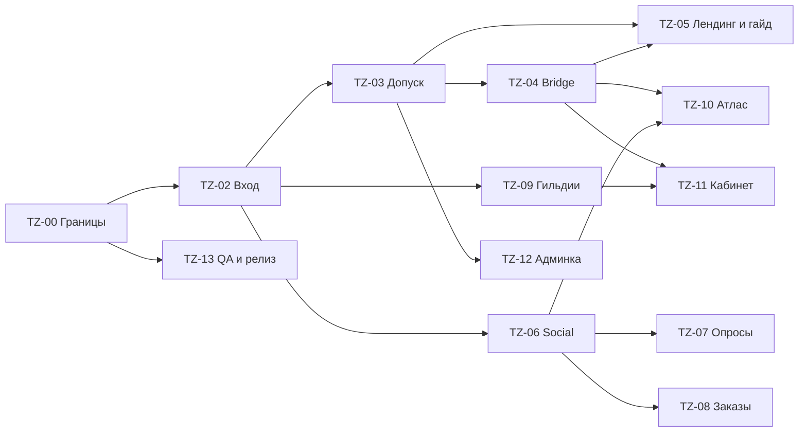

# TZ-00 · Product Scope / MVP — границы продукта и релиза

**Статус:** черновик для утверждения · **Версия:** 0.3 · **Базовая дата:** 13.11.2026 (пятница) · **Запуск:** 10.12.2026 (четверг), 27 календарных дней (14.11…10.12).

Структура — [шаблон ТЗ](TZ-template.md), разделы 0–12. Источник: [аудит концепции и разработки v2.0](<../MineOrt_IV_Аудит_концепции_и_разработки_v2 (1).md>) §18–§20, §23–§26 и Приложение C; ссылки вида `(аудит §19, стр. 888–911)` указывают номера строк файла аудита. «33 дня» в аудите (стр. 1030) — историческая цифра от 7.11.2026, здесь везде 27 дней ([C-01](../00-analysis/01-audit-analysis.md#3-противоречия-c-01c-18)).

**Теги:** [ЗАКРЕПЛЕНО] / [ПРЕДЛАГАЕТСЯ] / [ПРОВЕРИТЬ] / [ОПРЕДЕЛИТЬ] / [РИСК] — как в аудите; [ПРЕДЛОЖЕНИЕ КОМАНДЫ] — число, правило, механизм или дата, которых нет в аудите; [РЕШЕНИЕ ВЛАДЕЛЬЦА 13.11.2026] — решение владельца.

## Содержание

0. [Паспорт](#0-паспорт)
1. [Цели и границы](#1-цели-и-границы)
2. [Аудитория, акторы и разрешения](#2-аудитория-акторы-и-разрешения)
3. [Ключевые сценарии](#3-ключевые-сценарии)
4. [Состояния и UI](#4-состояния-и-ui)
5. [API и данные](#5-api-и-данные)
6. [Безопасность и приватность](#6-безопасность-и-приватность)
7. [Ограничения: ёмкость, SLO, лимиты](#7-ограничения-ёмкость-slo-лимиты)
8. [Критерии релиза и go/no-go](#8-критерии-релиза-и-gono-go)
9. [Тесты](#9-тесты)
10. [Зависимости: блокирующие решения и реестр ТЗ](#10-зависимости-блокирующие-решения-и-реестр-тз)
11. [Отложено (P2)](#11-отложено-p2)
12. [Журнал изменений и журнал решений](#12-журнал-изменений-и-журнал-решений)

---

## 0. Паспорт

| Поле | Значение |
|---|---|
| ID и название | TZ-00 · Product Scope / MVP (аудит §25, стр. 1087: «Границы P0/P1/P2, аудитория, критерии релиза, решения») |
| Версия и статус | 0.4 · черновик для утверждения владельцем (раунд 4 финального ревью плана) |
| Владелец ТЗ | Владелец проекта (роль `admin` с разрешением `roles.manage`); утверждает он же |
| Релиз и волна | Весь P0 + P1 к 10.12.2026 (P1a / P1b / P1c — внутренние вехи) [РЕШЕНИЕ ВЛАДЕЛЬЦА 13.11.2026] |
| Эпики | E00–E19 (сквозное ТЗ; соответствие эпиков и ТЗ — [п. 10.2](#102-реестр-тз-tz-00tz-13-и-соответствие-эпиков)) |
| Блокирующие OD | OD-03, OD-06, OD-22, OD-23 (внутри — [ОПРЕДЕЛИТЬ]: определение «источника» и политика UUID), OD-25, OD-26, OD-35, OD-36, OD-41, OD-45 (ветка несовершеннолетних, юрисдикция хранения [ПРОВЕРИТЬ]), OD-46 — [п. 10.1](#101-блокирующие-открытые-решения-и-варианты-по-умолчанию); приняты: OD-33, OD-34 |
| Риски | R-01, R-09 (критические, балл 9), R-15 (bus factor, высокий) — [реестр рисков](../04-plan/03-risk-register.md) |
| Связанные файлы | [анализ аудита](../00-analysis/01-audit-analysis.md) · [реестр OD](../00-analysis/03-open-decisions.md) · [IA](../01-product/01-information-architecture.md) · [модель статусов](../01-product/02-user-status-model.md) · [роли и права](../01-product/03-roles-permissions.md) · [сценарии P0](../02-scenarios/01-scenarios-access-p0.md) · [сценарии Social](../02-scenarios/02-scenarios-social.md) · [сценарии мира и гильдий](../02-scenarios/03-scenarios-world-guilds.md) · [архитектура](../03-architecture/01-architecture.md) · [Bridge](../03-architecture/02-bridge-protocol.md) · [модель данных](../03-architecture/03-data-model.md) · [NFR](../03-architecture/04-nfr-security.md) · [план релиза](../04-plan/01-release-plan.md) · [бэклог](../04-plan/02-backlog.md) · [план разработки MVP](../04-plan/04-mvp-development-plan.md) · [тесты](../05-qa/01-acceptance-tests.md) |

---

## 1. Цели и границы

### 1.1. Цели

1. Открыть 10.12.2026 сервер MineOrt IV и сайт-платформу: безопасный допуск игроков (Telegram-вход, ник, приглашение или заявка, управляемый whitelist, защищённый игровой вход) плюс базовая социальная платформа (аудит §18–§19, стр. 875–911).
2. Зафиксировать границы P0 / P1 / P2, аудиторию, критерии релиза и журнал решений как основу для остальных ТЗ (аудит §25, стр. 1087).
3. Принять и записать решение о границе релиза: [РЕШЕНИЕ ВЛАДЕЛЬЦА 13.11.2026] (OD-34) к 10.12.2026 выпускается **весь P0 + весь P1**; аудит называет это «высокорисковой целью» (стр. 923, 1030), риск фиксируется (R-09, R-15), цель не меняется.
4. Не выдавать неработающие заглушки за готовую функциональность (аудит стр. 1032): волна, не прошедшая go/no-go, скрывается фича-флагом целиком.

Аудит прямо оговаривает: целевой состав §18 — «не обещание, что всё будет безопасно реализовано к 10 декабря», этапы выпуска «не отменяют» требований (стр. 886) [ЗАКРЕПЛЕНО].

### 1.2. Восемь составляющих продукта (аудит §18, стр. 875–884)

[ЗАКРЕПЛЕНО как целевой состав продукта]. Колонка «Релиз / волна» — по [плану релиза, п. 2](../04-plan/01-release-plan.md#2-состав-к-1012) [РЕШЕНИЕ ВЛАДЕЛЬЦА 13.11.2026]; ТЗ и эпики — [п. 10.2](#102-реестр-тз-tz-00tz-13-и-соответствие-эпиков).

| № | Составляющая (аудит) | Что входит к 10.12 | Релиз / волна | Эпики | ТЗ |
|---|---|---|---|---|---|
| 1 | **Главная** с CTA «Начать играть» и секцией правил (стр. 876) | Лендинг, CTA по `onboarding_stage`, секция и страница правил с версиями; текст правил даёт владелец (OD-06) | P0 | E01, E05 | TZ-01, TZ-05 |
| 2 | **Telegram-вход, привязка ника, приглашения/заявки, whitelist, безопасное игровое подключение** (стр. 877) | Telegram OIDC, профиль, ник, приглашения (только admin, OD-36), заявки, очередь Bridge, честные статусы, limbo и подтверждение личности, защита от подмены ника, fail-closed | P0 | E02, E03, E04 | TZ-02, TZ-03, TZ-04 |
| 3 | **Как играть** — мастер установки и энциклопедия (стр. 878) | Мастер `/start`, сборка клиента (`.mrpack` + `.zip`, OD-25), Гайдбук с поиском | P0 | E06 | TZ-05 |
| 4 | **Social** — публикации/новости, голосования, календарь, заказы/помощь, галерея (стр. 879) | Лента, официальные новости, жалобы, галерея, медиа-хранилище; опросы; календарь; заказы и помощь | P1a (лента, новости, галерея) · P1b (опросы, календарь, посты от гильдии) · P1c (заказы, помощь) | E08, E09, E10 | TZ-06, TZ-07, TZ-08 |
| 5 | **Карта-атлас** на open source движке, метки, изображения, `/marker new` (стр. 880) | Атлас на BlueMap или Dynmap (OD-16), метки `public` / `guild` / `private`, фото к меткам, `/marker new`; тайлы только за сессией (OD-47, [ПРЕДЛОЖЕНИЕ КОМАНДЫ]) | P1c | E13, E14 | TZ-10 |
| 6 | **Игроки и гильдии** — цветные теги, создание гильдий админом, ранги главами (стр. 881) | Каталог игроков; админ-создание гильдий, глава, приглашения, ранги, цветные теги **на сайте**; серверная проверка прав | P1a (каталог) · P1b (гильдии) | E11, E12 | TZ-09 |
| 7 | **Личный кабинет** — базовая статистика и история действий сайта (стр. 882) | Статус допуска, ник, адрес по разрешению (P0); история действий, базовая игровая статистика, настройки публичности (P1a) | P0 (статус) · P1a (история) | E07, E15 | TZ-11 |
| 8 | **Админ-панель** — заявки, доступы, гильдии, модерация (стр. 883) | `/admin`: заявки, игроки, приглашения, правила, Bridge, аудит, гайды (P0); модерация (P1a); гильдии (P1b); карта (P1c) | P0 + P1 по волнам | E03, E04, E08, E11, E13 | TZ-12 (и TZ-03, TZ-04 для допуска) |

### 1.3. Что входит и что не входит

Решение владельца [РЕШЕНИЕ ВЛАДЕЛЬЦА 13.11.2026]: к 10.12 — P0 и P1 целиком; P2 — после. Состав блоков и часы — [план релиза, п. 2](../04-plan/01-release-plan.md#2-состав-к-1012).

#### P0 — обязательные технические условия запуска (аудит стр. 890–899)

| Входит | Не входит в P0 |
|---|---|
| Лендинг, CTA и секция правил с механизмом наполнения (стр. 892); SC-ONB-01…04, SC-ADM-03 | Социальные разделы, карта, гильдии, расширенный кабинет (→ P1) |
| Telegram Login, профиль, привязка ника (стр. 893); SC-AUTH-01…07, SC-ACC-01 | Игровые теги гильдий, Mini App, расширенные уведомления (→ P2) |
| Приглашения, заявки, подтверждение администратором (стр. 894); SC-ACC-02, 03, 05, 06, SC-ADM-01, 08 | Квоты приглашений для игроков (OD-36: позже) |
| Whitelist Bridge и честные статусы синхронизации (стр. 895); SC-ACC-07…09, 11, SC-ADM-04, SC-OPS-04 | Автоудаление «лишних» записей whitelist (только drift для admin) |
| Защищённый вход для offline- и Premium-игроков, тесты подмены ника (стр. 896); SC-GAME-01…06, SC-ACC-10, 12 | Автологин Premium без проверки сессии Mojang (OD-23, C-14) |
| Мастер «Начать играть», реальная сборка, инструкции (стр. 897); SC-GUIDE-01…04 | Редактор гайдов, диагностика ошибок, тикеты (→ P2) |
| Базовый кабинет: статус допуска, ник, ссылка на гайд, адрес сервера по разрешению (стр. 898); SC-DSH-01 | История действий, игровая статистика (→ P1a, C-12) |
| Админ-интерфейс допуска; бэкапы, тесты безопасности (стр. 899); SC-ADM-02, 05, 06, SC-OPS-01…03 | Вход в игру при недоступном backend (fail-closed, не «открыто») |

#### P1 — базовая социальная платформа (аудит стр. 901–911), волны — внутренние вехи

| Волна | Входит (с аудитом) | SC |
|---|---|---|
| **P1a** | Общий поток публикаций и официальные новости (стр. 903); галерея и медиа-хранилище (906); каталог игроков с фильтром по гильдиям (907); кабинет с историей действий и базовой игровой статистикой (909); обязательные уведомления | SC-SOC-01…07, SC-GAL-01, 02, SC-PLR-01, 02, SC-DSH-02, 03, SC-ADM-07 (контент) |
| **P1b** | Админ-создание гильдий, назначение главы, приглашения, ранги, цветные теги на сайте (908); опросы с уникальностью голосов, календарь (904); посты от гильдии | SC-GLD-01…11, SC-POLL-01…03, SC-EVT-01, 02, SC-SOC-08 |
| **P1c** | Табло заказов и помощи (905); BlueMap/Dynmap в первичной интеграции с атласом, метками и изображениями (910); `/marker new` и привязка метки к учётной записи (911) | SC-REQ-01…03, SC-MAP-01…06, SC-MRK-01…03, SC-ADM-07 (метки) |

| Не входит в P1 |
|---|
| Игровая синхронизация цветных тегов (чат, TAB, над головой) — P2, E17 (OD-15, C-05) |
| Правка и удаление меток игровыми командами (`/marker list/edit/delete`) — сайт P1c, игровые команды P2 (C-09) |
| Полная собственная оболочка атласа, End, территории, дороги — P2 (OD-17, OD-21) |
| Передача главенства самими главами — P2 (OD-12) |

#### P2 — после 10.12 (аудит стр. 913–921)

Полная оболочка атласа; синхронизация тегов гильдий с игровым чатом, TAB и т.п.; расширенная аналитика, проекты со сбором ресурсов, связь заказов с контейнерами (E18); богатые комментарии, подписки, упоминания, уведомления и модерация; ImageFrame через сайт и генератор команд (с защитой от SSRF); диагностика, тикеты поддержки, редактор гайдов; Mini App, летопись MineOrt I–IV, расширенные сообщества. Подробнее — [п. 11](#11-отложено-p2).

### 1.4. Инварианты, которыми нельзя жертвовать

Инварианты не сокращаются ни одной ступенью [лестницы сокращений](../04-plan/01-release-plan.md#5-лестница-сокращений); если защита не готова, зависящая от неё функция **не выходит** (скрывается флагом), а не выходит «без защиты» [РЕШЕНИЕ ВЛАДЕЛЬЦА 13.11.2026 — перечень; обоснование — аудит].

| № | Инвариант | Основание в аудите | Проверка |
|---|---|---|---|
| INV-1 | Offline-безопасность входа: до успешной аутентификации нет движения, предметов, команд, чата; limbo; подтверждение личности (со сверкой числа и одним выбором на challenge: неверное число или «Это не я» — `denied`); подписанные решения входа; жизнь challenge равна жизни limbo-соединения (`/abandon`); защита от подмены ника и параллельного входа; карантин освобождённого ника (инвариант I-12) и отложенная архивация: данные не сбрасываются при бане, отзыве и удалении, архив обязателен при повторной выдаче ника на всех путях; смена ника переносит данные (`player.data_migrate`); fail-closed. «Для ускорения нельзя жертвовать проверкой offline-авторизации» | стр. 232, 1030; «главный блокер запуска» — стр. 1112; критический риск — стр. 958 | AC-05, AC-29, AC-30; TC-GAME-01c, 03a…c, 04a…d, 06a, 07a…c; TC-ACC-10b, 11d, 12d; TC-OPS-04g |
| INV-2 | Честные статусы: «Доступ готов» и адрес сервера — только при `desired = on` и `applied_state = applied`; при выключенном Minecraft — ожидание, не ложный успех; reconciliation не подтверждает ложно | стр. 847, 960; AC-21 | AC-21, AC-28; TC-ACC-07a…c, 09a…c |
| INV-3 | Бэкапы и проверенное восстановление (тест в окне 03.12–07.12 — не ранее чем за 7 и не позднее чем за 3 дня до запуска, RTO ≤4 ч; режим восстановления: сайт в режиме только чтения, глобальный отзыв сессий, внешний append-only журнал `audit_log` и `security_events` с RPO ≤ 5 мин, diff по нему с повторным применением, вход в игру закрыт (`paused`) до закрытия diff; бан и отзыв из последних суток не воскресают) | стр. 842, 866 | SC-OPS-01; NFR-REL-01…06, NFR-REL-11, NFR-REL-13; TC-OPS-01c |
| INV-4 | Аудит админ-действий и подпись команд Bridge (Ed25519 + HMAC); чужая и просроченная команда отклоняется | стр. 725, 822–829 | AC-22, AC-27, AC-34; TC-OPS-04a…g |
| INV-5 | Серверная проверка прав гильдий; ранг гильдии не даёт прав сайта, OP, RCON, LuckPerms; ровно один owner; последнего owner удалить нельзя (если выходит P1b) | стр. 532, 556, 829, 959, 965 | AC-18, AC-23; TC-GLD-05a…e, 06a…d, 10a…c |
| INV-6 | Приватность меток: закрытая метка недоступна по прямому URL, API, движку и тайлам (если выходит P1c) | стр. 679, 806, 963 | AC-31; TC-MAP-04a…d |
| INV-7 | Секреты (HMAC Bridge, ключ Ed25519, токен бота) только в менеджере секретов; Bridge — только исходящий HTTPS, без RCON и произвольных консольных команд | стр. 675, 808 | NFR-SEC-10; SC-OPS-04 |
| INV-8 | Сайт и БД работают при выключенном Minecraft; Minecraft не зависит от сайта сильнее, чем fail-closed | стр. 674, 846 | SC-OPS-02; NFR-PERF-07 |
| INV-9 | Привилегированные данные (роли, статусы, привязки, ранги) записываются только через backend / RPC `SECURITY DEFINER`; клиентские роли пишут напрямую лишь непривилегированные колонки по `GRANT` [ПРЕДЛОЖЕНИЕ КОМАНДЫ — расширение перечня, подтверждает владелец] | — (раунд ревью, B2) | NFR-SEC-15; TC-OPS-06g |
| INV-10 | Чтение закрытых данных только через представления: `anon` и `authenticated` не имеют `SELECT` на базовые таблицы с закрытыми колонками; публичное чтение — `public_members`, `public_profiles`, `public_guilds` [ПРЕДЛОЖЕНИЕ КОМАНДЫ — расширение перечня, подтверждает владелец] | — (раунд 3, R3-07) | NFR-SEC-19; TC-OPS-06h |
| INV-11 | Бан не обходится удалением аккаунта: самоудаление при `banned` / `suspended` запрещено, `deletion_tombstones` с `banned` и `ban_until` проверяется при Telegram-входе до создания `users` [ПРЕДЛОЖЕНИЕ КОМАНДЫ — расширение перечня, подтверждает владелец] | — (раунд 3, R3-06) | NFR-SEC-20; TC-DSH-04d |

---

## 2. Аудитория, акторы и разрешения

### 2.1. Аудитория

Сообщество друзей одной школы, играющее на приватном Minecraft-сервере MineOrt IV (аудит стр. 27, 60); доступ закрытый — по приглашению или заявке. Часть участников может быть несовершеннолетней — вопрос возраста и политики данных открыт: ОТКРЫТО → OD-45 (G-13). Часть игроков использует Premium-аккаунты, часть — offline (аудит §6.4, стр. 228–234).

Сценарии-ориентиры (аудит §20): игрок впервые приходит на сайт и хочет начать играть (AC-01, AC-02); приглашённый и неприглашённый игроки (AC-03, AC-04); администратор и модератор принимают решения (AC-22); глава гильдии управляет составом (AC-16…AC-18).

### 2.2. Акторы

Три независимых измерения (аудит §16.1, стр. 814–820): уровень доступа к платформе, глобальная роль сайта, роль в гильдии. Полная матрица — [роли и права](../01-product/03-roles-permissions.md); модель статусов — [02-user-status-model](../01-product/02-user-status-model.md).

| Актор | Измерение | Кто это |
|---|---|---|
| Гость (`guest`) | Доступ | Нет сессии; видит главную, правила, `/start` (мастер открыт, OD-03), официальные новости и public-галерею (OD-02, по умолчанию) |
| Пользователь Telegram (`tg_user`) | Доступ | Вошёл, нет допуска; выбирает ник, принимает правила, подаёт заявку или гасит приглашение |
| Заявитель (`applicant`) | Доступ | Есть заявка `pending` или членство `pending`; читает Social |
| Участник (`member`) | Доступ | `access_memberships.status = approved`, аккаунт `active`; публикует контент; игровой доступ определяется whitelist и `game_identity` |
| Ограниченный (`restricted`) | Доступ | `suspended` / `banned` / `revoked`; видит только экран ограничения и контакт |
| `player` / `moderator` / `admin` | Роль сайта | «Владелец» = `admin` + разрешение `roles.manage`, не отдельная роль |
| `owner` … `member` гильдии | Ранг | owner, vice_leader, officer_1…3, member (шаблон из 6 уровней, OD-09) |
| Bridge, планировщик, бот | Системные | Исполнитель очереди, фоновые задачи, Telegram-бот |

### 2.3. Принципы разрешений

1. Проверки прав — на сервере на каждом запросе; скрытие кнопки не является защитой (аудит §16.2, стр. 822–829; AC-18).
2. Права ролей сайта читаются из БД, не из токена или клиента (NFR-SEC-06).
3. Критичные админ-операции — со step-up (TOTP или passkey, 15 минут): перепривязка Telegram, смена ника/UUID, бан и разбан, `roles.manage`, ротация секрета Bridge, критичные отмены очереди, смена главы (AC-34, G-18) [ПРЕДЛОЖЕНИЕ КОМАНДЫ].
4. Кто выдаёт приглашения — только `admin` (OD-36, по умолчанию); кто публикует — OD-27; кто модерирует — OD-28.

---

## 3. Ключевые сценарии

Полный перечень — файлы [сценариев](../02-scenarios/01-scenarios-access-p0.md). Ниже — минимальный набор, по которому проверяется продукт в целом («сквозная вертикаль» M2, 26.11, и критерии go/no-go). Прототипы-вертикали аудита §22.1 (стр. 999–1007) — спайки SP-01…SP-07 [бэклог](../04-plan/02-backlog.md).

| Блок | Сценарии | AC | Релиз / волна |
|---|---|---|---|
| Путь нового игрока | [SC-ONB-01](../02-scenarios/01-scenarios-access-p0.md), SC-ONB-02, SC-ONB-03, SC-ONB-04, SC-AUTH-01, SC-ACC-01, SC-ACC-02, SC-ACC-05 | AC-01…04, AC-07, AC-33 | P0 |
| Честный допуск | SC-ACC-07 (MC выключен), SC-ACC-08 (ошибка/таймаут), SC-ACC-09 (reconciliation), SC-ACC-11 (отзыв, карантин ника), SC-ACC-12, SC-OPS-02 | AC-21, AC-28 | P0 |
| Игровая безопасность | SC-GAME-01 (первый вход, сверка числа), SC-GAME-03 (подмена ника), SC-GAME-04 (fail-closed), SC-GAME-06 (до авторизации нельзя ничего), SC-GAME-07 (параллельный и повторный вход), SC-OPS-04 (подпись Bridge и решений входа) | AC-05, AC-27, AC-29, AC-30 | P0 |
| Подключение | SC-GUIDE-01, SC-GUIDE-02, SC-GUIDE-03 | AC-06 | P0 |
| Админ-допуск | SC-ADM-01, SC-ADM-02 (step-up), SC-ADM-04, SC-ADM-05, SC-ADM-08 | AC-22, AC-26, AC-34 | P0 |
| Эксплуатация | SC-OPS-01 (бэкап, тест восстановления, режим восстановления), SC-OPS-03 | NFR-REL | P0 |
| Данные пользователя | SC-DSH-04 (удаление аккаунта) · SC-DSH-05 (выгрузка своих данных) | AC-22, AC-24 · NFR-LIM-20 | P0 · P1a |
| Social | SC-SOC-01, SC-SOC-03, SC-SOC-04, SC-GAL-01 | AC-08, AC-12, AC-24 | P1a |
| Гильдии и опросы | SC-GLD-01, SC-GLD-04, SC-GLD-05 (самоповышение), SC-GLD-06 (последний глава), SC-POLL-02 (повторный голос), SC-EVT-01 | AC-09, AC-10, AC-15…18, AC-23 | P1b |
| Атлас и метки | SC-MAP-04 (закрытая метка не утекает), SC-MRK-01, SC-MRK-03 (дубль события), SC-REQ-01 | AC-11, AC-13, AC-31, AC-32 | P1c |

Новые критерии приёмки AC-25…AC-34 введены командой [ПРЕДЛОЖЕНИЕ КОМАНДЫ] ([анализ аудита, п. 5](../00-analysis/01-audit-analysis.md)). Привязка AC к релизу и волне:

| Релиз / волна | AC |
|---|---|
| P0 | AC-01…AC-07, AC-20 (статус), AC-21, AC-22, AC-25…AC-30, AC-33, AC-34 |
| P1a | AC-08, AC-12, AC-19, AC-20 (история), AC-24 (посты) |
| P1b | AC-09, AC-10, AC-15, AC-16, AC-17, AC-18, AC-23 |
| P1c | AC-11, AC-13, AC-14, AC-31, AC-32, AC-24 (метки) |

---

## 4. Состояния и UI

Состояния заданы моделью независимых измерений, а не линейной цепочкой аудита (стр. 217–226; C-02) [ПРЕДЛОЖЕНИЕ КОМАНДЫ] — [модель статусов](../01-product/02-user-status-model.md).

### 4.1. Канонические перечисления (единые для всех ТЗ)

| Измерение | Значения |
|---|---|
| `users.account_status` | active \| suspended \| banned \| deleted |
| `applications.status` | draft \| pending \| approved \| rejected \| withdrawn |
| `invitations.status` | active \| exhausted \| expired \| revoked |
| `access_memberships.status` | pending \| approved \| suspended \| revoked |
| `whitelist_entries` | `desired` on \| off; `applied_state` not_requested \| pending \| applied \| failed \| drift |
| `minecraft_identities.binding_status` | reserved \| confirmed \| released; `account_type` premium \| offline \| unknown |
| `game_identity` | unconfirmed \| confirmed |
| `server_actions.status` | queued \| leased \| succeeded \| failed_retryable \| failed \| expired \| cancelled |
| `login_challenges.status` | pending \| confirmed \| denied \| expired \| abandoned |
| `bridge_servers.status` | online \| offline \| paused |
| Уровень доступа | guest \| tg_user \| applicant \| member \| restricted |
| `onboarding_stage` (производный) | guest \| needs_rules \| needs_nick \| needs_access \| application_pending \| application_rejected \| access_preparing \| ready_to_install \| first_login_pending \| active \| restricted |
| `site_role` | player \| moderator \| admin |
| `guild_rank` (уровень 1→6) | owner \| vice_leader \| officer_1 \| officer_2 \| officer_3 \| member |

### 4.2. Навигация и UI-термины

- Шесть разделов (аудит стр. 90–102, Приложение C стр. 1202): Главная, Как играть, Общение (код `social`), Карта (продукт «Атлас»), Игроки (вкладка «Гильдии», OD-01), Личный кабинет; плюс `/admin`. Карта маршрутов — [IA](../01-product/01-information-architecture.md).
- Термины UI (запрещены синонимы аудита, [глоссарий](../00-analysis/02-glossary.md)): «Как играть» (энциклопедия — «Гайдбук»), «Карта» / «Атлас», «Общение», «Игроки», «Гильдия» (OD-07).
- CTA «Начать играть» зависит от `onboarding_stage` (AC-01, AC-02); `/start` открыт всем авторизованным, адрес и «Можно подключаться» — только при `applied_state = applied` (OD-03, по умолчанию).
- Пункты меню и маршруты выключенных волн скрыты; API возвращает 404; данные сохраняются (US-E00-05).

### 4.3. Обязательные UI-состояния

Для каждого списка и формы — loading / empty / error / success; ошибки — понятным языком, без технических деталей (NFR-A11Y-08, NFR-A11Y-10); время — хранение UTC, показ в поясе браузера с меткой пояса (OD-42, NFR-A11Y-09). Тексты правил сервера и юридические тексты команда **не придумывает** (OD-06, OD-45).

---

## 5. API и данные

Для TZ-00 раздел носит сквозной характер; контракты — в профильных ТЗ.

| Соглашение | Правило | Источник |
|---|---|---|
| Источник истины | Bridge — единственный канал сайт → Paper; сайт и БД не зависят от Minecraft | [архитектура](../03-architecture/01-architecture.md), аудит стр. 672–680 |
| Единый журнал | `audit_log` со `scope` (global / guild) вместо отдельных гильдейских журналов; `security_events` — технические и подозрительные события; `site_activity` — пользовательская проекция, не аудит | [модель данных](../03-architecture/03-data-model.md), C-10 [ПРЕДЛОЖЕНИЕ КОМАНДЫ] |
| Раздельные сущности | `applications` и `guild_join_requests`; `invitations` и `guild_invitations`; единые `media` + полиморфные `media_attachments` | C-10 |
| Идемпотентность | `action_id`, `(server_id, event_id)`, партионные уникальные индексы на допуск | [Bridge](../03-architecture/02-bridge-protocol.md), [модель данных](../03-architecture/03-data-model.md) |
| Защита данных | RLS «по умолчанию закрыто»; закрытые данные не отдаются публичным API (аудит стр. 804–808); публичное чтение — только через представления `public_members`, `public_profiles`, `public_guilds`, прямого `SELECT` на базовые таблицы с закрытыми колонками нет (R3-07) | NFR-SEC-06, NFR-SEC-13, NFR-SEC-19 |
| Модель записи | Клиентские роли не пишут напрямую в таблицы с привилегированными колонками (`site_role`, `account_status`, `game_identity`, `binding_status`, `applications.status`, `guild_members.rank_id` и др.): переходы выполняют backend или RPC `SECURITY DEFINER` с проверкой прав, инвариантов и аудита; где запись с клиента разрешена — `GRANT UPDATE` по колонкам. В матрице RLS вместо «З» — «через API» (B2) [ПРЕДЛОЖЕНИЕ КОМАНДЫ] | NFR-SEC-15; [модель данных, п. 8.1](../03-architecture/03-data-model.md#81-паттерн-записи-b2); TC-OPS-06g |
| Хранение и удаление | Мягкое удаление; медиа физически через 30 дней; аудит хранится (OD-40) | NFR-OPS-01…05 |

Стек (OD-35, по умолчанию): Next.js + TypeScript, Tailwind, Supabase/PostgreSQL, Vercel, Java Paper Bridge [ПРОВЕРИТЬ] — ОТКРЫТО → OD-35 до 16.11.

---

## 6. Безопасность и приватность

Модель угроз и контролей — [NFR и безопасность](../03-architecture/04-nfr-security.md) (угрозы T-xx, §9). Критичные угрозы аудита (§21, стр. 956–970):

| Приоритет аудита | Угроза | Контроль (кратко) | ТЗ / TC |
|---|---|---|---|
| Критический | Захват ника и инвентаря в offline-режиме | limbo, подтверждение личности с одним выбором на challenge, подписанные решения входа, единое правило блокировки пары «ник + источник» и бюджет на ник, отказ параллельного входа, карантин освобождённого ника с отложенной архивацией, fail-closed | TZ-04; TC-GAME-03a…c, 04a…d, 07a…c; TC-OPS-04g; TC-ACC-11d, 12d |
| Высокий | Воскрешение бана или отзыва после восстановления БД; прямая запись клиентской ролью в роли и статусы | Режим восстановления (read-only сайт, отзыв всех сессий, внешний журнал, Bridge на паузе, ручной разбор diff); запись только через API; чтение закрытых колонок только через представления | TZ-04, TZ-02; TC-OPS-01c, TC-OPS-06g, TC-OPS-06h |
| Критический | Эскалация гильдейской роли в глобальные права | Раздельные модели прав, серверные проверки, негативные тесты | TZ-09; TC-GLD-05a…e, 10a…c |
| Высокий | Ошибочный whitelist и неполная синхронизация | Очередь с подтверждением, retry, reconciliation | TZ-03, TZ-04; TC-ACC-07*…09* |
| Высокий | Разглашение баз через метки и тайлы | Видимость на сервере, закрытие прямых URL, тайлы за сессией | TZ-10; TC-MAP-04a…d |
| Высокий | Вредоносные файлы и URL | Только JPEG/PNG/WebP, перекодирование, без SVG, лимиты; ImageFrame — P2 с allowlist | TZ-06; TC-SOC-05a…e |
| Высокий | Слишком много функций до 10.12 | Лестница сокращений, go/no-go по волнам | [план релиза](../04-plan/01-release-plan.md) |

Приватность: публичность Telegram ID, IP, кодов и журналов исключена (аудит стр. 487, 804). Политика конфиденциальности `/privacy`, согласие при первом входе, возраст участников — ОТКРЫТО → OD-45 (срок 19.11; по умолчанию — ветка несовершеннолетних: самодекларация возраста, согласие родителя с текстом от владельца, минимизация данных; юрисдикция хранения Supabase/Vercel — [ПРОВЕРИТЬ]). Удаление аккаунта (SC-DSH-04, P0) требует свежего Telegram-входа (не старше 5 минут), рвёт привязку Telegram сразу и запрещено при `banned` / `suspended` (`ERR_DELETE_FORBIDDEN_BANNED`); `deletion_tombstones` хранит HMAC-хэш Telegram ID на 30 дней, а для забаненного — не меньше срока бана (поля `banned`, `ban_until`; TC-DSH-04d) — [ОПРЕДЕЛИТЬ → OD-45 / OD-40]. Выгрузка своих данных (SC-DSH-05, P1a) — только свои данные, без секретов. Сроки хранения (audit_log 1 год, security_events 180 дней, IP 30 дней) — [ПРЕДЛОЖЕНИЕ КОМАНДЫ], [NFR](../03-architecture/04-nfr-security.md). Граница публичности статистики — ОТКРЫТО → OD-29.

Тайлы карты и геометрия баз (C-15, G-11, R-21): рекомендация — тайлы только для `member` с проверкой сессии, гостям — обзор низкого разрешения [ОПРЕДЕЛИТЬ]; решение до M2 26.11 — **OD-47 [ПРЕДЛОЖЕНИЕ КОМАНДЫ]** ([реестр OD](../00-analysis/03-open-decisions.md#2-сводная-таблица)).

---

## 7. Ограничения: ёмкость, SLO, лимиты

### 7.1. Ёмкость и реальность срока

[РЕШЕНИЕ ВЛАДЕЛЬЦА 13.11.2026] OD-33: один основной поток разработки (владелец) + AI-агенты; отдельных разработчиков и тестировщиков нет. Числа взяты из [плана релиза, п. 1](../04-plan/01-release-plan.md#1-допущения-и-ёмкость), [анализа аудита, п. 6](../00-analysis/01-audit-analysis.md#6-реалистичность-сроков-на-13112026) и [бэклога, п. 5](../04-plan/02-backlog.md); здесь не пересчитываются [ПРЕДЛОЖЕНИЕ КОМАНДЫ].

| Показатель | Значение |
|---|---|
| Срок | 13.11 → 10.12.2026 — 27 календарных дней |
| Ёмкость владельца | 6 ч/день → **162 ч**; 10 ч/день → **270 ч** |
| Оценка аудита (стр. 1017–1024) | 116–205 задач; ориентир **250–550 ч**; полный P0+P1 к дате — «высокорисковая цель» (стр. 1030) |
| Бэклог снизу вверх (без ускорения AI) | **914 ч**, 154 истории: P0 — 89 / 550 ч; P1a — 23 / 120 ч; P1b — 24 / 134 ч; P1c — 18 / 110 ч (v0.2: +11 историй, +68 ч; v0.3: +11 историй, +54 ч за счёт защитных работ раундов ревью; v0.4: +11 историй, +64 ч — стенд PAPER-T, домен, ТЗ, тестовый вход, Java CI, наполнение) |
| Требуемое ускорение | бэклог ÷ ёмкость: **×5,6** (6 ч/день) / **×3,4** (10 ч/день); P0 один — ×3,4 / ×2,0; по аудиту — ×1,5…3,4 (6 ч) и ×0,9…2,0 (10 ч) |
| Нагрузка владельца как узкого места | 415 ч против 162 / 270 ч (×2,6 / ×1,5); на P0 — 300 ч (×1,9 / ×1,1); пик W3 — 193 ч при 42 / 70 ч доступных, из них P0 — 122 ч (92 ч «В») |
| Риски | **R-09** «слишком много функций до 10.12» — критический (балл 9); R-01 offline-вход — 9; **R-15** bus factor — высокий (6) |

**Вывод для TZ-00 (ссылка, не пересчёт):** без кратного ускорения силами AI-агентов и без лестницы сокращений цель P0+P1 не выполнима ни в одном из сценариев; допущение множителя проверяется спайком SP-07 в W1, точка пересмотра — M1 (19.11). Лестница сокращений и go/no-go по волнам — обязательные механизмы, а не запасные ([план релиза, п. 5](../04-plan/01-release-plan.md#5-лестница-сокращений)).

Порядок сокращений [РЕШЕНИЕ ВЛАДЕЛЬЦА 13.11.2026]: сначала глубина P1 → затем целые волны P1c, затем P1b переносятся на после 10.12 → затем P0-упрощения (пути захвата аккаунта — только с подтверждения владельца) → ступень 7 [ПРЕДЛОЖЕНИЕ КОМАНДЫ]: сдвиг даты или закрытый запуск только P0 — решение владельца; «никогда не режем» — [п. 1.4](#14-инварианты-которыми-нельзя-жертвовать). Остаток после ступеней 1–6 — 526 ч (1,9× ёмкости при 10 ч/день); пороги множителя SP-07 (при 10 ч/день, по фактической скорости владельца на «В»-историях W1): < 3,4× → ступени 3–4, < 2,4× → готовить ступени 5–6, < 1,9× → ступень 7 (сдвиг даты по формуле `13.11 + остаток_ч ÷ (множитель × ч/день)` или закрытый запуск только P0 — решение владельца; закрытый запуск разрыв по часам не устраняет) ([план релиза, п. 5](../04-plan/01-release-plan.md#5-лестница-сокращений)).

### 7.2. Ключевые числа NFR

Все числа — в [NFR](../03-architecture/04-nfr-security.md); [ПРЕДЛОЖЕНИЕ КОМАНДЫ], если не указан аудит.

| Область | Значение | NFR |
|---|---|---|
| Доступность сайта | 99,5 % в месяц | NFR-PERF-01 |
| Чтение / запись p95 | < 500 мс / < 1 с | NFR-PERF-02, 03 |
| Применение whitelist p95 (сервер онлайн) | < 60 с | NFR-PERF-04 |
| LCP на `/` и `/start` (mid-mobile, 4G) | < 2,5 с; initial JS ≤ 200 КБ gzip | NFR-PERF-05, 06 |
| Бэкапы | БД ежедневно; RPO ≤ 24 ч; RTO ≤ 4 ч; тест восстановления в окне 03.12–07.12 (не ранее чем за 7 и не позднее чем за 3 дня до запуска); режим восстановления БД | NFR-REL-01…06, NFR-REL-11, NFR-REL-13 |
| Сессии | 30 дней rolling; админская 12 ч; step-up 15 мин | NFR-SEC-02…04 |
| Игровой код и пароль | 5 неудач за 10 мин → блок пары «ник + источник» на 15 мин; TTL кода 5 мин; бюджет пароля на ник — 20 неверных за час (отключает только парольный путь); оповещения об отказах в бот — не больше 3 в час на ник, challenge живого входа уходит всегда; бюджет challenge ≤ 3 за 10 мин для источника, не подтверждавшего вход; подтверждавшие источники освобождены (R4-01) | NFR-LIM-16, NFR-LIM-22, NFR-LIM-23 |
| Запросы Bridge | general 120/мин; auth 600/мин (пересчёт от пикового онлайна) | NFR-LIM-18, NFR-LIM-19 |
| Выгрузка своих данных | 1 в 24 ч, ссылка 24 ч | NFR-LIM-20 |
| Доступность интерфейса | WCAG 2.2 AA, минимум 320 px | NFR-A11Y-01, 06 |

---

## 8. Критерии релиза и go/no-go

Решение принимается на **M4 (08.12.2026)** по каждому блоку отдельно, затем заморозка 09.12 и запуск M5 10.12. Полные таблицы, проверки и схема решения — [план релиза, п. 4](../04-plan/01-release-plan.md#4-критерии-gono-go); здесь — сводка для владельца.

### 8.1. P0 — обязателен (G0-01…G0-12)

Если любой из G0-01…G0-12 не выполнен — запуск откладывается или сужается: P0 нельзя выпускать с известной дырой входа или ложными статусами.

| № | Критерий | AC / SC |
|---|---|---|
| G0-01 | 100 % TC P0 приоритета Blocker и Critical пройдены (Blocker, добавленные в v0.2 и v0.3: TC-GAME-01c, TC-GAME-07b, TC-OPS-06g, TC-OPS-06h, TC-ACC-11d, TC-OPS-04g, TC-DSH-04a, TC-DSH-04d) | AC-01…07, 20 (статус), 21, 22, 25…30, 33, 34 |
| G0-02 | 0 открытых дефектов безопасности Critical и High | pentest-lite |
| G0-03 | Подмена ника, сверка числа, параллельный и повторный вход, fail-closed (в том числе под нагрузкой без 429) и limbo пройдены на продовой конфигурации | AC-05, AC-29, AC-30; TC-GAME-01c, 04d, 07a…c |
| G0-04 | Reconciliation: drift выявляется, «Доступ готов» не показывается ложно | AC-28 |
| G0-05 | Одобрение при выключенном MC остаётся `pending` и применяется после запуска | AC-21 |
| G0-06 | Bridge отклоняет неподписанную, просроченную, чужую команду и не снимает limbo по неподписанному ответу решения входа; ротация секрета проверена | AC-27; TC-OPS-04a…g |
| G0-07 | Тест восстановления в окне 03.12–07.12 (не ранее чем за 7 и не позднее чем за 3 дня до запуска), RTO ≤ 4 ч; режим восстановления (TC-OPS-01c, Critical: read-only, отзыв сессий, сверка с внешним журналом, вход закрыт); бэкап мира перед запуском | SC-OPS-01 |
| G0-08 | Правила v1 опубликованы (текст владельца — OD-06, до 01.12) | AC-07, AC-33 |
| G0-09 | У 100 % админов настроен step-up | AC-34 |
| G0-10 | Сайт работает при выключенном Minecraft | SC-OPS-02 |
| G0-11 | IP/домен сервера и клиентская сборка с контрольной суммой опубликованы (OD-25, OD-26) | AC-06 |
| G0-12 | Whitelist p95 < 60 с; LCP < 2,5 с на `/` и `/start` | NFR-PERF |

### 8.2. Волны P1 — выпускаются только прошедшие критерии, иначе фича-флаг

Общие условия для каждой волны: 0 открытых Critical/High дефектов безопасности в её модулях; smoke-набор P0 не сломан; ревью владельца завершено [ПРЕДЛОЖЕНИЕ КОМАНДЫ].

| Волна | Флаг | Ключевые критерии | Если не выполнено |
|---|---|---|---|
| P1a | `ff_p1a` | Blocker/Critical TC по AC-08, 12, 19, 20 (история), 24 (посты); безопасность медиа (SVG, polyglot, EXIF, квоты, прямой URL) — 0 High; видимость гостю и заявителю, приватность профиля; выгрузка своих данных без чужого (TC-DSH-05a, 05b) | Волна скрыта; сайт остаётся на P0 |
| P1b | `ff_p1b` (`ff_p1b_guilds`, `ff_p1b_social`) | Blocker/Critical TC по AC-09, 10, 15…18, 23; **серверные проверки прав гильдий через прямой API 100 %** (TC-GLD-04g, 05a…e, 06a…d, 10a…c); повторный голос, гонка и голос с вариантом чужого опроса (TC-POLL-02e) | Гильдии скрыты; опросы и календарь могут выйти отдельно |
| P1c | `ff_p1c` (`ff_p1c_atlas`, `ff_p1c_requests`) | Blocker/Critical TC по AC-11, 13, 14, 31, 32, 24 (метки); **закрытая метка недоступна** через URL, API, движок, тайлы (TC-MAP-04a…d); дубль `/marker new`; стресс-тест на BisectHosting (пороги — [ОПРЕДЕЛИТЬ] владельцем); тайлы только за сессией | Атлас и заказы скрыты; `/marker new` отключается конфигурацией плагина |

Критерии AC-18, AC-23 (права гильдий) и AC-31 (видимость меток) — **жёсткие**: нарушение не компенсируется другими результатами.

### 8.3. Определение «релиз состоялся» для TZ-00

1. Все критерии G0-01…G0-12 выполнены.
2. Для каждой выпущенной волны выполнены её критерии; невыпущенные — под флагом и записаны в [план после 10.12](../04-plan/01-release-plan.md#8-план-после-1012).
3. Журнал решения M4 (кто, когда, какие флаги) внесён в [реестр OD](../00-analysis/03-open-decisions.md).

---

## 9. Тесты

Для TZ-00 тесты сквозные; каждая AC покрыта ≥ 1 TC в [приёмочных тестах](../05-qa/01-acceptance-tests.md) (матрица AC → SC → TC → релиз → эпик → ТЗ). Приложения пока нет: кейсы — спецификация (OD-33: тестировщиков нет, прогон автоматизирован и ручной по списку безопасности).

| Группа | TC (закреплены в пакете) | Приоритет | Уровень |
|---|---|---|---|
| Подмена ника, limbo, fail-closed, сверка числа, параллельный вход | TC-GAME-03a…c, 04a…d, 06a, 01a, 01c, 02a/b, 02d, 07a…c | Blocker / Critical | Plugin-интеграция + API |
| Честные статусы, reconciliation | TC-ACC-07a…c, 08a/b, 09a…c | Blocker | Plugin-интеграция |
| Подпись и ротация секрета Bridge; подпись решений входа | TC-OPS-04a…e, 04g | Blocker/Critical | API + плагин |
| Права и аудит админа, step-up | TC-ADM-01a…c, TC-ADM-02a/b | Blocker | E2E + API |
| Права гильдий (P1b) | TC-GLD-05a…e, 06a…d, 10a…c | Blocker | API |
| Приватность меток (P1c) | TC-MAP-04a…d, TC-MRK-03a/b | Blocker | API + E2E |
| Медиа и UGC (P1a) | TC-SOC-05a…e, 06a, 07a | Critical | API |
| RLS, прямая запись клиентской ролью, прямое чтение закрытых колонок и SQLi | TC-OPS-06a…h, TC-OPS-08a | Blocker | API |
| Карантин ника, удаление аккаунта, выгрузка данных, режим восстановления | TC-ACC-10b, 11d, 12d; TC-DSH-04a…d; TC-DSH-05a, 05b; TC-OPS-01c | Blocker / Critical | Plugin-интеграция + E2E + API |

Дополнительно: smoke-набор регрессии на релиз; тест восстановления; нагрузочный тест; pentest-lite (US-E19-04, US-E19-05) [бэклог](../04-plan/02-backlog.md).

---

## 10. Зависимости: блокирующие решения и реестр ТЗ

### 10.1. Блокирующие открытые решения и варианты по умолчанию

Подробности и карточки — [реестр OD](../00-analysis/03-open-decisions.md#3-карточки-блокирующих-решений-p0). Если срок пропущен, статус становится «принято по умолчанию» с записью в журнал (реестр, п. 2).

| OD | Вопрос | Вариант по умолчанию [ПРЕДЛОЖЕНИЕ КОМАНДЫ] | Решает | Срок | Блокирует | Статус |
|---|---|---|---|---|---|---|
| OD-33 | Ёмкость | Один поток (владелец) + AI-агенты | Владелец | 13.11 | план | **принято владельцем 13.11.2026** |
| OD-34 | Граница 10.12 | Весь P0 + P1 | Владелец | 13.11 | план | **принято владельцем 13.11.2026** |
| OD-35 | Стек | Next.js + TS, Tailwind, Supabase/Postgres, Vercel, Java Paper Bridge; лимиты бесплатного плана Supabase [ПРОВЕРИТЬ] | Техлид | 16.11 | E00 и всё далее | **принято владельцем 14.11.2026 (A)** [РЕШЕНИЕ ВЛАДЕЛЬЦА 14.11.2026] |
| OD-36 | Кто выдаёт приглашения | Только `admin`; TTL 7 дней, одноразовое, токен — хэш | Владелец | 16.11 | E03 | **принято владельцем 14.11.2026 (A)** [РЕШЕНИЕ ВЛАДЕЛЬЦА 14.11.2026] |
| OD-41 | Шаг «подключить бота» | Обязательный шаг чек-листа онбординга и кабинета (не шлюз `onboarding_stage`) | Техлид | 16.11 | E02, E04 | **принято владельцем 14.11.2026 (A)** [РЕШЕНИЕ ВЛАДЕЛЬЦА 14.11.2026] |
| OD-46 | Вход при недоступном backend | Fail-closed для новых сессий | Техлид | 16.11 | E04 | **принято владельцем 14.11.2026 (A)** [РЕШЕНИЕ ВЛАДЕЛЬЦА 14.11.2026] |
| OD-23 | Схема игрового входа | Гибрид (код при первом входе; кнопка в боте со сверкой числа; пароль — резерв); блокировка пары «ник + источник»; источник и политика UUID — [ОПРЕДЕЛИТЬ] до SP-03 | Техлид | 16.11 (прототип 19.11) | E04, E06 | **принято владельцем 14.11.2026 (C, гибрид)** [РЕШЕНИЕ ВЛАДЕЛЬЦА 14.11.2026] |
| OD-22 | Версия Minecraft/Paper/Java | Последняя, поддерживаемая Paper и плагинами на 19.11 [ПРОВЕРИТЬ]; на 14.11 кандидат — Paper 26.3 + Java 25 (источники — карточка OD-22) | Техлид + Владелец | 16.11 кандидат, 19.11 фиксация | E04, E06 | открыто (кандидат по умолчанию A; фиксация 19.11) |
| OD-03 | `/start` до одобрения | Мастер открыт; адрес и «Можно подключаться» — при `applied` | Владелец | 19.11 | E05, E06 | открыто |
| OD-45 | Персональные данные, возраст | `/privacy` + согласие при первом входе; ветка несовершеннолетних: самодекларация возраста + согласие родителя (текст от владельца) + минимизация данных; юрисдикция хранения Supabase/Vercel [ПРОВЕРИТЬ]; хранение хэша Telegram ID после удаления [ОПРЕДЕЛИТЬ] | Владелец | 19.11 | E02, E05 | открыто |
| OD-06 | Тексты правил | Текст — владелец до 01.12; версии; мажорная версия — повторное принятие | Владелец | механизм 19.11, текст 01.12 | E05 | открыто |
| OD-25 | Формат клиента, список модов | `.mrpack` + `.zip`; загрузчик [ПРОВЕРИТЬ]; список до 27.11 | Владелец | 27.11 | E06 | открыто |
| OD-26 | IP/домен сервера | Сообщает владелец | Владелец | 01.12 | E06, E07 | открыто |
| OD-47 | Политика тайлов карты (C-15, G-11, R-21) | Тайлы — только `member` с проверкой сессии; гостям обзор низкого разрешения [ПРЕДЛОЖЕНИЕ КОМАНДЫ — новое OD] | Владелец + техлид | 26.11 (M2) | E13 | открыто (внесено в реестр) |
| OD-48 | Возврат доступа после разбана; судьба `pending`-заявки забаненного | Админ восстанавливает членство `approved` (аудит, step-up); `pending`-заявка при бане → `withdrawn` (`ban_close`), членство `pending` → `revoked`; ник в карантине возвращается тому же игроку [ПРЕДЛОЖЕНИЕ КОМАНДЫ — новое OD] | Владелец | 26.11 (M2) | E07 | открыто |
| OD-49 | Отзыв заявки пользователем | Заявка `pending` → `withdrawn`; членство `pending` → `revoked`, `revoke_reason=application_withdrawn` [ПРЕДЛОЖЕНИЕ КОМАНДЫ — новое OD] | Владелец | 26.11 (M2) | E03 | открыто |

Прочие решения, влияющие на ТЗ: OD-01 (меню), OD-02 (видимость Social), OD-16 (движок карты, спайк до 26.11), OD-24 (хостинг карты, 01.12), OD-31 (восстановление при потере Telegram), OD-37 (смена ника), OD-04 (весь Social P1 к 10.12 — принято по умолчанию как следствие OD-34). Остальные — [сводная таблица OD](../00-analysis/03-open-decisions.md#2-сводная-таблица).

### 10.2. Реестр ТЗ TZ-00…TZ-13 и соответствие эпиков

Перечень ТЗ — аудит §25 (стр. 1085–1100) [ЗАКРЕПЛЕНО]; шаблон — [TZ-template](TZ-template.md). Привязка эпиков E00–E19 к номерам ТЗ — **[ПРЕДЛОЖЕНИЕ КОМАНДЫ]** (аудит её не задаёт; бэклог оставил вопрос открытым и отсылает сюда). Сроки готовности ТЗ — по [плану релиза, п. 3](../04-plan/01-release-plan.md#3-недельный-план-и-вехи-m0m5): ТЗ P1a — к 17.11, P1b / P1c — к 24.11; ТЗ P0 — до старта соответствующих эпиков [ПРЕДЛОЖЕНИЕ КОМАНДЫ].

| TZ | Название (аудит §25) | Эпики [ПРЕДЛОЖЕНИЕ КОМАНДЫ] | Релиз / волна | Статус | Файл |
|---|---|---|---|---|---|
| TZ-00 | Product Scope / MVP | сквозное; E00 (раздел зависимостей) | P0 + P1 | заполнен, черновик для утверждения | [TZ-00](TZ-00-product-scope.md) |
| TZ-01 | UI/UX и дизайн-система | E01 | P0 (токены, kit, меню) + P1 (макеты разделов) | не начато; вне объёма пакета документации; пишется историей US-E00-10 (AI+В, W1); токены и меню — W1 | — |
| TZ-02 | Telegram Auth & Profiles | E02 (+ часть E16: подключение бота) | P0 | каркас | [TZ-02](TZ-02-telegram-auth-profiles.md) |
| TZ-03 | Applications & Whitelist | E03 (+ часть E05: правила и согласие; US-E03-13 — предусловие архива при выдаче ника) | P0 | каркас | [TZ-03](TZ-03-applications-whitelist.md) |
| TZ-04 | Minecraft Security & Bridge | E04 (US-E04-01…24), US-E03-12, US-E03-13 | P0 | каркас | [TZ-04](TZ-04-minecraft-security-bridge.md) |
| TZ-05 | Landing & Play Guide | E05, E06 | P0 | только реестр; пишется историей US-E00-10 (W1), до старта E05 (W2) и E06 (W3) | — |
| TZ-06 | Social & UGC | E08 | P1a | только реестр; пишется историей US-E08-14 (W1), к 17.11 | — |
| TZ-07 | Polls & Events | E09 | P1b | только реестр; TZ-07 пишется историей US-E11-13 (W2), к 24.11 | — |
| TZ-08 | Orders & Help Board | E10 | P1c | только реестр; пишется историей US-E13-09 (W2), к 24.11 | — |
| TZ-09 | Player Directory & Guilds | E11, E12 (E17 — P2, отдельным разделом) | P1a (каталог) · P1b (гильдии) | только реестр; каталог — US-E08-14 (к 17.11), гильдии — US-E11-13 (к 24.11) | — |
| TZ-10 | Map Atlas & Markers | E13, E14 | P1c | только реестр; пишется историей US-E13-09 (к 24.11); раздел движка — после OD-16 | — |
| TZ-11 | Dashboard & Activity | E07 (в том числе удаление аккаунта SC-DSH-04 и tombstone бана US-E07-07), E15 (в том числе выгрузка данных SC-DSH-05), E16 (уведомления и настройки) | P0 (статус кабинета) · P1a (история, статистика, уведомления) | только реестр; E07 — US-E00-10 (до W3), E15 — US-E08-14 (к 17.11) | — |
| TZ-12 | Admin & Moderation | админ-панель сквозная: модерация (E08), гильдии (E11), метки (E13); журналы | P0 (допуск через TZ-03/04) · P1 по волнам | только реестр; пишется историей US-E00-10 | — |
| TZ-13 | QA, Release & Operations | E19; E00 (окружения, CI, флаги) | P0 и P1 (каждый этап) | только реестр; пишется историей US-E00-10; бэкапы, мониторинг, автотесты — W3, QA и restore — W4 | — |

Уточнения [ПРЕДЛОЖЕНИЕ КОМАНДЫ]:

1. Админ-интерфейсы допуска (`/admin/applications`, `/admin/invitations`, `/admin/bridge`, `/admin/players`, `/admin/rules`) описываются в TZ-03 и TZ-04 (E03, E04); TZ-12 агрегирует общую панель, журналы и модерацию P1.
2. E17 (игровые теги) и E18 (проекты и взносы) — P2, отдельных ТЗ в этом наборе нет; условия появления — [п. 11](#11-отложено-p2).
3. Номера TZ-01…TZ-13 неизменны; одно ТЗ может покрывать несколько эпиков, один эпик не делится между ТЗ (кроме E16).

Диаграмма отражает зависимости эпиков [аудит §22, стр. 976–997](<../MineOrt_IV_Аудит_концепции_и_разработки_v2 (1).md>) в терминах ТЗ [ПРЕДЛОЖЕНИЕ КОМАНДЫ].

---

## 11. Отложено (P2)

Отложенное (аудит стр. 913–921) и перенесённое по лестнице сокращений. Любое возвращение в релиз требует решения владельца и обновления [плана после 10.12](../04-plan/01-release-plan.md#8-план-после-1012).

| Что | Почему отложено | Условие возврата | Связь |
|---|---|---|---|
| Игровые цветные теги гильдий (чат, TAB, над головой), `tag.sync` | Нужны проверки совместимости плагинов; в P1 — только сайт (C-05) | OD-15; завершённая E11 и E04 | E17 |
| Полная оболочка атласа, End, территории, дороги | P1 — оболочка: список, фильтры, карточки (OD-17, OD-21) | Решение после OD-16 и стресс-теста | E13+ |
| Проекты со сбором ресурсов, связь заказов с контейнерами, расширенная аналитика | Не входят в P1 | После базовой реализации; оценка P2 — отдельная (аудит стр. 1024) | E18 |
| Богатые комментарии, подписки, упоминания, уведомления, модерация | Глубина Social — по лестнице; комментарии — первыми в сокращении (OD-05) | После M4 | E08, E16 |
| ImageFrame-загрузка через сайт, генератор команд | SSRF-риск (R-07) | Allowlist схем/хостов, без редиректов и приватных IP | P2 |
| Диагностика ошибок, тикеты поддержки, редактор гайдов | Гайды в P0 — из репозитория / `/admin/guides` по лестнице | После запуска | E06+ |
| Telegram Mini App, летопись MineOrt I–IV, расширенные сообщества | Не входят в P1 | Решение владельца | P2 |
| Самостоятельная передача главенства главой | OD-12: только через admin | Решение владельца | E11 |
| Игровые команды правки и удаления меток | C-09: сайт — P1c, игра — P2 | После стабильного `/marker new` | E14 |
| Волны P1b / P1c, не прошедшие go/no-go или срезанные ступенями 3–4 | Лестница сокращений | Выполнение критериев волны ([п. 8.2](#82-волны-p1--выпускаются-только-прошедшие-критерии-иначе-фича-флаг)) | [план релиза, п. 8](../04-plan/01-release-plan.md#8-план-после-1012) |

---

## 12. Журнал изменений и журнал решений

### 12.1. Журнал изменений

| Дата | Версия | Автор | Изменение | Основание |
|---|---|---|---|---|
| 13.11.2026 | 0.1 | Команда документации | Первичное заполнение TZ-00 по шаблону | План пакета; решения владельца OD-33, OD-34 |
| 13.11.2026 | 0.2 | Команда документации | Раунд ревью безопасности: пересчёт бэклога (132 истории, 796 ч; P0 — 454 ч), ступень 7 лестницы и пороги множителя SP-07, единая формулировка окна теста восстановления 03.12–07.12, INV-9 (паттерн записи через API), новые SC и TC (SC-GAME-07, SC-DSH-04, SC-DSH-05; 90 сценариев, 358 тест-кейсов), ветка несовершеннолетних в OD-45, `ban_close` в OD-48 | Ревью безопасности; [README](../README.md) |
| 13.11.2026 | 0.3 | Команда документации | Раунд 3 повторного ревью: пересчёт бэклога (143 истории, 850 ч; P0 — 504 ч; P1b — 128 ч), пороги M1 пересчитаны (< 3,1× / < 2,2× / < 1,8×, R3-16), INV-1 и INV-3 расширены (один выбор на challenge, `/abandon`, отложенная архивация, `data_migrate`, внешний журнал и read-only режим восстановления), новые INV-10 (чтение через представления) и INV-11 (бан не обходится удалением), статусы `login_challenges` и `bridge_servers` в п. 4.1, TC-DSH-04d и TC-OPS-06h (всего 90 сценариев, 360 тест-кейсов), R-23 в реестре рисков | Повторное ревью (MAJOR-1…7, MINOR-10); [README](../README.md) |
| 14.11.2026 | 0.4 | Команда документации | Раунд 4: пересчёт бэклога скриптом (154 истории, 914 ч; P0 — 550 ч; P1a — 120 ч; P1b — 134 ч; P1c — 110 ч), нагрузка владельца на P0 и формула ступени 7, пороги M1 (3,4× / 2,4× / 1,9×), диапазон G0-01…G0-12 везде, оповещения об отказах и бюджет challenge (R4-01), статусы ТЗ — истории US-E00-10, US-E08-14, US-E11-13, US-E13-09 | Финальное ревью плана MVP (R4-08…R4-16); [README](../README.md) |

### 12.2. Журнал решений

Состав: Приложение C аудита (стр. 1198–1218; состояние на 7.11.2026) → решения владельца 13.11.2026 → решения по умолчанию. Основной журнал ведётся в [реестре OD, п. 4](../00-analysis/03-open-decisions.md#4-журнал-решений); здесь — выжимка, достаточная для ТЗ.

#### Приложение C аудита

| Решение (аудит) | Статус в аудите | Строка | Статус в пакете | Связанные OD |
|---|---|---|---|---|
| Шесть основных разделов сайта | Закреплено | 1202 | Закреплено; URL — [IA](../01-product/01-information-architecture.md) | OD-01, OD-38 |
| CTA «Начать играть» → Telegram при отсутствии входа | Закреплено | 1203 | Закреплено | OD-44 |
| Правила на главной | Закреплено | 1204 | Закреплено; текст — ОТКРЫТО → OD-06 | OD-06, OD-38 |
| Social со всеми шестью категориями | Закреплено | 1205 | Закреплено; 6 подразделов UI = 7 функций (C-06); глубина — по лестнице | OD-04, OD-05, OD-27 |
| Галерея и медиа | Закреплено | 1206 | Закреплено; квоты — NFR-LIM | OD-19, OD-40 |
| Атлас на open source движке | Закреплено как цель | 1207 | Закреплено; движок — ОТКРЫТО → OD-16 | OD-16, OD-17, OD-24 |
| `/marker new` | Закреплено как функция | 1208 | Закреплено; черновик `private` по умолчанию | OD-20 |
| Каталог игроков и гильдий | Закреплено | 1209 | Закреплено; видимость — ОТКРЫТО → OD-29 | OD-01, OD-29 |
| Гильдии создаёт владелец | Закреплено | 1210 | Закреплено (C-04); по умолчанию — только `admin` | OD-11 |
| Глава управляет составом и рангами | Закреплено | 1211 | Закреплено; матрица — [роли и права](../01-product/03-roles-permissions.md) | OD-09, OD-12, OD-14 |
| Цветной тег гильдии | Закреплено | 1212 | Закреплено; P1 — сайт | OD-15 |
| Ранги owner/vice/officers/member | Ориентир от владельца | 1213 | Ориентир; шаблон 6 уровней (C-03) | OD-09 |
| Базовая статистика + история сайта | Закреплено | 1214 | Закреплено; перечень и публичность — ОТКРЫТО → OD-29 | OD-29 |
| Next.js, Supabase, Vercel | Предложено | 1215 | ОТКРЫТО → OD-35 | OD-35 |
| BlueMap или Dynmap | Проверить | 1216 | ОТКРЫТО → OD-16 (спайк W1–W2) | OD-16 |
| AuthMe vs Telegram-код | Решить | 1217 | ОТКРЫТО → OD-23 (прототип W1) | OD-23 |
| Полный состав к 10 декабря | Решить | 1218 | **Принято владельцем 13.11.2026** (OD-34) | OD-34 |

#### Решения владельца и принятые по умолчанию

| Дата | Решение | Тип | Следствия |
|---|---|---|---|
| 13.11.2026 | OD-33: один основной поток (владелец) + AI-агенты; отдельных разработчиков и тестировщиков нет | [РЕШЕНИЕ ВЛАДЕЛЬЦА 13.11.2026] | Две дорожки; расчёт ёмкости; R-15 высокий |
| 13.11.2026 | OD-34: к 10.12.2026 выпускается весь P0 + P1 | [РЕШЕНИЕ ВЛАДЕЛЬЦА 13.11.2026] | Волны P1a/b/c — внутренние вехи; лестница сокращений; go/no-go по волнам; R-09 критический |
| 13.11.2026 | OD-04: весь Social P1 к 10.12 | принято по умолчанию (следствие OD-34) | Глубина — по лестнице; комментарии первыми в сокращении |
| 13.11.2026 | Базовая дата 13.11.2026, 27 дней до запуска (C-01) | [ПРЕДЛОЖЕНИЕ КОМАНДЫ], рабочая | «33 дня» — историческая цифра |
| 13.11.2026 | Независимые измерения статусов вместо линейной цепочки (C-02) | [ПРЕДЛОЖЕНИЕ КОМАНДЫ] | [Модель статусов](../01-product/02-user-status-model.md) |
| 13.11.2026 | Перечень «никогда не режем»: offline-безопасность, честные статусы, бэкапы, аудит админ-действий, серверная проверка прав гильдий (+ приватность меток) | [РЕШЕНИЕ ВЛАДЕЛЬЦА 13.11.2026] | [п. 1.4](#14-инварианты-которыми-нельзя-жертвовать) |

Варианты по умолчанию для открытых OD (OD-01…OD-32, OD-35…OD-49) — [реестр OD, п. 2](../00-analysis/03-open-decisions.md#2-сводная-таблица); они не считаются утверждёнными до смены статуса.

### 12.3. Замечания для сведения

1. OD-47 (политика тайлов карты) предложен командой по результатам [анализа](../00-analysis/01-audit-analysis.md) (C-15, G-11, R-21); вместе с OD-48 и OD-49 внесён в [реестр OD](../00-analysis/03-open-decisions.md) (раунд исправлений 13.11.2026).
2. Соответствие эпиков и ТЗ (п. 10.2) — предложение команды: аудит и бэклог её не фиксируют; утверждает владелец.
3. Часы и множитель AI-агентов (п. 7.1) — расчёты плана релиза и бэклога, не измерения; замер — SP-07 в W1, пересмотр на M1 (19.11).
4. Даты готовности ТЗ P1 (17.11, 24.11) взяты из [плана релиза, п. 3](../04-plan/01-release-plan.md#3-недельный-план-и-вехи-m0m5); остальные сроки ТЗ — [ПРЕДЛОЖЕНИЕ КОМАНДЫ].
5. Ссылки на TC, начинающиеся с `TC-…*`, означают «все кейсы сценария»; окончательные ID закрепляются в [05-qa](../05-qa/01-acceptance-tests.md).
6. Соответствие заголовков разделов шаблону [TZ-template](TZ-template.md): нумерация 0–12 и смысл разделов сохранены, формулировки заголовков уточнены под сквозной характер TZ-00 — 2 «Аудитория, акторы и разрешения» (шаблон: «Акторы и разрешения»), 3 «Ключевые сценарии» («Сценарии»), 7 «Ограничения: ёмкость, SLO, лимиты» («Ограничения и ошибки»), 8 «Критерии релиза и go/no-go» («Критерии приёмки»), 10 «Зависимости: блокирующие решения и реестр ТЗ» («Зависимости»), 11 «Отложено (P2)» («Отложено»), 12 «Журнал изменений и журнал решений» («Журнал изменений»); разделы 0, 1, 4, 5, 6, 9 совпадают по названию.
7. Расширение перечня «никогда не режем» (INV-9, INV-10, INV-11, подпись решений входа, карантин ника и отложенная архивация, режим восстановления) — [ПРЕДЛОЖЕНИЕ КОМАНДЫ] в рамках существующих категорий; перечень владельца 13.11.2026 не изменялся, дополнения подтверждает владелец.
