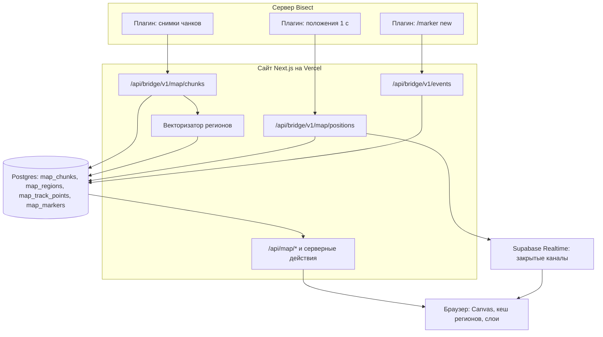
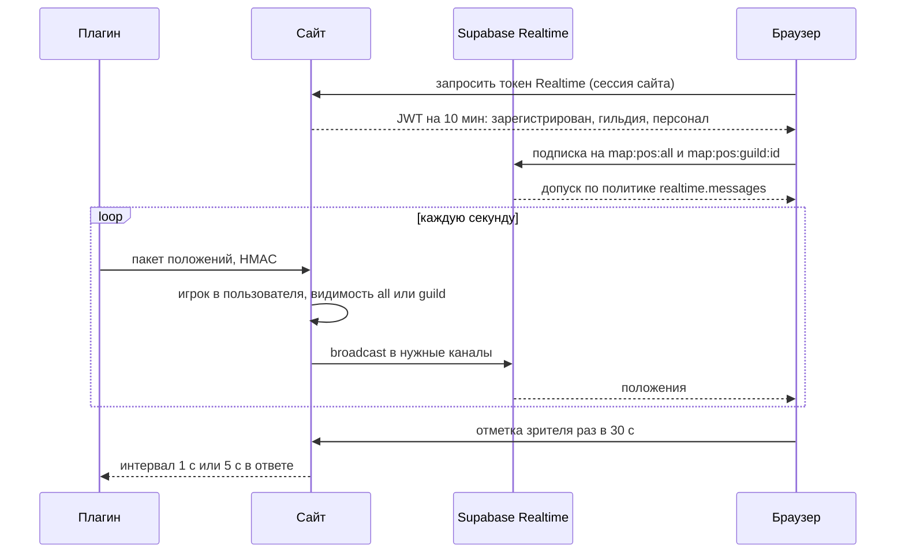
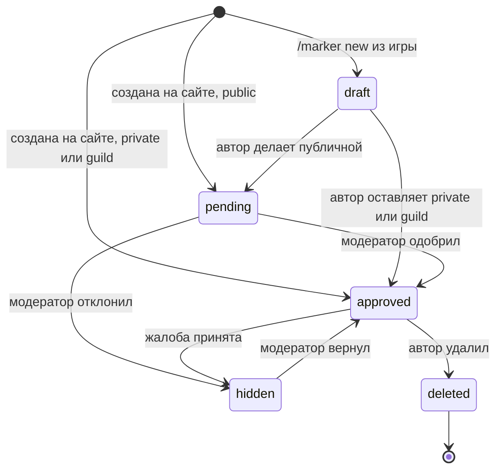

# Карта-атлас MineOrt - Plan

> **Смена визуального направления (22.11.2026, решение владельца).** Карта теперь повторяет мод
> [AtlasMap](https://github.com/erkinpaw/atlasmap) (erkinpaw, MIT) максимально близко: пиксель на блок, цвета
> ванильной карты, тонировка под папирус, оформление в виде текстурных панелей, 8 дизайнов, значки меток,
> список меток, линейка, рисование. Это заменяет прежний стиль «тушь и акварель»: пункты R3, KTD4, KTD12,
> юниты U4 (векторизатор) и U5 в части стиля, набор иконок «в стиле туши» и запрет на иконки из референса
> больше не действуют. Что сделано: кодек чанка версии 2 (высота, глубина воды, цвет карты блока), серверный
> рендер PNG-плиток по алгоритму `ChunkScanner.papyrus()` мода, `/api/map/tile`, новый вид `/map` с темами.
> Что не переносится: мод клиентский (миникарта, горячие клавиши, телепорт, атлас сохранений) — на сайте
> этого нет; метки и рисунки хранятся в базе, а не в файлах клиента. Координаты в интерфейсе игрока по-прежнему
> скрыты (решение D6), их видит администратор. Плагин Paper читает цвет блока через `BlockData.getMapColor()`.

## Goal Capsule

- **Objective.** К релизу 10.12.2026 зарегистрированный игрок открывает `/map` и видит рисованную карту той части мира, где побывало сообщество, видит, где сейчас другие игроки и куда они недавно ходили, и сам дополняет карту метками, скриншотами, путями и маршрутами, которые видят другие по правилам видимости.
- **Means.** Плагин Paper на сервере читает точные данные мира и положения игроков и отправляет их на сайт. Сайт строит из данных векторную рисованную карту и раздаёт живые положения через закрытые каналы Supabase Realtime (KTD2, KTD4, KTD6).
- **Authority.** Решения владельца в [требованиях](../01-product/04-map-atlas-requirements.md) (D1–D12) → этот план → остальной пакет документов. Для карты этот план заменяет OD-16, OD-17, SP-04 и блок 9 [плана MVP](../04-plan/04-mvp-development-plan.md).
- **Stop conditions.** Остановиться и вернуться к владельцу, если: U1 покажет, что сервер Bisect не пускает исходящий HTTPS из плагина; U2 покажет падение TPS ниже 19,5 при 30 игроках; U6 покажет, что проект Supabase не принимает собственный JWT для Realtime.
- **Execution profile.** Один PR. Карта весь срок закрыта флагом `ff_p1c_atlas`, поэтому промежуточные коммиты безопасны. Первый Java-код в репозитории появляется в U1.
- **Who finishes.** Владелец собирает и выкладывает jar плагина на BisectHosting и включает флаг на проде; остальное делает исполнитель.

---

## Product Contract

### Summary

Плагин Paper собирает точные данные мира только там, где побывали игроки, и шлёт живые положения раз в секунду. Сайт превращает данные мира в рисованную карту тушью с плавными берегами, штриховкой воды и значками лесов и гор. Поверх неё — живые точки игроков, недавние пути, метки с иконками и скриншотами, сохранённые пути и маршруты. Из игры метку ставит команда `/marker new`.

### Problem Frame

Карта задумана как ресурс сообщества, который хочется изучать, читать и дополнять, а не как просмотр готового рендера. Готовые движки (BlueMap, Dynmap) дают блочный вид и свой интерфейс, а владельцу нужны свой стиль рисованной карты и плотная связь с игрой. Сейчас `/map` — заглушка за флагом ([src/app/map/page.tsx](../../src/app/map/page.tsx)), Java-плагина в репозитории нет, есть только серверная сторона Bridge. Карта должна войти в релиз целиком, а до 10.12 осталось 18 дней.

### Key Decisions

- **Свой плагин и свой рисунок карты.** Governs R1, R2, R21. (session-settled: user-directed — chosen over BlueMap/Dynmap даже как источника тайлов: нужен свой стиль и свой интерфейс)
- **Стиль рисованной карты без кубов.** Governs R3. (session-settled: user-directed — chosen over блочного вида Minecraft: карта должна выглядеть как карта местности, нарисованная человеком)
- **Карта открывается по мере исследования.** Governs R1. (session-settled: user-directed — chosen over показа всего сгенерированного мира: исследование само мотивирует)
- **Точность и отклик важнее сложности разработки.** Governs R2, R4, R6. (session-settled: user-directed — chosen over упрощённого рендера: «минимальная погрешность, лучший отклик»)
- **Живые положения точные.** Governs R6, R8. (session-settled: user-directed — chosen over огрубления до ориентиров: положение должно быть таким, как есть)
- **Координаты числами игрокам не показываются; администратор видит.** Governs R8, R9.
- **Видимость положения: всем (по умолчанию) или только гильдии; скрыть нельзя; гости не видят.** Governs R7.
- **Чужие пути сглажены, с задержкой и за окно.** Governs R10. (session-settled: user-approved — задержка 2 мин и окно 30 мин предложены командой, владелец принял как стартовые)
- **Свой путь за 5 минут сохраняется как метка-путь; маршрут А → Б рисуется отдельным инструментом.** Governs R14, R15.
- **Ориентиры — подписи администратора и метки игроков.** Governs R17. (session-settled: user-approved — chosen over автораспознавания поселений)
- **Карта целиком в релизе 10.12.** Governs all. (session-settled: user-directed — chosen over базовой карты к релизу и остального позже)
- **Риск извлечения координат принят.** Governs R8. Точная точка требует точных чисел в браузере; защита — только интерфейсная ([требования, раздел 4](../01-product/04-map-atlas-requirements.md)).

### Requirements

**Мир и рисунок**

- R1. Карта показывает только исследованные чанки: чанк считается исследованным, когда игрок оказался в пределах 3 чанков от него. Остальное — чистый пергамент с рисованной кромкой.
- R2. Геометрия берётся из точных данных мира по каждому столбцу блоков: береговые линии, реки, рельеф, леса, застройка, тропы. Сглаживание не сдвигает объект больше чем на 1 блок.
- R3. Стиль — тушь на пергаменте с мягкой акварельной заливкой: плавные контуры, штриховка воды, значки деревьев и гор, рукописные подписи, рамка и роза ветров. Блочной сетки и пикселей нет.
- R4. Изменения мира появляются на карте не позже чем через 60 секунд после того, как чанк изменился и был сохранён плагином.
- R5. Измерения: Overworld и Nether (OD-21). Переключатель измерения на карте.

**Живые положения**

- R6. Зарегистрированные участники видят точные положения игроков в сети с задержкой не больше 2 секунд (p95).
- R7. Игрок выбирает в профиле видимость положения: «всем участникам» (по умолчанию) или «только гильдии». Скрыть полностью нельзя. Гости положений не видят. Игрок без гильдии с настройкой «только гильдии» виден администраторам и модераторам с подтверждённым TOTP.
- R8. В интерфейсе игрока нет числовых координат: ни у точек игроков, ни у курсора, ни у меток, ни у маршрутов. Линейка и длина маршрута показывают расстояние в блоках.
- R9. Администратор в режиме администрирования видит координаты курсора, игроков и меток.

**Пути**

- R10. Чужие пути показываются сглаженными линиями за окно «от 32 до 2 минут назад»; свой путь — за последние 30 минут без задержки. Видимость путей совпадает с видимостью положения (R7).

**Метки**

- R11. Метку можно поставить с сайта (клик по карте) и из игры командой `/marker new <название>`. У метки: иконка из набора, цвет, название, описание, категория, измерение, автор, дата, связь с гильдией или событием.
- R12. К метке прикрепляются скриншоты (до 5) через существующий конвейер медиа: проверка, WebP, без EXIF.
- R13. Видимость метки: public / guild / private. Метка и её координаты не уходят тому, кто не имеет права её видеть.
- R14. Игрок может сохранить свой путь за последние 5 минут как метку-путь с названием и описанием.
- R15. Игрок может нарисовать маршрут от точки А до точки Б с промежуточными точками, отредактировать его и увидеть длину.
- R16. Список меток: поиск по названию и описанию, сортировка, фильтр по категории, автору, гильдии и типу, скрытие метки или категории для себя.
- R17. Администратор ставит подписи-ориентиры (названия мест); подписи и названия публичных меток рисуются рукописным шрифтом.

**Модерация**

- R18. На метку можно пожаловаться; модератор скрывает метку и её скриншоты. Публичные метки проходят премодерацию: автор видит метку сразу, остальные — после одобрения.

**Плагин и надёжность**

- R19. Плагин — один jar на BisectHosting, подключается к сайту через существующий протокол Bridge (HMAC). Если сайт недоступен или карта выключена, игра продолжает работать без задержек.
- R20. Плагин не уводит TPS сервера ниже 19,5 при 30 игроках в сети.
- R21. Из игры `/marker new` создаёт черновик private-метки (OD-20) и отвечает игроку ссылкой на неё на сайте.

### Success Criteria

- На тестовом стенде с 30 игроками: положения доходят до браузера за ≤ 2 с (p95), карта прокручивается и масштабируется без рывков (≥ 50 кадров в секунду на среднем ноутбуке), TPS ≥ 19,5.
- На эталонных чанках-фикстурах векторизатор отклоняется от исходной геометрии не больше чем на 1 блок.
- Игрок, впервые открывший карту, без подсказок находит своё положение, ставит метку, прикрепляет скриншот и видит её в списке.

### Scope Boundaries

- Клиентский мод, миникарта в игре, телепорт к метке — не входят (не нужны: карта живёт на сайте).
- Измерение End, территории гильдий — не входят (OD-21).
- Автоматическое распознавание поселений и рек как ориентиров — не входит (решение владельца).
- Огрубление координат для защиты от слежки — не делается: риск принят владельцем.
- Иконки из референса atlasmap не берутся: нужен свой набор в стиле туши. Код atlasmap (Fabric-клиент) не переиспользуется, берутся только идеи взаимодействия.

#### Deferred to Follow-Up Work

- Свободное рисование фигур и ластик, как в референсе (см. Open Questions).
- Цветовые темы оформления карты (в референсе их 8).

### Open Questions

- Сколько хранить сырые точки положений (нужны администратору и для метки-пути)? По умолчанию 7 дней. Не блокирует: значение меняется в одной настройке.
- Открывать ли район спавна заранее, чтобы в день запуска карта не была пустой? По умолчанию нет: карта открывается только игроками (R1).
- Входят ли в релиз линейка и свободное рисование фигур? По умолчанию линейка входит (одна функция в U5), свободное рисование — нет.

### Sources

- Требования и решения владельца: [docs/01-product/04-map-atlas-requirements.md](../01-product/04-map-atlas-requirements.md).
- Референс взаимодействия: https://github.com/erkinpaw/atlasmap (Fabric-мод для 26.3, MIT). Из него: карта дорисовывается по мере исследования, метки с иконками, перекраской, описаниями и скриншотами, список меток с поиском и скрытием, линейка.
- Стиль: три изображения-референса от владельца 22.11.2026 (тушь с штриховкой, островная карта с розой ветров, акварельная иллюстрированная карта).
- Paper 26.3, сборка 249 STABLE, Java 25 — проверено 14.11.2026 ([OD-22](../00-analysis/03-open-decisions.md)).
- Supabase Realtime: широковещание с сервера через REST (`/rest/v1/rpc/broadcast`), закрытые каналы с политиками на `realtime.messages`, собственный JWT через импортированный ключ подписи; утверждения в токене не обновляются до его перевыпуска (документация Supabase, context7).

---

## Planning Contract

### Key Technical Decisions

- KTD1. **Плагин — модуль единого плагина `mineort-bridge` в каталоге `plugin/`.** Gradle, JDK 25, Paper API 26.3. Один jar на Bisect, один ключ Bridge и одна реализация подписи HMAC, совместимая с `canonicalRequest` в [src/lib/bridge/auth.ts](../../src/lib/bridge/auth.ts). Будущие функции Bridge (whitelist, игровой вход) добавляются в тот же плагин.
- KTD2. **Мир собирается из снимков чанков в момент события, а не из файлов регионов.** Плагин берёт `ChunkSnapshot` при загрузке исследованного чанка и после изменения блоков (чанк помечается «грязным», отправка — не чаще раза в 10 секунд). Обработка идёт вне главного потока. Для каждого столбца 16×16 хранятся точная высота поверхности, класс поверхности (вода, глубокая вода, песок, трава, лес, снег, камень, тропа, застройка, лава, лёд, пашня и др.), биом и глубина воды. Чанк кодируется компактно и сжимается. Так данные точные и свежие, а сервер не перечитывает диск.
- KTD3. **Исследованность — наличие чанка в БД.** Чанк попадает в БД только когда игрок оказался в пределах 3 чанков (R1). Отдельной таблицы «туман войны» нет.
- KTD4. **Рисунок строится в два этапа: векторизация на сервере, стилизация в браузере.** Векторизатор на сайте собирает регион 512×512 блоков (32×32 чанка) в векторный слой: полигоны воды (marching squares по маске воды на разрешении блока), горизонтали по высоте, области леса и застройки, линии троп, пляжи. Сглаживание ограничено отклонением ≤ 1 блок (R2). Браузер рисует слой тушью и акварелью, раскладывая значки деревьев и гор детерминированно по хэшу координат, чтобы картинка не менялась между загрузками. Векторы дают чёткие линии на любом масштабе, позволяют менять стиль без перерисовки на сервере и весят мало.
- KTD5. **Отрисовка в браузере — Canvas 2D со своей камерой и кешем регионов, без картографической библиотеки.** Регион рисуется в отдельный bitmap для каждой ступени масштаба (в Web Worker через OffscreenCanvas), поверх — слой живых точек, путей и меток. Картографические библиотеки рассчитаны на географические координаты и свой стиль, а рисованные значки и штриховка требуют полного контроля. Если на стенде не будет 50 кадров в секунду, тот же кеш регионов переносится на WebGL-слой.
- KTD6. **Живые положения идут по пути «плагин → сайт → Supabase Realtime → браузер».** Плагин раз в секунду отправляет пакет положений на `/api/bridge/v1/map/positions` (HMAC). Сайт сопоставляет игроков с пользователями, делит их по видимости (R7) и рассылает через REST-широковещание в закрытые каналы: `map:pos:all`, `map:pos:guild:<id>`, `map:pos:admin`. Браузер подключается с собственным JWT на 10 минут, который выпускает сайт; политика на `realtime.messages` пускает в канал по утверждениям токена (зарегистрирован, гильдия, активная сессия персонала с TOTP). Ключ Supabase остаётся только на сайте, а фильтрация видимости — на сервере.
- KTD7. **Плагин замедляется, когда карту никто не смотрит.** Браузер с открытой картой раз в 30 секунд отмечается на сайте. Если зрителей нет больше минуты, ответ сайта велит плагину слать положения раз в 5 секунд вместо 1 секунды. Это снижает число вызовов функций Vercel и сохраняет пятисекундный шаг записи путей.
- KTD8. **Точки путей хранятся с прореживанием.** Сайт сохраняет точку, если игрок сместился на 2 блока или прошло 5 секунд. Хранение — 7 дней (Open Question), очистка — существующим механизмом cron. Чужие пути отдаются через `/api/map/trails` за окно R10 после упрощения (Дуглас — Пейкер, ε = 0,5 блока); сглаживание сплайном — в браузере.
- KTD9. **Метки, пути и маршруты — одна таблица `map_markers` с полем `kind` (`point`, `path`, `route`, `label`).** Для `path` и `route` хранится полилиния. Доступ — через серверные действия, RLS закрыта по умолчанию, как во всём проекте. Скриншоты — существующие `media` и `media_attachments` с `target_type = 'marker'` (уже разрешено в схеме). Жалобы — существующие `moderation_reports`, к которым добавляется тип `marker`.
- KTD10. **`/marker new` использует уже принятое событие `marker.create_requested`.** Плагин сам выдаёт UUID метки и сразу отвечает игроку ссылкой `/map/m/<id>`. Сайт превращает событие в черновик private-метки, а ссылка начинает работать после обработки события.
- KTD11. **Координаты для игроков существуют только внутри отрисовки.** Интерфейс игрока не выводит чисел (R8); числа выводятся только в режиме администратора, включённом сессией персонала с TOTP, по образцу [src/app/admin/step-up](../../src/app/admin/step-up).
- KTD12. **Набор иконок — свой, в стиле туши, SVG.** Около 60 иконок по категориям, перекраска одним цветом из палитры. Так иконки совпадают со стилем карты, и нет зависимости от чужих ресурсов.

### High-Level Technical Design

Компоненты и потоки данных:



Живые положения и доступ к каналу:



Жизнь метки:



### Assumptions

- Исходящий HTTPS из плагина на BisectHosting разрешён (R-16 в реестре рисков). Проверяется в U1.
- Проект Supabase принимает собственный JWT для Realtime через импортированный ключ подписи. Проверяется первым шагом U6.
- План Vercel выдерживает около 2,6 млн вызовов в месяц при постоянных зрителях; KTD7 снижает это число, когда карту не смотрят.

### Output Structure

```text
plugin/                       Gradle-проект mineort-bridge (JDK 25, Paper 26.3)
  src/main/java/.../bridge/   клиент Bridge: подпись, отправка, конфиг
  src/main/java/.../map/      снимки чанков, кодирование, положения, /marker
  src/test/java/...           тесты кодирования и классификации
src/lib/map/                  кодек чанков, векторизатор, пути, видимость, токен Realtime
src/app/api/bridge/v1/map/    приём чанков и положений от плагина
src/app/api/map/              регионы, пути, токен, отметка зрителя
src/app/map/                  страница карты и карточка метки
src/components/map/           камера, отрисовка, слои, инструменты, список меток
public/map/icons/             набор иконок в стиле туши
supabase/migrations/          таблицы карты и политики Realtime
```

---

## Implementation Units

| U-ID | Название | Основные файлы | Зависит от |
|---|---|---|---|
| U1 | Плагин и клиент Bridge | `plugin/` | — |
| U2 | Снимки чанков в плагине | `plugin/.../map/` | U1 |
| U3 | Схема карты и приём чанков | `supabase/migrations/`, `src/app/api/bridge/v1/map/chunks/` | — |
| U4 | Векторизатор регионов | `src/lib/map/vectorize/` | U3 |
| U5 | Рисованная карта в браузере | `src/app/map/`, `src/components/map/` | U4 |
| U6 | Живые положения | `src/app/api/bridge/v1/map/positions/`, `src/lib/map/realtime.ts` | U1, U3 |
| U7 | Пути | `src/lib/map/trails.ts`, `src/app/api/map/trails/` | U6 |
| U8 | Метки, список, ориентиры, модерация | `src/app/actions/map.ts`, `src/components/map/markers/` | U3, U5 |
| U9 | Скриншоты к меткам | `src/components/map/markers/`, `src/lib/social/media.ts` | U8 |
| U10 | Метка-путь и маршрут | `src/components/map/tools/` | U7, U8 |
| U11 | `/marker new` из игры | `plugin/.../map/MarkerCommand`, `src/lib/map/marker-events.ts` | U1, U8 |
| U12 | Приватность, документы, проверка на стенде | `src/app/privacy/`, `docs/` | U1–U11 |

### U1. Плагин и клиент Bridge

- **Goal:** собираемый jar плагина `mineort-bridge`, который подписывает запросы так же, как ждёт сайт, и отправляет heartbeat.
- **Requirements:** R19; KTD1.
- **Dependencies:** нет. На машине разработчика нужен JDK 25 (сейчас Java не установлена).
- **Files:** `plugin/settings.gradle`, `plugin/build.gradle`, `plugin/src/main/resources/plugin.yml`, `plugin/src/main/java/.../bridge/BridgeClient.java`, `plugin/src/main/java/.../bridge/Signer.java`, `plugin/src/test/java/.../bridge/SignerTest.java`, `.github/workflows/ci.yml` (сборка и тесты плагина).
- **Approach:**
  1. Gradle-проект с обёрткой, Paper API 26.3, JDK 25.
  2. Подпись: канонический запрос `METHOD\nPATH\nTS\nNONCE\nsha256(body)` и HMAC-SHA256, как в `src/lib/bridge/auth.ts`; поправка часов по `server_time` из ответа.
  3. Асинхронная отправка через `java.net.http.HttpClient` с очередью и ограничением; главный поток не ждёт сети.
  4. Конфиг: адрес сайта, `key_id`, секрет, выключатель карты.
- **Execution note:** первым делом поднять плагин на локальном Paper 26.3 и проверить heartbeat против staging; затем то же на Bisect (исходящий HTTPS).
- **Patterns to follow:** серверная сторона подписи в `src/lib/bridge/auth.ts`, тест-векторы в `src/lib/bridge/bridge.test.ts`.
- **Test scenarios:**
  - Подпись на эталонном запросе совпадает с тест-вектором, который выдаёт `canonicalRequest` + `hmacHex` на стороне сайта.
  - Тело с кириллицей подписывается одинаково на обеих сторонах.
  - Сайт недоступен: вызов heartbeat не блокирует главный поток, ошибка пишется в лог один раз в минуту.
  - Ответ `ERR_TS_SKEW` с `server_time`: следующий запрос проходит с поправленным временем.
- **Verification:** heartbeat с локального Paper и с Bisect принят staging-сервером; CI собирает jar и прогоняет тесты плагина.

### U2. Снимки чанков в плагине

- **Goal:** плагин отправляет точные данные исследованных чанков и их изменения.
- **Requirements:** R1, R2, R4, R5, R20; KTD2, KTD3.
- **Dependencies:** U1.
- **Files:** `plugin/src/main/java/.../map/ChunkCapture.java`, `.../map/SurfaceClassifier.java`, `.../map/ChunkCodec.java`, `.../map/ExploredTracker.java`, `plugin/src/test/java/.../map/SurfaceClassifierTest.java`, `.../map/ChunkCodecTest.java`.
- **Approach:**
  1. Отслеживать чанки в радиусе 3 от каждого игрока; новый чанк из этой зоны — исследованный.
  2. Снимок `ChunkSnapshot` на главном потоке, классификация и кодирование — в рабочем потоке.
  3. Изменения блоков, взрывы, рост деревьев помечают чанк грязным; отправка грязных — не чаще раза в 10 секунд пакетами до 50 чанков.
  4. В формат чанка входит версия кодека, чтобы сайт мог отказаться от старого формата.
- **Execution note:** замерить время на главном потоке при 30 ботах на стенде до того, как подключать отправку.
- **Patterns to follow:** клиент из U1.
- **Test scenarios:**
  - Столбец с водой глубиной 5 над песком кодируется как глубокая вода с глубиной 5 и высотой дна.
  - Листва над травой даёт класс «лес», а не «трава».
  - Тропа (`dirt_path`) и гравий на поверхности дают класс «тропа».
  - Кодирование и раскодирование чанка возвращает те же высоты по всем 256 столбцам.
  - Чанк за пределами радиуса 3 от игроков не отправляется.
  - 100 изменений блоков в одном чанке за 5 секунд дают одну отправку.
- **Verification:** на стенде данные исследованных чанков приходят на сайт; TPS ≥ 19,5 при 30 ботах.

### U3. Схема карты и приём чанков

- **Goal:** таблицы карты и защищённый приём чанков от плагина.
- **Requirements:** R1, R2, R4, R13, R18, R19; KTD3, KTD8, KTD9.
- **Dependencies:** нет (параллельно с U1).
- **Files:** `supabase/migrations/20261122000001_map.sql`, `src/app/api/bridge/v1/map/chunks/route.ts`, `src/lib/map/chunk-codec.ts`, `src/lib/map/chunk-codec.test.ts`, `tests/map-ingest.int.test.ts`, `tests/rls-direct-access.int.test.ts` (новые таблицы).
- **Approach:**
  1. Таблицы: `map_chunks` (сервер, измерение, координаты чанка, данные, версия), `map_regions` (векторный слой региона, версия, `dirty`), `map_track_points`, `map_markers`, `map_watchers`; в `privacy_settings` — поле видимости положения (`all` по умолчанию, `guild`); в `moderation_reports.target_type` — `marker`.
  2. RLS закрыта для `anon` и `authenticated`, доступ — через сервер, как в существующих миграциях.
  3. Приём: проверка HMAC через `authenticateBridge`, разбор кодека, upsert по (сервер, измерение, чанк) только если версия новее, отметка региона грязным.
- **Patterns to follow:** `src/app/api/bridge/v1/events/route.ts`, `supabase/migrations/20261114000014_guilds_players.sql` (закрытая RLS и `revoke`).
- **Test scenarios:**
  - Пакет из 50 чанков с верной подписью сохраняется, регионы помечаются грязными.
  - Повтор того же пакета не создаёт дублей и не меняет `updated_at`.
  - Старая версия чанка после новой не перезаписывает данные.
  - Неверная подпись — 401, ничего не записано.
  - Неизвестная версия кодека — пакет отклонён с понятным кодом.
  - Прямой запрос `anon` и `authenticated` к любой таблице карты отклоняется.
- **Verification:** интеграционные тесты против staging проходят; данные из U2 видны в `map_chunks`.

### U4. Векторизатор регионов

- **Goal:** из чанков региона получается векторный слой с точностью ≤ 1 блок.
- **Requirements:** R2, R4; KTD4.
- **Dependencies:** U3.
- **Files:** `src/lib/map/vectorize/index.ts`, `.../water.ts`, `.../contours.ts`, `.../areas.ts`, `.../paths.ts`, `.../smooth.ts`, `src/lib/map/vectorize/vectorize.test.ts`, `tests/fixtures/map/` (эталонные чанки), `src/app/api/cron/map-vectorize/route.ts`, `vercel.json`.
- **Approach:**
  1. Маска воды, горизонтали (шаг 8 блоков), области леса, застройки, пляжей — marching squares на сетке блоков.
  2. Тропы — скелет маски троп в линии.
  3. Сглаживание Чайкина с проверкой отклонения: если вершина уходит дальше 1 блока от исходного контура, сглаживание на этом участке ослабляется.
  4. Пересчёт грязных регионов сразу после приёма (`after()` в обработчике) и cron раз в минуту как подстраховка.
- **Execution note:** начать с эталонных фикстур и проверки отклонения — это и есть доказательство R2.
- **Test scenarios:**
  - Круглое озеро радиусом 20 блоков даёт один замкнутый полигон, отклонение от маски ≤ 1 блок по всем точкам.
  - Узкая река шириной 2 блока не рвётся и не исчезает при сглаживании.
  - Остров внутри озера даёт дырку в полигоне воды.
  - Регион на краю исследованной зоны не рисует берег на границе тумана.
  - Пустой регион даёт пустой слой без ошибки.
  - Регион с меньшей версией чанков не перезаписывает более свежий слой.
- **Verification:** все фикстуры проходят проверку отклонения; изменение мира на стенде видно в слое региона за ≤ 60 секунд.

### U5. Рисованная карта в браузере

- **Goal:** `/map` показывает исследованный мир в стиле туши и акварели, с плавной прокруткой и масштабом.
- **Requirements:** R1, R3, R5, R8; KTD4, KTD5, KTD11.
- **Dependencies:** U4.
- **Files:** `src/app/map/page.tsx`, `src/app/api/map/regions/route.ts`, `src/components/map/map-view.tsx`, `src/components/map/camera.ts`, `src/components/map/render/style.ts`, `.../render/region-worker.ts`, `.../render/glyphs.ts`, `.../render/fog.ts`, `src/components/map/ruler.tsx`, `src/components/map/camera.test.ts`, `src/components/map/render/glyphs.test.ts`, `e2e/map.spec.ts`.
- **Approach:**
  1. Камера: перетаскивание, колесо и жесты, ступени масштаба, переключатель Overworld и Nether.
  2. Регионы подгружаются по видимой области, рисуются в Worker в bitmap для ступени масштаба и кешируются.
  3. Стиль: пергамент, линии туши переменной толщины, штриховка воды вдоль берега, акварельные заливки, значки деревьев и гор по хэшу координат, рукописный шрифт подписей, рамка и роза ветров.
  4. Туман: неисследованное — чистый пергамент с рисованной кромкой.
  5. Линейка показывает только расстояние (R8).
- **Execution note:** до полировки стиля собрать черновой рисунок одного региона и показать владельцу — это вопрос вкуса, его дешевле поправить рано.
- **Patterns to follow:** флаг `requireFlag("ff_p1c_atlas")`, навигация и шапка из `src/components/layout/`.
- **Test scenarios:**
  - Один и тот же регион при двух загрузках рисует значки деревьев в тех же местах.
  - Масштаб и сдвиг камеры переводят точку экрана в точку мира и обратно без ошибки.
  - Гость, открывший `/map`, видит рисованный мир без слоя игроков.
  - В DOM и подписях страницы игрока нет числовых координат (e2e проверяет текст страницы).
  - Переключение на Nether показывает только исследованные чанки Nether.
  - Пустой мир показывает пергамент и подсказку «карта откроется, когда игроки начнут исследовать».
- **Verification:** на стенде ≥ 50 кадров в секунду при прокрутке на среднем ноутбуке; владелец одобрил стиль на скриншоте.

### U6. Живые положения

- **Goal:** точные положения игроков в браузере с задержкой ≤ 2 секунды и видимостью по настройке.
- **Requirements:** R6, R7, R8, R9; KTD6, KTD7, KTD11.
- **Dependencies:** U1, U3.
- **Files:** `plugin/src/main/java/.../map/PositionSender.java`, `src/app/api/bridge/v1/map/positions/route.ts`, `src/lib/map/visibility.ts`, `src/lib/map/realtime.ts`, `src/app/api/map/realtime-token/route.ts`, `src/app/api/map/watch/route.ts`, `supabase/migrations/20261122000002_map_realtime.sql`, `src/components/map/layers/players.tsx`, `src/components/guilds/privacy-form.tsx`, `src/lib/map/visibility.test.ts`, `tests/map-positions.int.test.ts`.
- **Approach:**
  1. Первым шагом проверить на staging, что Realtime принимает выпущенный сайтом JWT (стоп-условие).
  2. Плагин шлёт все положения раз в секунду или раз в 5 секунд по ответу сайта (KTD7).
  3. Сайт: UUID игрока → пользователь → видимость и гильдия → рассылка в `map:pos:all`, `map:pos:guild:<id>` и всегда в `map:pos:admin`.
  4. Токен Realtime на 10 минут с утверждениями: зарегистрирован, `guild_id`, персонал с TOTP; обновление до истечения.
  5. Политика на `realtime.messages` проверяет тему и утверждения токена.
  6. Настройка видимости положения — в форме приватности профиля.
- **Patterns to follow:** `authenticateBridge` и `bridgeJson`, подпись JWT через `jose` (уже в зависимостях), сессия персонала и TOTP из `src/lib/admin/totp.ts`.
- **Test scenarios:**
  - Игрок с видимостью «всем» попадает в `map:pos:all` и в `map:pos:admin`.
  - Игрок с видимостью «только гильдии» попадает только в канал своей гильдии и в `map:pos:admin`.
  - Игрок «только гильдии» без гильдии попадает только в `map:pos:admin`.
  - Токен участника без гильдии не даёт подписаться на `map:pos:guild:<чужой id>`.
  - Токен без сессии персонала не даёт подписаться на `map:pos:admin`.
  - Гость не получает токен Realtime.
  - Игрок вышел из гильдии: после перевыпуска токена (≤ 10 мин) доступ к каналу гильдии пропадает, а его положение сразу уходит по новой видимости.
  - Нет зрителей больше минуты: ответ сайта задаёт интервал 5 секунд; появился зритель — снова 1 секунда.
  - Пакет положений с неверной подписью отклоняется.
- **Verification:** на стенде задержка от игры до браузера ≤ 2 с (p95); проверка каналов разными ролями проходит.

### U7. Пути

- **Goal:** сглаженные недавние пути игроков на карте.
- **Requirements:** R10; KTD8.
- **Dependencies:** U6.
- **Files:** `src/lib/map/trails.ts`, `src/lib/map/trails.test.ts`, `src/app/api/map/trails/route.ts`, `src/app/api/cron/purge-media/route.ts` (очистка старых точек) или отдельный cron, `src/components/map/layers/trails.tsx`, `tests/map-trails.int.test.ts`.
- **Approach:**
  1. При приёме положений (U6) сохранять точку при смещении ≥ 2 блоков или через 5 секунд.
  2. `/api/map/trails` отдаёт чужие пути за окно 32–2 минуты назад с учётом видимости зрителя и свой путь за 30 минут, упрощённые до ε = 0,5 блока.
  3. Браузер сглаживает линии сплайном и обновляет пути раз в 15 секунд; свой путь дорисовывает из живых положений.
- **Test scenarios:**
  - Игрок стоит на месте 10 минут: хранится одна точка раз в 5 секунд, а не 600.
  - Чужой путь не содержит точек моложе 2 минут и старше 32 минут.
  - Свой путь содержит точки последних секунд.
  - Путь игрока «только гильдии» не отдаётся участнику другой гильдии.
  - Телепорт (скачок больше 100 блоков) разрывает линию, а не рисует отрезок через полмира.
  - Точки старше срока хранения удаляются очисткой.
- **Verification:** на стенде пути видны, обновляются и не тянутся за телепортами.

### U8. Метки, список, ориентиры, модерация

- **Goal:** игроки ставят и читают метки; администратор ставит ориентиры; модератор управляет публичными метками.
- **Requirements:** R11, R13, R16, R17, R18; KTD9, KTD12.
- **Dependencies:** U3, U5.
- **Files:** `src/app/actions/map.ts`, `src/lib/map/markers.ts`, `src/lib/map/markers.test.ts`, `src/app/api/map/markers/route.ts`, `src/components/map/markers/marker-layer.tsx`, `.../marker-card.tsx`, `.../marker-editor.tsx`, `.../marker-list.tsx`, `.../icon-picker.tsx`, `public/map/icons/`, `src/app/map/m/[id]/page.tsx`, `src/app/admin/moderation/` (метки в очереди), `tests/map-markers.int.test.ts`, `e2e/map.spec.ts`.
- **Approach:**
  1. Серверные действия: создать, изменить, удалить (мягко), сменить видимость, пожаловаться.
  2. Выдача меток в видимой области фильтруется на сервере по видимости и статусу модерации (R13, R18).
  3. Карточка метки: иконка, название, описание, автор, дата, гильдия, вложения; ссылка `/map/m/<id>` открывает карту на метке.
  4. Список: поиск, сортировка, фильтры, скрытие метки и категории для себя (хранится в профиле).
  5. Ориентиры — метки `label`, только для администратора, рисуются рукописной подписью.
  6. Публичная метка — `pending` для всех, кроме автора, до одобрения в существующей очереди модерации.
- **Patterns to follow:** серверные действия в `src/app/actions/social.ts`, очередь модерации в `src/app/admin/moderation/`, лимиты частоты из NFR (метки 10 в час, 100 активных на игрока).
- **Test scenarios:**
  - private-метка не попадает в выдачу другому игроку даже по прямому id.
  - guild-метка видна членам гильдии автора и не видна остальным.
  - public-метка видна автору сразу, остальным — после одобрения.
  - Скрытая модератором метка пропадает у всех, кроме модератора.
  - Поиск по слову из описания находит метку; скрытая для себя категория пропадает из слоя и списка.
  - 11-я метка за час получает отказ по лимиту.
  - Игрок не может создать метку `label`.
  - Выдача метки игроку не содержит полей с числовыми координатами в подписях интерфейса; в режиме администратора координаты показаны.
- **Verification:** e2e: поставить метку кликом, выбрать иконку и цвет, найти её в списке, пожаловаться другим игроком, скрыть модератором.

### U9. Скриншоты к меткам

- **Goal:** к метке прикрепляется до 5 скриншотов, они открываются в просмотрщике.
- **Requirements:** R12, R13; KTD9.
- **Dependencies:** U8.
- **Files:** `src/components/map/markers/marker-media.tsx`, `src/lib/social/media.ts` (привязка к метке), `tests/map-markers.int.test.ts`.
- **Approach:** переиспользовать загрузку, нормализацию и подписанные ссылки из `src/lib/social/media.ts` и `src/components/social/image-picker.tsx`; видимость вложения следует видимости метки.
- **Patterns to follow:** галерея (`src/app/social/gallery/`, `gallery-key-nav.tsx`).
- **Test scenarios:**
  - Шестой скриншот отклоняется.
  - Скриншот private-метки не открывается по подписанной ссылке другим игроком.
  - Удаление метки ставит её медиа на очистку через 30 дней (OD-40).
  - Файл не-изображение отклоняется существующей проверкой.
- **Verification:** скриншот прикрепляется из карточки и открывается в просмотрщике.

### U10. Метка-путь и маршрут

- **Goal:** игрок сохраняет свой путь за 5 минут и рисует маршрут А → Б.
- **Requirements:** R14, R15, R8; KTD8, KTD9.
- **Dependencies:** U7, U8.
- **Files:** `src/components/map/tools/save-path.tsx`, `src/components/map/tools/route-tool.tsx`, `src/lib/map/markers.ts`, `src/lib/map/markers.test.ts`.
- **Approach:**
  1. «Сохранить путь»: сервер берёт свои точки за 5 минут, упрощает и создаёт метку `path`.
  2. Маршрут: клики ставят точки, точки перетаскиваются, двойной клик завершает; длина — в блоках; сохраняется как метка `route` с видимостью.
- **Test scenarios:**
  - Метка-путь содержит точки только за последние 5 минут и только своего игрока.
  - Игрок не в сети и без точек за 5 минут получает понятный отказ.
  - Маршрут из 2 точек сохраняется; из 1 точки — нет.
  - Перетаскивание промежуточной точки меняет длину маршрута.
  - Маршрут с видимостью guild не виден вне гильдии.
- **Verification:** e2e: нарисовать маршрут, сохранить, открыть другим игроком гильдии.

### U11. `/marker new` из игры

- **Goal:** игрок ставит метку из игры и сразу получает ссылку на неё.
- **Requirements:** R11, R21; KTD10.
- **Dependencies:** U1, U8.
- **Files:** `plugin/src/main/java/.../map/MarkerCommand.java`, `plugin/src/test/java/.../map/MarkerCommandTest.java`, `src/lib/map/marker-events.ts`, `src/lib/map/marker-events.test.ts`, `src/app/api/bridge/v1/events/route.ts`.
- **Approach:**
  1. Команда проверяет право и кулдаун 30 секунд, берёт точное положение и измерение, выдаёт UUID метки.
  2. Событие `marker.create_requested` уходит существующей очередью событий; игрок сразу получает кликабельную ссылку `/map/m/<id>`.
  3. Сайт превращает событие в черновик private-метки с автором по UUID игрока; страница метки до обработки показывает «метка появится через несколько секунд».
- **Test scenarios:**
  - Повтор того же события не создаёт вторую метку.
  - Игрок без подтверждённой игровой личности получает отказ в игре.
  - Вторая команда раньше 30 секунд получает отказ с оставшимся временем.
  - Название длиннее лимита обрезается в игре с предупреждением.
  - Событие от игрока, не привязанного к пользователю сайта, не создаёт метку и пишется в журнал.
- **Verification:** на стенде команда создаёт черновик, ссылка открывает его на сайте.

### U12. Приватность, документы, проверка на стенде

- **Goal:** игроки знают, что их положение видно; документы пакета не противоречат плану; карта проверена на стенде.
- **Requirements:** R6, R7, R20; принятый риск из требований.
- **Dependencies:** U1–U11.
- **Files:** `src/app/privacy/page.tsx`, `docs/00-analysis/03-open-decisions.md` (OD-16, OD-17, OD-20, OD-47), `docs/04-plan/04-mvp-development-plan.md` (блок 9 ссылается на этот план), `docs/03-architecture/04-nfr-security.md` (правило о координатах).
- **Approach:**
  1. На странице приватности и в форме настройки: положение видно участникам в реальном времени; можно ограничить гильдией; полностью скрыть нельзя.
  2. Отметить в документах, что карта строится по этому плану, без переписывания истории.
  3. Прогон на стенде: 30 ботов, замер TPS, задержки положений, кадров в браузере.
- **Test expectation:** none -- тексты и документы; проверка стенда — ручной протокол с цифрами.
- **Verification:** протокол стенда приложен к PR и показывает выполнение Success Criteria.

---

## Verification Contract

| Проверка | Команда или способ | Когда |
|---|---|---|
| Типы, линт, формат, юнит-тесты сайта | `npm run check` | каждый юнит с кодом сайта |
| Интеграционные тесты (staging БД) | `npm run test` (файлы `tests/*.int.test.ts`) | U3, U6–U11 |
| E2E карты | `npm run test:e2e` (`e2e/map.spec.ts`) | U5, U8, U10 |
| Плагин: сборка и тесты | `./gradlew build` в `plugin/` (и в CI) | U1, U2, U6, U11 |
| Точность векторизатора | фикстуры `tests/fixtures/map/`, отклонение ≤ 1 блок | U4 |
| Стенд Paper 26.3 с 30 ботами | ручной протокол: TPS ≥ 19,5, задержка положений ≤ 2 с p95, ≥ 50 кадров в секунду | U2, U6, U12 |
| Проверка в браузере | Playwright MCP по `/map` при включённом `ff_p1c_atlas` | U5, U8, U10 |

---

## Definition of Done

- Все R1–R21 выполнены и проверены тестами или протоколом стенда.
- `npm run check`, интеграционные тесты, e2e и сборка плагина зелёные.
- Протокол стенда подтверждает Success Criteria.
- Владелец одобрил стиль карты на скриншоте.
- jar плагина собран; инструкция по установке на Bisect лежит рядом с плагином.
- Флаг `ff_p1c_atlas` остаётся выключенным на проде до решения владельца.
- Брошенный экспериментальный код (неудачные варианты рендера, отладочные слои) удалён из диффа.

---

## Risks

| Риск | Что делаем |
|---|---|
| 18 дней на весь объём при одном основном потоке | Порядок юнитов даёт рабочую карту рано: U1–U5 — мир, U6–U7 — люди, U8–U11 — метки. Каждый следующий слой добавляется поверх работающего. |
| На машине нет Java, плагина в репозитории ещё нет | U1 начинается с установки JDK 25 (с разрешения владельца) и проверки сборки. |
| Bisect не пускает исходящий HTTPS | Проверка в U1 — стоп-условие. |
| Проект Supabase не принимает свой JWT для Realtime | Проверка первым шагом U6 — стоп-условие; запасной путь — поток событий с сайта (SSE), он упирается в лимиты Vercel на длинные соединения. |
| Лимиты вызовов Vercel при 1 вызове в секунду | KTD7 снижает частоту без зрителей; план Vercel проверить до релиза. |
| Координаты можно извлечь из браузера | Риск принят владельцем; смягчения перечислены в требованиях, раздел 4. |
| Карта пуста в день запуска | Открытый вопрос о раскрытии спавна. |
